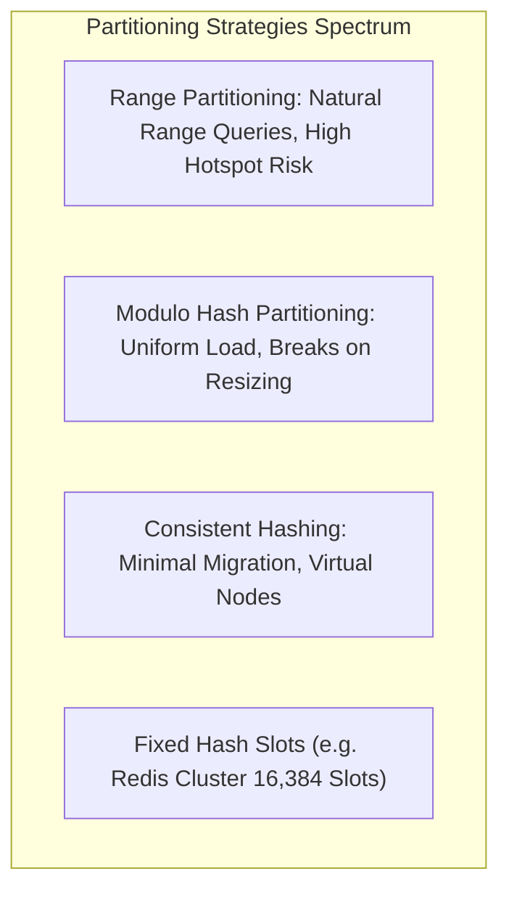
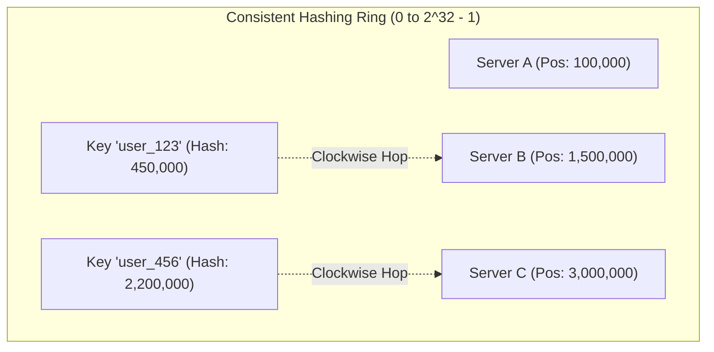
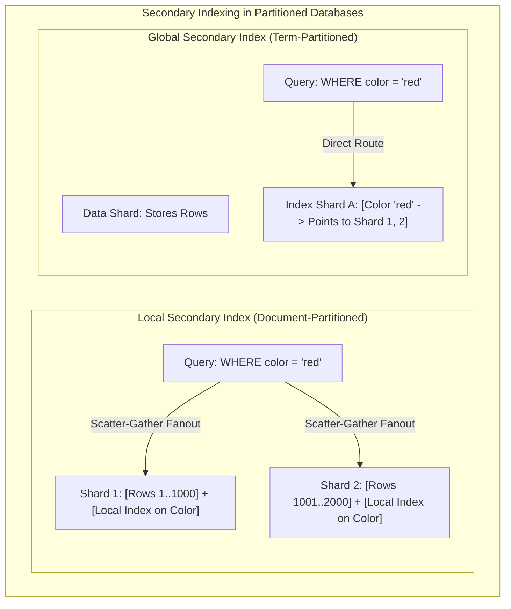
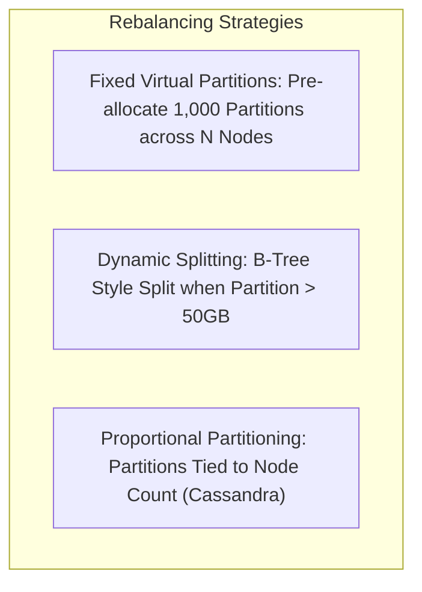
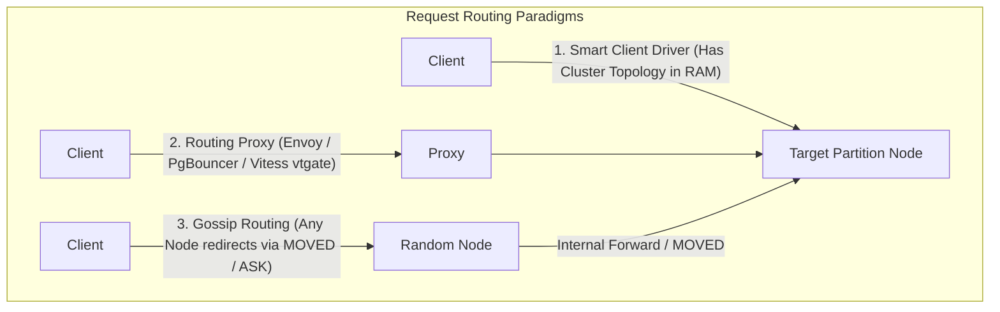

# Module 08: Partitioning, Sharding, and Distributed Request Routing

When a dataset expands beyond the storage capacity of a single physical server, or when query throughput saturates the network bandwidth and CPU cores of the largest available vertical hardware instance, data systems must partition their data. **Partitioning** (traditionally termed **sharding**) divides a massive monolithic database into smaller, independent subsets called partitions or shards. Each partition acts as a self-contained unit that can be hosted on a distinct physical node, enabling linear horizontal scalability.

---

## 1. Partitioning Strategies: Range, Hash, and Consistent Hashing

The choice of partitioning algorithm fundamentally dictates whether the database can evaluate range queries efficiently, and whether write traffic is evenly distributed across cluster nodes.

### 1. Range Partitioning
- **Mechanics**: Keys are sorted, and partitions are assigned contiguous ranges between boundaries:
  - Partition 1: $[\text{"A"}, \text{"G"})$
  - Partition 2: $[\text{"G"}, \text{"P"})$
  - Partition 3: $[\text{"P"}, \text{"Z"}]$
- **Strengths**: Range scans (`WHERE key BETWEEN 'H' AND 'K'`) route directly to a single partition, executing in $O(\log N)$ time.
- **The Hot Spot Failure Mode**: If the partition key is monotonic (such as a timestamp `created_at`), all write operations for the current second hit the exact same single partition (the latest time slice), while all past partition servers sit completely idle.

### 2. Modulo Hash Partitioning
- **Mechanics**: Evaluates partition key $k$ through a deterministic hash function (e.g. MurmurHash3, MD5) modulo the total number of physical nodes $N$:

$$\text{Node}(k) = \text{hash}(k) \pmod N$$

- **Strengths**: Destroys natural clustering, scattering monotonic timestamps uniformly across all $N$ nodes.
- **The Resizing Catastrophe**: If cluster capacity grows from $N$ to $N + 1$ nodes, almost every key in the database hashes to a completely different node ($\text{hash}(k) \bmod N \ne \text{hash}(k) \bmod (N+1)$). Adding a single server forces a massive, cluster-wide reshuffling of almost $100\%$ of all records.

### 3. Consistent Hashing (Karger et al., 1997)
Consistent Hashing decouples the hash space from the number of physical nodes by mapping both keys and servers to an abstract circular ring:

- **Ring Mechanics**: The hash space ranges from $0$ to $2^{32} - 1$. Both server node identifiers and data keys are hashed onto this 32-bit ring. A key is assigned to the first server encountered by moving clockwise around the ring.
- **Minimal Rebalancing Invariant**: When a new node is added or an old node is removed, only keys located between that node and its predecessor are migrated. On average, adding a node moves only:

$$\text{Fraction of Migrated Keys} = \frac{1}{N}$$

- **Virtual Nodes (Vnodes)**: If a cluster contains only 3 physical nodes, random hash placement can assign $70\%$ of the ring to a single node. Consistent hashing solves this by assigning each physical machine $V$ "virtual nodes" (e.g., $V = 256$ points on the ring per physical machine), guaranteeing uniform statistical balance.

---

## 2. Secondary Indexes in Partitioned Databases: Local versus Global

While partitioning by primary key is straightforward, indexing non-partition attributes introduces profound architectural trade-offs:

### 1. Document-Partitioned (Local Secondary Indexes)
- **Structure**: Each shard maintains secondary indexes covering *strictly the subset of records* stored locally on that shard.
- **Write Path (Fast & Local)**: Updating a row requires modifying the heap and the secondary index on the *same physical machine*, requiring zero inter-node distributed transactions.
- **Read Path (The Scatter-Gather Penalty)**: If a query filters on a secondary attribute (`WHERE color = 'red'`) without specifying the partition key, the coordinator must execute a **Scatter-Gather query**: it sends the query to **every single shard in the cluster**, waits for all nodes to reply, and merges the results.
- **The Tail Latency Amplification Problem**: If a cluster has $N = 100$ shards and each shard has a 99th-percentile latency of $p = 0.99$, the probability that a scatter-gather query hits at least one slow node is:

$$P(\text{Stall}) = 1 - (0.99)^{100} = 1 - 0.366 = 63.4\%$$

A majority of client queries will experience the 99th-percentile tail latency! (Default in Elasticsearch and MongoDB).

### 2. Term-Partitioned (Global Secondary Indexes)
- **Structure**: The secondary index is partitioned globally across the cluster, partitioned by the indexed attribute value itself.
- **Read Path (Fast & Direct)**: A query for `WHERE color = 'red'` routes directly to the single shard responsible for the term `'red'`. Zero scatter-gather fanout.
- **Write Path (Distributed & Heavy)**: Inserting a single row requires updating the primary record on Shard 1 and sending a remote network call to update the secondary index entry on Shard 2. To avoid blocking, modern distributed databases (e.g. DynamoDB GSI) update global secondary indexes **asynchronously**, sacrificing read-your-writes consistency.

---

## 3. Rebalancing Strategies and Partition Resizing

As storage volume grows or cluster nodes are added and removed, partitions must be migrated across physical hardware without taking the database offline.

1. **Fixed Number of Partitions (Virtual Buckets)**:
   - The database pre-allocates a fixed number of logical partitions far exceeding the number of physical nodes (e.g. Redis Cluster pre-allocates exactly $16,384$ hash slots; Couchbase pre-allocates $1,024$ vBuckets).
   - If the cluster starts with 5 nodes, each node owns $\sim 3,276$ slots. When a 6th node is added, it claims a few hundred slots from each existing node without altering hash assignments.
2. **Dynamic Splitting (Range-Based)**:
   - Used by Bigtable, HBase, and CockroachDB. When a partition's size exceeds a threshold (e.g. 64MB or 4GB), it is split into two halves at the median key, and one half is migrated to an under-utilized node.

---

## 4. Request Routing Architectures

When a client application issues an SQL or key-value query, how does the network packet find the specific physical node holding that key?

1. **Smart Client**: The client application library maintains a local, cached copy of the cluster partition map. When `get("user_123")` is called, the client computes the hash locally and establishes a direct TCP socket to the target node. (Fastest; requires intelligent client SDKs).
2. **Routing Proxy Tier**: Clients connect to dumb load-balancing proxies (e.g. Vitess `vtgate`, HAProxy). The proxy layer inspects the query key, resolves the partition map, and forwards requests to the correct backend.
3. **P2P Node Gossip with Redirection**: Clients connect to any arbitrary node. If that node does not own the key, it either internally forwards the request, or returns a redirection response (`MOVED <slot> <ip:port>` in Redis Cluster), prompting the client to retry against the target server.

---

## 5. Then vs Now: Sharding and Partitioning Evolution

| Dimension | Classical Era (1990–2000s) | Intermediate Wave (2010s) | Modern Distributed State-of-the-Art (2020s–Present) |
| :--- | :--- | :--- | :--- |
| **Sharding Responsibility**| Application layer (custom application routing scripts) | Coarse NoSQL partitioning (MongoDB, Cassandra) | Transparent Declarative Distributed SQL (Spanner, CockroachDB) |
| **Cross-Shard Transactions** | Forbidden or manually coordinated via complex 2PC | Eventual consistency only; single-row transactions | Distributed ACID with TrueTime / Hybrid Logical Clocks (HLC) |
| **Secondary Indexes** | Avoided; all queries forced to use primary shard key | Scatter-gather local secondary indexes only | Asynchronous Global Secondary Indexes (GSI) with CDC pipelines |
| **Rebalancing Overhead** | Manual off-peak dump-and-reload procedures | Network-saturating rebalances with severe write stalls | Throttled background chunk streaming with zero client downtime |

---

## 6. Production Failure Modes and Anti-Patterns

### 1. Celebrity / Hot-Key Partition Saturation
- **Symptom**: One database node runs at $100\%$ CPU and saturates its network interface, while 99 other nodes in the cluster sit idle.
- **Root Cause**: A single partition key (e.g. a social media influencer with 50,000,000 followers, or a retailer's "Black Friday" SKU) receives millions of operations per second. Because hash partitioning maps all operations for that key to the same shard, hashing does not solve key skew.
- **Mitigation**: Implement **Salting**: append a random 2-digit integer suffix to the key during write (`sku_1234_01` to `sku_1234_10`), spreading writes across 10 shards. Reads must query all 10 salted shards and aggregate.

### 2. Tail Latency Meltdown via Unbounded Scatter-Gather Fanout
- **Symptom**: System-wide P99.9 latency explodes from $5\text{ ms}$ to $800\text{ ms}$ under modest traffic growth.
- **Root Cause**: Microservices issue high-frequency queries that omit the partition key on a table with 200 document-partitioned shards. Every single request broadcasts to all 200 nodes. A transient network hiccup or garbage collection pause on *any single node* delays the entire user request.
- **Mitigation**: Require the partition key in all high-frequency API contracts; maintain Global Secondary Indexes; apply speculative duplicate requests (hedged requests) to bypass slow tails.

### 3. Cross-Shard Distributed Transaction Deadlocks
- **Symptom**: High transaction abort rates and connection spikes under distributed transactions spanning multiple shards.
- **Root Cause**: Transactions acquiring distributed locks across distinct shards in non-uniform order ($T_1$ locks Shard A then Shard B; $T_2$ locks Shard B then Shard A).
- **Mitigation**: Enforce global strict ordering on shard lock acquisition (sort shard IDs before locking) or design data models to keep transactions strictly within a single partition boundary.

---

## 7. Interview Drill

<strong>Q1: Why does simple modulo hashing (`hash(key) % N`) cause severe operational failure when scaling a database cluster, and how does Consistent Hashing solve it?</strong>

**Answer:** 
Under simple modulo hashing, the node assignment for key $k$ is determined by $\text{hash}(k) \bmod N$. If cluster capacity is altered by adding or removing a single node ($N \to N + 1$), almost every key in the database hashes to a completely different result because the divisor changes:

$$\text{hash}(k) \pmod N \ne \text{hash}(k) \pmod{N+1}$$

Consequently, scaling a 10-node cluster to 11 nodes forces a catastrophic rebalancing event that migrates approximately $\frac{N}{N+1} \approx 91\%$ of all records across the network, saturating I/O and causing severe downtime.

**Consistent Hashing** resolves this by mapping both nodes and keys to an independent, fixed circular ring (e.g. $0$ to $2^{32}-1$). A key is assigned to the next node encountered moving clockwise. When a node is added or removed, only the keys belonging to the immediate adjacent segment of the ring are moved. On average, only $\frac{1}{N}$ of the total database keys are migrated, allowing seamless horizontal scaling.

<strong>Q2: Compare the read and write trade-offs of Local Secondary Indexes (document-partitioned) versus Global Secondary Indexes (term-partitioned).</strong>

**Answer:** 
- **Local Secondary Indexes (Document-Partitioned)**:
  - *Write Path*: Highly efficient. The secondary index is stored on the same shard as the row. An insert or update is completely local to that single machine, requiring zero distributed transactions.
  - *Read Path*: Terrible for non-partition queries. If a query filters on a secondary attribute without specifying the partition key, the coordinator must execute a **Scatter-Gather query**, fanning out to every single shard in the cluster and aggregating results.
- **Global Secondary Indexes (Term-Partitioned)**:
  - *Read Path*: Highly efficient. The secondary index is partitioned by the index attribute itself. A query routes directly to the single shard responsible for that indexed value.
  - *Write Path*: Heavy and distributed. Inserting a row requires writing to the primary shard and issuing a network call to update the index on a remote shard, requiring either expensive distributed 2PC or asynchronous eventual consistency.

<strong>Q3: Explain the "Scatter-Gather Tail Latency Amplification" phenomenon and formulate its mathematical probability.</strong>

**Answer:** 
When a query omits the partition key in a document-partitioned database, the coordinator must fan out the request to all $N$ shards and wait for the slowest response before returning.

If each independent shard has a probability $p$ of completing within a normal latency threshold (e.g. $p = 0.99$ for the 99th percentile), the probability that *all* $N$ shards respond within that threshold is $p^N$. Conversely, the probability that **at least one shard encounters a tail-latency stall** is:

$$P(\text{Slow Response}) = 1 - p^N$$

For a 100-shard cluster with $p = 0.99$:

$$P(\text{Slow Response}) = 1 - (0.99)^{100} \approx 63.4\%$$

Even though every individual node performs well $99\%$ of the time, nearly two-thirds ($63.4\%$) of all scatter-gather user queries will experience the 99th-percentile tail latency.

<strong>Q4: What is the purpose of Virtual Nodes (Vnodes) in a Consistent Hashing architecture?</strong>

**Answer:** 
Without virtual nodes, physical servers are mapped to a single point on the consistent hashing ring. Due to the stochastic nature of hashing, three physical nodes can easily be placed close together, leaving one node responsible for $70\%$ of the ring while the others receive almost no traffic (severe load imbalance).

**Virtual Nodes** solve this by assigning each physical machine $V$ distinct points across the ring (e.g. $V = 128$ or $256$). This ensures that:
1. Ownership of the hash ring is uniformly distributed across physical machines according to the law of large numbers.
2. Heterogeneous hardware can be accommodated: a powerful server with double the RAM and CPU can be assigned $2\times$ as many virtual nodes.
3. When a physical machine fails, its load is evenly dispersed across *all* surviving cluster nodes rather than overwhelming its single immediate clockwise neighbor.

<strong>Q5: How does Redis Cluster route client requests across its 16,384 hash slots, and how do client redirections (`MOVED` vs `ASK`) work?</strong>

**Answer:** 
Redis Cluster divides its keyspace into exactly 16,384 logical **Hash Slots**:

$$\text{Slot} = \text{CRC16}(\text{key}) \pmod{16384}$$

Physical nodes divide ownership of these 16,384 slots. When a client sends a query to a node:
- **`MOVED <slot> <ip:port>` Redirection**: If the target key belongs to a slot owned by a different node, the node responds with a `MOVED` error. The client updates its local slot-to-node cache and retries against the correct node.
- **`ASK <slot> <ip:port>` Redirection**: Occurs during active cluster resharding. If a slot is currently in the process of being migrated from Node A to Node B, Node A checks if the specific key has already been moved. If not, it serves it locally; if the key has already migrated to Node B, Node A returns an `ASK` redirection. The client sends an `ASKING` command to Node B followed by the query, without permanently updating its local cluster map cache.

<strong>Q6: How do hash tags (e.g. `{user123}:orders`) enforce multi-key transactional locality in partitioned data systems?</strong>

**Answer:** 
In partitioned databases like Redis Cluster, multi-key operations (transactions, `MGET`, Lua scripts) are strictly prohibited if the participating keys belong to different shards (triggering a `CROSSSLOT` error).

A **hash tag** overrides standard hashing by instructing the engine to hash *only the substring contained within curly braces `{}`*:
- For key `{user123}:orders`, the hash is computed on `user123`.
- For key `{user123}:profile`, the hash is computed on `user123`.

Because both keys produce the exact same CRC16 hash, they are guaranteed to map to the identical hash slot and reside on the exact same physical node. This allows the application to execute atomic multi-key transactions locally without distributed cross-network locking.

