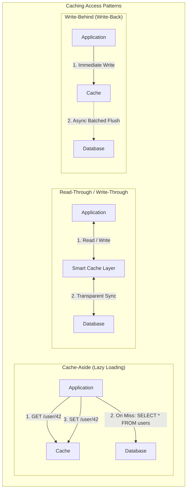
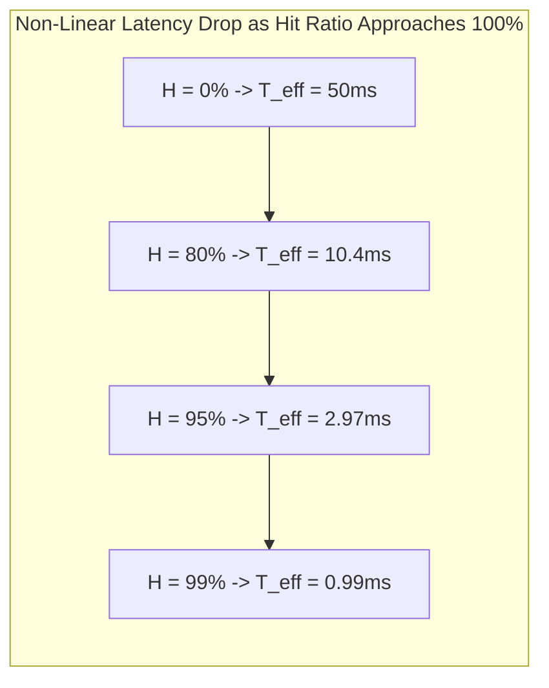
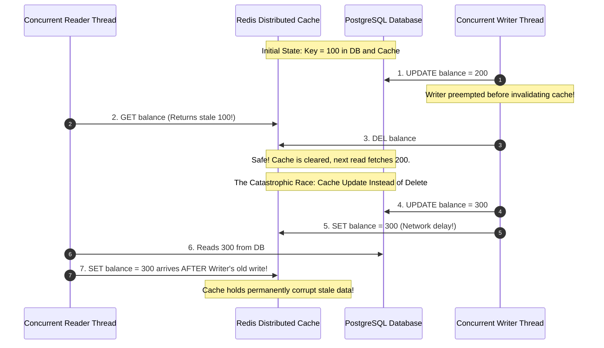
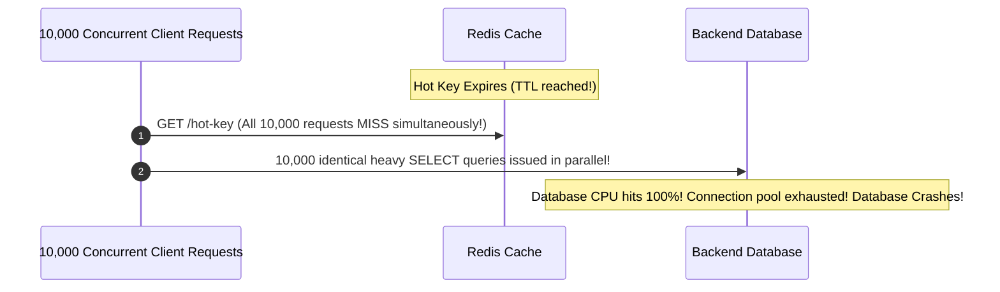
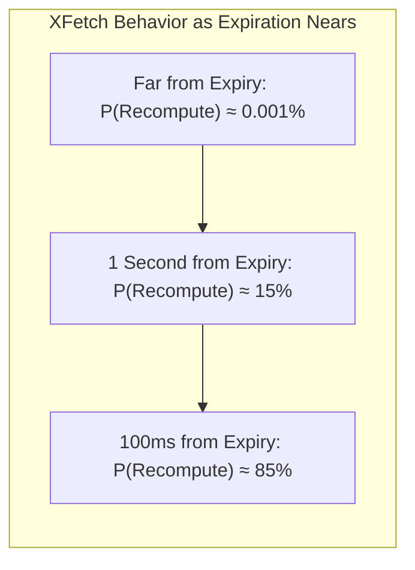
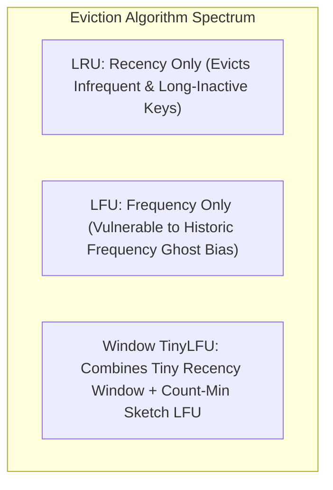

# Module 09: Caching Topologies, Consistency Invalidation, and Stampede Mitigation

Caching is the universal engineering technique for bridging latency and throughput disparities across the memory hierarchy. Placing high-frequency read data into fast volatile memory (DRAM) shields underlying persistent databases from excessive load and lowers client query latencies from tens of milliseconds to sub-millisecond ranges. However, introducing a cache introduces a distributed dual-storage system: data exists simultaneously in the persistent source of truth and the volatile cache, creating profound challenges in **data consistency, race condition ordering, and invalidation semantics**.

---

## 1. Caching Topologies and Access Patterns

### 1. Cache-Aside (Lazy Loading)
- **Read Path**: The application queries the cache. On a **cache hit**, it returns immediately. On a **cache miss**, the application queries the database, writes the retrieved value into the cache, and returns it to the client.
- **Write Path**: The application writes updates directly to the database, and subsequently **invalidates (deletes)** the corresponding key from the cache.
- **Trade-off**: Most resilient pattern; cache failures do not halt writes. However, cold starts incur latency penalties.

### 2. Read-Through and Write-Through
- The application treats the cache as the primary data store. The cache infrastructure encapsulates a database adapter:
  - **Read-Through**: On a cache miss, the cache itself queries the database, populates its internal memory, and responds to the application.
  - **Write-Through**: The application writes to the cache; the cache synchronously writes the update to the persistent database before acknowledging success to the client. Guarantees consistency at the cost of write latency.

### 3. Write-Behind (Write-Back)
- The application writes directly to the cache, which acknowledges the operation immediately ($< 1\text{ ms}$). The cache asynchronously batches and flushes dirty writes to the persistent database in the background.
- *Advantage*: Massive write throughput; absorbs write bursts.
- *Fatal Hazard*: If the cache node crashes or loses power before background writes flush to disk, uncommitted user mutations are **permanently lost**.

---

## 2. Effective Latency Mathematics and Cache Hit Ratios

The performance benefit of caching is modeled via the **Effective Memory Access Time ($T_{\text{eff}}$)**:

$$T_{\text{eff}} = H \cdot T_{\text{cache}} + (1 - H) \cdot T_{\text{db}}$$

Where:
- $H$ is the **Cache Hit Ratio** ($0.0 \le H \le 1.0$).
- $T_{\text{cache}}$ is the cache lookup latency (e.g. $0.5\text{ ms}$).
- $T_{\text{db}}$ is the database lookup latency (e.g. $50\text{ ms}$).

Because database query latency is two orders of magnitude higher than cache latency, small variations in hit ratio produce massive shifts in backend load: dropping from $99\%$ to $95\%$ hit ratio increases database load by **$5\times$** ($1\%$ misses to $5\%$ misses).

---

## 3. The Invalidation Conundrum: The Dual-Write Race Condition

A database and a cache lack distributed two-phase commit. When updating an entity, should application code update the cache or invalidate it? Should it modify the database first or the cache first?

### The Invalidation Best Practice: "Update Database, Then Delete Cache"

1. **Delete, Don't Update**: Always **invalidate (delete)** the cache entry rather than writing the updated value. If two concurrent writers execute, updating the cache directly risks an out-of-order race where an older write overwrites a newer write in the cache, causing permanent data staleness. Deleting the key forces subsequent readers to fetch the latest state from the database.
2. **Order of Operations**: Always **update the database first**, then delete the cache entry.
   - If the database write fails, the transaction rolls back and the cache remains intact.
   - If the cache deletion fails, the key will eventually expire via TTL or be corrected by an automated Change Data Capture (CDC) invalidator.
3. **Change Data Capture (CDC) for Guaranteed Invalidation**: Enterprise architectures deploy Debezium to tail the database Write-Ahead Log and publish invalidation messages to a Kafka topic. A dedicated cache invalidation service consumes from the topic and deletes keys in Redis, guaranteeing eventual invalidation even if application servers crash.

---

## 4. Cache Stampede (Thundering Herd) and the XFetch Algorithm

A **Cache Stampede** occurs when a high-traffic key (e.g. the homepage top-10 products, accessed 50,000 times per second) expires from the cache.

### Stampede Mitigation Strategies

1. **Mutex Locking (Single-Flight)**: When a cache miss occurs, the worker acquires a short-lived distributed mutex (e.g. via `SET NX`). The single lock winner executes the database query and repopulates the cache; all other threads sleep briefly and retry against the newly populated cache.
2. **Probabilistic Early Expiration: The XFetch Algorithm**:
   - Formulated by Vattani, Chierichetti, and Lowenstein in 2015 (*"Optimal Probabilistic Cache Stampede Prevention"*, VLDB).
   - Rather than waiting for a key to strictly expire at time $T$, workers evaluating read operations perform a probabilistic check to determine if they should **asynchronously recompute the value before it expires**.

### The XFetch Mathematical Formulation

A worker recomputes and refreshes the cache entry if:

$$\Delta - \beta \cdot \delta \cdot \ln(\text{rand}()) > \text{TTL}$$

Where:
- $\Delta$ is the remaining time until key expiration ($\text{expiry} - \text{currentTime}$).
- $\delta$ is the delta computation time (how long it took the database to calculate the value on the last run).
- $\beta > 0$ is an aggressiveness multiplier (typically $\beta = 1.0$).
- $\text{rand}() \in (0, 1]$ is a uniform random real number.
- $\text{TTL}$ is the current remaining lifetime.

Because $\ln(\text{rand}())$ is negative, as $\Delta \to 0$ (as the key approaches its expiration deadline), the probability of the condition evaluating to true increases exponentially. Exactly **one** random worker will trigger the recomputation in the background milliseconds before the key expires, repopulating the cache with a fresh TTL with **zero mutex locking** and zero stampede risk!

---

## 5. Cache Eviction Policies: LRU, LFU, and Window TinyLFU

When a cache's memory reaches its configured ceiling (`maxmemory`), it must evict existing keys to accommodate new insertions.

### 1. Least Recently Used (LRU)
- Tracks recency of access. Evicts the key whose last access timestamp is oldest.
- *Limitation*: A key accessed once five seconds ago will be retained over a key accessed 10,000 times that hasn't been accessed in six seconds.

### 2. Least Frequently Used (LFU)
- Maintains a reference counter per key. Evicts the key with the lowest total access count.
- *Limitation (Historic Bias)*: A key that was wildly popular yesterday (e.g. a breaking news story) accumulates a massive counter and sits permanently in cache long after traffic has stopped, blocking new popular items from being retained.

### 3. Window TinyLFU (W-TinyLFU)
- Adopted by high-performance caches (Caffeine in Java, Ristretto in Go).
- **Structure**:
  1. A tiny admission window ($1\%$ of cache) managed via LRU to capture newly bursty keys.
  2. A Main Cache ($99\%$ of cache) divided into protected and probation segments.
  3. A **Count-Min Sketch** probabilistic data structure that estimates access frequency in a compact 4-bit footprint with logarithmic time decay to eliminate historic bias.
- **Admission Invariant**: When an item is evicted from the admission window, it competes with the eviction candidate of the main cache. If its estimated frequency exceeds that of the main cache victim, it is admitted; otherwise, it is immediately discarded.

---

## 6. Then vs Now: Caching Architecture Evolution

| Dimension | Classical Paradigm (2000s) | Cloud Era (2010s) | Modern State-of-the-Art (2020s–Present) |
| :--- | :--- | :--- | :--- |
| **Cache Engine** | Single-node Memcached instances | Clustered Redis with manual sentinel failover | Multi-tier: Local in-process W-TinyLFU (L1) + Redis Cluster (L2) |
| **Invalidation Mechanics** | Fixed arbitrary TTLs ("cache and pray") | Application-level manual delete calls prone to race conditions | Event-driven CDC invalidation streams via Debezium/Kafka |
| **Stampede Prevention** | Distributed mutexes via `SETNX` (prone to deadlocks) | Hardcoded background cron warmers | Mathematically optimal XFetch probabilistic early refresh |
| **Consistency Guarantees** | Accepted stale data as normal trade-off | Dual-write best-effort patterns | Read-your-writes LSN cache gating and deterministic outbox pipelines |

---

## 7. Production Failure Modes and Anti-Patterns

### 1. The Dual-Write Cache Corruption Race
- **Symptom**: Customer sees old billing address on their profile for weeks after updating it, despite multiple page reloads.
- **Root Cause**: The application implemented "Update Cache, Then Update Database". A concurrent thread read the database between the two operations and wrote the old state back to the cache, or the application crashed after updating the cache but before the database committed.
- **Mitigation**: Never update the cache on writes; update the database first, then delete the cache key.

### 2. Cache Penetration (Querying Non-Existent Entities)
- **Symptom**: An attacker floods the site with requests for non-existent IDs (`/user/-999999`); cache misses 100% of queries, saturating database CPU.
- **Root Cause**: Because the key does not exist in the database, the application writes nothing to the cache, forcing every single subsequent attack request to hit the database.
- **Mitigation**: Cache null objects with short TTLs (`SET user:-999999 "NULL" EX 30`), or place a **Bloom filter** in front of the cache to immediately reject non-existent IDs.

### 3. Eviction Policy Misconfiguration (OOM Crashes)
- **Symptom**: Redis instances reject write operations with `OOM command not allowed when used memory > 'maxmemory'`.
- **Root Cause**: `maxmemory` was configured without setting an eviction policy (defaulting to `noeviction`). When RAM filled, Redis refused all writes instead of evicting cold data.
- **Mitigation**: Configure `maxmemory-policy allkeys-lru` or `volatile-lru` depending on whether persistent keys are stored in the same instance.

---

## 8. Interview Drill

<strong>Q1: Formulate the mathematical proof of why application code should "Update Database, Then Delete Cache" rather than "Update Database, Then Update Cache".</strong>

**Answer:** 
Suppose two concurrent threads, Writer 1 and Writer 2, update the same entity:
1. Under an **"Update Cache"** approach:
   - Writer 1 writes value $A$ to DB.
   - Writer 2 writes value $B$ to DB.
   - Due to network packet jitter, Writer 2's cache update arrives first: `Cache.SET(B)`.
   - Writer 1's delayed cache update arrives second: `Cache.SET(A)`.
   - *Result*: The DB holds $B$ (correct), but the cache holds $A$ permanently!

2. Under a **"Delete Cache"** approach:
   - Writer 1 writes $A$ to DB.
   - Writer 2 writes $B$ to DB.
   - Both writers issue `Cache.DEL()`.
   - *Result*: Regardless of network arrival order, the key is deleted from the cache. The next read operation queries the database, retrieves the latest committed value $B$, and populates the cache correctly.

<strong>Q2: How does the XFetch algorithm prevent cache stampedes without relying on distributed locks?</strong>

**Answer:** 
The XFetch algorithm evaluates a probabilistic condition during routine read operations:

$$\Delta - \beta \cdot \delta \cdot \ln(\text{rand}()) > \text{TTL}$$

Where $\Delta$ is the remaining lifetime of the key, $\delta$ is the delta computation duration, $\beta$ is a tuning multiplier, and $\text{rand}() \in (0, 1]$ is a uniform random number.

Because $\ln(\text{rand}())$ is negative, the probability that the condition evaluates to true is nearly zero when the key is fresh, but increases smoothly and exponentially as the key approaches its expiration deadline ($\Delta \to 0$). Under high read traffic, exactly one client will randomly evaluate this condition to true in the window immediately preceding expiration, triggering an **asynchronous background recomputation** that refreshes the key's TTL. The key never expires, completely preventing concurrent thundering herds without any distributed mutex locking.

<strong>Q3: Explain the difference between Cache Penetration, Cache Breakdown, and Cache Avalanche.</strong>

**Answer:** 
- **Cache Penetration**: Queries request keys that **do not exist** in either the cache or the database. Every request bypasses the cache and hits the database. (Mitigated by caching NULL values with short TTLs or using Bloom filters).
- **Cache Breakdown**: A **single ultra-hot key** expires from the cache. High concurrent traffic hits the database simultaneously to recompute that single key. (Mitigated by mutex locks or the XFetch algorithm).
- **Cache Avalanche**: A **massive volume of distinct keys expire at the exact same second** (e.g. because they were all inserted with the identical fixed TTL like 3600 seconds), causing global database saturation. (Mitigated by adding random jitter to TTLs: `TTL = base_ttl + rand(0, 300)`).

<strong>Q4: Why does Least Frequently Used (LFU) eviction suffer from historic frequency bias, and how does Window TinyLFU solve it?</strong>

**Answer:** 
LFU maintains an access counter for each key. An item that was accessed 100,000 times yesterday (e.g. a viral news story) accumulates a massive counter. Even after its traffic drops to zero today, its counter remains far higher than a newly popular item accessed 50 times today. Standard LFU will repeatedly evict the newly popular item to keep the dead viral item.

**Window TinyLFU** solves this via two innovations:
1. **Count-Min Sketch with Logarithmic Aging**: It tracks frequencies in a compact 4-bit sketch. Periodically, all counters are halved (attenuated), causing historic frequency to decay exponentially over time.
2. **Admission Window**: Newly inserted items enter a small LRU admission window to prove their immediate bursty utility before competing with established items in the main cache.

<strong>Q5: What is the Effective Memory Access Time formula, and what does it reveal about database load when hit ratio drops from 99% to 95%?</strong>

**Answer:** 
The formula is:

$$T_{\text{eff}} = H \cdot T_{\text{cache}} + (1 - H) \cdot T_{\text{db}}$$

Database load is directly proportional to the miss ratio $(1 - H)$. 
- At a $99\%$ hit ratio ($H = 0.99$), the miss ratio is $1 - 0.99 = 0.01$ ($1\%$ of queries hit the database).
- At a $95\%$ hit ratio ($H = 0.95$), the miss ratio is $1 - 0.95 = 0.05$ ($5\%$ of queries hit the database).

A seemingly minor drop of $4\%$ in cache hit ratio increases the query volume hitting the backend database by:

$$\frac{0.05}{0.01} = 5\times \quad (500\% \text{ load increase})$$

This non-linear amplification frequently pushes overloaded databases beyond connection pool limits into total cascading failure.

<strong>Q6: How does Change Data Capture (CDC) provide resilient cache invalidation compared to application-level invalidation?</strong>

**Answer:** 
In application-level invalidation, if an application server crashes, encounters an unhandled exception, or experiences a network partition after committing to the database but before calling `Cache.del()`, the cache is never invalidated and remains permanently stale.

In **CDC-driven invalidation**:
1. The application only writes to the database.
2. A CDC agent (e.g. Debezium) tails the database's sequential Write-Ahead Log directly.
3. Every committed transaction is guaranteed to generate WAL records. The CDC engine decodes these records and publishes invalidation events to a reliable broker (Kafka).
4. Invalidation workers consume from Kafka and delete the keys in Redis.

Because WAL records are persistent and Kafka tracks consumer offsets, invalidation events cannot be lost even if application servers or invalidation workers crash, guaranteeing eventual consistency.

