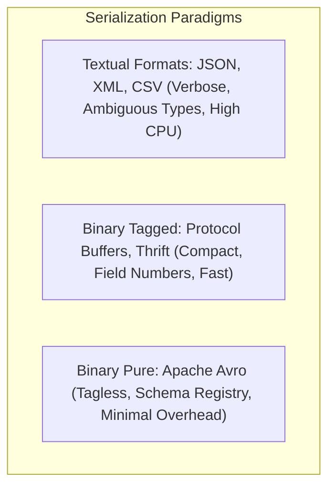
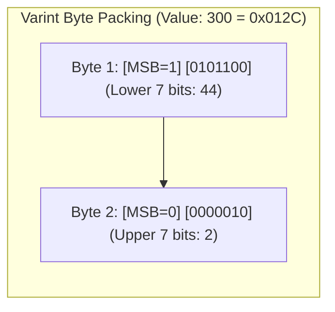
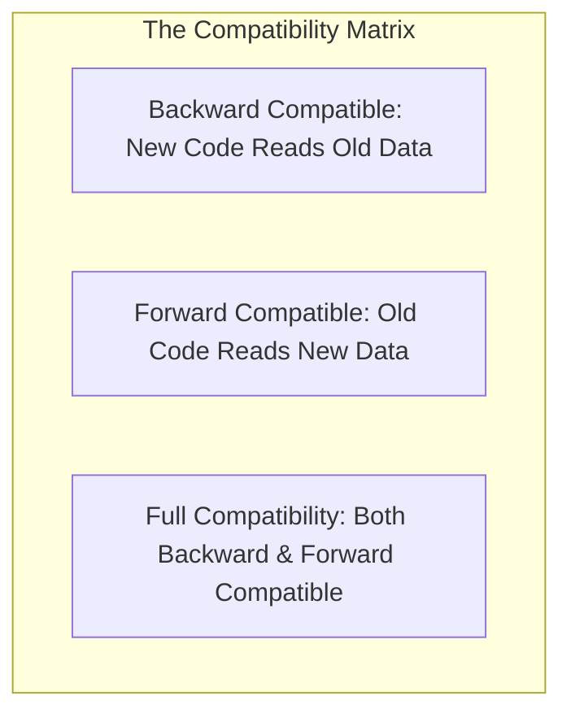
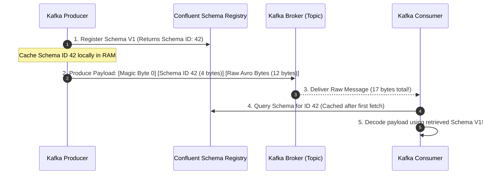

# Module 10: Data Encoding, Binary Serialization, and Schema Evolution

Whenever data is communicated across a process boundary—written to persistent disk files, streamed over a network socket, or broadcast through a message broker—it must be converted from in-memory objects (pointers, classes, hash tables) into a contiguous stream of bytes. This process is **serialization** (or **encoding**). Because distributed systems consist of independent services deployed at different times by different teams, schemas inevitably evolve. Maintaining compatibility across heterogeneous service versions is a paramount engineering discipline.

---

## 1. Encoding Formats: Textual versus Binary



### 1. Textual Formats (JSON, XML, CSV)
- **Strengths**: Human-readable; ubiquitous tool support; zero compile-time schema generation.
- **Architectural Weaknesses**:
  - **Extreme Inefficiency**: Repeating attribute names (e.g. `{"user_id": 42, "user_id": 43}`) consumes up to $80\%$ of network payload bytes.
  - **Type Ambiguity**: JSON cannot distinguish between integers and floating-point numbers (treating all numbers as IEEE 754 double-precision floats, leading to precision loss for 64-bit integers like Twitter IDs or database primary keys); no native binary byte string support (requiring $33\%$ Base64 bloat).
  - **High CPU Parsing Overhead**: Tokenizing ASCII text, parsing floating-point strings, and escaping characters consumes significant CPU cycles compared to binary memory offsets.

### 2. Binary Tagged Formats (Protocol Buffers, Thrift)
- Developed by Google (Protobuf) and Facebook (Thrift).
- Instead of transmitting field names as strings, schema definitions assign a compact numeric **Field Tag (Field Number)** to each attribute:
  ```protobuf
  message UserProfile {
    int64 user_id = 1;
    string email = 2;
    bool is_verified = 3;
  }
  ```
- On the wire, each attribute is encoded as a **Tag Header** combining the field number and a **Wire Type** (e.g. Varint, 64-bit, Length-delimited), followed immediately by the payload bytes.
- Field names never appear on the wire, drastically reducing payload size and accelerating deserialization.

### 3. Pure Binary Tagless Formats (Apache Avro)
- Developed for Apache Hadoop and enterprise event streaming (Kafka).
- **Tagless Invariant**: Avro records contain **neither field names NOR field numbers**! An encoded integer `42` is represented solely by its variable-length byte value.
- To parse an Avro byte stream, the consumer must possess the exact **Writer's Schema** used to encode the data. The engine aligns the raw byte sequence against the schema fields in sequential order. This achieves the theoretical maximum binary compression for structured records.

---

## 2. Low-Level Binary Mechanics: Varints and ZigZag Encoding

Standard fixed-width integer representations allocate 4 bytes for `int32` and 8 bytes for `int64`. Storing small numbers (e.g. integer `5`) in an `int64` wastes 7 bytes of zeros.



### Variable-Length Quantity (Varint / Base 128)
- Splits an integer into 7-bit chunks.
- The Most Significant Bit (MSB) of each byte acts as a **continuation bit**:
  - `MSB = 1`: More bytes follow.
  - `MSB = 0`: This is the final byte of the integer.
- The value `1` encodes in a single byte: `00000001`.
- The value `300` ($256 + 44$) encodes in two bytes: `10101100 00000010`.

### ZigZag Encoding for Negative Numbers
Under standard two's complement, small negative numbers (e.g. `-1`) have all their upper bits set to $1$ (`0xFFFFFFFFFFFFFFFF`), requiring 10 full bytes under a standard varint!

To solve this, binary serializers apply **ZigZag encoding**, which maps signed integers onto unsigned integers by interleaving positive and negative numbers:

$$\text{ZigZag}(n) = (n \ll 1) \oplus (n \gg 63)$$

| Signed Integer $n$ | ZigZag Encoded Bit Representation | Unsigned Decimal |
| :---: | :---: | :---: |
| `0` | `0` | `0` |
| `-1` | `1` | `1` |
| `1` | `2` | `2` |
| `-2` | `3` | `3` |
| `2` | `4` | `4` |

A negative number with small absolute magnitude (e.g. `-1`) becomes a small unsigned integer (`1`), encoding in a single varint byte.

---

## 3. Schema Evolution Rules: Backward, Forward, and Full Compatibility

In distributed microservices, rolling updates mean that old code and new code run concurrently in production. Schemas must evolve without crashing running services.



### Formal Compatibility Definitions

1. **Backward Compatibility**:
   - Code compiled with schema version $V_2$ (new) can successfully deserialize data written by an older producer running schema version $V_1$ (old).
   - *Requirement*: Any field added in $V_2$ must be **optional** or specify an explicit **default value**. If $V_2$ added a required field with no default, parsing $V_1$ payloads would fail.
2. **Forward Compatibility**:
   - Code compiled with schema version $V_1$ (old) can successfully deserialize data written by a newer producer running schema version $V_2$ (new).
   - *Requirement*: Old code must ignore unrecognized fields. In Protobuf and Thrift, parser decoders silently skip unknown field tags, preserving them in an internal unknown-fields buffer so they are not stripped during round-trip serialization.
3. **Full Compatibility**:
   - The evolution satisfies both Backward and Forward compatibility simultaneously. Older services can read data from newer services, and newer services can read data from older services.

### Safe versus Breaking Schema Evolution Operations

| Schema Modification | Backward Compatible? | Forward Compatible? | Operational Consequence |
| :--- | :---: | :---: | :--- |
| **Add optional field with default** | Yes | Yes | Fully safe. New readers apply default; old readers ignore. |
| **Add required field (no default)** | **NO** | Yes | **Breaking Change!** New readers crash when reading old messages. |
| **Remove optional field** | Yes | Yes | Safe, provided the field number / tag is permanently reserved. |
| **Remove required field** | Yes | **NO** | **Breaking Change!** Old readers crash when new producers omit field. |
| **Rename field (Protobuf)** | Yes | Yes | Fully safe. Protobuf binds by field number, ignoring names. |
| **Rename field (Avro)** | **NO** (without alias) | **NO** | Breaks unless declared with schema `aliases: ["old_name"]`. |
| **Change field number/tag** | **NO** | **NO** | **Catastrophic Failure!** Data fields map to completely wrong types. |

---

## 4. Enterprise Event Streaming and the Schema Registry

In high-throughput event streaming systems like Apache Kafka, sending an Avro JSON schema (often 1KB–5KB of schema text) with every 50-byte event payload would multiply network and storage costs by $50\times$.



### The Schema Registry Wire Protocol (Confluent Standard)
- Payloads are prefixed with a 5-byte header:
  - Byte 0: **Magic Byte** (always `0x00`).
  - Bytes 1–4: **Schema ID** (32-bit big-endian integer assigned by the registry).
  - Bytes 5+: Raw, tagless Avro or Protobuf binary payload.
- The Schema Registry enforces compatibility rules at registration time: if a developer attempts to commit an incompatible schema breaking backward compatibility, the registry rejects the registration HTTP call, preventing incompatible payloads from entering the event pipeline.

---

## 5. Then vs Now: Serialization and Wire Protocols

| Dimension | Classical Era (1990–2000s) | Web 2.0 Era (2010s) | Modern Cloud-Native (2020s–Present) |
| :--- | :--- | :--- | :--- |
| **Primary RPC Format** | Heavy XML (SOAP, WSDL) or language-specific binary (Java RMI) | Unchecked JSON over HTTP/1.1 REST | Strict Protobuf contracts over HTTP/2 gRPC |
| **Data Lake Encoding** | Uncompressed CSV / TSV text files | Row-based JSON lines | Binary columnar with embedded schemas (Apache Parquet, ORC) |
| **Event Bus Payloads** | Untyped strings or opaque binary blobs | Loose JSON schemas validated in code | Schema Registry enforced Avro/Protobuf with strict compatibility gates |
| **Schema Invariance** | Rigid database-only schemas; distributed brittle updates | "Schema-less" wild west leading to runtime crashes | Rigorous Schema Evolution contracts with compile-time type generation |

---

## 6. Production Failure Modes and Anti-Patterns

### 1. Recycling Deprecated Field Tags in Protocol Buffers
- **Symptom**: Downstream microservices parse user records and observe corrupt, nonsensical data (e.g. an account balance parsed as an IP address string).
- **Root Cause**: A developer deleted an old field (`optional int32 age = 4`) and later created a new field reusing the same tag (`optional string ip_address = 4`). When older messages stored in backups or Kafka topics were replayed, the old `age` integers were deserialized into the new `ip_address` string field.
- **Mitigation**: Never delete a field tag without marking it permanently reserved: `reserved 4; reserved "age";`.

### 2. The JSON Integer Precision Truncation Anomaly
- **Symptom**: High-value database IDs (e.g. Snowflake IDs: `178945612345678912`) generated by backend databases are mysteriously altered when passed through frontend JavaScript clients (becoming `178945612345678900`).
- **Root Cause**: JavaScript parses all JSON numbers as IEEE 754 double-precision floats, which can safely represent exact integers only up to $2^{53} - 1$ (`9,007,199,254,740,991`). Integers exceeding this threshold suffer silent least-significant-bit truncation.
- **Mitigation**: Serialize 64-bit integers as strings in JSON payloads (`"178945612345678912"`).

### 3. Schema Registry Network Outage Halting Event Pipelines
- **Symptom**: Kafka producers and consumers crash simultaneously, throwing fatal serialization errors when the Schema Registry instance undergoes maintenance.
- **Root Cause**: Client applications were configured without local schema caching, querying the Schema Registry synchronously for every batch.
- **Mitigation**: Configure long in-memory schema caches in client SDKs and deploy multi-node Schema Registry clusters with persistent backing storage.

---

## 7. Interview Drill

<details>
<summary><strong>Q1: Contrast Protocol Buffers and Apache Avro in terms of wire overhead and schema dependency during deserialization.</strong></summary>

**Answer:** 
- **Protocol Buffers**:
  - *Wire Format*: Uses **tagged binary encoding**. Each field is prefixed with a tag header combining the field number and wire type. Field names are omitted, but field numbers are transmitted with every attribute.
  - *Schema Dependency*: Can be parsed partially without the schema file; an engine without the schema can still navigate the byte stream, skip unrecognized field tags, and extract raw bytes based on wire types.
- **Apache Avro**:
  - *Wire Format*: Uses **pure tagless binary encoding**. Neither field names NOR field numbers appear on the wire. Data consists solely of raw contiguous values.
  - *Schema Dependency*: **Absolute**. A consumer cannot decode even a single byte of an Avro message without access to the exact schema used to write it. The engine relies on the schema to know which fields appear in what order and what their data types are. This makes Avro payloads significantly smaller than Protobuf.
</details>

<details>
<summary><strong>Q2: How does ZigZag encoding prevent small negative integers from consuming 10 bytes under variable-length quantity (Varint) encoding?</strong></summary>

**Answer:** 
In standard two's complement binary representation, negative integers have their high-order bits set to $1$ (e.g., `-1` is `0xFFFFFFFFFFFFFFFF` in 64-bit). Under standard Varint encoding, the continuation bit (MSB) must be set for every 7-bit chunk that contains non-zero bits, causing `-1` to consume a full 10 bytes of space.

ZigZag encoding solves this by mathematically interleaving positive and negative numbers into unsigned values:

$$\text{ZigZag}(n) = (n \ll 1) \oplus (n \gg 63)$$

- `0` becomes `0`
- `-1` becomes `1`
- `1` becomes `2`
- `-2` becomes `3`

A small negative number like `-1` maps to the tiny unsigned integer `1`, which encodes in a **single Varint byte** (`00000001`), completely eliminating the 10-byte penalty for signed negative values.
</details>

<details>
<summary><strong>Q3: Explain the difference between Backward Compatibility and Forward Compatibility in schema evolution.</strong></summary>

**Answer:** 
- **Backward Compatibility**: A newer code version (reading with a new schema) can successfully read and deserialize data produced by an older code version (written with an old schema). 
  - *Rule*: Any newly added field must have a default value or be optional; otherwise, the new code will fail when reading historical records where the field is missing.
- **Forward Compatibility**: An older code version (reading with an old schema) can successfully read and deserialize data produced by a newer code version (written with a new schema).
  - *Rule*: The older code must gracefully ignore any newly added fields present in the payload without throwing parsing errors.
</details>

<details>
<summary><strong>Q4: Why does adding a required field without a default value break backward compatibility?</strong></summary>

**Answer:** 
If a service updates its schema to add a new field marked as `required` with no default value:
1. When the new service reads historical data stored in the database or messages produced by older services, the payload will not contain this new field.
2. Because the field is declared `required` and has no default value, the deserialization engine cannot populate the field.
3. The parser throws a validation exception (e.g. `MissingRequiredFieldException`), causing the application to fail.

Therefore, adding a required field with no default is a **breaking backward-incompatible change**.
</details>

<details>
<summary><strong>Q5: What is the purpose of Confluent Schema Registry in Kafka architectures, and what is the structure of its 5-byte message prefix?</strong></summary>

**Answer:** 
Sending full JSON or Avro schemas with every message would bloat small event payloads by $10\times$ to $50\times$. 

The Schema Registry centralizes schema storage. When producing, the serializer registers the schema, retrieves a unique 32-bit Schema ID, and prepends a **5-byte header** to the payload:
- **Byte 0**: Magic Byte (`0x00`).
- **Bytes 1–4**: 32-bit big-endian Schema ID.
- **Bytes 5+**: Raw, compact tagless Avro/Protobuf bytes.

The consumer inspects the 4-byte ID, queries the Schema Registry once to retrieve and cache the schema, and subsequently decodes all messages using that cached schema. This combines extreme binary compaction with strict centralized schema governance.
</details>

<details>
<summary><strong>Q6: Why must a developer never delete a field tag in Protocol Buffers without marking it as `reserved`?</strong></summary>

**Answer:** 
In Protocol Buffers, data fields are identified on the wire strictly by their numeric **Field Tag (Field Number)**, never by their string name. 

If a developer deletes `optional string old_token = 5;` from a `.proto` file without reserving tag 5:
1. Months later, another developer might define `optional int64 user_balance = 5;`.
2. When the application reads historical records from backups or delayed event queues where tag 5 contains string tokens, the new code attempts to parse those bytes as an integer.
3. This leads to silent, catastrophic data corruption or unrecoverable deserialization exceptions.

Marking `reserved 5; reserved "old_token";` ensures the compiler permanently forbids reusing that tag number or field name in future revisions.
</details>
