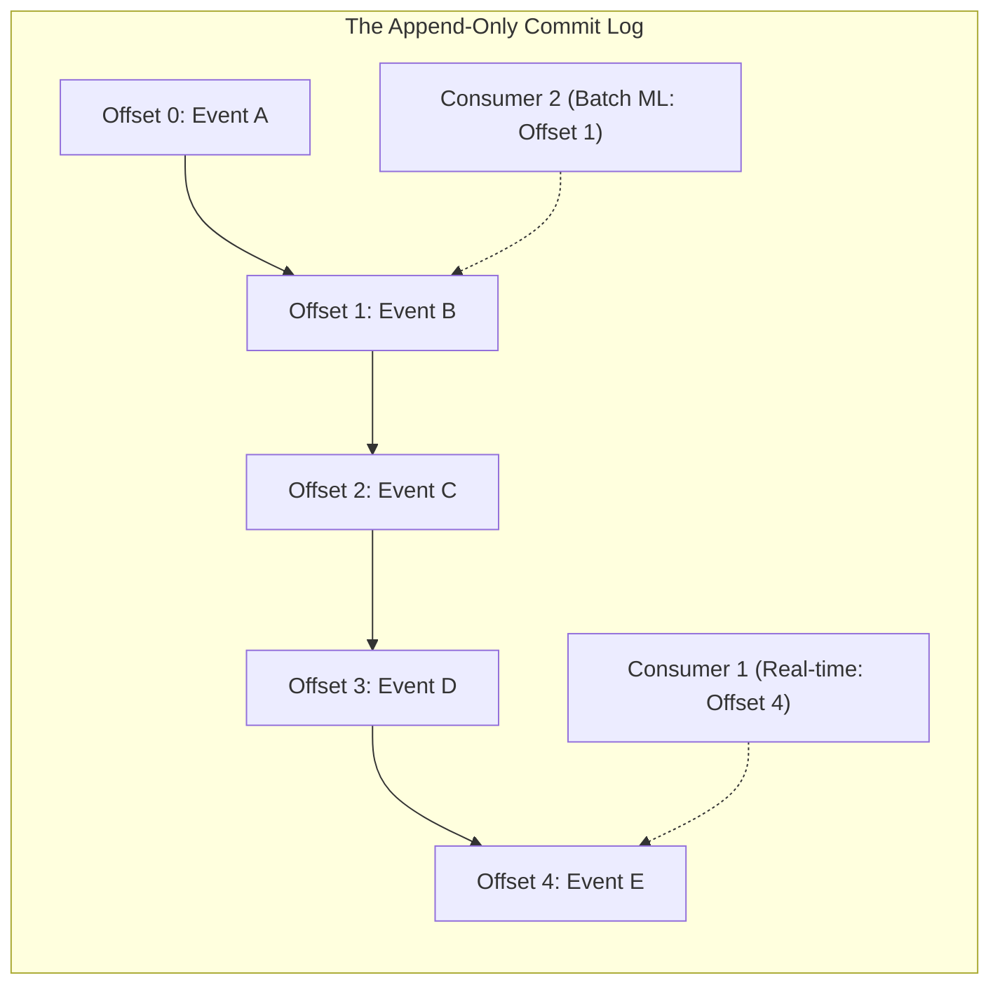
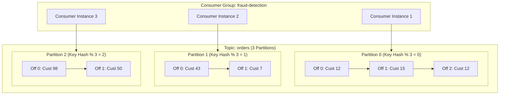
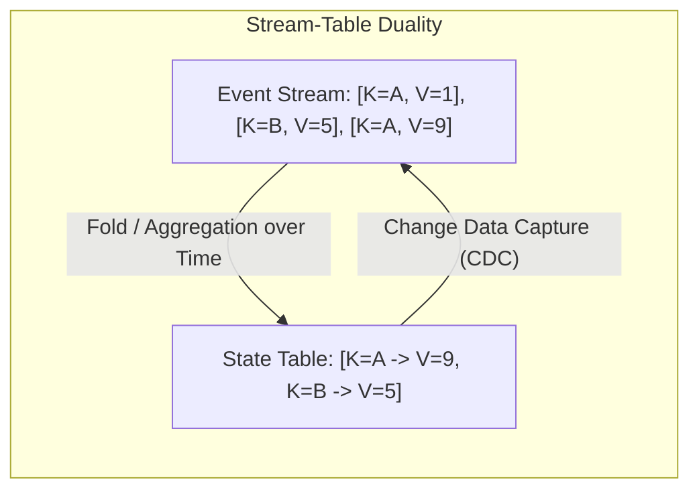
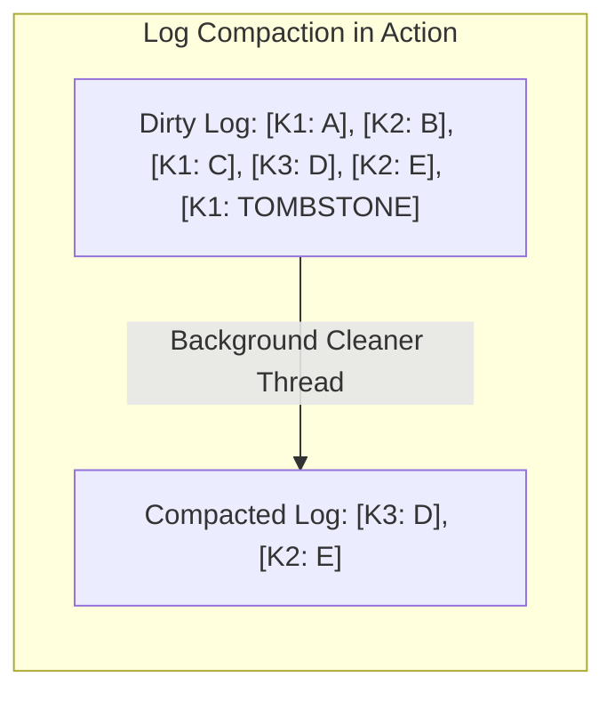
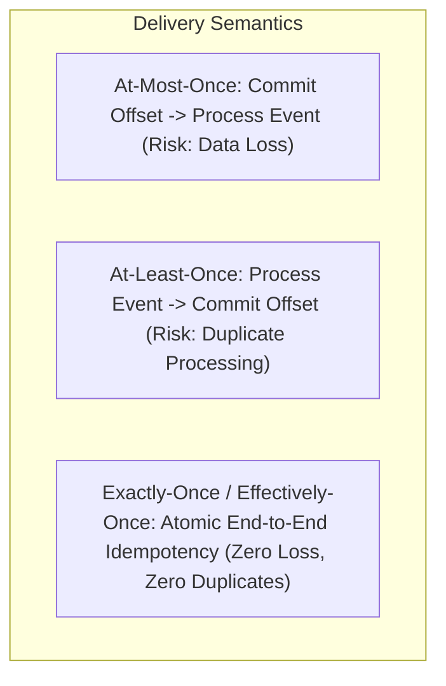
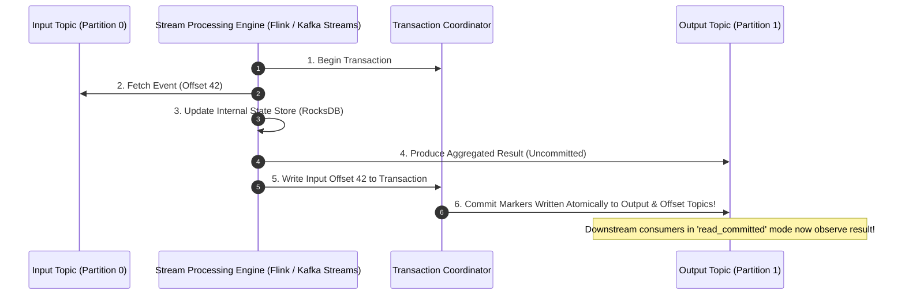
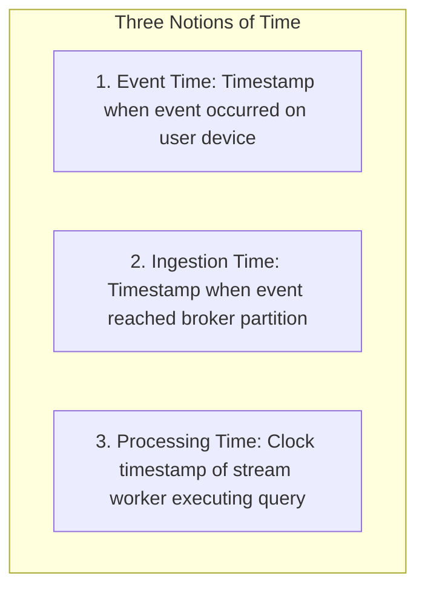
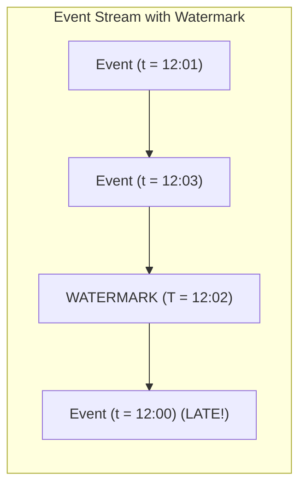
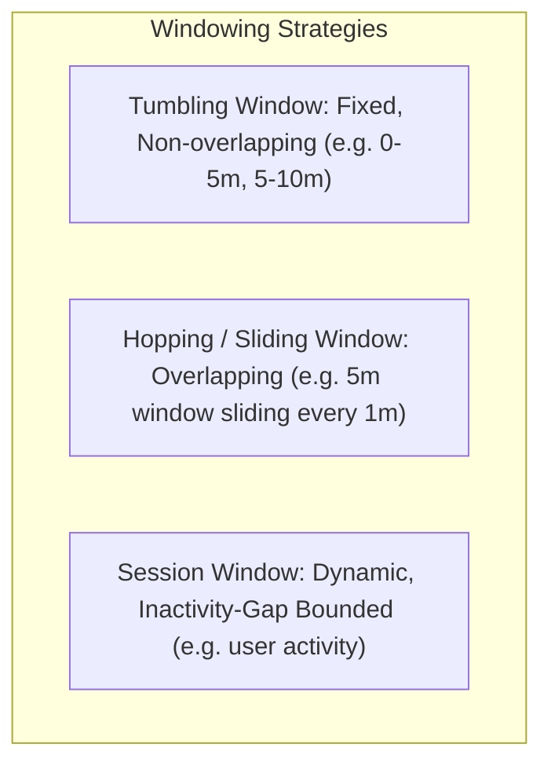

# Module 11: Stream Processing, Event Logs, and Stream-Table Duality

For decades, data engineering was dominated by the batch processing paradigm: transactional databases collected records during the day, and nightly batch ETL jobs (Hadoop MapReduce, SQL scripts) processed the data in bulk hours later. In modern architectures, business events occur continuously and demand real-time ingestion, stateful aggregation, and low-latency reaction. At the center of this paradigm shift is the **distributed append-only commit log**, which unifies databases, message queues, and real-time stream processing engines into a cohesive distributed architecture.

---

## 1. The Log as a Fundamental Data Primitive

In his seminal 2013 paper *"The Log: What every software engineer should know about real-time data's unifying abstraction"*, Jay Kreps articulated that an **append-only log** is the simplest possible storage abstraction: an ordered sequence of records appended strictly to the end and indexed by monotonically increasing sequence numbers (**offsets**).

### Traditional Message Queues versus Distributed Commit Logs

| Dimension | Traditional Message Queue (RabbitMQ, SQS, AMQP) | Distributed Commit Log (Apache Kafka, Apache Pulsar) |
| :--- | :--- | :--- |
| **Storage Model** | Transient. Messages are held in memory/disk until acknowledged. | Persistent append-only disk segments retained by time or size (e.g. 7 days or 1TB). |
| **Consumption Model** | **Destructive Consumption**: Once a consumer acknowledges a message, the broker permanently deletes it. | **Non-Destructive Consumption**: The broker retains messages. Consumers maintain their own independent read offsets. |
| **Multiple Consumers** | Competing consumers pattern; broadcasting requires complex fanout exchange duplication. | Free fanout. 100 independent services can consume the exact same log at their own pace without duplicating data. |
| **Replayability** | **Impossible**. Once processed, events cannot be re-read. | **Native**. A new microservice or buggy consumer can reset its offset to 0 and replay the entire history of events. |
| **Ordering Guarantees** | Often lost under concurrent consumers, message re-queues, and nacks. | **Strict total ordering** guaranteed within each individual partition. |

---

## 2. Partitioning, Ordering Guarantees, and Consumer Groups

To scale beyond the network and disk limits of a single machine, a topic is divided into multiple **Partitions**.

### Ordering Invariants
- **Within a Partition**: The log provides a **strict, total monotonic ordering** guarantee. If event $E_1$ has offset 42 and event $E_2$ has offset 43 in Partition 0, all consumers reading Partition 0 will observe $E_1$ before $E_2$.
- **Across Partitions**: There is **no global ordering guarantee**. Events across different partitions can be consumed in arbitrary order depending on network latency and consumer thread scheduling.
- **Key-Based Routing**: Producers compute partition assignments via a deterministic hash: $\text{partition} = \text{hash}(\text{key}) \pmod{\text{num\_partitions}}$. All events sharing the identical business key (e.g. `customer_id`) are routed to the same partition, guaranteeing **strict causal ordering per customer**.

### Consumer Groups and Cooperative Rebalancing
- A **Consumer Group** coordinates multiple worker instances to process partitions in parallel.
- **Partition Assignment Invariant**: Each partition is assigned to **at most one** consumer instance within the group at any given time. If a group has more consumers than partitions, the excess consumers sit completely idle as hot standbys.
- **Cooperative Sticky Rebalancing**: Modern protocols reassign only the specific partitions affected by a node failure or joining instance, avoiding "stop-the-world" consumer pauses across unaffected workers.

---

## 3. The Stream-Table Duality and Log Compaction

One of the most profound theoretical insights in modern data architecture is the **Stream-Table Duality**:

$$\text{Stream} \underset{\text{Changelog / CDC}}{\overset{\text{Fold / Aggregation}}{\longleftrightarrow}} \text{Table}$$

1. **Stream $\to$ Table**: A stream represents the continuous history of mutations. Replaying the event stream from the beginning and applying each mutation sequentially builds the current state table. (A table is a snapshot of a stream evaluated at a specific point in time).
2. **Table $\to$ Stream**: A table holds the latest state. Recording every mutation (`INSERT`, `UPDATE`, `DELETE`) as an event creates a change-data-capture stream. (A stream is the delta history of a table).

### Log Compaction (Tombstone Pruning)
In a standard log, segments are retained for a fixed duration (e.g. 7 days). However, if an event log represents the state of a database table (e.g. a `users` topic where key is `user_id`), retaining by time is flawed: inactive users are deleted after 7 days, while active users accumulate millions of redundant updates.

**Log Compaction** instructs the broker to retain **the latest value for every key** indefinitely:

- When a cleaner thread runs, it scans past segments and removes obsolete records whose keys have newer versions downstream.
- A **Tombstone** (a record with a non-null key and a `null` payload) indicates a deletion. The cleaner retains the tombstone long enough for all consumers to observe the delete, and subsequently purges the key entirely.
- Log-compacted topics enable stateful stream processing workers to restore state tables in minutes by reading only the latest snapshot of each key, rather than billions of historical raw events.

---

## 4. Processing Guarantees: At-Most-Once, At-Least-Once, and Exactly-Once (EOS)

### 1. At-Most-Once Delivery
- The consumer commits its offset to the broker *before* processing the message in business logic.
- If the worker crashes during processing, the newly restarted worker reads from the committed offset, **skipping the failed event**.
- Acceptable strictly for non-critical, loss-tolerant metrics (e.g. temperature telemetry).

### 2. At-Least-Once Delivery (Industry Baseline)
- The consumer processes the message in business logic, writes state, and *then* commits its offset to the broker.
- If the worker crashes before committing the offset, the restarted worker re-reads the event, **processing it a second time**.
- Requires application business logic to be strictly **idempotent** ($f(f(x)) = f(x)$).

### 3. Effectively-Once Semantics (EOS / Exactly-Once)
Achieving exactly-once processing requires coordinated protocol support across the entire end-to-end pipeline:

- **Idempotent Producers**: The broker assigns each producer a 64-bit Producer ID (PID) and tracks sequence numbers per partition. Duplicate network retransmissions are detected and discarded at the broker with zero duplicates stored.
- **Two-Phase Commit (2PC) Transactions**: The stream processor coordinates a distributed transaction spanning the consumed input offset, the local state store mutations, and the produced downstream messages. Output messages are stamped with commit markers; downstream consumers operating in `read_committed` mode buffer uncommitted messages and expose them only after the commit marker arrives.

---

## 5. Time Semantics and Windowing: Event Time, Watermarks, and Windows

In real-world networks, physical message transmission experiences arbitrary latency: a mobile app records an event at 12:00:00 (Event Time), but network disconnects delay message delivery until 12:15:00 (Processing Time).

### Watermarks and Out-of-Order Handling
To perform accurate time-windowed aggregations (e.g. "count active users in 5-minute tumbling windows"), stream processors must evaluate queries based strictly on **Event Time**.

A **Watermark** is a temporal control signal injected into the event stream that asserts progress:

$$\text{Watermark}(T) \implies \text{No further events with EventTime} < T \text{ will arrive.}$$

- When the stream processor observes $\text{Watermark}(T = 12:05)$, it triggers the closure and emission of the $[12:00, 12:05)$ window.
- **Late-Arriving Data**: If an event with Event Time $12:03$ arrives *after* $\text{Watermark}(12:05)$, it is classified as late data. The engine can either:
  1. Drop the event.
  2. Route it to a Dead Letter Queue / Side Output.
  3. Emit an updated window correction (retraction/upsert).

### Window Types

---

## 6. Then vs Now: Stream Processing Evolution

| Dimension | Classical Era (2000s) | Big Data Era (2010s) | Modern State-of-the-Art (2020s–Present) |
| :--- | :--- | :--- | :--- |
| **Pipeline Architecture** | Nightly batch ETL scripts running on relational databases | Lambda Architecture: Speed layer (Storm) + Batch layer (Hadoop) | **Kappa Architecture**: Single stream engine (Flink/Kafka Streams) for both real-time and historical backfills |
| **State Management** | External remote databases (Redis/PostgreSQL) bottlenecking throughput | In-memory JVM heaps prone to massive GC pauses | Local embedded disk-backed state stores (RocksDB) with async changelog backup |
| **Time Semantics** | Wall-clock Processing Time (non-deterministic results) | Heuristic delayed batching | Strict Event Time with dynamic Watermark generation |
| **Storage Convergence**| Discrete message queues separate from analytical stores | Kafka coupled with HDFS/S3 data dumps | Unified tiered storage (Kafka/Pulsar streaming hot data, offloading segments to S3/Iceberg) |

---

## 7. Production Failure Modes and Anti-Patterns

### 1. The Poison Pill Consumer Blockade
- **Symptom**: An entire partition halts processing; consumer lag climbs exponentially across an entire business domain.
- **Root Cause**: A single malformed message (unparseable JSON, invalid schema) crashes the consumer thread. Because the offset is not committed, the consumer restarts, fetches the exact same message, and crashes again in an infinite loop.
- **Mitigation**: Implement a try/catch wrapper that routes unparseable messages to a **Dead Letter Queue (DLQ)** topic with error headers and commits the offset to advance.

### 2. Consumer Rebalance Storms
- **Symptom**: Stream processing cluster spends $100\%$ of its time rebalancing; message throughput drops to zero.
- **Root Cause**: A heavy batch of messages takes longer to process than `max.poll.interval.ms` (e.g. 5 minutes). The broker assumes the consumer has died, evicts it from the group, and triggers a rebalance. When the consumer finishes and attempts to commit, it is rejected, causing another rebalance.
- **Mitigation**: Increase `max.poll.interval.ms`, reduce `max.poll.records`, decouple message fetching from processing using internal thread pools, and adopt Cooperative Sticky Assignors.

### 3. Out-of-Memory via State Store Bloat in Unbounded Windows
- **Symptom**: Flink or Kafka Streams worker nodes run out of memory or disk space.
- **Root Cause**: A stateful stream join or session window is configured without a timeout or clean-up TTL (`joinWindow.grace(0)`). Keys with missing join partners accumulate in embedded RocksDB storage indefinitely.
- **Mitigation**: Explicitly configure state store retention limits and purge inactive keys via state TTL policies.

---

## 8. Interview Drill

<strong>Q1: What is the fundamental difference between a traditional message queue (like RabbitMQ) and a distributed commit log (like Apache Kafka)?</strong>

**Answer:** 
The fundamental distinction lies in their **storage and consumption models**:
- **Traditional Message Queue**: Uses **destructive consumption**. When a consumer reads and acknowledges a message, the broker permanently deletes it from storage. It is designed for task dispatching between competing consumers. Once consumed, messages cannot be replayed by other services.
- **Distributed Commit Log**: Uses **non-destructive, append-only persistent storage**. Messages are stored sequentially in disk segments and retained according to time or size policies (e.g. 7 days or 1TB), completely independent of consumer consumption. Consumers track their own read progress via **offsets**. 

This permits multiple independent systems to consume the same stream at their own pace, and allows new services to reset their offset to zero to replay the entire history of events.

<strong>Q2: Explain the Stream-Table Duality and how Log Compaction leverages this duality to maintain state.</strong>

**Answer:** 
The Stream-Table Duality establishes that a stream and a table are two representations of the same underlying data:
- **Stream $\to$ Table**: An event stream records every mutation over time. Aggregating or folding that stream from the beginning produces the current state table.
- **Table $\to$ Stream**: Taking the continuous delta change log (CDC) of a state table produces an event stream.

**Log Compaction** leverages this by enforcing that for a specific topic, the broker retains **the latest value for every key** indefinitely, purging older intermediate updates for that key. This allows the topic to act as a durable, compact backup of a state table. A newly launched stream worker can reconstruct its entire local state store in minutes by consuming only the latest compacted state per key, rather than replaying millions of historical raw transactions.

<strong>Q3: How does Apache Kafka achieve Exactly-Once Semantics (EOS) in a stream-processing read-process-write pipeline?</strong>

**Answer:** 
Kafka achieves EOS through the coordinated combination of two mechanisms:
1. **Idempotent Producers**: The producer is assigned a 64-bit Producer ID (PID). Each batch of messages sent to a partition carries a sequence number. The broker detects and discards duplicate network retransmissions, guaranteeing that network retries never write duplicate messages to a partition.
2. **Two-Phase Commit Distributed Transactions**: The stream processing engine coordinates an atomic transaction spanning:
   - Producing output messages to downstream topics.
   - Committing consumed input offsets to the internal `__consumer_offsets` topic.

A Transaction Coordinator writes a commit marker across the participating partitions. Downstream consumers running in `read_committed` mode buffer uncommitted messages and expose them to application logic only after the commit marker arrives. If a worker crashes mid-stream, uncommitted messages and offsets are aborted together, ensuring zero loss and zero duplicate state updates.

<strong>Q4: Why does ordering in Apache Kafka hold only within a partition, and how does key-based hashing guarantee causal ordering for business entities?</strong>

**Answer:** 
Kafka partitions are independent physical append-only logs hosted on different broker nodes. While each individual partition maintains a single sequential append head with strictly increasing monotonic offsets, there is no global clock or cross-partition barrier synchronization. Therefore, messages written across different partitions have no relative ordering guarantees.

To enforce ordering for a specific business entity (e.g. a customer account), the producer assigns the entity ID as the message **Key**. The producer client computes:

$$\text{Partition} = \text{hash}(\text{Key}) \pmod{\text{Total Partitions}}$$

Because the hash function is deterministic, every single event for that specific customer is guaranteed to be appended to the **exact same partition**, ensuring that the customer's events are processed in strict, uncompromised causal order.

<strong>Q5: What is a Watermark in event-time stream processing, and how does it balance latency versus completeness?</strong>

**Answer:** 
In stream processing, network delays cause events to arrive out of chronological order (a message with Event Time 12:01 might arrive after a message with Event Time 12:04). 

A **Watermark** is a control event flowing through the data stream that carries a timestamp $T$, asserting the completion heuristic: *"The engine assumes no further events with Event Time $t < T$ will arrive."* 

When $\text{Watermark}(T = 12:05)$ arrives at a window operator, the operator immediately triggers the computation and emission of the $[12:00, 12:05)$ window:
- An **aggressive watermark** (close to real time) minimizes latency, emitting window results quickly, but increases the probability that legitimate late-arriving events are dropped.
- A **conservative watermark** (lagging behind real time) maximizes completeness by waiting longer for straggling events, but increases overall pipeline end-to-end latency and state store memory consumption.

<strong>Q6: What causes a "Consumer Rebalance Storm" in Apache Kafka, and how does the Cooperative Sticky Assignor mitigate it?</strong>

**Answer:** 
A Consumer Rebalance Storm occurs when one or more consumer workers take longer to process a batch of messages than the configured `max.poll.interval.ms`. 

The Kafka broker assumes the worker has died, evicts it from the consumer group, and triggers a group-wide **rebalance**. Under the legacy **Eager Rebalance protocol**, *all* consumers in the group must revoke *all* their assigned partitions, stop processing, and re-join the group. While rebalancing, the backlog grows; when workers re-acquire partitions, they face larger message batches, take longer to process, timeout again, and trigger another rebalance in a catastrophic death spiral.

The **Cooperative Sticky Assignor** resolves this:
1. It avoids "stop-the-world" revocations.
2. Unaffected consumer instances **continue processing their existing partitions uninterrupted**.
3. Only the specific partitions migrating between instances are reassigned, reducing rebalance latency by $90\%+$ and preventing cascading group meltdowns.

