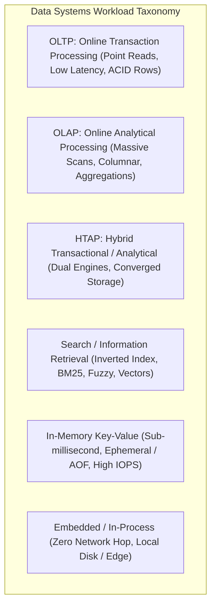
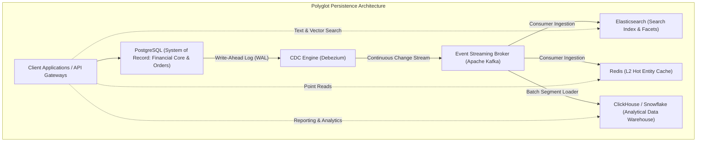
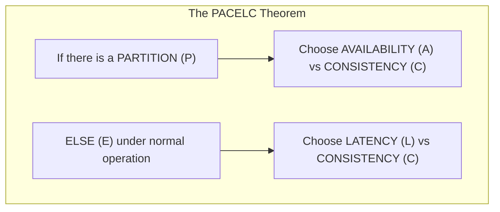
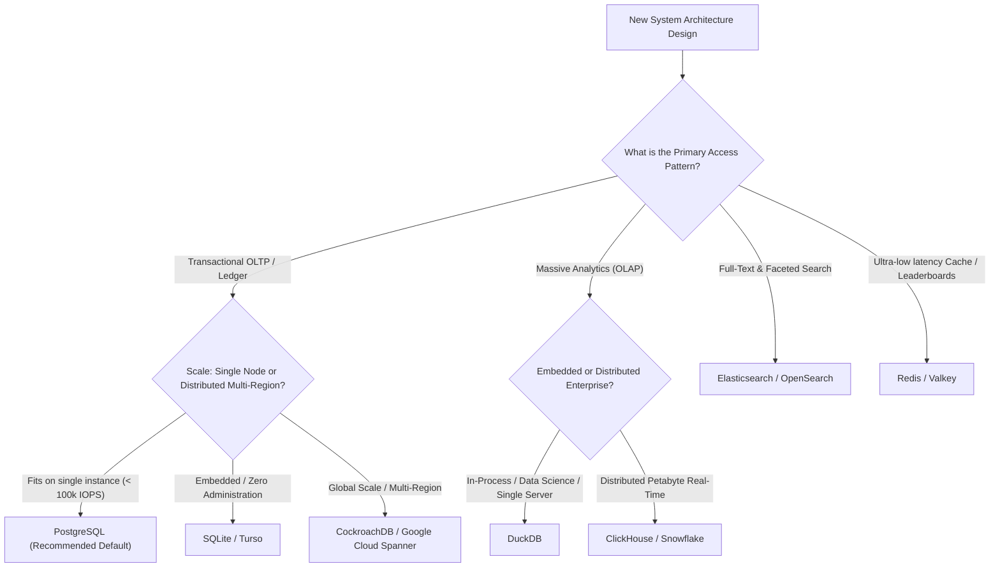

# Module 12: Architectural Decision Matrix, Workload Characterization, and Polyglot Persistence

No single database management system can optimally satisfy every operational requirement across modern enterprise architectures. A storage engine optimized for sub-millisecond atomic point lookups across millions of concurrent users (OLTP) is structurally incapable of scanning billions of records to calculate annual financial aggregations within seconds (OLAP), just as an inverted-index search cluster cannot reliably act as an ACID-compliant double-entry ledger. System architects must master **workload characterization**, understand the trade-offs across specialized engines, and coordinate **polyglot persistence** topologies.

---

## 1. Workload Classification: OLTP, OLAP, HTAP, Search, and In-Memory



### 1. Online Transaction Processing (OLTP)
- **Workload Profile**: High concurrency (thousands of queries per second); small, predictable read/write footprints; access patterns query or modify a handful of records by primary key or indexed foreign key.
- **Engine Requirements**: Strict ACID transaction guarantees, multi-version concurrency control (MVCC) or fine-grained row locks, row-oriented slotted page storage (B+Trees), and minimal commit latency via sequential Write-Ahead Logging.
- **Canonical Engines**: PostgreSQL, MySQL InnoDB, CockroachDB, Google Cloud Spanner.

### 2. Online Analytical Processing (OLAP)
- **Workload Profile**: Low concurrency (dozens of concurrent queries); complex, long-running read queries scanning millions or billions of rows; heavy multi-table joins, window calculations, and aggregations (`SUM`, `AVG`, `GROUP BY`).
- **Engine Requirements**: Column-oriented storage layout, high-ratio compression (Dictionary, RLE, Bit-Packing), vectorized SIMD execution engines, and distributed massively parallel processing (MPP) query planning.
- **Canonical Engines**: ClickHouse, Snowflake, DuckDB, Google BigQuery, Apache Druid.

### 3. Hybrid Transactional / Analytical Processing (HTAP)
- **Workload Profile**: Applications requiring real-time analytical queries over actively mutating transactional data without ETL delay.
- **Engine Mechanics**: Maintains dual storage representations of the same logical data: an in-memory or row-oriented store for writes, coupled with an asynchronous background converter maintaining a columnar replica (e.g. TiDB/TiFlash, SingleStore, Snowflake Unistore).

### 4. Search and Information Retrieval
- **Workload Profile**: Semi-structured document exploration, unstructured full-text keyword matching, fuzzy typo tolerance, faceted filtering, and dense vector similarity search.
- **Engine Requirements**: Inverted indexes with BM25 relevance scoring, postings lists compression, and HNSW graph traversal.
- **Canonical Engines**: Elasticsearch, OpenSearch, Apache Solr.

### 5. In-Memory Key-Value Caches
- **Workload Profile**: Ultra-low latency ($< 1\text{ ms}$), extreme IOPS ($100,000+$ ops/sec per core), ephemeral caching, session storage, distributed rate limiting, and real-time leaderboards.
- **Engine Mechanics**: Pure in-memory data structures (hash tables, skip lists, radix trees); single-threaded or lockless event loops; optional append-only file persistence.
- **Canonical Engines**: Redis, Valkey, Memcached, Dragonfly.

### 6. Embedded / In-Process Engines
- **Workload Profile**: Applications requiring local persistence without network latency or server administration: mobile apps, desktop software, edge devices, and local analytics scripts.
- **Engine Mechanics**: Library linked directly into the application process address space; communication via direct C ABI memory calls (zero network serialization overhead).
- **Canonical Engines**: SQLite (relational OLTP), DuckDB (analytical OLAP), RocksDB (key-value LSM).

---

## 2. The Comprehensive Architectural Decision Matrix

| Engine | Primary Data Model | Storage Engine Architecture | Concurrency Control | Isolation Defaults | Scaling Profile | Ideal Workload |
| :--- | :--- | :--- | :--- | :--- | :--- | :--- |
| **PostgreSQL** | Relational + `JSONB` + Vectors | Row-oriented Slotted Pages + B+Tree / GIN / HNSW | MVCC (Heap-Only Tuples + SSI) | Read Committed (Supports true Serializable) | Vertical Primary; Horizontal Read Replicas; Distributed via Citus | General-purpose transactional core, financial ledgers, complex SQL, hybrid multi-model web apps. |
| **SQLite** | Relational | B+Tree Pages in single file | Coarse file locks / WAL mode | Serializable (single writer in WAL) | Embedded single-node; Cloud-replicated via Litestream/Turso | Mobile applications, desktop tools, edge microservices, embedded local state stores. |
| **Redis / Valkey** | Key-Value / Complex Data Types | In-Memory Hash Tables & SkipLists | Single-threaded command loop (Atomic per command) | Strict Serialization (single thread) | Horizontal via Redis Cluster (16,384 slots) | Ephemeral caching, distributed rate limiting, real-time counters, low-latency queues. |
| **Elasticsearch** | Semi-structured JSON Documents | Lucene Segments (Inverted Index + BKD + HNSW) | Optimistic Concurrency (`if_seq_no`) | Eventual Consistency (Near Real-Time refresh) | Native multi-node horizontal sharding | Full-text search, log aggregation, observability metrics, faceted e-commerce catalogs. |
| **ClickHouse** | Columnar Relational | MergeTree (Columnar, Block Compression) | Vectorized append-only partitions | Atomic block insertion | Horizontal sharding across nodes | Real-time event analytics, clickstream processing, financial time-series telemetry. |
| **DuckDB** | Columnar Relational | In-Process Columnar Vectorized Engine | MVCC with optimistic concurrency | Snapshot Isolation | Embedded in-process execution (single node) | Fast local data science, embedded client-side OLAP, serverless ETL microservices. |

---

## 3. Polyglot Persistence: Managing Derived Data Systems

The reality of modern enterprise scale is **Polyglot Persistence**: an architecture where distinct storage technologies are deployed side-by-side, each owning the specific workload for which its underlying storage mechanics were designed.



### The System of Record (SoR) versus Derived Data Systems
- **System of Record (Source of Truth)**: The authoritative master representation of business state. All writes, state transitions, and constraints must be validated and committed here first (typically an ACID relational database like PostgreSQL).
- **Derived Data Systems**: Read-optimized representations computed deterministically from the System of Record. If an index in Elasticsearch or a cache in Redis is corrupted, it can be mathematically reconstructed from the historical log of the System of Record.

### The Fatal Anti-Pattern: Application-Level Dual Writes
A catastrophic architectural anti-pattern is attempting to update the System of Record and derived systems within application endpoint code:

```typescript
// THE DUAL-WRITE DISASTER: NEVER DO THIS IN PRODUCTION
async function updateProduct(product: Product) {
  await database.update(product);          // Step 1: Write to DB
  await redis.set(`product:${product.id}`, product); // Step 2: Write to Cache
  await elasticsearch.index(product);      // Step 3: Write to Search
}
```

If the server crashes after Step 1, or if Elasticsearch rejects the write due to a transient network timeout, the database holds the new data while the search cluster and cache hold stale or missing records, creating **permanent, silent data divergence**.

### The Production Remedy: CDC-Driven Pipelines
1. Application endpoints write exclusively to the **System of Record**.
2. A Change Data Capture engine (Debezium) reads the database's sequential Write-Ahead Log.
3. Changes are broadcast to an Apache Kafka topic.
4. Independent consumer services consume from Kafka and update Redis, Elasticsearch, and ClickHouse idempotently.

---

## 4. Theoretical Boundaries: The CAP and PACELC Theorems

When designing distributed storage architectures, physical network constraints impose theoretical limits formalized by Eric Brewer (2000) and refined by Daniel Abadi (2012).



### 1. The CAP Theorem
In a distributed asynchronous network subject to partitions ($P$):
- **Consistency ($C$)**: Every read receives the most recent write or an error (linearizability).
- **Availability ($A$)**: Every non-failing node returns a non-error response for every request (liveness).
- **Partition Tolerance ($P$)**: The system continues operating despite arbitrary dropped or delayed network packets.
- *The Inevitable Choice*: Because physical network partitions ($P$) cannot be prevented in real-world networking, a distributed database must choose between **CP** (rejecting writes/reads to preserve consistency when partitioned) or **AP** (accepting writes on both sides of a partition, yielding divergent state).

### 2. Abadi's PACELC Theorem
The CAP theorem is binary and only discusses behavior *during* active network partitions (which occur rarely). Abadi expanded this to describe normal, steady-state operation:

$$\text{If } \mathbf{P} \text{ (Partition)}, \text{ choose } \mathbf{A} \lor \mathbf{C}; \quad \mathbf{E} \text{ (Else)}, \text{ choose } \mathbf{L} \lor \mathbf{C}$$

- Under normal operation without partitions, does the system prioritize **low latency ($L$)** by replicating asynchronously, or does it prioritize **strict consistency ($C$)** by waiting for synchronous cross-datacenter round-trips before acknowledging commits?

### PACELC Classification of Common Engines

| Database Engine | PACELC Classification | Architectural Trade-off Summary |
| :--- | :--- | :--- |
| **Amazon DynamoDB / Cassandra** | **PA / EL** | During partition: Available (AP); Under normal operation: Low Latency (EL) via async replication. |
| **Google Cloud Spanner** | **PC / EC** | During partition: Consistent (CP); Under normal operation: Consistent (EC) via synchronous TrueTime Paxos. |
| **MongoDB (Default)** | **PC / EC** | Primary node handles writes; partitions cause write pauses (CP); normal operation waits for primary commit (EC). |
| **Redis (Master/Replica)** | **PA / EL** | Standby replicas replicate asynchronously; network disconnects risk lost writes in exchange for sub-millisecond latency. |

---

## 5. Architectural Decision Flowchart



---

## 6. Production Failure Modes and Anti-Patterns

### 1. Premature Polyglot Sprawl
- **Symptom**: A 5-person engineering startup deploys PostgreSQL, MongoDB, Redis, Elasticsearch, and Cassandra simultaneously, spending $80\%$ of their engineering bandwidth debugging infrastructure, CDC pipelines, and schema synchronization errors.
- **Root Cause**: Adopting specialized engines before data volume or query complexity justifies the operational overhead.
- **Mitigation**: **Start with PostgreSQL as the boring monolithic foundation**. PostgreSQL natively supports relational tables, binary `JSONB` documents, full-text search, and vector embeddings (`pgvector`). Introduce specialized engines (ClickHouse, Elasticsearch, Redis) only when quantitative profiling proves PostgreSQL cannot meet measured latency or throughput SLOs.

### 2. Treating Search Clusters as Systems of Record
- **Symptom**: Critical customer financial or order records disappear or become corrupted after an Elasticsearch node failure.
- **Root Cause**: Using Elasticsearch as the primary database without backing it with a true relational System of Record. Search engines prioritize near-real-time search indexing and fuzzy scoring over strict transactional durability, ACID constraints, and foreign key integrity.
- **Mitigation**: Never use a search engine as the primary System of Record. Always write to a transactional database first and project data into the search cluster via CDC.

### 3. Divergent Invalidation Outages
- **Symptom**: Bug reports flood customer support: users search for items that show up in product lists but yield 404 errors when clicked.
- **Root Cause**: The application updated the primary database, but the asynchronous CDC pipeline to Elasticsearch stalled due to an unhandled schema change. The search index served stale pointers to deleted database rows.
- **Mitigation**: Implement end-to-end reconciliation scripts that periodically compare checksums between the primary database and derived indexes, alerting on replication drift.

---

## 7. Interview Drill

<details>
<summary><strong>Q1: Contrast OLTP and OLAP workloads across access patterns, transaction requirements, and physical storage engine layout.</strong></summary>

**Answer:** 
- **OLTP (Online Transaction Processing)**:
  - *Access Patterns*: High concurrency (thousands of QPS); operations read or mutate a tiny handful of rows by primary key or indexed foreign key.
  - *Transaction Requirements*: Strict ACID compliance; fine-grained row-level locking or MVCC; sub-millisecond commit durability via sequential WAL.
  - *Storage Layout*: **Row-oriented (Slotted Page / B+Tree)**. Storing all attributes of a single row contiguously ensures that retrieving or updating a full record requires reading or writing a single page.
- **OLAP (Online Analytical Processing)**:
  - *Access Patterns*: Low concurrency; long-running analytical queries scanning millions or billions of rows to compute aggregations (`SUM`, `AVG`, `GROUP BY`) across a small subset of columns.
  - *Transaction Requirements*: Relaxed ACID (often append-only or batch-partitioned commits); zero row-level lock overhead.
  - *Storage Layout*: **Column-oriented (Vectorized / Block Compression)**. Storing each attribute contiguously across memory allows the engine to load only the specific columns queried, minimizing I/O and enabling SIMD vectorized query execution.
</details>

<details>
<summary><strong>Q2: Explain why application-level "Dual Writes" guarantee data corruption in polyglot persistence architectures, and describe the production remedy.</strong></summary>

**Answer:** 
Application-level dual writes occur when application endpoint code writes to a primary database and subsequently issues a network call to update a secondary system (e.g. `await db.insert()` followed by `await elasticsearch.index()`).

This guarantees corruption because the two systems lack distributed two-phase commit:
1. If the application server crashes between the two calls, the database commits but the search index is never updated.
2. If two concurrent writers execute, network packet jitter can cause writes to arrive out of order (e.g. Writer 1 commits first to the database, but Writer 2's update reaches Elasticsearch first, leaving the search index holding stale data).

The production remedy is **CDC-Driven Synchronization**:
- The application writes strictly to the relational **System of Record**.
- A Change Data Capture engine (Debezium) tails the database's sequential Write-Ahead Log.
- Changes are streamed to a persistent broker (Kafka) and applied to derived systems idempotently in strict transactional order, guaranteeing eventual consistency.
</details>

<details>
<summary><strong>Q3: How does the PACELC theorem expand upon the classical CAP theorem?</strong></summary>

**Answer:** 
The CAP theorem is binary and considers system behavior *only during active network partitions* ($P$): a system must choose between Availability ($A$) and Consistency ($C$). However, in well-engineered cloud networks, network partitions are rare; systems spend $99.99\%$ of their operational lifetime running normally.

Daniel Abadi's **PACELC theorem** expands CAP by addressing normal operation:

$$\text{If } \mathbf{P} \text{ (Partition)}, \text{ choose } \mathbf{A} \lor \mathbf{C}; \quad \mathbf{E} \text{ (Else / Normal)}, \text{ choose } \mathbf{L} \lor \mathbf{C}$$

PACELC states that even when the network is healthy, a distributed database must make an fundamental architectural trade-off:
- Does it prioritize **low latency ($L$)** by replicating data asynchronously and acknowledging writes immediately? (e.g. MongoDB, Redis, Cassandra).
- Or does it prioritize **strict consistency ($C$)** by synchronously coordinating commits across multiple network nodes before acknowledging the client? (e.g. Google Cloud Spanner, CockroachDB).
</details>

<details>
<summary><strong>Q4: Why should software engineering teams default to PostgreSQL before adopting specialized NoSQL or document databases?</strong></summary>

**Answer:** 
Modern PostgreSQL is a **converged multi-model database engine**. It eliminates the operational complexity of managing multiple heterogeneous databases during early-to-mid stage architecture:
1. **Relational & ACID Core**: Provides unbreakable referential integrity, schema validation, and serializable transactions.
2. **Semi-Structured Document Support**: Native binary `JSONB` with indexable jsonpath expressions and GIN indexes provides document-store flexibility without sacrificing relational joins.
3. **Full-Text Search**: Built-in `tsvector` and `tsquery` handle lexical search without running an Elasticsearch cluster.
4. **Vector Embeddings**: The `pgvector` extension provides HNSW and IVFFlat vector indexing for AI workloads directly adjacent to relational operational data.

Defaulting to PostgreSQL avoids the massive engineering overhead of maintaining cross-database CDC pipelines, dual-write consistency, and heterogeneous deployment infrastructure until measured performance bottlenecks demand specialized engines.
</details>

<details>
<summary><strong>Q5: What is DuckDB, and why has it emerged as the leading embedded analytical storage engine?</strong></summary>

**Answer:** 
DuckDB is an in-process, columnar analytical SQL database management system—often termed the **"SQLite for Analytics"**. 

It has emerged as the industry standard for analytical client workloads because:
1. **Embedded / In-Process**: Runs directly within the host process (Python, Node.js, WebAssembly, Rust) via direct C ABI calls, eliminating network socket round-trips and serialization costs.
2. **Vectorized Columnar Engine**: Executes queries using a state-of-the-art vectorized execution engine (processing blocks of 2048 tuples using SIMD vector instructions), matching or exceeding standalone cloud OLAP engines on single-node hardware.
3. **Zero-Copy Interoperability**: Natively reads and writes Apache Arrow, Parquet, and CSV files in place without requiring an upfront database import phase.
</details>

<details>
<summary><strong>Q6: Under what conditions does an architect require a true distributed SQL database (such as Google Cloud Spanner or CockroachDB) over a single-node PostgreSQL primary with read replicas?</strong></summary>

**Answer:** 
A single-node primary with read replicas can comfortably handle $99\%$ of web workloads (often scaling to $50,000+$ write IOPS and hundreds of thousands of read QPS). 

An architect requires distributed SQL only when:
1. **Write Throughput Limits**: The total volume of write transactions exceeds the maximum hardware capabilities (CPU, disk write IOPS, memory bandwidth) of the largest vertically scaled server available on the cloud market.
2. **Multi-Region Active-Active Latency**: The business mandates that users on different continents (e.g. US, Europe, Asia) experience low-latency local write transactions with automatic global consistency.
3. **Zero-RPO Instant Failover**: Business SLOs cannot tolerate the 10–30 second failover window of primary-replica architectures; distributed SQL systems leverage Paxos/Raft to achieve sub-second leader re-election with zero data loss ($RPO = 0$).
</details>
