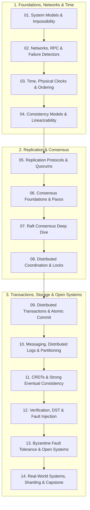

# Distributed Systems: From Impossibility Proofs to Global Consensus

A mathematically grounded, production-verified curriculum in distributed systems, replication protocols, consensus foundations, and fault-tolerant architecture. Every theoretical theorem is anchored in primary academic literature (Lamport, Fischer-Lynch-Paterson, Herlihy-Wing, Ongaro-Ousterhout, Gray, Shapiro, Corbett) and accompanied by deterministic, executable TypeScript test suites running directly under Node.js 26 without transpilation build steps.

> Verified against Node 26.12.1, TypeScript 7.0.2 on 2026-10-30

---

## 1. Syllabus & Curriculum Structure

The curriculum is structured as a continuous progressive narrative spanning 14 in-depth modules:



### Module Directory
1. [Module 01: System Models & Impossibility Proofs](modules/01-system-models-and-impossibility.md): Deutsch 8 fallacies, failure hierarchy (Crash-Stop to Byzantine), timing models (synchronous, asynchronous, partially synchronous), Two Generals impossibility proof, FLP bivalence proof, Gilbert-Lynch CAP, Abadi PACELC, Safety vs Liveness.
2. [Module 02: Networks, RPC & Failure Detection](modules/02-networks-rpc-and-failure-detection.md): RPC 5 failure points, at-most-once deduplication tables, Full Jitter vs Decorrelated Jitter, Metastable failures & retry amplification storms, $\Phi$-accrual failure detector normal tail math, Gray failures, SWIM gossip protocol.
3. [Module 03: Time, Physical Clocks & Ordering](modules/03-time-clocks-and-ordering.md): Physical clock skew & drift, LWW silent overwrite anomaly, Lamport happens-before ($\to$), Vector Clocks causal comparison, Hybrid Logical Clocks (HLC), Spanner TrueTime commit-wait $2\epsilon$, GC pause trap & fencing tokens.
4. [Module 04: Consistency Models & Linearizability](modules/04-consistency-models-and-linearizability.md): Herlihy-Wing real-time precedence, Jepsen consistency hierarchy, session guarantees (RYW, MR, MW, WFR), serializability vs linearizability, Wing-Gong (WGL) linearizability checking algorithm, P-compositionality.
5. [Module 05: Replication Protocols & Quorums](modules/05-replication-protocols-and-quorums.md): Primary-backup synchronous vs asynchronous, Chain Replication & CRAQ, naive $R+W>N$ linearizability violation, ABD register read-repair protocol, State Machine Replication (SMR) principle, ReadIndex, Lease reads, Follower reads.
6. [Module 06: Consensus Foundations, Paxos & ZAB](modules/06-consensus-foundations-and-paxos.md): Agreement/Validity/Integrity/Termination, Single-Decree Paxos Phase 1a/1b & 2a/2b, dueling proposers livelock, Multi-Paxos 1 RTT steady state, Flexible Paxos $Q_1 \cap Q_2 \neq \emptyset$ asymmetric quorums, EPaxos, ZAB epoch + counter.
7. [Module 07: Raft Consensus Deep Dive](modules/07-raft-consensus-deep-dive.md): Raft state machine transitions, RequestVote & AppendEntries RPCs, 5 safety properties, Figure 8 commit rule for prior terms, fsync persistence of `currentTerm`/`votedFor`/`log[]`, Pre-Vote phase, Check-Quorum mechanism.
8. [Module 08: Distributed Coordination & Locks](modules/08-distributed-coordination-and-locks.md): Distributed locks vs leases, Kleppmann's Redlock critique, storage-enforced fencing tokens, etcd revisions & micro-transactions, ZooKeeper ephemeral sequential nodes & fair lock queues avoiding thundering herds, distributed barriers.
9. [Module 09: Distributed Transactions & Atomic Commit](modules/09-distributed-transactions-and-atomic-commit.md): Atomic commit, 2PC prepare/commit and blocking coordinator failure, 3PC network partition failure, Google Percolator primary/secondary locks, Spanner Paxos + 2PC, Calvin deterministic scheduling, Sagas orchestration/choreography, Transactional Outbox.
10. [Module 10: Messaging, Distributed Logs & Partitioning](modules/10-messaging-logs-and-delivery-semantics.md): Log as source of truth, Kafka partitions, ISR, High Watermark vs LEO, `acks=all` + `min.insync.replicas >= 2`, Idempotent Producer PID + seqNum, Transactional EOS, KIP-848 cooperative rebalances, Kafka 4.2 Share Groups KIP-932, partition count resize trap.
11. [Module 11: CRDTs & Strong Eventual Consistency](modules/11-conflict-free-replicated-data-types-crdts.md): Strong Eventual Consistency (SEC), join-semilattice commutativity/associativity/idempotence, G-Counter, PN-Counter, OR-Set add-wins, sequence CRDTs, tombstone causal stability GC, Local-First 7 ideals.
12. [Module 12: Verification, DST & Fault Injection](modules/12-verification-testing-and-fault-injection.md): Deterministic Simulation Testing (DST FoundationDB/TigerBeetle VOPR), Jepsen generators/nemeses/checkers, TLA+ formal specifications & TLC model checking, AWS formal methods, Chaos Engineering.
13. [Module 13: Byzantine Fault Tolerance & Open Systems](modules/13-byzantine-fault-tolerance-and-open-systems.md): Byzantine failure model, $3f + 1$ mathematical proof, PBFT 3-phase pre-prepare/prepare/commit, Sybil attack defenses, Nakamoto Proof-of-Work & longest-chain rule, SUNDR fork consistency, CFT vs BFT trade-off matrix.
14. [Module 14: Real-World Systems, Sharding & Capstone](modules/14-distributed-systems-in-practice-and-capstone.md): GFS 64MB chunks & record appends, MapReduce fault tolerance, Dynamo vector clocks & sloppy quorums, Spanner architecture, AWS Aurora 6-way quorum log streaming, Memcached leases, Capstone Multi-Raft Sharded Key-Value Store with Linearizable Handoff.

---

## 2. Certifications & Academic Standards

This track covers foundational graduate and undergraduate distributed systems curricula and industry technical interview loops:

| Examination / Program | Vendor / Institution | Target Level / Format | Syllabus Reference |
|---|---|---|---|
| **MIT 6.5840 (formerly 6.824)** | MIT EECS / CSAIL (Morris, Kaashoek) | Graduate / Upper Undergraduate (Consensus, Paxos, Raft, Fault Tolerance, Sharded KV) | [MIT 6.5840 Distributed Systems](https://pdos.csail.mit.edu/6.824/) |
| **Cambridge CST Part II Distributed Systems** | University of Cambridge Computer Laboratory (Kleppmann) | Undergraduate Tripos Part II (System models, time, replication, consistency, CRDTs) | [Cambridge CST Part II Distributed Systems](https://www.cl.cam.ac.uk/teaching/current/DistSys/) |
| **Principal/Staff Distributed Systems Loop** | Industry Standard (Google Cloud, AWS, Confluent, Cloudflare, Meta) | Staff/Principal System Design & Protocol Correctness Loop | [Distributed Systems Question Bank & Mock Exam](exams/interview.md) |

- **Coverage Matrix**: Complete objective breakdown and weightings in [`exams/README.md`](exams/README.md).
- **Question Bank & Mock Examination**: 75 scenario-based questions and a 90-minute timed mock exam in [`exams/interview.md`](exams/interview.md).

---

## 3. Fast Reference & Terminology

- **Bilingual Index**: English ↔ Czech terminology mapping in [`GLOSSARY.md`](GLOSSARY.md).
- **Operational Cheat Sheet**: Quick lookup of theorems, formulas, quorum intersections, Raft safety invariants, and gotchas in [`CHEATSHEET.md`](CHEATSHEET.md).

---

## 4. Running Tests & Verification

All examples and proofs are hermetic TypeScript test suites running directly on Node 26 without external daemons:

```bash
# Execute pinned toolchain
mise run test

# Or run directly via npm
npm test

# Run strict static type checking
npm run typecheck

# Verify all Mermaid diagrams
node ../../tools/mermaid-check/check.mjs .
```
