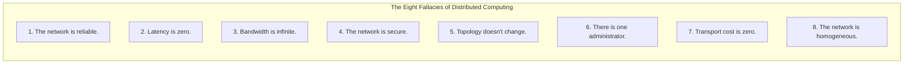
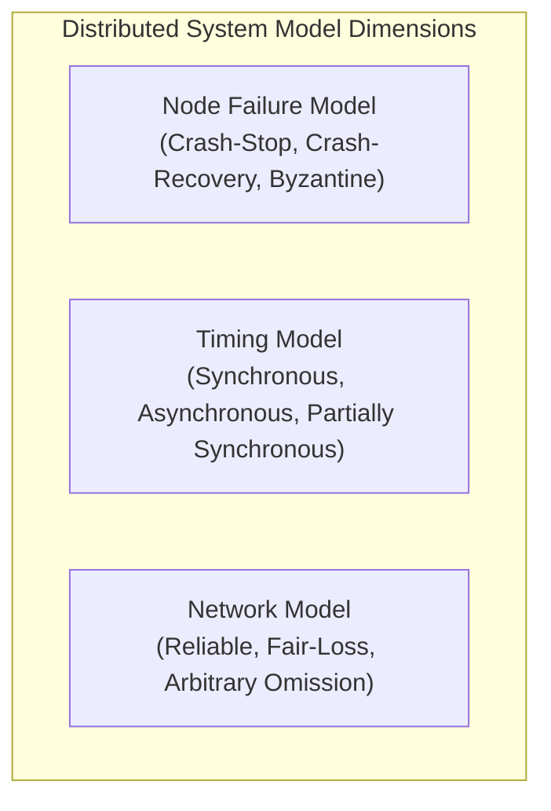
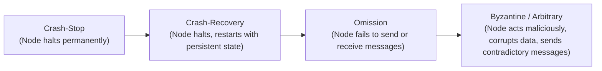
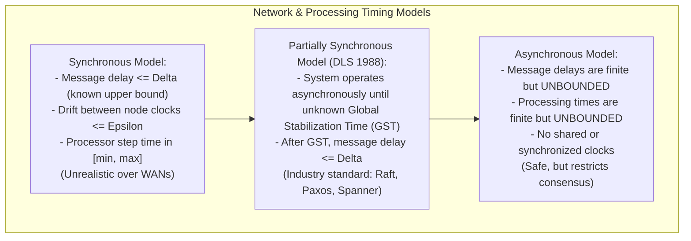
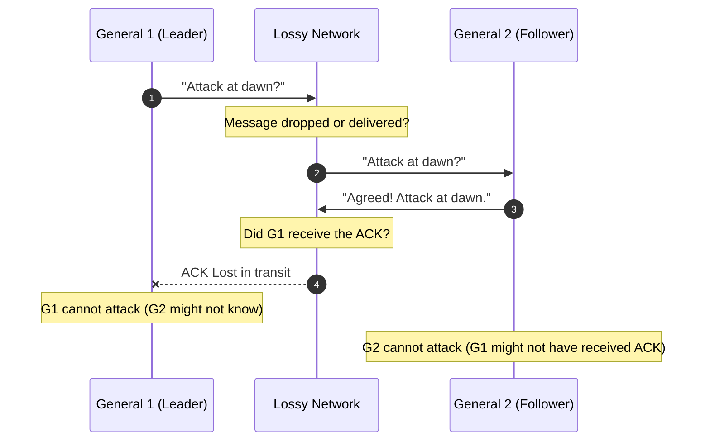
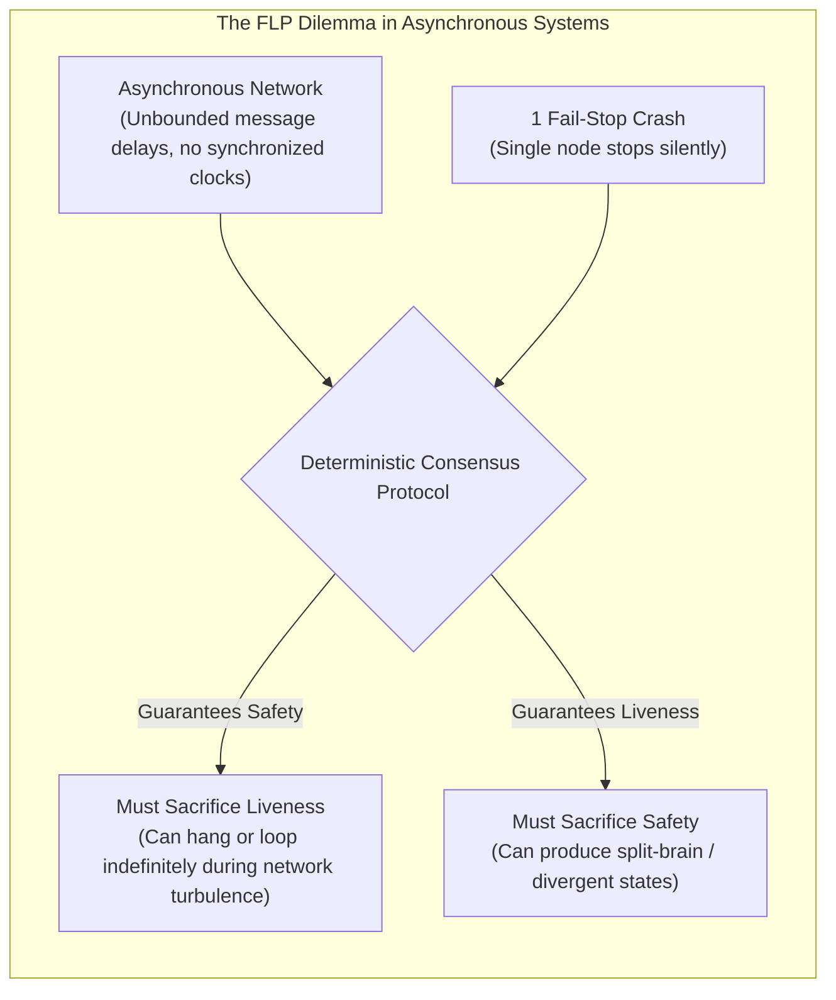
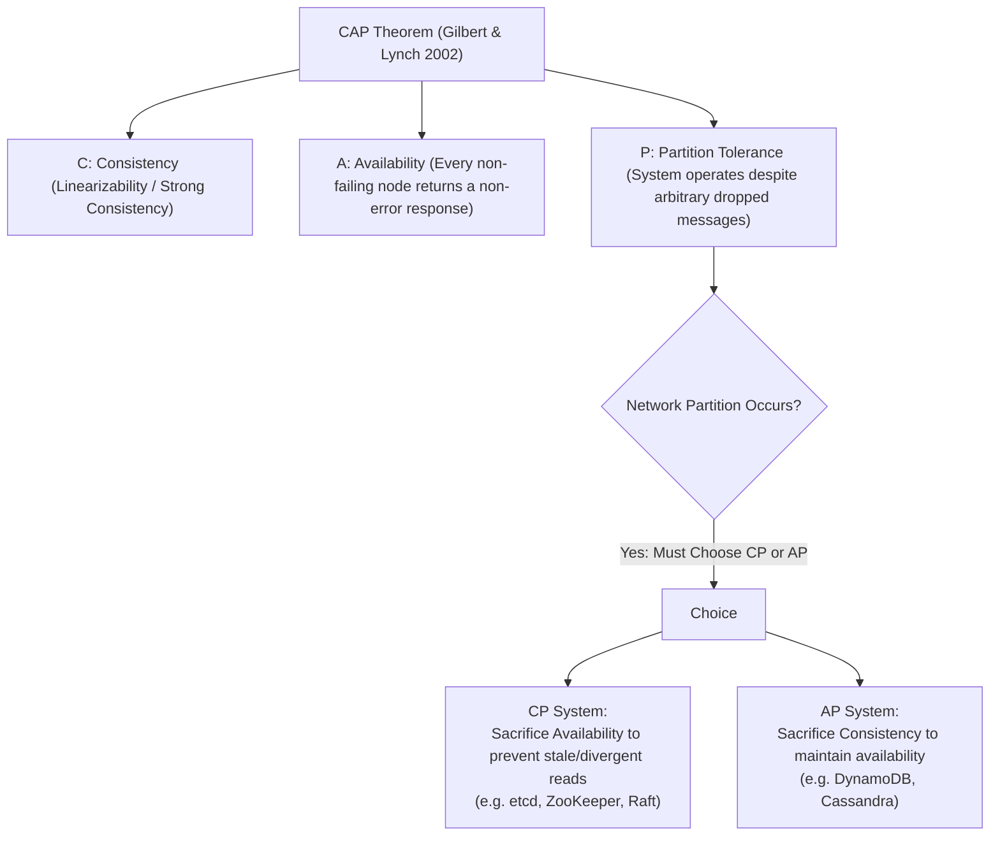
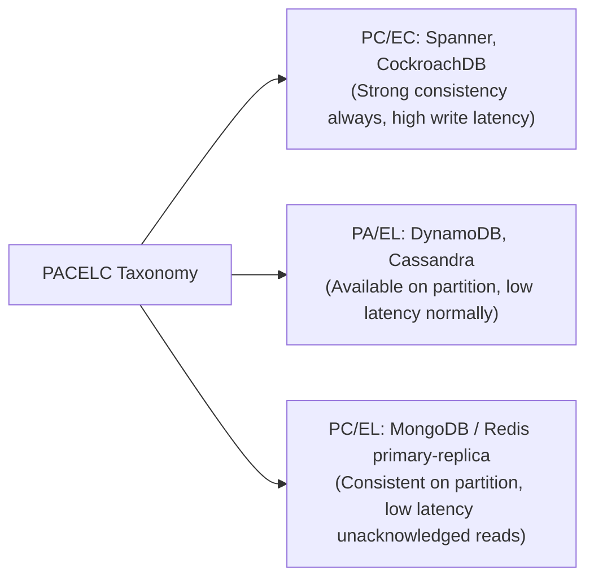
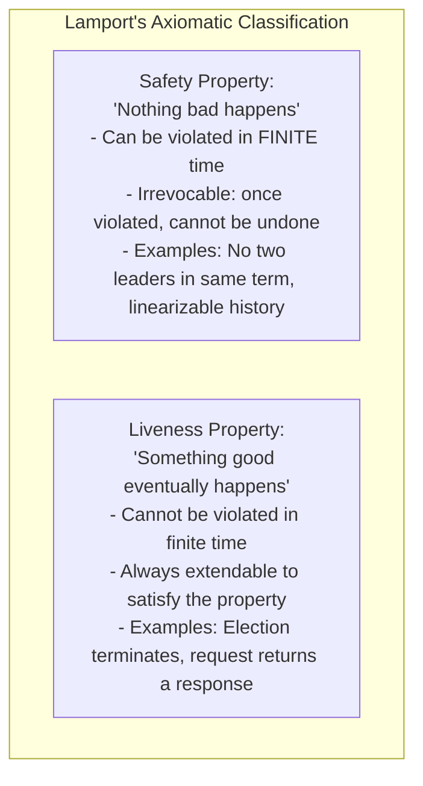

# Module 01 — System Models, Network Realities, and Impossibility Theorems

A distributed system is an interconnected collection of independent computational nodes communicating via messages over a network, coordinating actions to appear as a single coherent system. Unlike centralized architectures where memory, clock ticks, and CPU registers share a single physical board, distributed systems must operate across partial network partitions, unpredictable message latencies, clock skews, and node failures. This module establishes the formal taxonomy of distributed system models, the foundational Eight Fallacies of Distributed Computing, and the seminal impossibility proofs governing the domain: the **Two Generals Problem**, the **FLP Theorem**, and the formal **CAP / PACELC Theorems**.

---

## 1. The Eight Fallacies of Distributed Computing

In 1994, L. Peter Deutsch and James Gosling at Sun Microsystems formulated the canonical assumptions that engineers erroneously make when transitioning from single-node to networked architectures:

Every production outage in large-scale systems traces back to one of these false premises. Networks drop packets, fiber cables are cut, packet queues cause unbounded tail latencies, middleboxes rewrite headers, and node configurations diverge across autonomous administration domains.

---

## 2. Formal Classification of System Models

A distributed algorithm cannot be proven correct in a vacuum; it must be defined against an explicit **System Model** encompassing node behavior, timing assumptions, and network characteristics.

### 1. Node Failure Hierarchy
Failure models characterize how nodes deviate from their specified algorithm:

| Failure Model | Formal Definition | Operational Reality |
|---|---|---|
| **Crash-Stop (Fail-Stop)** | A node operates correctly until it halts. Once halted, it remains silent forever. | Server hardware power failure with permanent decommissioning. |
| **Crash-Recovery (Fail-Recovery)** | A node may halt unexpectedly, losing volatile RAM, but can later recover using non-volatile storage (disk/WAL). | Linux kernel panic, OOM killer termination, VM reboot. |
| **Omission Failures** | A node fails to transmit messages into the network or fails to read incoming packets from its socket buffers. | Garbage collection (GC) stop-the-world pauses, OS buffer saturation. |
| **Byzantine (Arbitrary)** | A node may arbitrarily deviate from the protocol: send conflicting votes, lie about its state, forge messages, or collude with adversaries. | Compromised nodes, malicious software, bit-flip hardware memory corruption. |

---

### 2. Network Timing Models
Timing models determine what assumptions an algorithm may legally make about execution speeds and message travel delays:

1. **Synchronous**: There exists a known strict upper bound $\Delta$ such that every message sent at time $t$ arrives by $t + \Delta$. If no reply arrives within $2\Delta$, the sender knows with mathematical certainty that the remote node has crashed. While common inside real-time embedded systems or a single mainframe backplane, it is nonexistent across commodity IP networks.
2. **Asynchronous**: Message delays and CPU processing speeds are arbitrary and unbounded (though finite). A process cannot distinguish between a node that has crashed and a node that is merely slow, hung in garbage collection, or experiencing network congestion. **No timeouts can be safely used to infer node death.**
3. **Partially Synchronous (Dwork, Lynch, Stockmeyer 1988)**: The system behaves asynchronously for arbitrary intervals (packets may be delayed indefinitely), but there exists an unknown **Global Stabilization Time (GST)** after which the network becomes synchronous with bounded delay $\Delta$. Practical consensus protocols (Raft, Paxos) rely on partial synchrony: **safety is guaranteed even during asynchronous periods, while liveness is guaranteed after GST**.

---

## 3. The Two Generals Problem: Consensus over Unreliable Channels

The **Two Generals Problem** (Gray, 1978) proves the impossibility of coordinating a deterministic joint action between two processes communicating over an unreliable channel.

### Formal Proof Sketch via Contradiction
1. Suppose there exists a minimum-length message exchange sequence $M = \langle m_1, m_2, \dots, m_k \rangle$ that guarantees both generals attack simultaneously with 100% confidence.
2. Consider the final message $m_k$ sent from General $A$ to General $B$.
3. Since the communication channel is unreliable, $m_k$ could be intercepted and lost.
4. If $m_k$ is lost, General $B$ does not receive it. However, because $M$ was assumed to guarantee agreement, General $A$ must still execute the attack.
5. But General $B$ cannot distinguish whether $m_k$ was lost or if the protocol was simply never completed. If General $B$ attacks without $m_k$, then message $m_k$ was unnecessary!
6. This contradicts the minimality of $M$. By induction, removing all messages down to $m_1$ shows that no finite sequence of acknowledgments can ever establish common knowledge over a lossy link.

---

## 4. The FLP Impossibility Theorem

In 1985, Fischer, Lynch, and Paterson published their landmark paper (*"Impossibility of Distributed Consensus with One Faulty Process"*), winning the Dijkstra Prize.

> **Theorem (FLP 1985):** In an asynchronous network model, no deterministic consensus protocol can guarantee both safety and liveness in the presence of even a single unannounced crash-stop failure.

### The Mechanism of Bivalent Configurations
- A system configuration is **univalent** if all possible future executions inevitably decide the same value (0-valent or 1-valent).
- A configuration is **bivalent** if both 0 and 1 remain reachable depending on which message is scheduled next.
- Initial configurations are necessarily bivalent.
- FLP proves that starting from any bivalent state, there always exists an adversarial message delivery sequence that delays the arrival of a packet from a single slow/crashed node such that the system transitions from one bivalent state to another bivalent state forever.
- **Practical Implication**: Modern consensus systems (Raft, Paxos) do not violate FLP. Instead, they abandon pure asynchrony, assuming **partial synchrony** with randomized timers (Raft) to escape bivalent cycles in practice.

---

## 5. CAP Theorem: Formal Gilbert-Lynch Statement and PACELC

Formulated by Eric Brewer in 2000 and formally proven by Seth Gilbert and Nancy Lynch in 2002, the **CAP Theorem** defines the fundamental trade-off of partitioned systems.

### Precise Definitions (Gilbert & Lynch)
- **Consistency ($C$)**: Equivalent strictly to **Linearizability**. Every read operation must return the value of the most recent write, or throw an error. The system behaves as if there is only a single copy of data in the universe.
- **Availability ($A$)**: Every non-failing node must return a successful, non-error response to every request it receives.
- **Partition Tolerance ($P$)**: The network is permitted to lose arbitrary messages between nodes for arbitrary durations.

> [!IMPORTANT]
> **"CA" is not a valid architectural choice in distributed systems.** Networks are physical entities that *will* partition. Therefore, a distributed system must choose how to behave *when* a partition occurs: either reject requests on minority partitions (CP) or serve stale/divergent data (AP).

### The PACELC Theorem (Daniel Abadi, 2012)
CAP only describes system behavior *during an active network partition*. In production systems, partitions are rare exceptions; normal operation dominates $>99.9\%$ of the time. The **PACELC Theorem** extends CAP to normal conditions:

$$\text{If } \mathbf{P} \text{ (Partition)}, \quad \text{choose between } \mathbf{A} \text{ and } \mathbf{C}; \quad \text{Else } (\mathbf{E}), \quad \text{choose between } \mathbf{L} \text{ (Latency) and } \mathbf{C} \text{ (Consistency)}.$$

---

## 6. Safety vs. Liveness: Lamport's Dual Axioms

Leslie Lamport proved that every distributed specification decomposes into two orthogonal property classes:

| Dimension | Safety Property | Liveness Property |
|---|---|---|
| **Informal Meaning** | "A bad thing never happens." | "A good thing eventually happens." |
| **Violation Horizon** | Finite sequence of steps $t_0 \dots t_k$. | Infinite execution trace (cannot be disproven at step $k$). |
| **Recovery** | Irrevocable. A committed split-brain write cannot be un-written. | Remediable. At any finite point, the system can still make progress. |
| **Model Checking** | Checked via state invariants ($G(P)$) in TLA+ / TLC. | Checked via temporal logic formulas ($\Diamond P$ or $\Box \Diamond P$). |

---

## 7. Interview Drill: System Models & Impossibility

1. Why is the Two Generals Problem fundamentally different from the Byzantine Generals Problem?

In the Two Generals Problem, the communication channel is unreliable (packets are lost or delayed), but the processes themselves are completely honest and trustworthy (crash-stop). In the Byzantine Generals Problem, the communication network is assumed to be reliable, but the processes themselves may be traitors, sending contradictory messages or intentionally sabotaging agreement.

2. Does the Raft or Paxos consensus protocol violate the FLP Impossibility Theorem?

No. The FLP theorem applies strictly to **deterministic** consensus protocols running in a **purely asynchronous** network model.
Raft and Paxos circumvent FLP by introducing two non-asynchronous assumptions:
1. **Partial Synchrony**: They rely on timeouts to detect leader crashes and assume that after Global Stabilization Time (GST), packet delays are bounded.
2. **Randomization**: Raft uses randomized election timeouts to break symmetric voting ties, ensuring that adversarial bivalent cycles terminate with probability 1.

3. Why is calling a database 'CA' considered an architectural misnomer?

In any distributed architecture, network partitions ($P$) are a physical inevitability of IP networks (fiber cuts, switch reboots, routing misconfigurations). You cannot choose "no partitions". When a partition occurs, the system is physically partitioned; it must therefore either:
- Halt or return an error on the partitioned nodes (sacrificing Availability for Consistency, CP), or
- Allow both sides of the partition to accept writes independently (sacrificing Consistency for Availability, AP).
Systems marketed as "CA" (e.g. single-node PostgreSQL) are simply centralized non-distributed systems.

4. What does the PACELC theorem tell us about Cassandra versus Google Spanner during normal operation?

Under normal operation (no network partition, the **Else** branch):
- **Cassandra (PA/EL)**: Chooses **Latency ($L$)** over Consistency ($C$). It uses asynchronous replication and non-strict quorums to acknowledge writes rapidly without waiting for cross-region coordination.
- **Google Spanner (PC/EC)**: Chooses **Consistency ($C$)** over Latency ($L$). It executes Paxos roundtrips and commit-wait delays using TrueTime to guarantee strict serializability, deliberately accepting higher roundtrip latency to maintain consistency.

5. How can a model checker determine whether an invariant failure is a safety violation or a liveness violation?

- A **Safety violation** is proven by a finite execution trace ending in a specific bad state (e.g., two nodes simultaneously believing they are the leader in term 5). It requires only inspecting the state table.
- A **Liveness violation** cannot be proven by any finite prefix. It manifests as a cycle (an infinite loop or deadlock) where the system transitions indefinitely through valid states without ever reaching the desired goal state (e.g., an infinite election split-vote loop).

