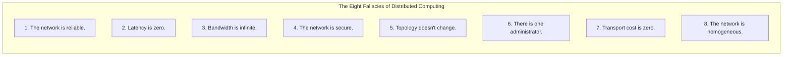
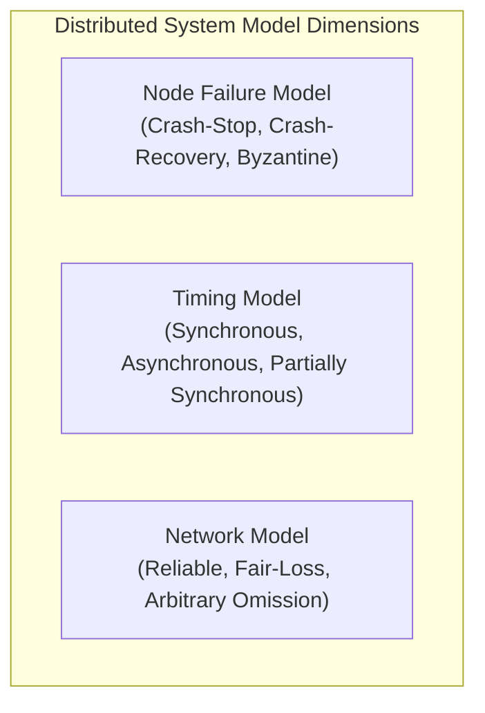
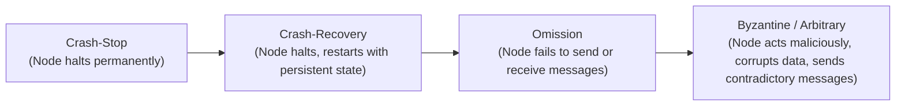
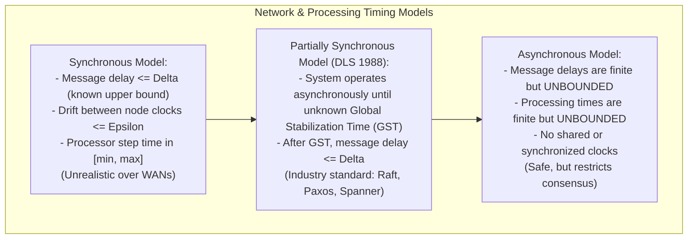
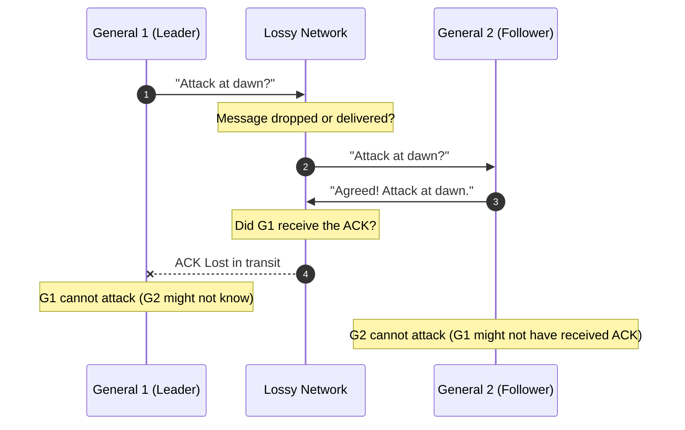
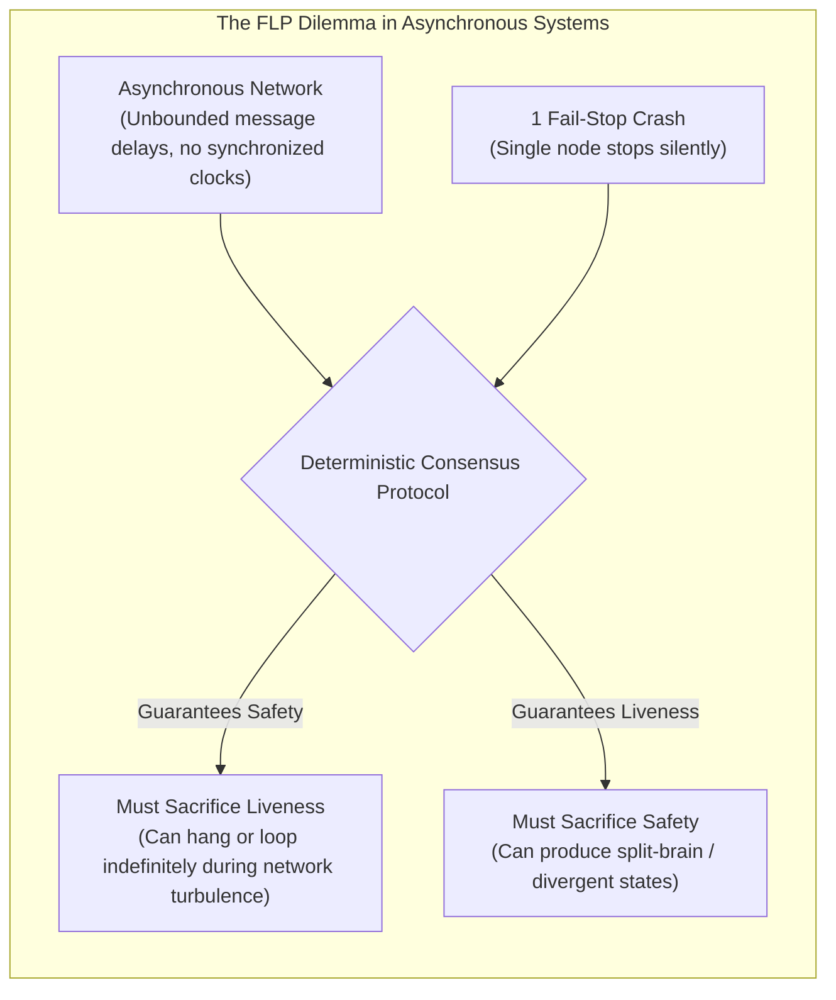
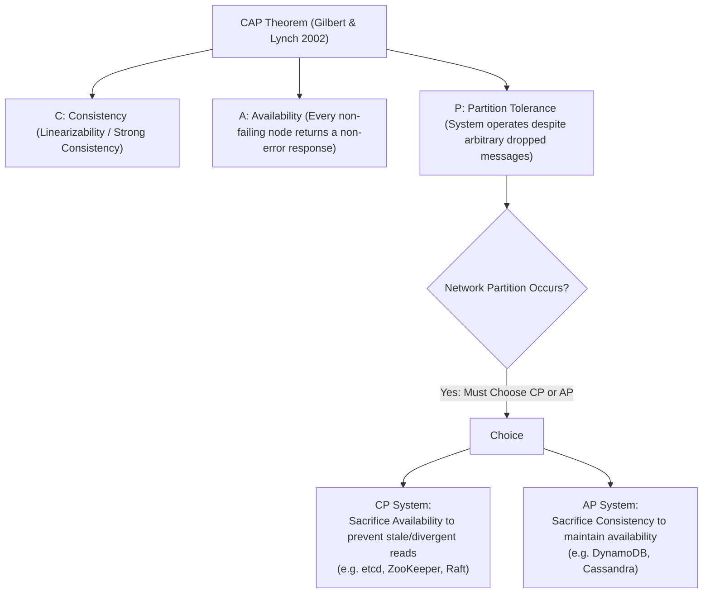
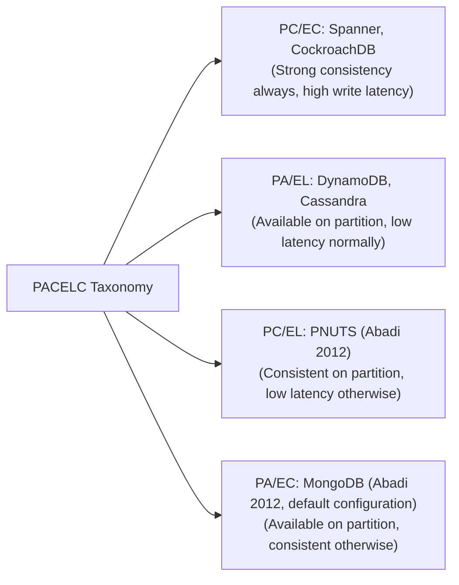
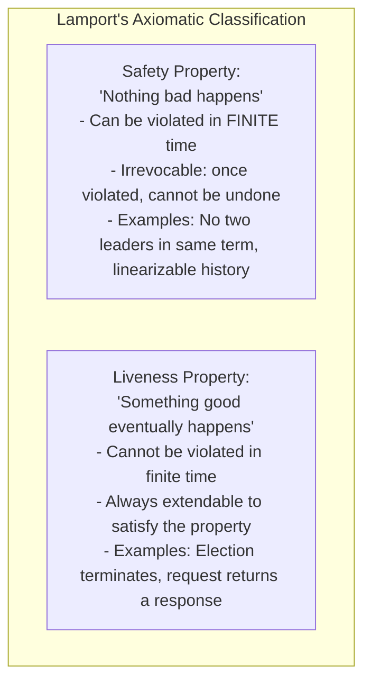
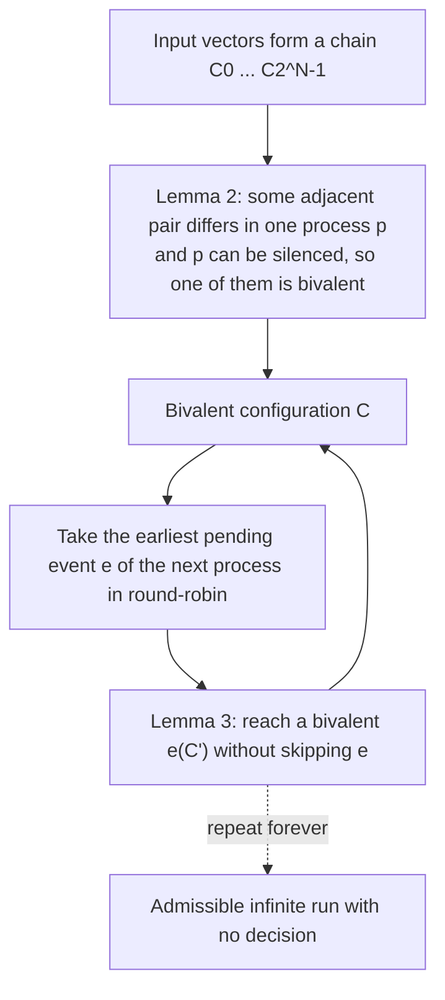

# Module 01 — System Models, Network Realities, and Impossibility Theorems

A distributed system is an interconnected collection of independent computational nodes communicating via messages over a network, coordinating actions to appear as a single coherent system. Unlike centralized architectures where memory, clock ticks, and CPU registers share a single physical board, distributed systems must operate across partial network partitions, unpredictable message latencies, clock skews, and node failures. This module establishes the formal taxonomy of distributed system models, the foundational Eight Fallacies of Distributed Computing, and the seminal impossibility proofs governing the domain: the **Two Generals Problem**, the **FLP Theorem**, and the formal **CAP / PACELC Theorems**.

---

## 1. The Eight Fallacies of Distributed Computing

In 1994, L. Peter Deutsch and James Gosling at Sun Microsystems formulated the canonical assumptions that engineers erroneously make when transitioning from single-node to networked architectures:



Every production outage in large-scale systems traces back to one of these false premises. Networks drop packets, fiber cables are cut, packet queues cause unbounded tail latencies, middleboxes rewrite headers, and node configurations diverge across autonomous administration domains.

---

## 2. Formal Classification of System Models

A distributed algorithm cannot be proven correct in a vacuum; it must be defined against an explicit **System Model** encompassing node behavior, timing assumptions, and network characteristics.



### 1. Node Failure Hierarchy

Failure models characterize how nodes deviate from their specified algorithm:



| Failure Model | Formal Definition | Operational Reality |
| --- | --- | --- |
| **Crash-Stop (Fail-Stop)** | A node operates correctly until it halts. Once halted, it remains silent forever. | Server hardware power failure with permanent decommissioning. |
| **Crash-Recovery (Fail-Recovery)** | A node may halt unexpectedly, losing volatile RAM, but can later recover using non-volatile storage (disk/WAL). | Linux kernel panic, OOM killer termination, VM reboot. |
| **Omission Failures** | A node fails to transmit messages into the network or fails to read incoming packets from its socket buffers. | Garbage collection (GC) stop-the-world pauses, OS buffer saturation. |
| **Byzantine (Arbitrary)** | A node may arbitrarily deviate from the protocol: send conflicting votes, lie about its state, forge messages, or collude with adversaries. | Compromised nodes, malicious software, bit-flip hardware memory corruption. |

---

### 2. Network Timing Models

Timing models determine what assumptions an algorithm may legally make about execution speeds and message travel delays:



1. **Synchronous**: There exists a known strict upper bound $\Delta$ such that every message sent at time $t$ arrives by $t + \Delta$. If no reply arrives within $2\Delta$, the sender knows with mathematical certainty that the remote node has crashed. While common inside real-time embedded systems or a single mainframe backplane, it is nonexistent across commodity IP networks.
2. **Asynchronous**: Message delays and CPU processing speeds are arbitrary and unbounded (though finite). A process cannot distinguish between a node that has crashed and a node that is merely slow, hung in garbage collection, or experiencing network congestion. **No timeouts can be safely used to infer node death.**
3. **Partially Synchronous (Dwork, Lynch, Stockmeyer 1988)**: The system behaves asynchronously for arbitrary intervals (packets may be delayed indefinitely), but there exists an unknown **Global Stabilization Time (GST)** after which the network becomes synchronous with bounded delay $\Delta$. Practical consensus protocols (Raft, Paxos) rely on partial synchrony: **safety is guaranteed even during asynchronous periods, while liveness is guaranteed after GST**.

---

## 3. The Two Generals Problem: Consensus over Unreliable Channels

The **Two Generals Problem** (Gray, 1978) proves the impossibility of coordinating a deterministic joint action between two processes communicating over an unreliable channel.



### Formal Proof Sketch via Contradiction

1. Suppose there exists a minimum-length message exchange sequence $M = \langle m_1, m_2, \dots, m_k \rangle$ that guarantees both generals attack simultaneously with 100% confidence.
2. Consider the final message $m_k$ sent from General $A$ to General $B$.
3. Since the communication channel is unreliable, $m_k$ could be intercepted and lost.
4. If $m_k$ is lost, General $B$ does not receive it. However, because $M$ was assumed to guarantee agreement, General $A$ must still execute the attack.
5. But General $B$ cannot distinguish whether $m_k$ was lost or if the protocol was simply never completed. If General $B$ attacks without $m_k$, then message $m_k$ was unnecessary!
6. This contradicts the minimality of $M$. By induction, removing all messages down to $m_1$ shows that no finite sequence of acknowledgments can ever establish common knowledge over a lossy link.

---

## 4. The FLP Impossibility Theorem

In 1985, Fischer, Lynch, and Paterson published their landmark paper (_"Impossibility of Distributed Consensus with One Faulty Process"_), winning the Dijkstra Prize.

> **Theorem (FLP 1985):** In an asynchronous network model, no deterministic consensus protocol can guarantee both safety and liveness in the presence of even a single unannounced crash-stop failure.



### The Mechanism of Bivalent Configurations

- A system configuration is **univalent** if all possible future executions inevitably decide the same value (0-valent or 1-valent).
- A configuration is **bivalent** if both 0 and 1 remain reachable depending on which message is scheduled next.
- Initial configurations are necessarily bivalent.
- FLP proves that starting from any bivalent state, there always exists an adversarial message delivery sequence that delays the arrival of a packet from a single slow/crashed node such that the system transitions from one bivalent state to another bivalent state forever.
- **Practical Implication**: Modern consensus systems (Raft, Paxos) do not violate FLP. Instead, they abandon pure asynchrony, assuming **partial synchrony** with randomized timers (Raft) to escape bivalent cycles in practice.

---

## 5. CAP Theorem: Formal Gilbert-Lynch Statement and PACELC

Formulated by Eric Brewer in 2000 and formally proven by Seth Gilbert and Nancy Lynch in 2002, the **CAP Theorem** defines the fundamental trade-off of partitioned systems.



### Precise Definitions (Gilbert & Lynch)

- **Consistency ($C$)**: Equivalent strictly to **Linearizability**. Every read operation must return the value of the most recent write, or throw an error. The system behaves as if there is only a single copy of data in the universe.
- **Availability ($A$)**: Every non-failing node must return a successful, non-error response to every request it receives.
- **Partition Tolerance ($P$)**: The network is permitted to lose arbitrary messages between nodes for arbitrary durations.

> [!IMPORTANT]
> **"CA" is not a valid architectural choice in distributed systems.** Networks are physical entities that _will_ partition. Therefore, a distributed system must choose how to behave _when_ a partition occurs: either reject requests on minority partitions (CP) or serve stale/divergent data (AP).

### The PACELC Theorem (Daniel Abadi, 2012)

CAP only describes system behavior _during an active network partition_. In production systems, partitions are rare exceptions; normal operation dominates $>99.9\%$ of the time. The **PACELC Theorem** extends CAP to normal conditions:

$$\text{If } \mathbf{P} \text{ (Partition)}, \quad \text{choose between } \mathbf{A} \text{ and } \mathbf{C}; \quad \text{Else } (\mathbf{E}), \quad \text{choose between } \mathbf{L} \text{ (Latency) and } \mathbf{C} \text{ (Consistency)}.$$



---

## 6. Safety vs. Liveness: Lamport's Dual Axioms

Leslie Lamport proved that every distributed specification decomposes into two orthogonal property classes:



| Dimension | Safety Property | Liveness Property |
| --- | --- | --- |
| **Informal Meaning** | "A bad thing never happens." | "A good thing eventually happens." |
| **Violation Horizon** | Finite sequence of steps $t_0 \dots t_k$. | Infinite execution trace (cannot be disproven at step $k$). |
| **Recovery** | Irrevocable. A committed split-brain write cannot be un-written. | Remediable. At any finite point, the system can still make progress. |
| **Model Checking** | Checked via state invariants ($G(P)$) in TLA+ / TLC. | Checked via temporal logic formulas ($\Diamond P$ or $\Box \Diamond P$). |

---

## 7. Common Knowledge: The Epistemic Form of Two Generals

The sketch in §3 argues by minimality. The sharper statement, due to Halpern and Moses (_Knowledge and Common Knowledge in a Distributed Environment_, PODC 1984 / JACM 1990), is epistemic: coordinated action needs **common knowledge**, and a lossy channel can never create it.

### Definitions

Fix a set of **worlds** $W$ (global executions up to some point) and, for each process $p$, an **indistinguishability relation** $w \sim_p w'$ meaning $p$ has the same local view in both. For a fact $\varphi \subseteq W$:

- $K_p\varphi = \{w : \forall w' \sim_p w,\ w' \in \varphi\}$ ($p$ knows $\varphi$).
- $E\varphi = \bigcap_p K_p\varphi$ (everybody knows). $E^{k+1}\varphi = E(E^k\varphi)$.
- $C\varphi = \bigcap_{k \ge 1} E^k\varphi$, equivalently the greatest fixpoint $X = \varphi \cap E X$ (common knowledge).

Coordinated attack is solvable only if the generals can act on a fact that is in $C\varphi$ at the moment they act. This is why no finite handshake, TCP's included, can give both sides certainty that the other side has acted: each extra message buys one more level of $E^k$, never $C$.

### Theorem (no common knowledge over a lossy chain)

Model an alternating chain $m_1$ (G1 to G2), $m_2$ (G2 to G1), $m_3, \dots$ in which $m_{k+1}$ is sent only after $m_k$ is delivered. Let world $w_d$ be "exactly $d$ messages were delivered", and let $\varphi$ be "$m_1$ was delivered" ($d \ge 1$). A process's view is the pair (messages it sent, messages it received).

1. The sender of $m_{d+1}$ sent it in $w_d$ (and it was lost), so G1's view in $w_0$ and $w_1$ is identical: sent $m_1$, received nothing. G1's indistinguishability classes are $\{0,1\},\{2,3\},\{4,5\},\dots$.
2. G2's view first changes at $w_1$ (it received $m_1$) and again at $w_3$, so its classes are $\{0\},\{1,2\},\{3,4\},\dots$.
3. Induction: $w_d \in E^{k}\varphi$ iff $d \ge k + 1$. Each extra delivered message buys exactly **one more level** of "everybody knows that everybody knows...".
4. The two relations interleave: $w_0 \sim_{G1} w_1$, $w_1 \sim_{G2} w_2$, $w_2 \sim_{G1} w_3$, and so on. Following alternating edges connects every world to $w_0 \notin \varphi$, so no world can sit inside a set closed under $E$ that excludes $w_0$. Hence $C\varphi = \emptyset$ in every world, whatever the chain length.

The executable version computes $E^k$ levels and the greatest fixpoint on a 13-world chain: [examples/01b-flp-knowledge-and-round-bounds.test.ts](../examples/01b-flp-knowledge-and-round-bounds.test.ts). It asserts that world $d$ satisfies exactly $E^{d-1}\varphi$ and that $C\varphi$ is empty everywhere.

### What engineers do instead

Because $C$ is unreachable, real protocols replace "act simultaneously" by **asymmetric commitment**: one side decides unilaterally and the other side's obligation is made idempotent and retryable. Two-phase commit's coordinator log (Module 09), TCP's connection teardown with `TIME_WAIT`, and "at-least-once plus idempotent receiver" (Module 10) are all ways to live without common knowledge.

---

## 8. The FLP Proof Structure

The module's §4 states the theorem. This section gives the proof skeleton so that you can reconstruct it on a whiteboard.

### Model (FLP 1985, §2)

- $N \ge 2$ deterministic processes, each an automaton with a one-bit input register $x_p$, a write-once output register $y_p \in \{b, 0, 1\}$ ($b$ = undecided), and a transition function.
- A **message buffer** holds sent-but-undelivered messages $(p, m)$. The only primitive is `receive(p)`, which returns either some message addressed to $p$ or the **null message $\emptyset$**. The buffer may delay any message arbitrarily but must deliver every message to a non-faulty process eventually.
- A **configuration** $C$ is (all process states, buffer). An **event** $e = (p, m)$ applied to $C$ gives $e(C)$. A **schedule** is a finite or infinite sequence of events; a run is _admissible_ if at most one process takes only finitely many steps and every message to a live process is eventually delivered.
- **Partial correctness**: no reachable configuration has two different decision values, and both 0 and 1 are decision values of some reachable configuration (the second clause rules out the trivial "always decide 0").
- $C$ is **$v$-valent** if every configuration reachable from $C$ with a decision has decision value $v$; **bivalent** if both values remain reachable.

### Lemma 1 (commutativity)

If schedules $\sigma_1,\sigma_2$ apply to $C$ and involve disjoint sets of processes, then $\sigma_1\sigma_2(C) = \sigma_2\sigma_1(C)$. Disjoint processes touch disjoint states and only _add_ to the buffer. This lemma is why delivery order between independent processes is irrelevant, and it is the only place where "asynchronous" is used mechanically.

### Lemma 2 (a bivalent initial configuration exists)

Order the $2^N$ input vectors so that adjacent vectors $C_i, C_{i+1}$ differ in a single process's input. Validity forces the all-0 vector to be 0-valent and the all-1 vector to be 1-valent, so some adjacent pair $C_i$ (0-valent) and $C_{i+1}$ (1-valent) exists. They differ only in process $p$'s input. Consider an admissible run from $C_i$ in which $p$ takes **no steps** (it is the one allowed fault) and the others decide. The same schedule applies from $C_{i+1}$ because $p$ never acts, and the others cannot tell the two apart, so they decide the same value in both. That value is both 0 (from $C_i$ being 0-valent) and 1 (from $C_{i+1}$ being 1-valent): contradiction unless one of the two is bivalent.

### Lemma 3 (a bivalent configuration stays bivalent across any pending event)

Let $C$ be bivalent and $e = (p, m)$ an event applicable to $C$. Let $\mathcal{C}$ be the set of configurations reachable from $C$ **without** applying $e$, and $\mathcal{D} = \{e(C') : C' \in \mathcal{C}\}$. Claim: $\mathcal{D}$ contains a bivalent configuration.

Suppose not, so every member of $\mathcal{D}$ is univalent.

1. $\mathcal{D}$ contains both a 0-valent and a 1-valent configuration. Take a decided configuration $E_i$ reachable from $C$ with value $i$. Either $e$ was not used on the way (then $E_i \in \mathcal{C}$ and $e(E_i) \in \mathcal{D}$ is a descendant of an $i$-valent configuration, hence $i$-valent), or $e$ was used and the configuration just after it lies in $\mathcal{D}$ and reaches $E_i$, hence is $i$-valent.
2. Because $\mathcal{C}$ is connected by single events from $C$, there are neighbours $C_0, C_1 = e'(C_0)$ in $\mathcal{C}$ with $e(C_0)$ $i$-valent and $e(C_1)$ $(1-i)$-valent, where $e' = (p', m')$.
3. Case $p' \neq p$. Events of different processes commute (Lemma 1): $e'(e(C_0)) = e(e'(C_0)) = e(C_1)$. So the $i$-valent $e(C_0)$ has a $(1-i)$-valent successor: contradiction.
4. Case $p' = p$. Let the system run from $C_0$ with $p$ taking **no steps** (the single permitted fault) until some configuration $A$ is decided, using a schedule $\sigma$ that does not involve $p$. By Lemma 1, $\sigma$ also applies to $e(C_0)$ and to $e(e'(C_0))$, and $e(A)$ and $e(e'(A))$ are reachable from them. $A$ is already decided with a single value $d$, and decisions are irrevocable, so $e(A)$ and $e(e'(A))$ both carry value $d$. But one descends from an $i$-valent and the other from a $(1-i)$-valent configuration: contradiction.

### Assembling the theorem

Start in a bivalent initial configuration (Lemma 2). Keep a queue of processes in round-robin order, and always apply the **earliest pending event** of the process at the head of the queue (null message if none). By Lemma 3 this keeps the configuration bivalent forever. The run is admissible (every process steps infinitely often, every message is eventually delivered) and nobody ever decides.



### What FLP does and does not say

- It does **not** say consensus is impossible in practice. It says no _deterministic_ protocol has a _guaranteed_ termination bound against an adversarial scheduler in the _asynchronous_ model with **one** crash. The bad run exists, but it requires an adversary that is smarter than any real network.
- It does **not** need Byzantine faults, lossy links, or more than one crash.
- The impossibility is about **termination only**. Safety (agreement, validity) can always be preserved by waiting.

### Exhaustive illustration on two tiny protocols

Three processes broadcast their input bit; the explorer enumerates every delivery order (the adversary is the scheduler) and records reachable decisions:

| Protocol | Rule | Safe (agreement) | Live under 1 initial crash |
| --- | --- | --- | --- |
| wait-all-majority | decide majority once all 3 values arrived | yes, over every schedule | **no**: survivors wait forever |
| wait-two-min | decide `min` of the first 2 values seen | **no**: input $(0,1,1)$ lets p0 decide 0 and p1 decide 1 | yes |

Under wait-two-min the input $(0,1,1)$ is **bivalent** (both 0 and 1 are reachable decisions) while $(0,0,0)$ and $(1,1,1)$ are univalent, exactly the structure Lemma 2 predicts. The test asserts both rows, for all 8 inputs and each possible crashed process: [examples/01b-flp-knowledge-and-round-bounds.test.ts](../examples/01b-flp-knowledge-and-round-bounds.test.ts).

---

## 9. Circumventing FLP

| Route | Assumption you add | Representative algorithm | Cost |
| --- | --- | --- | --- |
| Synchrony | Known bound $\Delta$ on delay and step time | Flood-set (crash), Dolev-Strong (authenticated Byzantine) | $f+1$ rounds, wrong if the bound is violated |
| Partial synchrony | Unknown GST after which bounds hold (Dwork-Lynch-Stockmeyer 1988) | Paxos, Raft, PBFT | Liveness only after GST; safety always |
| Failure detectors | Oracle of class $\Diamond S$ and $f < n/2$ (Chandra-Toueg 1996) | Rotating-coordinator consensus | Detector must be eventually accurate |
| Randomization | Local coins, termination with probability 1 | Ben-Or (1983), Rabin (1983) | Possibly many rounds; no worst-case bound |
| Weaker problem | Drop agreement or drop determinism | Eventual consistency, CRDTs (Module 11) | No single decided value |

Chandra and Toueg showed that $\Diamond S$ (eventually every crashed process is permanently suspected by all, and eventually some correct process is never suspected) suffices for consensus when a majority is correct, and Chandra, Hadzilacos and Toueg (1996) proved $\Diamond W$ (equivalent to $\Diamond S$) is the _weakest_ detector that does. Raft's randomized election timeout is a practical $\Omega$ (eventual leader) detector. Failure detector engineering is Module 02.

### 9.1 Synchronous crash consensus needs $f+1$ rounds

In a synchronous system with crash faults, flooding solves consensus, and no algorithm can do it in fewer than $f+1$ rounds (Fischer-Lynch 1982 prove the bound for Byzantine faults, Dolev-Strong 1983 treat authenticated agreement, and Aguilera-Toueg 1999 give a short bivalency argument for the crash case).

```text
FLOODSET(x_p, f):                           // process p
  W <- { x_p }
  for r <- 1 to f + 1:
      send W to all
      receive W_q from every q that did not crash before round r's send
      W <- W ∪ (∪ W_q)
  decide min(W)
// Invariant (after round r): if some process crashed in round r, then at least one
// round remains in which the surviving holder can relay what it learned.
// Among f + 1 rounds at most f contain a crash, so some round r* is crash-free.
// After r* every live process has received the same sets, so W is identical.
```

The counterexample for $f$ rounds is a **chain of partial crashes**: with $f=2$, p0 holds the only 0, crashes in round 1 after telling only p1; p1 crashes in round 2 after telling only p2. After 2 rounds p2 knows 0 and p3 does not, so they decide differently. A third round lets p2 relay.

```typescript
const chain: Crash[] = [
  { proc: 0, round: 1, reaches: 0b0010 }, // p0 tells only p1, then crashes
  { proc: 1, round: 2, reaches: 0b0100 }, // p1 tells only p2, then crashes
];
floodSetAgrees([0, 1, 1, 1], 2, chain); // false: p2 decides 0, p3 decides 1
floodSetAgrees([0, 1, 1, 1], 3, chain); // true
```

The test exhaustively enumerates every crash pattern (which process, which round, which subset of recipients) and every input vector for $n=4$: $f=1$ with one round admits a violation, with two rounds never; $f=2$ with three rounds never. This is a bounded model check, not a proof for all $n$, but it is the same pigeonhole argument made executable.

### 9.2 Ben-Or randomized consensus

Binary consensus with $n > 2f$ crash faults, asynchronous, termination with probability 1.

```text
BENOR(x_p):
  for r <- 1, 2, ... :
      // Phase R
      send (R, r, x_p) to all; wait for n - f messages (R, r, *)
      if more than n/2 of them carry the same v then proposal <- v else proposal <- ⊥
      // Phase P
      send (P, r, proposal) to all; wait for n - f messages (P, r, *)
      if at least f + 1 carry the same v ≠ ⊥ then decide v          // keep participating
      elif at least one carries some v ≠ ⊥ then x_p <- v
      else x_p <- random bit
```

**Agreement.** Since $n-f > n/2$, two different non-⊥ proposals cannot exist in the same round (each needs more than $n/2$ matching reports, two such sets intersect). If a process decides $v$ in round $r$, it saw $f+1$ proposals for $v$; any other process's $(n-f)$-sized sample intersects those $f+1$ (because $(n-f)+(f+1) > n$), so everybody sets $x \leftarrow v$. In round $r+1$ all $n-f$ reports are $v$, everyone proposes $v$ and decides. **Validity**: unanimous input $v$ makes every report $v$, so round 1 decides.

**Termination.** If no process has an adoptable proposal, all flip independent coins; with probability at least $2^{-n}$ all coins agree and the next round decides. The adversarial-scheduler expected round count is exponential in $n$ for $f = \Theta(n)$ with local coins; a shared **common coin** (Rabin 1983) makes it constant, which is how modern randomized BFT (HoneyBadgerBFT, Module 13) obtains asynchronous liveness.

The simulator runs $n=5$, $f=2$, two processes crashed from the start, a seeded adversary that shows each process a random $(n-f)$-sized sample, over 300 seeds. It asserts that every live process decides, all decisions agree, unanimous inputs decide in one round, and that split inputs need more than one round on at least one seed.

---

## 10. CAP: The Gilbert-Lynch Proof and What It Does Not Say

### Model

Gilbert and Lynch work in the **asynchronous network model** with an **atomic (linearizable) read/write register** as the service. _Available_ means every request received by a non-failing node eventually gets a response, _with no bound on the delay_. _Partition-tolerant_ means the network may drop any messages.

### Proof (Theorem 1 of Gilbert-Lynch 2002)

Assume a service that is atomic, available and partition-tolerant. Split the nodes into non-empty $G_1, G_2$ with all messages between them lost. Let a client write $v_1$ to a node in $G_1$; by availability it returns. Then a client reads from a node in $G_2$; by availability it returns. Since no message crossed the cut, the $G_2$ node cannot have learned $v_1$ and so returns the old value $v_0$. The write completed before the read began, so the read violates atomicity. Contradiction. $\blacksquare$

### Refinements that matter for engineering

1. **Availability is stronger than "uptime".** It requires _every_ non-failing node (including a minority-side node) to answer. A Raft cluster is not "available" in this sense on the minority side, which is why Raft is CP.
2. **Consistency means linearizability**, nothing weaker. Systems that give up linearizability for causal consistency (Module 04) can remain available during partitions (Mahajan, Alvisi, Dahlin 2011 show causal consistency is the strongest model achievable under an always-available, partition-tolerant regime).
3. **Latency is invisible to CAP.** A "partition" with infinite delay and a very slow network with finite delay are indistinguishable, which is why Abadi's PACELC adds the latency/consistency trade-off for the no-partition case.
4. **Kleppmann's critique (2015)** argues that the CAP definitions are too narrow to classify real systems (a system that is linearizable for writes but serves stale reads from followers is neither CP nor AP in the formal sense) and recommends talking in terms of **specific consistency models and specific fault models** instead of CAP labels. DDIA 2e (ch. 10, "The Cost of Linearizability") follows this advice.

### Then vs now

| Period | Dominant framing | What changed |
| --- | --- | --- |
| 2000-2009 | "Pick two of C, A, P" (Brewer keynote, PODC 2000) | Used to justify abandoning ACID for BASE |
| 2002 | Gilbert-Lynch proof | Fixed definitions; showed the trade is only _during_ a partition |
| 2012 | Brewer, "CAP Twelve Years Later"; Abadi's PACELC | Partitions are rare; the everyday trade is latency vs consistency; recovery after a partition is the real design problem |
| 2015-now | Kleppmann critique; Jepsen's consistency map; Spanner and CockroachDB | Name the exact consistency model and failure assumptions; "CP" systems achieve high availability through replication and fast leader failover |

> [!NOTE]
> Correction to the PACELC placement in §5: Abadi's 2012 paper classifies **MongoDB as PA/EC** and **PNUTS as PC/EL**. The "PC/EL" entry above has been relabelled accordingly. Classification of a product depends on its configuration (write concern, read preference), so treat these labels as defaults, not properties.

---

## 11. Safety and Liveness: The Alpern-Schneider Decomposition

Section 6 gave the intuition. The formal statement (Alpern and Schneider, _Defining Liveness_, 1985) treats a **property** $P$ as a set of infinite state sequences (behaviours).

- $P$ is a **safety property** iff for every behaviour $\sigma \notin P$ there is a finite prefix $\sigma[0..i]$ such that **no** extension of that prefix is in $P$ (a "bad thing" happened at step $i$ and cannot be undone).
- $P$ is a **liveness property** iff **every** finite prefix can be extended to a behaviour in $P$ (nothing finite can refute it).
- **Theorem:** every property is the intersection of a safety property and a liveness property. The safety part is the topological closure of $P$.

Consequences for verification practice:

| Question | Safety | Liveness |
| --- | --- | --- |
| Counterexample shape | finite trace to a bad state | lasso: finite prefix plus a cycle that never makes progress |
| TLC mechanism | invariant `[]Inv` checked on reachable states | temporal formula with fairness assumptions, e.g. `WF_vars(Next)` |
| Simulator mechanism | assert after every step (see Module 07's `checkInvariants`) | run until a step budget; "no progress" is evidence, not proof |
| Needs fairness? | no | yes: without weak/strong fairness a stuttering behaviour trivially violates any liveness property |

This is also the formal reason Raft's guarantees split as they do. Election Safety, Log Matching and State Machine Safety are safety properties and are asserted on every simulator step. "A leader is eventually elected" is a liveness property: it holds only under partial synchrony, and a simulator can only report that it held within a budget for the seeds tried.

---

## 12. Course Map: Where This Module Sits

| Source | Material | This module |
| --- | --- | --- |
| MIT 6.5840 (Spring 2026 schedule) lecture 1 (Introduction), lecture 4 (Paxos) | Fault tolerance goals, why consensus is hard | §2 system models, §8-9 impossibility and its escapes |
| MIT 6.5840 lectures 6-7 (Raft), lecture 8 (Linearizability) | Safety properties that labs check | §11 safety/liveness; used in [Module 07](07-raft-consensus-deep-dive.md) |
| DDIA 2e ch. 9, "Faults and Partial Failures", "System Model and Reality" | Partial failure, crash-recovery model, safety vs liveness | §2, §11 |
| DDIA 2e ch. 9, "Knowledge, Truth, and Lies", "The Majority Rules" | Truth defined by quorum; Byzantine | §7 common knowledge; [Module 13](13-byzantine-fault-tolerance-and-open-systems.md) |
| DDIA 2e ch. 10, "The Cost of Linearizability", "Consensus" | CAP, FLP, equivalence of consensus problems | §8-10 |

---

## Interview Drill

<details><summary>1. Why is the Two Generals Problem fundamentally different from the Byzantine Generals Problem?</summary>

In the Two Generals Problem, the communication channel is unreliable (packets are lost or delayed), but the processes themselves are completely honest and trustworthy (crash-stop). In the Byzantine Generals Problem, the communication network is assumed to be reliable, but the processes themselves may be traitors, sending contradictory messages or intentionally sabotaging agreement.
</details>

<details><summary>2. Does the Raft or Paxos consensus protocol violate the FLP Impossibility Theorem?</summary>

No. The FLP theorem applies strictly to **deterministic** consensus protocols running in a **purely asynchronous** network model. Raft and Paxos circumvent FLP by introducing two non-asynchronous assumptions:

1. **Partial Synchrony**: They rely on timeouts to detect leader crashes and assume that after Global Stabilization Time (GST), packet delays are bounded.
2. **Randomization**: Raft uses randomized election timeouts to break symmetric voting ties, ensuring that adversarial bivalent cycles terminate with probability 1.

</details>

<details><summary>3. Why is calling a database 'CA' considered an architectural misnomer?</summary>

In any distributed architecture, network partitions ($P$) are a physical inevitability of IP networks (fiber cuts, switch reboots, routing misconfigurations). You cannot choose "no partitions". When a partition occurs, the system is physically partitioned; it must therefore either:

- Halt or return an error on the partitioned nodes (sacrificing Availability for Consistency, CP), or
- Allow both sides of the partition to accept writes independently (sacrificing Consistency for Availability, AP). Systems marketed as "CA" (e.g. single-node PostgreSQL) are simply centralized non-distributed systems.

</details>

<details><summary>4. What does the PACELC theorem tell us about Cassandra versus Google Spanner during normal operation?</summary>

Under normal operation (no network partition, the **Else** branch):

- **Cassandra (PA/EL)**: Chooses **Latency ($L$)** over Consistency ($C$). It uses asynchronous replication and non-strict quorums to acknowledge writes rapidly without waiting for cross-region coordination.
- **Google Spanner (PC/EC)**: Chooses **Consistency ($C$)** over Latency ($L$). It executes Paxos roundtrips and commit-wait delays using TrueTime to guarantee strict serializability, deliberately accepting higher roundtrip latency to maintain consistency.

</details>

<details><summary>5. How can a model checker determine whether an invariant failure is a safety violation or a liveness violation?</summary>

- A **Safety violation** is proven by a finite execution trace ending in a specific bad state (e.g., two nodes simultaneously believing they are the leader in term 5). It requires only inspecting the state table.
- A **Liveness violation** cannot be proven by any finite prefix. It manifests as a cycle (an infinite loop or deadlock) where the system transitions indefinitely through valid states without ever reaching the desired goal state (e.g., an infinite election split-vote loop).

</details>

<details><summary>6. After three messages are delivered on the two-generals chain, which level of mutual knowledge do the generals have, and why can they still not both attack safely?</summary>

Delivered messages $m_1..m_d$ yield exactly $E^{d-1}\varphi$ for $\varphi$ = "$m_1$ was sent and delivered". Each additional delivery adds one level of "everybody knows that everybody knows...", but attacking simultaneously requires $C\varphi = \bigcap_k E^k\varphi$. Because the sender of the last message cannot distinguish "it arrived" from "it was lost", the indistinguishability graph connects every world to the one where nothing was delivered, so $C\varphi$ is empty at every finite depth. Practical protocols avoid needing it by making one side's action unilateral and retryable.
</details>

<details><summary>7. Why does a synchronous crash-tolerant consensus protocol need f + 1 rounds, and what does the worst-case adversary do?</summary>

Among $f+1$ rounds at most $f$ contain a crash, so at least one round is crash-free, and in that round every live process gets the same information, after which flooding yields identical value sets. With only $f$ rounds the adversary crashes one process per round, each time after informing only the _next_ process in a chain, so the minority value reaches one live process in the last round and nobody else. Those two processes decide differently. The executable check enumerates all such patterns for $n=4$.
</details>
