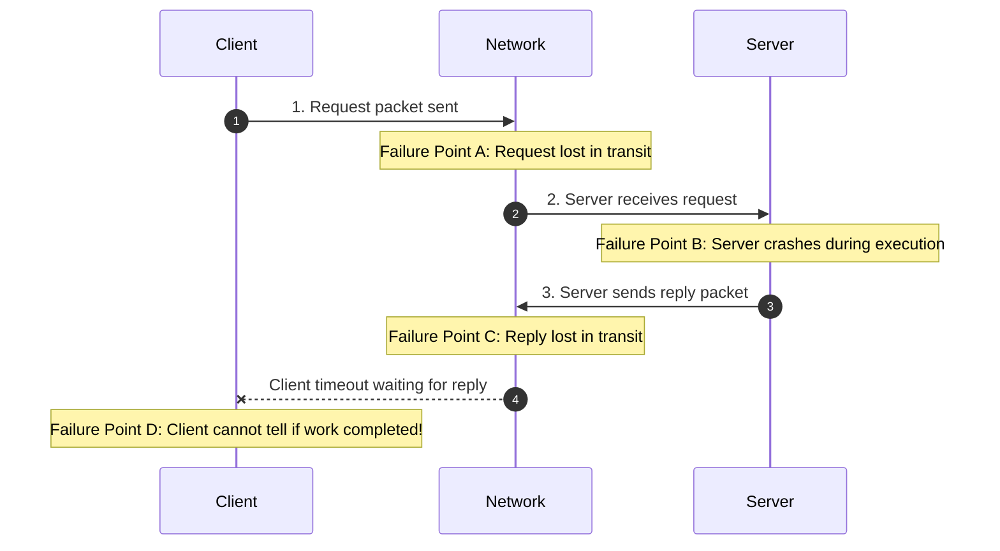
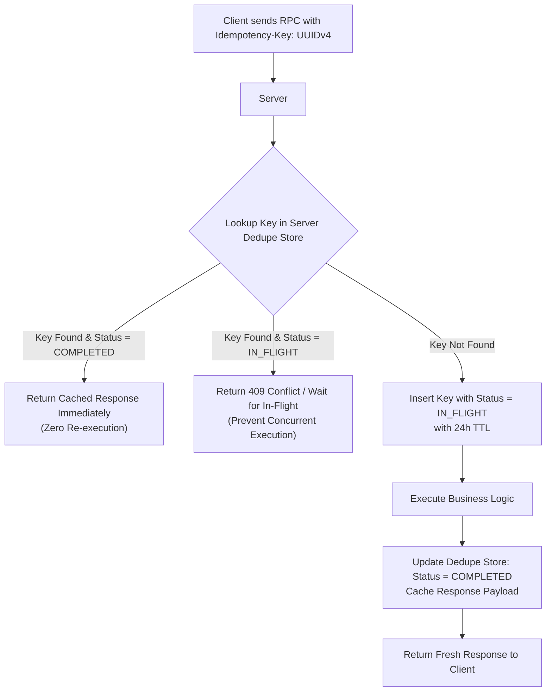
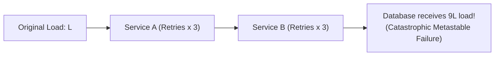
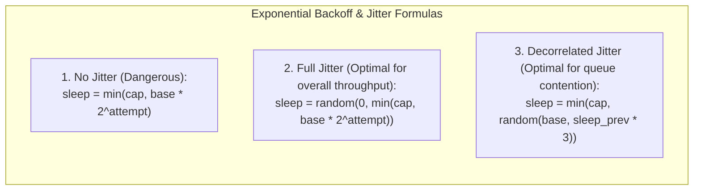
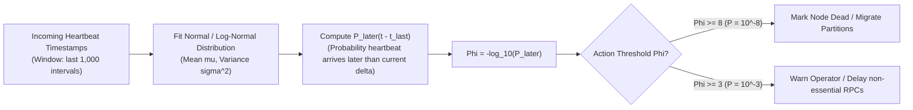
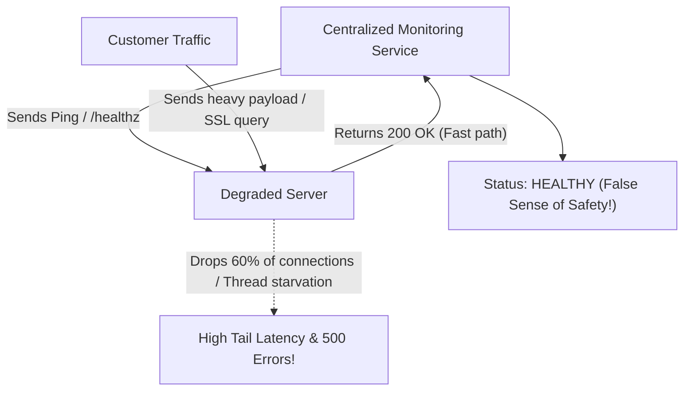
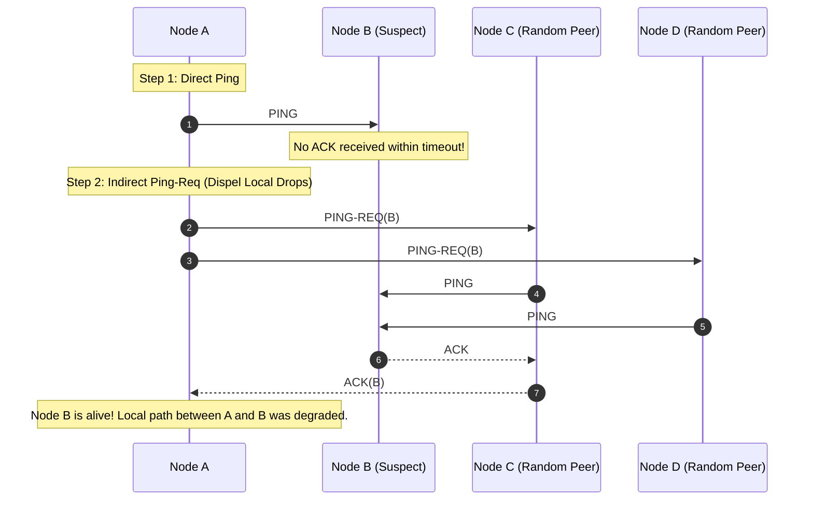

# Module 02 — Networks, RPC Semantics, and Failure Detection

In a distributed environment, all node collaboration occurs via message passing over unreliable IP networks. Traditional in-process function calls (which guarantee immediate execution and deterministic return values) are replaced by **Remote Procedure Calls (RPCs)**, introducing partial failures, network latency, dropped packets, and duplicates. This module analyzes RPC delivery semantics, idempotency deduplication tables, exponential backoff with **Full Jitter** and **Decorrelated Jitter**, retry amplification, modern failure detectors (heartbeat timeouts, **$\Phi$-Accrual Suspicion**), **Gray Failures**, and the **SWIM Gossip Protocol**.

---

## 1. Remote Procedure Call (RPC) Semantics

An RPC abstracts network communication into a familiar programming idiom: invoking a function on a remote server as if it were a local subroutine. However, unlike local calls, an RPC can fail in five distinct network phases:



### The Three Delivery Semantics
When an RPC client times out without a reply, it cannot determine whether the server crashed before running the function, during execution, or after completing it before the reply packet was sent. The chosen retry policy defines the delivery contract:

| Semantic | Protocol Mechanism | Duplicate Execution Risk | Production Application |
|---|---|---|---|
| **At-Least-Once** | Client retries continuously until an acknowledgment is received. | High. Non-idempotent operations may execute multiple times. | Read operations, idempotent writes (e.g. `set(key, val)`). |
| **At-Most-Once** | Server maintains a deduplication table of client request IDs. Retried requests return cached results without re-executing. | Zero. Operation executes at most once. | Financial transactions, order processing, mutating state. |
| **Exactly-Once** | An idealistic concept. Achievable only within closed distributed state machines with 2PC/Raft; impossible when interacting with external uncoordinated APIs (e.g. charging a credit card). | Zero within transactional boundaries. | Kafka transactional outbox, Raft client sessions. |

---

## 2. Idempotency Keys and Server Deduplication Tables

To convert an at-least-once network retry into an **at-most-once** business execution, distributed systems utilize **Idempotency Keys** (RFC 9440):



### MIT 6.5840 / Industry Best Practice: Deduplication Table Architecture
1. **Client Identity**: Every client assigns a unique 64-bit `clientId` and a strictly monotonically increasing sequence number `seqNum` to every RPC.
2. **Server Dedupe Record**:
   ```typescript
   interface DedupeEntry<T> {
     seqNum: number;
     status: 'IN_FLIGHT' | 'COMPLETED';
     response?: T;
     updatedAt: number;
   }
   ```
3. **Garbage Collection**: Clients inform the server of their highest received sequence number (`lastAckedSeqNum`). The server safely purges all records for that client with `seqNum < lastAckedSeqNum`, preventing unbounded memory leaks.

---

## 3. Retries, Backoff, and Metastable Failures

When a downstream service degrades, naive client retries trigger **Retry Storms** (amplification): $N$ clients each retrying 3 times generate $4N$ load on an already collapsing system.



### Jitter Strategies (AWS Architecture / Marc Brooker)
To prevent clients from synchronizing their retries into constructive interference spikes (the "thundering herd"), backoff algorithms inject pseudo-random variance (**Jitter**):



```typescript
export function computeBackoffFullJitter(attempt: number, baseMs = 100, capMs = 10000): number {
  const maxBackoff = Math.min(capMs, baseMs * Math.pow(2, attempt));
  return Math.floor(Math.random() * maxBackoff);
}

export function computeDecorrelatedJitter(prevSleepMs: number, baseMs = 100, capMs = 10000): number {
  const nextSleep = Math.min(capMs, baseMs + Math.random() * (prevSleepMs * 3 - baseMs));
  return Math.floor(nextSleep);
}
```

### The Metastable Failure Trap
A **metastable failure** is a state where a transient trigger (such as a temporary network hiccup or database garbage collection pause) pushes a system into an overload loop sustained entirely by internal feedback mechanisms (retries, cache invalidation storms, heavy health-check probes). The system **remains broken even after the original trigger has disappeared**, requiring operators to manually shed load or disable retries.
- **Defense**: Implement **Retry Budgets** (e.g. limiting retries to at most $10\%$ of total outgoing requests) and storage-level circuit breakers.

---

## 4. Failure Detectors: From Static Timeouts to $\Phi$-Accrual

A **Failure Detector** is a local oracle that monitors remote nodes and outputs whether a node is suspected of having crashed. Chandra and Toueg (1996) classified failure detectors by two axiomatic metrics:
- **Completeness**: Every crashed node is eventually suspected by every non-faulty node.
- **Accuracy**: Non-faulty nodes are not suspected.

In an asynchronous network, **perfect accuracy is impossible** because network delays cannot be distinguished from crashes.

### The $\Phi$-Accrual Failure Detector (Hayashibara et al., 2004)
Traditional failure detectors output a binary boolean decision: `ALIVE` or `DEAD`. Under variable network load, choosing a timeout is a painful trade-off: a short timeout triggers frequent false alarms, while a long timeout delays failovers for minutes.
The **$\Phi$-Accrual Failure Detector** (used by Apache Cassandra and Akka Cluster) decouples detection from action by computing a continuous suspicion scale $\Phi$:



$$\Phi = - \log_{10} \left( P_{\text{later}}(t - t_{\text{last}}) \right)$$
- If $\Phi = 1$, the probability of a false alarm is $10^{-1} = 10\%$.
- If $\Phi = 8$, the probability of a false alarm is $10^{-8} = 0.000001\%$.
- **Advantage**: The detector automatically adapts to network jitter without manual operator tuning!

---

## 5. Gray Failures

A **Gray Failure** (Huang et al., Microsoft Azure study, 2017) is an insidious partial failure mode in which a node passes all synthetic health checks but silently fails real customer workloads.



### Common Gray Failure Causes
1. **Network BGP/Switch Flapping**: A switch drops large jumbo packets or specific TCP ports while ping ICMP packets pass cleanly.
2. **Disk I/O Latency Spikes**: A slow disk blocks database write threads while health endpoints serve static JSON from RAM.
3. **Memory Leaks & JVM GC Pauses**: Memory pressure causes periodic 10-second pauses that coincide with user request processing.
4. **Remediation**: Use **End-to-End Synthetic Canaries** and client-observed success rate metrics rather than simple point-to-point ping probes.

---

## 6. The SWIM Gossip Protocol

In clusters with thousands of nodes, centralized heartbeats or all-to-all pinging ($O(N^2)$ network traffic) causes massive bandwidth saturation. The **SWIM Protocol** (Structured Weakly-Consistent Infection-Style Process Group Membership Protocol, Das et al., 2002) achieves strictly $O(1)$ network load per node.



### SWIM Mechanisms
1. **Direct Probe**: At each time interval $T$, node $A$ selects a random peer $B$ and sends a `PING`.
2. **Indirect Probe (Ping-Req)**: If $B$ fails to reply within timeout, $A$ selects $k$ random peers ($C, D$) and sends `PING-REQ(B)`. The peers probe $B$ on $A$'s behalf. This prevents false alarms caused by localized network edge degradation between $A$ and $B$.
3. **Suspicion Mechanism**: If indirect probes fail, $B$ is not immediately declared dead. It is marked as **SUSPECT** and gossiped to the cluster. If $B$ is alive, it has a timeout period to broadcast an `ALIVE` refutation before being declared **DEAD**.

---

## 7. Interview Drill: Networks, RPC & Failure Detection

<details>
<summary>1. In an at-least-once RPC protocol, why does an idempotency key need to be assigned by the client rather than the server?</summary>

If the server generated the idempotency key, the initial request might be lost in transit before reaching the server, or the server's reply containing the generated key might be dropped. The client would then be forced to retry without a key, creating a duplicate server-side record. When the client generates a unique UUIDv4 key *before* transmitting the request, all subsequent retries carry the identical identifier, allowing the server to reliably recognize retries.
</details>

<details>
<summary>2. Why does Full Jitter outperform No-Jitter in reducing peak server load during a recovery spike?</summary>

Without jitter, all clients that experienced an error at time $t_0$ calculate identical deterministic backoff intervals ($t_0 + 200\text{ms}$, $t_0 + 400\text{ms}$). They sleep for the same duration and strike the recovering server simultaneously in tight, synchronized waves. Full Jitter chooses a random sleep time uniformly across $[0, \text{maxBackoff}]$, smoothing discrete load spikes into a flat, continuous request stream.
</details>

<details>
<summary>3. How does the Phi-Accrual failure detector differ from a static threshold detector, and why is this useful in cloud environments?</summary>

A static detector uses a hardcoded timeout (e.g. 5 seconds) which either generates false alarms during routine network congestion or delays failure detection for unacceptable periods. The $\Phi$-accrual detector continuously measures the distribution of heartbeat inter-arrival times and estimates the probability that a heartbeat is merely delayed versus the node being dead. Cloud environments with unpredictable virtualized network jitter can adjust thresholds dynamically without code changes.
</details>

<details>
<summary>4. What is a Gray Failure and why do traditional ping-based health checks fail to detect it?</summary>

A gray failure occurs when a component is neither fully functional nor completely dead. Traditional health checks query simple, lightweight endpoints (e.g. `GET /healthz`) that return `200 OK` directly from memory or test basic network reachability. However, the service may be failing complex user queries, dropping specific packet sizes, suffering thread-pool deadlocks, or experiencing severe disk I/O timeouts.
</details>

<details>
<summary>5. How does the SWIM protocol achieve O(1) message overhead per node period regardless of cluster size?</summary>

In each protocol period $T$, a node only probes a fixed, constant number of peers (1 direct ping, and at most $k$ indirect ping-requests if the first fails), rather than broadcasting to the entire cluster. Membership updates and suspicion states are piggybacked on top of routine ping/ack messages using epidemic gossip dissemination. Consequently, the bandwidth consumed per node is independent of total cluster size $N$.
</details>
