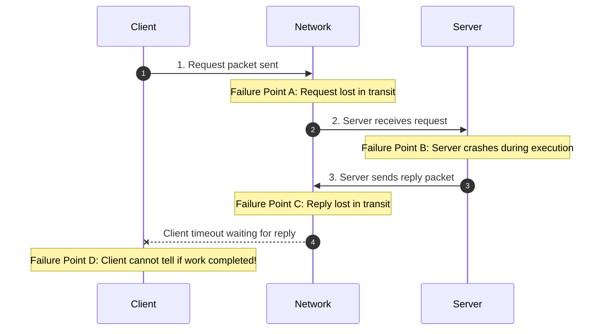
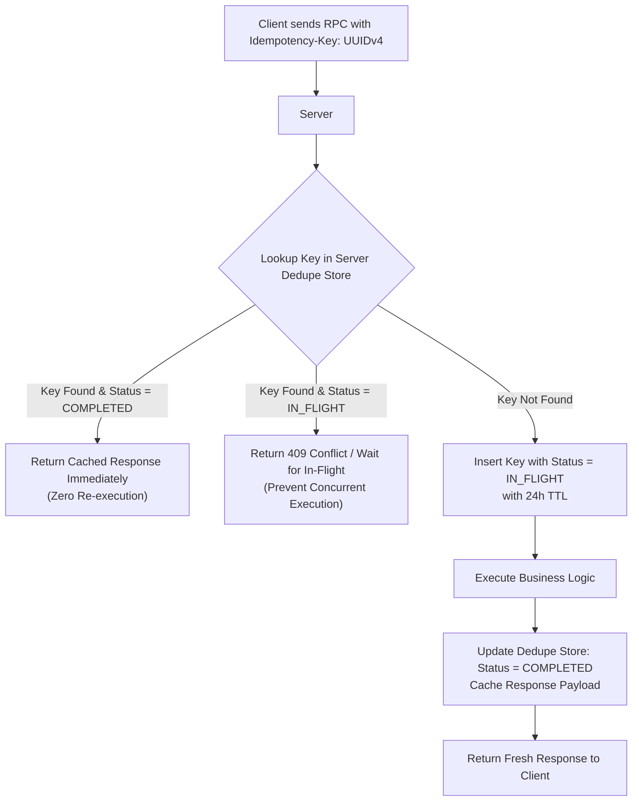
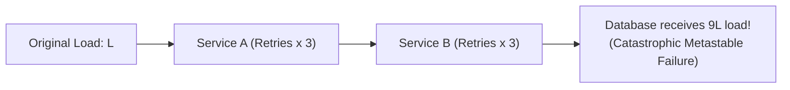
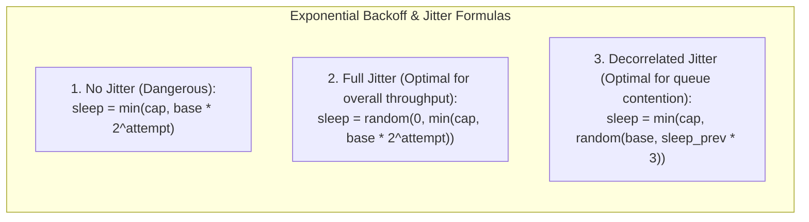
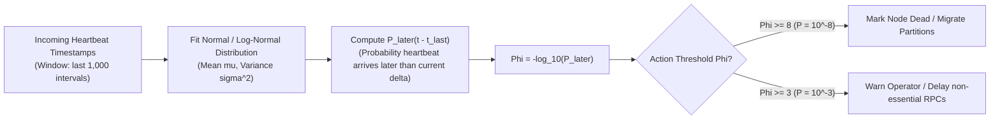
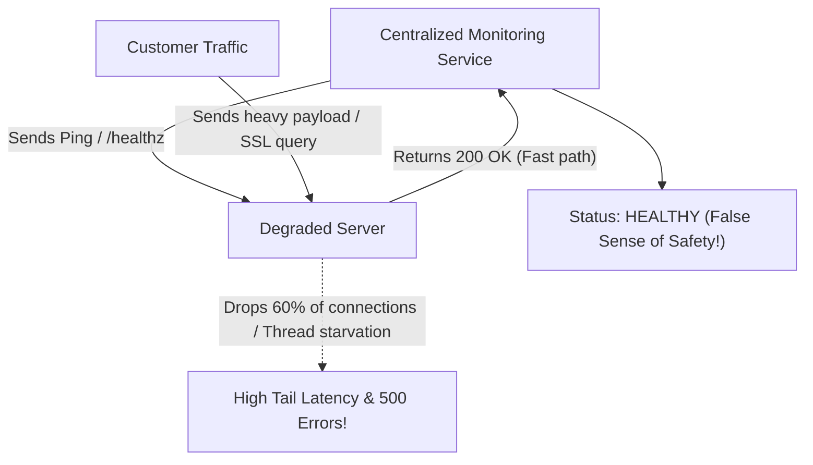
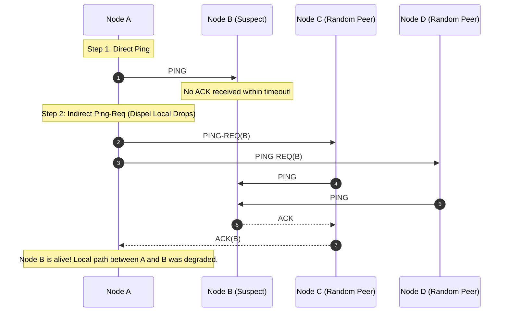

# Module 02 — Networks, RPC Semantics, and Failure Detection

In a distributed environment, all node collaboration occurs via message passing over unreliable IP networks. Traditional in-process function calls (which guarantee immediate execution and deterministic return values) are replaced by **Remote Procedure Calls (RPCs)**, introducing partial failures, network latency, dropped packets, and duplicates. This module analyzes RPC delivery semantics, idempotency deduplication tables, exponential backoff with **Full Jitter** and **Decorrelated Jitter**, retry amplification, modern failure detectors (heartbeat timeouts, **$\Phi$-Accrual Suspicion**), **Gray Failures**, and the **SWIM Gossip Protocol**.

---

## 1. Remote Procedure Call (RPC) Semantics

An RPC abstracts network communication into a familiar programming idiom: invoking a function on a remote server as if it were a local subroutine. However, unlike local calls, an RPC can fail in five distinct network phases:



### The Three Delivery Semantics

When an RPC client times out without a reply, it cannot determine whether the server crashed before running the function, during execution, or after completing it before the reply packet was sent. The chosen retry policy defines the delivery contract:

| Semantic | Protocol Mechanism | Duplicate Execution Risk | Production Application |
| --- | --- | --- | --- |
| **At-Least-Once** | Client retries continuously until an acknowledgment is received. | High. Non-idempotent operations may execute multiple times. | Read operations, idempotent writes (e.g. `set(key, val)`). |
| **At-Most-Once** | Server maintains a deduplication table of client request IDs. Retried requests return cached results without re-executing. | Zero. Operation executes at most once. | Financial transactions, order processing, mutating state. |
| **Exactly-Once** | An idealistic concept. Achievable only within closed distributed state machines with 2PC/Raft; impossible when interacting with external uncoordinated APIs (e.g. charging a credit card). | Zero within transactional boundaries. | Kafka transactional outbox, Raft client sessions. |

---

## 2. Idempotency Keys and Server Deduplication Tables

To convert an at-least-once network retry into an **at-most-once** business execution, distributed systems utilize **Idempotency Keys** (the IETF `Idempotency-Key` header is an Internet-Draft, see §7):



### MIT 6.5840 / Industry Best Practice: Deduplication Table Architecture

1. **Client Identity**: Every client assigns a unique 64-bit `clientId` and a strictly monotonically increasing sequence number `seqNum` to every RPC.
2. **Server Dedupe Record**:
   ```typescript
   interface DedupeEntry<T> {
     seqNum: number;
     status: 'IN_FLIGHT' | 'COMPLETED';
     response?: T;
     updatedAt: number;
   }
   ```
3. **Garbage Collection**: Clients inform the server of their highest received sequence number (`lastAckedSeqNum`). The server safely purges all records for that client with `seqNum < lastAckedSeqNum`, preventing unbounded memory leaks.

---

## 3. Retries, Backoff, and Metastable Failures

When a downstream service degrades, naive client retries trigger **Retry Storms** (amplification): $N$ clients each retrying 3 times generate $4N$ load on an already collapsing system.



### Jitter Strategies (AWS Architecture / Marc Brooker)

To prevent clients from synchronizing their retries into constructive interference spikes (the "thundering herd"), backoff algorithms inject pseudo-random variance (**Jitter**):



```typescript
export function computeBackoffFullJitter(attempt: number, baseMs = 100, capMs = 10000): number {
  const maxBackoff = Math.min(capMs, baseMs * Math.pow(2, attempt));
  return Math.floor(Math.random() * maxBackoff);
}

export function computeDecorrelatedJitter(
  prevSleepMs: number,
  baseMs = 100,
  capMs = 10000,
): number {
  const nextSleep = Math.min(capMs, baseMs + Math.random() * (prevSleepMs * 3 - baseMs));
  return Math.floor(nextSleep);
}
```

### The Metastable Failure Trap

A **metastable failure** is a state where a transient trigger (such as a temporary network hiccup or database garbage collection pause) pushes a system into an overload loop sustained entirely by internal feedback mechanisms (retries, cache invalidation storms, heavy health-check probes). The system **remains broken even after the original trigger has disappeared**, requiring operators to manually shed load or disable retries.

- **Defense**: Implement **Retry Budgets** (e.g. limiting retries to at most $10\%$ of total outgoing requests) and storage-level circuit breakers.

---

## 4. Failure Detectors: From Static Timeouts to $\Phi$-Accrual

A **Failure Detector** is a local oracle that monitors remote nodes and outputs whether a node is suspected of having crashed. Chandra and Toueg (1996) classified failure detectors by two axiomatic metrics:

- **Completeness**: Every crashed node is eventually suspected by every non-faulty node.
- **Accuracy**: Non-faulty nodes are not suspected.

In an asynchronous network, **perfect accuracy is impossible** because network delays cannot be distinguished from crashes.

### The $\Phi$-Accrual Failure Detector (Hayashibara et al., 2004)

Traditional failure detectors output a binary boolean decision: `ALIVE` or `DEAD`. Under variable network load, choosing a timeout is a painful trade-off: a short timeout triggers frequent false alarms, while a long timeout delays failovers for minutes. The **$\Phi$-Accrual Failure Detector** (used by Apache Cassandra and Akka Cluster) decouples detection from action by computing a continuous suspicion scale $\Phi$:



$$\Phi = - \log_{10} \left( P_{\text{later}}(t - t_{\text{last}}) \right)$$

- If $\Phi = 1$, the probability of a false alarm is $10^{-1} = 10\%$.
- If $\Phi = 8$, the probability of a false alarm is $10^{-8} = 0.000001\%$.
- **Advantage**: The detector automatically adapts to network jitter without manual operator tuning!

---

## 5. Gray Failures

A **Gray Failure** (Huang et al., Microsoft Azure study, 2017) is an insidious partial failure mode in which a node passes all synthetic health checks but silently fails real customer workloads.



### Common Gray Failure Causes

1. **Network BGP/Switch Flapping**: A switch drops large jumbo packets or specific TCP ports while ping ICMP packets pass cleanly.
2. **Disk I/O Latency Spikes**: A slow disk blocks database write threads while health endpoints serve static JSON from RAM.
3. **Memory Leaks & JVM GC Pauses**: Memory pressure causes periodic 10-second pauses that coincide with user request processing.
4. **Remediation**: Use **End-to-End Synthetic Canaries** and client-observed success rate metrics rather than simple point-to-point ping probes.

---

## 6. The SWIM Gossip Protocol

In clusters with thousands of nodes, centralized heartbeats or all-to-all pinging ($O(N^2)$ network traffic) causes massive bandwidth saturation. The **SWIM Protocol** (Structured Weakly-Consistent Infection-Style Process Group Membership Protocol, Das et al., 2002) achieves strictly $O(1)$ network load per node.



### SWIM Mechanisms

1. **Direct Probe**: At each time interval $T$, node $A$ selects a random peer $B$ and sends a `PING`.
2. **Indirect Probe (Ping-Req)**: If $B$ fails to reply within timeout, $A$ selects $k$ random peers ($C, D$) and sends `PING-REQ(B)`. The peers probe $B$ on $A$'s behalf. This prevents false alarms caused by localized network edge degradation between $A$ and $B$.
3. **Suspicion Mechanism**: If indirect probes fail, $B$ is not immediately declared dead. It is marked as **SUSPECT** and gossiped to the cluster. If $B$ is alive, it has a timeout period to broadcast an `ALIVE` refutation before being declared **DEAD**.

---

## 7. At-Most-Once Execution as an Invariant

"Exactly-once delivery" cannot exist on a channel that may drop either direction (Module 01, §7: the sender of the last message never learns whether it arrived). What can be built is **exactly-once effect**, which is **at-least-once delivery composed with a deduplicating receiver**. The receiver's job is to make the following statement true.

> **At-most-once invariant.** For every pair $(c, s)$ of client id and sequence number, the state machine applies the operation for $(c,s)$ in at most one position of its history, and every reply sent for $(c,s)$ carries the result of that single application.

### Why a dedupe table alone is not enough

The table must be **bounded** (otherwise memory grows with the number of requests ever made) and **crash-consistent** (otherwise a restarted server re-executes). Both constraints interact with a hazard that tutorials skip: the **delayed duplicate**. A network can hold a copy of $(c,s)$ for longer than the client waits, so a copy may arrive _after_ the client has seen the reply, acknowledged it, and the server has garbage-collected the entry.

| Design | Table entry lifetime | Failure mode |
| --- | --- | --- |
| No table | none | Every retry executes: counter drifts upward |
| Table, never collected | forever | Unbounded memory |
| Table, drop entries with $s \le \text{ack}$, treat missing as new | until acked | **Delayed duplicate of an acked request executes a second time** |
| Table plus per-client **watermark**: drop entries $\le \text{ack}$ and reject any $s \le \text{watermark}$ as stale | until acked | Correct. Table holds only the in-flight window |
| One outstanding request per client, keep only `(lastSeq, lastResult)` (Raft thesis §6.3) | one entry per client | Correct, but needs session expiry |

```typescript
handle(r: Req): Reply {
  const cached = this.done.get(`${r.client}:${r.seq}`);
  if (cached !== undefined) return { seq: r.seq, value: cached };        // retried: replay the result
  if (r.seq <= (this.watermark.get(r.client) ?? 0))
    return { seq: r.seq, value: 'STALE' };                               // answered and acked long ago
  const value = this.execute();                                          // the only side effect
  this.done.set(`${r.client}:${r.seq}`, value);
  for (let s = (this.watermark.get(r.client) ?? 0) + 1; s <= r.ack; s++) // piggybacked ack = GC signal
    this.done.delete(`${r.client}:${s}`);
  this.watermark.set(r.client, Math.max(this.watermark.get(r.client) ?? 0, r.ack));
  return { seq: r.seq, value };
}
```

**Proof of the invariant (watermark design).** Let $w_c$ be the watermark of client $c$. The invariant "entry $(c,s)$ is in `done` iff $w_c < s$ and $(c,s)$ was executed" is preserved by `handle`: execution adds the entry only when $s > w_c$; GC deletes entries with $s \le \text{ack}$ and then raises $w_c$ to at least ack. A request for $(c,s)$ therefore takes exactly one of three branches: replay (executed, not yet collected), stale-reject ($s \le w_c$, executed earlier or never needed), or execute (first sight, $s > w_c$). A delayed duplicate arriving after GC falls in the stale branch. The harness [examples/02b-rpc-sessions-detectors-and-swim.test.ts](../examples/02b-rpc-sessions-detectors-and-swim.test.ts) runs 200 seeds with 20 to 30 percent loss, 50 percent duplication and delays up to 30 ticks: the naive-GC server double-executes on at least one seed, the watermark server executes exactly 40 times on every seed and its table never exceeds two entries.

### Replicated servers: the table is part of the state machine

In a replicated service (Module 07, Module 14) the dedupe table must live **inside the replicated state**, updated by the same log entries as the data. If the leader kept the table in local memory, a failover would hand clients to a new leader with an empty table and retries would re-execute. Raft's client-session mechanism registers a session through the log, assigns the client id from the log index, expires idle sessions deterministically (based on log-carried timestamps, not local clocks) and answers a duplicate with the cached result. Kafka's idempotent producer is the same construction: producer id plus per-partition sequence number, with the broker rejecting out-of-order or duplicate sequence numbers (Module 10).

### Then vs now: idempotency keys

|  | Before ~2015 | Now |
| --- | --- | --- |
| Client contract | Endpoint-specific tricks (unique constraint on a business key) | A generic `Idempotency-Key` request header, popularised by Stripe |
| Standardisation | None | IETF HTTPAPI working-group Internet-Draft `draft-ietf-httpapi-idempotency-key-header` (version 07, October 2025; check datatracker for RFC status) |
| Server contract | Undefined for concurrent duplicates | Same key while the first request is in flight: `409 Conflict`; same key with a different payload: `422`; completed: replay stored response |

> [!WARNING]
> Earlier drafts of this module cited RFC 9440 for idempotency keys. RFC 9440 is the _Client-Cert HTTP Header Field_; the idempotency header is still an Internet-Draft as of the version cited above.

---

## 8. TCP Is Not an Application Acknowledgment

DDIA 2e (ch. 9, "The Limitations of TCP") makes the point that TCP's guarantees end at the socket. Three consequences:

1. **A TCP ACK means "the peer's kernel buffered it", not "the application processed it".** If the receiver crashes after the kernel ACK, the sender never learns the request was lost. This is the failure point B/C of the RPC diagram at the top of the module, one layer down.
2. **Connection loss erases the in-flight window.** When a connection resets, the sender cannot know which of its last writes were consumed. Reconnect must re-send under the same idempotency identity.
3. **Ordering and exactly-once are per connection.** Retrying on a new connection loses ordering relative to the old one, and an old-connection packet can still surface (a delayed duplicate again).

This is the **end-to-end argument** (Saltzer, Reed and Clark, 1984): reliability implemented only in lower layers cannot deliver an application-level guarantee, so the check (the idempotent receiver, the application-level ack) must live at the endpoints.

---

## 9. Timeouts, Deadlines and Retry Amplification

### A timeout is a failure detector with a threshold

A timeout converts "no reply yet" into "assume failed". In the asynchronous model there is no correct threshold; in practice choose it from the observed latency distribution (a high percentile of successful calls, for example p99.9 plus margin) and propagate a **deadline**, not a timeout, across hops so downstream work stops when the caller has already given up.

### Amplification, formally

If every layer makes up to $a$ attempts and the leaf always fails, one client request produces $a^{L}$ leaf attempts across $L$ layers. With $a=3$ and $L=3$ that is 27. A **retry budget** $b$ (retries allowed at most $b \cdot$ requests, per client process) caps the multiplier at $(1+b)^{L}$: for $b = 0.1$ and $L = 3$, about 1.33. The budget turns multiplicative growth into a bounded constant.

```typescript
leafCalls(3, 1, 3, null); // 27: unbounded retries, 3 layers, 3 attempts each
leafCalls(3, 10_000, 3, 0.1); // ~13_310: 10% budget per layer, 10_000 * 1.1^3
```

Both numbers are asserted in the test file. Google's SRE guidance pairs a per-request cap (about 3 attempts) with a per-client ratio (about 10 percent retries); treat 10 percent as a starting default to tune, not a law.

### Hedged requests

For tail latency, send a second copy of a read to another replica after the first has taken longer than, say, the observed p95, and use whichever answers first (Dean and Barroso, _The Tail at Scale_, CACM 2013). Expected extra load is about 5 percent for a p95 trigger. Hedging is only safe for idempotent operations, and must be cancelled on first response or it becomes its own retry storm.

### Metastable failures

A **metastable failure** (Bronson et al., HotOS 2021; Huang et al., OSDI 2022, an empirical study of production incidents) has a trigger, an amplifying sustaining effect (retries, cache misses re-driving load onto the database, expensive health checks), and persists after the trigger is removed. Recovery therefore needs **load shedding or a temporary capacity reduction on the sustaining path**, not "wait for the trigger to clear". Adding capacity often fails because the new capacity also warms its caches under the full retry load.

---

## 10. Failure Detector Theory

### Chandra-Toueg classes

A failure detector outputs, at each process and time, a set of suspected processes. Two completeness and four accuracy properties yield eight classes (Chandra and Toueg 1996):

|                         | Strong accuracy | Weak accuracy  | Eventual strong | Eventual weak |
| ----------------------- | --------------- | -------------- | --------------- | ------------- |
| **Strong completeness** | **P** (Perfect) | **S** (Strong) | **◇P**          | **◇S**        |
| **Weak completeness**   | Q               | W              | ◇Q              | **◇W**        |

- Strong completeness: eventually every crashed process is permanently suspected by **every** correct process.
- Weak completeness: eventually every crashed process is permanently suspected by **some** correct process.
- Strong accuracy: no correct process is ever suspected. Weak accuracy: **some** correct process is never suspected.
- "Eventual" variants only require the accuracy property from some unknown time onward.

Weak completeness can be boosted to strong by gossiping suspicions, so W ≅ S and ◇W ≅ ◇S. **◇S (equivalently ◇W) is the weakest class that solves consensus** with a correct majority (Chandra, Hadzilacos and Toueg 1996), and is equivalent to the leader oracle $\Omega$ ("eventually all correct processes trust the same correct leader"). Raft and Multi-Paxos implement an $\Omega$ with randomised timeouts and terms.

### Implementing ◇P under partial synchrony

```text
HEARTBEAT-DETECTOR(q monitors p):         // sender: every π ticks, send "alive" to q
  Δ_q <- initial timeout
  on tick: if now - last_arrival(p) > Δ_q then suspect(p)
  on heartbeat from p: if p ∈ suspected then unsuspect(p); Δ_q <- Δ_q + increment
```

**Eventual strong accuracy.** After GST, delays are at most $\delta$, so consecutive arrivals are at most $\pi + \delta$ ticks apart. Every false suspicion raises $\Delta_q$ by a fixed increment; after finitely many suspicions $\Delta_q \ge \pi + \delta$ and no further false suspicion occurs. **Strong completeness.** A crashed process stops sending, so $\text{now} - \text{last\_arrival}$ grows without bound and eventually exceeds any finite $\Delta_q$, permanently.

The simulation draws delays uniformly in $[1,400]$ before GST and $[1,20]$ after, with $\pi = 10$ and initial $\Delta_q = 15$. Over 100 seeds the adaptive detector produces **zero** false suspicions after $GST + 500$, a crashed sender is suspected at the horizon in every run, and the negative control (fixed $\Delta_q = 15 < \pi + \delta$) still flaps after GST on more than 90 of the 100 seeds. This is the executable form of "you must adapt the timeout, or you do not have eventual accuracy".

### Phi accrual: two implementations of the same idea

Hayashibara et al. (2004) define $\varphi(t) = -\log_{10} P_{\text{later}}(t - t_{\text{last}})$, where $P_{\text{later}}$ is the tail of a distribution fitted to recent inter-arrival times.

| Implementation | Distribution assumed | Computation | Consequence |
| --- | --- | --- | --- |
| Original paper, Akka | Normal (Akka uses a logistic approximation of the normal tail) | Needs mean **and variance** | Very stable links get a tight bound: a small delay beyond the mean already yields large $\varphi$; needs a minimum standard deviation |
| Apache Cassandra `FailureDetector` | Exponential | $\varphi = \dfrac{t}{\bar\tau}\cdot\dfrac{1}{\ln 10}$ (`PHI_FACTOR = 1.0 / Math.log(10.0)`), only the **mean** is tracked, window of 1000 samples | $\varphi = 8$ is reached after silence of $8\ln 10 \approx 18.4$ mean intervals, independent of jitter |

For the exponential model $P_{\text{later}}(t) = e^{-t/\bar\tau}$, so $-\log_{10}P = (t/\bar\tau)\log_{10} e$. The test asserts $\varphi(8\ln 10 \cdot \bar\tau) = 8$ and $P_{\text{later}} = 10^{-8}$ at that point, and that doubling the mean interval halves $\varphi$ for the same silence. Cassandra's default `phi_convict_threshold` of 8 is the commonly cited value; raise it (for example to 10 or 12) on clouds with noisy neighbours rather than shortening gossip intervals.

---

## 11. SWIM in Detail

### Round structure and bounded detection time

Each member runs a protocol period of length $T$. It picks a probe target, sends a `ping`, waits for `ack`, and on timeout asks $k$ other members for `ping-req(target)`. The original SWIM paper (Das, Gupta, Motivala, DSN 2002) analyses _random_ target selection; choosing targets by a **shuffled round-robin** over the member list gives a worst-case bound of one pass through the list, which production implementations (HashiCorp memberlist) adopt.

- **Expected first detection time** with uniform random selection: a failed member is probed by at least one of the $n-1$ healthy members in a period with probability $1 - (1 - \tfrac{1}{n-1})^{n-1} \to 1 - 1/e$, so the expected number of periods to first detection is $\to \dfrac{e}{e-1} \approx 1.58$, independent of $n$.
- **Message load** per prober per period: 1 ping, plus at most $k$ indirect probes of 4 messages each in the worst case (`ping-req`, helper `ping`, target `ack`, helper `ack`): $\le 1 + 4k$ messages counted by the harness, with no dependence on $n$. The test asserts that bound for $n \in \{10, 100, 10^4\}$.

### Why indirect probes help: one bad edge is not a dead node

With one degraded link A-B (80 percent loss each way) and healthy other paths (2 percent loss), a direct probe succeeds with probability $0.2^2 = 0.04$ (both legs must survive), so direct-only probing wrongly suspects B in about 96 percent of periods (1923 of 2000 in the seeded run). With $k=3$ helpers each indirect path succeeds with probability about $0.98^4 \approx 0.92$, so the chance that all three fail is about $0.08^3 \approx 5\times10^{-4}$ and the seeded run records 0 false suspicions in 2000 periods. This is the SWIM answer to gray, partial failures: **ask someone else's opinion before accusing**.

### Suspicion, incarnation numbers and refutation

A member that fails indirect probes is marked `suspect`, not `dead`, and the state is gossiped (piggybacked on pings and acks). The suspected member can refute by incrementing its **incarnation number** and gossiping `alive(incarnation+1)`. Message precedence: `alive(i)` overrides `suspect(j)` iff $i > j$; `suspect(i)` overrides `alive(j)` iff $i \ge j$; `dead` overrides everything. The suspicion timeout is scaled with $\log n$ so that the refutation has time to reach every member.

### Lifeguard (then vs now)

Plain SWIM mis-fires when the _prober itself_ is slow (CPU starvation, GC, overloaded VM): the slow node's missed acks look like others' failures. **Lifeguard** (Dadgar, Phillips, Currey; HashiCorp, 2017-2018) adds a **local health multiplier** that stretches the prober's own timeouts when its recent probes failed, a **dogpile** rule that shortens the suspicion timeout as independent confirmations arrive, and a **buddy system** that tells a suspected member it is suspected right away. Reported effect: a large reduction in false positives under CPU starvation at modest extra message cost. The lesson for design: a failure detector must also be a **self-health detector**.

---

## 12. Gray Failure as Differential Observability

Huang et al. (HotOS 2017) define a gray failure by the **difference between two observers**: the system's failure detector sees healthy, an application sees failure. Write $O_{\text{detector}}(t)$ for what monitoring concludes and $O_{\text{app}}(t)$ for what clients experience. A fault is gray when $O_{\text{detector}} = \text{healthy} \wedge O_{\text{app}} = \text{failed}$ for a sustained interval.

Design rules that follow:

1. **Probe with the real path.** A `/healthz` handler that returns a constant exercises none of the request-processing code. Health checks should exercise a dependency-touching code path with a bounded cost.
2. **Make the app's observations first-class inputs to the detector.** Client-side error rate and latency by server (outlier detection in a proxy) beat server self-reports.
3. **Use more than one observer** and require agreement before declaring a node dead (SWIM's indirect probes are the protocol version of this).
4. **Distinguish "unhealthy" from "dead"** (drain and stop routing versus declare failure and reassign ownership) so that a false positive costs capacity, not correctness.

---

## 13. Course Map

| Source | Material | This module |
| --- | --- | --- |
| MIT 6.5840 lecture 2 (RPC and Threads), Lab 2 (Key/Value server) | RPC failure model, at-most-once with retries | §7 dedupe and watermark proof; §8 |
| MIT 6.5840 Labs 4 and 5 | Client sessions replicated through Raft | §7 replicated dedupe tables |
| DDIA 2e ch. 9, "Unreliable Networks", "The Limitations of TCP", "Network Faults in Practice" | Network faults, TCP semantics | §8-9 |
| DDIA 2e ch. 9, "Fault Detection", "Timeouts and Unbounded Delays", "Synchronous Versus Asynchronous Networks" | Choosing timeouts; bounded delay networks | §9-10 |

---

## Interview Drill

<details><summary>1. In an at-least-once RPC protocol, why does an idempotency key need to be assigned by the client rather than the server?</summary>

If the server generated the idempotency key, the initial request might be lost in transit before reaching the server, or the server's reply containing the generated key might be dropped. The client would then be forced to retry without a key, creating a duplicate server-side record. When the client generates a unique UUIDv4 key _before_ transmitting the request, all subsequent retries carry the identical identifier, allowing the server to reliably recognize retries.
</details>

<details><summary>2. Why does Full Jitter outperform No-Jitter in reducing peak server load during a recovery spike?</summary>

Without jitter, all clients that experienced an error at time $t_0$ calculate identical deterministic backoff intervals ($t_0 + 200\text{ms}$, $t_0 + 400\text{ms}$). They sleep for the same duration and strike the recovering server simultaneously in tight, synchronized waves. Full Jitter chooses a random sleep time uniformly across $[0, \text{maxBackoff}]$, smoothing discrete load spikes into a flat, continuous request stream.
</details>

<details><summary>3. How does the Phi-Accrual failure detector differ from a static threshold detector, and why is this useful in cloud environments?</summary>

A static detector uses a hardcoded timeout (e.g. 5 seconds) which either generates false alarms during routine network congestion or delays failure detection for unacceptable periods. The $\Phi$-accrual detector continuously measures the distribution of heartbeat inter-arrival times and estimates the probability that a heartbeat is merely delayed versus the node being dead. Cloud environments with unpredictable virtualized network jitter can adjust thresholds dynamically without code changes.
</details>

<details><summary>4. What is a Gray Failure and why do traditional ping-based health checks fail to detect it?</summary>

A gray failure occurs when a component is neither fully functional nor completely dead. Traditional health checks query simple, lightweight endpoints (e.g. `GET /healthz`) that return `200 OK` directly from memory or test basic network reachability. However, the service may be failing complex user queries, dropping specific packet sizes, suffering thread-pool deadlocks, or experiencing severe disk I/O timeouts.
</details>

<details><summary>5. How does the SWIM protocol achieve O(1) message overhead per node period regardless of cluster size?</summary>

In each protocol period $T$, a node only probes a fixed, constant number of peers (1 direct ping, and at most $k$ indirect ping-requests if the first fails), rather than broadcasting to the entire cluster. Membership updates and suspicion states are piggybacked on top of routine ping/ack messages using epidemic gossip dissemination. Consequently, the bandwidth consumed per node is independent of total cluster size $N$.
</details>

<details><summary>6. Your dedupe table deletes an entry once the client's ack covers it. Show an execution that still double-applies a request, and fix it.</summary>

The client sends $(c, 5)$; the network duplicates it; one copy is processed and acknowledged, the next request $(c, 6)$ carries `ack = 5`, and the server deletes the entry for $(c,5)$. The second copy of $(c,5)$, delayed in a switch buffer, now arrives, finds no entry and executes again. Fix: keep a per-client watermark and answer any request with $s \le \text{watermark}$ with a stale-rejection rather than executing. The watermark is one integer per client, so memory stays bounded.
</details>

<details><summary>7. Why must the deduplication table of a Raft-replicated service be part of the replicated state machine?</summary>

If it lives only in the leader's memory, a leader change leaves the next leader without it. A client that timed out against the old leader retries on the new one, which has no record and re-executes an operation that is already in the log. Applying session registration, request results and session expiry through log entries makes every replica's table identical and deterministic, including across snapshot and restart. Expiry must be driven by timestamps stored in the log, not each replica's local clock.
</details>
