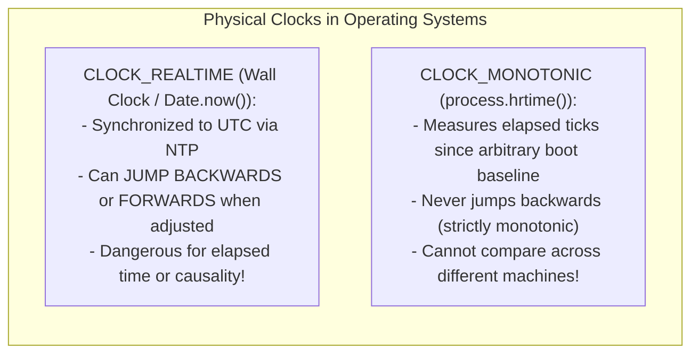
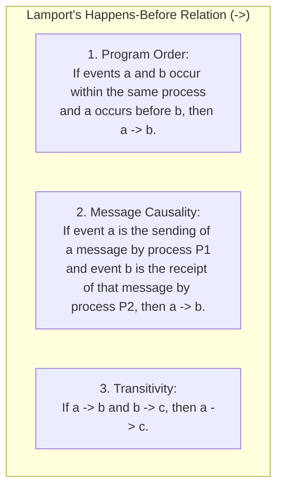
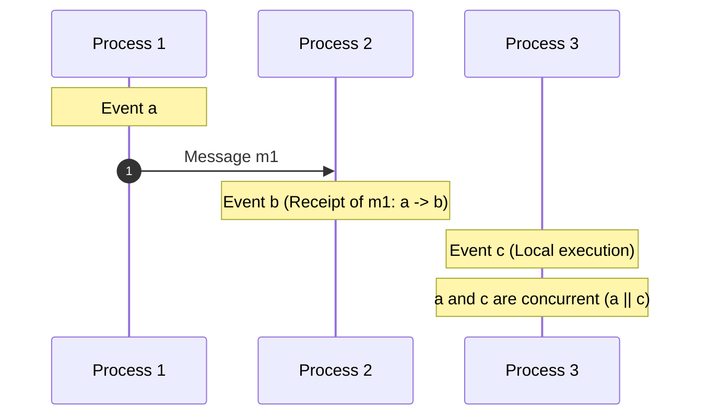
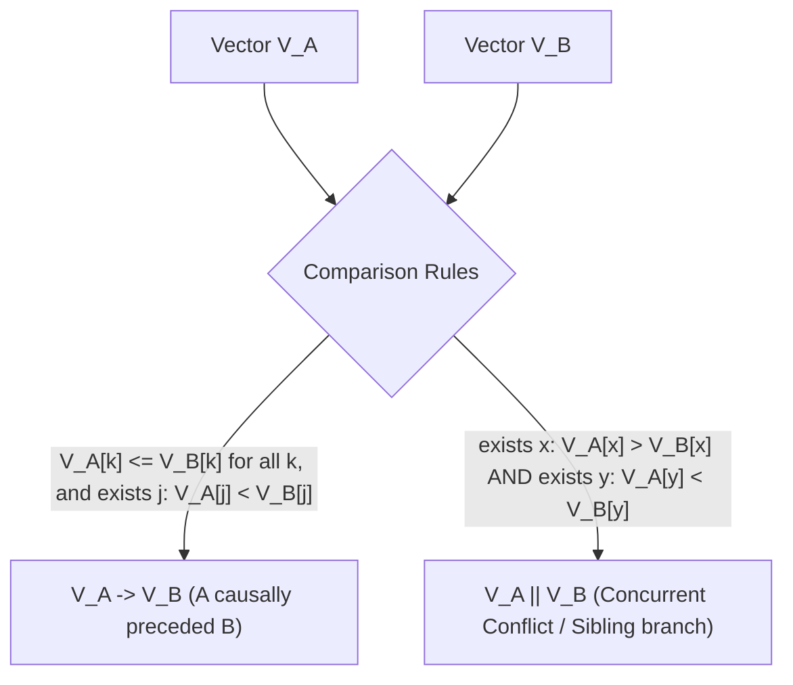
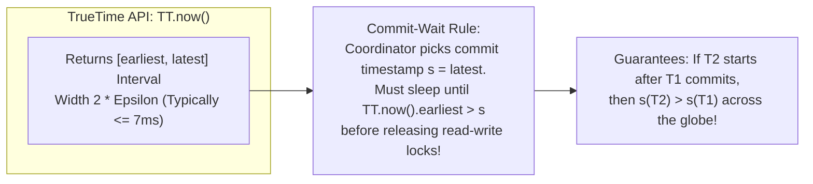
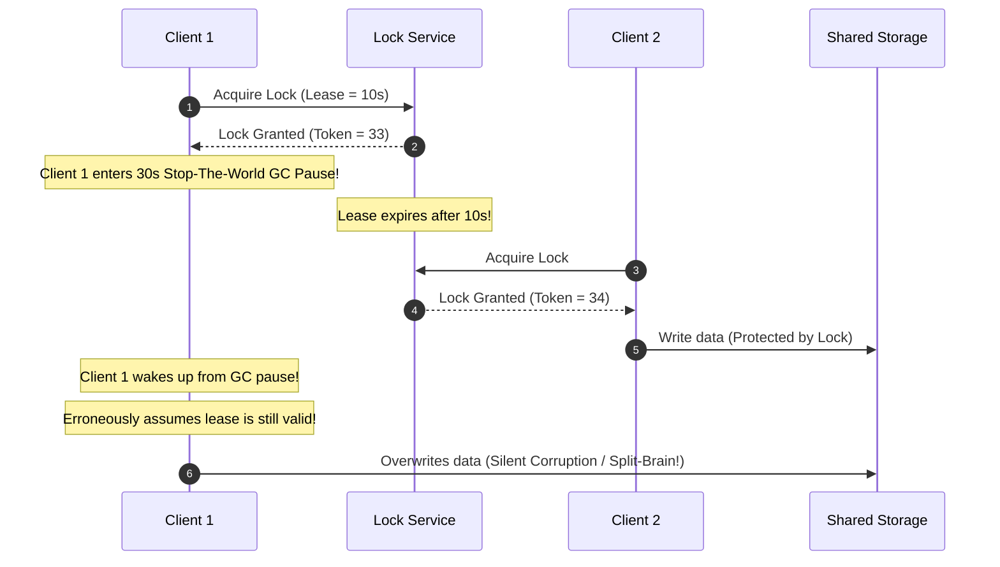
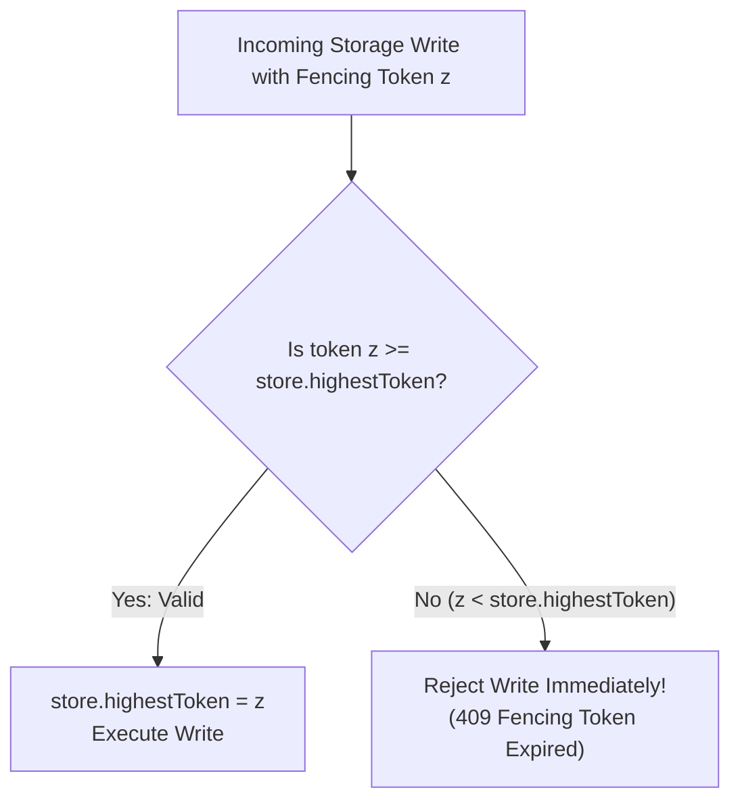

# Module 03 — Time, Physical vs. Logical Clocks, and Ordering

In a single-threaded program, time is linear, monotonic, and total: every operation executes either strictly before or strictly after every other operation. In a distributed system, this assumption completely breaks down. Each node possesses its own physical crystal oscillator that drifts unpredictably, network delays between nodes are variable, and relativistic physical limits prevent instantaneous state synchronization. This module examines physical clock drift, the pitfalls of Last-Write-Wins (LWW), Lamport's **Happens-Before** relation ($\to$), **Vector Clocks**, **Hybrid Logical Clocks (HLC)**, Google Spanner's **TrueTime Commit-Wait**, and storage-enforced **Fencing Tokens**.

---

## 1. Physical Clocks: Skew, Drift, and Non-Monotonicity

Modern servers track time using quartz crystal oscillators. Due to temperature fluctuations, manufacturing variances, and component aging, quartz clocks suffer from **drift**—typically drifting by $\approx 10^{-5}$ to $10^{-6}$ seconds per second (1–10 seconds per day).



### The Pitfall of Last-Write-Wins (LWW)
Distributed databases like Apache Cassandra and Amazon DynamoDB often offer **Last-Write-Wins (LWW)** to resolve concurrent conflicts: the write with the highest physical wall-clock timestamp wins.
- **The Catastrophe**: If Node $A$'s clock is 500ms ahead of Node $B$'s clock, a write executed on Node $B$ at 12:00:00.600 will be stamped as `12:00:00.600`. If an earlier write occurred on Node $A$ at 12:00:00.200, it was stamped as `12:00:00.700` due to clock skew.
- **Result**: Node $A$'s older write permanently overwrites Node $B$'s newer write. **Data is silently lost without any error thrown.**

---

## 2. Lamport's Happens-Before Relation ($\to$)

In his seminal 1978 paper (*"Time, Clocks, and the Ordering of Events in a Distributed System"*), Leslie Lamport demonstrated that ordering distributed events does not require physical clocks; it requires tracking **causality**.



### Concurrent Events ($\parallel$)
If two events $a$ and $b$ do not have a causal path between them ($a \not\to b$ and $b \not\to a$), they are formally **concurrent** ($a \parallel b$). Neither can be said to have happened first.



---

## 3. Logical Clocks: Lamport vs. Vector Clocks

### 1. Lamport Logical Clocks (Scalar)
Each process maintains an integer counter $L$.
- Before executing a local event: $L = L + 1$.
- When sending message $m$: attach current $L$.
- When receiving message with timestamp $L_{\text{msg}}$: $L = \max(L, L_{\text{msg}}) + 1$.

$$\text{Axiom}: \quad a \to b \implies L(a) < L(b)$$
> [!WARNING]
> **The converse does NOT hold**: $L(a) < L(b) \not\implies a \to b$. If $L(a) < L(b)$, events $a$ and $b$ might be causally related, or they might be completely concurrent. A scalar clock cannot detect concurrency!

---

### 2. Vector Clocks (Full Causal Tracking)
To achieve bidirectional causality ($a \to b \iff V(a) < V(b)$), Fidge and Mattern (1988) introduced **Vector Clocks**. In a system of $N$ processes, each process maintains an integer vector $V[1 \dots N]$:
1. Initially, $V = [0, 0, \dots, 0]$.
2. Before local event at process $i$: $V_i[i] = V_i[i] + 1$.
3. When sending message: attach vector $V_i$.
4. When process $i$ receives vector $V_{\text{msg}}$:
   $$V_i[j] = \max(V_i[j], V_{\text{msg}}[j]) \quad \forall j \neq i, \qquad V_i[i] = V_i[i] + 1$$



```typescript
export function compareVectorClocks(v1: number[], v2: number[]): 'LESS' | 'GREATER' | 'EQUAL' | 'CONCURRENT' {
  let hasLess = false;
  let hasGreater = false;
  for (let i = 0; i < v1.length; i++) {
    if (v1[i]! < v2[i]!) hasLess = true;
    if (v1[i]! > v2[i]!) hasGreater = true;
  }
  if (!hasLess && !hasGreater) return 'EQUAL';
  if (hasLess && !hasGreater) return 'LESS';       // v1 -> v2
  if (hasGreater && !hasLess) return 'GREATER';    // v2 -> v1
  return 'CONCURRENT';                             // v1 || v2
}
```

---

## 4. Hybrid Logical Clocks (HLC)

Vector clocks provide precise causal ordering, but their size grows linearly with the number of nodes ($O(N)$), creating massive network overhead in clusters of 10,000 servers.
The **Hybrid Logical Clock (HLC)** (Kulkarni et al., 2014, used by CockroachDB and MongoDB) combines physical wall-clock time $pt$ with a logical counter $c$ into a single 64-bit coordinate $(l, c)$:
- $l$: Highest physical time observed so far.
- $c$: Logical sequence counter for events occurring within the same physical millisecond.
- **Guarantee**: If $e_1 \to e_2$, then $HLC(e_1) < HLC(e_2)$, while $|l - pt| \le \epsilon$ stays bounded to physical real-world time.

---

## 5. Google Spanner's TrueTime and Commit-Wait

Google Spanner achieves **External Consistency (Strict Serializability)** globally without vector clocks using specialized hardware: GPS receivers and atomic rubidium clocks in every datacenter.



By enforcing that transactions **wait out the clock uncertainty ($\approx 2\epsilon$)** before publishing their commit timestamp, Spanner guarantees that physical causality mirrors logical causality globally.

---

## 6. Distributed Leases, GC Pauses, and Fencing Tokens

A **lease** is a time-bounded distributed lock. If the lock holder fails to renew the lease, it automatically expires, allowing other nodes to acquire it without deadlocking.

### The GC Pause / VM Suspension Bug (Kleppmann on Redlock)
Relying on local timers to verify lease validity is fundamentally flawed in managed runtimes (Node.js, Java, Python):



### Remediation: Storage-Enforced Fencing Tokens
To prevent stale lock holders from corrupting storage, the lock service must return a strictly monotonically increasing **Fencing Token** ($z = 33, 34, \dots$). The storage layer records the highest token seen so far:



---

## 7. Interview Drill: Time, Clocks & Ordering

<details>
<summary>1. Why can a Lamport scalar clock not be used to detect whether two events are concurrent?</summary>

A Lamport clock produces a total order where every event has a scalar number $L(e)$. While it satisfies $a \to b \implies L(a) < L(b)$, the reverse does not hold. If $L(a) < L(b)$, it is impossible to determine whether $a$ causally influenced $b$ or if they occurred completely independently in isolated partitions. Detecting true concurrency requires Vector Clocks where both vectors fail to dominate each other.
</details>

<details>
<summary>2. Why does Google Spanner require physical atomic clocks and GPS receivers instead of standard NTP?</summary>

Standard NTP over commodity networks can drift by tens or hundreds of milliseconds, and can jump backwards during adjustments. Spanner's Commit-Wait rule requires transactions to pause for the maximum uncertainty window ($2\epsilon$) before committing. If $\epsilon = 200\text{ms}$, every transaction would incur a 400ms latency penalty. GPS and atomic clocks bound uncertainty $\epsilon \le 7\text{ms}$, making commit-wait delays acceptable (~10–14ms).
</details>

<details>
<summary>3. In vector clocks, what is the exact mathematical condition indicating that event a causally preceded event b?</summary>

Vector $V_a$ causally precedes $V_b$ ($V_a \to V_b$) if and only if:
1. $V_a[k] \le V_b[k]$ for all node indices $k = 1 \dots N$, and
2. There exists at least one index $j$ such that $V_a[j] < V_b[j]$.
If neither $V_a \le V_b$ nor $V_b \le V_a$ holds, the events are concurrent ($V_a \parallel V_b$).
</details>

<details>
<summary>4. Why does a distributed lease fail to protect shared storage if client-side timeouts are trusted?</summary>

A client cannot guarantee that its execution thread will not be paused between checking the timer and writing to storage. Stop-the-world garbage collection pauses, OS thread context-switching, page faults, or hypervisor CPU throttling can pause a process for seconds or minutes. During this pause, the lease expires on the server and is granted to another node. When the first process resumes, it executes its write, causing split-brain data corruption.
</details>

<details>
<summary>5. How do fencing tokens resolve the lease expiration trap?</summary>

Fencing tokens move enforcement from the client to the storage service. The lock manager issues a monotonically incrementing token with every lease grant. When writing to storage, the client passes its token. The storage layer remembers the highest token it has processed and rejects any write presenting a lower token, neutralizing stale writes from paused former lock holders.
</details>
