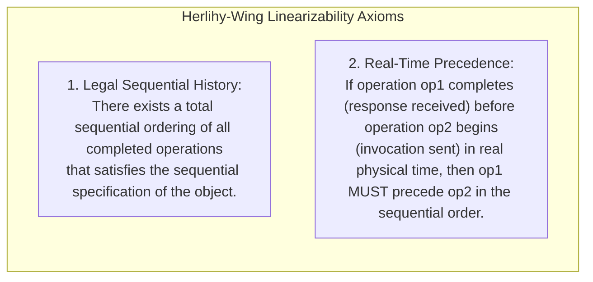
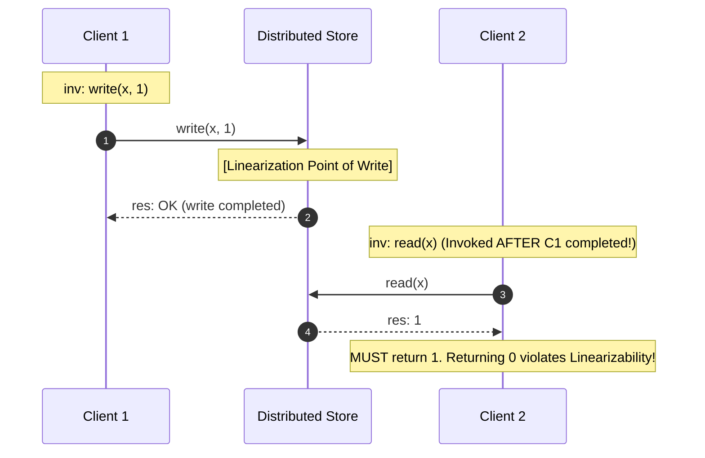
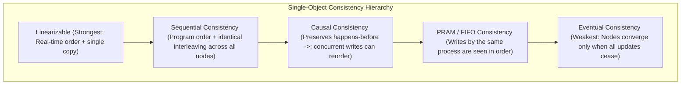
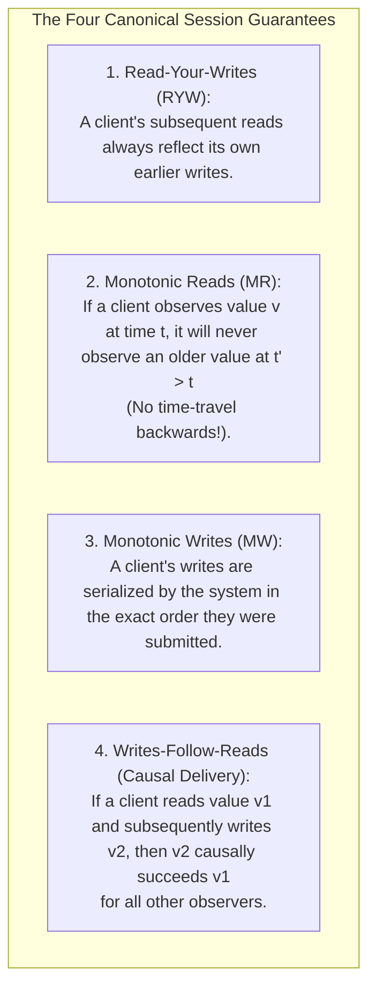
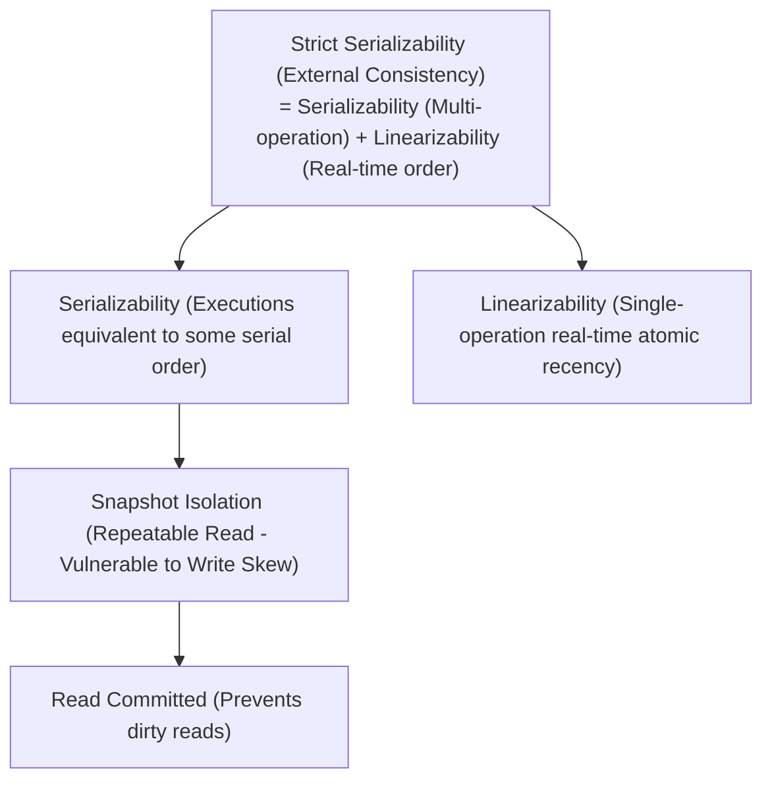
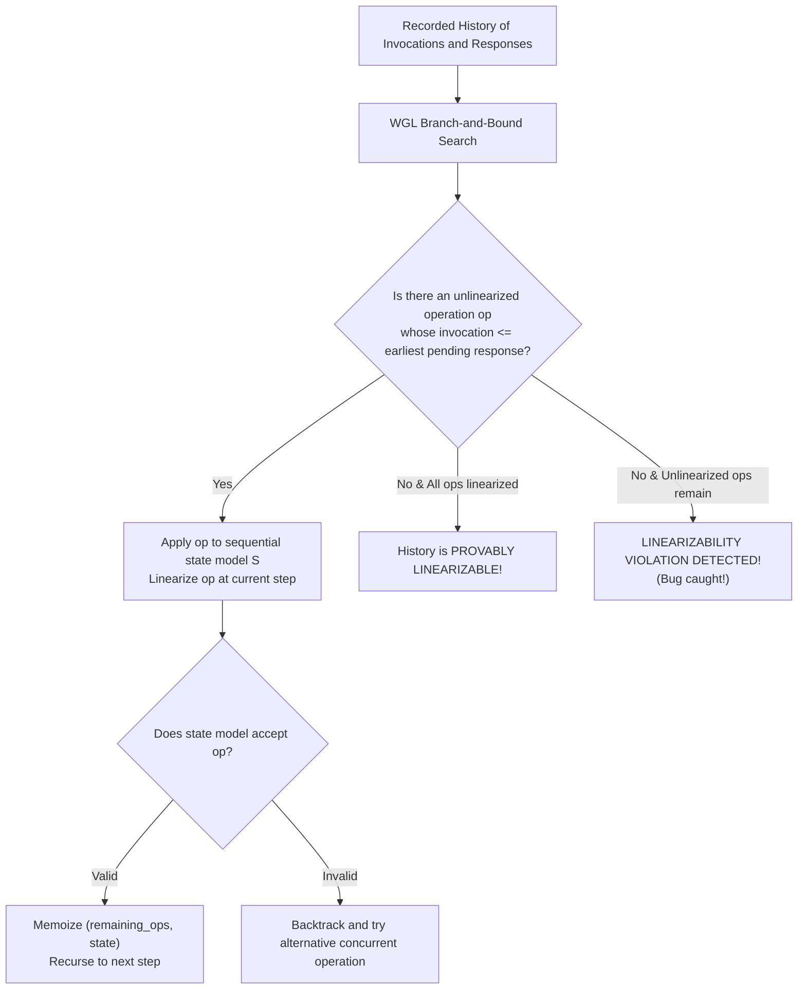

# Module 04 — Consistency Models, Linearizability, and Verification

The term "consistency" is one of the most overloaded words in computer science: it represents the "C" in ACID (application-defined integrity constraints) and the "C" in CAP (single-copy recency on read operations). In distributed systems, a **Consistency Model** is a formal contract between a storage system and its clients specifying which return values are legal when multiple concurrent processes read and write shared data across a network. This module establishes the formal definition of **Linearizability**, the complete **Consistency Hierarchy** (from Strict Serializability down to Eventual Consistency), **Session Guarantees**, and algorithmic verification via the **Wing-Gong (WGL)** linearizability checking algorithm.

---

## 1. Linearizability: Formal Herlihy-Wing Definition

Formulated by Maurice Herlihy and Jeannette Wing in 1990, **Linearizability** (also termed *Atomic Consistency* or *External Consistency*) is the strongest consistency model for single-object operations.

### The Linearization Point
Under linearizability, every operation appears to take effect instantaneously at a specific **Linearization Point** strictly between its invocation timestamp $\text{inv}(op)$ and response timestamp $\text{res}(op)$.

If Client 2 invokes `read(x)` after Client 1 has already received `OK` for `write(x, 1)`, Client 2 **must** observe `1`. Returning an older value (`0`) violates the real-time precedence axiom.

---

## 2. The Consistency Hierarchy

Consistency models exist along a spectrum trading off guarantees for availability and latency (Viotti & Vukolić, 2016):

### Comparison Matrix
| Consistency Model | Real-Time Ordering? | Total Order Across All Nodes? | Available Under Partitions? | Canonical Realization |
|---|---|---|---|---|
| **Linearizable** | **Yes** | **Yes** | **No (CP)** | etcd, ZooKeeper, Raft, Spanner |
| **Sequential** | No | **Yes** | No | Leslie Lamport (1979) multi-core memory |
| **Causal** | No | No (Partial causal order) | **Yes (Sticky AP)** | Bayou, COPS, Git branches |
| **PRAM / FIFO** | No | No | **Yes (AP)** | TCP streams |
| **Eventual** | No | No | **Yes (AP)** | DynamoDB, Cassandra, DNS |

---

## 3. Client Session Guarantees

In systems that relax linearizability for availability, clients require predictable guarantees within their own interactive session (Terry et al., 1994):

### Implementation Mechanics
- **Sticky Routing**: Route all requests from a user session to the same replica.
- **Client-Side Version Tracking**: The client caches the highest version vector or transaction ID seen. Every read request includes `min_version = V`. Replicas whose local state is behind $V$ delay responding until they catch up (Read-Index / sync).

---

## 4. Transactional Isolation vs. Distributed Consistency

Engineers frequently confuse **Isolation Levels** (multi-operation atomicity and concurrency control inside a database) with **Distributed Consistency Models** (single-operation recency across networked replicas).

- **Linearizability**: Governs **individual operations** on individual objects. An operation finishes at a real-time point.
- **Serializability**: Governs **multi-operation transactions**. Transactions appear to execute in *some* serial order, but that order does not need to correspond to physical real-time!
- **Strict Serializability**: The union of both. Transactions are serializable, and their serial order respects the physical real-time order of their completions (e.g. Google Spanner).

---

## 5. Algorithmic Verification: The Wing-Gong (WGL) Algorithm

Testing whether an execution trace from a black-box distributed system is linearizable is **NP-complete** (Gibbons & Korach, 1997). In practice, systems like Jepsen, Knossos, and Porcupine use the **Wing-Gong (WGL)** algorithm with memoization:

### Porcupine and P-Compositionality
Herlihy and Wing proved that linearizability is **composible** ($P$-compositionality):
$$\text{History } H \text{ is linearizable} \iff \forall \text{ key } k, \ H|_k \text{ is linearizable}$$
A multi-key key-value store history can be verified by checking each key independently in parallel! Tools like **Porcupine** (Go) leverage $P$-compositionality to verify millions of operations in seconds.

---

## 6. Interview Drill: Consistency Models & Linearizability

1. What is the fundamental difference between Linearizability and Sequential Consistency?

Both require that all nodes observe an identical, valid sequential interleaving of operations.
However, **Linearizability** imposes a global real-time constraint: if operation $B$ is invoked after operation $A$ has completed in real time, $A$ must precede $B$ in the sequence.
**Sequential Consistency** has no concept of physical real time; it only requires that operations within the same process respect program order. A sequentially consistent system is legally allowed to return days-old data, provided all nodes observe the updates in the identical order.

2. Why does a quorum system with R + W > N fail to guarantee linearizability by itself?

While $R + W > N$ ensures that the read quorum overlaps with the write quorum by at least one node (Pigeonhole Principle), overlapping is not sufficient for linearizability.
Consider a write $W(x, 1)$ currently updating replicas: it has updated 1 node out of 3.
- Client 1 reads from a quorum including the updated node and observes $1$.
- Client 2 invokes a read *after* Client 1 has finished. Client 2's quorum hits the 2 nodes that have not yet received the update, observing the old value $0$.
Client 2 observed an older value than Client 1 in real time, violating linearizability. To guarantee linearizability, reads must execute an **ABD / Read-Repair** step, writing the newest observed value back to a write quorum before returning.

3. Can a system provide Causal Consistency during a total network partition?

Yes. Under the PACELC / availability taxonomy, Causal Consistency belongs to the **Sticky-Available** class. Because causal consistency only requires respecting the happens-before relationship ($\to$) and allows independent concurrent operations ($a \parallel b$) to be merged later, nodes on either side of a network partition can continue to accept reads and writes without coordinating, preserving causality locally.

4. What is Write Skew, and why does Snapshot Isolation allow it while Serializability prevents it?

Write Skew occurs when two concurrent transactions read overlapping datasets, verify a joint invariant (e.g. "at least one doctor must be on call"), and make disjoint updates (Doctor $A$ goes off call; Doctor $B$ goes off call).
Under **Snapshot Isolation**, each transaction reads a consistent snapshot of the database taken before the transaction began. Because they modify different rows (Doctor $A$ vs Doctor $B$), there are no row-level write-write conflicts, and both commit successfully. However, the final state violates the invariant (zero doctors on call).
**Serializability** prevents write skew by detecting read-write dependencies (via Two-Phase Locking or Serializable Snapshot Isolation SSI) and aborting one of the transactions.

5. Why is linearizability testing NP-complete, and how do verification tools make it practical?

When operations overlap concurrently in time, their linearization points can be assigned in any order. For $n$ concurrent operations, there are $n!$ potential sequential interleavings that must be searched.
Verification tools make this tractable via two principles:
1. **Memoization & Pruning**: The Wing-Gong algorithm caches already-visited pairs of `(remaining_operations, model_state)`, pruning exponential duplicate search subtrees.
2. **P-Compositionality**: Because a system is linearizable if and only if each key is individually linearizable, verification is partitioned across independent keys, turning one intractable $N$-operation search into thousands of tiny, microsecond searches.

