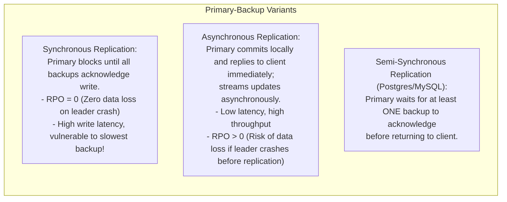
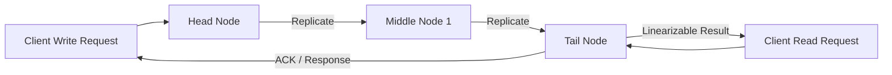
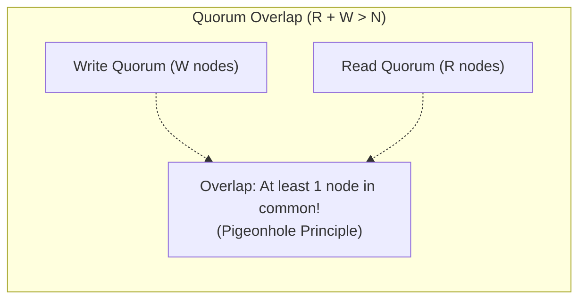
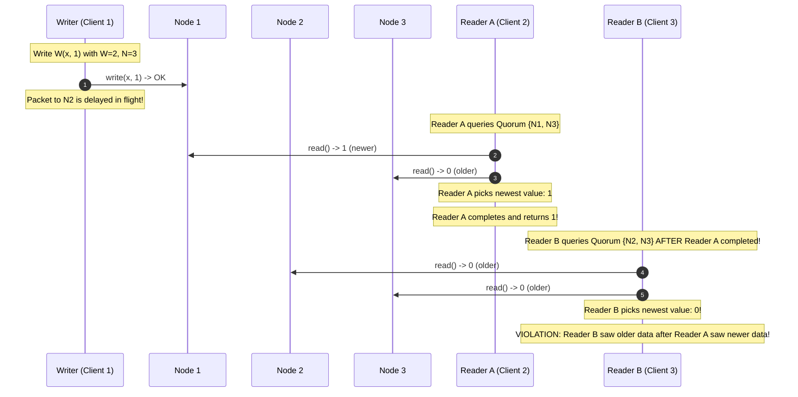
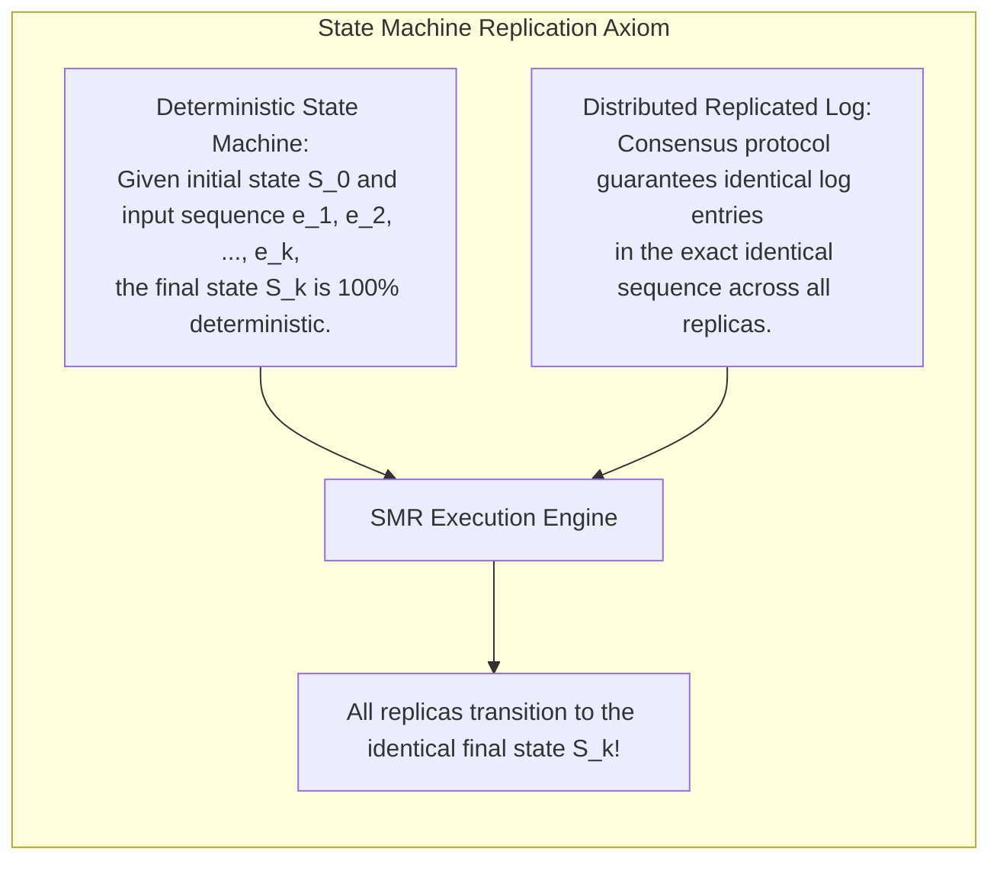
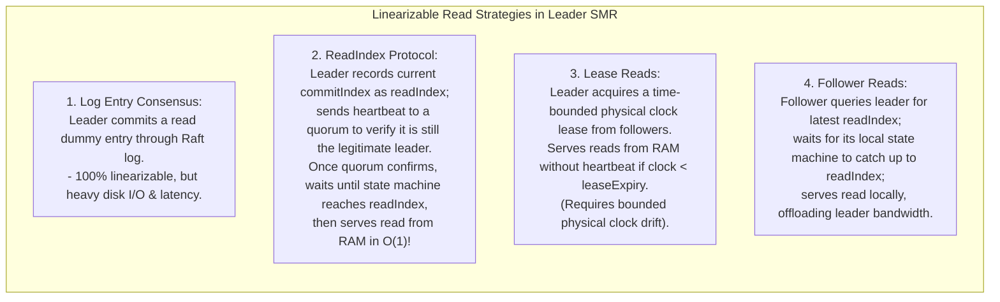

# Module 05 — Replication Protocols, Quorum Systems, and State Machine Replication

Replication copies data across multiple physical machines to provide fault tolerance, high availability, and geographic locality. However, keeping replicas synchronized in the presence of network partitions, hardware crashes, and concurrent updates is among the hardest challenges in computer systems. This module covers **Primary-Backup Replication**, **Chain Replication (CRAQ)**, **Quorum Systems**, why naive $R + W > N$ fails linearizability, the formal **ABD Register Protocol**, **State Machine Replication (SMR)**, and linearizable read strategies (**ReadIndex**, **Lease Reads**, and **Follower Reads**).

---

## 1. Primary-Backup Replication

In **Primary-Backup** (leader-follower) replication, a single designated node (the Primary) processes all write mutations, serializes them into an ordered log, and streams the updates to Backup replicas.

### The Failover Dilemma: Split-Brain
If the Primary experiences a network partition or a long GC pause, backups may declare the leader dead and promote a new Primary. If the old Primary recovers and continues accepting writes while the new Primary accepts conflicting writes, the system enters **Split-Brain**. Recovering requires consensus algorithms to enforce that at most one primary can hold authority in any epoch.

---

## 2. Chain Replication and CRAQ

Introduced by Robbert van Renesse and Fred B. Schneider in 2004, **Chain Replication** organizes replicas into a linear pipeline:

### Invariants of Chain Replication
1. **Writes**: Clients send all write requests to the **Head**. The Head executes the write, pushes it down the chain through middle nodes, and the **Tail** commits the write, sending the response to the client.
2. **Reads**: Clients send all read requests strictly to the **Tail**.
3. **Linearizability Guarantee**: Because the Tail processes all reads and is the final node to commit writes, any write acknowledged to a client has already reached the Tail. Therefore, all subsequent reads observed at the Tail are guaranteed to reflect that write in real time, achieving **Linearizability** with minimal coordination overhead.

### CRAQ: Chain Replication with Apportioned Queries
In standard Chain Replication, the Tail becomes a read bottleneck. **CRAQ** (Terrace & Freedman, 2009) allows **all nodes** (Head, Middle, Tail) to serve reads directly:
- Each node stores multiple object versions marked as **CLEAN** or **DIRTY**.
- When an update arrives: the node marks the new version as `DIRTY`.
- If a read arrives for an object with state `CLEAN`, the node serves it immediately.
- If a read arrives for an object with state `DIRTY`, the node queries the Tail for the latest committed version number, serving the linearizable response without routing the full payload through the Tail.

---

## 3. Quorum Systems and the ABD Protocol

A **Quorum System** replicates data across $N$ nodes without a designated primary, using subsets of nodes to coordinate reads and writes.

### Why $R + W > N$ Fails Linearizability
It is widely believed that $R + W > N$ guarantees strong consistency. **This is false.** Quorum overlap guarantees that a read quorum observes the newest write, but it does *not* guarantee Linearizability due to concurrent or partial writes:

### The ABD Protocol (Attiya, Bar-Noy, Dolev 1995)
To fix this anomaly, the **ABD Protocol** introduces a mandatory **Read-Repair** phase during reads:
1. **Write Phase**:
   - Query a read quorum to discover the highest version number $v_{\max}$.
   - Send `write(val, v_max + 1)` to a write quorum $W$.
2. **Read Phase (Two Steps)**:
   - Query a read quorum $R$ to collect values and timestamps; identify the highest timestamped value $(v, \text{val})$.
   - **Crucial Step**: Write $(v, \text{val})$ back to a write quorum $W$ *before* returning to the client!
   - Writing back guarantees that any subsequent reader will overlap with the newly repaired quorum, mathematically preserving Linearizability.

---

## 4. State Machine Replication (SMR)

Formulated by Leslie Lamport (1978) and generalized by Fred B. Schneider (1990), **State Machine Replication (SMR)** is the universal paradigm for building fault-tolerant distributed services (Raft, Paxos, Spanner).

If $N$ replicas apply the exact same sequence of transitions to a deterministic state machine, their internal states will remain identical forever. The entire problem of distributed fault tolerance reduces to: **how to maintain an identical replicated log of commands across all nodes**.

---

## 5. Linearizable Read Strategies in SMR

In a leader-based SMR system (e.g. Raft or etcd), processing reads through the full consensus log (writing a no-op log entry) consumes excessive disk I/O and network bandwidth. However, **serving reads locally from the leader's RAM is dangerous**: during a network partition, a deposed leader may continue serving stale reads before realizing it has been replaced.

---

## 6. Interview Drill: Replication Protocols & Quorums

1. In Chain Replication, why does serving reads strictly from the Tail guarantee linearizability?

In Chain Replication, writes must flow through the entire chain (Head $\to$ Middle $\to$ Tail) before the client receives an acknowledgment. If a client has received confirmation that a write succeeded, that write has already been applied at the Tail. Because all subsequent reads are routed strictly to the Tail, the Tail will immediately return that write or a newer write, strictly satisfying the real-time precedence requirement of Linearizability.

2. Why does the ABD protocol require a two-phase read (read followed by write-back)?

In a quorum system without a single leader, a concurrent write might only have reached a minority of nodes when the writer pauses or crashes. If Client 1 reads from a quorum that hits one of these updated nodes, it learns the new value. If Client 1 simply returned that value, a subsequent Client 2 might query a different quorum that misses the updated node and returns the old value (time travel!). By forcing Client 1 to write the new value back to a full write quorum before returning, Client 1 guarantees that all future quorum reads will observe the new value.

3. What is the ReadIndex optimization in Raft, and what failure does it prevent?

The ReadIndex optimization allows a Raft leader to serve reads from RAM without writing entries to disk.
It prevents stale reads caused by network partitions: if a leader is partitioned from the majority, a new leader may be elected elsewhere. If the old leader served reads directly from RAM, it would return stale data.
With ReadIndex, the leader records its `commitIndex`, sends a round of heartbeat messages to a majority of nodes to confirm it is still the valid leader, waits for its local state machine to apply up to that `commitIndex`, and only then serves the read.

4. What are the operational trade-offs of Lease Reads compared to ReadIndex?

- **ReadIndex**: Requires a network roundtrip of heartbeats to a majority for every batch of read operations. It is completely safe under arbitrary clock drift or VM pauses, but adds network roundtrip latency.
- **Lease Reads**: Allows the leader to serve reads immediately from memory with zero network messages as long as its physical clock lease has not expired. It achieves ultra-low latency, but relies on bounded physical clock drift: if a leader experiences a severe clock jump or a long hypervisor pause, it may serve stale reads.

5. How does CRAQ allow non-tail nodes to serve linearizable reads without overloading the tail?

CRAQ assigns a status of `CLEAN` or `DIRTY` to object versions on each node. When an update is propagating down the chain, intermediate nodes mark the new version as `DIRTY`. If a node receives a read request for an object whose latest version is `CLEAN`, it can serve the read locally with zero network overhead. If the object is `DIRTY`, it sends a tiny lightweight version-query probe to the Tail to determine which version is officially committed, offloading payload bandwidth from the Tail.

