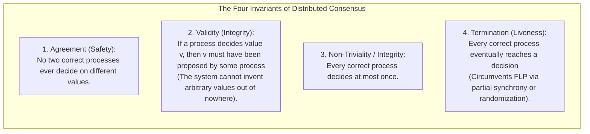
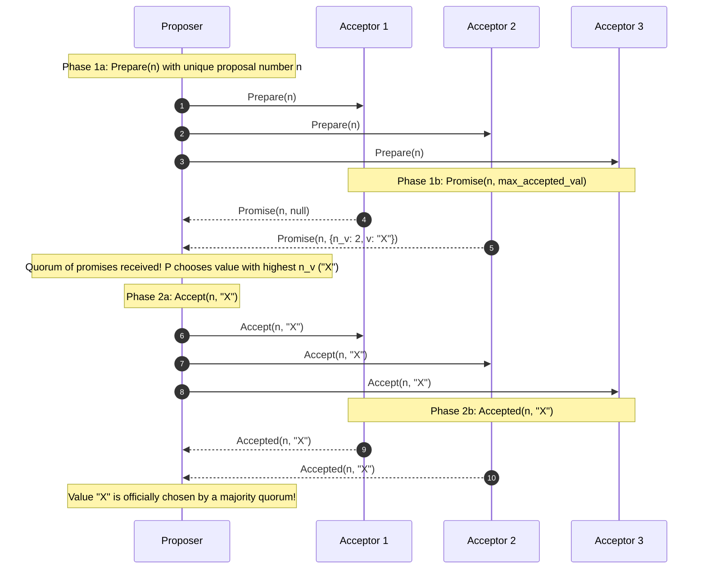
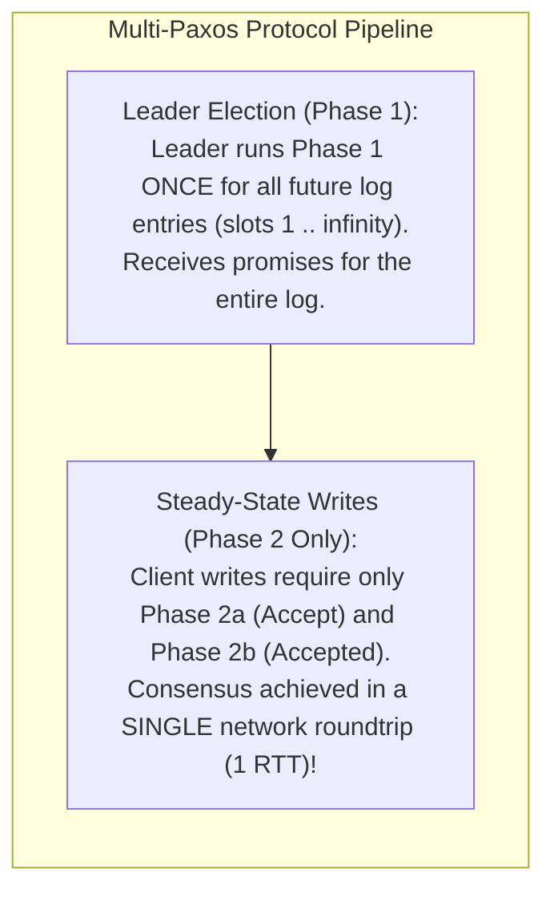
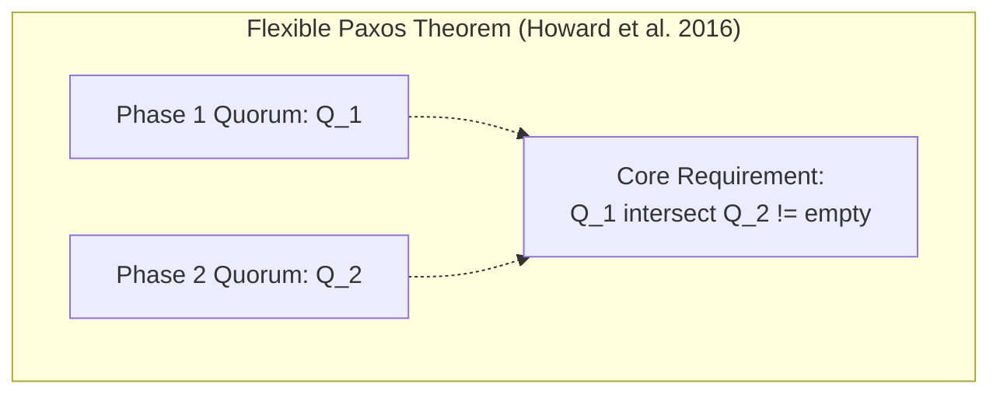
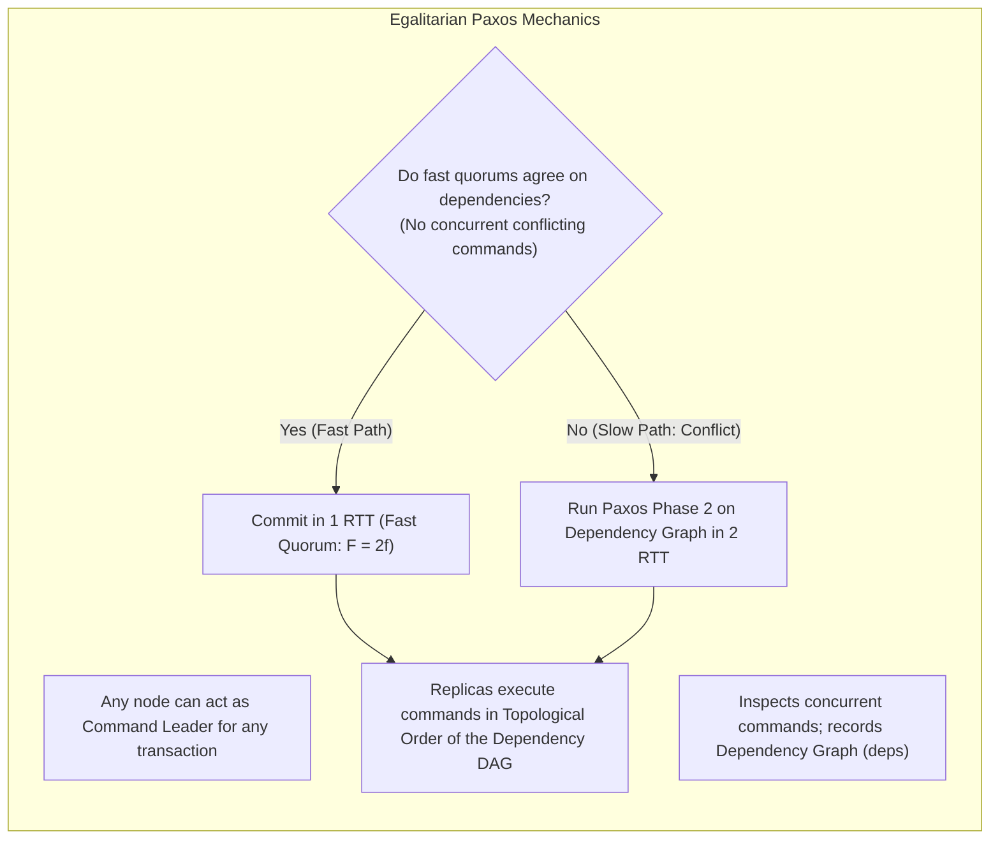
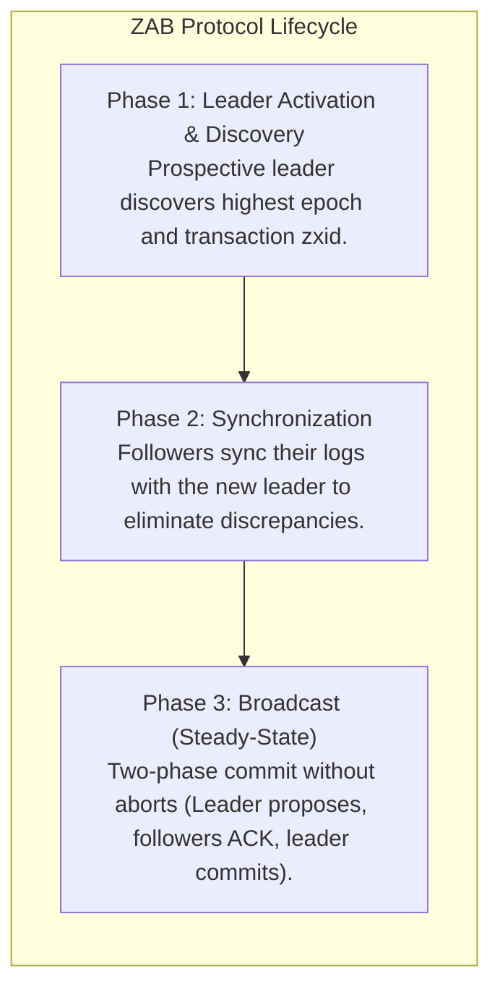

# Module 06 — Consensus Foundations, the Paxos Family, and ZAB

Consensus is the core problem of distributed computing: getting a set of independent processes to agree on a single data value or sequence of actions despite network packet drops, unbounded message delays, and server crashes. While simple in concept, designing a consensus protocol that provably prevents divergence while remaining live under realistic network conditions took computer scientists decades to solve. This module explores formal consensus properties, Leslie Lamport's **Single-Decree Paxos**, **Multi-Paxos**, **Flexible Paxos**, **Egalitarian Paxos (EPaxos)**, and the **ZooKeeper Atomic Broadcast (ZAB)** protocol.

---

## 1. Formal Properties of Consensus

Any valid distributed consensus protocol must satisfy four fundamental invariants:

---

## 2. Single-Decree Paxos: Protocol Mechanics

Invented by Leslie Lamport in 1998 (*"The Part-Time Parliament"*) and simplified in 2001 (*"Paxos Made Simple"*), Paxos achieves agreement on a single decision using three process roles:
- **Proposers**: Advocate for client values.
- **Acceptors**: Act as the consensus memory store and voting quorum.
- **Learners**: Observe the agreed-upon value.

### The Two-Phase Paxos Protocol
1. **Proposal Numbers**: Each proposal has a unique number $n = (\text{round}, \text{nodeId})$ ordered lexicographically such that no two proposers generate the same number.
2. **Phase 1a (Prepare)**: Proposer picks $n$ and broadcasts `Prepare(n)` to a majority of Acceptors.
3. **Phase 1b (Promise)**: If $n > \text{maxPromised}$, the Acceptor returns a promise never to accept proposals with numbers $< n$, and includes the highest-numbered proposal it has already accepted, if any: $(n_v, v)$.
4. **Phase 2a (Accept)**: Once the Proposer receives promises from a majority of Acceptors:
   - If any Acceptor reported an already-accepted value, the Proposer **must** set its proposal value $v$ to the value associated with the highest $n_v$ in the promises.
   - If no Acceptor reported an accepted value, the Proposer is free to propose its own desired client value.
   - The Proposer broadcasts `Accept(n, v)` to a majority of Acceptors.
5. **Phase 2b (Accepted)**: Acceptor accepts `(n, v)` unless it has already promised to reject proposals $< n$. If a majority accepts, the value is permanently **chosen**.

### The Livelock Vulnerability: Dueling Proposers
Single-Decree Paxos guarantees safety under all conditions, but two concurrent proposers can livelock the system: Proposer $A$ sends `Prepare(1)`; before it sends `Accept(1)`, Proposer $B$ sends `Prepare(2)`. Acceptors promise $B$, so they reject $A$'s `Accept(1)`. Proposer $A$ immediately retries with `Prepare(3)`, causing Acceptors to reject $B$'s `Accept(2)`. This ping-pong can continue indefinitely. Multi-Paxos and Raft resolve this by introducing a **Stable Leader**.

---

## 3. Multi-Paxos: Steady-State Optimization

Running two full network roundtrips (Phase 1 + Phase 2) for every log entry is too slow for production databases. **Multi-Paxos** amortizes Phase 1:

If the leader remains stable, Phase 1 is never repeated, reducing steady-state write latency to a single roundtrip ($1 \text{ RTT}$).

---

## 4. Flexible Paxos: Dismantling the Majority Quorum Myth

For over two decades, the distributed systems community believed that Paxos required **all** quorums to be strict majorities ($> N/2$). In 2016, Heidi Howard et al. at the University of Cambridge proved this fundamental assumption false.

> **Flexible Paxos Theorem:** Paxos consensus requires only that **Phase 1 quorums intersect with Phase 2 quorums** ($Q_1 \cap Q_2 \neq \emptyset$). Phase 1 quorums do *not* need to intersect with each other, and Phase 2 quorums do *not* need to intersect with each other!

### The Asymmetric Quorum Advantage
In an $N = 10$ node cluster:
- **Classic Paxos**: Requires majorities of $6$ nodes for Phase 1 and $6$ nodes for Phase 2.
- **Flexible Paxos**: Set Phase 1 quorum size $|Q_1| = 9$ and Phase 2 quorum size $|Q_2| = 2$.
  - Because $9 + 2 = 11 > 10$, $Q_1$ and $Q_2$ are guaranteed to overlap on at least 1 node!
  - **Impact**: Leader election (Phase 1) is rare, so waiting for 9 nodes is acceptable. Meanwhile, the steady-state write path (Phase 2) requires acknowledgments from **only 2 nodes**, drastically reducing latency and isolating the system from tail latency!

---

## 5. Egalitarian Paxos (EPaxos)

Traditional Multi-Paxos routes all writes through a single leader, creating a geographic latency bottleneck for global deployments. **Egalitarian Paxos (EPaxos)** (Moraru, Andersen, Kaminsky, 2013) is a leaderless protocol where **any replica can propose writes**:

EPaxos achieves consensus in $1 \text{ RTT}$ under typical non-conflicting workloads across WAN environments.

---

## 6. ZooKeeper Atomic Broadcast (ZAB)

Apache ZooKeeper coordinates distributed systems (Kafka KRaft metadata, Hadoop, HBase) using the **ZAB protocol** (Junqueira, Reed, Serafini, 2011).

### ZAB Transaction Identifiers (`zxid`)
Every proposal in ZAB carries a 64-bit integer `zxid`:
- **High 32 bits**: `epoch` (incremented every time a new leader is elected).
- **Low 32 bits**: `counter` (monotonic sequence number reset to 0 at the start of each epoch).

### ZAB Guarantees
1. **Reliable Delivery**: If a message is committed by the leader, it will eventually be committed by all correct followers.
2. **Total Order**: If message $a$ is committed before message $b$ by one server, $a$ is committed before $b$ by all servers.
3. **Causal Consistency**: If message $a$ causes message $b$, $a$ will be proposed before $b$.
4. **FIFO Client Order**: All requests from a single client FIFO queue are executed in the exact order submitted.

---

## 7. Interview Drill: Paxos & ZAB

1. In Phase 2a of Single-Decree Paxos, why is a proposer forbidden from choosing its own value if an acceptor reported an accepted value in Phase 1b?

If an acceptor in Phase 1b returns an already accepted value $(n_v, v)$, that value might have already been accepted by a majority of acceptors and decided in an earlier round without the current proposer's knowledge. Overwriting it with a new value would violate the fundamental **Agreement** invariant (two different values could be decided). The proposer must adopt the value with the highest proposal number to preserve historical consensus.

2. What is the difference between Paxos and Two-Phase Commit (2PC)?

- **2PC (Atomic Commit)**: Requires **unanimous** agreement from 100% of participants. If even a single participant crashes or votes NO, the transaction must abort. 2PC is a blocking protocol: if the coordinator crashes during commit, participants are stuck holding locks indefinitely.
- **Paxos (Consensus)**: Requires only a **majority quorum** ($\lfloor N/2 \rfloor + 1$). It makes forward progress even if a minority of nodes crash or become unreachable ($N = 2f + 1$ tolerates $f$ crash failures).

3. How does Flexible Paxos improve write performance in cloud database clusters?

Classic Paxos requires majority quorums for both election ($Q_1$) and replication ($Q_2$). In Flexible Paxos, as long as $Q_1$ and $Q_2$ intersect on at least one node, consensus is preserved. Because leader failover is rare while client writes happen thousands of times per second, Flexible Paxos sets $Q_1$ large (e.g. 5 out of 6 nodes) and $Q_2$ small (2 out of 6 nodes). This reduces the number of network acknowledgments required on the write path, significantly lowering latency and eliminating tail latency caused by slow cloud nodes.

4. What causes Dueling Proposers in Paxos, and how does Multi-Paxos resolve it?

In basic Paxos, any node can become a proposer at any time. If Proposer $A$ issues `Prepare(1)` and Proposer $B$ concurrently issues `Prepare(2)`, acceptors reject $A$'s subsequent `Accept(1)` because they promised $B$. Proposer $A$ then issues `Prepare(3)`, preempting $B$'s `Accept(2)`. They can livelock indefinitely.
Multi-Paxos resolves this by using an explicit leader election mechanism (or randomized timeouts) to designate a single **Stable Leader** that alone issues Phase 2 accepts.

5. How does the 64-bit zxid in ZAB ensure that stale leaders cannot corrupt followers after a network partition heals?

The high 32 bits of `zxid` represent the `epoch`, which strictly increases on every leader election. When an old, partitioned leader attempts to issue a proposal, followers reject it because their current epoch is higher than the stale proposal's epoch. Furthermore, during synchronization (Phase 2), any uncommitted entries from previous epochs on lagging followers are cleanly truncated to match the new leader's committed state.

