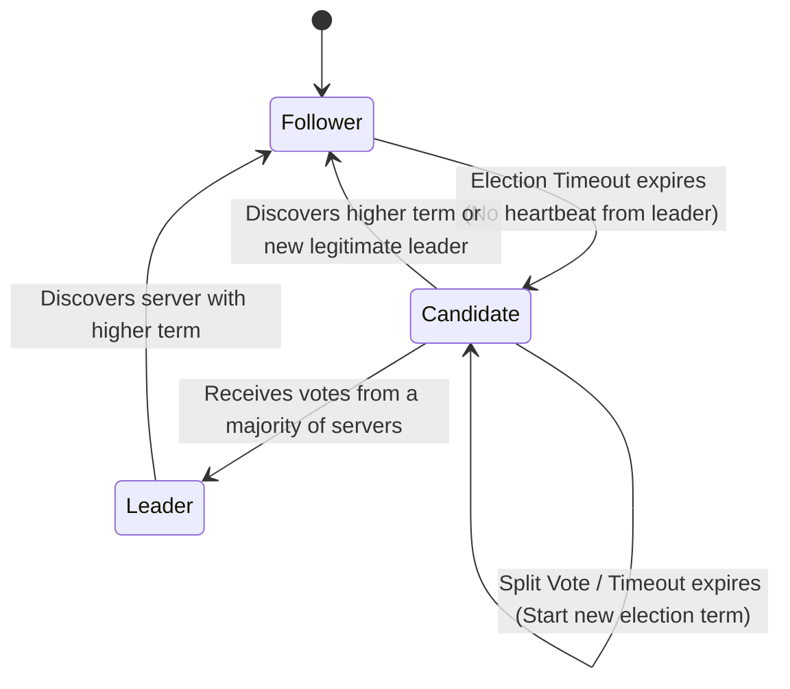
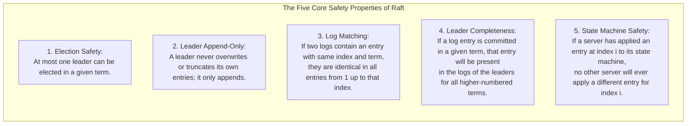
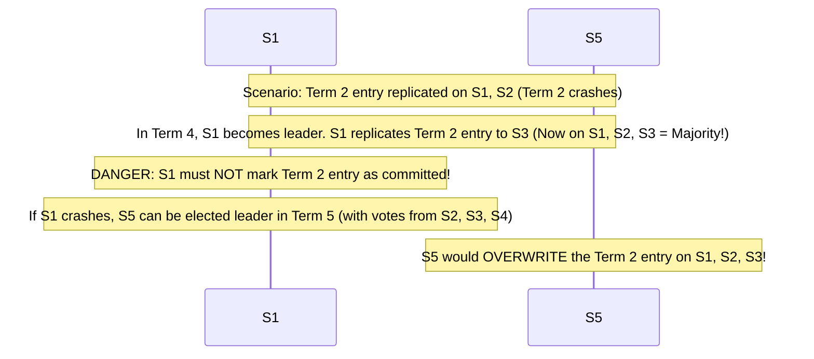

# Module 07 — The Raft Consensus Algorithm: Rigorous Mechanics and Production Pitfalls

Designed by Diego Ongaro and John Ousterhout at Stanford University in 2014 (*"In Search of an Understandable Consensus Algorithm"*), **Raft** is a consensus algorithm that achieves complete operational equivalence with Multi-Paxos while decomposing consensus into distinct, cleanly separated subproblems: **Leader Election**, **Log Replication**, **Safety Enforcements**, and **Membership Reconfiguration**. Raft is the foundational consensus engine powering the modern cloud infrastructure stack, including **etcd** (Kubernetes), **HashiCorp Consul**, **CockroachDB**, **TiKV**, and **Apache Kafka KRaft**. This module details Raft's state machine, RPC definitions, the five core safety properties, the critical **Figure 8 commit rule**, persistence requirements, and production failure modes.

---

## 1. Raft Roles and State Transition Machine

At any point in time, a Raft server exists in exactly one of three distinct roles:



### The Role Contract
1. **Follower**: Passive. Only responds to incoming RPCs from Candidates and Leaders. If it receives no communication within its randomized election timeout, it assumes the leader is dead and transitions to Candidate.
2. **Candidate**: Increments `currentTerm`, votes for itself, and broadcasts `RequestVote` RPCs to all peers.
3. **Leader**: Handles all client read/write requests, coordinates log replication, sends periodic heartbeats (`AppendEntries` with empty payload) to maintain authority, and advances the system's `commitIndex`.

---

## 2. Raft RPC Specifications

Raft coordinates nodes using exactly two primary Remote Procedure Calls:

### 1. `RequestVote` RPC
Invoked by Candidates during elections:

```typescript
export interface RequestVoteArgs {
  term: number;         // Candidate's term
  candidateId: string;  // Candidate requesting vote
  lastLogIndex: number; // Index of candidate's last log entry
  lastLogTerm: number;  // Term of candidate's last log entry
}

export interface RequestVoteReply {
  term: number;         // currentTerm, for candidate to update itself
  voteGranted: boolean; // True means candidate received vote
}
```

#### Receiver Implementation Rules
1. **Term Check**: If `args.term < currentTerm`, return `false`. If `args.term > currentTerm`, update `currentTerm = args.term` and convert to Follower.
2. **Voting Restriction**: Grant vote if and only if:
   - `votedFor` is `null` or matches `args.candidateId`, **AND**
   - Candidate's log is **at least as up-to-date as receiver's log**:
     $$(lastLogTerm > myLastTerm) \lor (lastLogTerm == myLastTerm \land lastLogIndex \ge myLastIndex)$$

---

### 2. `AppendEntries` RPC
Invoked by Leaders for log replication and heartbeats:

```typescript
export interface LogEntry<T> {
  term: number;
  index: number;
  command: T;
}

export interface AppendEntriesArgs<T> {
  term: number;         // Leader's term
  leaderId: string;     // So follower can redirect clients
  prevLogIndex: number; // Index of log entry immediately preceding new ones
  prevLogTerm: number;  // Term of prevLogIndex entry
  entries: LogEntry<T>[]; // Log entries to store (empty for heartbeat)
  leaderCommit: number; // Leader's commitIndex
}

export interface AppendEntriesReply {
  term: number;         // currentTerm, for leader to update itself
  success: boolean;     // True if follower contained entry matching prevLogIndex and prevLogTerm
  matchIndex?: number;  // Optimization: highest matching index on follower
}
```

#### Log Matching Invariant
If two distinct logs contain an entry with the identical index and term, then:
- They store the identical command at that index.
- The logs are **identical in all entries up through that index**!

---

## 3. The Five Core Raft Safety Properties

Ongaro and Ousterhout mathematically proved that Raft guarantees five immutable safety properties under all network delays, partitions, packet duplicates, and reorderings:



---

## 4. The Critical Figure 8 Commit Rule

One of the most subtle edge cases in distributed consensus is documented in **Figure 8** of the Raft paper:

> [!CAUTION]
> **A Raft leader CANNOT commit a log entry from an earlier term simply because it is replicated on a majority of nodes!**



### The Correct Commit Rule
To prevent committed entries from being silently overwritten:
- A leader counts replica confirmations **only for entries originating in its CURRENT term**.
- Once an entry from the leader's current term is confirmed by a majority, it marks that entry as committed.
- By the **Log Matching Property**, committing the current-term entry **indirectly commits all preceding entries from earlier terms**.

---

## 5. Persistence Requirements: The Fsync Mandate

To survive power cuts and crash-restarts without violating Election Safety, a Raft node **must synchronously write three variables to non-volatile storage (`fsync`)** before replying to any RPC:
1. `currentTerm`: The latest term the server has observed.
2. `votedFor`: The candidate identifier that received this server's vote in `currentTerm`.
3. `log[]`: All log entries (index, term, command).

### The Crash-Restart Amnesia Catastrophe
If a server acknowledges a vote and crashes, but reboots without persisting `votedFor`:
- The server wakes up in the same term with `votedFor = null`.
- Another candidate requests a vote in the same term.
- The server grants a **second vote** in the identical term!
- Result: **Two leaders are elected in the same term**, causing divergent, split-brain log commits.

---

## 6. Pre-Vote and Check-Quorum Extensions

### 1. The Pre-Vote Protocol
When a network partition isolates a follower, the isolated node's election timer expires repeatedly. It increments its term ($term = 10 \to 11 \to \dots \to 50$). When the partition heals, the partitioned node reconnects and broadcasts an RPC with $term = 50$, forcing the healthy cluster leader to step down!
- **Solution (Pre-Vote)**: Before incrementing its term, a candidate executes a tentative **Pre-Vote** phase. Peers only grant pre-votes if they have not received heartbeats from a valid leader. The partitioned node cannot obtain a pre-vote majority and cannot disrupt the cluster.

### 2. Check-Quorum
If a leader is partitioned from the majority, it might not receive followers' messages, but followers cannot depose it until their election timers fire.
- **Solution**: The leader periodically checks if it received positive acknowledgments from a majority within an election timeout window. If it has not, it **voluntarily steps down to Follower**, preventing stale reads.

---

## 7. Interview Drill: Raft Consensus

<details>
<summary>1. In Raft, why must election timeouts be randomized (e.g. between 150ms and 300ms)?</summary>

If all nodes shared a deterministic timeout (e.g. exactly 200ms), when the leader crashes, all followers would become candidates simultaneously. They would vote for themselves and broadcast `RequestVote` RPCs at the identical millisecond, resulting in a **Split Vote** where no candidate obtains a majority. Randomizing timeouts across a range ensures that one follower's timer will fire substantially earlier than the others, allowing it to collect votes and establish leadership before peers begin competing.
</details>

<details>
<summary>2. Why does the RequestVote RPC reject a candidate whose log is shorter or has an older term than the receiver's log?</summary>

This enforces the **Leader Completeness** safety property: any server that wins an election must already contain all committed log entries from all previous terms.
Because committing an entry requires a majority quorum, and electing a leader requires a majority quorum, the two quorums must overlap by at least one node. The voting restriction ensures that this overlapping node will vote NO if the candidate's log lacks the committed entry.
</details>

<details>
<summary>3. Why can a Raft leader never commit an entry from an earlier term by counting replicas?</summary>

As shown in Figure 8 of the Raft paper, an entry from a previous term that reaches a majority might still be overwritten by a future leader if the current leader crashes before committing an entry from its own term. The leader cannot distinguish whether the older entry was genuinely committed or merely replicated before an uncommitted leader crashed. Only when a leader commits an entry from its *current* term can it be mathematically certain that no future leader could possibly be elected without that entry.
</details>

<details>
<summary>4. What happens if a Raft follower receives an AppendEntries request with prevLogIndex and prevLogTerm that do not match its local log?</summary>

The follower rejects the request (`success: false`). This triggers the leader's recovery mechanism: the leader decrements `nextIndex` for that follower and re-sends `AppendEntries` with an earlier `prevLogIndex`. This process repeats until a matching index is located. Once a match is found, the follower overwrites any conflicting subsequent entries and appends the leader's new entries, restoring the **Log Matching Invariant**.
</details>

<details>
<summary>5. How does the Pre-Vote extension prevent an isolated node from disrupting a healthy cluster upon reconnection?</summary>

An isolated node that cannot communicate with the leader repeatedly times out and increments its `currentTerm`. Without Pre-Vote, reconnecting this node forces all healthy nodes (including the leader) to update their term and step down.
With Pre-Vote, the isolated node enters a non-disruptive trial phase without incrementing its actual term. Because the healthy majority is receiving heartbeats from the legitimate leader, they reject the pre-vote. The partitioned node remains blocked from advancing its term, protecting the active leader from disruption.
</details>
