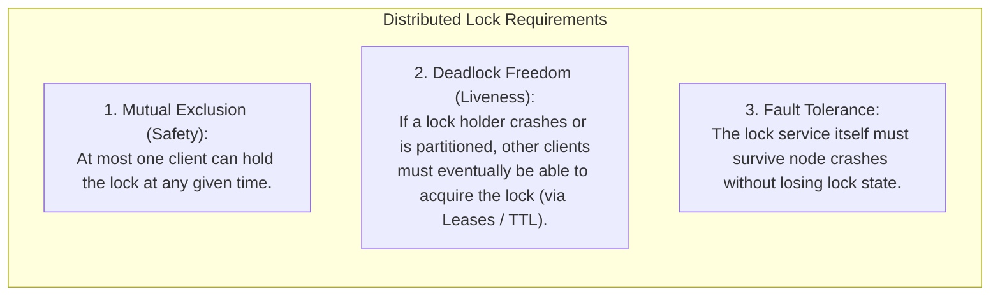
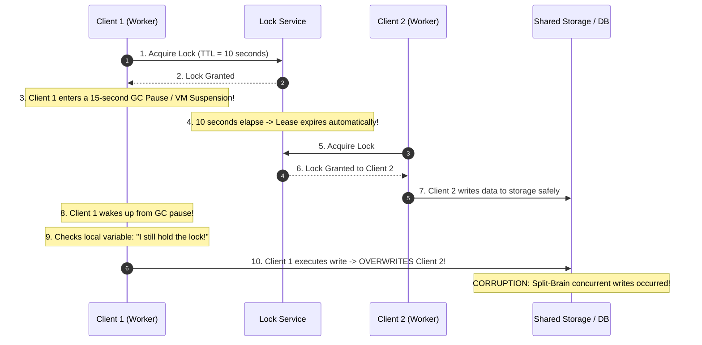
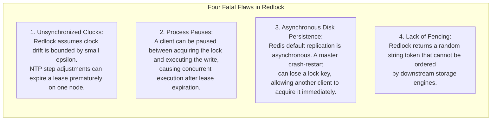
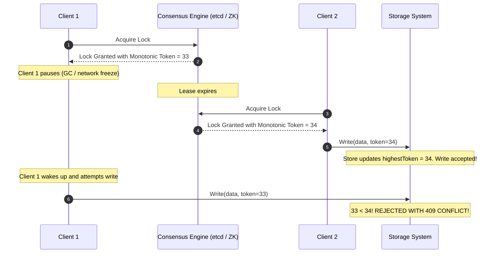
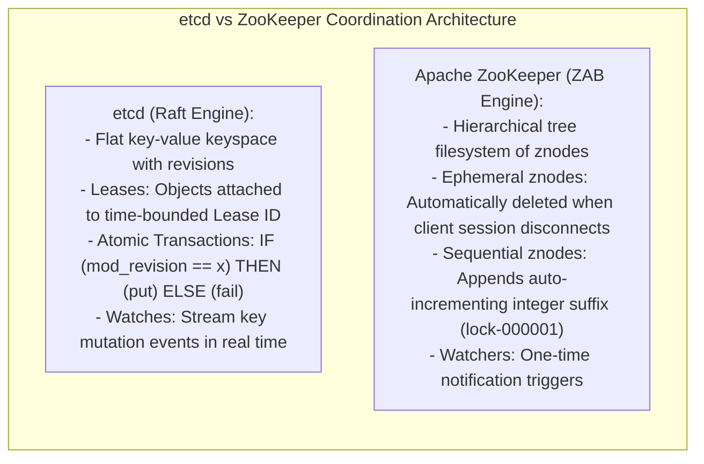
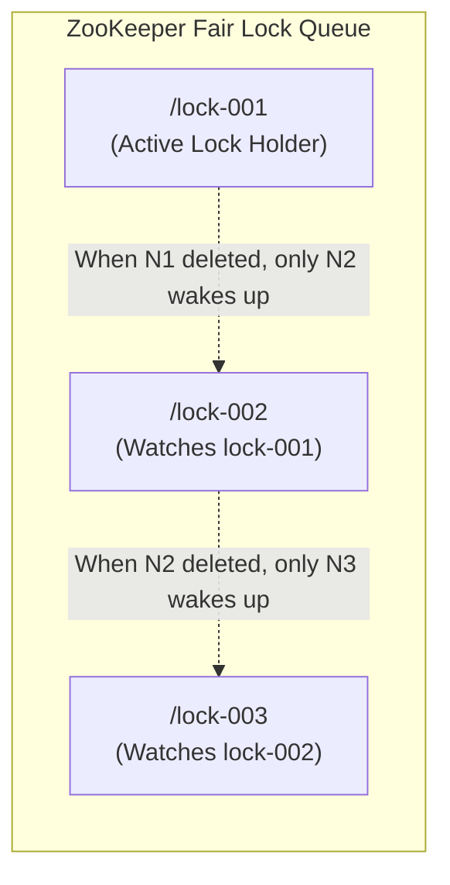

# Module 08 — Distributed Coordination, Locks, and Service Primitives

Building distributed applications requires solving higher-level coordination challenges: electing a primary worker, acquiring exclusive access to a shared resource, discovering dynamic microservice instances, and synchronizing parallel processing stages. Because distributed locks and coordination services operate across lossy networks subject to process pauses and physical clock drift, naive lock implementations frequently cause split-brain data corruption. This module explores **Distributed Locks**, Martin Kleppmann's formal critique of **Redlock**, **Storage-Enforced Fencing Tokens**, and coordination primitives in **etcd** and **Apache ZooKeeper**.

---

## 1. The Distributed Lock Problem

In a single operating system, a mutex is backed by atomic CPU primitives (CAS) and kernel futexes: if a thread acquires a lock, memory hardware guarantees mutual exclusion. In a distributed system, a lock must be held by an independent node over a network.

---

## 2. The Lease Mechanism and the GC Pause Trap

To guarantee Deadlock Freedom, distributed locks use **Leases** (time-bounded locks). The lock automatically expires after a Time-To-Live (TTL) unless the client sends periodic heartbeat renewals.

### The Stop-The-World GC Vulnerability
In managed runtimes (Java, Node.js, Python, Go), local lease timers cannot guarantee mutual exclusion:

---

## 3. The Redlock Critique: Kleppmann vs. Redis

Salvatore Sanfilippo (creator of Redis) proposed **Redlock**, an algorithm for acquiring locks across $N = 5$ independent Redis instances without consensus: a client queries each Redis node sequentially, and if it acquires a majority within a timeout, it assumes the lock is held.

In 2016, Martin Kleppmann published a comprehensive critique (*"How to do distributed locking"*), proving Redlock is unsafe for systems where correctness matters:

### Kleppmann's Verdict: What Locks Are For
- **For Efficiency (Optimization)**: If a duplicate execution only wastes CPU work (e.g. rendering an image twice, sending a duplicate email that is acceptable), lightweight Redis locks are sufficient.
- **For Correctness (Safety)**: If a duplicate execution corrupts financial ledgers, customer records, or shared files, **Redlock is unsafe**. You must use a **Consensus-backed coordination engine (etcd, ZooKeeper)** paired with **Fencing Tokens**.

---

## 4. Fencing Tokens: Storage-Level Mutual Exclusion

Because clients cannot prevent unexpected execution delays, safety **must be enforced by the storage layer** that holds the shared resource:

### Requirements for Fencing Tokens
1. **Monotonically Increasing**: Every successive lock grant must issue a strictly higher integer token ($33, 34, 35, \dots$). Consensus engines (etcd's `raft_index` / `mod_revision`, ZooKeeper's `zxid`) provide this natively.
2. **Storage Enforcement**: The storage service must record the highest token processed so far (`highestTokenSeen`), rejecting any write presenting a token $< \text{highestTokenSeen}$.

---

## 5. Coordination Primitives in etcd and ZooKeeper

Modern cloud architectures implement distributed coordination using consensus-backed key-value stores:

### Implementing Fair Distributed Locks without Thundering Herds
A naive distributed lock broadcasts an event to thousands of waiting nodes when a lock is released, causing a catastrophic **Thundering Herd** CPU spike.
- **The Solution (ZooKeeper Lock Queue)**:
  1. Each client creates an **Ephemeral Sequential** node: `/locks/resource-lock-000001`.
  2. The client lists all children of `/locks`.
  3. If its node has the smallest sequence number, it holds the lock!
  4. If not, the client **watches only the node with the immediately preceding sequence number** (Node 2 watches Node 1, Node 3 watches Node 2).
  5. When Node 1 releases, only Node 2 wakes up in $O(1)$ time!

---

## 6. Distributed Barriers and Service Discovery

### Distributed Barrier
A coordination pattern where $N$ independent worker nodes must complete Phase 1 before any node is permitted to proceed to Phase 2:
- Workers register by creating an ephemeral child node under `/barrier/node_i`.
- Each worker sets a watch on `/barrier`.
- When the number of registered children reaches $N$, the coordinator creates `/barrier/ready`.
- The watch fires on all nodes simultaneously, allowing workers to proceed to Phase 2.

### Service Discovery
In dynamic container environments (Kubernetes), IP addresses churn constantly.
- Instances register by creating an ephemeral key (`/services/payment-service/<ip>:<port>`) with a 10-second lease renewal heartbeat.
- API Gateways watch the `/services/payment-service/` prefix.
- If an instance crashes, its lease expires, the key is removed, and the gateway automatically reroutes traffic away from the dead instance within seconds.

---

## 7. Interview Drill: Distributed Coordination & Locks

1. Why is Redlock insufficient for mission-critical storage writes where correctness is non-negotiable?

Redlock relies on two invalid assumptions: synchronized physical clocks and bounded execution times. If a process experiences a stop-the-world garbage collection pause or hypervisor CPU throttling after acquiring a lock, its lease can expire without the client's knowledge. Another client can acquire the lock and write to storage. When the first process resumes, it executes its write, corrupting data. Because Redlock tokens are opaque strings that cannot be ordered by storage engines, downstream storage cannot detect or reject stale writes.

2. How do fencing tokens guarantee safety even if a client holds a stale lock and attempts to write?

Fencing tokens move enforcement from the client to the storage service. The lock service issues a monotonically increasing integer token with every lease grant. Downstream storage tracks the highest token it has accepted. If a paused client resumes and submits a write with an older token, the storage engine detects that `token < highest_token` and immediately aborts the write with an error, preventing silent data corruption.

3. In ZooKeeper, how does watching the preceding sequential znode eliminate the Thundering Herd problem?

In a naive implementation, all waiting clients set a watch on the main lock znode. When the lock is released, all waiting nodes wake up simultaneously, overwhelming ZooKeeper with thousands of concurrent read requests.
By using sequential znodes, each candidate watches only the znode immediately preceding its own number in the queue. When the active lock is deleted, exactly one client (the next in line) receives a notification, ensuring $O(1)$ network and CPU overhead.

4. What is the difference between an Ephemeral znode in ZooKeeper and a standard Persistent znode?

- **Persistent znode**: Remains in the ZooKeeper tree permanently until an explicit `delete` API call removes it.
- **Ephemeral znode**: Bound to the active client session that created it. If the client disconnects or fails to send heartbeats within the session timeout period, ZooKeeper automatically deletes the znode. This makes ephemeral znodes ideal for leader election, membership tracking, and distributed locks.

5. How does etcd implement distributed locks using its revision and transaction (Txn) APIs?

In etcd, every write operation increments a global 64-bit integer called `mod_revision`.
A client creates a key with a time-bounded Lease. It then executes an atomic transaction:
`IF (create_revision == 0) THEN (put key with lease) ELSE (get key)`.
If successful, the client's key has the lowest `mod_revision`. The client uses `mod_revision` as its fencing token. Waiting clients set a watch on the key prefix to observe releases.

