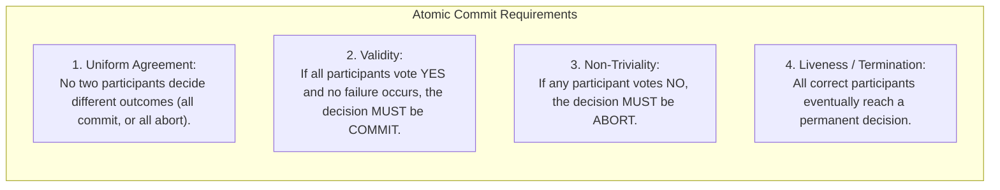
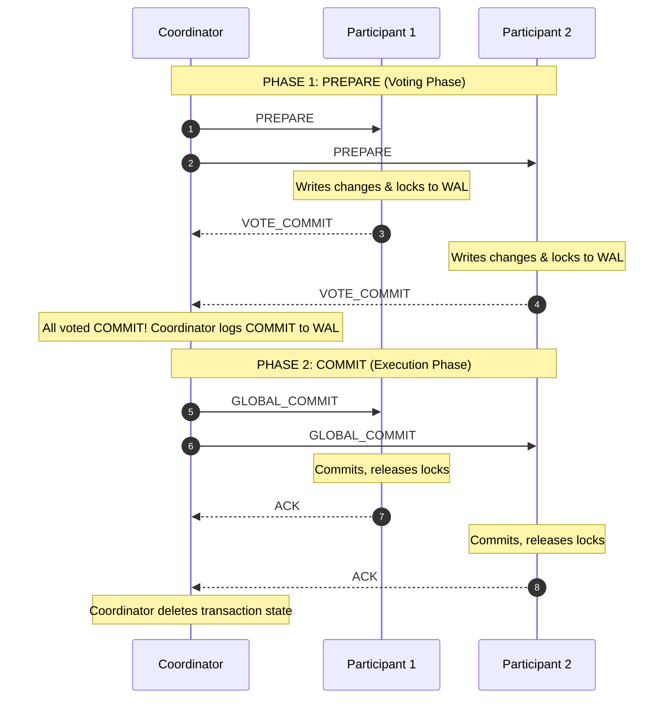
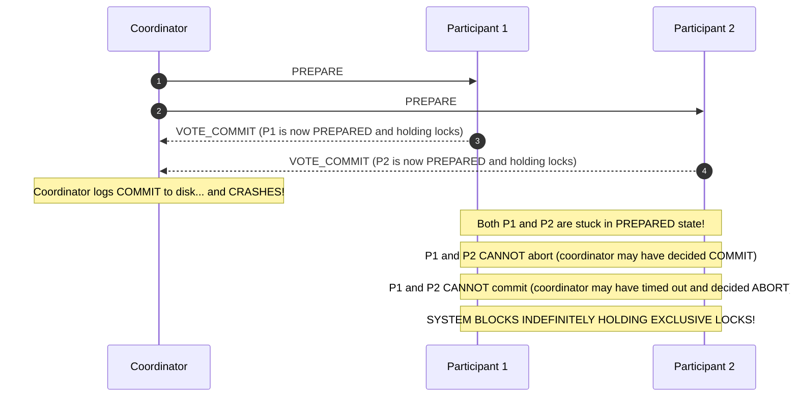
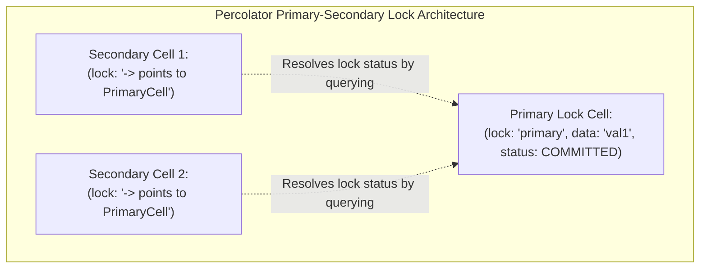
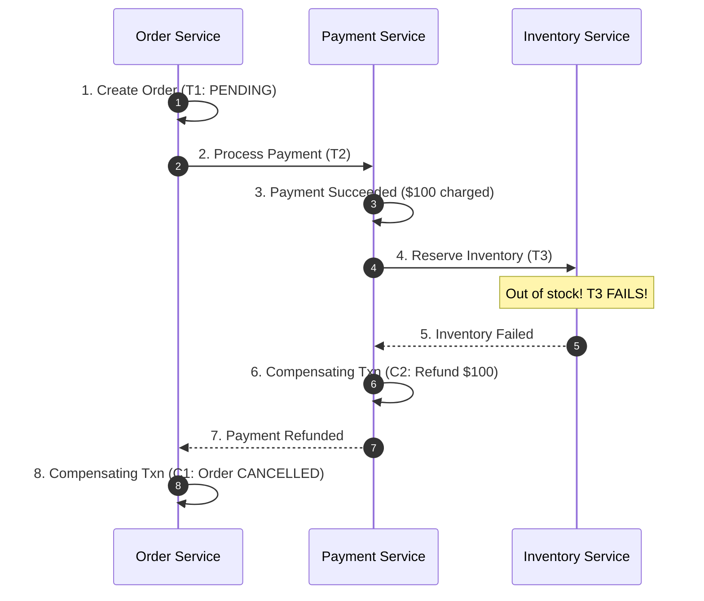
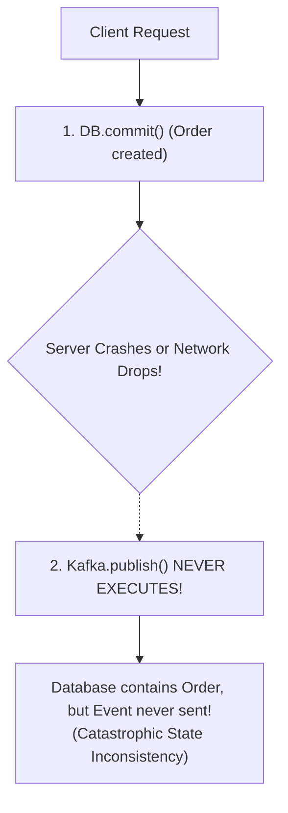
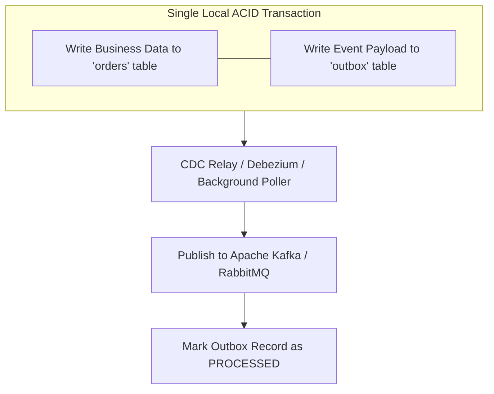
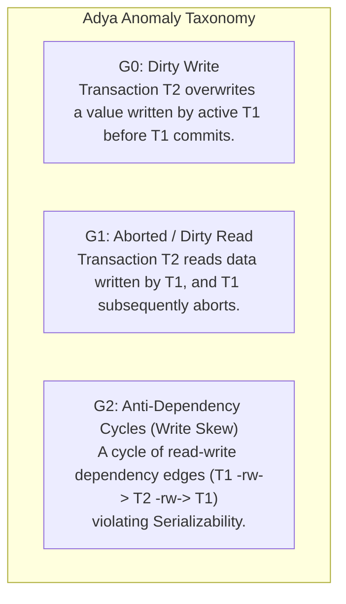

# Module 09 — Distributed Transactions, Atomic Commit, and Sagas

In a centralized relational database, ACID transactions are enforced using local write-ahead logging (WAL) and two-phase locking (2PL). In a distributed architecture where data is partitioned across multiple independent nodes or microservices, achieving atomicity and isolation requires coordinating commits across independent storage engines without introducing single points of failure or indefinite deadlocks. This module examines the **Atomic Commit Problem**, **Two-Phase Commit (2PC)** and its inherent blocking flaw, **Three-Phase Commit (3PC)**, **Google Percolator**, **Google Spanner**, the **Sagas Pattern**, the **Transactional Outbox**, and Atul Adya's formal **Transaction Anomaly Taxonomy ($G_0, G_1, G_2$)**.

---

## 1. The Atomic Commit Problem

The **Atomic Commit Problem** requires that either all participating nodes commit a transaction or all abort it, ensuring no partial updates occur across nodes:

---

## 2. Two-Phase Commit (2PC): Protocol and the Blocking Flaw

Introduced by Jim Gray in 1978, **Two-Phase Commit (2PC)** is the classic protocol for coordinating atomic commit across multiple participants:

### The Blocking Flaw of 2PC
2PC is a **blocking protocol**:

If the coordinator crashes while participants are in the `PREPARED` state, participants cannot unilaterally decide to abort (the coordinator might have sent `COMMIT` to another participant) nor can they decide to commit (a participant might have voted `ABORT`). **They must wait indefinitely holding database row locks**, causing cascading lock starvation across the entire enterprise.

---

## 3. Three-Phase Commit (3PC) and Why It Is Unused

Dale Skeen (1981) proposed **Three-Phase Commit (3PC)** to make atomic commit non-blocking by introducing a `PRE_COMMIT` phase:
1. `CAN_COMMIT?` (Vote)
2. `PRE_COMMIT` (All voted yes; prepare to commit)
3. `DO_COMMIT` (Commit)

### Why 3PC Fails in Production
3PC assumes a **crash-stop model with synchronous networks**.
Under **network partitions**, 3PC fails catastrophically: if a partition separates participants, the nodes on one side of the partition may time out and decide `ABORT`, while nodes on the other side advance to `PRE_COMMIT` and decide `COMMIT`. **3PC produces split-brain data corruption under network partitions**, making it completely unsuitable for real-world IP networks.

---

## 4. Modern Distributed Transactions: Percolator and Spanner

### 1. Google Percolator (Peng & Dabek, 2010)
Percolator provides Distributed Snapshot Isolation over Bigtable without a centralized coordinator:
- Uses a **Timestamp Oracle (TSO)** for read and commit timestamps.
- Eliminates 2PC coordinator failure by designating one cell as the **Primary Lock**. All other participating cells create **Secondary Locks** that store a pointer pointing back to the Primary Lock.
- **Roll-forward / Roll-back Recovery**: If a client crashes mid-commit, another transaction attempting to read the locked data checks the status of the Primary Lock:
  - If the Primary Lock was committed, the reader rolls the secondary lock forward!
  - If the Primary Lock was aborted or missing, the reader cleans up and rolls back!

### 2. Google Spanner (Corbett et al., 2012)
Google Spanner marries **Paxos groups** with **Two-Phase Commit**:
- Data is sharded across thousands of Paxos replication groups.
- A 2PC transaction is coordinated not between single fragile machines, but between **Paxos leader nodes**.
- If a coordinator leader crashes, its Paxos group immediately elects a new leader that resumes the 2PC commit without blocking!
- Uses **TrueTime commit-wait** to enforce global Strict Serializability.

---

## 5. The Sagas Pattern: Long-Running Distributed Workflows

When transactions span multiple autonomous microservices (Order Service $\to$ Payment Service $\to$ Inventory Service), holding 2PC database locks across services for seconds is disastrous for throughput.
The **Sagas Pattern** (Garcia-Molina & Salem, 1987) decomposes a distributed transaction into a sequence of local transactions:

$$T_1, T_2, \dots, T_n$$

Every forward transaction $T_i$ is paired with an idempotent **Compensating Transaction** $C_i$ that semantically undoes its changes:

$$C_1, C_2, \dots, C_{n-1}$$

### Orchestration vs. Choreography
- **Choreography**: Services publish events (e.g. `PaymentProcessed`) and listen to peer events. Simple for small workflows, but hard to trace, test, and debug as service count grows.
- **Orchestration**: A centralized **Saga Orchestrator** (e.g. Temporal, AWS Step Functions) explicitly coordinates steps, state transitions, timeouts, and compensatory rollbacks. Highly recommended for enterprise workflows.

---

## 6. The Dual-Write Problem and the Transactional Outbox

A classic microservice anti-pattern is executing a local database write and then publishing an event to a message broker (e.g. Apache Kafka):

### The Transactional Outbox Pattern
Atomicity across database and messaging is achieved using a local database **Outbox Table**:

Because updating `orders` and inserting into `outbox` occur within the **same local ACID database transaction**, either both succeed or both roll back. A reliable background process (or Change Data Capture via Debezium) streams outbox records to Kafka with at-least-once delivery guarantees.

---

## 7. Atul Adya's Transaction Anomaly Taxonomy ($G_0, G_1, G_2$)

In his 1999 MIT doctoral thesis, Atul Adya established the formal mathematical graph dependency taxonomy for transactional anomalies, now used by Jepsen and **Elle**:

---

## 8. Interview Drill: Distributed Transactions & Sagas

1. Why is Two-Phase Commit considered an anti-pattern across microservice boundaries?

2PC requires all participating services to acquire exclusive row-level database locks during Phase 1 (`PREPARE`) and hold them until Phase 2 (`COMMIT`). In a microservices architecture, network latency between services and third-party dependencies would hold database locks for hundreds of milliseconds or seconds, collapsing database throughput. Furthermore, if the coordinator crashes, all services are blocked indefinitely holding locks, violating service autonomy and fault isolation.

2. How does the Transactional Outbox pattern prevent the Dual-Write anomaly?

The Dual-Write anomaly occurs when an application updates a database and sends an event to a message queue in two uncoordinated steps; a crash between the two creates data drift.
The Transactional Outbox writes the outgoing event into an `outbox` table in the *same* database transaction as the business entity. Because both records are committed in a single local ACID transaction, the event is guaranteed to be persisted if and only if the business data is saved. A separate Change Data Capture (CDC) process reliably tails the outbox table and streams events to Kafka.

3. What is the fundamental difference between forward recovery and backward recovery in a Saga?

- **Backward Recovery**: When a step fails, the saga executes compensating transactions in reverse order ($C_k, C_{k-1}, \dots$) to undo already committed local transactions and return the system to an abort state.
- **Forward Recovery**: Used when a step cannot be undone (e.g. money transferred or email sent). The saga retries the failed step continuously (with idempotency) until it succeeds, guaranteeing that the workflow eventually terminates in a successful state.

4. How does Google Percolator resolve abandoned secondary locks after a client crash?

Every transaction in Percolator designates one cell as the **Primary Lock** and sets all other cells as **Secondary Locks** that point to the Primary.
If a client crashes, another transaction attempting to access a locked cell follows the backpointer to inspect the Primary Lock.
If the Primary Lock is marked `COMMITTED`, the reader knows the transaction succeeded and rolls the secondary lock forward. If the Primary Lock has rolled back or expired, the reader cleans up the lock, guaranteeing recovery without a dedicated coordinator.

5. What is the G2 anomaly in Adya's taxonomy, and what isolation level is required to prevent it?

$G_2$ represents anti-dependency cycles (also known as **Write Skew**), where transaction $T_1$ reads a state that transaction $T_2$ overwrites, and $T_2$ reads a state that $T_1$ overwrites ($T_1 \xrightarrow{rw} T_2 \xrightarrow{rw} T_1$).
Snapshot Isolation allows $G_2$ because neither transaction modifies a row that the other modified. Preventing $G_2$ requires **Serializability** (or Strict Serializability), which tracks read-write anti-dependencies and aborts one of the conflicting transactions.

