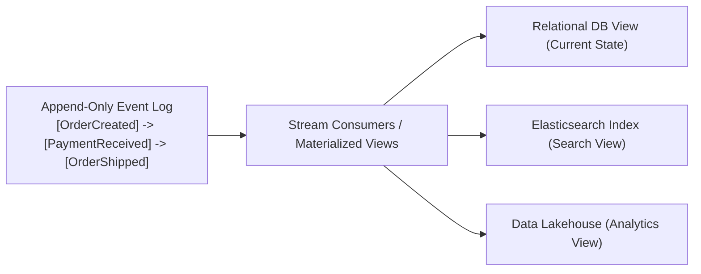
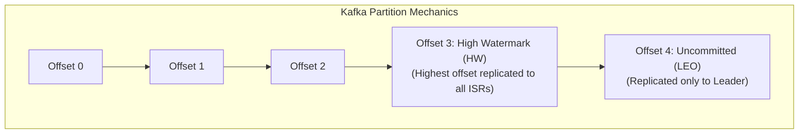
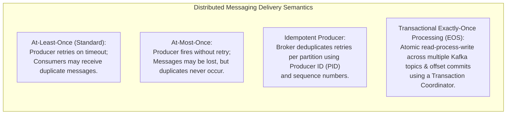
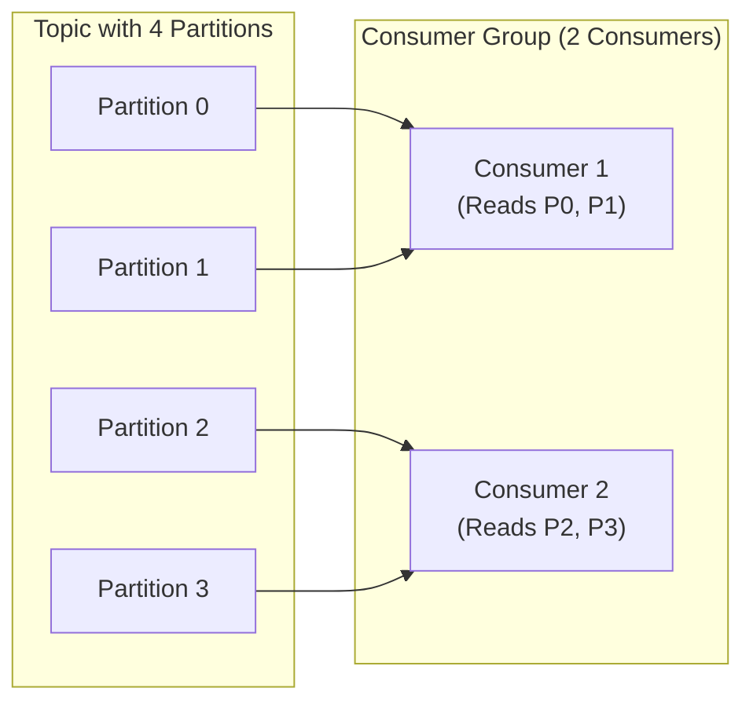
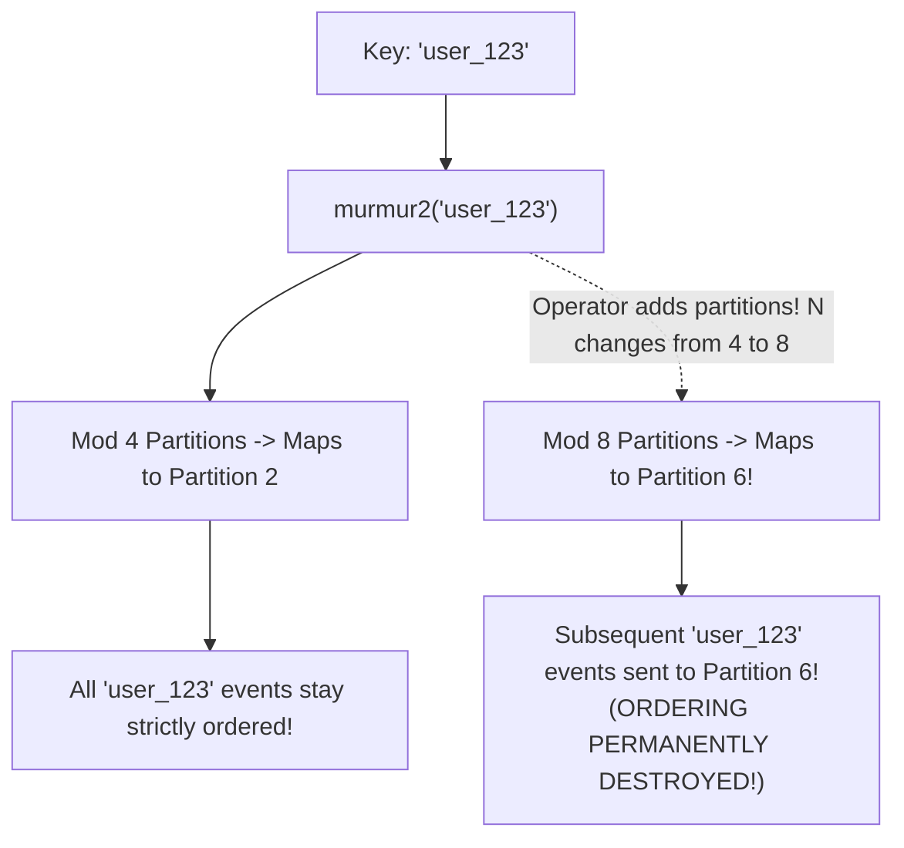

# Module 10 — Messaging, Distributed Logs, and Delivery Semantics

In distributed systems, state is not static; it is an evolving stream of events. Rather than communicating via synchronous request-response RPCs (which tightly couple service lifecycles), high-scale architectures decouple producers and consumers using an **Append-Only Distributed Commit Log**. This module analyzes the log as the fundamental source of truth, **Apache Kafka's architecture** (Partitions, In-Sync Replicas, High Watermark), delivery semantics (**At-Least-Once**, **Idempotent Producers**, **Transactional Exactly-Once**), **Consumer Rebalance Storms**, **KIP-848**, and **Kafka 4.2 Share Groups (KIP-932)**.

---

## 1. The Distributed Commit Log as Source of Truth

As Martin Kleppmann formulated in *"Turning the Database Inside Out"*, a database table is merely a cached materialized view of an underlying stream of changes:

$$\text{State} = \sum_{i=1}^n \Delta_i \quad (\text{Folding event log changes over time})$$



---

## 2. Apache Kafka Architecture: Partitions, ISR, and High Watermark

Apache Kafka provides high throughput by sharding topics into independent, sequential, append-only **Partitions**:



### 1. High Watermark (HW) vs. Log End Offset (LEO)
- **Log End Offset (LEO)**: The offset of the next record to be written to a partition.
- **High Watermark (HW)**: The offset of the latest record that has been successfully replicated to all active **In-Sync Replicas (ISR)**.
- **Consumer Isolation Guarantee**: Consumers are only permitted to read records up to the High Watermark (`offset < HW`), preventing readers from observing uncommitted records that could be lost during leader failover.

### 2. Producer Acknowledgment (`acks`) and Durability
The producer configuration `acks` governs durability:
- `acks=0`: Fire-and-forget. Zero durability; highest throughput.
- `acks=1`: Leader writes to local log and replies immediately. If leader crashes before replication, acknowledged records are lost!
- `acks=all` (or `-1`): Leader waits for all replicas in the ISR to acknowledge the write.
  - **The Critical Trap**: `acks=all` must be paired with `min.insync.replicas >= 2`! If `min.insync.replicas = 1`, and all followers fall out of sync, `acks=all` silently degrades to `acks=1`, losing data on leader crash.
  - Set `unclean.leader.election.enable = false` to forbid out-of-sync replicas from ever becoming leader.

---

## 3. Delivery Semantics and Exactly-Once Processing



### 1. Idempotent Producer (`enable.idempotence = true`)
The broker assigns each producer a 64-bit Producer ID (`PID`). For every partition, the producer maintains a monotonically incrementing sequence number ($0, 1, 2, \dots$).
If a network timeout causes a producer to re-send message $k$, the broker inspects the partition log:
- If sequence number $k$ was already recorded, the broker returns `ACK` without appending a duplicate.

### 2. Transactional Exactly-Once (Kafka Transactions)
Kafka's transactional API coordinates atomic commits across input consumer offsets and output topic partitions using a **Transaction Coordinator** and two-phase commit markers:
```typescript
await producer.beginTransaction();
await producer.send({ topic: 'analytics-events', messages: transformedBatch });
await producer.sendOffsets({ consumerGroupId: 'etl-group', offsets: currentOffsets });
await producer.commitTransaction();
```
Downstream consumers configured with `isolation.level = read_committed` will buffer uncommitted transactional batches, exposing messages to application code only after the transaction commit marker is written.

---

## 4. Consumer Groups, Rebalances, and KIP-848

Kafka partitions are distributed among consumers in a **Consumer Group**, providing horizontal scale-out processing:



### The Rebalance Storm Trap
In classic Kafka (prior to KIP-848), when a consumer is added or removed, or when a slow message handler causes `max.poll.interval.ms` to elapse, the entire consumer group triggers a **Stop-The-World Rebalance**:
1. All consumers pause processing and revoke partition assignments.
2. Group coordinator elects a leader consumer to compute new partition mappings.
3. Consumers re-join and resume reading.
On heavy clusters, slow consumers trigger repeated timeouts, locking the entire group in an endless **Rebalance Loop**.

### KIP-848: Next-Generation Consumer Rebalance Protocol
Introduced in Kafka 3.7+ and standard in modern deployments, KIP-848 moves partition assignment logic entirely to the broker-side coordinator. Rebalances become **incremental and cooperative**: consumers retain their active partitions while newly assigned partitions are added in the background, eliminating stop-the-world pauses.

### Kafka 4.2 GA: Share Groups / Queues for Kafka (KIP-932)
In classic Kafka, partition count limits consumer parallelism: a topic with 4 partitions can support at most 4 active consumers in a group.
Made **Generally Available in Kafka 4.2 (March 2026)**, **Share Groups (KIP-932)** introduce true point-to-point queue semantics:
- Multiple consumers within a share group can cooperatively consume messages from the **same partition**.
- Acknowledgments occur at the individual message level (`ACK`, `REJECT`, `RELEASE`), bringing RabbitMQ/SQS-style competitive consumption directly to high-throughput Kafka topics.

---

## 5. The Partition Count Trap: Broken Key Ordering

A foundational rule of distributed logs:
$$\text{Ordering is guaranteed STRICTLY within a single partition, NEVER across partitions.}$$

When messages are published with a key $K$, Kafka maps the key to a partition via hash modulo:
$$\text{partition} = \text{murmur2}(K) \pmod N$$



> [!WARNING]
> Increasing the partition count of an existing topic **breaks the hash mapping of existing keys**. Subsequent updates for key $K$ will route to a new partition while older unconsumed updates sit in the former partition, permanently destroying per-key causality!

---

## 6. Interview Drill: Distributed Messaging & Logs

<details>
<summary>1. In Kafka, why does aacks=all` not guarantee durability if min.insync.replicas is set to 1?</summary>

`acks=all` means the leader waits for acknowledgments from all members currently in the In-Sync Replicas (ISR) set.
If followers crash or fall behind, the leader removes them from the ISR. If `min.insync.replicas` is configured to 1, the leader becomes the sole member of the ISR.
The leader commits the write locally, confirms to the producer that `acks=all` was satisfied, and immediately crashes. Because no other node possessed the message, the acknowledged data is permanently lost. Durability requires `min.insync.replicas >= 2`.
</details>

<details>
<summary>2. Why does Kafka guarantee message ordering only within a partition and not across an entire topic?</summary>

Kafka achieves massive horizontal throughput by distributing partitions across different physical broker nodes. Enforcing a total global ordering across all partitions would require a single centralized sequencer to timestamp and coordinate every write, reintroducing the exact single-machine bottleneck that partitioning was designed to eliminate. Restricting order to individual partitions allows each partition to append at maximum disk sequential write speeds independently.
</details>

<details>
<summary>3. What is the difference between an Idempotent Producer and Transactional Exactly-Once in Kafka?</summary>

- **Idempotent Producer**: Deduplicates retried messages within a single partition during network glitches. It does not provide multi-partition atomicity.
- **Transactional Exactly-Once**: Coordinates atomic read-process-write loops across multiple topic partitions and consumer offset commits. Either all emitted messages and the consumed offset are committed together, or none are, guaranteeing that an application failure mid-processing rolls back the entire batch.
</details>

<details>
<summary>4. What problem do Share Groups (KIP-932) solve in Kafka 4.2?</summary>

In standard Kafka consumer groups, a partition can be assigned to only one consumer at a time. If a topic has 3 partitions, spinning up 10 consumers leaves 7 consumers completely idle.
Share Groups bring queue-like semantics to Kafka by allowing multiple consumers to pull and process individual messages concurrently from the same partition, enabling dynamic scale-out worker pools without having to artificially over-partition topics.
</details>

<details>
<summary>5. How does the KIP-848 consumer rebalance protocol eliminate stop-the-world pauses in large clusters?</summary>

In classic consumer groups, any membership change forces all consumers to revoke their partitions and pause processing while a member election runs.
Under KIP-848, the partition assignor logic runs on the broker coordinator. Consumers communicate state via periodic heartbeats. When a rebalance occurs, the broker reassigns partitions incrementally: consumers continue processing their existing assigned partitions without interruption, receiving new partition assignments seamlessly on subsequent heartbeat cycles.
</details>
