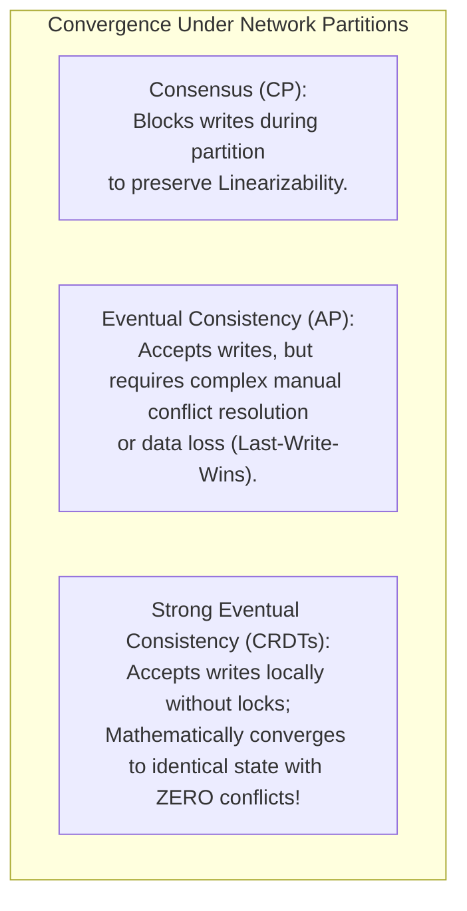
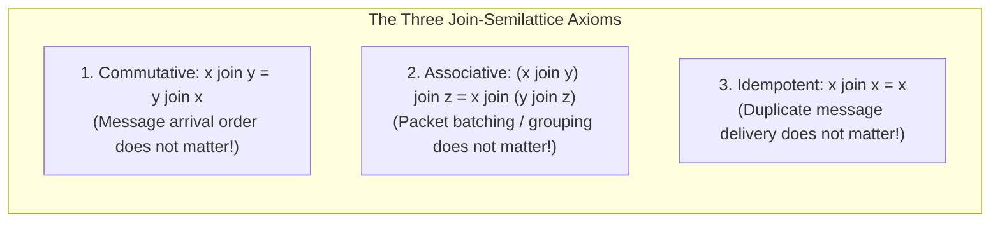
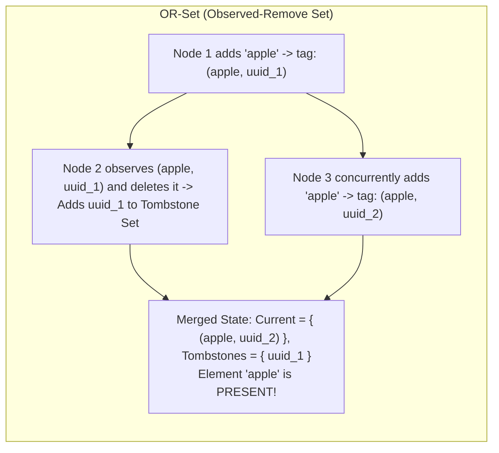
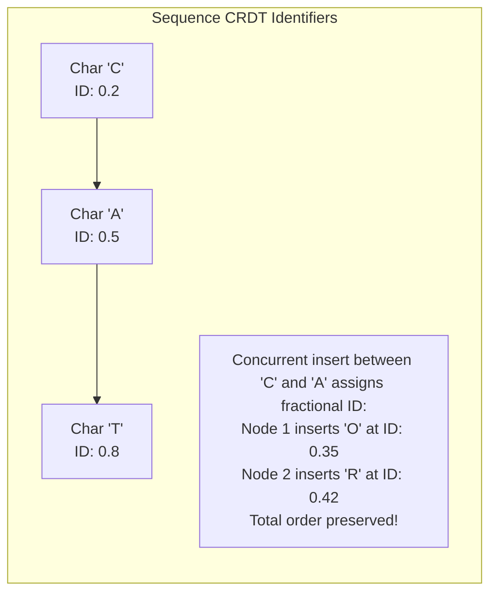
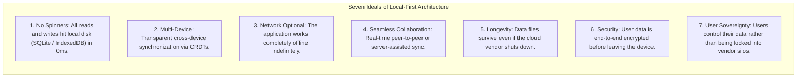

# Module 11 — Conflict-Free Replicated Data Types (CRDTs) and Local-First Architecture

Consensus algorithms (Raft, Paxos) enforce linearizability by routing updates through a single leader or majority quorum. While optimal for banking ledgers and cluster metadata, this model is fundamentally incompatible with mobile devices, disconnected laptops, offline collaborative tools, and edge computing where nodes must operate without constant internet connectivity. **Conflict-Free Replicated Data Types (CRDTs)** achieve **Strong Eventual Consistency (SEC)** without any synchronous consensus, enabling replicas to accept concurrent mutations offline and mathematically converge to the identical state when reconnected. This module explores **State-based (CvRDT)** and **Operation-based (CmRDT)** models, the join-semilattice axioms, canonical implementations (**G-Counter**, **PN-Counter**, **OR-Set**, **Sequence CRDTs**), tombstone garbage collection, and the **Local-First software architecture**.

---

## 1. Strong Eventual Consistency (SEC) and the Semilattice Axioms

Formally defined by Marc Shapiro et al. at INRIA in 2011, a system provides **Strong Eventual Consistency (SEC)** if:
1. **Eventual Delivery**: Any update executed at one replica is eventually delivered to all replicas.
2. **Strong Convergence**: Any two replicas that have delivered the same set of updates have the **exact same internal state**, regardless of the order in which updates were received.



---

## 2. State-Based CRDTs (CvRDT) and Join-Semilattices

In a **State-Based CRDT (CvRDT)**, replicas synchronize by periodically sending their complete state across the network and merging it into peer states.

### The Join-Semilattice Mathematical Foundation
A CvRDT is governed by a **join-semilattice** $(S, \sqcup, \le)$:
- $S$ is a set of valid states partially ordered by $\le$.
- $\sqcup$ is a binary merge operator computing the **Least Upper Bound (LUB)** of any two states.



Because the merge operator is **Commutative, Associative, and Idempotent**, states can be transmitted over unreliable networks in arbitrary order, duplicated, delayed, or batched, and replicas will still converge deterministically!

---

## 3. Canonical CRDT Implementations

### 1. Grow-Only Counter (G-Counter)
A distributed counter that only supports increments.
- State: An integer array $V[1 \dots N]$ where $V[i]$ records increments performed by node $i$.
- **Increment**: Node $i$ sets $V[i] = V[i] + 1$.
- **Read**: $\text{value} = \sum_{j=1}^N V[j]$.
- **Merge**: Computes element-wise maximum:
  $$\text{merge}(V_A, V_B) = [\max(V_A[1], V_B[1]), \ \max(V_A[2], V_B[2]), \ \dots, \ \max(V_A[N], V_B[N])]$$

```typescript
export class GCounter {
  readonly counts: Map<string, number> = new Map();

  constructor(readonly nodeId: string) {}

  increment(delta = 1): void {
    const cur = this.counts.get(this.nodeId) ?? 0;
    this.counts.set(this.nodeId, cur + delta);
  }

  value(): number {
    let total = 0;
    for (const val of this.counts.values()) total += val;
    return total;
  }

  merge(other: GCounter): void {
    for (const [node, val] of other.counts.entries()) {
      const cur = this.counts.get(node) ?? 0;
      this.counts.set(node, Math.max(cur, val));
    }
  }
}
```

---

### 2. Positive-Negative Counter (PN-Counter)
Supports both increments and decrements by composing two G-Counters:
- $P$: Tracks all positive increments.
- $N$: Tracks all negative decrements.
- **Value**: $\text{value} = P.\text{value}() - N.\text{value}()$.
- **Merge**: $\text{merge}(P_A, P_B)$ and $\text{merge}(N_A, N_B)$ independently.

---

### 3. Observed-Remove Set (OR-Set)
In distributed sets, deleting an element while another replica concurrently re-adds it produces subtle race conditions. The **OR-Set (Add-Wins Set)** resolves this cleanly:
- When adding element $e$, the node generates a globally unique identifier (e.g. UUIDv4 / tag): $(e, \text{tag})$.
- When deleting element $e$, the node removes **only the specific tags for $e$ that it has currently observed**.
- If Node $A$ deletes $e$ while Node $B$ concurrently adds $e$ with a new tag $tag_{\text{new}}$, the new tag survives the merge. **Adds win over concurrent deletes**.



---

## 4. Collaborative Text and Sequence CRDTs

Collaborative text editors (Google Docs, Figma, Notion) require ordering characters in a string. Naive array index tracking fails because concurrent typing shifts indices: if Node $A$ inserts at index 2 and Node $B$ inserts at index 2, merging them creates jumbled words.



### Modern Sequence CRDT Architectures
- **RGA (Replicated Growable Array)**: Links each character directly to its preceding neighbor rather than a numeric index.
- **YATA / Yjs**: Treats characters as an ordered directed graph, resolving concurrent insertions between identical boundaries using client ID tie-breakers.
- **Automerge (Fugue)**: Uses maximal tree models to eliminate character interleaving anomalies ("flickering" text).

---

## 5. Tombstone Garbage Collection and Causal Stability

When elements are deleted in CRDT sets or sequences, they cannot be deleted from memory immediately because a late-arriving message from a partitioned peer could resurrect them. Instead, they are replaced by **Tombstones**.
- **The Tombstone Bloat Problem**: In long-lived documents, deleted text leaves thousands of tombstone records in memory, consuming megabytes of RAM.
- **Causal Stability Solution**: A tombstone $(e, \text{tag})$ can be permanently expunged from memory if and only if **all active replicas in the cluster have acknowledged observing the delete operation**. This is determined using vector clocks: once a delete's version vector is causally dominated by all nodes, the tombstone is safely purged.

---

## 6. The Local-First Software Movement

Articulated by Martin Kleppmann, Adam Wiggins, Peter van Hardenberg, and Mark McGranaghan in 2019 (*"Local-First Software: You own your data, in spite of the cloud"*), Local-First architecture replaces centralized SaaS with client-sovereign computing:



---

## 7. Interview Drill: CRDTs & Local-First

<details>
<summary>1. What are the three mathematical properties a state merge function must satisfy to guarantee Strong Eventual Consistency?</summary>

The merge operator $\sqcup$ must form a join-semilattice, satisfying:
1. **Commutativity**: $x \sqcup y = y \sqcup x$ (the order in which messages arrive across the network does not alter the result).
2. **Associativity**: $(x \sqcup y) \sqcup z = x \sqcup (y \sqcup z)$ (how messages are partitioned or batched in transit does not matter).
3. **Idempotence**: $x \sqcup x = x$ (duplicate network packet delivery does not corrupt state).
</details>

<details>
<summary>2. Why can a G-Counter not support decrement operations?</summary>

A G-Counter relies on the monotonic growth property of join-semilattices: merging two counters takes the maximum value seen for each node index ($\max(V_A[i], V_B[i])$).
If decrements were permitted, a smaller value would be interpreted as an older state during merge, causing the larger (pre-decrement) value to win and resurrecting the subtracted count. Supporting decrements requires a PN-Counter, which maintains two separate G-Counters for additions and subtractions.
</details>

<details>
<summary>3. In an Observed-Remove Set (OR-Set), how does the system resolve concurrent add and delete operations for the same element?</summary>

The OR-Set assigns a unique tag (e.g. UUID) to every add operation. When an element is deleted, the delete operation records and neutralizes only the specific tags that were observed at that replica at the time of deletion.
If another node concurrently adds the same element, it generates a fresh, distinct tag. When the two replicas merge, the fresh tag was not included in the delete's tombstone list, so the element remains present in the set. **Adds win over concurrent deletes**.
</details>

<details>
<summary>4. What is the difference between a State-based CRDT (CvRDT) and an Operation-based CRDT (CmRDT)?</summary>

- **State-based (CvRDT)**: Replicas transmit their entire state (or delta-state) to peers. Merging requires only standard unreliable transport (packets can be dropped, duplicated, or reordered) because the merge operator is commutative, associative, and idempotent. However, state payloads can be large.
- **Operation-based (CmRDT)**: Replicas transmit small operation deltas (e.g. `addChar(x)`). Payloads are tiny, but the underlying network transport must guarantee **reliable, exactly-once, causal delivery**, which requires maintaining version vectors and retransmission buffers.
</details>

<details>
<summary>5. How does a Local-First application differ fundamentally from a traditional cloud-hosted Single Page Application (SPA)?</summary>

In a traditional cloud SPA, the client is a dumb terminal: clicking "Save" sends an HTTP request over the network while displaying a loading spinner. If the user is offline, the app is unusable; if the cloud server shuts down, the user loses their data.
In a Local-First application, the primary source of truth resides on the local device (e.g. SQLite or IndexedDB). All reads and writes execute against local storage instantaneously with zero network latency. A background sync engine uses CRDTs to replicate data opportunistically when connectivity is available, guaranteeing that the application remains fully functional offline.
</details>
