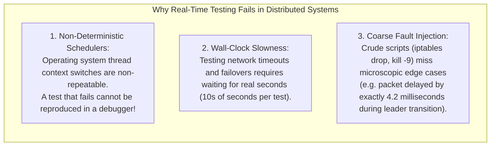
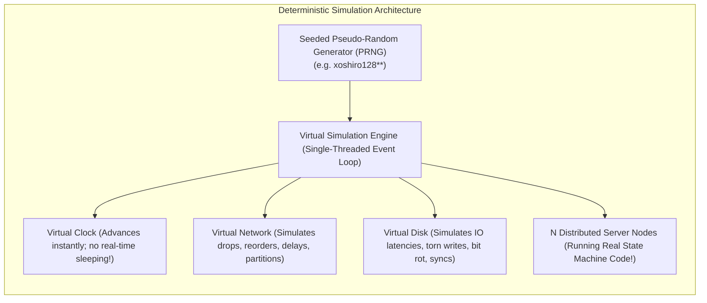
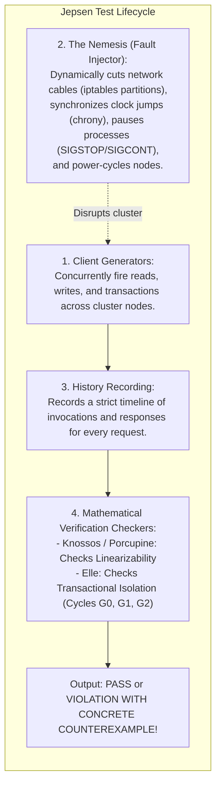
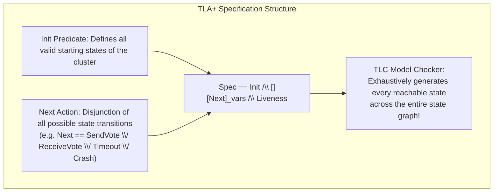

# Module 12 — Verification, Deterministic Simulation, and Fault Injection

Distributed systems are notoriously difficult to verify. Subtle race conditions, asymmetric network partitions, disk write delays, and process pauses create a combinatorial state space so vast ($> 10^{20}$ possible interleavings) that traditional unit and integration testing covers less than $0.000001\%$ of potential execution paths. A bug that manifests once every billion requests will crash a cluster processing $100,000$ operations per second multiple times a day. This module explores modern testing paradigms: **Deterministic Simulation Testing (DST)** as pioneered by FoundationDB and TigerBeetle, Kyle Kingsbury's **Jepsen Testing Methodology**, formal specification with **TLA+ / PlusCal**, and **Chaos Engineering**.

---

## 1. The Fallacy of Traditional Distributed Testing

Traditional tests rely on real operating system threads, real sockets, and `sleep()` timers:

---

## 2. Deterministic Simulation Testing (DST)

Pioneered by Will Wilson at **FoundationDB** and refined by Joran Dirk Greef at **TigerBeetle (VOPR)**, **Deterministic Simulation Testing (DST)** replaces the real operating system with a synthetic, virtualized, single-threaded execution harness.

### The Invariant Audit Loop
1. The simulation executes millions of steps in fractions of a second (simulating days of cluster operation in 2 seconds).
2. The virtual network and disk randomly inject faults:
   - Partitions clusters into asymmetric splits.
   - Corrupts disk blocks.
   - Reorders, duplicates, and delays packets.
   - Pauses and crashes nodes, restarting them from simulated non-volatile storage.
3. **Continuous Safety Invariant Check**: After **every single event**, the test asserts global invariants:
   - *Election Safety*: At most one leader in any term.
   - *Linearizability*: State machine history is legal.
   - *Log Matching*: Replicas do not hold contradictory entries.
4. **Byte-for-Byte Replayability**: If an invariant is violated at step $4,921$, the test runner prints the initial random seed (e.g. `seed: 0x4a9b21f`). Re-running the simulation with that exact seed reproduces the bug **identically down to the exact CPU instruction**, allowing developers to step through with a debugger!

---

## 3. Jepsen: Black-Box Verification and Fault Injection

Created by Kyle Kingsbury (@aphyr), **Jepsen** is an open-source testing framework that subjects distributed databases (PostgreSQL, MongoDB, Cassandra, etcd, Kafka, CockroachDB) to adversarial conditions to verify their consistency claims.

Jepsen famously discovered critical data-loss bugs in dozens of industry databases that claimed "linearizability" or "strict serializability", proving that informal reasoning about distributed edge cases is almost always flawed.

---

## 4. Formal Methods: TLA+ and PlusCal

Invented by Leslie Lamport, **TLA+ (Temporal Logic of Actions)** is a formal specification language based on mathematical set theory and first-order logic.

### Industrial Impact at Amazon Web Services (AWS)
In 2015, Chris Newcombe et al. published *"How Amazon Web Services Uses Formal Methods"*, documenting how AWS uses TLA+ to verify core services like **Amazon S3**, **DynamoDB**, and **EBS**:
- TLA+ discovered subtle, multi-year bugs in S3 fault-tolerant replication that had evaded code reviews and years of testing.
- It gave engineers mathematical proof that performance optimizations did not compromise data durability.
- Engineers write models in **PlusCal** (a C-like pseudo-code syntax), which compiles automatically into pure TLA+ for model checking with **TLC**.

---

## 5. Chaos Engineering: Resilience in Production

While DST and TLA+ operate before code ships, **Chaos Engineering** tests resilience in live production environments. Pioneered by Netflix with **Chaos Monkey** and standardized by CNCF tools like **Chaos Mesh**:
- **Principle**: Introduce controlled, randomized failures directly in production (terminating pods, introducing latency, degrading DNS) during working hours to verify that self-healing systems (Kubernetes, Envoy, Circuit Breakers) handle failures gracefully without customer-facing downtime.

---

## 6. Interview Drill: Verification & Deterministic Testing

1. Why is single-threaded Deterministic Simulation Testing superior to multi-threaded integration testing for distributed algorithms?

Multi-threaded testing depends on the host operating system's thread scheduler, which is inherently non-deterministic. When a multi-threaded test catches an elusive race condition, re-running it almost never reproduces the failure, turning debugging into guesswork.
In contrast, a deterministic simulator runs in a single thread driven by a seeded pseudo-random number generator (PRNG). Every network delay, packet drop, disk write latency, and context switch is a deterministic function of the seed. If a bug is caught on step 10,000, passing the same seed reproduces the identical failure byte-for-byte in a debugger every single time.

2. How does Kyle Kingsbury's Jepsen test for linearizability violations?

Jepsen client processes concurrently execute read and write operations against the cluster while a "Nemesis" injects network partitions and node crashes. Jepsen records every operation's invocation timestamp, return timestamp, and result.
After the run, a linearizability checker (such as Porcupine or Knossos) parses the recorded history using the Wing-Gong algorithm, searching for a legal sequential execution order that respects the real-time precedence of all operations. If no valid linearization exists, Jepsen outputs the exact minimal sequence of operations that broke linearizability.

3. In TLA+, what is the difference between an Invariant and a Temporal Property?

- **Invariant (Safety Property)**: A state predicate that must evaluate to `TRUE` in every single reachable state of the system (e.g. `TypeOK`, `NoTwoLeadersInSameTerm`). It can be violated in a single step and is checked by evaluating the state table.
- **Temporal Property (Liveness Property)**: A formula in temporal logic asserting behavior across sequences of states over time (e.g. $\Box \Diamond \text{LeaderElected}$, meaning "it is always true that eventually a leader will be elected"). It cannot be violated in a finite state and is checked by searching for cycles (strongly connected components) in the state graph.

4. What are the limitations of TLA+ model checking, and how do engineers manage state space explosion?

TLC exhaustively enumerates all reachable states. As the number of nodes, buffer sizes, or message queues increases, the number of states explodes exponentially ($O(k^N)$), quickly exhausting physical memory.
Engineers manage this by:
1. Model symmetry reduction (treating identical node IDs as symmetric equivalents).
2. Constraining model parameters to small constants (e.g. testing with 3 nodes, 2 client values, and message queues capped at 2 packets). Research shows that almost all concurrency and consensus bugs manifest in configurations with $\le 3$ nodes.

5. How does TigerBeetle's VOPR verify storage durability under power cuts?

TigerBeetle's VOPR (Viewstamped Operation Replicator) runs real consensus engine code on top of a simulated virtual disk. The simulator randomly terminates nodes without warning, resets volatile memory, and inspects the virtual disk to ensure that all data written before the crash was either properly flushed via simulated `fsync` or detected as torn/incomplete by recovery checksums, guaranteeing that crash-recovery never introduces amnesia or corrupts state machine state.

