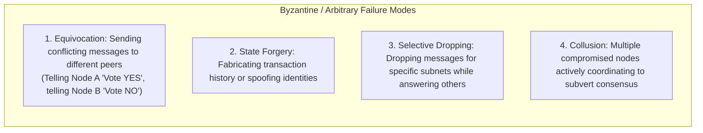
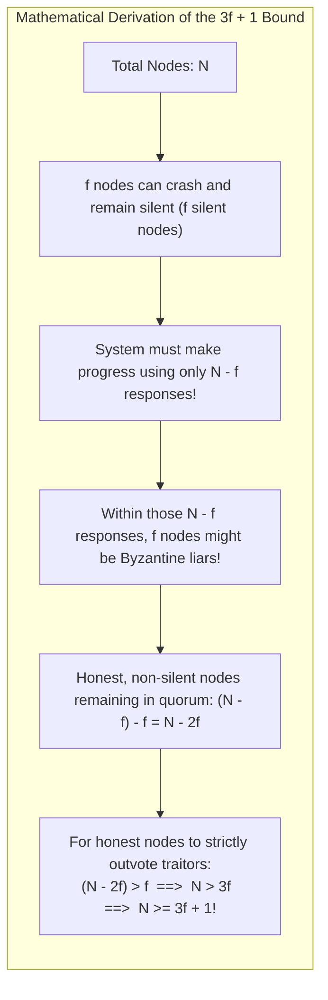
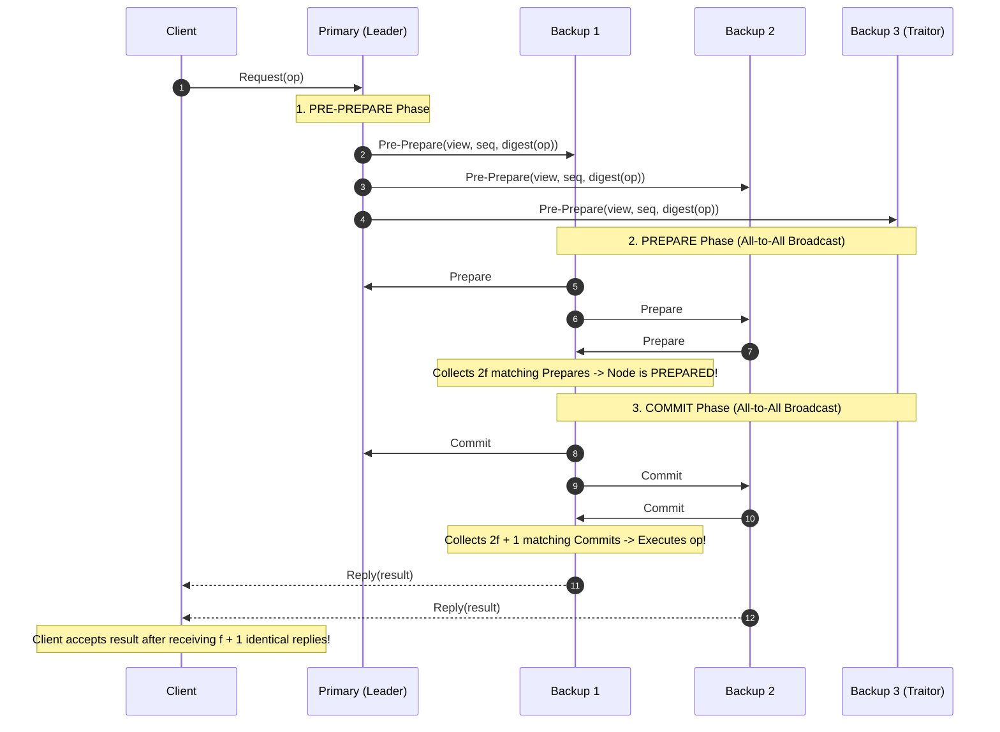
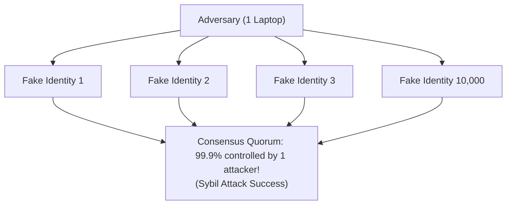
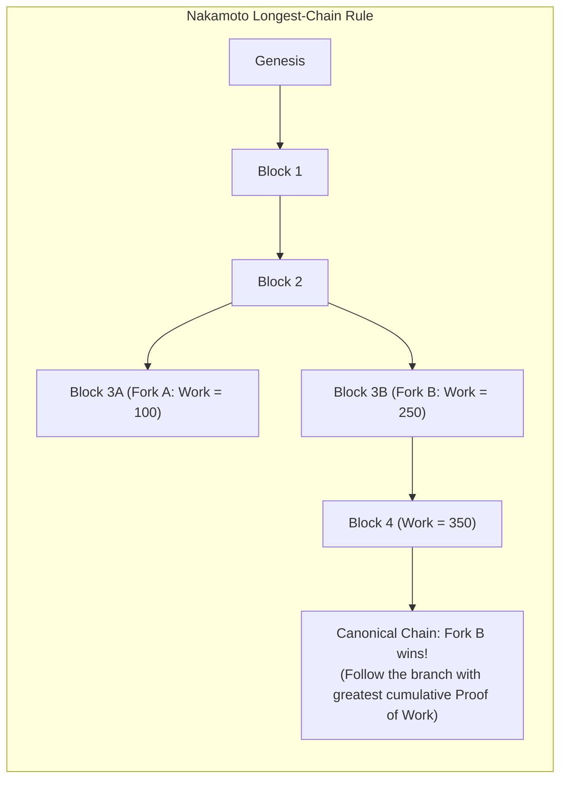

# Module 13 — Byzantine Fault Tolerance, Sybil Resistance, and Open Systems

Crash-Fault-Tolerant (CFT) consensus algorithms like Raft and Multi-Paxos operate under the **benign failure assumption**: nodes may crash, restart, or experience network partitions, but they never lie, forge cryptographic signatures, or intentionally send contradictory state updates to different peers. This assumption holds within a single corporate datacenter where all machines share a unified trust boundary. However, in adversarial environments, multi-tenant clouds, cross-organizational supply chains, and public open networks, nodes may be compromised or actively malicious. This module explores the **Byzantine Fault Model**, the formal mathematical derivation of the **$3f + 1$ Bound**, **Practical Byzantine Fault Tolerance (PBFT)**, **Sybil Resistance**, **Nakamoto Consensus**, and **SUNDR Fork Consistency**.

---

## 1. The Byzantine Fault Model

Formulated by Leslie Lamport, Robert Shostak, and Marshall Pease in 1982 (*"The Byzantine Generals Problem"*), the **Byzantine failure model** represents the most adversarial failure assumption in computer science:

---

## 2. The $3f + 1$ Quorum Bound: Mathematical Derivation

In Crash-Fault-Tolerant systems (Raft/Paxos), surviving $f$ failures requires $2f + 1$ nodes (a simple majority). In Byzantine systems, surviving $f$ arbitrary failures mathematically requires at least:

$$N \ge 3f + 1 \quad \text{total nodes}$$

### The Formal Proof
1. Suppose a system of $N$ nodes contains at most $f$ Byzantine traitors.
2. Because $f$ nodes might crash or be disconnected, the protocol **must be able to make forward progress (liveness) after receiving responses from only $N - f$ nodes**.
3. Now consider the worst-case scenario: the $f$ missing nodes were actually completely honest nodes that were merely delayed by network latency, and the $N - f$ nodes that responded include all $f$ Byzantine traitors.
4. The number of honest nodes among the respondents is $(N - f) - f = N - 2f$.
5. To guarantee that the honest nodes can reach agreement and outvote the $f$ traitors (safety), the count of honest respondents must strictly exceed the count of traitors:
   $$N - 2f > f \implies N > 3f \implies N \ge 3f + 1$$
Thus, to tolerate 1 Byzantine traitor ($f = 1$), a system must contain at least $3(1) + 1 = 4$ nodes.

---

## 3. Practical Byzantine Fault Tolerance (PBFT)

Prior to 1999, Byzantine consensus protocols were theoretical constructs with exponential time complexity. Miguel Castro and Barbara Liskov published **PBFT (Practical Byzantine Fault Tolerance)**, providing the first polynomial-time state machine replication protocol for Byzantine networks:

### PBFT Protocol Flow
1. **Pre-Prepare**: Primary assigns sequence number $seq$ to the client request and broadcasts `Pre-Prepare` with a cryptographic digest of the message.
2. **Prepare**: Each backup validates the signature and broadcasts `Prepare` to all peers. Each node waits for $2f$ valid `Prepare` messages matching the `Pre-Prepare`. Once collected, the node is **Prepared**.
3. **Commit**: Replicas broadcast `Commit` to all peers. Once a node collects $2f + 1$ valid `Commit` messages, it executes the operation against its local state machine.
4. **Client Verification**: The client waits for $f + 1$ identical cryptographic replies from distinct servers. Since at most $f$ can be traitors, receiving $f + 1$ identical replies guarantees that at least one honest node computed that result!

---

## 4. Open Systems and the Sybil Attack

In closed enterprise clusters, node identities are bound to PKI certificates issued by an internal Certificate Authority (CA). In permissionless, open networks (the public Internet), anyone can participate.
In 2002, John Douceur published *"The Sybil Attack"*:
> An adversary in a peer-to-peer network can create millions of virtual pseudonymous identities on a single computer, trivializing $3f + 1$ quorum voting by overwhelming the network with fake majority votes.

---

## 5. Nakamoto Consensus: Proof-of-Work and Longest-Chain Rule

In 2008, Satoshi Nakamoto introduced **Bitcoin**, solving the Sybil attack and Byzantine consensus at global scale by tying voting power to **scarce thermodynamic resources (computational energy)** rather than IP addresses or node counts.

### Key Innovations of Nakamoto Consensus
1. **Proof-of-Work (PoW)**: Generating a valid block header requires finding a cryptographic nonce such that:
   $$\text{SHA256}(\text{SHA256}(\text{block\_header})) < \text{Target}$$
   This transforms voting power from "one identity, one vote" to **"one CPU cycle, one vote"**, defeating Sybil attacks.
2. **The Longest-Chain Rule**: Replicas treat the valid chain with the highest cumulative Proof-of-Work as the ground truth. Transient forks caused by network propagation delays resolve naturally as miners converge on the longest branch.
3. **Probabilistic Finality**: Unlike PBFT (which provides instant deterministic finality once $2f + 1$ commits are collected), Nakamoto consensus provides **probabilistic finality**: as subsequent blocks are appended, the probability $P$ of an attacker re-writing history decays exponentially:
   $$P \approx \sum_{k=0}^\infty \frac{\lambda^k e^{-\lambda}}{k!} \left( \frac{q}{p} \right)^{\max(z - k, 0)}$$
   Waiting 6 block confirmations makes the probability of reversal practically zero.

---

## 6. SUNDR and Fork Consistency

When building cloud storage where the storage server itself is untrusted or potentially compromised, can clients achieve strong consistency?
In 2004, Jinyuan Li et al. proved with **SUNDR (Secure Untrusted Data Repository)** that linearizability is impossible without direct inter-client communication. Instead, SUNDR provides **Fork Consistency**:
- The untrusted server can partition clients into separate historical forks (lying about peer writes).
- However, the server cannot alter past history, and **once it forks a client's view, it can never reconcile them without being immediately detected via cryptographic verification graphs**.

---

## 7. CFT vs. BFT: Architectural Trade-Off Matrix

| Dimension | Crash-Fault-Tolerant (CFT: Raft / Paxos) | Byzantine-Fault-Tolerant (BFT: PBFT) |
|---|---|---|
| **Fault Model** | Nodes crash, drop packets, or restart cleanly. | Nodes cheat, lie, forge signatures, collude. |
| **Quorum Threshold** | $2f + 1$ (Majority: $51\%$) | $3f + 1$ (Supermajority: $67\%$) |
| **Message Complexity** | $O(N)$ steady state (Leader broadcasts to followers). | $O(N^2)$ steady state (All-to-all prepare & commit phases). |
| **Cryptography** | Simple integer comparison, no digital signatures. | Heavy asymmetric or HMAC signature generation and verification. |
| **Throughput** | $> 100,000$ transactions/second. | $\approx 1,000 - 10,000$ transactions/second. |
| **Deployment Fit** | Private cloud, VPCs, Kubernetes, internal databases. | Cross-organization consortia, public ledgers, zero-trust bridges. |

---

## 8. Interview Drill: Byzantine Fault Tolerance & Open Systems

1. Why can a Crash-Fault-Tolerant system survive with 2f + 1 nodes, while a Byzantine system strictly requires 3f + 1 nodes?

In a CFT system, a failed node simply halts: it never sends contradictory or malicious messages. If $f$ nodes crash in a cluster of $2f + 1$, the remaining $f + 1$ nodes form an absolute majority of the original cluster.
In a BFT system, $f$ nodes might crash (silent), while another $f$ nodes might be active traitors lying to peers. To make progress, the system must act upon receiving $N - f$ messages. If $N = 2f + 1$, only $(2f + 1) - f = f + 1$ messages arrive; of these, $f$ could be from traitors and only 1 from an honest node, making consensus impossible. For honest nodes to strictly outvote traitors ($(N - 2f) > f$), $N$ must be at least $3f + 1$.

2. How does Proof-of-Work solve John Douceur's Sybil Attack in open permissionless networks?

In an open network where anyone can create accounts or IP addresses for free, an attacker can generate millions of fake identities to win majority voting.
Proof-of-Work ties voting power to the laws of thermodynamics: creating a block requires consuming real-world electrical energy and compute power to solve a cryptographic hash puzzle. An attacker cannot multiply their voting power simply by spawning virtual identities; they must acquire more physical hash power than the rest of the honest network combined ($> 50\%$).

3. What is the difference between deterministic finality in PBFT and probabilistic finality in Nakamoto Consensus?

- **PBFT (Deterministic Finality)**: Once a transaction completes the Commit phase ($2f + 1$ signed commits received), it is permanently finalized. It can never be rolled back or reordered under any circumstances.
- **Nakamoto Consensus (Probabilistic Finality)**: A block appended to the chain is never 100% final in a strict mathematical sense. There is always a theoretical possibility that an attacker could compute a longer private chain and broadcast it. However, with every subsequent block appended to the chain, the probability of an attacker overtaking the honest chain decays exponentially towards zero.

4. Why does PBFT have poor scalability when cluster node count N grows to hundreds or thousands of nodes?

PBFT requires two all-to-all broadcast phases during every transaction: the Prepare phase and the Commit phase. In an all-to-all broadcast, every node transmits messages to every other node, generating $O(N^2)$ network messages per consensus round.
While $O(N^2)$ is fast for $N = 4$ or $N = 7$ nodes, for $N = 1,000$ nodes, a single transaction generates over $1,000,000$ network messages, saturating network switches and collapsing throughput.

5. Under what conditions should an engineering team choose Raft over a BFT protocol like PBFT?

Raft should be chosen whenever all nodes reside within a **single administrative trust boundary** (such as internal corporate datacenters, AWS VPCs, or Kubernetes clusters).
Because internal nodes are managed by the same organization and protected by network firewalls, the risk of nodes sending deliberately forged, malicious, or contradictory messages is virtually zero. Raft provides orders of magnitude higher throughput and lower latency ($O(N)$ message complexity, $2f+1$ nodes, zero cryptographic signature verification overhead) compared to BFT protocols.

