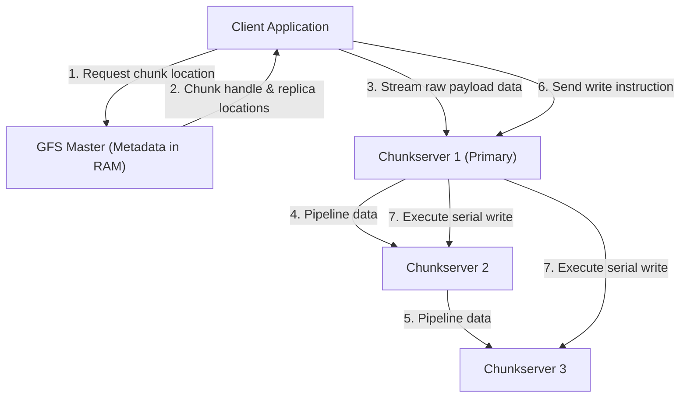
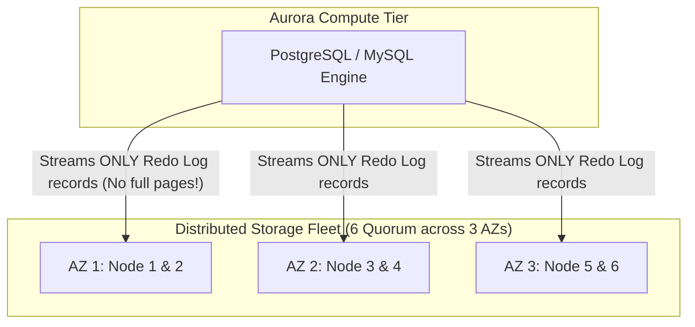
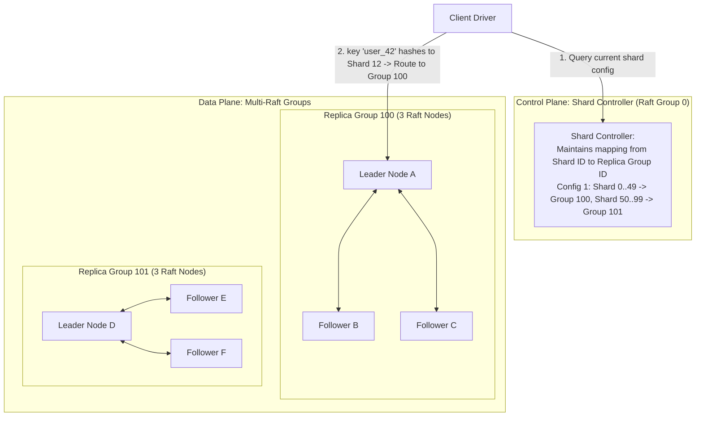

# Module 14 — Distributed Systems in Practice, Seminal Case Studies, and Capstone Architecture

The theoretical principles of distributed systems—consensus, linearizability, logical clocks, and failure detectors—converge in the industrial architectures that power the global Internet. Systems like **Google File System (GFS)**, **MapReduce**, **Amazon Dynamo**, **Google Spanner**, and **Amazon Aurora** transformed computer science from academic theory into petabyte-scale production engines. This concluding module dissects these seminal architectures, analyzes common catastrophic production failure modes, and establishes the blueprint for our Capstone: a **Sharded Linearizable Key-Value Store on Multi-Raft** (modeled after MIT 6.5840 Labs 4 and 5).

---

## 1. Seminal Real-World Architectural Case Studies

### 1. Google File System (GFS, 2003)
Built by Sanjay Ghemawat, Howard Gobioff, and Shun-Tak Leung, GFS was engineered to store petabytes of web crawler data on cheap, unreliable commodity disks.
- **Architectural Design**: A single **Master** node paired with thousands of **Chunkservers**.
- **Design Choices**: Files are partitioned into massive **64 MB chunks** (minimizing master metadata size and network overhead).
- **Mutations via Record Append**: GFS decoupled data flow from control flow: the master chooses a primary chunkserver for each chunk, but clients push data directly down a pipelined chain of chunkservers. GFS guaranteed *at-least-once record append* (accepting occasional duplicate records to preserve high append throughput).

---

### 2. Amazon Dynamo (2007): The AP Masterpiece
Engineered by Giuseppe DeCandia et al. at Amazon, Dynamo was designed to guarantee that the shopping cart checkout never rejects a customer write, even during catastrophic datacenter failures:
- **Consistent Hashing with Virtual Nodes**: Distributes keys evenly across a ring topology with $O(1/N)$ reassignment upon node changes.
- **Sloppy Quorums and Hinted Handoff**: If designated primary replicas are down, writes are accepted by temporary healthy neighbor nodes (hinted handoff) and delivered once primary nodes recover.
- **Vector Clocks**: Retains concurrent conflict branches (siblings) to be resolved by the application during subsequent reads.
- **Merkle Trees**: Background anti-entropy synchronization using hash trees to quickly discover divergent ranges between replicas with minimal network transfer.

---

### 3. Google Spanner (2012): Globally Distributed Strict Serializability
Spanner proved that a globally distributed database could provide **Strict Serializability** (External Consistency) across continents without sacrificing SQL semantics:
- **Multi-Paxos Shards**: Data is partitioned into tablets; each tablet is replicated across a 3-way or 5-way Paxos group.
- **Two-Phase Commit (2PC) Across Paxos Groups**: Cross-shard transactions execute 2PC between Paxos group leaders, ensuring that individual node crashes do not block the commit.
- **TrueTime Hardware**: GPS receivers and atomic rubidium clocks bound clock uncertainty to $\epsilon \le 7\text{ms}$. The **Commit-Wait** rule enforces that transactions pause for $2\epsilon$ before releasing commit timestamps, guaranteeing that causal order matches physical real-time order globally.

---

### 4. Amazon Aurora (2017): "The Log Is the Database"
Traditional relational databases (PostgreSQL/MySQL) replicating over network storage suffer from extreme write amplification (writing full dirty buffer pages, WAL logs, and double-write buffers).
Amazon Aurora fundamentally redesigned the storage engine:
- The database compute tier generates only **Redo Log Records** and streams them to a specialized, distributed storage tier.
- Storage is replicated across a **6-way quorum across 3 Availability Zones** ($4/6$ write quorum, $3/6$ read quorum).
- The storage nodes independently apply log records in the background, completely offloading checkpointing, background page flushing, and backup I/O from the database engine!

---

## 2. Production Failure Modes and Anti-Patterns

### 1. The Retry Amplification / Metastable Failure Cascade
When an upstream database slows down slightly, client timeouts fire and initiate retries.
- 3 layers of microservices, each with 3 retries, turn 1 request into $4 \times 4 \times 4 = 64$ database queries.
- The database collapses completely under 64x traffic.
- **Remediation**:
  1. Mandate **Retry Budgets** (clients may retry at most 10% of their requests).
  2. Implement **Circuit Breakers** (trip open immediately when error rate crosses 5%).
  3. Enforce **Full Jitter Exponential Backoff**.

### 2. The Un-Fenced Split-Brain Overwrite
Relying on local timers to verify lease ownership: a paused master wakes up from a 30-second garbage collection pause and overwrites data committed by the newly promoted primary.
- **Remediation**: Downstream storage must enforce **Fencing Tokens** on all writes!

### 3. Cascading Cache Stampedes
When a popular cache key expires or the cache cluster restarts, thousands of concurrent incoming requests miss simultaneously and hit the database tier directly.
- **Remediation**: Implement **Probabilistic Early Expiration (XFetch)** or mutual-exclusion mutex locks around cache misses so exactly one worker warms the cache.

---

## 3. Capstone Architecture: Sharded Key-Value Store on Multi-Raft

Modeled after MIT 6.5840 Labs 4 and 5, this architecture scales a fault-tolerant key-value store horizontally across multiple consensus replica groups:

### The Shard Migration Hand-off Protocol
When a new replica group is added, the Shard Controller rebalances shard ownership:
1. **Reconfiguration Announcement**: The controller commits a new configuration $C_{k+1}$ via Raft.
2. **Freeze & Handoff**: Group 100 stops accepting writes for Shard 12, takes an atomic snapshot of Shard 12 data, and transmits the state to Group 101.
3. **Acknowledgment & Activation**: Group 101 installs the snapshot through its local Raft log, notifies the controller, and begins serving client writes for Shard 12.
4. **Safety Guarantee**: Throughout the migration, at most one group serves writes for Shard 12 at any point in logical time, guaranteeing unbroken **Linearizability**.

---

## 4. Interview Drill: Distributed Systems in Practice

1. In Amazon Aurora, why does streaming only redo logs to storage achieve drastically higher throughput than standard PostgreSQL replication?

Standard PostgreSQL replication writes entire modified 8 KB buffer pool pages to disk during checkpoints, alongside write-ahead log (WAL) entries, generating massive disk I/O and network traffic (write amplification).
Aurora offloads page reconstruction entirely to the storage layer: the database compute node sends only small, serialized redo log entries across the network. The distributed storage nodes independently apply these redo records in memory and flush pages in the background, reducing network packet volume by up to 9x and eliminating checkpointing I/O stalls on the database engine.

2. How does Google File System handle the failure of a primary chunkserver during a client append?

If a chunkserver fails or a disk write times out during an append, the client's operation fails. The client retries the append from the beginning.
Because some chunkservers may have committed the record while others failed, GFS fills the failed region with padding and appends the record at a higher offset. This is why GFS provides **at-least-once append** rather than strictly unique append: application consumers must handle duplicate records or filter by unique transaction ID.

3. What is a Metastable Failure, and why does resolving the initial trigger fail to recover the system?

A metastable failure occurs when a transient trigger (such as a brief network partition or temporary traffic spike) pushes a system into an overloaded state that is sustained by internal feedback loops (such as aggressive client retries, expensive cache misses, or rebalance storms).
Even after the original network trigger resolves, the traffic volume generated by retrying clients exceeds the system's capacity, keeping the system permanently broken until operators intervene by dropping traffic (load shedding) or restarting services.

4. In a Sharded Multi-Raft cluster, how is linearizability preserved when ownership of a shard moves from Group A to Group B?

Linearizability requires that Group A stops accepting writes for the migrating shard *before* Group B begins accepting writes.
Group A marks the shard as `TRANSFERRING` through its Raft log, freezing all client operations on that shard. Group A packages the shard's state machine snapshot and transmits it to Group B. Group B commits the received snapshot through its own Raft log, transitions the shard status to `ACTIVE`, and acknowledges the transfer. The Shard Controller then publishes the new configuration to clients.

5. How does Facebook's Memcached architecture prevent Cache Stampedes when hot keys expire?

Facebook utilizes **Leases**: when a cache miss occurs, Memcached returns a unique 64-bit lease token to the first querying client.
Only the client holding the lease token is permitted to query the database and update the cache. All subsequent concurrent requests for the missing key receive a notification to wait or return stale data, guaranteeing that the database receives exactly one query rather than thousands of simultaneous hits.

