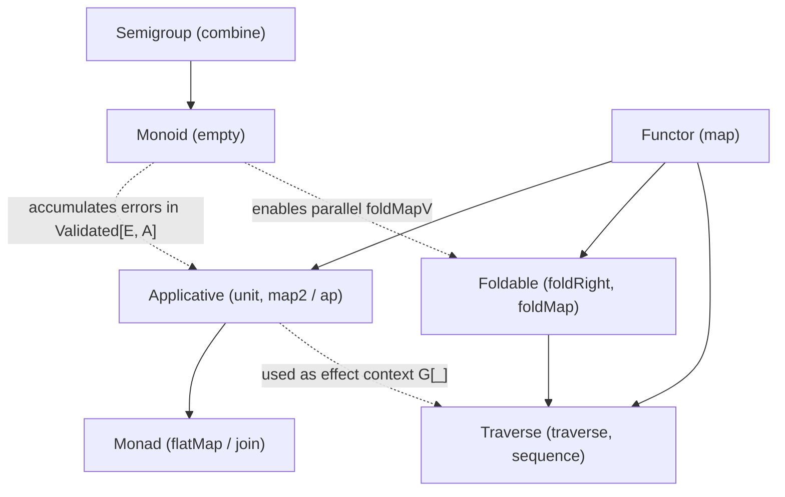

# Functional Programming Cheat Sheet

Fast desk reference for algebraic type classes, laws, minimal primitive sets, asymptotic and stack-safety bounds, Scala 2 vs. Scala 3 translations, and production failure modes.

---

## 1. Type-Class Hierarchy

---

## 2. Algebraic Laws Quick Reference

| Type Class | Required Laws | Formal Equations | Counterexample if Violated |
| --- | --- | --- | --- |
| **Semigroup** | Associativity | `combine(combine(x, y), z) == combine(x, combine(y, z))` | Integer subtraction `(a - b) - c != a - (b - c)` or IEEE 754 float `+` |
| **Monoid** | Associativity, Left Identity, Right Identity | `combine(empty, x) == x` and `combine(x, empty) == x` | Non-empty string concatenation without `""` identity |
| **Functor** | Identity, Composition | `map(fa)(id) == fa` and `map(map(fa)(f))(g) == map(fa)(g compose f)` | Stateful counter inside `map` breaks identity and fusion |
| **Applicative** | Identity, Homomorphism, Interchange, Associativity | `ap(unit(id))(v) == v`, `ap(unit(f))(unit(x)) == unit(f(x))`, `ap(u)(unit(y)) == ap(unit(f => f(y)))(u)`, `product(product(a, b), c) ~ product(a, product(b, c))` | Incompatible `map2` and `flatMap` in a broken `Monad`/`Applicative` |
| **Monad** | Left Identity, Right Identity, Associativity | `unit(a).flatMap(f) == f(a)`, `m.flatMap(unit) == m`, `m.flatMap(f).flatMap(g) == m.flatMap(a => f(a).flatMap(g))` (equiv. Kleisli `(f >=> g) >=> h == f >=> (g >=> h)`) | `Validated` cannot implement lawful `flatMap` consistent with error accumulation |
| **Traverse** | Identity, Composition, Naturality | `traverse(fa)(Id.apply) == Id(fa)`, `traverse(fa)(a => Compose(f(a).map(g))) == Compose(traverse(fa)(f).map(traverse(_)(g)))` | Reversing element order inside `traverse` breaks identity |
| **Par** | `map` Identity, `fork` Equivalence | `map(y)(id) == y`, `fork(x) == x` (denotationally, barring deadlock) | Blocking `.get()` inside `fork` deadlocks bounded worker pools |

---

## 3. Minimal Primitive Sets & Derived Combinators

| Abstraction | Minimal Primitive Set (Canonical) | Key Derived Combinators | Primary Module |
| --- | --- | --- | --- |
| **`State[S, A]`** | `unit`, `flatMap` (or `get`, `set`, `run`) | `map`, `map2`, `modify`, `sequence` | [Module 05](modules/05-purely-functional-state-and-combinators.md) |
| **`Par[A]`** | `unit`, `fork`, `map2` (or `delay` + `async`) | `lazyUnit`, `map`, `asyncF`, `sequence`, `parMap`, `parFilter` | [Module 06](modules/06-purely-functional-parallelism-and-laws.md) |
| **`Parser[A]`** | `string`, `regex`, `or`, `slice`, `scope`, `attempt`, `flatMap`, `succeed` | `map`, `product`, `many`, `many1`, `listOfN`, `sepBy` | [Module 08](modules/08-parser-combinators-and-algebraic-design.md) |
| **`Monoid[A]`** | `empty`, `combine` | `concatenate`, `foldMap`, `foldMapV`, `productMonoid`, `functionMonoid` | [Module 09](modules/09-monoids-foldables-and-parallel-reduction.md) |
| **`Monad[F[_]]`** | Set 1: `unit`, `flatMap` \| Set 2: `unit`, `compose` \| Set 3: `unit`, `map`, `join` | `map2`, `sequence`, `traverse`, `replicateM`, `filterM`, `forever` | [Module 10](modules/10-functors-monads-and-kleisli-composition.md) |
| **`Applicative[F[_]]`** | Set 1: `unit`, `map2` \| Set 2: `unit`, `apply` | `map`, `sequence`, `traverse`, `product`, `replicateM`, `map3`, `map4` | [Module 11](modules/11-applicative-and-traversable-functors.md) |
| **`Traverse[F[_]]`** | `traverse` (with `map`) \| OR `sequence` + `map` | `map` (via `Id`), `foldMap` (via `Const`), `zipWithIndex`, `mapAccum` | [Module 11](modules/11-applicative-and-traversable-functors.md) |
| **`Free[F[_], A]`** | `Return`, `Suspend`, `FlatMap` | `map`, `flatMap`, `runTrampoline`, `runFree`, `translate` | [Module 12](modules/12-effects-io-trampolining-st-and-streaming.md) |

---

## 4. Complexity, Stack Safety & Evaluation Strategy

| Construct / Operation | Time Complexity | Heap / Space | Stack Usage | Notes |
| --- | --- | --- | --- | --- |
| **Persistent `List` prepend (`Cons`) / `tail`** | $O(1)$ | $O(1)$ shared tail | $O(1)$ | Immutable structural sharing |
| **Persistent `List` `append` (`xs ++ ys`)** | $O(\|xs\|)$ | $O(\|xs\|)$ (`ys` shared) | $O(1)$ if iterative / `foldLeft` | Never copies `ys` |
| **Naive recursive `foldRight` on `List`** | $O(n)$ | $O(1)$ | $O(n)$ (**unsafe**) | Overflows stack around $n \approx 10{,}000\text{–}25{,}000$ |
| **Iterative `foldLeft` / reversed `foldRight`** | $O(n)$ | $O(1)$ / $O(n)$ | $O(1)$ (**safe**) | Preferred for strict linear folds |
| **Non-strict `LazyList` fused `map` + `filter`** | $O(k)$ demanded | $O(1)$ if head unretained | $O(1)$ per step | $O(n)$ OOM leak if head reference is retained |
| **Balanced `foldMapV` over indexed sequence** | $O(n)$ work, $O(\log n)$ depth | $O(\log n)$ | $O(\log n)$ | Requires associative `Monoid` |
| **Naive monadic `IO` (`f(io())()`)** | $O(n)$ | $O(n)$ closures | $O(n)$ (**unsafe**) | Throws `StackOverflowError` / `RangeError` |
| **Trampolined `TailRec` / `Free` right-associated** | $O(n)$ | $O(n)$ max suspended nodes | $O(1)$ (**safe**) | Heap-allocated continuations eliminate stack frames |
| **Scoped `ST` in-place Quicksort** | $O(n \log n)$ avg | $O(n)$ mutable array | $O(\log n)$ | Pure externally via rank-2 quantification |

---

## 5. Scala 2 (_FP in Scala_ 1e) vs. Scala 3 Translation Guide

| Concept | Scala 2 (_FP in Scala_ 1e, 2015) | Scala 3 (3.9 LTS / 3.10.1) | Notes |
| --- | --- | --- | --- |
| **Algebraic Data Type** | `sealed trait Option[+A]; case object None ...; case class Some[+A](get: A) ...` | `enum Option[+A]: case None; case Some(get: A)` | Exhaustive pattern matching built in |
| **Type Class Definition & Instance** | `implicit object IntMonoid extends Monoid[Int]` + `(implicit m: Monoid[A])` | `given Monoid[Int] with ...` + `(using m: Monoid[A])` | Explicit `summon[Monoid[A]]` replaces `implicitly` |
| **Extension Methods** | `implicit class MonoidOps[A](a: A)` | `extension [A](a: A) def \|+\|(b: A)(using m: Monoid[A]): A` | Zero allocation wrapper syntax |
| **Type Lambdas** | `({type f[x] = State[S, x]})#f` or kind-projector `State[S, *]` | `[X] =>> State[S, X]` | Native compiler support; no compiler plugin needed |
| **Rank-2 Quantification (`ST`)** | `trait RunnableST[A] { def apply[S]: ST[S, A] }` | `type RunnableST[A] = [S] => () => ST[S, A]` | First-class polymorphic function types |
| **Lazy Infinite List** | `Stream[A]` (head-strict!) | `LazyList[A]` (head- and tail-lazy) | Eliminates `Stream` head-evaluation pitfall |
| **Zero-Cost Wrapper (`State`)** | `case class State[S, +A](run: S => (A, S))` (allocates wrapper) | `opaque type State[S, +A] = S => (A, S)` | Zero runtime boxing overhead |

---

## 6. Production Failure Modes & Remedies

| Failure Mode | Root Cause | Symptom | Deterministic Remedy |
| --- | --- | --- | --- |
| **Fixed-Thread-Pool Deadlock in `Par`** | Outer submitted task holds a thread while calling `.get()` on inner `fork` | Hang when fork nesting exceeds pool size $N$ | Non-blocking continuation-passing `Future` / actors / Cats Effect or ZIO fibers |
| **Stack Overflow in Monadic Recursion** | Left-nested `flatMap` evaluated directly on JVM/JS call stack | `StackOverflowError` / `RangeError` at $\sim 10\text{k}$ steps | Reify `FlatMap` onto the heap via `TailRec` / `Free` trampoline with right-association |
| **Lazy List OOM (`Head Retention`)** | Holding root reference to `LazyList` while iterating to end | Linear heap growth instead of constant memory | Drop head reference (`def` instead of `val`) or use pull-based chunked streams (`FS2` / `Process`) |
| **Divergent Parallel Reduction** | Using non-associative combiner (`-`, float `+`, biased averaging) | Sequential fold disagrees with parallel `foldMapV` | Enforce `Monoid` associativity via property-based tests (`ScalaCheck` / `fast-check`) |
| **Parser Infinite Loop / Missed Backtrack** | `many` on zero-width parser, or failing after consuming input in `or` | Stack/CPU spin or unexpected parse failure | Guard zero-width steps in `many`; wrap speculative branches in `attempt` |
| **Leaked File/Socket Handles in Streams** | Unbracketed `try/finally` across async/pull boundaries or early `take(n)` | File descriptor exhaustion under error or cancelation | Use `Process` `onComplete` / `bracketResource` (`Resource` in Cats Effect / `ZIO.acquireRelease`) |
