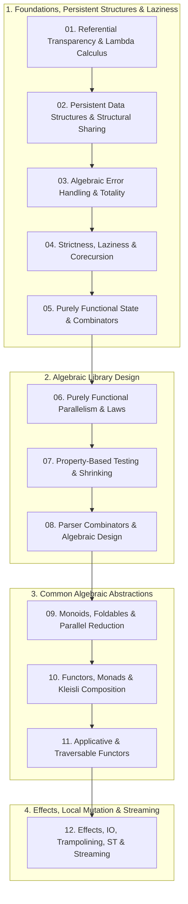

# Functional Programming: From Lambda Calculus to Effect Systems

A mathematically grounded, production-verified curriculum in purely functional software architecture, algebraic design, and effect systems. Anchored in primary academic literature (Church, Reynolds, Wadler, Okasaki, Moggi, McBride & Paterson, Gibbons & Oliveira, Claessen & Hughes, Launchbury & Peyton Jones) and the algebraic progression of _Functional Programming in Scala_, every concept is proven with executable **TypeScript** test suites (Node 26, `fast-check`) and **Scala 3** higher-kinded law suites (Scala 3.10.1, MUnit, ScalaCheck).

> Verified against Node 26.13.0, TypeScript 7.0.2, fast-check 4.10.3, OpenJDK 25.0.5 LTS, Scala 3.10.1, MUnit 1.3.6, munit-scalacheck 1.3.1 on 2026-11-20

---

## 1. Syllabus & Curriculum Structure

The curriculum progresses continuously from equational foundations through algebraic data types and combinator libraries to higher-kinded type classes and effect/stream runtimes across 12 modules:



### Module Directory

1. [Module 01: Referential Transparency & Lambda Calculus](modules/01-referential-transparency-and-lambda-calculus.md): Referential transparency (Strachey), substitution model, untyped & typed $\lambda$-calculus ($\alpha/\beta/\eta$-conversion), currying, tail-call elimination, parametricity, and Wadler's free theorems.
2. [Module 02: Persistent Data Structures & Structural Sharing](modules/02-persistent-data-structures-and-structural-sharing.md): Sum and product ADTs, singly-linked persistent lists, $O(1)$ structural sharing, Okasaki amortized bounds, stack-unsafe `foldRight` vs stack-safe `foldLeft`, and tree catamorphisms.
3. [Module 03: Algebraic Error Handling & Totality](modules/03-algebraic-error-handling-and-totality.md): Partial functions vs totality, why exceptions break referential transparency, `Option` lifting (`map2`, `sequence`, `traverse`), `Either` fail-fast semantics, and `Validated` error accumulation.
4. [Module 04: Strictness, Laziness & Corecursion](modules/04-strictness-laziness-and-corecursion.md): Call-by-value vs call-by-name vs call-by-need, thunk memoization, infinite `Stream` / `LazyList`, stream fusion (deforestation), corecursive `unfold`, and **Then vs now** (Scala 2 `Stream` head-retention leak vs `LazyList`).
5. [Module 05: Purely Functional State & Combinators](modules/05-purely-functional-state-and-combinators.md): Referentially transparent `RNG` state transitions, `State[S, A]` combinator algebra (`unit`, `map`, `map2`, `flatMap`, `sequence`), `get`/`modify`, and pure finite-state machines (candy dispenser).
6. [Module 06: Purely Functional Parallelism & Laws](modules/06-purely-functional-parallelism-and-laws.md): Algebraic derivation of `Par[A]`, explicit `fork` boundaries, fixed-thread-pool deadlock mechanics, non-blocking continuation/actor `Future`, law of `map` identity, and `choiceN` unification.
7. [Module 07: Property-Based Testing & Shrinking](modules/07-property-based-testing-and-shrinking.md): `Gen[A]` as `State[RNG, A]`, `SGen[A]` sized generators, `Prop` falsification, exhaustive vs randomized checking, integrated vs type-directed shrinking (QuickCheck / ScalaCheck / `fast-check`), and law-driven testing.
8. [Module 08: Parser Combinators & Algebraic Design](modules/08-parser-combinators-and-algebraic-design.md): Algebra-first API design, `slice`, `many`, `product`, `flatMap`, context-sensitive grammars, `scope`/`label` error reporting, committed failures vs `attempt` backtracking, and a complete JSON parser.
9. [Module 09: Monoids, Foldables & Parallel Reduction](modules/09-monoids-foldables-and-parallel-reduction.md): `Semigroup` and `Monoid` laws, balanced parallel `foldMapV`, the `WC` word-count monoid, monoid homomorphisms, `productMonoid` single-pass fusion, `Foldable` abstraction, and unlawful-instance counterexamples.
10. [Module 10: Functors, Monads & Kleisli Composition](modules/10-functors-monads-and-kleisli-composition.md): `Functor` laws, `Monad` minimal primitive sets (`unit`+`flatMap`, `unit`+`compose`, `unit`+`map`+`join`), Kleisli category composition (`>=>`), monad laws in both forms, and `Identity` / `Reader` / `State` monads.
11. [Module 11: Applicative & Traversable Functors](modules/11-applicative-and-traversable-functors.md): `Applicative` vs `Monad` power and static analyzability, the 4 applicative laws (identity, homomorphism, interchange, associativity), `Validation` as non-monadic `Applicative`, functor composition, and `Traverse` laws (`traverse`, `sequence`, stateful `mapAccum`).
12. [Module 12: Effects, IO, Trampolining, ST & Streaming](modules/12-effects-io-trampolining-st-and-streaming.md): Reifying external effects as `IO`, stack overflow in naive monadic `IO`, `TailRec` and `Free[F, A]` trampolines, asynchronous `IO`, rank-2 polymorphic `ST[S, A]` for contextual purity (in-place Quicksort), pull-based `Process` stream transducers, and **Then vs now** (2015 `Process` vs FS2/Cats Effect/ZIO fiber runtimes).

### Prerequisites

- Working familiarity with algebraic types, recursion, and generic functions in TypeScript or Scala.
- Comfort with basic discrete mathematics (sets, functions, relations, induction).
- Familiarity with concurrency concepts (threads, thread pools, callbacks).

### Out of Scope

- **Scala 3 Compiler Internals, TASTy & Macro Metaprogramming**: Detailed Scala 3 syntax, `opaque type` lowering, Capture Checking, and Typelevel/ZIO production ecosystems live in [`languages/scala`](../../languages/scala/README.md).
- **TypeScript Type-Level Programming Mechanics**: Conditional types, mapped types, and structural type inference live in [`languages/typescript`](../../languages/typescript/README.md).
- **Low-Level Lock-Free Concurrency & Memory Barriers**: CAS loops, memory ordering, and cache coherence live in [`algorithms/dsa`](../../algorithms/dsa/README.md).

---

## 2. Certifications & Exams

**No active proctored vendor certification exists for pure Functional Programming.** Lightbend (now Akka) sunsetted its commercial Scala developer certifications, and functional programming as an architectural discipline has no single global vendor exam. Instead, this track aligns with the industry- and academia-recognised substitutes:

| Program / Interview Standard | Authority / Format | Target Scope | Reference |
| --- | --- | --- | --- |
| **EPFL / Scala Center Specialization** | EPFL & Scala Center on Coursera (_Functional Programming in Scala_ 5-course specialization) | Functional program design, parallel computing, effectful streams, capstone | [Coursera EPFL Functional Programming in Scala](https://www.coursera.org/specializations/scala) |
| **Senior / Staff Functional Systems Interview Loop** | Industry technical architecture & live-coding rounds (fintech, compilers, distributed platforms) | Equational reasoning, algebraic API design, stack-safe effects, law verification, concurrency pitfalls | [FP Question Bank & Mock Exam](exams/fp-interview.md) |

- **Coverage Matrix**: Domain weights, objective mappings, and executable proof cross-references in [`exams/README.md`](exams/README.md).
- **Question Bank & Mock Examination**: 65 original questions (`Q-FP-001`–`Q-FP-065`) plus a 30-question / 90-minute timed mock exam in [`exams/fp-interview.md`](exams/fp-interview.md).

---

## 3. Fast Reference & Terminology

- **Bilingual Index**: Canonical English ↔ Czech terminology index in [`GLOSSARY.md`](GLOSSARY.md).
- **Desk Reference**: Type-class hierarchy, algebraic laws, minimal primitive sets, complexity/stack-safety matrix, Scala 2 vs Scala 3 translation, and production failure modes in [`CHEATSHEET.md`](CHEATSHEET.md).

---

## 4. Running Tests & Verification

All executable proofs run hermetically using the track-local `mise` toolchain (Node 26.13.0, TypeScript 7.0.2, OpenJDK 25.0.5 LTS, Scala 3.10.1):

```bash
# Install pinned runtimes and npm dependencies
mise install && mise exec -- npm ci

# Run both TypeScript (node --test + fast-check) and Scala 3 (MUnit + ScalaCheck) suites
mise exec -- npm test

# Strict TypeScript and Scala 3 type checking
mise exec -- npm run typecheck

# Linting (oxlint + Scala -Werror) and formatting verification
mise exec -- npm run lint && mise exec -- npm run fmt:check
```
