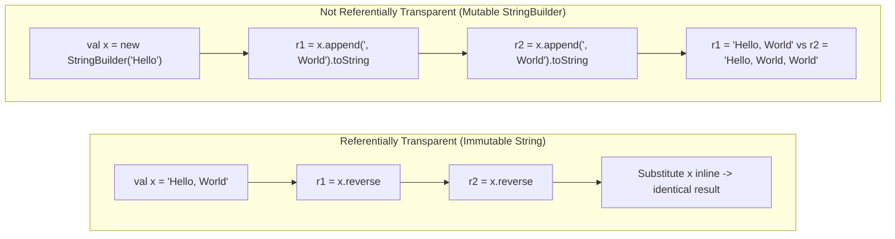
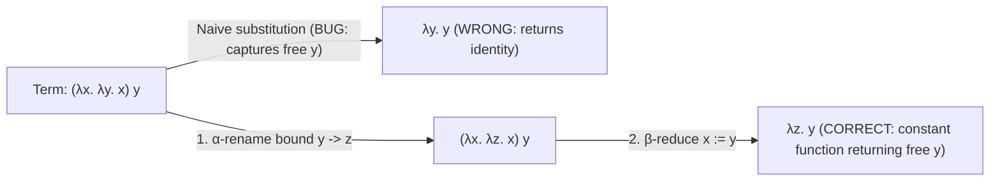

# Module 01 — Referential Transparency, Purity, and the $\lambda$-Calculus

Software systems become unpredictable when the meaning of an expression depends on _when_ it runs, _how many times_ it runs, or _what other code_ mutated shared state beforehand. Functional programming solves this by structuring programs out of **pure functions** and **referentially transparent** expressions whose behavior can be understood, refactored, and verified via local equational substitution rather than global execution-trace simulation. This module establishes the formal mathematical foundation of pure computation: the definition of total mathematical functions, Christopher Strachey's notion of referential transparency and the substitution model, the untyped and simply-typed $\lambda$-calculus, higher-order combinators, tail-call compilation on the JVM and V8, and Philip Wadler's _Theorems for Free!_ via parametric polymorphism.

---

## 1. Pure Functions and Observable Side Effects

In mathematics, a **function** $f : A \to B$ is a subset $f \subseteq A \times B$ satisfying two axioms:

1. **Totality**: For every $a \in A$, there exists some $b \in B$ such that $(a, b) \in f$.
2. **Single-valuedness (Determinism)**: If $(a, b_1) \in f$ and $(a, b_2) \in f$, then $b_1 = b_2$.

A function $f : A \to B$ has **no observable effects** beyond mapping each input $a \in A$ to its unique output $b \in B$. In an imperative runtime, however, a subroutine signature `A => B` may conceal hidden state transitions outside the declared return type:

- Mutating a heap variable, array slot, or object field reachable outside the function's local stack frame.
- Performing I/O: writing to a socket, filesystem, stdout, or database, or reading wall-clock time or an entropy source.
- Raising an uncaught exception or executing a non-local jump instead of returning a value in $B$.
- Diverging (non-termination), which in denotational semantics maps inputs to the bottom element $\bot$.

### Refactoring Side Effects into Algebraic Values

Consider a payment-processing routine that bills a credit card inside a loop over ordered items. When the credit card charge is executed directly inside `buyCoffee(cc)`, the function mixes domain calculation (what the order costs) with external network I/O (calling the payment gateway). Testing `buyCoffee` now requires mocking HTTP clients, and buying $n$ coffees triggers $n$ separate network roundtrips and transaction fees.

To restore purity, separate **computing the charge** from **interpreting the charge**:

```scala
case class CreditCard(number: String)
case class Coffee(price: BigDecimal)

case class Charge(cc: CreditCard, amount: BigDecimal):
  def combine(other: Charge): Charge =
    if cc == other.cc then Charge(cc, amount + other.amount)
    else throw IllegalArgumentException("Cannot combine charges to different cards")

object Cafe:
  def buyCoffee(cc: CreditCard): (Coffee, Charge) =
    val cup = Coffee(BigDecimal(4.50))
    (cup, Charge(cc, cup.price))

  def buyCoffees(cc: CreditCard, n: Int): (List[Coffee], Charge) =
    val purchases = List.fill(n)(buyCoffee(cc))
    val (coffees, charges) = purchases.unzip
    (coffees, charges.reduce((c1, c2) => c1.combine(c2)))

  def coalesce(charges: List[Charge]): List[Charge] =
    charges.groupBy(_.cc).values.map(_.reduce(_.combine(_))).toList
```

Notice that `Charge.combine` above still throws on mismatched cards—a partiality defect that [Module 03](03-algebraic-error-handling-and-totality.md) eliminates by replacing exceptions with `Either`. Even at this stage, lifting `Charge` into an explicit return value turns network side effects into ordinary immutable data that can be batched (`coalesce`), unit-tested without mocks, and audited before execution at the program boundary.

In TypeScript, the same refactoring replaces imperative gateway calls with pure value construction:

```typescript
export interface CreditCard {
  readonly number: string;
}

export interface Coffee {
  readonly price: number;
}

export interface Charge {
  readonly cc: CreditCard;
  readonly amount: number;
}

export const combineCharges = (a: Charge, b: Charge): Charge => {
  if (a.cc.number !== b.cc.number) {
    throw new Error('Cannot combine charges to different cards');
  }
  return { cc: a.cc, amount: a.amount + b.amount };
};

export const buyCoffee = (cc: CreditCard): readonly [Coffee, Charge] => {
  const cup: Coffee = { price: 4.5 };
  return [cup, { cc, amount: cup.price }];
};

export const buyCoffees = (cc: CreditCard, n: number): readonly [readonly Coffee[], Charge] => {
  const purchases = Array.from({ length: n }, () => buyCoffee(cc));
  const coffees = purchases.map(([cup]) => cup);
  const totalCharge = purchases.map(([, charge]) => charge).reduce(combineCharges);
  return [coffees, totalCharge];
};
```

---

## 2. Referential Transparency and the Substitution Model

Coined by W. V. O. Quine in _Word and Object_ (1960) and introduced to programming language theory by Christopher Strachey (_Fundamental Concepts in Programming Languages_, 1967), **referential transparency** formalizes what it means for an expression to be context-independent.

> [!IMPORTANT]
> **Formal Definition (Referential Transparency & Purity):** An expression $e$ is **referentially transparent** (RT) if, for _all_ programs $p$, all occurrences of $e$ in $p$ can be replaced by the result of evaluating $e$ without changing the observable meaning of $p$. A function $f$ is **pure** if the expression $f(x)$ is referentially transparent for all referentially transparent expressions $x$.

This property enables the **substitution model of evaluation**: reasoning about code by replacing variables and function calls with their evaluated definitions, identical to simplifying algebraic equations in arithmetic.



Consider the classic counterexample with a mutable buffer (`StringBuilder` in Scala or an array `push` in TypeScript):

```scala
val x = StringBuilder("Hello")
val y = x.append(", World")
val r1 = y.toString // "Hello, World"
val r2 = y.toString // "Hello, World"

// Now substitute the definition of y directly at both call sites:
val r1Sub = x.append(", World").toString // "Hello, World"
val r2Sub = x.append(", World").toString // "Hello, World, World" (Diverges!)
```

Because `StringBuilder.append` mutates the heap object aliased by both `x` and `y` in place and returns `this`, `x.append(", World")` is _not_ referentially transparent: substituting the expression for the bound identifier `y` alters the observable program output.

Notice a crucial subtlety about **scope**: if a function allocates a fresh mutable `Array` or `StringBuilder` strictly _inside_ its body, mutates it locally, and never leaks a reference to that mutable structure before returning an immutable snapshot, is the function externally pure? From the caller's perspective, every evaluation of `f(x)` still returns the same value and leaves no observable heap change behind—a property known as **contextual purity** (or _benevolent side effects_), which [Module 12](12-effects-io-trampolining-st-and-streaming.md) formalizes inside the type system via the rank-2 `ST` monad.

---

## 3. Untyped and Simply-Typed $\lambda$-Calculus

Long before electronic computers existed, Alonzo Church formulated the **$\lambda$-calculus** (1936) as a minimal formal system for function definition and application. Every functional programming language is an enriched, typed, or eager/lazy dialect of this calculus.

### Syntax and Reduction Rules (Untyped $\lambda$-Calculus)

Terms $M, N$ in the untyped $\lambda$-calculus are generated from an infinite supply of variable names $x, y, z$ by three productions:

$$M ::= x \mid \lambda x.\, M \mid M_1\, M_2$$

Here $x$ is a **variable**, $\lambda x.\, M$ is an **abstraction** (anonymous function binding $x$ in $M$), and $M_1\, M_2$ is an **application** (left-associative: $M_1\, M_2\, M_3 \equiv (M_1\, M_2)\, M_3$).

A variable $x$ is **bound** if it appears inside the body of some enclosing $\lambda x$; otherwise it belongs to the set of **free variables** $FV(M)$:

$$FV(x) = \{x\}, \qquad FV(\lambda x.\, M) = FV(M) \setminus \{x\}, \qquad FV(M_1\, M_2) = FV(M_1) \cup FV(M_2)$$

Equivalence and computation are governed by three rules:

1. **$\alpha$-equivalence** (bound-variable renaming): $\lambda x.\, M \equiv_\alpha \lambda y.\, M[x := y]$ provided $y$ does not appear free in $M$ and is not captured by an inner binder.
2. **$\beta$-reduction** (function application): $(\lambda x.\, M)\, N \to_\beta M[x := N]$, where $M[x := N]$ denotes **capture-avoiding substitution** (renaming bound variables inside $M$ via $\alpha$-conversion whenever a free variable of $N$ would otherwise become accidentally bound by a $\lambda$ inside $M$).
3. **$\eta$-conversion** (extensionality): $\lambda x.\, (f\, x) \equiv_\eta f$ whenever $x \notin FV(f)$. Applying `f` inside a wrapper lambda that merely forwards its argument is extensionally identical to `f` itself.



### Church-Rosser Theorem (Confluence)

A foundational result proven by Church and Rosser (1936) states that $\beta$-reduction is **confluent**: if a term $M$ reduces by two different paths to $N_1$ and $N_2$ ($M \twoheadrightarrow_\beta N_1$ and $M \twoheadrightarrow_\beta N_2$), then there exists a common term $P$ such that $N_1 \twoheadrightarrow_\beta P$ and $N_2 \twoheadrightarrow_\beta P$.

As an immediate corollary, **normal forms are unique** up to $\alpha$-equivalence: regardless of which redex is evaluated first (applicative-order vs normal-order), any evaluation strategy that reaches a $\beta$-normal form reaches the _same_ normal form. Referential transparency is the direct engineering consequence of Church-Rosser confluence: without mutable state, the order in which independent subexpressions are reduced cannot change the final value.

### Church Encodings

Even without built-in integers, booleans, or tuples, the pure untyped $\lambda$-calculus encodes all data as higher-order control flow:

- **Booleans**: $\text{TRUE} \equiv \lambda t.\lambda f.\, t$, $\text{FALSE} \equiv \lambda t.\lambda f.\, f$, and $\text{IF} \equiv \lambda b.\lambda t.\lambda f.\, b\, t\, f$.
- **Pairs**: $\text{PAIR} \equiv \lambda a.\lambda b.\lambda s.\, s\, a\, b$, $\text{FST} \equiv \lambda p.\, p\, \text{TRUE}$, $\text{SND} \equiv \lambda p.\, p\, \text{FALSE}$.
- **Church Numerals**: $c_n \equiv \lambda f.\lambda x.\, f^n(x)$, representing a natural number $n$ by its $n$-fold iteration operator. Successor is $\text{SUCC} \equiv \lambda n.\lambda f.\lambda x.\, f\, (n\, f\, x)$ and addition is $\text{ADD} \equiv \lambda m.\lambda n.\lambda f.\lambda x.\, m\, f\, (n\, f\, x)$.

Because the untyped $\lambda$-calculus admits self-application, it contains non-terminating terms such as the $\Omega$-combinator $(\lambda x.\, x\, x)(\lambda x.\, x\, x) \to_\beta (\lambda x.\, x\, x)(\lambda x.\, x\, x)$ and the fixed-point $Y$-combinator $Y \equiv \lambda f.\, (\lambda x.\, f\,(x\,x))(\lambda x.\, f\,(x\,x))$, making it Turing-complete.

### Simply-Typed $\lambda$-Calculus ($\lambda_\to$) and Strong Normalization

To prevent runtime type errors and unrestricted self-application, Church (1940) introduced the **simply-typed $\lambda$-calculus** ($\lambda_\to$). Types are built from base types $B$ and the function arrow $\tau_1 \to \tau_2$. Under a typing context $\Gamma$ mapping free variables to types, typing judgments $\Gamma \vdash M : \tau$ are derived by three inference rules:

$$\frac{(x : \tau) \in \Gamma}{\Gamma \vdash x : \tau}\;\text{(Var)} \qquad \frac{\Gamma, x : \tau_1 \vdash M : \tau_2}{\Gamma \vdash (\lambda x : \tau_1.\, M) : \tau_1 \to \tau_2}\;\text{(Abs)} \qquad \frac{\Gamma \vdash M_1 : \tau_1 \to \tau_2 \quad \Gamma \vdash M_2 : \tau_1}{\Gamma \vdash M_1\, M_2 : \tau_2}\;\text{(App)}$$

Two theorems make $\lambda_\to$ the theoretical anchor of typed functional languages (Pierce, _Types and Programming Languages_):

1. **Type Safety (Preservation and Progress)**: Well-typed closed terms never get stuck, and $\beta$-reduction preserves types (if $\Gamma \vdash M : \tau$ and $M \to_\beta M'$, then $\Gamma \vdash M' : \tau$).
2. **Strong Normalization**: Every well-typed term in $\lambda_\to$ terminates along _every_ $\beta$-reduction path. Consequently, self-application $(\lambda x.\, x\, x)$ is untypable in $\lambda_\to$ (since $x$ would need type $\tau = \tau \to \sigma$, which has no finite solution). General recursion in practical languages like Scala or Haskell requires adding an explicit fixed-point primitive (`fix` / recursive definitions), trading strong normalization for Turing-completeness.

---

## 4. Higher-Order Functions, Tail Recursion, and Stack Frames

A **higher-order function (HOF)** is a function that accepts another function as an argument or returns a function as its result. HOFs replace ad-hoc control flow (`for` loops, mutable accumulators, `break` flags) with reusable, composable combinators.

### Stack Frames and Tail-Call Optimization

Consider computing the $n$-th Fibonacci number or factorial recursively. On a traditional call stack (such as the JVM operand/frame stack or V8's JavaScript stack), each non-tail call pushes a new **stack frame** containing the return address, saved registers, and local parameters. If the recursion depth $n$ exceeds the thread stack budget (typically ~8,000–12,000 frames on default 1 MiB JVM stacks, or ~10,000 frames in V8), execution aborts with `StackOverflowError` or `RangeError: Maximum call stack size exceeded`.

A call is in **tail position** if the caller performs _no further computation_ on the callee's return value—the caller simply returns whatever the callee returns. Notice why `n * factorial(n - 1)` is _not_ tail-recursive: after `factorial(n - 1)` returns, the current stack frame must remain alive to multiply its result by `n`.

By passing an explicit **accumulator** parameter, we transform a non-tail recursion into a tail-recursive loop:

```text
FACTORIAL-TAIL(n):
  GO(k, acc):
    if k <= 1 return acc
    return GO(k - 1, k * acc)   // tail call: no work remains after GO returns
  return GO(n, 1)

FIB-TAIL(n):
  if n == 0 return 0
  GO(remaining, prev, curr):
    if remaining <= 1 return curr
    return GO(remaining - 1, curr, prev + curr)
  return GO(n, 0, 1)
```

- **Loop Invariant for `GO(k, acc)` in `FACTORIAL-TAIL`**: At the start of every call to `GO(k, acc)` for $n \ge 1$, $k \ge 1$ and $\text{acc} \cdot k! = n!$. When $k = 1$, $\text{acc} \cdot 1! = n!$, proving partial correctness, and $k$ decreases strictly by 1 each step, guaranteeing termination in $O(n)$ steps and $O(1)$ stack space.

### JVM Lowering (`@tailrec`) vs V8 Execution

The JVM bytecode specification has **no native tail-call instruction** (every `invokevirtual`/`invokestatic` pushes a JVM stack frame unless inlined by JIT). To guarantee $O(1)$ stack usage on the JVM, the Scala compiler implements **self-tail-call elimination**: when a method calls _itself_ in tail position, `scalac` lowers the recursion directly into a bytecode `while` loop (`goto` back to method start after overwriting local variable slots).

Annotating a recursive helper with `@scala.annotation.tailrec` turns tail-call elimination into a compile-time proof: if a recursive call is accidentally moved out of tail position (for example, wrapping the call in `1 + go(...)` or placing it inside a `try/catch` block), compilation fails immediately rather than silently leaking stack frames in production.

```scala
import scala.annotation.tailrec

def factorial(n: Int): BigInt =
  @tailrec
  def go(k: Int, acc: BigInt): BigInt =
    if k <= 1 then acc
    else go(k - 1, k * acc)
  go(n, BigInt(1))

def fib(n: Int): BigInt =
  @tailrec
  def go(rem: Int, prev: BigInt, curr: BigInt): BigInt =
    if rem <= 0 then prev
    else if rem == 1 then curr
    else go(rem - 1, curr, prev + curr)
  go(n, BigInt(0), BigInt(1))

// Negative example: fails to compile under @tailrec because `1 +` runs AFTER `badLen` returns!
// @tailrec
// def badLen[A](xs: List[A]): Int = xs match
//   case Nil     => 0
//   case _ :: tl => 1 + badLen(tl)
```

In TypeScript / Node.js (V8), although ECMAScript 2015 specified Proper Tail Calls (PTC) in strict mode, V8 intentionally declined to ship general PTC (preserving full stack traces for debugging), and TypeScript emits standard function calls. Deep tail recursion in TypeScript therefore requires either an explicit `while` loop or heap-allocated **trampolining** ([Module 12](12-effects-io-trampolining-st-and-streaming.md)):

```typescript
export const factorial = (n: number): bigint => {
  let k = BigInt(n);
  let acc = 1n;
  while (k > 1n) {
    acc *= k;
    k -= 1n;
  }
  return acc;
};

export const findFirst = <A>(as: readonly A[], p: (a: A) => boolean): number => {
  for (let i = 0; i < as.length; i++) {
    if (p(as[i])) return i;
  }
  return -1;
};
```

Distinguish **self-tail recursion** (`scalac @tailrec`) from **mutual tail recursion** (`even(n)` calling `odd(n - 1)`). The JVM's lack of a general `tailcall` bytecode means `@tailrec` **cannot** optimize mutual recursion between two distinct methods or tail calls through a polymorphic function parameter (`f(x)`). Those cases require trampolining (`TailRec`, [Module 12](12-effects-io-trampolining-st-and-streaming.md)).

---

## 5. Parametric Polymorphism, Free Theorems, and Type-Driven Implementation

A **monomorphic** function operates on one concrete type (e.g., `findFirstString(ss: Array[String], key: String): Int`). A **parametrically polymorphic** function abstracts over an arbitrary type parameter `A` without constraining or inspecting `A`:

```scala
def findFirst[A](as: Array[A], p: A => Boolean): Int =
  @tailrec
  def loop(n: Int): Int =
    if n >= as.length then -1
    else if p(as(n)) then n
    else loop(n + 1)
  loop(0)
```

When a function is parametrically polymorphic in `A`, its type signature imposes severe mathematical constraints on what implementations can exist.

### Wadler's _Theorems for Free!_ (1989)

Building on John Reynolds's abstraction theorem for System F ($\lambda 2$), Philip Wadler showed in _Theorems for Free!_ (FPCA 1989) that a polymorphic type signature alone yields **free equational theorems** that hold for _every_ pure terminating function of that type—without inspecting a single line of its body.

Intuitively, because a function $h : \forall \alpha.\, F(\alpha) \to G(\alpha)$ has no knowledge of what concrete type $\alpha$ is, it cannot fabricate elements of $\alpha$, branch on the runtime representation of $\alpha$, or inspect values of $\alpha$ except by passing them to functions supplied in its arguments. Any representation change $f : A \to B$ applied to inputs commutes with $h$:

- If $r : \forall \alpha.\, [\alpha] \to [\alpha]$ (a polymorphic list transformer such as `reverse`, `tail`, or `take(3)`), then for **every** total function $f : A \to B$ and list $xs : [A]$:

$$\text{map}(f)(r_A(xs)) = r_B(\text{map}(f)(xs))$$

This is the **naturality condition** of a natural transformation in category theory: $r$ can only reorder, drop, or duplicate elements of the input list; it can never modify element values or inject new constants.

- For `id[A](a: A): A`, there is only **one** pure terminating implementation: returning `a` unchanged!

### Negative Example: Breaking Parametricity

Free theorems hold **only** in a pure, total, parametrically polymorphic subset of the language. Any backdoor that inspects types at runtime or subverts totality invalidates the free theorem:

```scala
// ANTI-PATTERN: violates parametricity via runtime type inspection (isInstanceOf)
def sneaky[A](xs: List[A]): List[A] = xs match
  case (i: Int) :: rest => (i + 1).asInstanceOf[A] :: rest // Unsafe cast + breaks naturality!
  case other            => other
```

Testing Wadler's free theorem against `sneaky` exposes the defect immediately: take `xs = List(1, 2)` and `f = (x: Int) => x.toString`. Then `sneaky(xs).map(f)` yields `List("2", "2")`, whereas `xs.map(f).pipe(sneaky)` yields `List("1", "2")`. Runtime type inspection (`isInstanceOf`, Java reflection, `Object.hashCode`, `null`, or throwing exceptions) destroys parametricity and invalidates compiler optimizations such as **short-cut deforestation** ([Module 02](02-persistent-data-structures-and-structural-sharing.md)).

### Following Types to Implementations

Because parametric polymorphism shrinks the space of possible implementations, often _only one_ pure total implementation fits a polymorphic signature. Consider the three foundational combinators from the Cartesian Closed Category isomorphism $A \times B \to C \cong A \to (B \to C)$:

```scala
def partial1[A, B, C](a: A, f: (A, B) => C): B => C =
  (b: B) => f(a, b)

def curry[A, B, C](f: (A, B) => C): A => (B => C) =
  (a: A) => (b: B) => f(a, b)

def uncurry[A, B, C](f: A => B => C): (A, B) => C =
  (a: A, b: B) => f(a)(b)

def compose[A, B, C](f: B => C, g: A => B): A => C =
  (a: A) => f(g(a))
```

And the exact TypeScript counterparts:

```typescript
export const curry =
  <A, B, C>(f: (a: A, b: B) => C) =>
  (a: A) =>
  (b: B): C =>
    f(a, b);

export const uncurry =
  <A, B, C>(f: (a: A) => (b: B) => C) =>
  (a: A, b: B): C =>
    f(a)(b);

export const compose =
  <A, B, C>(f: (b: B) => C, g: (a: A) => B) =>
  (a: A): C =>
    f(g(a));
```

Look closely at `compose[A, B, C](f: B => C, g: A => B): A => C`: to produce a `C` given `a: A`, the _only_ value of type `C` obtainable without bottom/exceptions comes from applying `f` to a `B`, and the _only_ way to obtain a `B` is applying `g` to `a`. By the **Curry-Howard isomorphism** (propositions as types, proofs as programs), the type $(B \to C) \to (A \to B) \to (A \to C)$ corresponds to the **hypothetical syllogism** in intuitionistic logic: if $B \implies C$ and $A \implies B$, then $A \implies C$. When the type uniquely inhabits the proof, the compiler's type checker guides the implementation directly.

---

## 6. Then vs Now: Scala 2 to Scala 3 Syntax, Entry Points, and Lowering

Because foundational FP literature (including _Functional Programming in Scala_, 1st ed.) historically used Scala 2 syntax, practitioners moving between older codebases and modern **Scala 3.10.1 / 3.9.0 LTS** encounter several syntactic and compilation-pipeline shifts.

| Aspect | Then (Scala 2.11–2.13) | Now (Scala 3.x / 3.10.1) | Engineering Impact |
| --- | --- | --- | --- |
| Program entry point | `object MyApp { def main(args: Array[String]): Unit = ... }` or `extends App` | `@main def run(args: String*): Unit = ...` | Eliminates `DelayedInit` trait initialization bugs and static forwarder quirks; generates clean static `main` wrapper |
| Block delimiters | Mandatory `{ ... }` braces everywhere | Significant indentation (`then`/`do`/colons) or braces | Lower visual noise in expression-oriented code; braces remain valid and compatible |
| Polymorphic lambdas | No native polymorphic function values (needed a `trait` with `apply[A]`) | Native polymorphic function types `[A] => A => A` | Enables System F / rank-2 encodings directly ([Module 12](12-effects-io-trampolining-st-and-streaming.md)) |
| Intermediate IR | Pickled Scala 2 signatures in JVM classfile annotations | **TASTy** (Typed Abstract Syntax Trees) `.tasty` files | Enables whole-AST inlining, cross-version binary stability, and Scala 2.13 interoperability |

For full details on Scala 3's compiler pipeline, TASTy serialization, and JVM bytecode lowering (including how `@tailrec` and function values compile to JVM `invokedynamic` / lambda metafactories), see [Scala 3 Module 01: Toolchain, TASTy, and JVM Lowering](../../../languages/scala/modules/01-scala3-toolchain-tasty-and-jvm-lowering.md).

---

## Interview Drill

### 1. Why is `StringBuilder.append` not referentially transparent, and can a function using a local `StringBuilder` still be pure?

<details><summary>Answer</summary>

`StringBuilder.append` mutates the receiver buffer in place and returns a reference to the mutated object (`this`). Substituting the expression `x.append(", World")` directly for a bound identifier `y` causes the mutation to run twice on the same heap object, changing the observed output from `"Hello, World"` to `"Hello, World, World"`—violating referential transparency. However, a function that creates a fresh `StringBuilder` inside its body, populates it locally without sharing a reference outside, and returns an immutable `String` _is_ contextually pure: no caller can observe the local mutation, and substituting `f(x)` with its result preserves the meaning of every enclosing program.
</details>

### 2. What does the Church-Rosser theorem guarantee, and how does it relate to equational reasoning in FP?

<details><summary>Answer</summary>

The Church-Rosser theorem guarantees **confluence** of $\beta$-reduction in the $\lambda$-calculus: if a term $M$ can be reduced by two different sequences of steps to $N_1$ and $N_2$, there always exists a common reduct $P$ reachable from both. Its immediate corollary is **uniqueness of normal forms**: if an expression terminates in a value, every terminating evaluation order produces the exact same value. In pure functional code, this means developers and compilers can safely refactor, inline, memoise, or parallelize independent subexpressions using algebraic substitution without changing program semantics.
</details>

### 3. Why must $\beta$-reduction use capture-avoiding substitution, and how does $\eta$-conversion interact with strict vs lazy languages?

<details><summary>Answer</summary>

Naive textual substitution in $(\lambda x.\lambda y.\, x)\, y$ replaces $x$ with $y$ inside $\lambda y.\, x$, yielding $\lambda y.\, y$ (the identity function) instead of a constant function returning the outer free $y$. Capture-avoiding substitution $\alpha$-renames the bound variable ($\lambda z.\, x$) before substituting so free variables remain free. As for $\eta$-conversion ($\lambda x.\, f\, x \equiv_\eta f$), in a strict (call-by-value) language with side effects or divergence, $\eta$-equivalence can break: if `f` evaluates to an expression that throws or loops immediately, `f` diverges at definition time, whereas `x => f(x)` wraps `f` in a thunk/closure that postpones evaluation until called.
</details>

### 4. Why does `scalac`'s `@tailrec` optimize self-recursion on the JVM but fail on mutual recursion or polymorphic continuations?

<details><summary>Answer</summary>

JVM bytecode has no general tail-call instruction; every `invokevirtual` or `invokestatic` pushes a new frame onto the thread's call stack. `scalac` handles `@tailrec` by lowering direct tail calls to the _same_ method into a `while`-loop `goto` with local variable reassignment. Because `goto` can only jump inside the current method's bytecode body, `scalac` cannot eliminate tail calls across distinct methods (`even` calling `odd`) or calls through dynamic function values (`f(x)`). Those require heap-allocated trampolines (`TailRec`).
</details>

### 5. What is a "free theorem" in Wadler's _Theorems for Free!_, and what breaks it on the JVM or in TypeScript?

<details><summary>Answer</summary>

A free theorem is an equational law derived solely from a function's parametrically polymorphic type signature using Reynolds's parametricity theorem. For example, any pure terminating function `r: [A] => List[A] => List[A]` must satisfy `r(xs.map(f)) == r(xs).map(f)` for every total function `f`, because `r` cannot inspect or fabricate values of abstract type `A`. On the JVM or in TypeScript, free theorems break whenever code uses runtime type checks (`isInstanceOf`, `typeof`, `instanceof`), unsafe casts (`asInstanceOf`, `as any`), `null` injection, non-local exceptions, or `Object.hashCode` / `toString` inspection on `A`.
</details>

### 6. Why does the type `(A, B) => C` admit a lossless isomorphism to `A => B => C`, and how does that help type inference?

<details><summary>Answer</summary>

In any Cartesian Closed Category (and the simply-typed $\lambda$-calculus), products and exponentials satisfy the adjunction $\text{Hom}(A \times B, C) \cong \text{Hom}(A, C^B)$, witnessed by `curry` and `uncurry`. Practically, currying into multiple parameter lists in Scala (`def f(a: A)(b: B)`) allows the type checker to solve type parameters left-to-right: concrete type arguments inferred from the first parameter list (`a: A`) flow into the expected type of the second parameter list (`b: B`), eliminating redundant type annotations on inline lambdas.
</details>

### 7. Suppose `factorial` is written as `def fact(n: Int): Int = if n <= 1 then 1 else n * fact(n - 1)`. Which line prevents `@tailrec` from compiling, and why?

<details><summary>Answer</summary>

The recursive call `fact(n - 1)` is _not_ in tail position because the multiplication `n * ...` must execute _after_ `fact(n - 1)` returns. The runtime must retain `n` inside the caller's stack frame until the recursive call unwinds, producing $O(n)$ stack space. Rewriting with an accumulator `go(k - 1, k * acc)` performs the multiplication _before_ invoking `go`, putting `go` in true tail position so `scalac` lowers it to an $O(1)$-space loop.
</details>
