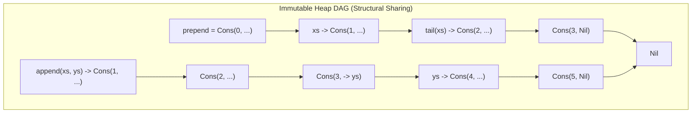

# Module 02 — Persistent Data Structures, Structural Sharing, and Catamorphisms

Immutability is frequently misunderstood as defensive copying—allocating an entire fresh array or object graph on every modification. If functional data structures copied $O(n)$ elements per update, pure programs would be asymptotically unusable. Instead, functional architectures rely on **persistent data structures** (Driscoll, Sarnak, Sleator, and Tarjan, _Making Data Structures Persistent_, 1989): immutable heap DAGs that preserve all prior versions intact after every logical "update" while reusing unchanged subtrees via **structural sharing**. This module formalizes Algebraic Data Types as initial algebras, analyzes structural sharing in singly-linked lists and binary trees, proves stack safety and duality properties of catamorphisms (`foldRight` vs `foldLeft`), derives Okasaki's persistent amortised Banker's Queue, and explains why naive eager pipelines suffer intermediate-allocation loss (deforestation).

---

## 1. Algebraic Data Types: Sums, Products, and Initial Algebras

An **Algebraic Data Type (ADT)** is a composite type constructed orthogonally from **products** (tuples, records, `case class`es—logical AND) and **sums** (tagged disjoint unions, `enum` variants—logical OR). Their name reflects a literal isomorphism with elementary arithmetic over type cardinalities $|T|$ (number of distinct inhabitants):

| Algebraic Construct | Type Notation | Cardinality Law | Concrete Example |
| --- | --- | --- | --- |
| Empty / Bottom | $0$ (`Nothing` / `never`) | $\|0\| = 0$ | Uninhabited return type of non-terminating divergence |
| Unit / Singleton | $1$ (`Unit` / `void` / `Nil`) | $\|1\| = 1$ | Single inhabitant `()` or `Nil` |
| Product (Record / Tuple) | $A \times B$ | $\|A \times B\| = \|A\| \cdot \|B\|$ | `(Boolean, Boolean)` has $2 \cdot 2 = 4$ values |
| Sum (Tagged Union) | $A + B$ | $\|A + B\| = \|A\| + \|B\|$ | `Either[Boolean, Option[Boolean]]` has $2 + (1 + 2) = 5$ values |
| Exponential (Function) | $A \to B$ ($B^A$) | $\|A \to B\| = \|B\|^{\|A\|}$ | `Boolean => Boolean` has $2^2 = 4$ pure functions |

### Inductive Lists as Least Fixed Points

A singly-linked list of elements of type $A$ is either empty (`Nil`) or a pair containing a head element $A$ and a tail list (`Cons`). Algebraically, `List[A]` is the **least fixed point** $\mu X.\, 1 + (A \times X)$ satisfying the recursive type equation:

$$L(A) \cong 1 + A \times L(A)$$

In category theory, this defines `List[A]` as the **initial $F$-algebra** for the functor $F_A(X) = 1 + A \times X$ (Lambek's Lemma guarantees the constructor map $[\text{Nil}, \text{Cons}] : 1 + A \times L(A) \to L(A)$ is an isomorphism). Every finite list is constructed bottom-up in finite steps from `Nil` and `Cons`.

```scala
enum List[+A]:
  case Nil
  case Cons(head: A, tail: List[A])

object List:
  def apply[A](as: A*): List[A] =
    if as.isEmpty then Nil
    else Cons(as.head, apply(as.tail*))
```

Notice the `+A` **covariance annotation** in `enum List[+A]`: if `Dog <: Animal`, then `List[Dog] <: List[Animal]`. Because `Nil` contains no elements of `A`, in Scala's type system `Nil` extends `List[Nothing]` (where `Nothing` is the bottom subtype of every type), allowing a single singleton `Nil` instance to serve as the empty list for _all_ element types!

In TypeScript, the same sum-of-products ADT is encoded via a `readonly` discriminated union (tagged by `kind`), with `never` serving as the covariant bottom type:

```typescript
export type List<A> =
  | { readonly kind: 'Nil' }
  | { readonly kind: 'Cons'; readonly head: A; readonly tail: List<A> };

export const Nil: List<never> = { kind: 'Nil' };
export const Cons = <A>(head: A, tail: List<A>): List<A> => ({ kind: 'Cons', head, tail });

export const listOf = <A>(...items: readonly A[]): List<A> => {
  let acc: List<A> = Nil;
  for (let i = items.length - 1; i >= 0; i--) {
    acc = Cons(items[i], acc);
  }
  return acc;
};
```

### Then vs Now: Scala 2 `sealed trait` vs Scala 3 `enum` ADTs

| Dimension | Then (Scala 2.11–2.13) | Now (Scala 3.x / 3.10.1) |
| --- | --- | --- |
| ADT declaration | `sealed trait List[+A]` + separate `case object Nil extends List[Nothing]` + `final case class Cons[+A](head: A, tail: List[A]) extends List[A]` | Single concise `enum List[+A]` with `case Nil` and `case Cons(...)` |
| Type inference on GADT/ADT patterns | `Cons(h, t)` often inferred narrow `Cons[A]` instead of `List[A]` unless upcast | Smart constructor / `enum` cases default to widening to `List[A]` cleanly |
| Type-class derivation | Boilerplate or Shapeless macros | Built-in `derives Eq, Show` hooks on `enum` |

In both eras, pattern matching over a closed `enum` / `sealed trait` enjoys **exhaustivity checking**: omitting either `Nil` or `Cons` triggers a compile-time match-may-not-be-exhaustive warning (or error under `-Werror`).

---

## 2. Persistent Singly-Linked Lists and Structural Sharing

Because `List[A]` nodes are strictly immutable once allocated on the heap, sharing a reference to an existing tail node is always safe—no caller can mutate `tail.head` or re-wire `tail.tail`.

Consider three operations on `xs = List(1, 2, 3)` and `ys = List(4, 5)`:

1. **`prepend(0, xs)` / `Cons(0, xs)`**: Allocates **1** new `Cons(0, -> xs)` cell whose `tail` pointer points directly to the existing `Cons(1, ...)` node. Time and space: **$O(1)$**.
2. **`tail(xs)`**: Returns `xs.tail` directly without allocating anything. Time and space: **$O(1)$**.
3. **`append(xs, ys)`**: Appending `ys` onto the _end_ of `xs` cannot mutate `Cons(3, Nil)` in place to point to `ys`—doing so would corrupt `xs` for all existing readers. Instead, `append` must **path-copy** every `Cons` spine node of `xs` (`Cons(1, Cons(2, Cons(3, ys)))`), while **sharing `ys` intact** at the tail! Time and space: **$O(|xs|)$**.



By the same path-copying invariant, `init(xs)` (dropping the _last_ element of a singly-linked list) and `setHead(xs, h)` have fundamentally asymmetric costs: `setHead` allocates 1 cell ($O(1)$), whereas `init` must copy all $n - 1$ preceding cells ($O(n)$).

### Curried Parameter Lists for Type Inference

When defining higher-order list combinators such as `dropWhile`, grouping parameters into two curried argument lists dramatically improves local type inference in Scala:

```scala
def dropWhile[A](as: List[A])(f: A => Boolean): List[A] = as match
  case List.Cons(h, t) if f(h) => dropWhile(t)(f)
  case _                       => as

// Call site: `A` is solved from `xs: List[Int]`, so `x` needs NO annotation!
val xs = List(1, 2, 3, 4)
val trimmed = dropWhile(xs)(x => x < 3)
```

In an uncurried signature `dropWhile[A](as: List[A], f: A => Boolean)`, Scala 2's bidirectional typer solved type parameters across a single parameter list simultaneously and frequently failed to infer `x: Int` inside `f`, forcing `dropWhile(xs, (x: Int) => x < 3)`. Splitting `as` and `f` into separate parameter lists guarantees left-to-right constraint propagation (which remains idiomatic in Scala 3 and mirrors TypeScript's contextual lambda typing).

---

## 3. Catamorphisms: `foldRight`, `foldLeft`, and Stack Safety

In recursive functional programming, structurally replacing every data constructor of an inductive type with an arbitrary function is called a **catamorphism** (Meijer, Fokkinga, and Paterson, _Functional Programming with Bananas, Lenses, Envelopes and Barbed Wire_, 1991). For `List[A]`, the canonical catamorphism is `foldRight`, which replaces `Nil` with `z: B` and every `Cons(h, t)` with `f(h, foldedTail)`:

```scala
def foldRight[A, B](as: List[A], z: B)(f: (A, B) => B): B = as match
  case List.Nil        => z
  case List.Cons(h, t) => f(h, foldRight(t, z)(f))
```

Equationally, `foldRight(List(1, 2, 3), z)(f)` expands right-associatively:

$$\text{foldRight}(\text{Cons}(1, \text{Cons}(2, \text{Cons}(3, \text{Nil}))), z)(f) = f(1, f(2, f(3, z)))$$

Notice the operational disaster hidden inside that clean algebraic definition: `foldRight(t, z)(f)` is **not in tail position** because `f(h, ...)` executes _after_ the recursive call returns! Every `Cons` node pushes a JVM (or V8) stack frame. On a list of $n = 20{,}000$ elements, `foldRight` crashes deterministically with `StackOverflowError`.

### `foldLeft`: Tail-Recursive Left-Associative Reduction

By accumulating the result _before_ descending into the tail, `foldLeft` places its recursive call in strict tail position:

```scala
import scala.annotation.tailrec

@tailrec
def foldLeft[A, B](as: List[A], acc: B)(f: (B, A) => B): B = as match
  case List.Nil        => acc
  case List.Cons(h, t) => foldLeft(t, f(acc, h))(f)
```

Equationally, `foldLeft(List(1, 2, 3), z)(f)` associates to the left:

$$\text{foldLeft}(\text{Cons}(1, \text{Cons}(2, \text{Cons}(3, \text{Nil}))), z)(f) = f(f(f(z, 1), 2), 3)$$

Because `@tailrec` lowers `foldLeft` into an imperative `while` loop at bytecode level, `foldLeft` handles lists of $10^7$ elements in $O(1)$ stack space.

### Expressing `foldRight` via `foldLeft` (and the Continuation Trap)

How do we make `foldRight` stack-safe without sacrificing its right-to-left evaluation order when `f` is non-commutative (for example, `Cons` reconstruction or list reversal)? There are two classic techniques, with starkly different runtime properties:

1. **Two-pass via `reverse` + `foldLeft` (Stack-Safe, Production Standard)**:

```scala
def reverse[A](as: List[A]): List[A] =
  foldLeft(as, List.Nil: List[A])((acc, a) => List.Cons(a, acc))

def foldRightSafe[A, B](as: List[A], z: B)(f: (A, B) => B): B =
  foldLeft(reverse(as), z)((b, a) => f(a, b))
```

This runs in $2n$ loop iterations ($O(n)$ time), allocates $n$ reversed `Cons` nodes on the heap ($O(n)$ heap), and uses **$O(1)$ stack space**—it never overflows on arbitrarily large lists.

2. **Single-pass via Continuation-Building `foldLeft` (Subtle Stack-Overflow Trap!)**:

```scala
// ANTI-PATTERN FOR LARGE LISTS IN STRICT LANGUAGES:
def foldRightViaCont[A, B](as: List[A], z: B)(f: (A, B) => B): B =
  val buildCont = foldLeft(as, (b: B) => b)((g, a) => b => g(f(a, b)))
  buildCont(z)
```

Why is `foldRightViaCont` dangerous on the JVM and in TypeScript? Although `foldLeft` itself runs in $O(1)$ stack space, it constructs an $n$-deep nested chain of heap closures `b0 => g_1(f(a_1, b0))`. Even though `g(f(a, b))` appears in tail position inside each closure after evaluating `f(a, b)`, calling `g.apply(...)` dispatches polymorphically through `Function1.apply` (`invokeinterface`), and **neither the JVM nor V8 performs tail-call optimization across closure interface calls**. Therefore, invoking `buildCont(z)` pushes $n$ stack frames of `Function1.apply` onto the call stack and **still throws `StackOverflowError`** at $n \approx 10{,}000$. Always prefer `reverse` + `foldLeft` (or lazy/trampolined folds, [Module 04](04-strictness-laziness-and-corecursion.md) & [Module 12](12-effects-io-trampolining-st-and-streaming.md)) in strict non-PTC runtimes.

### Deriving Standard Combinators via Folds

Every structural transformation on `List` factors cleanly through `foldRightSafe` or `foldLeft`:

```scala
def append[A](a1: List[A], a2: List[A]): List[A] =
  foldRightSafe(a1, a2)(List.Cons.apply)

def concat[A](lists: List[List[A]]): List[A] =
  foldRightSafe(lists, List.Nil: List[A])(append)

def map[A, B](as: List[A])(f: A => B): List[B] =
  foldRightSafe(as, List.Nil: List[B])((a, acc) => List.Cons(f(a), acc))

def filter[A](as: List[A])(p: A => Boolean): List[A] =
  foldRightSafe(as, List.Nil: List[A])((a, acc) => if p(a) then List.Cons(a, acc) else acc)

def flatMap[A, B](as: List[A])(f: A => List[B]): List[B] =
  concat(map(as)(f))

def zipWith[A, B, C](a: List[A], b: List[B])(f: (A, B) => C): List[C] =
  @tailrec
  def go(la: List[A], lb: List[B], acc: List[C]): List[C] = (la, lb) match
    case (List.Cons(ha, ta), List.Cons(hb, tb)) => go(ta, tb, List.Cons(f(ha, hb), acc))
    case _                                      => reverse(acc)
  go(a, b, List.Nil)

@tailrec
def startsWith[A](sup: List[A], sub: List[A]): Boolean = (sup, sub) match
  case (_, List.Nil)                                => true
  case (List.Cons(h1, t1), List.Cons(h2, t2)) if h1 == h2 => startsWith(t1, t2)
  case _                                            => false

@tailrec
def hasSubsequence[A](sup: List[A], sub: List[A]): Boolean = sup match
  case List.Nil              => sub == List.Nil
  case _ if startsWith(sup, sub) => true
  case List.Cons(_, t)       => hasSubsequence(t, sub)
```

### Negative Proof: Stack Overflow on Naive `foldRight`

To verify why `@tailrec` and `foldRightSafe` matter in production, consider building a 20,000-element list and summing it with both naive `foldRight` and `foldRightSafe`:

```scala
val large = List((1 to 20_000)*)

// Naive foldRight pushes 20,000 stack frames -> throws java.lang.StackOverflowError!
// foldRight(large, 0)(_ + _)

// Two-pass foldRightSafe runs in O(1) stack space -> returns 200010000 cleanly:
val total = foldRightSafe(large, 0)(_ + _)
```

In TypeScript, the stack-safe `foldLeft` + `reverse` + `foldRight` trio follows the exact same invariant:

```typescript
export const foldLeft = <A, B>(as: List<A>, acc: B, f: (b: B, a: A) => B): B => {
  let curr = as;
  let result = acc;
  while (curr.kind === 'Cons') {
    result = f(result, curr.head);
    curr = curr.tail;
  }
  return result;
};

export const reverse = <A>(as: List<A>): List<A> =>
  foldLeft(as, Nil as List<A>, (acc, a) => Cons(a, acc));

export const foldRight = <A, B>(as: List<A>, z: B, f: (a: A, b: B) => B): B =>
  foldLeft(reverse(as), z, (b, a) => f(a, b));

export const map = <A, B>(as: List<A>, f: (a: A) => B): List<B> =>
  foldRight(as, Nil as List<B>, (a, acc) => Cons(f(a), acc));
```

---

## 4. Persistent Binary Trees and General Tree Catamorphisms

Singly-linked lists model linear sequences; branching hierarchies require **algebraic trees**, whose least fixed point is $T(A) \cong A + T(A) \times T(A)$:

```scala
enum Tree[+A]:
  case Leaf(value: A)
  case Branch(left: Tree[A], right: Tree[A])

object Tree:
  def fold[A, B](t: Tree[A])(f: A => B)(g: (B, B) => B): B = t match
    case Leaf(a)      => f(a)
    case Branch(l, r) => g(fold(l)(f)(g), fold(r)(f)(g))

  def size[A](t: Tree[A]): Int = fold(t)(_ => 1)(1 + _ + _)
  def depth[A](t: Tree[A]): Int = fold(t)(_ => 0)((l, r) => 1 + (l max r))
  def maximum(t: Tree[Int]): Int = fold(t)(identity)(_ max _)
  def map[A, B](t: Tree[A])(f: A => B): Tree[B] =
    fold(t)(a => Leaf(f(a)): Tree[B])(Branch.apply)
```

Notice the structural sharing cost when updating a leaf inside a balanced binary tree of $n$ nodes (height $h = O(\log n)$): only the $O(\log n)$ `Branch` nodes on the root-to-leaf path are copied; the sibling subtrees at every level along the path are shared unchanged! This $O(\log n)$ path-copying property underpins persistent Red-Black trees, AVL trees, and Scala/Clojure's 32-way Hash Array Mapped Tries (HAMTs / `Vector`).

---

## 5. Okasaki's Persistent Amortised Banker's Queue

A singly-linked list gives $O(1)$ `push` and `pop` at the _front_, making it a persistent stack, but an $O(n)$ `enqueue` at the rear. How do we achieve **$O(1)$ amortised** FIFO queue operations?

### Ephemeral Two-List Queue and Potential Analysis

Represent a queue as a pair of lists `(front, rear)` where `front` holds elements in dequeue order and `rear` holds newly enqueued elements in reverse order. Enforce the invariant: whenever `front` is empty, `rear` must also be empty (achieved by `check(front, rear)` rotating `rear.reverse` into `front`):

```text
CHECK(front, rear):
  if front is Nil then return (REVERSE(rear), Nil)
  else return (front, rear)

ENQUEUE(q, x):
  return CHECK(q.front, Cons(x, q.rear))    // O(1) unless front was empty

DEQUEUE(q):
  match q.front:
    case Nil        => error EmptyQueue
    case Cons(h, t) => return (h, CHECK(t, q.rear))
```

Using Tarjan's potential method with potential function $\Phi(f, r) = |r|$ (length of `rear`):

- `enqueue` increases $|r|$ by $1$, paying actual cost $1$ plus potential $\Delta\Phi = +1$, so amortised cost is **$2 = O(1)$**.
- `dequeue` without rotation pays actual cost $1$ and $\Delta\Phi = 0$, amortised **$1$**.
- `dequeue` that empties `front` triggers `REVERSE(rear)` of actual cost $k = |r|$, while resetting $|r|$ from $k$ to $0$ ($\Delta\Phi = -k$); amortised cost is $k + (-k) = O(1)$!

### The Critical Persistence Failure Mode: Branching Replay

Wait: why does the strict two-list queue **fail** to preserve $O(1)$ amortisation when used _persistently_? Suppose a caller builds a queue `q0` with `front = List(1)` and `rear = List(n, ..., 2)` ($|r| = n - 1$), and then calls `dequeue(q0)` $m$ separate times on the _same_ immutable snapshot `q0`:

```scala
val q1 = dequeue(q0) // triggers O(n) reverse!
val q2 = dequeue(q0) // q0 still has front = List(1) -> triggers O(n) reverse AGAIN!
val qm = dequeue(q0) // m * O(n) total work!
```

Because `q0` is immutable, the potential credit $\Phi(q_0) = n - 1$ is spent **repeatedly** across forks of `q0`, degrading $m$ persistent operations to $\Theta(m \cdot n)$!

### Okasaki's Solution: Lazy Incremental Banker's Queue

Chris Okasaki (_Purely Functional Data Structures_, 1998) solved persistent amortisation by combining **laziness (memoised thunks)** with a stricter balance invariant:

$$|f| \ge |r|$$

Instead of waiting until `front` is completely empty to reverse all of `rear` in one burst, the **Banker's Queue** stores `front` as a **memoised lazy list** (`LazyList[A]`, [Module 04](04-strictness-laziness-and-corecursion.md)) and reverses `rear` incrementally whenever $|r| > |f|$:

```scala
case class BankersQueue[+A](frontLen: Int, front: LazyList[A], rearLen: Int, rear: List[A]):
  def isEmpty: Boolean = frontLen == 0

  def enqueue[B >: A](x: B): BankersQueue[B] =
    BankersQueue.balance(frontLen, front, rearLen + 1, x :: rear)

  def dequeue: Option[(A, BankersQueue[A])] = front match
    case LazyList.Empty     => None
    case LazyList.Cons(h, t) =>
      Some((h(), BankersQueue.balance(frontLen - 1, t(), rearLen, rear)))

object BankersQueue:
  private def balance[A](fl: Int, f: LazyList[A], rl: Int, r: List[A]): BankersQueue[A] =
    if rl <= fl then BankersQueue(fl, f, rl, r)
    else
      // Suspends `f ++ reverse(r)` inside a memoised LazyList: O(1) work per step!
      BankersQueue(fl + rl, f.appendLazy(LazyList.fromReversed(r)), 0, Nil)
```

Because `f.appendLazy(LazyList.fromReversed(r))` creates a **memoised thunk** whose reversal cost is distributed across $|f| + 1$ future `dequeue` steps and **cached on first evaluation**, even if 1,000 callers branch from the exact same `q0` snapshot right before rotation, the shared lazy tail is reversed **at most once** across all branches! Every operation remains $O(1)$ amortised even under arbitrary branching persistence.

---

## 6. Deforestation and Intermediate-List Fusion Loss

Writing modular pipelines out of `map`, `filter`, and `fold` creates a well-known performance pathology on strict linked lists:

```scala
val result = xs.map(_ + 1).filter(_ % 2 == 0).map(_.toString)
```

On an eager `List` of $n$ elements, each combinator must traverse the entire spine and allocate a brand-new intermediate `Cons` list:

1. `xs.map(_ + 1)` allocates $n$ `Cons` cells on the heap.
2. `.filter(_ % 2 == 0)` traverses those $n$ cells and allocates up to $n$ more `Cons` cells (leaving the first list as immediate garbage).
3. `.map(_.toString)` traverses again and allocates a third $n$-node spine.

This produces $3n$ heap allocations, $3\times$ pointer chasing across non-contiguous heap addresses (L1/L2 cache misses), and young-generation GC pressure. Removing intermediate data structures automatically is called **deforestation** (Philip Wadler, _Deforestation: Transforming Programs to Eliminate Trees_, 1990).

There are two algebraic escapes from intermediate-list allocation loss:

- **Foldr/Build (Short-Cut) Deforestation** (Gill, Launchbury, Peyton Jones, 1993): By expressing list producers via `build` and consumers via `foldr` and applying the rewrite rule $\text{foldr}\, f\, z\, (\text{build}\, g) \equiv g\, f\, z$ (whose correctness is guaranteed by Wadler's free theorem!), GHC fuses chained list combinators at compile time.
- **Pull-Based Lazy Evaluation and Stream Fusion**: Switching from eager `List` to non-strict `LazyList` ([Module 04](04-strictness-laziness-and-corecursion.md)) or chunked pull streams ([Module 12](12-effects-io-trampolining-st-and-streaming.md)) interleaves `map`, `filter`, and `map` element-by-element so no intermediate collection ever exists in memory.



_Step-by-step mechanics:_ (1) `foldLeft` accumulates in strict tail position for $O(1)$ stack space while naive `foldRight` pushes $O(n)$ frames. (2) Deforestation fuses `map`/`filter`/`map` into a single pass without allocating $3n$ intermediate `Cons` spines. (3) Okasaki's Banker's Queue preserves $|f| \ge |r|$ via a memoised `LazyList` thunk so branching persistent forks evaluate each rotation step at most once.

---

## Interview Drill

### 1. Why is prepending (`Cons(x, xs)`) $O(1)$ on a persistent `List`, whereas appending (`append(xs, ys)`) is $O(|xs|)$?

<details><summary>Answer</summary>

Prepending allocates one `Cons` cell whose `tail` pointer references the existing head node of `xs`; because `xs` is immutable, sharing it requires zero defensive copying, taking $O(1)$ time and space. Appending `ys` to the end of `xs` cannot mutate the final `Cons(last, Nil)` node of `xs` to point to `ys` without altering `xs` for all other references. Therefore, `append` must copy every `Cons` spine node along `xs` ($O(|xs|)$ allocations) while sharing `ys` intact at the tail.
</details>

### 2. Why does `foldRight` overflow the JVM or V8 stack on a 50,000-element `List`, and why is the continuation-passing `foldLeft` trick also unsafe in strict JVM/JS code?

<details><summary>Answer</summary>

Naive `foldRight` executes `f(h, foldRight(t, z)(f))`—the recursive call is not in tail position because `f` must run after the recursive call unwinds, pushing $O(n)$ stack frames. The continuation-passing rewrite `foldLeft(as, (b: B) => b)((g, a) => b => g(f(a, b)))(z)` builds an $n$-deep chain of heap closures in $O(1)$ stack space, _but_ evaluating the final composed function invokes `g(...)` through `Function1.apply` (`invokeinterface` on JVM or regular call in V8). Because neither the JVM nor V8 implements general tail-call elimination across virtual/interface calls, evaluating that closure chain still pushes $n$ stack frames and throws `StackOverflowError` / `RangeError`. Two-pass `foldLeft(reverse(as), z)(...)` is genuinely $O(1)$ stack space.
</details>

### 3. How does `enum List[+A]` use `Nothing` and covariance to represent an empty list without allocating per element type?

<details><summary>Answer</summary>

`List[+A]` declares its type parameter covariant (`+A`), meaning `A <: B` implies `List[A] <: List[B]`. Because `Nothing` (Scala's bottom type, analogous to `never` in TypeScript) is a subtype of _every_ type `T`, defining `case Nil` as a singleton extending `List[Nothing]` guarantees `List[Nothing] <: List[T]` for every `T`. Thus a single heap singleton `Nil` satisfies `List[Int]`, `List[String]`, and `List[Customer]` simultaneously.
</details>

### 4. Why does Okasaki's strict two-list queue degrade from $O(1)$ amortised to $O(n)$ per operation under persistent branching, and how does the Banker's Queue fix it?

<details><summary>Answer</summary>

In a strict two-list queue `(front, rear)`, potential $\Phi = |r|$ pays for the $O(n)$ `rear.reverse` rotation when `front` becomes empty. If a persistent caller retains a snapshot `q0` immediately before rotation (`|front| = 1`, `|rear| = n`) and invokes `dequeue(q0)` $m$ separate times, `q0` remains unmodified and triggers a fresh $O(n)$ reversal on every branch ($\Theta(mn)$ total). Okasaki's Banker's Queue maintains $|f| \ge |r|$ and stores `front` in a **memoised lazy list**, suspending `f ++ reverse(r)`. Once evaluated by any branch, the reversed cells are memoised in place inside the shared thunk graph, so across all $m$ branches each rotation step executes at most once.
</details>

### 5. What is a catamorphism, and why is `Tree.fold` a catamorphism for binary trees?

<details><summary>Answer</summary>

A catamorphism is the unique homomorphism out of an initial $F$-algebra that structurally deconstructs an inductive data type by replacing every constructor with an algebra operation. For `enum Tree[+A]` (`Leaf(a: A)` and `Branch(l, r)`), the functor is $F_A(X) = A + X \times X$. Providing `f: A => B` (replacing `Leaf`) and `g: (B, B) => B` (replacing `Branch`) supplies an $F_A$-algebra $(B, [f, g])$, and `Tree.fold(t)(f)(g)` folds the tree bottom-up into `B`.
</details>

### 6. Why does `dropWhile(xs)(f)` infer lambda parameter types better than `dropWhile(xs, f)` in Scala?

<details><summary>Answer</summary>

When all arguments sit in a single parameter list `(xs, f)`, Scala's type inference solves `A` from all arguments together, and Scala 2 (as well as certain polymorphic contexts) could not propagate `A` from `xs` into `f` before typing `f`'s body. Currying into two parameter lists `(xs)(f)` forces left-to-right constraint resolution: `A` is unified from `xs: List[A]` in the first group, locking `A` before the compiler type-checks the anonymous function `f: A => Boolean` in the second group.
</details>

### 7. What is deforestation, and why do chained `List.map` / `List.filter` calls waste memory compared to fused pipelines?

<details><summary>Answer</summary>

Deforestation is the elimination of intermediate data structures produced solely to be consumed immediately by the next combinator in a pipeline. On an eager `List`, `xs.map(f).filter(p).map(g)` allocates up to $3n$ heap `Cons` nodes across three full spine traversals, causing young-gen GC churn and pointer-chasing cache misses. Lazy evaluation (`LazyList`), `foldr`/`build` fusion, or chunked pull streams fuse the operations so each element passes through `f`, `p`, and `g` in registers without intermediate list allocation.
</details>

### 8. Why do persistent sequences like Scala's `Vector` use 32-way Hash Array Mapped Tries (HAMTs) instead of singly-linked `List` or binary trees?

<details><summary>Answer</summary>

Singly-linked `List` requires $O(n)$ traversal for random indexing and rear updates, while binary trees have depth $\log_2 n$ (~20 pointer hops for $10^6$ elements, with poor CPU cache locality). A persistent 32-way branching trie (`Vector` / HAMT) keeps tree depth at $\lceil \log_{32} n \rceil \le 4$ for a million elements, fits each 32-element node into contiguous cache lines, and performs persistent copy-on-write updates by copying at most 4 small arrays—achieving effectively $O(1)$ ($eO(1)$) random access, append, and structural sharing.
</details>
