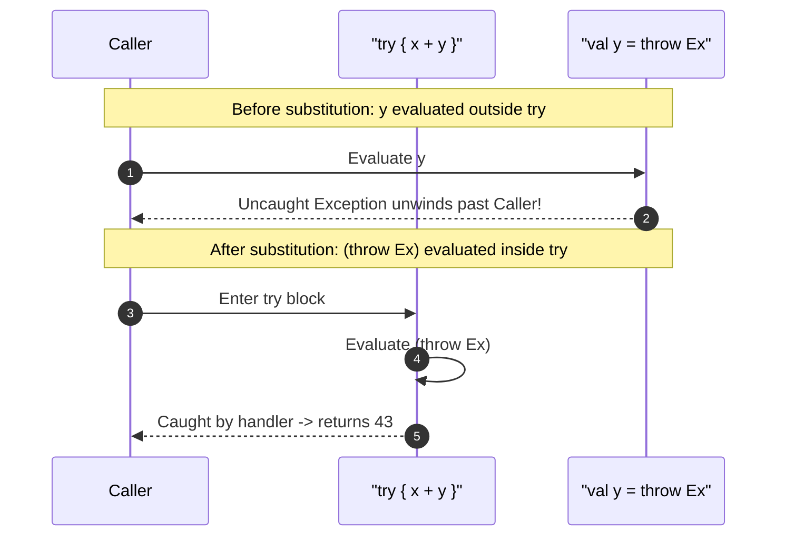
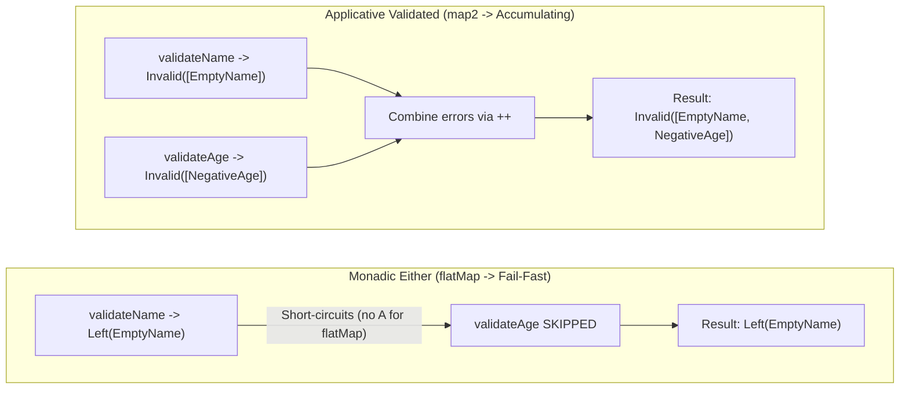

# Module 03 — Algebraic Error Handling, Totality, and Failure Composition

Programs routinely encounter missing keys, malformed inputs, division by zero, and upstream failures. Imperative languages handle these conditions either by returning sentinel values (`-1`, `null`, `NaN`) or by throwing exceptions that unwind the call stack dynamically. Both mechanisms corrode modularity: sentinels subvert type safety and silently propagate corruption, while exceptions break **referential transparency** and make expression meaning depend on dynamic call-stack context. This module formalizes total vs partial functions, proves why exceptions violate the substitution model, develops the `Option` and `Either` algebras alongside total function lifting (`lift`, `map2`, `sequence`, `traverse`), contrasts fail-fast monadic `Either` against error-accumulating `Validated`, and shows how to wrap impure exception-throwing boundaries safely.

---

## 1. Total vs Partial Functions

Recall from [Module 01](01-referential-transparency-and-lambda-calculus.md) that a mathematical function $f : A \to B$ is **total** if it assigns a well-defined value $b \in B$ to _every_ $a \in A$. A **partial function** $f : A \rightharpoonup B$ is defined only on a strict subset $D \subsetneq A$ and either throws an exception, returns `null`, or diverges on $A \setminus D$.

Consider computing the arithmetic mean of a `Seq[Double]`:

```scala
def meanPartial(xs: Seq[Double]): Double =
  if xs.isEmpty then throw ArithmeticException("mean of empty list!")
  else xs.sum / xs.length
```

The declared signature `Seq[Double] => Double` is a lie: `Nil` belongs to the domain `Seq[Double]`, yet `meanPartial(Nil)` fails to produce a `Double`. Callers receive zero static reminder from the type checker to handle the empty case, and any refactoring that assumes `meanPartial` returns a `Double` crashes at runtime.

### Why Sentinel Values and Nullability Fail

Replacing an exception with a sentinel value (`Double.NaN`, `-1`, `""`) or `null` attempts to preserve totality on paper while sacrificing correctness in practice:

| Error Mechanism | Type Signature Honesty | Nested Ambiguity | Generic Polymorphic Composition | Compiler Enforcement |
| --- | --- | --- | --- | --- |
| Unchecked Exceptions | Lies (`A => B` may throw) | N/A (unwinds stack) | Breaks RT & parallel combinators | None |
| Sentinels (`-1`, `NaN`) | Lies (`-1` looks like valid `Int`) | Indistinguishable from real domain data | Impossible for generic `A` (no universal sentinel) | None |
| Nullable (`T \| null`) | Honest only under strict null flags | `Option[Option[A]]` collapses: `(T \| null) \| null == T \| null` | Breaks generic `Map.get` when value itself can be `null` | Partial (`strictNullChecks` / `-Yexplicit-nulls`) |
| Algebraic `Option[A]` / `Either[E, A]` | **100% Honest** (`A => Option[B]`) | Preserves structure (`Some(None)` vs `None`) | Full functor/applicative/monad composition | **Exhaustive** pattern-match checking |

Notice the subtle flattening defect of union-based nullability (`T | null` in TypeScript or Scala 3 `-Yexplicit-nulls`): if a cache `Map<K, V | null>` stores explicit `null` tombstones for missing keys, then `cache.get(k)` returns `(V | null) | null`, which simplifies algebraically to `V | null`—making "key absent" indistinguishable from "key present with value `null`" without an auxiliary `has(k)` check! Algebraic `Option[Option[V]]` preserves all three states cleanly: `None` (absent), `Some(None)` (tombstone), and `Some(Some(v))` (cached value).

---

## 2. Why Exceptions Break Referential Transparency

Exceptions are often defended as "only for unexpected errors," yet their semantic defect is structural rather than stylistic: **an expression containing `throw` is not referentially transparent**.

> [!IMPORTANT]
> **Context-Dependence Proof:** An expression is referentially transparent only if its meaning does not depend on the enclosing context—it can be substituted freely anywhere without changing observable behavior. Because `throw` searches dynamically up the runtime call stack for an enclosing `try/catch` handler, its meaning changes whenever it moves across a `try` boundary.

Consider this substitution test in Scala (or its exact equivalent in TypeScript):

```scala
def failingFn(i: Int): Int =
  val y: Int = throw Exception("fail!")
  try
    val x = 42 + 5
    x + y
  catch case _: Exception => 43

// Now apply the substitution model: replace `y` with its RHS inside the try block:
def failingFnSubstituted(i: Int): Int =
  try
    val x = 42 + 5
    x + (throw Exception("fail!"))
  catch case _: Exception => 43
```

Look at the two outcomes:

- `failingFn(1)` throws `Exception("fail!")` uncaught because `y` was evaluated _before_ entering the `try` block.
- `failingFnSubstituted(1)` catches the exception inside `try/catch` and returns `43`!

Simply inlining a `val` definition changed the program's result from crashing to returning `43`. Because `throw` breaks equational substitution, compilers and engineers cannot safely inline, extract common subexpressions, memoise, or parallelize (`Par`, [Module 06](06-purely-functional-parallelism-and-laws.md)) expressions that throw.



---

## 3. The `Option` and `Either` Algebras

Instead of smuggling failure through dynamic stack unwinding, functional programming **reifies** failure into ordinary return values using closed sum types.

### `Option[+A]`: Modeling Computations That May Produce No Value

Algebraically, `Option[A]` is the pointed set $1 + A$: either `None` (no value, cardinality $1$) or `Some(get: A)` (a wrapped value of type `A`):

```scala
enum Option[+A]:
  case Some(get: A)
  case None

  def map[B](f: A => B): Option[B] = this match
    case None    => None
    case Some(a) => Some(f(a))

  def flatMap[B](f: A => Option[B]): Option[B] =
    map(f).getOrElse(None)

  def getOrElse[B >: A](default: => B): B = this match
    case None    => default
    case Some(a) => a

  def orElse[B >: A](ob: => Option[B]): Option[B] =
    map(Some(_)).getOrElse(ob)

  def filter(f: A => Boolean): Option[A] =
    flatMap(a => if f(a) then Some(a) else None)
```

Notice two critical design invariants in `getOrElse` and `orElse`:

1. **Lower type bound `[B >: A]`**: Because `Option[+A]` is covariant in `A`, a method parameter cannot have raw contravariant type `A` (otherwise passing a supertype default to `Option[Dog]` would violate variance soundness). Writing `B >: A` widens the return type cleanly to the least upper bound `B`.
2. **Non-strict by-name parameter `=> B` / `=> Option[B]`**: The fallback `default` or `ob` is evaluated **only** when `this` is `None`. Making `default` strict would eagerly trigger expensive fallback I/O or throw on the happy path!

With `Option` in hand, `mean` and `variance` become completely total and compose cleanly via `flatMap`:

```scala
def mean(xs: Seq[Double]): Option[Double] =
  if xs.isEmpty then Option.None
  else Option.Some(xs.sum / xs.length)

def variance(xs: Seq[Double]): Option[Double] =
  mean(xs).flatMap(m => mean(xs.map(x => math.pow(x - m, 2))))
```

In TypeScript, `Option<A>` uses a `readonly` discriminated union, with lazy fallback thunks `() => B` replacing Scala's `=> B`:

```typescript
export type Option<A> = { readonly kind: 'None' } | { readonly kind: 'Some'; readonly value: A };

export const none: Option<never> = { kind: 'None' };
export const some = <A>(value: A): Option<A> => ({ kind: 'Some', value });

export const map = <A, B>(oa: Option<A>, f: (a: A) => B): Option<B> =>
  oa.kind === 'None' ? none : some(f(oa.value));

export const getOrElse = <A>(oa: Option<A>, fallback: () => A): A =>
  oa.kind === 'None' ? fallback() : oa.value;

export const flatMap = <A, B>(oa: Option<A>, f: (a: A) => Option<B>): Option<B> =>
  getOrElse(map(oa, f), () => none);
```

### `Either[+E, +A]`: Typed Failure Diagnostics

`Option` captures _absence_ (`None`) without explaining _why_ an operation failed. Whenever callers must inspect, log, or recover from structured error reasons, use the coproduct $E + A$:

```scala
enum Either[+E, +A]:
  case Left(value: E)
  case Right(value: A)

  def map[B](f: A => B): Either[E, B] = this match
    case Left(e)  => Left(e)
    case Right(a) => Right(f(a))

  def flatMap[EE >: E, B](f: A => Either[EE, B]): Either[EE, B] = this match
    case Left(e)  => Left(e)
    case Right(a) => f(a)

  def orElse[EE >: E, B >: A](b: => Either[EE, B]): Either[EE, B] = this match
    case Left(_)  => b
    case Right(a) => Right(a)

  def map2[EE >: E, B, C](b: Either[EE, B])(f: (A, B) => C): Either[EE, C] =
    for
      aa <- this
      bb <- b
    yield f(aa, bb)
```

> [!NOTE]
> **Then vs Now (Scala `Either` Right-Biasing):** Prior to Scala 2.12, `scala.util.Either` was unbiased—callers had to call `.right.map(...)` or `.left.flatMap(...)` explicitly, making `for`-comprehensions awkward. Since Scala 2.12 (and throughout Scala 3), `Either` is **right-biased** by convention (`Right` = success, `Left` = failure), so `map`, `flatMap`, and `for`-comprehensions operate directly on the `Right` channel.

---

## 4. Lifting Total Functions, `map2`, `sequence`, and `traverse`

Adopting `Option` or `Either` does _not_ require rewriting existing pure domain functions (`math.abs`, `parseRate`, `calculateTax`) to know about `Option`! Instead, functorial **lifting** adapts ordinary total functions $A \to B$ into the `Option` or `Either` context:

```scala
def lift[A, B](f: A => B): Option[A] => Option[B] = _.map(f)

def map2[A, B, C](a: Option[A], b: Option[B])(f: (A, B) => C): Option[C] =
  a.flatMap(aa => b.map(bb => f(aa, bb)))
```

Wait: what if we have a `List[Option[A]]` (for instance, parsing a list of optional configuration entries) and want `Option[List[A]]`—returning `Some(allValues)` iff every entry is `Some`, or `None` if _any_ entry is `None`? That operation is `sequence`, and its single-pass generalization is `traverse`:

```scala
def sequence[A](as: List[Option[A]]): Option[List[A]] =
  traverse(as)(identity)

def traverse[A, B](as: List[A])(f: A => Option[B]): Option[List[B]] =
  as.foldRight(Option.Some(Nil): Option[List[B]]) { (a, acc) =>
    map2(f(a), acc)(_ :: _)
  }
```

Compare `traverse(as)(f)` against `sequence(as.map(f))`:

1. **Single-pass vs two-pass**: `sequence(as.map(f))` allocates an intermediate `List[Option[B]]` across the entire input even if the _first_ element produces `None`. Using a short-circuiting `traverse` (or tail-recursive loop checking `f(a)` iteratively) aborts immediately upon the first `None` and avoids allocating intermediate wrapper lists!
2. **Stack safety**: Remember from [Module 02](02-persistent-data-structures-and-structural-sharing.md) that naive `List.foldRight` overflows the stack on large lists. Production `traverse` implementations use an explicit `@tailrec` loop accumulating into a reversed `List` (and short-circuiting immediately on `None` or `Left(e)`):

```scala
import scala.annotation.tailrec

def traverseEither[E, A, B](as: List[A])(f: A => Either[E, B]): Either[E, List[B]] =
  @tailrec
  def go(rem: List[A], acc: List[B]): Either[E, List[B]] = rem match
    case Nil => Either.Right(acc.reverse)
    case h :: t =>
      f(h) match
        case Either.Left(e)  => Either.Left(e) // Short-circuit immediately in O(1) stack
        case Either.Right(b) => go(t, b :: acc)
  go(as, Nil)
```

In TypeScript, the same short-circuiting `traverseEither` executes in an $O(1)$-stack imperative loop:

```typescript
export type Either<E, A> =
  | { readonly kind: 'Left'; readonly error: E }
  | { readonly kind: 'Right'; readonly value: A };

export const left = <E>(error: E): Either<E, never> => ({ kind: 'Left', error });
export const right = <A>(value: A): Either<never, A> => ({ kind: 'Right', value });

export const traverseEither = <E, A, B>(
  items: readonly A[],
  f: (a: A) => Either<E, B>,
): Either<E, readonly B[]> => {
  const out: B[] = [];
  for (const item of items) {
    const res = f(item);
    if (res.kind === 'Left') return res;
    out.push(res.value);
  }
  return right(out);
};
```

---

## 5. Fail-Fast Monadic `Either` vs Error-Accumulating `Validated`

Suppose we are validating a user-registration payload with three independent fields: `name`, `age`, and `email`. Using `Either.flatMap` (or `Either.map2` implemented via `flatMap`), what happens if _both_ `name` and `email` are invalid?

Look at the signature of `flatMap`:

```scala
def flatMap[E, A, B](ea: Either[E, A])(f: A => Either[E, B]): Either[E, B]
```

Because `f` **requires an `A`** in order to produce the next `Either[E, B]`, when `ea` is `Left(e1)`, there is **no `A` to pass to `f`**! Monadic `flatMap` encodes _sequential data dependence_, forcing `Either` to **fail fast** on the very first `Left` and silently ignore every subsequent validation check.

For independent validations where callers need _every_ error reported simultaneously (API form validation, config linting, schema checks), drop `flatMap` and use an **applicative** error-accumulating type `Validated[+E, +A]` paired with an associative combining operation (`Semigroup[E]` or `NonEmptyList[E]`, [Module 11](11-applicative-and-traversable-functors.md)):



In Scala 3, `Validated` models independent accumulation cleanly without providing `flatMap` (preserving its distinct algebraic laws):

```scala
enum Validated[+E, +A]:
  case Valid(get: A)
  case Invalid(errors: List[E])

  def map2[EE >: E, B, C](other: Validated[EE, B])(f: (A, B) => C): Validated[EE, C] =
    (this, other) match
      case (Valid(a), Valid(b))         => Valid(f(a, b))
      case (Invalid(e1), Invalid(e2))   => Invalid(e1 ++ e2)
      case (Invalid(e), _)              => Invalid(e)
      case (_, Invalid(e))              => Invalid(e)
```

Notice the architectural rule: **use `Either` (or `flatMap`) when step 2 depends on step 1's output; use `Validated` (applicative `map2` / `mapN`) when checks are independent and all errors must accumulate.** For the full categorical unification of `Applicative`, `Semigroup`, `Validated`, and `Parallel`, see [Module 11](11-applicative-and-traversable-functors.md).

### End-to-End Example: Form & Config Validation (`Either` vs `Validated`)

Consider validating an API request containing `name: String` and `ageStr: String`:

```scala
case class Person(name: String, age: Int)

def validateName(raw: String): Validated[String, String] =
  if raw.trim.nonEmpty then Validated.Valid(raw.trim)
  else Validated.Invalid(List("Name must not be empty"))

def validateAge(raw: String): Validated[String, Int] =
  raw.toIntOption match
    case Some(n) if n >= 0 => Validated.Valid(n)
    case Some(_)           => Validated.Invalid(List("Age must be non-negative"))
    case None              => Validated.Invalid(List(s"Invalid integer: '$raw'"))

def mkPerson(name: String, age: String): Validated[String, Person] =
  validateName(name).map2(validateAge(age))(Person.apply)

// Calling mkPerson("", "-5") returns:
// Invalid(List("Name must not be empty", "Age must be non-negative"))
```

If `mkPerson` had used monadic `Either.flatMap`, calling `mkPerson("", "-5")` would have reported _only_ `"Name must not be empty"`, forcing users or CI pipelines to fix and resubmit payloads one error at a time.

In TypeScript, the exact same error-accumulating `map2Validated` pattern composes cleanly without needing exceptions:

```typescript
export type Validated<E, A> =
  | { readonly kind: 'Valid'; readonly value: A }
  | { readonly kind: 'Invalid'; readonly errors: readonly E[] };

export const valid = <A>(value: A): Validated<never, A> => ({ kind: 'Valid', value });
export const invalid = <E>(...errors: readonly E[]): Validated<E, never> => ({
  kind: 'Invalid',
  errors,
});

export const map2Validated = <E, A, B, C>(
  va: Validated<E, A>,
  vb: Validated<E, B>,
  f: (a: A, b: B) => C,
): Validated<E, C> => {
  if (va.kind === 'Valid' && vb.kind === 'Valid') return valid(f(va.value, vb.value));
  if (va.kind === 'Invalid' && vb.kind === 'Invalid') return invalid(...va.errors, ...vb.errors);
  return va.kind === 'Invalid' ? va : (vb as Validated<E, never>);
};
```

---

## 6. Wrapping Exception-Throwing Boundaries Safely

Real production systems must interoperate with legacy JVM libraries, JDBC drivers, `Integer.parseInt`, `JSON.parse`, and DOM APIs that throw exceptions. We contain those exceptions at the boundary using a non-strict adapter `Try` or `catchNonFatal`:

```scala
import scala.util.control.NonFatal

def catching[A](a: => A): Either[Throwable, A] =
  try Either.Right(a)
  catch case NonFatal(t) => Either.Left(t)
```

> [!WARNING]
> **Critical Production Guardrail (`NonFatal`):** Never write `catch { case t: Throwable => ... }`! Catching raw `Throwable` swallows fatal JVM errors (`OutOfMemoryError`, `StackOverflowError`, `VirtualMachineError`, `InterruptedException`, and Scala's internal `ControlThrowable` used by `boundary`/`break`), corrupting thread shutdown and hiding OOM crashes inside `Left(...)`. Always match `scala.util.control.NonFatal(t)`.

In TypeScript, `catch (err: unknown)` catches any thrown value (JavaScript allows `throw "string"` or `throw null`, not just `Error` instances), so boundary adapters must normalize `unknown` into a typed error domain:

```typescript
export const tryCatch = <E, A>(thunk: () => A, onThrow: (cause: unknown) => E): Either<E, A> => {
  try {
    return right(thunk());
  } catch (err: unknown) {
    return left(onThrow(err));
  }
};
```

### Then vs Now: Local Control Flow with Scala 3 `boundary` / `break`

When translating multi-step validation or imperative early-exit algorithms in Scala 3.3+, `scala.util.boundary` and `boundary.break` allow direct-style early return into an `Option` or `Either` _without_ breaking referential transparency externally:

```scala
import scala.util.boundary, boundary.break

def parseAllInts(raw: List[String]): Either[String, List[Int]] = boundary:
  val out = raw.map { s =>
    s.toIntOption match
      case Some(n) => n
      case None    => break(Either.Left(s"Invalid integer: '$s'"))
  }
  Either.Right(out)
```

Under the hood, `boundary` establishes a scoped `Label` and `break` throws a lightweight, stackless `Break` exception tagged with that exact `Label` identity. As long as the `Label` capability never escapes the `boundary` block (enforced via runtime identity or future Capture Checking), `parseAllInts` remains externally pure and referentially transparent—combining imperative early-exit ergonomics with an algebraic `Either` contract at the signature boundary.

---

## Interview Drill

### 1. Construct a minimal code snippet proving that `throw` violates referential transparency.

<details><summary>Answer</summary>

Bind `val y: Int = throw Exception("boom")` outside a `try { 1 + y } catch { case _: Exception => 42 }` block. As written, `y` evaluates eagerly before `try` is entered, so the program aborts with an uncaught exception. Substituting `y`'s definition directly into `try { 1 + (throw Exception("boom")) } catch { case _: Exception => 42 }` moves the `throw` inside the `try` scope, causing the handler to catch it and return `42`. Because substituting a `val` with its right-hand side alters program behavior, `throw` is context-dependent and not referentially transparent.
</details>

### 2. Why is `T | null` inferior to `Option[T]` in generic data structures like `Map[K, V]`?

<details><summary>Answer</summary>

Union nullability is **not closed under nesting**: `(T | null) | null` collapses to `T | null`. In a generic `Map<K, V>` where `V` itself is nullable (e.g., `Map<string, User | null>` caching negative lookups), `map.get(key)` returning `null` becomes ambiguous between "key is absent" and "key is present with value `null`". By contrast, `Option[Option[User]]` distinguishes all three cases cleanly: `None` (cache miss), `Some(None)` (cached absence), and `Some(Some(user))` (cache hit).
</details>

### 3. Why must `Option.getOrElse` and `Option.orElse` use both a lower type bound `[B >: A]` and a by-name parameter `=> B`?

<details><summary>Answer</summary>

First, `Option[+A]` is covariant in `A`. Placing raw `A` in a method parameter position (contravariant position) violates variance soundness—you could not safely call `optDog.getOrElse(cat)` where `Dog` and `Cat` share supertype `Animal`. Adding `[B >: A]` widens the return type to the common supertype `B`. Second, `default: => B` makes the fallback non-strict so it is only evaluated when the `Option` is `None`, avoiding wasted computation or unwanted exceptions on `Some(...)`.
</details>

### 4. Why does `traverse(as)(f)` outperform `sequence(as.map(f))` for `Option` and `Either`?

<details><summary>Answer</summary>

`sequence(as.map(f))` performs two traversals and allocates an intermediate `List[Option[B]]` across every element of `as` before `sequence` inspects the first element. A single-pass `traverse` evaluates `f(a)` element by element and short-circuits immediately upon encountering the first `None` or `Left(e)`, avoiding both the intermediate wrapper list allocation and unnecessary work on remaining elements.
</details>

### 5. Why can monadic `Either.flatMap` not accumulate multiple validation errors, and what algebraic abstraction solves this?

<details><summary>Answer</summary>

`Either.flatMap[E, A, B](ea)(f: A => Either[E, B])` models _sequential dependency_: the second step `f` cannot even be invoked unless the first step `ea` succeeds and yields an `A`. When `ea` is `Left(e)`, `flatMap` must short-circuit immediately. Accumulating multiple independent errors requires an **applicative** combinator (`map2` / `ap` on `Validated[E, A]`) that evaluates both branches independently and merges `Left` / `Invalid` failures via an associative `Semigroup[E]` (such as `List` or `NonEmptyList` concatenation).
</details>

### 6. Why is `catch { case t: Throwable => Left(t) }` a dangerous anti-pattern on the JVM?

<details><summary>Answer</summary>

`Throwable` is the supertype of both recoverable `Exception`s and fatal JVM errors (`OutOfMemoryError`, `StackOverflowError`, `VirtualMachineError`), thread cancellation (`InterruptedException`), and Scala's internal `ControlThrowable`. Catching raw `Throwable` traps unrecoverable runtime corruption inside a domain `Either` value, preventing clean process termination or breaking `boundary`/`break` control flow. Always guard boundary adapters with `scala.util.control.NonFatal(t)`.
</details>

### 7. Suppose `Either` is written as `enum Either[+E, +A]`. Why can `map2` return `Either[EE, C]` for `[EE >: E]` instead of forcing both sides to share the exact same error type `E`?

<details><summary>Answer</summary>

Because `Either[+E, +A]` is covariant in its error channel `+E`, an `Either[ParseError, A]` and an `Either[NetworkError, B]` can both be combined via `map2` by widening `EE >: E` to their common supertype (e.g., `AppError` or `Throwable`). Without `[EE >: E]`, combining two `Either` values with distinct error subtypes in a `for`-comprehension would fail to typecheck unless callers manually called `.left.map(...)` at every step.
</details>

### 8. How does Scala 3's `boundary`/`break` reconcile imperative early exit with referential transparency?

<details><summary>Answer</summary>

`boundary` installs a scoped `Label[T]` token on the call stack and catches only `Break` control exceptions tagged with that exact `Label` identity, returning the broken value `T` directly as the result of the `boundary` block. As long as the `Label` capability does not escape the enclosing `boundary` scope (for example, captured inside a lazily evaluated closure or returned across threads), no caller outside `boundary` can observe the internal `Break` jump—preserving external referential transparency while compiling early exit to stackless local control flow.
</details>
