# Module 04 — Strictness, Laziness, and Corecursion

In John Hughes's landmark paper _Why Functional Programming Matters_ (1989), two glue mechanisms are identified as the source of functional modularity: higher-order functions and **non-strict (lazy) evaluation**. Strict languages couple _what_ a computation produces to _when_ and _how much_ of it runs, forcing loops, termination guards, and accumulators to entangle inside monolithic functions. Separating program _description_ from _evaluation_ via thunks and memoised lazy lists lets us compose infinite producers (`fibs`, database cursors, byte streams) with finite consumers (`take`, `exists`, `find`) in single-pass pipelines without allocating intermediate collections. This module formalizes call-by-value, call-by-name, and call-by-need semantics, builds a memoised `LazyList`, diagnoses the infamous Scala 2 `Stream` head-strictness and heap-retention OOM failure modes, and establishes the categorical duality between `foldRight` (catamorphism) and `unfold` (anamorphism).

---

## 1. Formal Evaluation Strategies: CBV, CBN, and Call-by-Need

Consider a function `square(x) = x * x` applied to `1 + 2`, or a conditional `if2(cond, onTrue, onFalse)` applied to `(true, expensiveA(), expensiveB())`. An **evaluation strategy** (Plotkin, _Call-by-Name, Call-by-Value and the $\lambda$-Calculus_, 1975; Launchbury, _A Natural Semantics for Lazy Evaluation_, 1993) determines when arguments to a function application are reduced to **Weak Head Normal Form (WHNF)**—an outermost constructor or $\lambda$-abstraction whose interior need not yet be evaluated.

| Strategy | Argument Reduction Timing | Evaluation Count per Call | Divergence Behavior | Primary Example |
| --- | --- | --- | --- | --- |
| **Call-by-Value (Strict)** | Before entering function body | Always $1$ (even if unused) | Diverges if _any_ argument diverges | Default Scala parameters, TypeScript, C, Java |
| **Call-by-Name (Non-strict)** | Substituted as an unevaluated thunk `() => A`; reduced at each use site | $0$ if unused; $k$ times if used $k$ times | Terminates if diverging argument is unused | Scala by-name parameters `x: => A` |
| **Call-by-Need (Lazy)** | Substituted as a shared memoised thunk; updated in-place on first force | **$0$ if unused; at most $1$ if used $\ge 1$ times** | Same termination as Call-by-Name (modulo shared exceptions) | Haskell, Scala `lazy val` + `LazyList` |


### By-Name Parameters vs `lazy val` in Scala

In Scala, annotating a parameter with `=> A` makes it **call-by-name**, compiling at bytecode level to a zero-argument `Function0[A]` thunk passed at the call site. Without explicit caching, referencing a by-name parameter twice recomputes it twice:

```scala
def if2[A](cond: Boolean, onTrue: => A, onFalse: => A): A =
  if cond then onTrue else onFalse

// By-name evaluated TWICE:
def maybeTwice(b: Boolean, i: => Int): Int =
  if b then i + i else 0

// Call-by-need via `lazy val` evaluated AT MOST ONCE:
def maybeTwiceMemoised(b: Boolean, i: => Int): Int =
  lazy val j = i
  if b then j + j else 0
```

Calling `maybeTwice(true, { println("hi"); 42 })` prints `"hi"` **twice**, whereas `maybeTwiceMemoised(true, { println("hi"); 42 })` prints `"hi"` **once**. Under the hood on the JVM, a local `lazy val` compiles to a synthetic `volatile` bitmap flag (or synchronization guard) paired with a cached field so that concurrent or repeated reads observe the evaluated result at most once (note: in Scala 3, thread-safe `lazy val` uses a clean state machine / `VarHandle` CAS protocol without deadlocking on recursive companion initialization in simple cases, though cyclic `lazy val` dependencies can still deadlock).

---

## 2. Thunks and Memoised Lazy Lists (`LazyList`)

Using explicit thunks `() => A` for both the head and the tail gives us a completely non-strict **lazy list**:

```scala
enum LazyList[+A]:
  case Empty
  case Cons(h: () => A, t: () => LazyList[A])

object LazyList:
  def empty[A]: LazyList[A] = Empty

  // Smart constructor: memoises BOTH head and tail via `lazy val`!
  def cons[A](hd: => A, tl: => LazyList[A]): LazyList[A] =
    lazy val head = hd
    lazy val tail = tl
    Cons(() => head, () => tail)

  def apply[A](as: A*): LazyList[A] =
    if as.isEmpty then empty
    else cons(as.head, apply(as.tail*))
```

Notice why the smart constructor `LazyList.cons` is mandatory rather than calling the raw data constructor `LazyList.Cons(() => hd, () => tl)` directly:

- Raw `Cons(() => expensive(), () => rest())` creates **unmemoised** call-by-name thunks—every time two consumers inspect `headOption` or traverse the same `LazyList` variable twice, `expensive()` executes again from scratch!
- `LazyList.cons` captures `lazy val head = hd` and `lazy val tail = tl` inside the closures `() => head` and `() => tail`, turning the spine into a **call-by-need memoised graph**.

In TypeScript, there is no syntax sugar for `=> A` or `lazy val`, so we implement explicit memoised thunks directly:

```typescript
export type Thunk<A> = () => A;

export const memo = <A>(thunk: Thunk<A>): Thunk<A> => {
  let evaluated = false;
  let cache: A;
  return () => {
    if (!evaluated) {
      cache = thunk();
      evaluated = true;
    }
    return cache;
  };
};

export type LazyList<A> =
  | { readonly kind: 'Empty' }
  | { readonly kind: 'Cons'; readonly head: Thunk<A>; readonly tail: Thunk<LazyList<A>> };

export const emptyLazyList: LazyList<never> = { kind: 'Empty' };

export const consLazy = <A>(head: Thunk<A>, tail: Thunk<LazyList<A>>): LazyList<A> => ({
  kind: 'Cons',
  head: memo(head),
  tail: memo(tail),
});
```

---

## 3. Then vs Now: Scala 2 `Stream` Head-Strictness and Heap-Retention OOM

Understanding lazy lists in production requires mastering two distinct failure modes—one historical (fixed in Scala 2.13 / 3) and one perennial (still lethal in modern `LazyList` and Haskell!).

| Dimension | Then (`scala.collection.immutable.Stream`, Scala 2.0–2.12) | Now (`scala.collection.immutable.LazyList`, Scala 2.13 / 3.x) |
| --- | --- | --- |
| Head strictness | **Head was strict** (`head: A`), only `tail` was lazy | **Both head and tail are lazy** (stored in lazy state thunk) |
| `Stream.from(1).map(f).filter(p)` | Immediately evaluated `f(1)` (and kept evaluating elements eagerly until the first `p` match!) | **Zero elements evaluated** until a consumer forces `headOption` or `toList` |
| Empty check `.isEmpty` | Safe, because head was already forced | Forces evaluation of the first cell to determine `Empty` vs `Cons` |
| Status | `@deprecated("Use LazyList", "2.13.0")` | Standard library lazy sequence |

### Failure Mode 1: Scala 2 `Stream` Unexpected Evaluation & Divergence

In Scala 2, because `Stream#Cons` evaluated its head eagerly, writing:

```scala
// Scala 2 Stream anti-pattern (broken laziness):
// Stream.continually(throw RuntimeException("boom")).take(0) -> THROWS immediately!
// In Scala 3 LazyList:
val safe = LazyList.continually(throw RuntimeException("boom")).take(0).toList // Nil!
```

In Scala 2 `Stream`, even calling `.filter(_ > 10)` on an infinite stream of failing network calls immediately blocked the thread searching for the first element matching `> 10` before any consumer requested an element. Scala 3's `LazyList` defers both head and tail inside a single lazy state thunk, so constructing transformations performs $O(1)$ work.

### Failure Mode 2: Head Retention and `OutOfMemoryError` (Still Active!)

Because `LazyList` **memoises** every evaluated `Cons` node in its tail pointer, the garbage collector can reclaim consumed prefix cells **only if no GC root retains a reference to the head of the list**!

```scala
// NEGATIVE TEST / PRODUCTION OOM TRAP:
// Holding `val` at the head retains ALL 50,000,000 evaluated Cons cells on the heap!
def leakMemory(): Int =
  val huge: LazyList[Array[Byte]] = LazyList.continually(new Array[Byte](1024))
  huge.drop(50_000_000).head.length // OutOfMemoryError: Java heap space!

// SAFE: pass unaliased expression (or `def`), allowing GC to collect each forced head cell:
def streamSafely(): Int =
  def huge: LazyList[Array[Byte]] = LazyList.continually(new Array[Byte](1024))
  huge.drop(50_000_000).head.length // Constant O(1) heap!
```

Look closely at why `val huge` leaks while `def huge` (or chaining `LazyList.continually(...).drop(50_000_000).head` inline) runs in constant memory: in `leakMemory()`, the local stack slot `huge` stays live throughout the method body (unless cleared by JIT liveness analysis, which cannot help if `huge` is a class field, `object` `val` CAF, or referenced later in the method!). Every forced `Cons` cell stays reachable from `huge -> tail -> tail -> ...`, turning an $O(1)$-space stream into an $O(n)$ memory leak.

---

## 4. Separating Program Description from Evaluation

With `LazyList.cons`, we separate _describing_ transformations from _driving_ evaluation. First, inspectable consumers drive evaluation safely in $O(1)$ stack space:

```scala
import scala.annotation.tailrec

extension [A](ll: LazyList[A])
  def toList: List[A] =
    @tailrec
    def go(curr: LazyList[A], acc: List[A]): List[A] = curr match
      case LazyList.Cons(h, t) => go(t(), h() :: acc)
      case LazyList.Empty      => acc.reverse
    go(ll, Nil)

  def take(n: Int): LazyList[A] = ll match
    case LazyList.Cons(h, t) if n > 1  => LazyList.cons(h(), t().take(n - 1))
    case LazyList.Cons(h, _) if n == 1 => LazyList.cons(h(), LazyList.empty)
    case _                             => LazyList.empty

  @tailrec
  def drop(n: Int): LazyList[A] = ll match
    case LazyList.Cons(_, t) if n > 0 => t().drop(n - 1)
    case _                            => ll

  // Non-strict second parameter `=> B` allows `f` to short-circuit without evaluating tail!
  def foldRight[B](z: => B)(f: (A, => B) => B): B = ll match
    case LazyList.Cons(h, t) => f(h(), t().foldRight(z)(f))
    case LazyList.Empty      => z

  def exists(p: A => Boolean): Boolean =
    foldRight(false)((a, b) => p(a) || b)

  def forAll(p: A => Boolean): Boolean =
    foldRight(true)((a, b) => p(a) && b)

  def headOption: Option[A] =
    foldRight(None: Option[A])((h, _) => Some(h))

  def map[B](f: A => B): LazyList[B] =
    foldRight(LazyList.empty[B])((h, t) => LazyList.cons(f(h), t))

  def filter(p: A => Boolean): LazyList[A] =
    foldRight(LazyList.empty[A])((h, t) => if p(h) then LazyList.cons(h, t) else t)

  def append[B >: A](other: => LazyList[B]): LazyList[B] =
    foldRight(other)((h, t) => LazyList.cons(h, t))

  def flatMap[B](f: A => LazyList[B]): LazyList[B] =
    foldRight(LazyList.empty[B])((h, t) => f(h).append(t))
```

Look closely at `exists` and `headOption` implemented via `foldRight`:

- In `exists`, `||` is **non-strict in its second argument**. As soon as `p(a)` returns `true`, `b` (the recursive `t().foldRight(z)(f)` thunk) is **never forced**, halting traversal immediately!
- In `headOption`, the combining lambda `(h, _) => Some(h)` completely ignores its second argument `_`, forcing _only_ the very first head element (so `LazyList(1, 2, 3).map(expensive).headOption` evaluates `expensive` once, not three times!).

### Equational Trace of Fused Demand-Driven Execution

Trace `LazyList(1, 2, 3, 4).map(_ + 10).filter(_ % 2 == 0).toList` step by step:

1. `LazyList(1, 2, 3, 4).map(_ + 10)` evaluates **nothing**—it returns `Cons(() => 1 + 10, () => LazyList(2, 3, 4).map(_ + 10))`.
2. `.filter(_ % 2 == 0)` forces the first element `1 + 10 = 11`. Since `11 % 2 == 0` is `false`, `filter` immediately forces the tail `2 + 10 = 12`.
3. `12 % 2 == 0` is `true`, so `filter` yields `Cons(() => 12, () => ...)` to `toList`.
4. `toList` appends `12` to its accumulator and demands the next filtered element: `3 + 10 = 13` (skipped), `4 + 10 = 14` (emitted), `Empty`.
5. Final result: `List(12, 14)`.

Notice the crucial architectural payoff: **`map` and `filter` are completely interleaved**—not a single intermediate `LazyList` of `[11, 12, 13, 14]` was ever allocated in memory! Because each element flows through the entire chain on demand, non-strict `LazyList` achieves **single-pass deforestation** ([Module 02](02-persistent-data-structures-and-structural-sharing.md)) automatically.

---

## 5. Infinite Streams and Corecursion (`unfold` Anamorphism)

Because `LazyList.cons` does not force its tail when constructed, a stream can reference itself recursively to describe **infinite** sequences in finite space:

```scala
val ones: LazyList[Int] = LazyList.cons(1, ones)

def constant[A](a: A): LazyList[A] =
  lazy val single: LazyList[A] = LazyList.cons(a, single)
  single

def from(n: Int): LazyList[Int] =
  LazyList.cons(n, from(n + 1))

val fibs: LazyList[BigInt] =
  def go(f0: BigInt, f1: BigInt): LazyList[BigInt] =
    LazyList.cons(f0, go(f1, f0 + f1))
  go(0, 1)
```

Notice how `constant` ties the knot with `lazy val single` so it allocates **one** cyclic `Cons` cell in memory rather than allocating a fresh `Cons` cell on every recursive step!

### Duality: Catamorphism (`foldRight`) vs Anamorphism (`unfold`)

Recursive data _consumption_ and _production_ are formal mathematical duals (Meijer, Fokkinga, Paterson 1991):

| Concept | Catamorphism (`foldRight`) | Anamorphism (`unfold`) |
| --- | --- | --- |
| Direction | **Consumes** data structure into a summary value | **Produces** data structure from a seed state |
| Categorical Dual | Initial $F$-algebra ($\mu X.\, 1 + A \times X \to B$) | Terminal $F$-coalgebra ($S \to \nu X.\, 1 + A \times X$) |
| Termination Criterion | **Structural recursion**: input strictly shrinks on each step | **Productivity (guarded corecursion)**: next constructor emitted in finite steps |
| Signature | `(z: => B)(f: (A, => B) => B): B` | `unfold[A, S](z: S)(f: S => Option[(A, S)]): LazyList[A]` |

Here is `unfold` in Scala 3 and TypeScript, along with the core combinators derived directly from it:

```scala
def unfold[A, S](state: S)(f: S => Option[(A, S)]): LazyList[A] = f(state) match
  case Some((h, s)) => LazyList.cons(h, unfold(s)(f))
  case None         => LazyList.empty

val fibsUnfold: LazyList[BigInt] =
  unfold((BigInt(0), BigInt(1))) { case (f0, f1) => Some((f0, (f1, f0 + f1))) }

def fromUnfold(n: Int): LazyList[Int] =
  unfold(n)(s => Some((s, s + 1)))

extension [A](ll: LazyList[A])
  def mapViaUnfold[B](f: A => B): LazyList[B] =
    unfold(ll):
      case LazyList.Cons(h, t) => Some((f(h()), t()))
      case LazyList.Empty      => None

  def takeViaUnfold(n: Int): LazyList[A] =
    unfold((ll, n)):
      case (LazyList.Cons(h, t), rem) if rem > 0 => Some((h(), (t(), rem - 1)))
      case _                                     => None

  def zipAll[B](other: LazyList[B]): LazyList[(Option[A], Option[B])] =
    unfold((ll, other)):
      case (LazyList.Cons(h1, t1), LazyList.Cons(h2, t2)) =>
        Some(((Some(h1()), Some(h2())), (t1(), t2())))
      case (LazyList.Cons(h1, t1), LazyList.Empty) =>
        Some(((Some(h1()), None), (t1(), LazyList.empty)))
      case (LazyList.Empty, LazyList.Cons(h2, t2)) =>
        Some(((None, Some(h2())), (LazyList.empty, t2())))
      case (LazyList.Empty, LazyList.Empty) =>
        None

  def startsWith[A2 >: A](prefix: LazyList[A2]): Boolean =
    zipAll(prefix).takeWhile(_._2.isDefined).forAll {
      case (Some(h1), Some(h2)) => h1 == h2
      case _                    => false
    }

  def tails: LazyList[LazyList[A]] =
    unfold(ll) {
      case LazyList.Empty      => None
      case s @ LazyList.Cons(_, t) => Some((s, t()))
    }.append(LazyList(LazyList.empty))

  def hasSubsequence[A2 >: A](sub: LazyList[A2]): Boolean =
    tails.exists(_.startsWith(sub))
```

Notice how `hasSubsequence` showcases Hughes's modularity argument at its purest: composing three small generic functions (`tails`, `exists`, and `startsWith`) expresses subsequence search in a single declarative line, yet executes lazily—stopping the moment a match is found and inspecting no further tails or elements without writing a single nested loop!

In TypeScript, `unfoldLazy`, `takeLazy`, and `mapLazy` combine with the same demand-driven execution:

```typescript
export const mapLazy = <A, B>(ll: LazyList<A>, f: (a: A) => B): LazyList<B> =>
  unfoldLazy(ll, (cur) =>
    cur.kind === 'Empty' ? { kind: 'None' } : { kind: 'Some', value: [f(cur.head()), cur.tail()] },
  );

export const takeLazy = <A>(ll: LazyList<A>, n: number): LazyList<A> =>
  unfoldLazy([ll, n] as const, ([cur, rem]) =>
    cur.kind === 'Cons' && rem > 0
      ? { kind: 'Some', value: [cur.head(), [cur.tail(), rem - 1]] }
      : { kind: 'None' },
  );

export const toArrayLazy = <A>(ll: LazyList<A>): readonly A[] => {
  const out: A[] = [];
  let cur = ll;
  while (cur.kind === 'Cons') {
    out.push(cur.head());
    cur = cur.tail();
  }
  return out;
};
```

In TypeScript, `unfold` pairs naturally with both `LazyList<A>` and standard JavaScript ES generators (`Iterable<A>`):

```typescript
import type { Option } from './option.ts';

export const unfoldLazy = <A, S>(state: S, f: (s: S) => Option<readonly [A, S]>): LazyList<A> => {
  const step = f(state);
  if (step.kind === 'None') return emptyLazyList;
  const [a, nextState] = step.value;
  return consLazy(
    () => a,
    () => unfoldLazy(nextState, f),
  );
};
```

### The $O(n^2)$ `scanRight` Trap

Consider implementing `tails` (all suffixes of a stream) and `scanRight` (running right-to-left suffix reductions, e.g., `LazyList(1, 2, 3).scanRight(0)(_ + _).toList == List(6, 5, 3, 0)`):

- `tails` via `unfold` produces each suffix in $O(1)$ per step (sharing the underlying `LazyList` tail).
- However, writing `scanRight` naively as `tails.map(_.foldRight(z)(f))` recomputes `foldRight` from scratch for every suffix, taking **$\Theta(n^2)$** time!
- Implementing `scanRight` directly via a single `foldRight` that carries `(accValue, accStream)` shares previously computed suffix totals in **$O(n)$**:

```scala
def scanRight[B](z: => B)(f: (A, => B) => B): LazyList[B] =
  foldRight((z, LazyList(z))) { (a, p0) =>
    lazy val p1 = p0 // Memoise pair so `p1._1` and `p1._2` do not evaluate `p0` twice!
    val b2 = f(a, p1._1)
    (b2, LazyList.cons(b2, p1._2))
  }._2
```

Notice the `lazy val p1 = p0` inside `scanRight`: without it, accessing both `p0._1` and `p0._2` in a non-strict `foldRight` would re-evaluate `p0` twice per element, turning $O(n)$ into $O(2^n)$ exponential blowup!



_Step-by-step mechanics:_ (1) `unfold` acts as a demand-driven anamorphism whose `Cons` tail thunk computes only when downstream `mapViaUnfold`/`takeViaUnfold` pulls the next element, fusing stages in $O(1)$ intermediate space. (2) Paired with pure `RNG` state transitions $S \to (A, S)$ ([Module 05](05-purely-functional-state-and-combinators.md)), rejection sampling discards the incomplete modulo bucket to yield uniform random streams.

---

## 6. Stream Fusion vs Per-Element Thunk Overhead

While `LazyList` eliminates intermediate _collections_ (achieving deforestation across `map`/`filter`/`take`), it still allocates one heap `Cons` object and two closure thunks per emitted element, plus synchronization overhead inside `lazy val` on the JVM. For high-throughput I/O and numeric pipelines:

1. **Coutts-Leshchinskiy-Stewart Stream Fusion** (2007) replaces recursive `Cons` thunks with a non-recursive state machine `Step[S, A] = Yield(a, s) | Skip(s) | Done`, allowing optimizing compilers (GHC, Scala 3 inline/macros) to compile `map`/`filter` loops into unboxed register loops with **zero heap allocation**.
2. **Chunked Pull Streams** (such as FS2 `Stream[F, O]` covered in [Module 12](12-effects-io-trampolining-st-and-streaming.md)) amortize effect and thunk overhead across contiguous `Chunk[A]` arrays (typically 1,024–4,096 elements per pull step) while preserving constant-memory streaming and interruption safety.

---

## Interview Drill

### 1. Explain the exact difference between call-by-name (`=> A`) and call-by-need (`lazy val`), and give a case where confusing them causes a bug.

<details><summary>Answer</summary>

Call-by-name substitutes an unevaluated thunk `() => A` at every reference site, so an expression evaluates $0$ times if unused and $k$ times if referenced $k$ times. Call-by-need combines call-by-name with memoisation: the first evaluation caches the result inside the thunk so subsequent reads return the cached value in $O(1)$ without re-executing. Confusing them inside `LazyList.Cons(() => hd, () => tl)` (without `lazy val` in a smart constructor) or inside `scanRight` (evaluating `p0._1` and `p0._2` separately) triggers redundant exponential recomputation or repeated side effects/allocations on every traversal.
</details>

### 2. What was the Scala 2 `Stream` head-strictness flaw, and how did Scala 2.13 / 3 `LazyList` fix it?

<details><summary>Answer</summary>

Scala 2's `scala.collection.immutable.Stream` evaluated its `head` eagerly while keeping only `tail` lazy. Consequently, operations like `Stream.continually(throw Ex).take(0)` or `.filter(p)` immediately forced the head (or forced elements up to the first `p` match) at construction time, causing unexpected exceptions, blocking I/O, or infinite loops before any consumer requested an element. Scala 2.13 and Scala 3 replaced `Stream` with `LazyList`, where both `head` and `tail` live inside a deferred state thunk so nothing evaluates until a consumer explicitly inspects the list.
</details>

### 3. Why does retaining a `val` reference to the head of a `LazyList` cause `OutOfMemoryError` on `drop(50_000_000)`?

<details><summary>Answer</summary>

Because `LazyList` memoises evaluated `Cons` nodes inside each cell's `tail` reference. If a `val` in scope (or a singleton `object` CAF) remains reachable at the head of the list while `drop` advances 50 million steps, every single forced `Cons` cell stays transitively reachable from that head pointer. The garbage collector cannot reclaim already-consumed prefix cells, accumulating $O(n)$ memory until the JVM crashes with `OutOfMemoryError`. Avoiding head-retention aliases (`def` or inline unaliased pipelines) lets GC collect each consumed node immediately.
</details>

### 4. Why does `LazyList.foldRight` require its combining function parameter to be `(A, => B) => B`, and how does that enable `exists` to terminate on infinite streams?

<details><summary>Answer</summary>

If the second parameter of `f` were strict `(A, B) => B`, every call to `foldRight` would force `t().foldRight(z)(f)` before entering `f`, traversing the entire spine and diverging on infinite streams. Making `b: => B` non-strict passes the recursive tail fold as an unevaluated thunk. In `exists(p)`, `f` evaluates `p(a) || b`: because `||` is short-circuiting, as soon as `p(a)` returns `true`, `b` is never forced and `foldRight` returns `true` immediately.
</details>

### 5. Compare `foldRight` (catamorphism) and `unfold` (anamorphism) in terms of algebraic duality and termination guarantees.

<details><summary>Answer</summary>

A catamorphism (`foldRight`) _consumes_ an inductive data type ($\mu F$) bottom-up via an $F$-algebra $F(B) \to B$, and is guaranteed to terminate when every recursive call operates on a strictly smaller substructure (structural recursion). An anamorphism (`unfold`) _produces_ a coinductive data type ($\nu F$) top-down from a seed $S$ via an $F$-coalgebra $S \to 1 + A \times S$. Because coinductive streams can be infinite, `unfold` does not require input size to shrink; instead it is governed by **productivity** (guarded corecursion): every step must produce the next `Cons` constructor or `Empty` in finite time.
</details>

### 6. When `LazyList(1, 2, 3, 4).map(_ + 10).filter(_ % 2 == 0).take(1).toList` runs, how many elements are mapped and filtered, and how many intermediate lists are allocated?

<details><summary>Answer</summary>

**Zero** intermediate lists are allocated on the heap, and only **2 elements** (`1` and `2`) are mapped and filtered! `toList` demands one element from `take(1)`, which pulls from `filter`, which pulls `1` from `map` ($1 + 10 = 11$, fails `% 2 == 0`), then pulls `2` from `map` ($2 + 10 = 12$, passes `% 2 == 0`). `take(1)` emits `12` and terminates immediately with `Empty`, never touching `3` or `4`.
</details>

### 7. Why is `scanRight` implemented via `tails.map(_.foldRight(z)(f))` asymptotically inferior to a direct `foldRight` implementation?

<details><summary>Answer</summary>

Mapping `foldRight` over each suffix returned by `tails` independently traverses every suffix from scratch, performing $n + (n - 1) + \dots + 1 = \Theta(n^2)$ steps on a stream of length $n$. By contrast, a single `foldRight` carrying the memoised pair `(headValue, tailResultStream)` reuses the previously computed suffix reduction in $O(1)$ per element, achieving $O(n)$ total time.
</details>

### 8. How can `hasSubsequence` implemented via `tails.exists(_.startsWith(sub))` run without allocating $O(n^2)$ sublists or evaluating the entire input stream?

<details><summary>Answer</summary>

Because `tails`, `exists`, and `startsWith` are all demand-driven over `LazyList`: `tails` constructs each suffix lazily on demand by sharing the existing `tail` thunk in $O(1)$, `startsWith` short-circuits via `forAll` on the very first mismatched element, and `exists` terminates the entire search the moment `startsWith(sub)` returns `true`—never even forcing the remaining suffix thunks beyond the match point.
</details>
