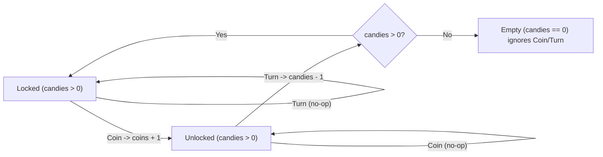

# Module 05 — Purely Functional State, Combinators, and Finite State Machines

Stateful APIs—pseudorandom number generators, protocol parsers, caches, and finite state machines—appear inherently tied to mutable fields because each call returns a result _and_ advances internal state for the next caller. Yet mutating a hidden `seed` or `status` variable destroys **referential transparency**, breaks deterministic test replay, and introduces race conditions under concurrency. The functional solution models state transitions explicitly as pure functions $S \to (A, S)$ that accept an immutable state $S$ and return both a computed value $A$ and the _next_ immutable state $S$. By lifting these transitions into a composable `State[S, A]` algebra, we recover imperative sequencing ergonomics via `for`-comprehensions without sacrificing purity.

---

## 1. Referentially Transparent State Transitions $S \to (A, S)$

Consider standard imperative random number generation (`val rng = scala.util.Random(); rng.nextInt()` or JavaScript `Math.random()`). Every invocation of `rng.nextInt()` mutates an internal `AtomicLong` seed in place. Calling `rng.nextInt()` twice yields two different numbers, violating referential transparency ([Module 01](01-referential-transparency-and-lambda-calculus.md)): you cannot substitute `val x = rng.nextInt()` into `(x, x)` without changing `(42, 42)` into `(42, -19384)`. Reproducing a flaky test failure becomes impossible unless the exact interleaving of calls across threads is captured.

To restore referential transparency, **separate state computation from state mutation** by making the state update explicit in the return type:

$$\text{StateAction}[S, A] \equiv S \to (A, S)$$

Given an initial state $s_0$, invoking `next(s_0)` always returns the exact same pair `(a, s_1)` regardless of how many times or on how many threads `next(s_0)` is evaluated.

---

## 2. Pure Linear Congruential Generator (`RNG`)

A **Linear Congruential Generator (LCG)** advances a 48-bit integer seed $X_n$ via the modular recurrence (Knuth, _TAOCP Vol. 2_; used in `java.util.Random`):

$$X_{n+1} = (a X_n + c) \bmod 2^{48}, \qquad a = \text{0x5DEECE66DL}, \quad c = \text{0xBL}$$

Because the low-order bits of a power-of-two modulus LCG exhibit short periods, only the upper 32 bits are extracted via an unsigned right shift (`>>> 16`):

```scala
trait RNG:
  def nextInt: (Int, RNG)

case class SimpleRNG(seed: Long) extends RNG:
  def nextInt: (Int, RNG) =
    val newSeed = (seed * 0x5DEECE66DL + 0xBL) & 0xFFFFFFFFFFFFL
    val nextRNG = SimpleRNG(newSeed)
    val n = (newSeed >>> 16).toInt
    (n, nextRNG)
```

In TypeScript, JavaScript `number` is an IEEE-754 64-bit float with only 53 bits of exact integer mantissa—multiplying a 48-bit seed by `0x5DEECE66D` (35 bits) overflows 53 bits and silently corrupts the low bits! Production TypeScript LCGs must use `BigInt` for exact 48-bit modular arithmetic:

```typescript
export interface RNG {
  nextInt(): readonly [number, RNG];
}

export class SimpleRNG implements RNG {
  private static readonly MULTIPLIER = 0x5deece66dn;
  private static readonly INCREMENT = 0xbn;
  private static readonly MASK = (1n << 48n) - 1n;

  constructor(private readonly seed: bigint) {}

  nextInt(): readonly [number, RNG] {
    const newSeed = (this.seed * SimpleRNG.MULTIPLIER + SimpleRNG.INCREMENT) & SimpleRNG.MASK;
    const nextRng = new SimpleRNG(newSeed);
    // Unsigned 32-bit shift right by 16, then interpret as signed 32-bit int
    const n = Number(BigInt.asIntN(32, newSeed >> 16n));
    return [n, nextRng];
  }
}
```

### Boundary Traps: `Int.MinValue` and Modulo Bias

Implementing derived generators exposes two classic numerical defects:

1. **Two's-Complement `Int.MinValue` Trap**: Calling `math.abs(n)` when `n == Int.MinValue` (`-2147483648`) silently returns `-2147483648` because `+2147483648` cannot fit in a signed 32-bit `Int`! To produce a uniformly distributed non-negative integer in $[0, \text{Int.MaxValue}]$, map negative values via `-(i + 1)` (sending `-2147483648` to `2147483647` and `-1` to `0`):

```scala
def nonNegativeInt(rng: RNG): (Int, RNG) =
  val (i, r) = rng.nextInt
  (if i < 0 then -(i + 1) else i, r)

def double(rng: RNG): (Double, RNG) =
  val (i, r) = nonNegativeInt(rng)
  (i / (Int.MaxValue.toDouble + 1), r) // Strictly in [0.0, 1.0)

def intDouble(rng: RNG): ((Int, Double), RNG) =
  val (i, r1) = rng.nextInt
  val (d, r2) = double(r1)
  ((i, d), r2)

def doubleInt(rng: RNG): ((Double, Int), RNG) =
  val ((i, d), r) = intDouble(rng)
  ((d, i), r)

def ints(count: Int)(rng: RNG): (List[Int], RNG) =
  @scala.annotation.tailrec
  def go(rem: Int, r: RNG, acc: List[Int]): (List[Int], RNG) =
    if rem <= 0 then (acc.reverse, r)
    else
      val (x, r2) = r.nextInt
      go(rem - 1, r2, x :: acc)
  go(count, rng, Nil)
```

2. **Modulo Bias in `nonNegativeLessThan(n)`**: Computing `i % n` directly skews probability toward smaller remainders whenever $n$ does not evenly divide $2^{31}$ (`Int.MaxValue + 1`). If $2^{31} = q \cdot n + r$ with remainder $r > 0$, values in $[0, r)$ occur $q + 1$ times while values in $[r, n)$ occur only $q$ times. Using **rejection sampling**, we discard values falling into the incomplete top bucket whenever `i + (n - 1) - mod < 0` (32-bit overflow past `Int.MaxValue`):

```scala
import scala.annotation.tailrec

@tailrec
def nonNegativeLessThan(n: Int)(rng: RNG): (Int, RNG) =
  val (i, rng2) = nonNegativeInt(rng)
  val mod = i % n
  if i + (n - 1) - mod >= 0 then (mod, rng2)
  else nonNegativeLessThan(n)(rng2)
```

---

## 3. State Action Combinators: `unit`, `map`, `map2`, `flatMap`, `sequence`

Threading `rng1`, `rng2`, `rng3` manually across compound generators is both tedious and bug-prone—passing `rng1` twice by mistake (`val (a, rng2) = rng1.nextInt; val (b, rng3) = rng1.nextInt`) silently yields identical numbers without any compiler warning!

Instead, treat a state action itself as a first-class value of type `type Rand[+A] = RNG => (A, RNG)` and build a combinator algebra that wires `RNG` values invisibly underneath:

```scala
type Rand[+A] = RNG => (A, RNG)

val int: Rand[Int] = _.nextInt

def unit[A](a: A): Rand[A] = rng => (a, rng)

def map[A, B](s: Rand[A])(f: A => B): Rand[B] =
  rng =>
    val (a, rng2) = s(rng)
    (f(a), rng2)

def map2[A, B, C](ra: Rand[A], rb: Rand[B])(f: (A, B) => C): Rand[C] =
  rng =>
    val (a, r1) = ra(rng)
    val (b, r2) = rb(r1)
    (f(a, b), r2)

def both[A, B](ra: Rand[A], rb: Rand[B]): Rand[(A, B)] =
  map2(ra, rb)((_, _))

def sequence[A](rs: List[Rand[A]]): Rand[List[A]] =
  rs.foldRight(unit(List.empty[A]))((r, acc) => map2(r, acc)(_ :: _))

def flatMap[A, B](r: Rand[A])(f: A => Rand[B]): Rand[B] =
  rng =>
    val (a, r1) = r(rng)
    f(a)(r1)
```

Notice two architectural properties of this combinator suite:

- **`flatMap` is strictly more expressive than `map` and `map2`**: With `flatMap` and `unit`, both `map` and `map2` become derived combinators (`map(s)(f) = flatMap(s)(a => unit(f(a)))` and `map2(ra, rb)(f) = flatMap(ra)(a => map(rb)(b => f(a, b)))`), while `flatMap` unlocks _data-dependent_ state actions such as `nonNegativeLessThan(n)` where rejection retry depends on the sampled value `i`:

```scala
def nonNegativeLessThanFlatMap(n: Int): Rand[Int] =
  flatMap(nonNegativeInt) { i =>
    val mod = i % n
    if i + (n - 1) - mod >= 0 then unit(mod)
    else nonNegativeLessThanFlatMap(n)
  }
```

- **Stack safety in `sequence`**: Notice `rs.foldRight(...)` in `sequence` builds a closure chain whose execution on $n > 10{,}000$ actions can overflow the call stack (just like `List.foldRight` in [Module 02](02-persistent-data-structures-and-structural-sharing.md)). A production `sequence` uses an iterative `@tailrec` loop over `rs` passing the evolving `rng` forward and reversing the accumulated list at the end.

---

## 4. Generalizing to `State[S, +A]` and `get` / `set` / `modify`

Nothing in `unit`, `map`, `map2`, `flatMap`, or `sequence` depends on the state type being `RNG`! Abstracting over an arbitrary state type `S` yields the general **`State` monad**:

```scala
opaque type State[S, +A] = S => (A, S)

object State:
  def apply[S, A](f: S => (A, S)): State[S, A] = f

  def unit[S, A](a: A): State[S, A] = s => (a, s)

  def get[S]: State[S, S] = s => (s, s)

  def set[S](s: S): State[S, Unit] = _ => ((), s)

  def modify[S](f: S => S): State[S, Unit] =
    for
      s <- get
      _ <- set(f(s))
    yield ()

  def sequence[S, A](actions: List[State[S, A]]): State[S, List[A]] =
    s0 =>
      val (rev, sn) = actions.foldLeft((List.empty[A], s0)) { case ((acc, s), act) =>
        val (a, sNext) = act(s)
        (a :: acc, sNext)
      }
      (rev.reverse, sn)

  extension [S, A](underlying: State[S, A])
    def run(s: S): (A, S) = underlying(s)

    def map[B](f: A => B): State[S, B] =
      s =>
        val (a, s1) = underlying(s)
        (f(a), s1)

    def flatMap[B](f: A => State[S, B]): State[S, B] =
      s =>
        val (a, s1) = underlying(s)
        f(a)(s1)

    def map2[B, C](sb: State[S, B])(f: (A, B) => C): State[S, C] =
      flatMap(a => sb.map(b => f(a, b)))
```

> [!NOTE]
> **Then vs Now (`case class State` vs Scala 3 `opaque type State`):** In Scala 2, `State` had to be wrapped in `final case class State[S, +A](run: S => (A, S))` to avoid type inference ambiguities with raw `Function1`, allocating an extra heap wrapper object on _every_ `map`/`flatMap` step. Scala 3's `opaque type State[S, +A] = S => (A, S)` exposes a distinct nominal type to the type checker at compile time while erasing completely to a bare `Function1` at JVM runtime—eliminating the wrapper allocation overhead.

In TypeScript, `State<S, A>` is typed cleanly as a structural function type with helper combinators:

```typescript
export type State<S, A> = (s: S) => readonly [A, S];

export const unitState =
  <S, A>(a: A): State<S, A> =>
  (s) => [a, s];

export const getState =
  <S>(): State<S, S> =>
  (s) => [s, s];

export const setState =
  <S>(next: S): State<S, void> =>
  () => [undefined, next];

export const modifyState =
  <S>(f: (s: S) => S): State<S, void> =>
  (s) => [undefined, f(s)];

export const flatMapState =
  <S, A, B>(sa: State<S, A>, f: (a: A) => State<S, B>): State<S, B> =>
  (s) => {
    const [a, s1] = sa(s);
    return f(a)(s1);
  };

export const mapState =
  <S, A, B>(sa: State<S, A>, f: (a: A) => B): State<S, B> =>
  (s) => {
    const [a, s1] = sa(s);
    return [f(a), s1];
  };
```

---

## 5. Purely Functional Imperative Programming (`for`-Comprehension Desugaring)

Once `State[S, A]` provides `map` and `flatMap`, Scala's `for`-comprehension syntax recovers readable, sequential step-by-step code that looks imperative while remaining 100% referentially transparent:

```scala
val ns: State[RNG, List[Int]] =
  for
    x  <- State(nonNegativeLessThan(100))
    y  <- State(nonNegativeInt)
    xs <- State.sequence(List.fill(x % 5)(State(int)))
  yield xs.map(_ % (y.abs + 1))
```

At compile time, `scalac` performs pure syntactic **desugaring**—every `<-` arrow becomes a `flatMap` call except the last generator before `yield`, which becomes `map`:

```scala
val nsDesugared: State[RNG, List[Int]] =
  State(nonNegativeLessThan(100)).flatMap { x =>
    State(nonNegativeInt).flatMap { y =>
      State.sequence(List.fill(x % 5)(State(int))).map { xs =>
        xs.map(_ % (y.abs + 1))
      }
    }
  }
```

Notice what `ns` actually _is_: it is **not** a mutated random state or an executed sequence of numbers. It is an immutable _program description_ `RNG => (List[Int], RNG)` that threads the state linearly under the hood only when `.run(initialSeed)` is invoked at the boundary.

---

## 6. Finite State Machines (Mealy Machines and Production Protocols)

A deterministic **Mealy finite state machine** is a 6-tuple $(S, \Sigma, \Lambda, \delta, \omega, s_0)$ where $S$ is a finite state space, $\Sigma$ is the input alphabet, $\Lambda$ is the output alphabet, $\delta : S \times \Sigma \to S$ is the transition function, $\omega : S \times \Sigma \to \Lambda$ is the output function, and $s_0 \in S$ is the initial state. Combining $(\delta, \omega)$ produces a function $\Sigma \to (S \to (\Lambda, S))$, which is literally `Input => State[S, Output]`!

### Canonical Example: Coin-Operated Candy Dispenser

Model a vending machine with state `Machine(locked: Boolean, candies: Int, coins: Int)` and inputs `Coin` | `Turn` governed by four rules:

1. Inserting a `Coin` into a `Locked` machine with `candies > 0` unlocks it (`locked = false`, `coins + 1`).
2. Turning the knob (`Turn`) on an `Unlocked` machine dispenses 1 candy and locks it (`locked = true`, `candies - 1`).
3. Turning a `Locked` machine or inserting a `Coin` into an `Unlocked` machine does nothing.
4. A machine with `candies == 0` ignores all inputs.



Implementing the transition function cleanly via `State.modify` and `State.get`:

```scala
enum Input:
  case Coin, Turn

case class Machine(locked: Boolean, candies: Int, coins: Int)

object CandyDispenser:
  private def step(input: Input)(m: Machine): Machine = (input, m) match
    case (_, Machine(_, 0, _))        => m
    case (Input.Coin, Machine(false, _, _)) => m
    case (Input.Turn, Machine(true, _, _))  => m
    case (Input.Coin, Machine(true, c, coins))  => Machine(locked = false, c, coins + 1)
    case (Input.Turn, Machine(false, c, coins)) => Machine(locked = true, c - 1, coins)

  def simulateMachine(inputs: List[Input]): State[Machine, (Int, Int)] =
    for
      _ <- State.sequence(inputs.map(in => State.modify[Machine](step(in))))
      s <- State.get
    yield (s.coins, s.candies)
```

Notice the engineering benefit for **production protocol FSMs** (TCP connection state machines, rate-limiter token buckets, Saga orchestrators): because `simulateMachine` is a pure function `List[Input] => State[Machine, (Int, Int)]`, every transition sequence can be property-tested (`fast-check` / ScalaCheck) across thousands of arbitrary input permutations with zero mocking, deterministic replay, and formal invariant verification (`candies >= 0` and `coins >= initialCoins`).

### Production Pattern: Deterministic Circuit Breaker State Machine

The exact same `State[S, A]` pattern governs distributed resilience components such as a **Circuit Breaker** (`Closed` -> `Open` -> `HalfOpen`). Rather than scattering `AtomicReference` mutations and `System.nanoTime()` calls inside an HTTP client, pass `(nowMs: Long, outcome: RequestOutcome)` as pure inputs into a transition function:

```scala
enum CircuitMode:
  case Closed(consecutiveFailures: Int)
  case Open(openedAtMs: Long)
  case HalfOpen

enum Decision:
  case AllowRequest, RejectFast

case class BreakerConfig(failureThreshold: Int, resetTimeoutMs: Long)

def circuitStep(cfg: BreakerConfig, nowMs: Long, failed: Option[Boolean]): State[CircuitMode, Decision] =
  State { mode =>
    (mode, failed) match
      case (CircuitMode.Open(at), _) if nowMs - at < cfg.resetTimeoutMs =>
        (Decision.RejectFast, mode)
      case (CircuitMode.Open(_), _) =>
        (Decision.AllowRequest, CircuitMode.HalfOpen)
      case (CircuitMode.HalfOpen, Some(true)) =>
        (Decision.AllowRequest, CircuitMode.Open(nowMs))
      case (CircuitMode.HalfOpen, Some(false)) =>
        (Decision.AllowRequest, CircuitMode.Closed(0))
      case (CircuitMode.Closed(n), Some(true)) if n + 1 >= cfg.failureThreshold =>
        (Decision.AllowRequest, CircuitMode.Open(nowMs))
      case (CircuitMode.Closed(n), Some(true)) =>
        (Decision.AllowRequest, CircuitMode.Closed(n + 1))
      case (CircuitMode.Closed(_), Some(false)) =>
        (Decision.AllowRequest, CircuitMode.Closed(0))
      case (_, None) =>
        (Decision.AllowRequest, mode)
  }
```

By modelling time (`nowMs`) and outcomes purely as inputs to `State[CircuitMode, Decision]`, a test suite can simulate multi-hour outage recovery timelines in microseconds with 100% deterministic reproducibility.

### TypeScript Candy Dispenser FSM

In TypeScript, the candy dispenser FSM mirrors the Scala algebra cleanly via `modifyState` and `getState`:

```typescript
export type Input = 'Coin' | 'Turn';
export interface Machine {
  readonly locked: boolean;
  readonly candies: number;
  readonly coins: number;
}

const stepMachine =
  (input: Input) =>
  (m: Machine): Machine => {
    if (m.candies <= 0) return m;
    if (input === 'Coin' && m.locked) return { ...m, locked: false, coins: m.coins + 1 };
    if (input === 'Turn' && !m.locked) return { ...m, locked: true, candies: m.candies - 1 };
    return m;
  };

export const simulateMachine =
  (inputs: readonly Input[]): State<Machine, readonly [number, number]> =>
  (initial) => {
    let current = initial;
    for (const input of inputs) {
      current = stepMachine(input)(current);
    }
    return [[current.coins, current.candies], current];
  };
```

### Production Warning: Stack Overflow on Deep `State.flatMap` Chains

Observe an operational limit of encoding `State[S, A]` directly as a raw function `S => (A, S)` without heap reification: chaining $100{,}000$ sequential `flatMap` steps (for example, `inputs.foldLeft(State.unit[Machine, Unit](()))((acc, in) => acc.flatMap(_ => State.modify(step(in))))`) builds a $100{,}000$-deep nested closure call chain! Evaluating `.run(s0)` pushes one stack frame per `flatMap` layer on both the JVM and V8, throwing `StackOverflowError` / `RangeError`.

Production FP libraries (`cats.data.State`, which is defined as `IndexedStateT[Eval, S, S, A]`) solve this by wrapping state transitions inside a **trampolined `Eval` / `TailRec`** monad ([Module 12](12-effects-io-trampolining-st-and-streaming.md)), trading a small per-step heap allocation for guaranteed $O(1)$ stack execution across millions of transitions.

---

## Interview Drill

### 1. Why does `math.abs(rng.nextInt)` fail to guarantee a non-negative `Int` on a 32-bit signed integer RNG?

<details><summary>Answer</summary>

In 32-bit two's-complement arithmetic, the range of `Int` is $[-2^{31}, 2^{31} - 1]$ (`-2147483648` to `2147483647`), which is asymmetric around zero. Negating `Int.MinValue` (`-(-2147483648)`) overflows and wraps back to `Int.MinValue`, so `math.abs(Int.MinValue)` returns `-2147483648`. Mapping negative integers via `-(i + 1)` safely sends `-2147483648` to `2147483647` and `-1` to `0`, preserving uniformity over $[0, 2^{31} - 1]$.
</details>

### 2. Why does `i % n` introduce modulo bias in random integer generation, and how does rejection sampling eliminate it?

<details><summary>Answer</summary>

When $n$ does not divide the generator's range size $2^{31}$, $2^{31} = q \cdot n + r$ with $0 < r < n$. Values in $[0, r)$ appear $q + 1$ times across the generator period whereas values in $[r, n)$ appear only $q$ times, biasing small remainders (severe when $n$ is large, e.g. $n = 2^{30} + 1$ gives $2\times$ bias on $[0, 2^{30} - 1)$). Rejection sampling detects whether the sampled `i` falls into the final incomplete multiple of `n` (`i + (n - 1) - (i % n) < 0` via signed 32-bit overflow past `Int.MaxValue`) and re-samples from the next `RNG` state until an unbiased bucket is drawn.
</details>

### 3. Why is `flatMap` strictly more powerful than `map2` for `State[S, A]`?

<details><summary>Answer</summary>

`map2(ra, rb)(f)` combines two _statically predetermined_ state actions `ra` and `rb` sequentially—the choice of `rb` cannot depend on the runtime value `a` produced by `ra`. By contrast, `flatMap(ra)(a => f(a))` lets the second state action be dynamically constructed from `a`, which is strictly required for conditional branching, loops, and rejection sampling (such as `nonNegativeLessThan`, which must decide whether to retry based on the drawn integer). Furthermore, both `map` and `map2` can be implemented from `flatMap` + `unit`, whereas `flatMap` cannot be implemented from `map2` + `unit`.
</details>

### 4. How does Scala 3 `opaque type State[S, +A] = S => (A, S)` improve upon Scala 2's `case class State`?

<details><summary>Answer</summary>

In Scala 2, wrapping `S => (A, S)` in `case class State[S, +A](run: S => (A, S))` was required to attach combinator methods and guide type inference, at the cost of allocating an extra heap `State` wrapper object alongside the `Function1` closure on every step. Scala 3's `opaque type` keeps `State[S, +A]` distinct from raw functions at compile time (enabling clean extension methods and type-class instances) while erasing completely to `S => (A, S)` in JVM bytecode, eliminating the wrapper allocation.
</details>

### 5. What does a Scala `for`-comprehension over `State` actually desugar to, and does `simulateMachine` execute transitions when constructed?

<details><summary>Answer</summary>

A `for`-comprehension `for a <- sa; b <- sb yield f(a, b)` desugars syntactically into `sa.flatMap(a => sb.map(b => f(a, b)))`. Constructing `simulateMachine(inputs)` builds an immutable function `Machine => ((Int, Int), Machine)` without executing any transitions at all. Transitions run purely when `.run(initialMachine)` is called with a concrete starting `Machine`.
</details>

### 6. Why does chaining 100,000 `State.flatMap` calls overflow the JVM or V8 call stack, and how do production FP libraries prevent this?

<details><summary>Answer</summary>

In the naive representation `S => (A, S)`, `sa.flatMap(f)` returns a closure `s => { val (a, s1) = sa(s); f(a)(s1) }`. Left-nesting or right-nesting 100,000 `flatMap` steps produces a chain of 100,000 closure invocations on the thread call stack because `sa(s)` is non-tail (in left-nested chains) and `f(a)(s1)` goes through `Function1.apply` (`invokeinterface`), which the JVM and V8 do not tail-call optimize. Production libraries such as Cats (`cats.data.State` backed by `Eval`) trampoline `flatMap` steps onto an explicit heap data structure (`FlatMap`), executing arbitrarily deep chains in $O(1)$ stack space.
</details>

### 7. Why is TypeScript's `number` unsafe for implementing a 48-bit Java-style LCG `SimpleRNG`?

<details><summary>Answer</summary>

JavaScript `number` is an IEEE-754 double-precision float with only 53 bits of exact integer precision (`Number.MAX_SAFE_INTEGER = 2^53 - 1`). Multiplying a 48-bit seed by the 35-bit constant `0x5DEECE66D` produces an 83-bit intermediate integer, truncating the lower 30 bits in floating-point rounding and destroying the LCG period and statistical quality. Using `BigInt` (`0x5deece66dn`) preserves exact integer arithmetic before masking with `(1n << 48n) - 1n`.
</details>

### 8. How does modelling a Circuit Breaker or Rate Limiter via `State[S, A]` improve testability over encapsulating `var state` and `System.currentTimeMillis()` inside a class?

<details><summary>Answer</summary>

When state and wall-clock reads live hidden inside a mutable class, verifying timeout transitions (`Open` -> `HalfOpen` after 30 seconds) requires flaky `Thread.sleep` waits or mocking system clocks globally, and tests cannot easily branch or replay partial traces. Passing `(nowMs, outcome)` into a pure `State[CircuitMode, Decision]` function turns hours of simulated failure/recovery into deterministic in-memory transitions running in microseconds with full property-based invariant verification.
</details>
