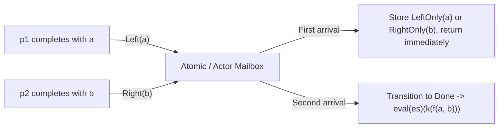
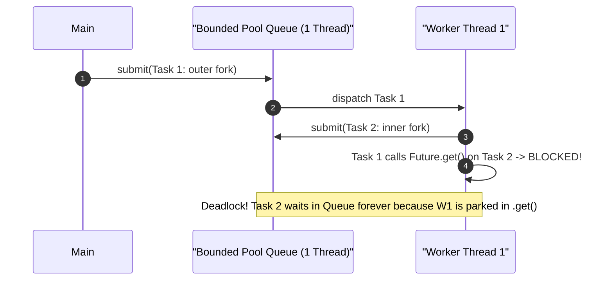

# Module 06 — Purely Functional Parallelism, Algebraic Laws, and Non-Blocking Execution

Traditional concurrency primitives—shared mutable variables, locks, condition variables, and even eager `Future`/`Promise` handles—couple _program logic_ to _thread scheduling_ and undermine **referential transparency**. If `val x = Future { compute() }` immediately dispatches work onto a thread pool at binding time, substituting `Future { compute() }` twice changes both scheduling and side-effect multiplicity. Instead of starting from threads, **algebra-first functional design** derives a pure data type `Par[A]` and its laws _before_ selecting a runtime representation: separating the immutable **description** of parallel computations from their **execution** at the program boundary (`run`). This module develops `Par`, derives functor laws via parametricity, diagnoses the fatal fixed-thread-pool deadlock in naive blocking `fork`, fixes it using a non-blocking continuation-passing actor engine, and refines the combinator algebra down to `flatMap` and `join`.

---

## 1. Algebra-First Design: Separating Description from Execution

Consider parallelizing a divide-and-conquer reduction such as summing an `IndexedSeq[Int]`. If we split the sequence in half (`sum(l)` and `sum(r)`) and immediately block to extract each `Int` before adding them, `sum(l)` must finish before `sum(r)` even starts—destroying parallelism!

To preserve both **composability** and **referential transparency**, we introduce an opaque container `Par[A]` representing a _description_ of an asynchronous computation that will eventually yield an `A`:

```scala
// Core Algebra (before committing to any concrete representation):
trait ParAlgebra[Par[_]]:
  def unit[A](a: A): Par[A]
  def lazyUnit[A](a: => A): Par[A] = fork(unit(a))
  def fork[A](a: => Par[A]): Par[A]
  def map2[A, B, C](a: Par[A], b: Par[B])(f: (A, B) => C): Par[C]
```

Notice three deliberate design boundaries in this minimal algebra:

1. **No `get` inside combinators**: Extracting the `A` value is deferred exclusively to `run(es: ExecutorService)(pa: Par[A])` at the outermost program boundary ("the end of the world"). Because `map2(sum(l), sum(r))(_ + _)` never inspects the inner values while assembling the computation graph, both branches `sum(l)` and `sum(r)` are dispatched concurrently when `run` interprets the graph.
2. **Explicit `fork` rather than automatic spawning inside `unit` or `map2`**: Evaluating `unit(1)` or `map2(unit(1), unit(2))(_ + _)` is cheaper to compute inline on the caller thread than paying thread-pool queuing, context switching, and `Future` allocation overhead. Making `fork` an explicit combinator lets the caller control parallelism granularity while keeping `unit` strictly pure and lightweight.
3. **`lazyUnit` wraps an unevaluated expression**: Defining `lazyUnit(a: => A)` as `fork(unit(a))` ensures `a` is not evaluated on the calling thread—it remains suspended by-name until the forked worker executes it.

### Derived Combinators

From just `unit`, `fork`, `lazyUnit`, and `map2`, an entire library of parallel collection algorithms emerges without touching threads:

```scala
def asyncF[A, B](f: A => B): A => Par[B] =
  a => lazyUnit(f(a))

def map[A, B](pa: Par[A])(f: A => B): Par[B] =
  map2(pa, unit(()))((a, _) => f(a))

def sortPar(parList: Par[List[Int]]): Par[List[Int]] =
  map(parList)(_.sorted)

def parMap[A, B](ps: List[A])(f: A => B): Par[List[B]] = fork:
  val fbs: List[Par[B]] = ps.map(asyncF(f))
  sequence(fbs)

// Divide-and-conquer balanced binary tree (O(log n) critical path vs O(n) foldRight!):
def sequenceBalanced[A](pas: IndexedSeq[Par[A]]): Par[IndexedSeq[A]] =
  if pas.isEmpty then unit(IndexedSeq.empty)
  else if pas.size == 1 then map(pas.head)(a => IndexedSeq(a))
  else
    val (l, r) = pas.splitAt(pas.size / 2)
    map2(fork(sequenceBalanced(l)), fork(sequenceBalanced(r)))(_ ++ _)

def sequence[A](pas: List[Par[A]]): Par[List[A]] =
  map(sequenceBalanced(pas.toIndexedSeq))(_.toList)

def parFilter[A](as: List[A])(f: A => Boolean): Par[List[A]] = fork:
  val pars: List[Par[List[A]]] = as.map(asyncF(a => if f(a) then List(a) else Nil))
  map(sequence(pars))(_.flatten)

// Granularity-controlled divide-and-conquer parallel fold:
def parFold[A](seq: IndexedSeq[A], threshold: Int)(zero: A)(f: (A, A) => A): Par[A] =
  if seq.isEmpty then unit(zero)
  else if seq.size <= threshold then unit(seq.foldLeft(zero)(f))
  else
    val (l, r) = seq.splitAt(seq.size / 2)
    map2(fork(parFold(l, threshold)(zero)(f)), fork(parFold(r, threshold)(zero)(f)))(f)

def parMax(ints: IndexedSeq[Int], threshold: Int = 1024): Par[Option[Int]] =
  val lifted = ints.map(Some(_): Option[Int])
  parFold(lifted, threshold)(None) {
    case (Some(a), Some(b)) => Some(a max b)
    case (a @ Some(_), None) => a
    case (None, b)           => b
  }

def parWordCount(paragraphs: List[String]): Par[Int] =
  val counts = paragraphs.map(asyncF(p => p.trim.split("\\s+").count(_.nonEmpty)))
  map(sequence(counts))(_.sum)
```

Notice `parFold`'s `threshold` parameter: below `threshold` elements (typically tuned so each leaf task runs for hundreds of microseconds rather than nanoseconds), recursion stays sequential on one worker thread—avoiding task-dispatch overhead from dominating actual work. Note also that `parFold` relies on `f` being **associative** with identity `zero` (a `Monoid`, [Module 09](09-monoids-foldables-and-parallel-reduction.md)) so splitting at arbitrary midpoints produces the exact same result as a sequential fold!

### Non-Blocking `Actor` Coordination in `map2`

Why does Chiusano & Bjarnason's original `Par` design pair callbacks with a lock-free **Actor** (message-passing state machine)? When two independent computations `p1` and `p2` complete concurrently on different worker threads, mutating shared state (`var ar: Option[A] = None`) under a `synchronized` monitor risks lock contention and violates non-blocking composition. An `Actor[Either[A, B]]` (or the lock-free CAS `PairState` above) serializes arrivals cleanly via a lock-free concurrent queue (`AtomicReference` treiber stack / MPSC queue):



Look carefully at `sequenceBalanced` vs a naive `pas.foldRight(unit(Nil))((p, acc) => map2(p, acc)(_ :: _))`: `foldRight` constructs a right-leaning linear chain of `map2` dependencies, whereas `sequenceBalanced` splits the input recursively in half, building a balanced binary fork-join tree of depth $\lceil \log_2 n \rceil$.

---

## 2. Formal Laws of `Par`: Parametricity and `fork`

An algebraic API is defined not merely by its type signatures, but by the **equational laws** that every lawful implementation must satisfy.

### The Law of Mapping (Derived via Free Theorems)

First, `map` must preserve `unit` (homomorphism):

$$\text{map}(\text{unit}(x))(f) \equiv \text{unit}(f(x))$$

Setting $f = \text{id}$ yields $\text{map}(\text{unit}(x))(\text{id}) \equiv \text{unit}(x)$. Now apply **Wadler's parametricity theorem** ([Module 01](01-referential-transparency-and-lambda-calculus.md)): because `map[A, B](y: Par[A])(f: A => B): Par[B]` is parametrically polymorphic in `A` and `B`, it cannot inspect the element inside `y`—it can only apply `f` to whatever `A` `y` produces! Therefore, passing `id` leaves every `A` unchanged, giving the **Functor Identity Law** for _every_ `y: Par[A]` (not just `unit(x)`):

$$\text{map}(y)(\text{id}) \equiv y$$

And composing two `map` calls equals mapping their composition (**Functor Composition Law**):

$$\text{map}(\text{map}(y)(g))(f) \equiv \text{map}(y)(f \circ g)$$

### The Law of Forking

Forking a computation onto an asynchronous worker must never alter its denotational result—only _where_ and _when_ it runs:

$$\text{fork}(x) \equiv x$$

This seemingly simple law—**`fork(x)` must compute the exact same result as `x` without hanging or throwing**—immediately exposes a catastrophic concurrency bug in naive thread-pool implementations!

---

## 3. Critical Failure Mode: Fixed-Size `ExecutorService` Deadlock

Suppose we instantiate `Par[A]` directly on `java.util.concurrent.ExecutorService` and `java.util.concurrent.Future`:

```scala
import java.util.concurrent.*

// ANTI-PATTERN: blocking Future.get() inside fork()!
object BlockingPar:
  opaque type Par[A] = ExecutorService => Future[A]

  private case class UnitFuture[A](get: A) extends Future[A]:
    def isDone = true
    def get(timeout: Long, unit: TimeUnit): A = get
    def isCancelled = false
    def cancel(evenIfRunning: Boolean) = false

  def unit[A](a: A): Par[A] = _ => UnitFuture(a)

  def fork[A](a: => Par[A]): Par[A] = es =>
    es.submit(new Callable[A]:
      def call(): A = a(es).get // <--- DEADLOCK TRAP: blocks worker thread inside submit!
    )

  def run[A](es: ExecutorService)(pa: Par[A]): Future[A] = pa(es)
```

Test **the law of forking** (`fork(x) == x`) on `Executors.newFixedThreadPool(1)` with `val a = lazyUnit(42 + 1)` and `val p = fork(a)`:

1. `BlockingPar.run(pool)(fork(fork(unit(43))))` submits Task 1 (`outer fork`) into the 1-thread pool's work queue.
2. Worker Thread 1 pops Task 1 from the queue and begins running `call()`.
3. Inside `call()`, `a(es)` invokes the _inner_ `fork`, which submits Task 2 (`unit(43)`) into the pool's work queue and returns a pending `Future`.
4. Task 1 immediately calls `.get()` on Task 2's `Future`, **blocking Worker Thread 1** until Task 2 completes!
5. Task 2 sits indefinitely in the pool's queue because **the only worker thread capable of dequeuing Task 2 is blocked inside Task 1 waiting for Task 2!**



Crucially, this is **not** merely a quirk of a 1-thread pool! On _any_ fixed-size thread pool of size $N$, a balanced `sequenceBalanced` tree of depth $d \ge N$ (or $N$ nested `fork` calls) exhausts all $N$ worker threads in blocking `.get()` calls, causing **deterministic production thread-pool starvation deadlock**. Even `map2` implemented as blocking `val af = a(es); val bf = b(es); UnitFuture(f(af.get, bf.get))` deadlocks whenever `map2` runs inside a forked parent task on a bounded pool!

### Reproducing the Deadlock (Negative Test)

We can witness the deadlock deterministically with a bounded timeout on a 1-thread pool:

```scala
val pool1 = Executors.newFixedThreadPool(1)
try
  val nested = BlockingPar.fork(BlockingPar.fork(BlockingPar.unit(42)))
  // Calling .get(500, TimeUnit.MILLISECONDS) throws TimeoutException reliably:
  val fut = BlockingPar.run(pool1)(nested)
  fut.get(500, TimeUnit.MILLISECONDS) // java.util.concurrent.TimeoutException!
finally pool1.shutdownNow()
```

Running the exact same `fork(fork(unit(42)))` graph on a 2-thread pool succeeds _by accident_ (hiding the bug in unit tests), only to deadlock in production when a 16-thread service receives concurrent requests or nests 16 `parMap` levels deep!

---

## 4. Non-Blocking Continuation-Passing `Par` Using Actors

How do we obey `fork(x) == x` for _arbitrary_ nesting depths even on a **single-threaded** `ExecutorService`? Eliminate every blocking `.get()` inside worker tasks by switching from pull-based `java.util.concurrent.Future` to push-based **continuation-passing style (CPS)** callbacks!

Define a minimal asynchronous `Future[+A]` whose sole operation registers a callback `k: A => Unit` to be invoked upon completion:

```scala
import java.util.concurrent.{ Callable, ExecutorService }
import java.util.concurrent.atomic.AtomicReference

object NonBlockingPar:
  sealed trait Future[+A]:
    private[NonBlockingPar] def apply(k: A => Unit): Unit

  opaque type Par[+A] = ExecutorService => Future[A]

  def unit[A](a: A): Par[A] = _ =>
    new Future[A]:
      def apply(k: A => Unit): Unit = k(a)

  def fork[A](a: => Par[A]): Par[A] = es =>
    new Future[A]:
      def apply(k: A => Unit): Unit =
        eval(es)(a(es)(k))

  // Dispatches runnable asynchronously without blocking any worker thread!
  private def eval(es: ExecutorService)(r: => Unit): Unit =
    es.submit(new Callable[Unit]:
      def call(): Unit = r
    )
```

Look closely at `fork(a)`: when Worker Thread 1 runs `a(es)(k)`, it submits `r` to `es` and **returns immediately**—Worker Thread 1 is freed back to the pool before `r` even starts! Thus `fork(fork(fork(unit(42))))` runs safely on a 1-thread pool with zero blocking!

### Synchronizing Two Async Branches Without Locks (`map2`)

In `map2(p1, p2)(f)`, `p1` and `p2` complete asynchronously on arbitrary threads in either order (`p1` first or `p2` first). Using a lock-free `AtomicReference` state machine (or a lightweight non-blocking `Actor` mailbox), whichever branch finishes first stores its value and returns immediately; whichever branch finishes _second_ extracts both results and invokes `eval(es)(k(f(a, b)))`:

```scala
  private enum PairState[+A, +B]:
    case Empty
    case LeftOnly(a: A)
    case RightOnly(b: B)
    case Done

  def map2[A, B, C](p1: Par[A], p2: Par[B])(f: (A, B) => C): Par[C] = es =>
    new Future[C]:
      def apply(k: C => Unit): Unit =
        val state = AtomicReference[PairState[A, B]](PairState.Empty)

        def onLeft(a: A): Unit =
          var done = false
          while !done do
            state.get() match
              case PairState.Empty =>
                done = state.compareAndSet(PairState.Empty, PairState.LeftOnly(a))
              case PairState.RightOnly(b) =>
                if state.compareAndSet(PairState.RightOnly(b), PairState.Done) then
                  done = true
                  eval(es)(k(f(a, b)))
              case _ => done = true

        def onRight(b: B): Unit =
          var done = false
          while !done do
            state.get() match
              case PairState.Empty =>
                done = state.compareAndSet(PairState.Empty, PairState.RightOnly(b))
              case PairState.LeftOnly(a) =>
                if state.compareAndSet(PairState.LeftOnly(a), PairState.Done) then
                  done = true
                  eval(es)(k(f(a, b)))
              case _ => done = true

        p1(es)(onLeft)
        p2(es)(onRight)
```

At the program boundary, `run(es)(pa)` bridges the continuation back to the caller using a `CountDownLatch` and an `AtomicReference` (never inside worker threads!):

```scala
  def run[A](es: ExecutorService)(pa: Par[A]): A =
    val ref = AtomicReference[A]()
    val latch = java.util.concurrent.CountDownLatch(1)
    pa(es) { a =>
      ref.set(a)
      latch.countDown()
    }
    latch.await()
    ref.get()
```

> [!WARNING]
> **Caveat in Callback-Only `Par`:** Look at what happens if `a` inside `fork(lazyUnit(throw RuntimeException("boom")))` throws an uncaught exception inside `es.submit(...)`: `k` is **never invoked**, so `latch.await()` in `run` hangs forever! Production effect runtimes (Cats Effect `IO`, ZIO) replace `A => Unit` callbacks with `Either[Throwable, A] => Unit` so every worker thread traps `NonFatal` exceptions and completes the continuation with `Left(err)`.

---

## 5. Refining Combinators to Their Most General Form (`choice`, `flatMap`, `join`)

Once we have `unit`, `fork`, `map2`, and `map`, can `Par` express conditional branching—evaluating a `Par[Boolean]` first and then running _only_ the chosen branch `t` or `f`?

```scala
def choice[A](cond: Par[Boolean])(t: Par[A], f: Par[A]): Par[A] =
  choiceN(map(cond)(b => if b then 0 else 1))(List(t, f))

def choiceN[A](n: Par[Int])(choices: List[Par[A]]): Par[A] =
  flatMap(n)(idx => choices(idx))

def choiceMap[K, V](key: Par[K])(choices: Map[K, Par[V]]): Par[V] =
  flatMap(key)(k => choices(k))
```

Look at the common pattern behind `choice`, `choiceN`, and `choiceMap`: given a `Par[A]` and a continuation function `A => Par[B]`, execute the first computation and feed its result to choose the next parallel computation. That universal combinator is **`chooser`**—more famously known as **`flatMap`** (or monadic `bind`):

```scala
def flatMap[A, B](pa: Par[A])(choices: A => Par[B]): Par[B] = es =>
  new Future[B]:
    def apply(k: B => Unit): Unit =
      pa(es)(a => choices(a)(es)(k))

def join[A](ppa: Par[Par[A]]): Par[A] = es =>
  new Future[A]:
    def apply(k: A => Unit): Unit =
      ppa(es)(pa => pa(es)(k))
```

Notice the exact algebraic equivalence between `flatMap` and `join` (which recurs across _every_ monad in [Module 10](10-functors-monads-and-kleisli-composition.md)):

- `flatMap(pa)(f) == join(map(pa)(f))`
- `join(ppa) == flatMap(ppa)(identity)`

One critical semantic observation: in `map2(pa, pb)(f)`, `pa` and `pb` are **independent**, so both execute in parallel; in `flatMap(pa)(f)`, `f` depends on the output of `pa`, so `pa` and `f(a)` necessarily execute **sequentially** (though `pa` and `f(a)` may each fork internally).

---

## 6. Then vs Now: Scala `Future`, TypeScript `Promise`, Virtual Threads, and Effect Runtimes

Why do functional architectures distinguish lazy `Par[A]` (or `IO[A]`) from standard library `scala.concurrent.Future[A]` and JavaScript `Promise<A>`?

| Concurrency Model | Dispatch Timing | Referential Transparency | Thread Blocking Under Nesting | Modern 2026 Equivalent |
| --- | --- | --- | --- | --- |
| `scala.concurrent.Future` / JS `Promise` | **Eager** on construction (hot handle) | **Broken** (factoring out a `val` changes execution count and timing) | Safe with `flatMap` callbacks; unsafe with `Await.result` | Legacy Scala 2/3 & JS/TS stdlib (`() => Promise<A>` thunk needed for RT) |
| `Par[A]` (Blocking `ExecutorService`) | Lazy (`ExecutorService => Future[A]`) | Preserved (except deadlock on bounded pools!) | **Deadlocks** when nested `fork` depth $\ge N$ | Pedagogical counterexample |
| `Par[A]` (CPS Non-blocking) | Lazy (`ExecutorService => CPS Future[A]`) | Preserved | **Zero blocking** (worker threads freed immediately) | Foundation of CPS fiber schedulers |
| **JDK 25 Virtual Threads / Ox `1.0.9` / Cats Effect `3.7.1`** | Structured / Lazy `IO.parMapN` | Full RT in `IO` / `ZIO`; structured scopes in Ox | Virtual threads unmount on `.get()` in $O(1)$ RAM; CE3 fibers yield cooperatively | Production Scala 3.10.1 concurrency stack |

In TypeScript, native `Promise<A>` shares the exact same eagerness trap as `scala.concurrent.Future`: `const p = fetchData()` starts the HTTP request immediately before `.then` or `Promise.all` is called! Representing a referentially transparent parallel computation in TypeScript requires wrapping the async operation inside a lazy thunk `type Par<A> = () => Promise<A>` (often called a `Task<A>`):

```typescript
export type Par<A> = () => Promise<A>;

export const unitPar =
  <A>(a: A): Par<A> =>
  () =>
    Promise.resolve(a);

export const map2Par =
  <A, B, C>(pa: Par<A>, pb: Par<B>, f: (a: A, b: B) => C): Par<C> =>
  async () => {
    const [a, b] = await Promise.all([pa(), pb()]);
    return f(a, b);
  };

export const sequencePar =
  <A>(pas: readonly Par<A>[]): Par<readonly A[]> =>
  async () =>
    Promise.all(pas.map((p) => p()));
```

Notice how `() => Promise<A>` restores referential transparency: creating `const task = map2Par(a, b, f)` runs nothing; calling `await task()` twice runs the parallel computation twice independently.

Additionally, compare how continuation-passing style translates to JavaScript's single-threaded event loop vs the JVM: in Node.js, CPS callbacks (`Promise.then` / microtask queue) never block the event-loop thread because I/O multiplexes via `libuv` (`epoll`/`kqueue`), whereas CPU-bound parallelism requires dispatching `Par` tasks onto `worker_threads` with a bounded worker pool—where the exact same blocking-wait anti-pattern (`Atomics.wait` inside a worker waiting for a child task on the same pool) reproduces the `ExecutorService` starvation deadlock!

---

## Interview Drill

### 1. Why does `scala.concurrent.Future` (and JavaScript `Promise`) violate referential transparency, whereas `Par[A]` preserves it?

<details><summary>Answer</summary>

`Future` and `Promise` represent _already-running_ computations (hot handles) whose side effects and scheduling begin immediately upon instantiation. Binding `val x = Future(sideEffect())` and calling `for a <- x; b <- x yield (a, b)` executes `sideEffect()` once, whereas substituting `Future(sideEffect())` directly at both positions in the `for`-comprehension executes it twice—changing observable behavior and violating the substitution model. `Par[A]` is a lazy description (a pure function waiting for `run`), so binding `val p = fork(unit(expr))` and substituting it preserves identical evaluation semantics.
</details>

### 2. Explain precisely why `fork(fork(unit(42)))` deadlocks on `Executors.newFixedThreadPool(1)` when `fork` is implemented with `es.submit(() => a(es).get)`.

<details><summary>Answer</summary>

`es.submit` enqueues the outer `fork` task onto the single worker thread. Inside that task, `a(es)` invokes the inner `fork`, which enqueues a second task (`unit(42)`) onto the pool's queue and returns a `Future`. The outer task then calls `.get()`, blocking the single worker thread until the inner task finishes. Because the pool has only one thread and that thread is parked inside `.get()`, no thread exists to dequeue and run the inner task, resulting in permanent deadlock.
</details>

### 3. Does increasing the thread pool size from 1 to 16 eliminate the blocking `fork` deadlock?

<details><summary>Answer</summary>

No. Any fixed-size pool of $N$ threads deadlocks whenever the dynamic nesting depth of synchronous `.get()` calls reaches $N$—for instance, a divide-and-conquer `sequenceBalanced` tree of depth $\ge \log_2 N$ or $N$ recursive `fork` calls can occupy all $N$ worker threads simultaneously waiting on queued child tasks, starving the queue completely. Only non-blocking continuations (CPS callbacks, fibers, or virtual threads that unmount off carrier OS threads) eliminate bounded-pool starvation.
</details>

### 4. How does the functor composition law for `Par` follow automatically from `map(unit(x))(f) == unit(f(x))` and Wadler's parametricity?

<details><summary>Answer</summary>

Because `map[A, B](y: Par[A])(f: A => B): Par[B]` is parametrically polymorphic in `A` and `B`, Reynolds's abstraction theorem (Wadler's free theorem) guarantees `map` cannot inspect or fabricate elements of `A` or `B`—it can only transport values via `f`. Passing `id` (`f(a) = a`) therefore leaves the wrapped structure unchanged (`map(y)(id) == y`), and applying `map(g)` followed by `map(f)` applies `f(g(a))` to every produced element, proving `map(map(y)(g))(f) == map(y)(f compose g)`.
</details>

### 5. Why is `sequenceBalanced` asymptotically faster in parallel span (critical path) than `foldRight` with `map2`?

<details><summary>Answer</summary>

Folding `List[Par[A]]` right-to-left with `map2` builds an unbalanced right-leaning tree of depth $O(n)$, forcing $n$ sequential continuation hand-offs along the spine. `sequenceBalanced` splits the `IndexedSeq` in half at each level, constructing a binary tree of depth $O(\log n)$ whose left and right subtrees execute in parallel—reducing the parallel span (critical path) from $\Theta(n)$ to $\Theta(\log n)$.
</details>

### 6. Why must `fork` remain an explicit combinator rather than having `unit` or `map2` spawn tasks automatically?

<details><summary>Answer</summary>

Spawning every trivial computation like `unit(1)` or `map2(unit(1), unit(2))(_ + _)` onto a thread pool wastes CPU cycles on queue insertion, closure allocation, and cross-thread synchronization far exceeding the cost of computing `1 + 2` inline. Explicit `fork` gives callers exact control over parallelism granularity (such as switching to sequential execution below a divide-and-conquer threshold) while keeping `unit` and `map2` zero-overhead.
</details>

### 7. What happens in the basic callback-based `NonBlockingPar` if a task throws an exception inside `eval`, and how do production effect runtimes fix it?

<details><summary>Answer</summary>

In the simple `Future[A]` callback signature `apply(k: A => Unit): Unit`, if `a(es)` throws an exception inside `es.submit`, `Callable.call()` aborts without ever invoking `k`. Any downstream `map2` or `run` latch waits forever (hanging the caller). Production effect systems such as Cats Effect `IO` and ZIO replace `A => Unit` with `Either[Throwable, A] => Unit`, catching `NonFatal` exceptions inside the worker loop and forwarding `Left(err)` to the continuation so errors propagate cleanly and latches always unblock.
</details>

### 8. Express `flatMap` in terms of `join` and `map`, and express `join` in terms of `flatMap`. What does this equivalence imply for concurrency?

<details><summary>Answer</summary>

`flatMap(pa)(f) == join(map(pa)(f))` and `join(ppa) == flatMap(ppa)(identity)`. Algebraically, `flatMap` and `join` are inter-derivable primitives that add _sequential data-dependent composition_ (a monad) on top of parallel `map2` (applicative). Operationally, this implies that whenever you use `flatMap` or `join`, the outer computation `pa` / `ppa` must complete before the inner `Par` can even be constructed and dispatched—limiting parallelism compared to `map2`.
</details>
