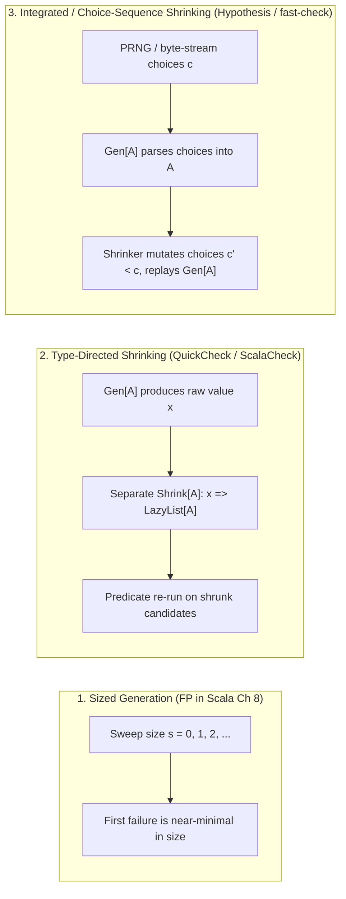

# Property-Based Testing, Algebraic Laws, and Shrinking

Example-based unit tests verify point assertions: given concrete input $x_0$, the function under test produces expected output $y_0$. While essential for regression pinning and specification by example (see [languages/javascript/README.md](../../../languages/javascript/README.md) for general test pyramid placement and mutation testing), point assertions test a zero-measure subset of an input domain whose cardinality is typically infinite or astronomically large. **Property-based testing (PBT)**, introduced in Haskell by Koen Claessen and John Hughes (_QuickCheck: A Lightweight Tool for Random Testing of Haskell Programs_, ICFP 2000), replaces hand-picked inputs with universally quantified predicates $\forall x \in D.\, P(x)$ paired with a constructive algebra of test-data generators and counterexample minimisers.

In functional design, a property-based testing library is not an ad-hoc test runner with random utilities; it is itself an algebraic specification problem. By factoring data generation (`Gen`), size-parameterised generation (`SGen`), property evaluation (`Prop`), and test outcomes (`Result`) into pure, referentially transparent values, properties become deterministic, reproducible, and composable under algebraic laws.

---

## 1. Algebraic Design of Generators: `Gen[A]` as Pure State

A naive generator draws random values via an impure global PRNG (`Math.random()` or `scala.util.Random`). That design breaks **referential transparency**: re-running a failing test with the same expression yields a different sequence of values, making flaky CI failures impossible to reproduce locally from the test definition alone.

Building on the pure state transition model in [05-purely-functional-state-and-combinators.md](05-purely-functional-state-and-combinators.md), a generator for values of type `A` is simply a state transition over a deterministic pseudorandom number generator `RNG`:

$$\text{Gen}[A] \;\cong\; \text{State}[\text{RNG}, A] \;=\; \text{RNG} \to (A, \text{RNG})$$

Because `Gen[A]` wraps `State[RNG, A]`, every generator carries its own explicit seed threading and forms a functor and a monad automatically. Composing generators never mutates shared PRNG state; two branches starting from the same `RNG` value produce identical sequences, while sequencing operations via `flatMap` threads the updated `RNG` deterministically from one draw to the next.

### Core Generator Algebra and Primitives

A minimal, orthogonal basis for `Gen[A]` consists of:

| Combinator | Type Signature | Algebraic Role |
| --- | --- | --- |
| `unit` | `A => Gen[A]` | Constant generator; ignores and forwards `RNG` unchanged |
| `choose` | `(Int, Int) => Gen[Int]` | Uniform integer in half-open interval $[start, stopExclusive)$ |
| `boolean` | `Gen[Boolean]` | Uniform Boolean derived from one PRNG bit or parity |
| `listOfN` | `(Int, Gen[A]) => Gen[List[A]]` | Fixed-length product of $n$ sequential draws |
| `map` | `(Gen[A], A => B) => Gen[B]` | Functorial transform preserving RNG consumption |
| `flatMap` | `(Gen[A], A => Gen[B]) => Gen[B]` | Dynamic data-dependent generation (sequencing RNG state) |
| `union` | `(Gen[A], Gen[A]) => Gen[A]` | Equal-weight coin flip between two generators |
| `weighted` | `((Gen[A], Double), (Gen[A], Double)) => Gen[A]` | Biased mixture distribution normalised over $[0, w_1 + w_2)$ |

Notice how `flatMap` strictly increases expressive power over `map` and `map2`. With `map2` alone, you can generate pairs `(n, xs)` where the length of `xs` is fixed statically; only `flatMap` lets the generated integer `n` dictate the number of subsequent draws `listOfN(n, g)`.

```scala
opaque type RNG = Long // e.g., 64-bit LCG / SplitMix64 state

final case class State[S, +A](run: S => (A, S)):
  def map[B](f: A => B): State[S, B] =
    State(s => { val (a, s2) = run(s); (f(a), s2) })

  def flatMap[B](f: A => State[S, B]): State[S, B] =
    State(s => { val (a, s2) = run(s); f(a).run(s2) })

final case class Gen[+A](sample: State[RNG, A]):
  def map[B](f: A => B): Gen[B] = Gen(sample.map(f))

  def flatMap[B](f: A => Gen[B]): Gen[B] =
    Gen(sample.flatMap(a => f(a).sample))

  def listOfN(size: Gen[Int]): Gen[List[A]] =
    size.flatMap(n => Gen.listOfN(n, this))

  def unsized: SGen[A] = SGen(_ => this)

object Gen:
  def unit[A](a: => A): Gen[A] =
    Gen(State(rng => (a, rng)))

  def choose(start: Int, stopExclusive: Int): Gen[Int] =
    Gen(State(RNG.nonNegativeInt).map(n => start + n % (stopExclusive - start)))

  def listOfN[A](n: Int, g: Gen[A]): Gen[List[A]] =
    Gen(State.sequence(List.fill(n)(g.sample)))

  def weighted[A](g1: (Gen[A], Double), g2: (Gen[A], Double)): Gen[A] =
    val threshold = g1._2.abs / (g1._2.abs + g2._2.abs)
    Gen(State(RNG.double)).flatMap(d => if d < threshold then g1._1 else g2._1)
```

> [!WARNING]
> **Modulo bias in naive `choose`:** Computing `start + n % range` when `n` is drawn uniformly from $[0, 2^{31})$ introduces slight bias unless `range` divides $2^{31}$ evenly, and fails completely if `stopExclusive - start` overflows signed 32-bit `Int`. Production generators (like SplitMix64 + Lemire's fast range reduction or rejection sampling) discard values in the partial tail bucket to guarantee exact uniformity.

### TypeScript Structural Realisation

In TypeScript, where higher-kinded types are absent, `Gen<A>` is cleanly encoded as a plain interface wrapping a pure step function `(rng: RNG) => readonly [A, RNG]`, paired with composable combinators:

```typescript
export interface RNG {
  readonly nextInt: () => readonly [number, RNG];
  readonly nextDouble: () => readonly [number, RNG];
}

export interface Gen<A> {
  readonly sample: (rng: RNG) => readonly [A, RNG];
}

export const unit = <A>(a: A): Gen<A> => ({
  sample: (rng) => [a, rng],
});

export const map = <A, B>(ga: Gen<A>, f: (a: A) => B): Gen<B> => ({
  sample: (rng) => {
    const [a, nextRng] = ga.sample(rng);
    return [f(a), nextRng];
  },
});

export const flatMap = <A, B>(ga: Gen<A>, f: (a: A) => Gen<B>): Gen<B> => ({
  sample: (rng) => {
    const [a, nextRng] = ga.sample(rng);
    return f(a).sample(nextRng);
  },
});

export const listOfN = <A>(n: number, ga: Gen<A>): Gen<readonly A[]> => ({
  sample: (rng) => {
    const acc: A[] = [];
    let current = rng;
    for (let i = 0; i < n; i++) {
      const [a, nextRng] = ga.sample(current);
      acc.push(a);
      current = nextRng;
    }
    return [acc, current];
  },
});
```

---

## 2. Sized Generation (`SGen[A]`) and Property Semantics (`Prop`, `Result`)

Generating unbounded structures immediately creates two opposing failure modes: either every test case is trivially small (missing bugs that appear only on deeper trees or longer lists), or recursive generators explode with `OutOfMemoryError` and slow test execution. **Sized generation** resolves this by parameterising generators over a non-negative complexity budget $s \in \mathbb{N}$:

$$\text{SGen}[A] \;=\; \text{Int} \to \text{Gen}[A]$$

A test runner sweeps `size` from `0` up to `maxSize` (e.g., `0, 1, 2, ..., 100`), generating both edge-case empty/singleton structures at low sizes and deeply nested structures at high sizes. Notice that `SGen[A]` forms a monad as well: `SGen(n => f(n).flatMap(a => g(a).forSize(n)))` threads the same size bound down through composite structures while letting `listOf(g)` treat `n` as the list length.

### The `Prop` Representation and Three-Valued `Result`

What _is_ a property? Calling `prop.check()` for its `Unit` side effect prematurely collapses compositionality—you cannot combine two `Unit`-returning checks with logical `&&` or `||` while preserving structured failure diagnostics (the failing counterexample string and how many test cases passed before falsification).

Instead, `Prop` is a pure function from execution configuration (`MaxSize`, `TestCases`, `RNG`) to a structured algebraic sum type `Result`:

$$\text{Prop} \;=\; (\text{MaxSize}, \text{TestCases}, \text{RNG}) \to \text{Result}$$

The `Result` ADT captures an essential semantic distinction between universal random sampling and exhaustive/degenerate proof:

```scala
type FailedCase   = String
type SuccessCount = Int
type TestCases    = Int
type MaxSize      = Int

enum Result:
  case Passed
  case Proved
  case Falsified(failure: FailedCase, successes: SuccessCount)

  def isFalsified: Boolean = this match
    case Falsified(_, _) => true
    case Passed \| Proved => false

final case class Prop(run: (MaxSize, TestCases, RNG) => Result):
  def &&(other: Prop): Prop = Prop { (max, n, rng) =>
    run(max, n, rng) match
      case Result.Passed \| Result.Proved => other.run(max, n, rng)
      case f @ Result.Falsified(_, _)    => f
  }

  def \|\|(other: Prop): Prop = Prop { (max, n, rng) =>
    run(max, n, rng) match
      case Result.Falsified(msg, _) =>
        other.tag(msg).run(max, n, rng)
      case ok => ok
  }

  def tag(msg: String): Prop = Prop { (max, n, rng) =>
    run(max, n, rng) match
      case Result.Falsified(e, c) => Result.Falsified(s"$msg\n$e", c)
      case ok                     => ok
  }
```

Why distinguish `Passed` from `Proved`? Consider `Prop.check(2 + 2 == 4)` or verifying a law over a finite domain like `Boolean` where exhaustive enumeration covers 100% of inputs. Such a property is **proved**, not merely sampled `Passed`. When evaluating `p1 && p2`, if `p1` is `Proved`, running `p1` once suffices—no `TestCases` iterations are needed—whereas `Passed` only indicates that `n` random trials did not uncover a counterexample.

### Deriving `forAll` with Sized Sweeps and Exception Capture

Evaluating `forAll(g: SGen[A])(f: A => Boolean): Prop` partitions `TestCases` evenly across sizes `0..max` using a lazy stream of `(RNG, A)` pairs (`LazyList.unfold`). Crucially, if the predicate `f(a)` throws an exception, `forAll` catches it and turns the exception message and stack summary into a `Falsified` value rather than aborting the enclosing combinators (`&&`, `||`) and losing the counterexample `a`.

```text
forAll(g: SGen[A], p: A => Boolean)(max, n, rng):
  casesPerSize := (n + (max - 1)) / max
  props := [ forAll(g(i))(p) for i in 0 .. min(n, max) ]
  combined := foldLeft(props, passedProp, (acc, next) => acc && next_with_cases(casesPerSize))
  return combined.run(max, n, rng)
```

In `forAll(ga: Gen[A])(p: A => Boolean)`, evaluating each sample lazily allows early termination on the very first counterexample without pre-generating all `n` inputs, and records `(a.toString, index)` into `Result.Falsified`.

---

## 3. Test-Case Minimisation and Shrinking Architectures

Random generation frequently discovers counterexamples full of irrelevant noise: a 94-element list containing negative numbers, huge integers, and duplicates when the actual minimal trigger is `List(0, -1)`. Presenting a raw 94-element counterexample forces engineers to spend minutes manually bisecting the input. **Test-case minimisation (shrinking)** reduces a failing counterexample $x$ to a locally minimal failing witness $x^*$ with respect to a simplification partial order $\prec$.

There are three principal architectures for shrinking in modern PBT systems, each with sharp algebraic trade-offs:



### Architecture Comparison and Shrinking Invariant Violation

1. **Sized Generation (`SGen`)**: Running tests in strictly ascending size order $s = 0, 1, \dots, \text{max}$ acts as an implicit coarse shrinker: if a property fails on empty lists or lists of length 1, it fails immediately at `size = 0` or `size = 1` before larger inputs are ever drawn. However, it cannot simplify values _within_ a given size (e.g., shrinking `-84729310` to `-1` when `size = 2`), nor does it shrink compound values generated inside `flatMap` independently.
2. **Type-Directed Shrinking (`Shrink[A]`, QuickCheck 1 / ScalaCheck 1.20)**: A separate type class `Shrink[A]` maps a failing value $x : A$ to a lazy tree or stream of simpler values of type `A` (e.g., halving integers toward `0`, deleting chunks of a `List`).
   - **Critical Failure Mode — Invariant Violation across `flatMap`:** Because `Shrink[A]` operates purely on the output type `A` and has no access to the `Gen[A]` that constructed `A`, shrinking breaks generator invariants! Suppose `evenInt = Gen.choose(0, 100).map(_ * 2)` or `sortedPair = Gen.choose(0, 50).flatMap(x => Gen.choose(x, 100).map(y => (x, y)))`. Applying a generic `Shrink[(Int, Int)]` after failure can propose `(50, 0)`, violating `x <= y` and generating **false-positive failures** for properties that only hold under the generator's precondition! Furthermore, `Shrink` is not a functor: knowing how to shrink `A` does not tell you how to shrink `B` given only `f: A => B` (you lack `f^-1`), so `genA.map(f)` silently loses custom shrinking unless manually re-specified.
3. **Integrated & Choice-Sequence Shrinking (Hedgehog, `fast-check` 4.x, Python Hypothesis)**:
   - **Integrated Rose-Tree Shrinking** (_fast-check_, Hedgehog): `Gen[A]` produces a lazy **rose tree** `Tree[A] = Node(root: A, children: LazyList[Tree[A]])` directly instead of a bare `A`. Because `Tree[A]` is a `Monad`, both `map` and `flatMap` preserve shrinking structure automatically! When `ga.map(f)` maps over the tree, every shrunk child is mapped by `f`, guaranteeing that invariants like `_ * 2` (evenness) can _never_ be violated during shrinking. However, `flatMap` over rose trees has a subtle limitation: shrinking the outer draw `a` in `ga.flatMap(f)` forces re-running `f(a')` from scratch, losing any progress already made shrinking the inner `B` unless the inner generator depends trivially on `a`.
   - **Choice-Sequence Shrinking** (_Hypothesis_, MacIver & Donaldson ECOOP 2020): Instead of shrinking values of type `A`, the generator reads an abstract sequence of primitive random choices $c = [b_0, b_1, \dots, b_k]$ (bits/integers) and parses them into `A`. On failure, the shrinker applies lexicographic reductions (deleting slices, zeroing blocks, binary-searching integer draws, swapping choices) to the raw byte/choice sequence $c' \prec c$ and **re-executes the generator** on $c'$. Because every candidate $A'$ is produced by executing the actual generator `Gen[A]` (including all `map`, `flatMap`, and `filter` guards), **every shrunk counterexample is guaranteed by construction to satisfy all generator invariants**, even across arbitrary `flatMap` dependencies!

| Property | Sized `SGen` | Type-Directed (`Shrink[A]`) | Integrated Rose Tree (`Tree[A]`) | Choice-Sequence (Hypothesis) |
| --- | --- | --- | --- | --- |
| Preserves `map` invariants | Yes | No (loses invariant) | Yes | Yes |
| Preserves `flatMap` invariants | Partial (size only) | No (requires manual `suchThat`) | Yes (re-generates inner) | Yes (replays full generator) |
| Functorial / Monadic composition | Yes (`SGen` is Monad) | No (`Shrink` is invariant) | Yes (`Tree` is Monad) | Yes (parser over choice stream) |
| Local minimality quality | Coarse (size level only) | High for product types | High for `map` / `map2` | Optimal (shortlex minimal trace) |
| Implementation complexity | Low | Medium | Medium-High | High (trace caching & adaptive pass) |

### Rose-Tree Integrated Shrinking in Action

To see concretely why rose trees eliminate shrink-time invariant violations, consider a lazy rose tree `Tree[A]` whose `children` stream holds immediate single-step simplifications of `root`. Implementing `map` on `Tree[A]` applies `f` recursively to `root` and every child subtree, while `flatMap` splices the outer shrunk trees ahead of the inner shrunk trees (Hedgehog's interleave):

```scala
final case class Tree[+A](root: A, children: () => LazyList[Tree[A]]):
  def map[B](f: A => B): Tree[B] =
    Tree(f(root), () => children().map(_.map(f)))

  def flatMap[B](f: A => Tree[B]): Tree[B] =
    val outer = f(root)
    Tree(
      outer.root,
      () => children().map(_.flatMap(f)) #::: outer.children()
    )

object Tree:
  def shrinkInt(target: Int, n: Int): LazyList[Int] =
    if n == target then LazyList.empty
    else
      val half = target + (n - target) / 2
      if half == n then LazyList(target)
      else LazyList.cons(half, shrinkInt(half, n))

  def intTree(target: Int, n: Int): Tree[Int] =
    Tree(n, () => shrinkInt(target, n).map(intTree(target, _)))
```

If we build `val evenGen = intTree(0, 42).map(_ * 2)`, every single node in the lazy shrink tree is guaranteed to be even (`42 -> 0, 22, 32, ...` mapped to `84 -> 0, 44, 64, ...`). There is no separate `Shrink[Int]` instance that could accidentally propose an odd integer such as `41` or `21`.

When a failure occurs at the root, the minimiser performs a **greedy depth-first descent**: it tests the children stream from left to right; as soon as a child `c` falsifies the property, it commits to `c` and descends into `c.children()`, terminating when no child falsifies the property. That node is a **1-minimal** local optimum under the shrink relation.

---

## 4. Algebraic Law Taxonomy and Model-Based Testing

Beyond ad-hoc assertions, property-based testing excels at encoding domain-agnostic **algebraic patterns** that catch subtle edge cases (empty collections, integer overflow, Unicode surrogates, structural sharing bugs):

| Pattern | Algebraic Statement | Canonical Examples |
| --- | --- | --- |
| **Round-trip (Bijection / Codec)** | $\forall x.\, \text{decode}(\text{encode}(x)) = \text{Right}(x)$ | JSON / Protobuf serialisers, URL escaping, parser-printer pairs |
| **Idempotence** | $\forall x.\, f(f(x)) = f(x)$ | Normalisation, deduplication, `Set.insert`, SQL `UPSERT` |
| **Homomorphism (Oracle / Model)** | $\forall x.\, \text{fastImpl}(\text{abs}(x)) = \text{abs}(\text{specImpl}(x))$ | Persistent RB-tree vs naive sorted `List`, lock-free queue vs mutex queue |
| **Invariance** | $\forall x.\, \text{measure}(f(x)) = \text{measure}(x)$ | `sort(xs).length == xs.length`, `reverse(reverse(xs)) == xs` |
| **Commutativity / Associativity** | $x \oplus y = y \oplus x$, $(x \oplus y) \oplus z = x \oplus (y \oplus z)$ | CRDT state merges, monoids, parallel reductions |

In **model-based (stateful) testing**, a complex concurrent or stateful system (such as a cache with LRU eviction or an STM transaction log) is tested against a tiny pure reference model `Model` by generating random sequences of `Command`s (`Gen[List[Command]]`). Each command defines a precondition on `Model`, a state transition `nextState(model): Model`, and a postcondition comparing the real system's response against the pure model's response. When a command sequence fails, shrinking deletes irrelevant intermediate commands and shrinks command arguments—producing the shortest possible reproduction trace for a multi-step state bug.

---

## 5. Verifying Algebraic Laws and Parallel Computations (`Par`)

Property-based testing shines brightest when verifying **algebraic laws**—identities that hold across all valid inputs of a combinator library rather than isolated examples. To test an asynchronous/parallel abstraction such as `Par[A]` (defined via `ExecutorService => Future[A]` in [06-purely-functional-parallelism-and-laws.md](06-purely-functional-parallelism-and-laws.md)), two obstacles arise:

1. **Structural equivalence of computations:** `Par[A]` is a function `ExecutorService => Future[A]`. Comparing two `Par[A]` values by reference equality (`==`) always fails; equality is **observational equivalence** under execution:

$$p_1 \equiv p_2 \iff \forall es : \text{ExecutorService}.\;\; p_1(es).\text{get}() = p_2(es).\text{get}()$$

2. **Resource lifecycle and thread-pool topology sensitivity:** A property test for `Par` cannot leak a new `ExecutorService` on every iteration (exhausting OS threads in seconds), nor can it test only a large cached pool. As shown in Module 06, fixed-size pools of size 1, 2, or 4 expose **blocking `fork` deadlocks** that an unbounded cached pool masks!

### Factoring `forAllPar` and Weighted Pool Topologies

We isolate execution resources inside a helper combinator `forAllPar` that supplies a weighted generator of `ExecutorService` topologies—including single-threaded, small fixed-size (2–4 threads), and work-stealing pools—and manages lifecycle cleanup once after the suite finishes:

```scala
val executorGen: Gen[ExecutorService] = Gen.weighted(
  Gen.choose(1, 4).map(Executors.newFixedThreadPool) -> 0.75,
  Gen.unit(Executors.newCachedThreadPool())          -> 0.25
)

def equal[A](p1: Par[A], p2: Par[A]): Par[Boolean] =
  Par.map2(p1, p2)(_ == _)

def forAllPar[A](g: Gen[A])(f: A => Par[Boolean]): Prop =
  forAll(executorGen ** g) { case (es, a) =>
    f(a).run(es).get()
  }
```

With `forAllPar`, checking the functor identity law `map(y)(identity) == y` and the fork law `fork(x) == x` reduces to declarative one-liners:

```scala
val mapIdentityProp: Prop =
  Prop.checkPar {
    equal(Par.map(Par.unit(1))(_ + 1), Par.unit(2))
  }

val forkLawProp: Prop =
  forAllPar(parIntGen)(p => equal(Par.fork(p), p))
```

> [!CAUTION]
> **Production Failure Mode — Testing `Par.fork` on Fixed Thread Pools:** If `Par.fork(a)` submits a callable to `ExecutorService` that synchronously calls `a.run(es).get()` inside its body, running `forkLawProp` against `Executors.newFixedThreadPool(1)` deadlocks immediately because the outer callable occupies the sole worker thread while waiting for the inner callable queued behind it. Always test parallel combinators with bounded thread-pool sizes ($k \in \{1, 2\}$) and explicit timeouts in `.get(timeout, TimeUnit)` so deadlocks surface as deterministic `Falsified` results rather than hanging CI runners indefinitely.

---

## 6. Testing Higher-Order Functions via `Cogen` (Coarbitrary)

First-order properties generate inputs of concrete data types (`Int`, `List[String]`, ASTs). What if we need to test laws of **higher-order combinators** such as `list.takeWhile(p)` or `list.map(f).map(g) == list.map(f andThen g)`? Testing `takeWhile` only with hardcoded predicates like `_ < 5` or `_ % 2 == 0` fails to exercise arbitrary, non-monotonic, or path-dependent predicates.

To generate random pure functions $f : A \to B$, we need two ingredients:

1. A generator `Gen[B]` for the codomain.
2. A **deterministic perturbation** of the `RNG` state driven by each argument value $a : A$, so that identical inputs $a_1 = a_2$ **always** produce the identical `RNG` state (preserving purity/referential transparency of the generated function $f$), while distinct inputs $a_1 \neq a_2$ yield statistically independent output draws from `Gen[B]`.

This dual operation to `Gen[A]` is **`Cogen[A]`** (called `Coarbitrary` in Haskell QuickCheck and `Cogen` in ScalaCheck):

$$\text{Gen}[A] : \text{RNG} \to (A, \text{RNG}) \qquad\text{vs.}\qquad \text{Cogen}[A] : (A, \text{RNG}) \to \text{RNG}$$

Notice the variance! Whereas `Gen[+A]` is **covariant** in `A` (supporting `map[B](f: A => B): Gen[B]`), `Cogen[-A]` is **contravariant** in `A`: given `f: B => A` and `Cogen[A]`, we obtain `Cogen[B]` via `contramap(b => perturb(f(b), rng))`!

```scala
trait Cogen[-A]:
  def perturb(a: A, rng: RNG): RNG

object Cogen:
  def fn[A, B](in: Cogen[A], out: Gen[B]): Gen[A => B] =
    Gen(State { rng =>
      val (seed, nextRng) = rng.nextLong
      val generatedFn: A => B = a =>
        val perturbedRng = in.perturb(a, RNG.simple(seed))
        out.sample.run(perturbedRng)._1
      (generatedFn, nextRng)
    })

  given Cogen[Int] with
    def perturb(a: Int, rng: RNG): RNG =
      // Deterministic bit-mixing step (e.g., SplitMix64 mixing on (rng.seed ^ a))
      RNG.mix(rng, a.toLong)

  given Cogen[String] with
    def perturb(s: String, rng: RNG): RNG =
      s.foldLeft(rng)((r, ch) => RNG.mix(r, ch.toLong))

  given [A](using ca: Cogen[A]): Cogen[List[A]] with
    def perturb(xs: List[A], rng: RNG): RNG =
      xs.foldLeft(RNG.mix(rng, xs.length.toLong))((r, a) => ca.perturb(a, r))
```

### Checking `takeWhile` + `dropWhile` Partition Identity with `Cogen`

With `Cogen.fn`, we can quantify over **arbitrary pure predicates** `p: Int => Boolean` to verify the fundamental partition identity of `List`:

```scala
val takeDropWhileProp: Prop =
  forAll(Gen.listOf(Gen.choose(-50, 50)) ** Cogen.fn(summon[Cogen[Int]], Gen.boolean)) {
    case (xs, p) =>
      xs.takeWhile(p) ++ xs.dropWhile(p) == xs
  }
```

And a subtle negative counterexample: if you generate `f: A => B` using an impure `mutable.Map` memoising random outputs from a shared mutable RNG, concurrent property evaluation or re-invoking the captured `f` inside shrunk counterexamples breaks referential transparency and causes non-deterministic test output. Using `Cogen` guarantees that the generated `f` is a genuinely pure, total, deterministic mathematical function, while requiring zero mutable state.

---

## 7. Failure Modes and Negative Examples

| Failure Mode | Mechanism | Detection / Mitigation |
| --- | --- | --- |
| **Vacuous `filter` / `suchThat` starvation** | `gen.suchThat(p)` rejects 99.9% of samples, spinning CPU or throwing stack/iteration overflow | Construct values meeting the invariant directly via `map`/`flatMap` instead of post-hoc rejection |
| **Unsatisfied shrink invariants** | Type-directed `Shrink[A]` mutates fields independently of `flatMap` preconditions | Use choice-sequence shrinking (Hypothesis) or integrated rose-tree generators (`fast-check`) |
| **Non-deterministic counterexamples** | Relying on `System.nanoTime()` or unseeded global PRNG inside properties | Thread explicit `RNG` seeds; log the exact failing `seed` and `size` so CI failures replay deterministically |
| **Unbounded `SGen` recursion** | Tree generator calls `flatMap` twice at size `n` without halving budget (`n / 2`), causing exponential blowup $O(2^n)$ | Divide the size budget among recursive children (`size / 2`) so total node count remains $O(\text{size})$ |
| **Swallowed exceptions masking bugs** | `forAll` catches `Throwable` inconsistently or crashes the whole runner without reporting the input | Catch non-fatal exceptions inside `forAll` and convert them to `Result.Falsified(input + stack, count)` |

---

## Interview Drill

1. **Why is `Gen[A]` modelled as `State[RNG, A]` rather than a function `() => A` backed by a thread-local PRNG?**

<details><summary>Answer</summary>

Modelling `Gen[A]` as `State[RNG, A]` preserves referential transparency: given the same `RNG` seed, a generator is a pure mathematical function producing the exact same value and next state. This guarantees 100% deterministic replay of failing CI tests from a logged seed, allows safe parallel property execution without lock contention or race conditions on shared PRNG state, and lets `Gen` inherit `map` and `flatMap` directly from `State`.

</details>

2. **Why does `Result` distinguish `Passed` from `Proved`, and how does that affect `&&` and `||`?**

<details><summary>Answer</summary>

`Passed` means a universally quantified property survived $n$ random samples without falsification, whereas `Proved` means the property was verified exhaustively (e.g., a zero-argument `Prop.check` assertion or exhaustive enumeration of a finite domain). When `p1 && p2` sees `Proved`, it knows `p1` holds unconditionally with 1 trial and need not allocate random test-case budgets to `p1`; in `p1 || p2`, either `Passed` or `Proved` short-circuits to success, while `Falsified` falls through to evaluate `p2` with tagged error context.

</details>

3. **Explain why QuickCheck's separate `Shrink[A]` type class breaks invariants across `flatMap`, and how integrated / choice-sequence shrinking solves it.**

<details><summary>Answer</summary>

`Shrink[A]` only sees the final value `a: A`, not the `Gen[A]` derivation tree that produced it. If `Gen[(Int, Int)]` used `flatMap` to enforce `x <= y`, a generic tuple shrinker can still propose `(10, 2)`, triggering spurious failures outside the generator's domain. Integrated rose-tree shrinking (`Gen[Tree[A]]`, e.g., `fast-check`) lifts shrinking into the `Monad` so `map` transforms every shrunk node automatically, while choice-sequence shrinking (Hypothesis) shrinks the underlying stream of random primitive choices and replays the entire `Gen[A]` pipeline, guaranteeing every candidate satisfies all `map`, `flatMap`, and `filter` invariants by construction.

</details>

4. **Why does `SGen` fail to scale cleanly for recursive tree structures if you pass `size` unchanged to both child subtrees?**

<details><summary>Answer</summary>

If a binary tree generator at size $n$ recursively spawns two subtrees each with size $n - 1$, the expected number of nodes grows as $O(2^n)$, causing stack overflows and timeouts even at modest sizes like `maxSize = 30`. Splitting the budget (`size / 2` or partitioning `n - 1` randomly between left and right subtrees) bounds total tree size linearly in `size`.

</details>

5. **How does `Cogen[A]` generate pure random functions `A => B`, and why must `Cogen` be contravariant (`Cogen[-A]`)?**

<details><summary>Answer</summary>

`Cogen[A]` defines `perturb(a: A, rng: RNG): RNG`. Given a captured base seed and `out: Gen[B]`, the generated function `f(a)` deterministically mixes `a` into the base `RNG` via `perturb` and draws a single `B` from `out`. Because equal `a` values produce identical perturbed `RNG` states, `f` is pure and deterministic without mutable caching. `Cogen` is contravariant (`Cogen[-A]`) because `A` appears in input (negative) position: given `g: B => A` and `Cogen[A]`, we can adapt `Cogen[A]` into `Cogen[B]` via `contramap` by passing `g(b)` into `perturb`.

</details>

6. **When testing `Par` laws with `forAllPar`, why is testing exclusively on `Executors.newCachedThreadPool()` dangerous?**

<details><summary>Answer</summary>

A cached thread pool spawns new threads whenever existing threads are occupied, masking thread-starvation deadlocks in combinators like `Par.fork` that block inside submitted tasks (`.get()`). Testing with weighted small fixed thread pools (`1` to `4` threads) reliably triggers and exposes blocking-`fork` deadlocks.

</details>

7. **How does `Prop` prevent exceptions thrown inside the function under test from breaking property combinators like `||`?**

<details><summary>Answer</summary>

`forAll` wraps predicate evaluation in a `try/catch` (catching `NonFatal`) and converts any thrown exception into `Result.Falsified(formattedInputAndError, successCount)`. Because failures remain values of `Result` rather than escaping as control-flow exceptions, `&&`, `||`, and `tag` can still inspect, combine, and report the minimal counterexample cleanly.

</details>

8. **What distinguishes a 1-minimal counterexample in rose-tree shrinking from a globally minimal counterexample?**

<details><summary>Answer</summary>

A 1-minimal counterexample is a local minimum under single-step shrink transitions: none of its direct children in `children()` falsifies the property, though a multi-step combination of simultaneous simplifications (or a non-adjacent subtree) might produce a strictly smaller failing input. Choice-sequence shrinkers such as Hypothesis mitigate this by applying multiple passes (block deletion, integer binary search, choice swapping) until reaching a fixed point across the entire choice trace.

</details>
