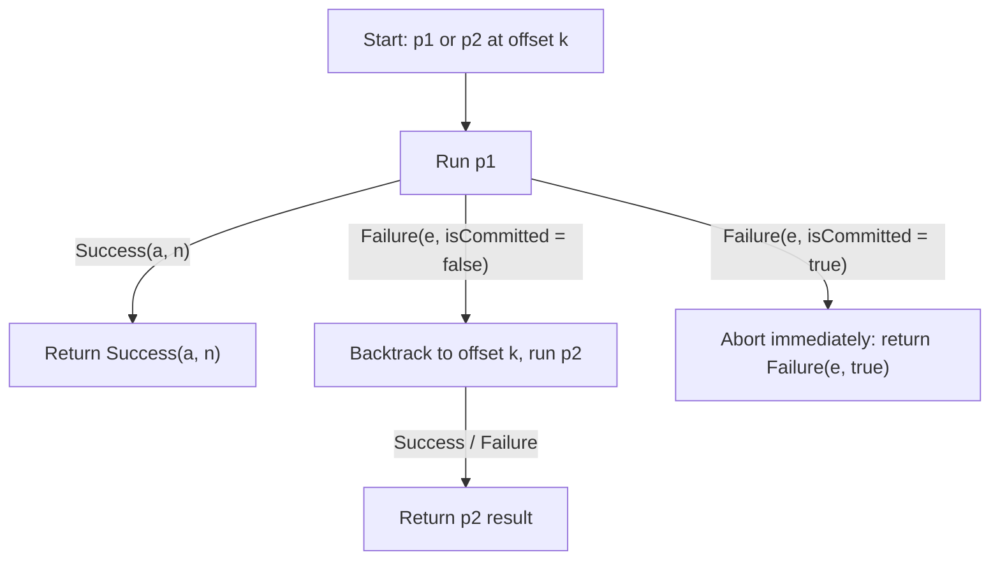
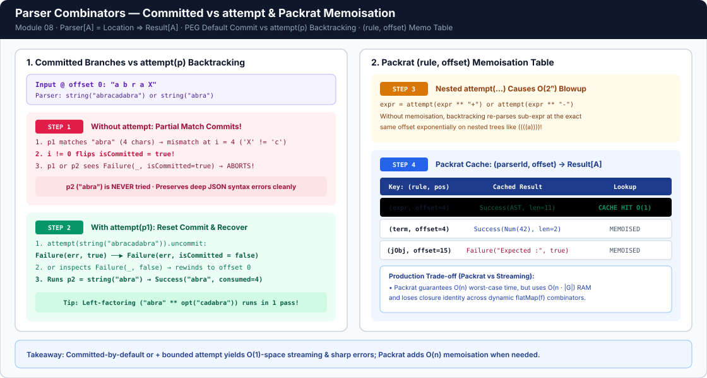

# Parser Combinators and Algebraic Design

Most software engineers learn parsing backwards: they pick a concrete representation (an imperative cursor with mutable index, or an ANTLR grammar file) and hack combinators around its quirks. **Algebraic design** inverts that workflow. Pioneered in functional programming by Graham Hutton and Erik Meijer (_Monadic Parsing in Haskell_, JFP 1998) and formalised in _Functional Programming in Scala_ (Chapter 9), algebra-first design begins with an **abstract interface** `Parsers[Parser[+_]]` and the **algebraic laws** its combinators must obey—deferring the concrete data representation until the algebra itself is complete and consistent.

The payoff is twofold: callers remain completely decoupled from representation internals (allowing later swaps from naive backtracking to memoised packrat tables or streaming state machines), and every design question—how `slice` avoids intermediate allocation, how `flatMap` crosses the Chomsky boundary into context-sensitive grammars, and how `attempt` bounds backtracking—is answered cleanly by inspecting the laws.

---

## 1. Designing the Algebra First: `Parsers[Parser[+_]]`

An algebra consists of a carrier type constructor `Parser[+A]` (representing a computation that inspects an input stream and either succeeds with a value of type `A` or fails with a structured diagnostic) together with **primitive operations**, **derived combinators**, and **equational laws**.

We start by discovering primitives from minimal parsing needs rather than guessing a representation:

| Combinator | Signature | Role | Primitive or Derived? |
| --- | --- | --- | --- |
| `string` | `String => Parser[String]` | Matches an exact literal prefix | Primitive |
| `regex` | `Regex => Parser[String]` | Matches a regular expression at current offset | Primitive |
| `slice` | `Parser[A] => Parser[String]` | Returns the matched raw substring, discarding `A` | Primitive (for $O(1)$ slice efficiency) |
| `succeed` | `A => Parser[A]` | Always succeeds with `a` consuming 0 characters | Primitive |
| `or` | `(Parser[A], => Parser[A]) => Parser[A]` | Choice; runs right branch (by-name) if left fails uncommitted | Primitive |
| `flatMap` | `(Parser[A], A => Parser[B]) => Parser[B]` | Sequences `p`, feeding its result into `f` | Primitive |
| `attempt` | `Parser[A] => Parser[A]` | Uncommits failures inside `p`, enabling backtracking | Primitive |
| `scope` | `(String, Parser[A]) => Parser[A]` | Pushes an error context frame onto `ParseError` stack | Primitive |
| `label` | `(String, Parser[A]) => Parser[A]` | Replaces the failure message with a domain expectation | Primitive |
| `map` | `(Parser[A], A => B) => Parser[B]` | Transforms result: `p.flatMap(a => succeed(f(a)))` | Derived |
| `product` | `(Parser[A], => Parser[B]) => Parser[(A, B)]` | Sequences two parsers: `for a <- p1; b <- p2 yield (a, b)` | Derived |
| `map2` | `(Parser[A], => Parser[B])((A, B) => C) => Parser[C]` | Combines two sequential results via `product` + `map` | Derived |
| `many` | `Parser[A] => Parser[List[A]]` | Zero or more occurrences: `map2(p, many(p))(_ :: _) \| succeed(Nil)` | Derived |
| `many1` | `Parser[A] => Parser[List[A]]` | One or more occurrences: `map2(p, many(p))(_ :: _)` | Derived |

### Why By-Name Evaluation (`=> Parser[B]`) Is Mandatory

Notice that the second argument to `or`, `product`, `map2`, and `listOfN` is **call-by-name** (`=> Parser[B]`). Consider the derived definition of `many(p)`:

```scala
def many[A](p: Parser[A]): Parser[List[A]] =
  map2(p, many(p))(_ :: _) or succeed(Nil)
```

If `map2`'s second parameter were evaluated strictly (call-by-value), invoking `many(p)` would evaluate `many(p)` eagerly before constructing the `Parser`, causing immediate unconditional `StackOverflowError` regardless of input! Making the second parameter of `product`/`map2` and `or` lazy (or thunked `() => Parser[B]` in TypeScript) defers construction of the recursive branch until `p` actually succeeds at runtime.

### Why `slice` Is Primitive and Algebraic Laws

Consider counting consecutive `'a'` characters: `char('a').many.map(_.size)`. If `slice` were derived simply by running `p` and computing `p.map(_ => ...)` without access to input offsets, `char('a').many` would allocate a `List[Char]` of length $n$ ($O(n)$ heap cons cells) just to throw it away! Making `slice` primitive lets an implementation inspect `(startOffset, endOffset)` on the underlying string and return `input.substring(start, end)` in $O(1)$ slice time (or bypass intermediate AST allocation completely):

$$\text{run}(\text{slice}(p.\text{many}))(\text{"aaa"}) = \text{Right}(\text{"aaa"})$$

Core algebraic laws governing the parser combinators include:

1. **Identity of `succeed`:** $\text{run}(\text{succeed}(a))(s) = \text{Right}(a)$ for all inputs $s$.
2. **Product-`succeed` identity:** `product(succeed(a), p)` is isomorphic to `p` (up to pairing `(a, b) <-> b`).
3. **Associativity of `product`:** `product(product(a, b), c)` is isomorphic to `product(a, product(b, c))` via `unbiasL` / `unbiasR`.
4. **`map` functor identity & composition:** `p.map(identity) == p`, and `p.map(f).map(g) == p.map(f andThen g)`.
5. **`map`-`product` naturality:** `map2(a.map(f), b.map(g))(h) == map2(a, b)((x, y) => h(f(x), g(y)))`.
6. **`attempt` cancellation law:** `attempt(p flatMap (_ => fail)) or q == q` (failures inside `attempt` never commit, so `or` always falls back to `q`).

---

## 2. Chomsky Hierarchy: Context-Free vs. Context-Sensitive Grammars

What separates `map2` / `product` / `or` from `flatMap`? In formal language theory, the algebraic difference corresponds precisely to the boundary between **Context-Free Grammars (CFGs)** and **Context-Sensitive Grammars (CSGs)**:

- **Context-Free Fragment (`string`, `or`, `product`/`map2`, `succeed`):** Every parser built solely with alternation (`or`) and static concatenation (`product`/`map2`) describes a context-free language (Type-2 in the Chomsky hierarchy). Crucially, the grammar of the _second_ parser `p2` in `product(p1, p2)` is fixed statically—it cannot depend on the runtime semantic value parsed by `p1`. This allows static analysis of FIRST/FOLLOW sets, LL($k$) lookahead tables, and left-factoring.
- **Context-Sensitive Fragment (adding `flatMap`):** With `flatMap`, the output `a: A` produced by `p1` dynamically selects _which grammar_ `f(a)` parses next! Consider parsing a length-prefixed binary/text frame such as `"4abcd"` or `"0"` (a decimal count $n$ followed by exactly $n$ digits or characters), or Python/YAML indentation-sensitive blocks where the parent's parsed column offset $c$ constrains all nested children, or XML closing tags `<tag>...</tag>` where the closing tag name must equal the opening tag name:

```scala
// Context-sensitive parser: integer n followed by exactly n 'a' characters
val lengthPrefixedA: Parser[List[String]] =
  regex("[0-9]+".r).flatMap { digits =>
    val n = digits.toInt
    listOfN(n, string("a"))
  }
```

No finite CFG can express $\{ n \cdot w \mid n \in \mathbb{N}, |w| = n \}$ for unbounded $n$, nor $\{ a^n b^n c^n \mid n \ge 1 \}$. Yet `flatMap` expresses them in three lines. The engineering trade-off (explored deeper in [11-applicative-and-traversable-functors.md](11-applicative-and-traversable-functors.md)) is that `flatMap` turns the grammar into an opaque black-box function `A => Parser[B]` that cannot be inspected before parsing runs.

---

## 3. Deriving a Complete RFC 8259 JSON Parser

To verify that our algebra scales beyond toy arithmetic expressions, we assemble a complete parser for **JSON (RFC 8259)** using nothing outside our abstract `Parsers` trait:

```scala
enum JSON:
  case JNull
  case JNumber(get: Double)
  case JString(get: String)
  case JBoolean(get: Boolean)
  case JArray(get: IndexedSeq[JSON])
  case JObject(get: Map[String, JSON])

def jsonParser[Parser[+_]](P: Parsers[Parser]): Parser[JSON] =
  import P.*
  val spaces  = regex("\\s*".r).slice
  val quoted  = scope("string literal") {
    string("\"") *> regex("([^\"\\\\]|\\\\.)*".r) <* string("\"")
  }
  val jNull   = string("null").as(JSON.JNull)
  val jBool   = string("true").as(JSON.JBoolean(true)) \| string("false").as(JSON.JBoolean(false))
  val jNumber = regex("[-+]?([0-9]*\\.)?[0-9]+([eE][-+]?[0-9]+)?".r)
    .map(s => JSON.JNumber(s.toDouble))
    .label("JSON number")
  val jString = quoted.map(JSON.JString(_))

  def token[A](p: Parser[A]): Parser[A] = spaces *> p <* spaces

  lazy val value: Parser[JSON] =
    token(jObject \| jArray \| jNull \| jBool \| jNumber \| jString)

  lazy val keyVal: Parser[(String, JSON)] =
    (token(quoted) <* token(string(":"))) ** value

  lazy val jArray: Parser[JSON] = scope("array") {
    (token(string("[")) *> sep(value, token(string(","))) <* token(string("]")))
      .map(vs => JSON.JArray(vs.toIndexedSeq))
  }

  lazy val jObject: Parser[JSON] = scope("object") {
    (token(string("{")) *> sep(keyVal, token(string(","))) <* token(string("}")))
      .map(kvs => JSON.JObject(kvs.toMap))
  }

  (spaces *> (jObject \| jArray) <* spaces <* eof)
```

Notice two critical details in `jsonParser`:

1. `value`, `jArray`, and `jObject` are mutually recursive; `lazy val` combined with call-by-name `or` / `*>` / `<*` prevents infinite initialisation loops.
2. In `jArray` and `jObject`, once `[` or `{` is consumed, the parser commits to parsing an array or object! If a syntax error occurs on element 47 of a JSON array, we do **not** want the top-level `jObject \| jArray` choice to silently backtrack all the way back to offset 0 and report `"Expected '{' or '['"`.

For example, parsing `{"items": [1, 2, }` triggers the following deterministic diagnostic trace without exponential backtracking:

- `"{"` consumes 1 character -> `jObject` commits (`isCommitted = true`).
- `scope("object")` wraps `keyVal`, which matches `"items"` and `":"`, then enters `jArray` (`"["` commits inside `scope("array")`).
- After `1, 2,`, `value` fails on `}` and `sep` commits inside `jArray` looking for `"]"`, yielding `1.1 object / 1.11 array / 1.17 Expected ']'`—pinpointing the exact missing bracket rather than blaming `{` at column 1.

---

## 4. Structured `ParseError`, Error Nesting, and Backtracking Control

A single flat error string like `"Syntax error at offset 142"` is useless on multi-kilobyte inputs. Conversely, unrestricted backtracking in `p1 or p2` causes both **unhelpful top-level errors** and **exponential time complexity** ($O(2^n)$ on deeply nested choices such as `((((expr))))` when a closing parenthesis is missing).

### The `ParseError` Stack (`scope` vs `label`)

We represent `Location` as `(input: String, offset: Int)` (lazily computing 1-based `line` and `col` from `input.slice(0, offset)` only when formatting an error, avoiding line-counting overhead on the hot success path) and `ParseError` as a non-empty trace stack of `(Location, String)` frames:

```scala
final case class Location(input: String, offset: Int = 0):
  lazy val line: Int = input.slice(0, offset).count(_ == '\n') + 1
  lazy val col: Int  = input.slice(0, offset).lastIndexOf('\n') match
    case -1        => offset + 1
    case lineStart => offset - lineStart

  def advanceBy(n: Int): Location = copy(offset = offset + n)

final case class ParseError(stack: List[(Location, String)] = Nil):
  def push(loc: Location, msg: String): ParseError =
    copy(stack = (loc, msg) :: stack)

  def label(s: String): ParseError =
    ParseError(latestLoc.map((_, s)).toList)

  def latestLoc: Option[Location] = stack.lastOption.map(_._1)
```

The two error combinators serve complementary roles:

- **`scope(msg, p)`** _pushes_ `(loc, msg)` onto the stack when `p` fails, preserving the detailed inner error beneath a high-level context frame (e.g., `line 4, col 12: object -> line 4, col 15: Expected ':'`).
- **`label(msg, p)`** _replaces_ the inner stack with `(latestLoc, msg)` when a composite token should present a single domain-level expectation (e.g., `"Expected ISO-8601 date"` rather than `"Expected digit '0'-'9'"`).

### Controlling Backtracking: Committed Branches and `attempt`

In Parsing Expression Grammars (PEGs, Bryan Ford, POPL 2004) and production combinator libraries (Parsec, `cats-parse`), **`or` commits by default once the left branch consumes at least 1 character**, unless explicitly wrapped in `attempt(p)`:



Let us trace the commit rule carefully:

1. A failure from a primitive (`string`, `regex`) before consuming input starts with `isCommitted = false`.
2. In `p1.flatMap(f)` (and therefore `product` / `map2`), **consuming $\ge 1$ character inside `p1` flips `isCommitted = true`** on any subsequent failure from `f(a)`! Intuitively: if you matched `"{"` and failed looking for `keyVal`, you are definitely inside a JSON object—retrying `jArray` at `"{"` makes zero sense.
3. **`attempt(p)`** resets `isCommitted = false` on any failure inside `p`:

```scala
def attempt[A](p: Parser[A]): Parser[A]
```

This rule simultaneously solves both failure modes:

- **Diagnostic precision:** Deep errors inside committed prefixes (`{"a": 1, "b": }`) propagate straight out with exact line/column and `scope` stack intact instead of being erased by outer `or` fallbacks.
- **Complexity guarantee ($O(n)$ LL($1$)-like dispatch):** Because `p1 or p2` only falls through to `p2` if `p1` fails _before consuming input_ (or is explicitly marked with bounded `attempt`), grammars with distinct leading tokens never re-scan already-parsed subtrees, eliminating $O(2^n)$ exponential blowup.

---

## 5. Concrete Reference Implementation (Scala 3 & TypeScript)

Every rule in our algebra maps cleanly onto a tiny, pure state-machine representation `Parser[+A] = Location => Result[A]`:

```scala
enum Result[+A]:
  case Success(get: A, charsConsumed: Int)
  case Failure(get: ParseError, isCommitted: Boolean)

  def mapError(f: ParseError => ParseError): Result[A] = this match
    case Failure(e, c) => Failure(f(e), c)
    case s             => s

  def uncommit: Result[A] = this match
    case Failure(e, true) => Failure(e, isCommitted = false)
    case other            => other

  def addCommit(isCommitted: Boolean): Result[A] = this match
    case Failure(e, c) => Failure(e, c || isCommitted)
    case other         => other

  def advanceSuccess(n: Int): Result[A] = this match
    case Success(a, m) => Success(a, m + n)
    case other         => other
```

With `Result` defined, each primitive in the reference `Parsers` implementation is concise and completely stack-free for `or` / `flatMap` routing (though `many` on deeply nested inputs should still accumulate iteratively or via trampolining, as covered in Module 12):

```scala
type Parser[+A] = Location => Result[A]

def string(w: String): Parser[String] = loc =>
  val i = firstNonmatchingIndex(loc.input, w, loc.offset)
  if i == -1 then Result.Success(w, w.length)
  else Result.Failure(loc.advanceBy(i).toError(s"'$w'"), isCommitted = i != 0)

def succeed[A](a: A): Parser[A] = _ => Result.Success(a, 0)

def attempt[A](p: Parser[A]): Parser[A] = loc => p(loc).uncommit

def or[A](p1: Parser[A], p2: => Parser[A]): Parser[A] = loc =>
  p1(loc) match
    case Result.Failure(_, false) => p2(loc)
    case r                        => r

def flatMap[A, B](p: Parser[A])(f: A => Parser[B]): Parser[B] = loc =>
  p(loc) match
    case Result.Success(a, n) =>
      f(a)(loc.advanceBy(n))
        .addCommit(n != 0)
        .advanceSuccess(n)
    case f @ Result.Failure(_, _) => f

def slice[A](p: Parser[A]): Parser[String] = loc =>
  p(loc) match
    case Result.Success(_, n)     => Result.Success(loc.input.substring(loc.offset, loc.offset + n), n)
    case f @ Result.Failure(_, _) => f
```

Notice the crucial subtlety in `string(w)`: if `w = "abracadabra"` and the input at `loc.offset` is `"abraX"`, `firstNonmatchingIndex` returns `i = 4`. Because `i != 0` (partial prefix match!), `isCommitted` is set to `true` and the error points to offset `loc.offset + 4`! That is why multi-character token overlap (`"abracadabra" or "abra"`) requires explicit `attempt(string("abracadabra")) or string("abra")`—or better yet, left-factoring (`string("abra") ** opt(string("cadabra"))`) to run in a single linear pass:

```text
firstNonmatchingIndex(s: String, w: String, offset: Int):
  i := 0
  while i < w.length and (offset + i) < s.length:
    if s[offset + i] != w[i]: return i
    i := i + 1
  if offset + w.length <= s.length: return -1   // full match
  else: return i                                 // truncated prefix mismatch at i
```

### TypeScript Structural Encoding

In **TypeScript**, thunking the lazy branch `() => Parser<A>` mirrors Scala's call-by-name parameter and prevents eager stack blowup in recursive rules:

```typescript
export interface ParseLocation {
  readonly input: string;
  readonly offset: number;
}

export type ParseResult<A> =
  | { readonly tag: 'Success'; readonly value: A; readonly consumed: number }
  | {
      readonly tag: 'Failure';
      readonly error: string;
      readonly offset: number;
      readonly committed: boolean;
    };

export type Parser<A> = (loc: ParseLocation) => ParseResult<A>;

export const string =
  (lit: string): Parser<string> =>
  (loc) => {
    if (loc.input.startsWith(lit, loc.offset)) {
      return { tag: 'Success', value: lit, consumed: lit.length };
    }
    return { tag: 'Failure', error: `Expected "${lit}"`, offset: loc.offset, committed: false };
  };

export const attempt =
  <A>(p: Parser<A>): Parser<A> =>
  (loc) => {
    const res = p(loc);
    return res.tag === 'Failure' ? { ...res, committed: false } : res;
  };

export const or =
  <A>(p1: Parser<A>, p2: () => Parser<A>): Parser<A> =>
  (loc) => {
    const r1 = p1(loc);
    if (r1.tag === 'Failure' && !r1.committed) return p2()(loc);
    return r1;
  };

export const flatMap =
  <A, B>(p: Parser<A>, f: (a: A) => Parser<B>): Parser<B> =>
  (loc) => {
    const r1 = p(loc);
    if (r1.tag === 'Failure') return r1;
    const r2 = f(r1.value)({ input: loc.input, offset: loc.offset + r1.consumed });
    if (r2.tag === 'Failure') {
      return { ...r2, committed: r2.committed || r1.consumed > 0 };
    }
    return { tag: 'Success', value: r2.value, consumed: r1.consumed + r2.consumed };
  };
```

### Derived Combinators and `ParseError` Rendering

Once `string`, `regex`, `slice`, `succeed`, `or`, `flatMap`, `attempt`, `scope`, and `label` are fixed, the remaining vocabulary derives purely from those primitives without touching `Result` or `Location`:

```scala
def map[A, B](p: Parser[A])(f: A => B): Parser[B] =
  p.flatMap(a => succeed(f(a)))

def product[A, B](p: Parser[A], p2: => Parser[B]): Parser[(A, B)] =
  p.flatMap(a => p2.map(b => (a, b)))

def map2[A, B, C](p: Parser[A], p2: => Parser[B])(f: (A, B) => C): Parser[C] =
  product(p, p2).map((a, b) => f(a, b))

def listOfN[A](n: Int, p: Parser[A]): Parser[List[A]] =
  if n <= 0 then succeed(Nil)
  else map2(p, listOfN(n - 1, p))(_ :: _)

def sep1[A](p: Parser[A], separator: Parser[Any]): Parser[List[A]] =
  map2(p, many(separator *> p))(_ :: _)

def sep[A](p: Parser[A], separator: Parser[Any]): Parser[List[A]] =
  sep1(p, separator) or succeed(Nil)
```

When rendering a `ParseError` stack, collapsing consecutive frames that share the exact same `Location` prevents verbose redundant line headers while preserving the call-chain context from outermost `scope` down to the innermost `label` or literal mismatch:

```text
formatError(err: ParseError):
  if err.stack is empty: return "no parse error"
  grouped := collapseBy(err.stack, frame => frame.location)
  lines := [ f"${loc.line}.${loc.col} ${msgs.join(" / ")}" for (loc, msgs) in grouped ]
  context := err.latestLoc.map(l => caretLine(l.input, l.offset))
  return lines.join("\n") + "\n" + context
```

---

## 6. Packrat Memoisation, Incremental Streaming, and `flatMap` Limits

When grammars genuinely require arbitrary unbounded lookahead (`attempt` over nested recursive rules), committed-by-default PEG branching can still degrade to $O(2^n)$ time. **Packrat parsing** (Bryan Ford, ICFP 2002) restores guaranteed linear time $O(n)$ by memoising a sparse table mapping `(parserId, offset) -> Result[A]` so no parser ever executes twice at the same input offset.

Yet packrat memoisation interacts subtly with monadic `flatMap`:

1. **Closure Identity Loss:** In `p.flatMap(f)`, the parser returned by `f(a)` is allocated dynamically per parse of `a`. Two invocations at different branches produce fresh closure instances with distinct object identities, preventing a naive `(parserRef, offset)` memo table from hitting the cache unless the memo key includes the parameterised `a` value itself (which can be huge or unhashable).
2. **Memory Footprint:** Retaining full memo tables across a $100\text{ MB}$ JSON stream consumes $O(n \cdot |G|)$ heap space (often $10\times\text{–}50\times$ the input size). Consequently, high-throughput streaming parsers (Haskell `attoparsec`, Scala `cats-parse`, Rust `nom`) deliberately eschew global packrat tables in favour of **committed-by-default $O(1)$-space backtracking** paired with chunked resumable continuation frames (`Partial(k: Chunk => Result)`), allowing already-committed input prefixes to be garbage-collected immediately.



_Step-by-step mechanics:_ (1) Consuming $\ge 1$ character flips `isCommitted = true` so `or` aborts immediately with exact error location, whereas `attempt(p)` resets `isCommitted = false` to allow fallback to `p2`. (2) When nested `attempt` rules risk $O(2^n)$ re-parsing, a sparse Packrat table caches `(parserId, offset) -> Result[A]` for $O(n)$ total time at the cost of $O(n \cdot |G|)$ heap.

---

## 7. Failure Modes and Negative Examples

Recursive-descent parser combinators exhibit four classic failure modes in production systems:

| Failure Mode | Root Cause | Concrete Example / Fix |
| --- | --- | --- |
| **Left Recursion Hang (`StackOverflowError`)** | Recursive-descent rule calls itself at offset 0 before consuming input | `expr = (expr ** string("+") ** term) or term` diverges infinitely. **Fix:** Rewrite via `term ** many(string("+") ** term)` (left-factoring) or use Pratt / precedence-climbing parsing |
| **Catastrophic Exponential Backtracking** | Wrapping large recursive alternatives (`expr`) in `attempt(...)` inside `or` | `attempt(expr <* "+") or attempt(expr <* "-")` re-parses `expr` twice per level ($O(2^d)$). **Fix:** Left-factor common prefixes (`expr ** (string("+") \| string("-"))`) or use packrat memoisation |
| **Strict `many` Infinite Loop on Nullable Sub-Parser** | Calling `many(p)` where `p` can succeed consuming `0` characters (e.g., `many(regex("\\s*".r))`) | `p` succeeds forever at the same offset until `OutOfMemoryError` or `StackOverflowError`. **Fix:** Guard `many` so a 0-char match terminates repetition, or require `p` inside `many` to be non-nullable |
| **Stack Overflow in `many` on Large Inputs** | Recursive `map2(p, many(p))` builds one JVM/JS stack frame per element | Parsing a 50,000-element JSON array overflows the call stack. **Fix:** Implement `many` via an internal loop or `ListBuffer` / trampolining while preserving the pure external algebra |

> [!TIP]
> **Production Scala 3 Ecosystem Note:** Typelevel's `cats-parse` formalises the distinction between nullable and non-nullable parsers directly in the type system: `Parser0[A]` may succeed consuming 0 characters, while `Parser[A]` statically guarantees $\ge 1$ character consumed. Because `many` / `rep` only accepts `Parser[A]` (non-nullable), infinite zero-consumption loops like `many(spaces)` become a **compile-time type error** rather than a runtime `OutOfMemoryError`.

---

## Interview Drill

1. **Why does algebra-first design define `Parsers[Parser[+_]]` and its laws before writing `Location => Result[A]`?**

<details><summary>Answer</summary>

Specifying the trait signatures and algebraic laws first prevents representation details (such as mutable cursors or concrete ASTs) from leaking into user-facing combinators. Any implementation obeying the laws—backtracking recursive descent, packrat memoisation, or streaming state machines—can be substituted transparently behind the same interface, and laws like `attempt` cancellation or `product` associativity can be tested directly with property-based testing.

</details>

2. **Why must `slice` be a primitive combinator rather than derived from `many` and `map`?**

<details><summary>Answer</summary>

If `slice(p)` were derived without primitive access to the input buffer and consumed offset, `p` (such as `char('a').many`) would first construct an intermediate `List[Char]` of length $n$ in memory and then concatenate it back into a string ($O(n)$ extra allocation and GC pressure). Making `slice` primitive lets the parser inspect `(startOffset, startOffset + charsConsumed)` and return a direct substring slice in $O(1)$ space overhead while bypassing intermediate allocations.

</details>

3. **How does adding `flatMap` move parser combinators from Context-Free Grammars to Context-Sensitive Grammars, and what do we give up?**

<details><summary>Answer</summary>

Combinators built only from `string`, `or`, and `product`/`map2` keep the structure of subsequent parsers independent of previously parsed values, which limits expressiveness to Context-Free Grammars. Adding `flatMap(p)(a => f(a))` lets the runtime value `a` dynamically construct the next parser `f(a)`—unlocking context-sensitive languages such as length-prefixed frames (`"3abc"`), matching XML tag names, or indentation-sensitive blocks. The cost is losing static grammar inspectability: because `f` is an opaque function, the parser library can no longer precompute FIRST/FOLLOW sets or guarantee $O(n)$ LL($k$) lookahead tables statically.

</details>

4. **Explain the difference between `scope` and `label` in `ParseError`, and how `isCommitted` interacts with `or`.**

<details><summary>Answer</summary>

`scope(msg, p)` pushes an outer context frame `(loc, msg)` onto the `ParseError` stack on failure, preserving inner diagnostics for hierarchical error traces (e.g., `object -> key-value -> Expected ':'`). `label(msg, p)` replaces the inner stack with a single domain-level expectation `(latestLoc, msg)`. Under committed-by-default semantics, once `p1` in `p1 or p2` consumes at least one character and then fails (`isCommitted = true`), `or` aborts immediately instead of falling back to `p2`—preventing both exponential re-parsing and the erasure of deep syntax errors.

</details>

5. **Why does `many(regex("\\s*".r))` crash at runtime, and how do modern libraries like `cats-parse` prevent it statically?**

<details><summary>Answer</summary>

`regex("\\s*".r)` matches the empty string consuming `0` characters (`charsConsumed = 0`). Calling `many` on it triggers an infinite loop at the same `offset` until `StackOverflowError` or `OutOfMemoryError`. `cats-parse` solves this at the type level by splitting parsers into `Parser0[A]` (may consume 0 chars) and `Parser[A]` (statically guaranteed to consume $\ge 1$ char) and restricting `rep` (`many`) to `Parser[A]`.

</details>

6. **How do you eliminate left recursion in a recursive-descent parser combinator library without rewriting the entire library as a bottom-up shift-reduce engine?**

<details><summary>Answer</summary>

Left-recursive rules such as `expr = (expr ** "+" ** term) \| term` infinite-loop in top-down parsers because `expr` invokes itself at the same offset before consuming any input. You eliminate direct left recursion by factoring into a non-left-recursive head followed by `many` (`term ** many("+" ** term)` and reducing with `foldLeft` for left-associativity) or by delegating infix operator precedence to a Pratt (top-down operator precedence) parser combinator.

</details>

7. **Why do the second parameters of `or` and `product` (`map2`) have to be call-by-name (`=> Parser[B]`)?**

<details><summary>Answer</summary>

Recursive grammar definitions such as `many(p) = map2(p, many(p))(_ :: _) or succeed(Nil)` and mutually recursive JSON rules (`jObject`, `jArray`, `value`) construct parsers by referencing themselves. If `or` or `map2` evaluated its second argument strictly, building the parser value would recurse infinitely on construction before a single character of input was ever read. Call-by-name defers evaluating the right-hand branch until runtime execution reaches it.

</details>

8. **Why do high-throughput streaming parser combinators (`cats-parse`, `attoparsec`) avoid full Packrat memoisation, and how does `flatMap` complicate Packrat caching?**

<details><summary>Answer</summary>

Packrat memoisation caches `(parserId, offset) -> Result` across the entire input, requiring $O(n \cdot |G|)$ memory and pinning the entire input buffer in memory in case a non-committed branch backtracks to offset `0`. Streaming parsers instead commit early (`isCommitted = true` after consuming input) so past input chunks can be released immediately in $O(1)$ space. Additionally, `flatMap(p)(f)` creates fresh dynamic parser closures `f(a)` at runtime whose identity depends on the parsed value `a`, defeating static `(parserId, offset)` memo keys unless `a` is hashed into the cache key.

</details>
