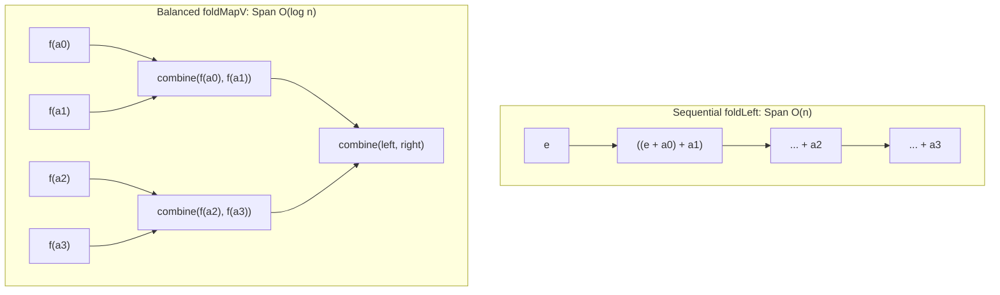

# Monoids, Foldables, and Parallel Reduction

Across disparate domains—string concatenation, integer arithmetic, configuration merging, MapReduce aggregations, and CRDT state convergence—the exact same algebraic shape recurs: a binary combining operation that is **associative** together with a distinguished **identity element**. In abstract algebra this structure is a **monoid**. In functional software architecture, as Guy Steele demonstrated in _Organizing Functional Code for Parallel Execution, or, foldl and foldr Considered Slightly Harmful_ (ICFP 2009), monoids are the exact mathematical unlock that transforms $O(n)$-span sequential loops into $O(\log n)$-span parallel divide-and-conquer reductions and fuses multi-pass traversals into single-pass streaming folds.

---

## 1. Semigroups and Monoids: Formal Axioms

A **semigroup** is a pair $(S, \bullet)$ consisting of a non-empty carrier set $S$ and a closed binary operation $\bullet : S \times S \to S$ satisfying **associativity**:

$$\forall x, y, z \in S.\quad (x \bullet y) \bullet z = x \bullet (y \bullet z)$$

A **monoid** $(M, \bullet, e)$ extends a semigroup with a two-sided **identity element** $e \in M$ (also called `empty` or `zero`) satisfying **left and right identity**:

$$\forall x \in M.\quad e \bullet x = x \quad\land\quad x \bullet e = x$$

Notice what the axioms do _not_ require: **commutativity** ($x \bullet y = y \bullet x$). String concatenation (`"a" + "b" != "b" + "a"`) and function composition (`f andThen g != g andThen f`) are monoids without being commutative. By contrast, integers under addition $(\mathbb{Z}, +, 0)$ form a **commutative (Abelian) monoid**.

```scala
trait Semigroup[A]:
  def combine(a1: A, a2: A): A

trait Monoid[A] extends Semigroup[A]:
  def empty: A

object Monoid:
  given stringMonoid: Monoid[String] with
    def combine(a1: String, a2: String): String = a1 + a2
    val empty: String = ""

  given intAddition: Monoid[Int] with
    def combine(a1: Int, a2: Int): Int = a1 + a2
    val empty: Int = 0

  given intMultiplication: Monoid[Int] with
    def combine(a1: Int, a2: Int): Int = a1 * a2
    val empty: Int = 1

  given booleanOr: Monoid[Boolean] with
    def combine(a1: Boolean, a2: Boolean): Boolean = a1 \|\| a2
    val empty: Boolean = false

  given booleanAnd: Monoid[Boolean] with
    def combine(a1: Boolean, a2: Boolean): Boolean = a1 && a2
    val empty: Boolean = true

  def listMonoid[A]: Monoid[List[A]] with
    def combine(a1: List[A], a2: List[A]): List[A] = a1 ++ a2
    val empty: List[A] = Nil
```

### Dual, `Option`, and Endomorphism Monoids

Several fundamental monoids illustrate how the same underlying carrier type admits distinct monoid instances—and why Scala type-class coherence (covered in `languages/scala`) avoids exposing conflicting global `given` instances for `Int` (`+` vs `*`) or `Option[A]`:

- **Dual Monoid (`dual[A](m: Monoid[A])`):** Reverses argument order: `combine(x, y) = m.combine(y, x)` with identical `empty`. If `m` is associative, `dual(m)` is automatically associative: $(z \bullet y) \bullet x = z \bullet (y \bullet x)$.
- **Option Monoid (`optionMonoid[A]` vs `firstOption[A]`):** Under `firstOption`, `combine(Some(a), _) = Some(a)` and `combine(None, opt) = opt` with `empty = None` (taking the first present value, useful for cascading configuration lookups; `dual(firstOption)` yields `lastOption`). Alternatively, lifting a `Semigroup[A]` into `Monoid[Option[A]]` combines `Some(a1)` and `Some(a2)` via `Semigroup[A].combine(a1, a2)`.
- **Endomorphism Monoid (`endoMonoid[A]`):** Functions `A => A` (endomorphisms) form a monoid under composition `f compose g` (or its dual `f andThen g`) with `empty = identity[A]`.

---

## 2. Folding Lists and Implementing `foldLeft` / `foldRight` via `foldMap`

When a data type's elements are already in a monoid `M`, reducing a `List[A]` requires zero extra wiring:

```scala
def concatenate[A](as: List[A], m: Monoid[A]): A =
  as.foldLeft(m.empty)(m.combine)
```

More generally, elements of a `List[A]` rarely belong directly to our target monoid `B`. **`foldMap`** maps each element $a : A$ into a monoid $B$ via $f : A \to B$ and combines the mapped values in a single pass:

```scala
def foldMap[A, B](as: List[A], m: Monoid[B])(f: A => B): B =
  as.foldLeft(m.empty)((b, a) => m.combine(b, f(a)))
```

Remarkably, `foldMap` together with `endoMonoid[B]` is strong enough to implement **both** `foldRight` and `foldLeft`! Notice why: each element $a : A$ in `foldRight` represents a partial state transition $f(a, \cdot) : B \to B$. Mapping each $a$ to the endomorphism `b => f(a, b)` inside `endoMonoid[B]` (using `compose`, or `dual(endoMonoid[B])` using `andThen` for `foldLeft`) and applying the resulting composed function to the initial seed `z: B` yields:

```scala
def foldRightViaFoldMap[A, B](as: List[A])(z: B)(f: (A, B) => B): B =
  val endo = new Monoid[B => B]:
    def combine(f1: B => B, f2: B => B): B => B = f1 compose f2
    val empty: B => B = identity
  foldMap(as, endo)(a => b => f(a, b))(z)

def foldLeftViaFoldMap[A, B](as: List[A])(z: B)(f: (B, A) => B): B =
  val dualEndo = new Monoid[B => B]:
    def combine(f1: B => B, f2: B => B): B => B = f1 andThen f2
    val empty: B => B = identity
  foldMap(as, dualEndo)(a => b => f(b, a))(z)
```

> [!WARNING]
> **Stack-Depth Caution on `endoMonoid`:** While `foldRightViaFoldMap` is algebraically exact, composing $n$ closures `f_1 compose f_2 compose ... compose f_n` builds a chain of nested thunks of depth $n$. Invoking the final composed function on a $100{,}000$-element list will blow the JVM or V8 call stack unless evaluated via a trampoline (Module 12) or a left-associative accumulator.

---

## 3. Why Associativity Enables Parallelism: Balanced `foldMapV`

Why does associativity matter so profoundly for systems engineering? Consider evaluating $a_0 \bullet a_1 \bullet a_2 \bullet a_3$:

- **`foldLeft`** imposes a strictly linear sequential dependency chain: $(((e \bullet a_0) \bullet a_1) \bullet a_2) \bullet a_3$. Every step depends on the previous step, forcing **span (critical path depth)** $\Theta(n)$ even on a 128-core CPU.
- **Balanced tree reduction (`foldMapV`)** uses associativity to re-parenthesise the expression into a binary tree: $(a_0 \bullet a_1) \bullet (a_2 \bullet a_3)$. Because the left and right subtrees share zero data dependencies, they execute in parallel, reducing span from $O(n)$ to $O(\log n)$ (Guy Blelloch's work-span model, 1990):



On an `IndexedSeq[A]` (which supports $O(1)$ `length` and `splitAt` slice views without $O(n)$ list traversal), `foldMapV` and its lifted parallel counterpart `parFoldMap` express divide-and-conquer reduction cleanly:

```scala
def foldMapV[A, B](as: IndexedSeq[A], m: Monoid[B])(f: A => B): B =
  if as.isEmpty then m.empty
  else if as.length == 1 then f(as(0))
  else
    val (l, r) = as.splitAt(as.length / 2)
    m.combine(foldMapV(l, m)(f), foldMapV(r, m)(f))

def par[A](m: Monoid[A]): Monoid[Par[A]] = new Monoid[Par[A]]:
  val empty: Par[A] = Par.unit(m.empty)
  def combine(a: Par[A], b: Par[A]): Par[A] = Par.map2(a, b)(m.combine)

def parFoldMap[A, B](as: IndexedSeq[A], m: Monoid[B])(f: A => B): Par[B] =
  Par.parMap(as)(f).flatMap { bs =>
    foldMapV(bs, par(m))(b => Par.lazyUnit(b))
  }
```

In production implementations (such as Scala parallel collections or Spark/Ray partition reducers), `foldMapV` switches from parallel splitting to a tight sequential loop below a **sequential threshold** (e.g., `as.length <= 4096`) so task-scheduling and closure-allocation overhead does not exceed the work of combining leaf elements.

### TypeScript Parallel-Ready Balanced Reduction

In TypeScript, even on a single-threaded event loop or across Web Workers / Node Worker Threads, balanced `foldMapV` limits recursion depth to $\lceil \log_2 n \rceil$ (never overflowing the stack even for $n = 10^8$) and mirrors divide-and-conquer worker dispatch:

```typescript
export interface Monoid<A> {
  readonly empty: A;
  readonly combine: (x: A, y: A) => A;
}

export const foldMapV = <A, B>(
  as: readonly A[],
  m: Monoid<B>,
  f: (a: A) => B,
  start = 0,
  end = as.length,
): B => {
  const len = end - start;
  if (len <= 0) return m.empty;
  if (len === 1) return f(as[start]);
  const mid = start + (len >>> 1);
  return m.combine(foldMapV(as, m, f, start, mid), foldMapV(as, m, f, mid, end));
};
```

---

## 4. Parallel Word-Count Parsing: The `WC` Monoid

A classic misconception is that parsing or token counting is inherently sequential because tokens can straddle arbitrary chunk boundaries. Suppose we split `"lorem ipsum dolor sit amet, "` right through the middle of `"dolor"`: left chunk `"lorem ipsum do"`, right chunk `"lor sit amet, "`. Summing independent per-chunk word counts yields $3 + 3 = 6$ instead of the true count $5$, because `"do"` and `"lor"` are two halves of a single word!

The solution is to design a **monoid `WC`** that preserves boundary state on both sides of any chunk:

```scala
enum WC:
  case Stub(chars: String)
  case Part(lStub: String, words: Int, rStub: String)
```

- `Stub(chars)` represents an unsplit fragment containing **no whitespace yet** (a partial word or empty `""`).
- `Part(lStub, words, rStub)` represents a fragment containing at least one whitespace boundary: `lStub` is the incomplete word fragment on the left edge, `words` is the exact count of **complete words fully contained inside** the fragment, and `rStub` is the incomplete word fragment on the right edge.

Look at what happens when combining two `WC` values:

```scala
val wcMonoid: Monoid[WC] = new Monoid[WC]:
  val empty: WC = WC.Stub("")

  def combine(a: WC, b: WC): WC = (a, b) match
    case (WC.Stub(c1), WC.Stub(c2)) =>
      WC.Stub(c1 + c2)
    case (WC.Stub(c), WC.Part(l, w, r)) =>
      WC.Part(c + l, w, r)
    case (WC.Part(l, w, r), WC.Stub(c)) =>
      WC.Part(l, w, r + c)
    case (WC.Part(l1, w1, r1), WC.Part(l2, w2, r2)) =>
      val boundaryWord = if (r1 + l2).isEmpty then 0 else 1
      WC.Part(l1, w1 + boundaryWord + w2, r2)
```

Let us trace our split `"lorem ipsum do"` \| `"lor sit amet, "`:

1. Left chunk reduces to `Part("", 2, "do")` (2 complete words `"lorem"`, `"ipsum"` and trailing `"do"`).
2. Right chunk reduces to `Part("lor", 2, "")` (leading `"lor"` and 2 complete words `"sit"`, `"amet,"`).
3. Combining `Part("", 2, "do")` and `Part("lor", 2, "")`: `r1 + l2 = "do" + "lor" = "dolor"` (non-empty -> `boundaryWord = 1`), producing `Part("", 2 + 1 + 2, "") = Part("", 5, "")`!
4. Had the split fallen _between_ `"ipsum"` and `"dolor"` (`r1 = ""` and `l2 = ""`), `r1 + l2` would be empty (`boundaryWord = 0`), producing `2 + 0 + 3 = 5` as well!

Finally, mapping any single character `c: Char` creates `if c.isWhitespace then WC.Part("", 0, "") else WC.Stub(c.toString)`, and extracting the final word count handles any remaining outer stubs:

```scala
def countWords(s: String): Int =
  def unstub(st: String): Int = st.length.min(1)
  foldMapV(s, wcMonoid)(c => if c.isWhitespace then WC.Part("", 0, "") else WC.Stub(c.toString)) match
    case WC.Stub(c)       => unstub(c)
    case WC.Part(l, w, r) => unstub(l) + w + unstub(r)
```

---

## 5. `Foldable[F[_]]` and Monoid Homomorphisms

Whenever we write `foldRight`, `foldLeft`, or `foldMap`, the exact implementation depends on the container `F[_]` (`List`, `IndexedSeq`, `LazyList`, `Tree`, `Option`), yet the fold abstraction itself is uniform. Capturing that commonality gives the **`Foldable[F[_]]`** higher-kinded type class:

```scala
trait Foldable[F[_]]:
  def foldRight[A, B](as: F[A])(z: B)(f: (A, B) => B): B
  def foldLeft[A, B](as: F[A])(z: B)(f: (B, A) => B): B
  def foldMap[A, B](as: F[A])(f: A => B)(using mb: Monoid[B]): B =
    foldRight(as)(mb.empty)((a, b) => mb.combine(f(a), b))
  def concatenate[A](as: F[A])(using m: Monoid[A]): A =
    foldLeft(as)(m.empty)(m.combine)
  def toList[A](as: F[A]): List[A] =
    foldRight(as)(List.empty[A])(_ :: _)

enum Tree[+A]:
  case Leaf(value: A)
  case Branch(left: Tree[A], right: Tree[A])

given Foldable[Tree] with
  def foldRight[A, B](as: Tree[A])(z: B)(f: (A, B) => B): B = as match
    case Tree.Leaf(a)      => f(a, z)
    case Tree.Branch(l, r) => foldRight(l)(foldRight(r)(z)(f))(f)

  def foldLeft[A, B](as: Tree[A])(z: B)(f: (B, A) => B): B = as match
    case Tree.Leaf(a)      => f(z, a)
    case Tree.Branch(l, r) => foldLeft(r)(foldLeft(l)(z)(f))(f)

  override def foldMap[A, B](as: Tree[A])(f: A => B)(using mb: Monoid[B]): B = as match
    case Tree.Leaf(a)      => f(a)
    case Tree.Branch(l, r) => mb.combine(foldMap(l)(f), foldMap(r)(f))
```

Notice that `Foldable[F[_]]` makes **no assumptions about element type `A`** or even whether `F` is a `Functor` (for instance, `Set` is `Foldable` without being a lawful `Functor` under arbitrary equality, and `Tree`'s overridden `foldMap` directly preserves the tree's balanced shape for parallel evaluation rather than linearising through `foldRight`).

### Monoid Hierarchy: Semigroup → Monoid → Commutative Monoid → Bounded Semilattice

Adding algebraic laws progressively unlocks stronger system guarantees:

| Algebraic Structure | Laws Beyond Semigroup | Production Systems Unlocked |
| --- | --- | --- |
| **Semigroup** $(S, \bullet)$ | Associativity only | Parallel reduction of non-empty chunks (`reduce`, `NonEmptyList`) |
| **Monoid** $(M, \bullet, e)$ | + Identity $e$ | Empty collections, `foldMapV` default base case, `0`-element streams |
| **Commutative Monoid** | + $x \bullet y = y \bullet x$ | Out-of-order network partition merges (MapReduce shuffle without sort order) |
| **Bounded Semilattice** | + Idempotence $x \bullet x = x$ | At-least-once duplicate-tolerant state-based CRDTs (`Set.union`, G-Counter `max`) |

Notice why distributed systems care deeply about **idempotent commutative monoids** (bounded semilattices): a plain monoid such as `(Int, +, 0)` cannot safely handle duplicate message delivery in an at-least-once network (`1 + 1 = 2 != 1`), whereas a bounded semilattice (`Set.union` or per-replica vector `Map[ReplicaId, Int]` combined with pointwise `max`) tolerates arbitrary reordering, partitioning, and duplicate retries with identical final state.

### Monoid Homomorphisms

A function $h : M \to N$ between two monoids $(M, \bullet, e_M)$ and $(N, \star, e_N)$ is a **monoid homomorphism** if it preserves both the binary operation and the identity element:

$$\forall x, y \in M.\quad h(x \bullet y) = h(x) \star h(y) \qquad\text{and}\qquad h(e_M) = e_N$$

Examples include:

- `String.length`: `(String, +, "") -> (Int, +, 0)`, because `(s1 + s2).length == s1.length + s2.length` and `"".length == 0`.
- `List.size`: `(List[A], ++, Nil) -> (Int, +, 0)`.
- `toSet`: `(List[A], ++, Nil) -> (Set[A], union, Set.empty)`.

Why do homomorphisms matter in distributed systems and compilers? Because any homomorphism $h$ satisfies:

$$\text{foldMap}(xs, N)(h \circ f) \;=\; h(\text{foldMap}(xs, M)(f))$$

That means you can **push aggregations down to workers** (map-side combiners in MapReduce/Spark): instead of shipping giant `String` payloads over the network to count total characters, each partition computes `.length` locally and ships a single 64-bit integer!

An **isomorphism** of monoids is a pair of homomorphisms $f : M \to N$ and $g : N \to M$ such that $f \circ g = \text{id}_N$ and $g \circ f = \text{id}_M$ (e.g., `(String, +, "")` and `(List[Char], ++, Nil)`).

---

## 6. Composing Monoids to Fuse Multi-Pass Traversals

One of the highest-leverage practical uses of monoids is **combinatorially assembling complex monoids** from simple ones so multiple independent metrics are computed in a **single fused pass** over a collection or stream:

1. **Product Monoid (`productMonoid`):** If `A` and `B` are monoids, `(A, B)` is automatically a monoid component-wise:

```scala
def productMonoid[A, B](ma: Monoid[A], mb: Monoid[B]): Monoid[(A, B)] = new Monoid[(A, B)]:
  val empty: (A, B) = (ma.empty, mb.empty)
  def combine(x: (A, B), y: (A, B)): (A, B) =
    (ma.combine(x._1, y._1), mb.combine(x._2, y._2))
```

2. **Map-Merge Monoid (`mapMergeMonoid`):** Given a `Monoid[V]` for values, `Map[K, V]` forms a monoid that takes key unions and combines colliding values via `V`'s monoid!

```scala
def mapMergeMonoid[K, V](mv: Monoid[V]): Monoid[Map[K, V]] = new Monoid[Map[K, V]]:
  val empty: Map[K, V] = Map.empty
  def combine(a: Map[K, V], b: Map[K, V]): Map[K, V] =
    (a.keySet ++ b.keySet).foldLeft(empty) { (acc, k) =>
      acc.updated(k, mv.combine(a.getOrElse(k, mv.empty), b.getOrElse(k, mv.empty)))
    }
```

3. **Function Monoid (`functionMonoid`):** If `B` is a monoid, `A => B` is a monoid combining outputs pointwise: `a => mb.combine(f(a), g(a))` with `empty = _ => mb.empty`.

### Single-Pass Traversal Fusion Example

Suppose we want to compute the arithmetic mean of a `LazyList[Int]` or large `IndexedSeq[Int]`, _and_ build a frequency histogram `Map[Int, Int]` simultaneously. Writing `xs.sum / xs.length` traverses the data twice (breaking single-pass streaming and hurting CPU L1/L2 cache locality if `xs` exceeds cache size; if `xs` is a single-use iterator, the second pass returns `0`!). Using `productMonoid`:

```scala
val statsMonoid = productMonoid(productMonoid(intAddition, intAddition), mapMergeMonoid[Int, Int](intAddition))

val ((sum, count), histogram) =
  foldMapV(data, statsMonoid)(x => ((x, 1), Map(x -> 1)))
val mean = if count == 0 then 0.0 else sum.toDouble / count
```

Every metric is accumulated in **one single parallelisable $O(n)$ work / $O(\log n)$ span traversal**.

---

## 7. Failure Modes and Negative Counterexamples

Not every plausible-looking `(T, op, zero)` triple is a valid monoid. Violating the monoid laws silently corrupts `foldMapV` and parallel reductions because sequential `foldLeft` and balanced tree `foldMapV` parenthesise the exact same input differently:

1. **Integer Subtraction `(Int, -, 0)`:**
   - Fails **associativity**: $(10 - 5) - 2 = 3$, whereas $10 - (5 - 2) = 7$.
   - Fails **left identity**: $0 - 5 = -5 \neq 5$.
2. **IEEE 754 Floating-Point Addition `(Double, +, 0.0)`:**
   - Mathematically $(\mathbb{R}, +, 0)$ is a commutative monoid, **but finite-precision IEEE 754 `Double` / `Float` addition is NOT associative!** Because of rounding to 53 bits of significand:

```scala
val x = 1e16
val y = -1e16
val z = 1.0
assert((x + y) + z == 1.0) // (0.0) + 1.0 == 1.0
assert(x + (y + z) == 0.0) // 1e16 + (-1e16, since 1.0 vanishes below ULP(1e16) == 2.0) == 0.0
```

- **Production Consequence:** Parallel GPU kernels, Spark `treeReduce`, and multi-threaded `parFoldMap` over `Double` produce **non-deterministic floating-point results** depending on thread scheduling and chunk boundaries! When exact reproducibility or numerical stability is required, use integer fixed-point representations (cents/nanos as `Long` or `BigInt`), fixed deterministic reduction trees, or **Neumaier / Kahan compensated summation** (storing `(sum, compensation)` as a pair so lost low-order bits are carried separately and summed across chunks):

```scala
final case class CompensatedSum(sum: Double, comp: Double):
  def value: Double = sum + comp

val neumaierMonoid: Monoid[CompensatedSum] = new Monoid[CompensatedSum]:
  val empty: CompensatedSum = CompensatedSum(0.0, 0.0)
  def combine(a: CompensatedSum, b: CompensatedSum): CompensatedSum =
    val s = a.sum + b.sum
    val c =
      if math.abs(a.sum) >= math.abs(b.sum) then (a.sum - s) + b.sum
      else (b.sum - s) + a.sum
    CompensatedSum(s, a.comp + b.comp + c)

// Now (1e16 + (-1e16)) + 1.0 and 1e16 + ((-1e16) + 1.0) both evaluate .value == 1.0!
```

3. **Division / Averaging `(Double, (a, b) => (a + b) / 2, 0.0)`:**
   - Fails both associativity and identity: `avg(avg(0, 2), 4) = 2.5 != avg(0, avg(2, 4)) = 1.5`. Always lift averages into the `(sum, count)` product monoid before dividing at the very end!

---

## Interview Drill

1. **What is the algebraic difference between a `Semigroup` and a `Monoid`, and when is `Semigroup` strictly preferable?**

<details><summary>Answer</summary>

A `Semigroup[A]` provides only an associative binary operation `combine: (A, A) => A`, whereas a `Monoid[A]` adds an identity element `empty: A` obeying `combine(empty, x) == x == combine(x, empty)`. `Semigroup` is strictly preferable for types that have a natural associative combination but no sensible empty value—such as `NonEmptyList[A]`, `Min[A]` / `Max[A]` over unbounded domains, or timestamps—forcing callers to handle empty collections explicitly (e.g., returning `Option[A]`) rather than inventing bogus sentinel values.

</details>

2. **Why does associativity alone unlock parallel `foldMapV`, whereas commutativity is not required?**

<details><summary>Answer</summary>

Parallel reduction splits a sequence into contiguous left and right slices `[0..mid)` and `[mid..n)` and regroups the evaluation tree from `(((a0 • a1) • a2) • a3)` to `(a0 • a1) • (a2 • a3)`. Regrouping parentheses without reordering operands requires **associativity**, not commutativity—so non-commutative monoids like `String` concatenation or `List` append still parallelise safely in $O(\log n)$ span as long as results are merged in left-to-right positional order.

</details>

3. **How does the `WC` monoid count words in parallel across arbitrary substring splits without double-counting or splitting words?**

<details><summary>Answer</summary>

`WC` distinguishes `Stub(chars)` (no whitespace seen yet) from `Part(lStub, words, rStub)` (partial left edge word, exact count of internal complete words, partial right edge word). When combining `Part(l1, w1, r1)` and `Part(l2, w2, r2)`, the boundary strings `r1` and `l2` are concatenated: if `(r1 + l2)` is non-empty, the two fragments meet to form exactly `1` boundary word (`w1 + 1 + w2`); if both are empty, they separated at whitespace (`w1 + 0 + w2`). This preserves associativity regardless of where the string is partitioned.

</details>

4. **Demonstrate why IEEE 754 floating-point addition violates the `Monoid` associativity law and what fails in production as a result.**

<details><summary>Answer</summary>

Because IEEE 754 `Double` has 53 bits of significand precision, `(1e16 + (-1e16)) + 1.0` evaluates to `0.0 + 1.0 = 1.0`, whereas `1e16 + ((-1e16) + 1.0)` rounds `(-1e16) + 1.0` back to `-1e16` (since `1.0` is smaller than half an ULP at $10^{16}$), yielding `0.0`. In production, parallel reductions (`parFoldMap`, Spark `reduce`, GPU reductions) vary their parenthesisation based on partition count or worker timing, causing flaky test assertions, non-reproducible ML training metrics, and accounting drift unless fixed-point integers or compensated summation are used.

</details>

5. **What is a monoid homomorphism, and how do distributed data engines exploit homomorphisms?**

<details><summary>Answer</summary>

A monoid homomorphism $h : (M, \bullet, e_M) \to (N, \star, e_N)$ satisfies $h(x \bullet y) = h(x) \star h(y)$ and $h(e_M) = e_N$. Distributed engines (MapReduce, Spark, ClickHouse) exploit $h(\text{foldMap}(xs, M)(f)) = \text{foldMap}(xs, N)(h \circ f)$ to run **map-side combiners**: each worker applies $h$ locally (e.g., counting `1` per word or computing `(sum, count)` locally) and transmits tiny fixed-size `N` summaries over the network instead of raw `M` collections.

</details>

6. **How do composed monoids allow you to compute mean, variance, and frequency histograms in one pass instead of multiple traversals?**

<details><summary>Answer</summary>

`productMonoid` combines multiple independent monoids `(A, B)` component-wise into a single `Monoid[(A, B)]`, and `mapMergeMonoid` lifts a value monoid into `Map[K, V]`. By folding with `productMonoid(productMonoid(sumMonoid, countMonoid), mapMergeMonoid(intAddition))`, `foldMap` or `foldMapV` computes every summary in one pass—avoiding repeated heap traversals, preserving L1/L2 cache locality, and working on single-use streams.

</details>

7. **How can `foldMap` + `endoMonoid` express `foldRight` and `foldLeft`, and what runtime pitfall occurs on large lists?**

<details><summary>Answer</summary>

Mapping each element `a` to the endomorphism `b => f(a, b)` inside `endoMonoid[B]` (composition `compose` for `foldRight`, or `dual(endoMonoid)` `andThen` for `foldLeft`) and applying the resulting combined function `B => B` to the seed `z` reproduces both folds. However, composing $n$ closures builds an $O(n)$-deep call chain on the heap that triggers `StackOverflowError` when invoked on large lists unless trampolined or replaced by an iterative loop.

</details>

8. **What extra monoid laws turn a `Monoid` into a Bounded Semilattice, and why does that matter for distributed state replication?**

<details><summary>Answer</summary>

A Bounded Semilattice adds **commutativity** ($x \bullet y = y \bullet x$) and **idempotence** ($x \bullet x = x$) on top of associativity and identity. Those exact properties are the mathematical foundation of state-based CRDTs (CvRDTs): replicas can merge gossiped states in any arrival order (commutativity), re-parenthesise merges across arbitrary network partitions (associativity), and safely re-apply duplicate messages under at-least-once delivery (idempotence) while guaranteeing convergence.

</details>
