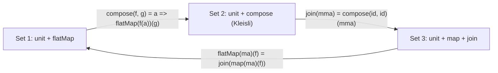

# Functors, Monads, and Kleisli Composition

Across Modules 03 through 09, seemingly unrelated types—`Option`, `Either`, `List`, `LazyList`, `State`, `Par`, `Gen`, and `Parser`—kept converging on the exact same combinator signatures: `map`, `map2`, `flatMap`, `unit`, `sequence`, and `traverse`. In category theory and functional programming—formalised for computation by Eugenio Moggi (_Notions of computation and monads_, 1991) and brought into language design by Philip Wadler (_The essence of functional programming_, POPL 1992)—those recurring patterns are captured by two fundamental algebraic type classes: **`Functor`** and **`Monad`**.

---

## 1. `Functor[F[_]]`: Structure-Preserving Mapping

A **functor** is a type constructor `F[_]` equipped with a `map` operation that transforms values _inside_ `F` without altering the container's shape or effect structure:

```scala
trait Functor[F[_]]:
  def map[A, B](fa: F[A])(f: A => B): F[B]

  def distribute[A, B](fab: F[(A, B)]): (F[A], F[B]) =
    (map(fab)(_._1), map(fab)(_._2))

  def codistribute[A, B](e: Either[F[A], F[B]]): F[Either[A, B]] = e match
    case Left(fa)  => map(fa)(Left(_))
    case Right(fb) => map(fb)(Right(_))
```

Notice `distribute` (a generalised `unzip`): for `F = List`, `distribute` splits a `List[(A, B)]` into `(List[A], List[B])`; for `F = Option`, it splits `Option[(A, B)]` into `(Option[A], Option[B])`! Yet `distribute` works uniformly for _every_ functor without knowing anything about `F`.

### The Functor Laws and Parametricity

For a `Functor[F]` instance to preserve structure rather than silently dropping, reordering, or duplicating elements, `map` must satisfy two laws:

1. **Identity Law:** Mapping the identity function changes nothing: $$\forall x : F[A].\quad \text{map}(x)(\text{id}_A) = x$$
2. **Composition Law:** Two sequential `map` calls fuse into one `map` over the composed function: $$\forall x : F[A],\, f : A \to B,\, g : B \to C.\quad \text{map}(\text{map}(x)(f))(g) = \text{map}(x)(g \circ f)$$

Under **parametricity** (Wadler's _Theorems for Free!_, FPCA 1989), any pure total polymorphic `map[A, B](fa: F[A])(f: A => B): F[B]` that satisfies the **identity law** automatically satisfies the **composition law**! Why? Because `map` has no knowledge of concrete types `A` and `B`; all it can do with values of type `A` is pass them to `f`. If `map(x)(id) == x`, `map` cannot drop, duplicate, or permute elements—so applying `f` then `g` must visit the exact same elements in the exact same positions as applying `g compose f`.

> [!WARNING]
> **Negative Counterexample — Why `Set[A]` Is Not a Lawful Scala `Functor`:** If `Set.map` relies on an arbitrary type's `equals`/`hashCode` or comparator, mapping a non-injective function $f$ collapses distinct elements (`Set(1, -1).map(math.abs) == Set(1)`), changing container cardinality. Even worse, defining a counter `var n = 0` inside `map` or reversing a `List` inside `map` breaks identity (`reverse(List(1, 2)) != List(1, 2)`) and breaks fusion optimizations!

---

## 2. `Monad[F[_]]` and Three Equivalent Minimal Primitive Sets

`Functor` lets you transform values inside a context (`A => B`), and as Module 11 explores, `Applicative` lets you combine independent contexts (`map2`). Neither lets the _runtime outcome_ of one computation dynamically determine _which computation runs next_ (`A => F[B]`). That sequencing capability defines a **`Monad`**.

Remarkably, `Monad[F[_]]` can be specified using **three completely equivalent minimal primitive sets**. Choosing any one set derives the other two identically:



Let us verify every translation explicitly in Scala 3:

```scala
trait Monad[F[_]] extends Functor[F]:
  def unit[A](a: => A): F[A]
  def flatMap[A, B](ma: F[A])(f: A => F[B]): F[B]

  override def map[A, B](ma: F[A])(f: A => B): F[B] =
    flatMap(ma)(a => unit(f(a)))

  def map2[A, B, C](ma: F[A], mb: F[B])(f: (A, B) => C): F[C] =
    flatMap(ma)(a => map(mb)(b => f(a, b)))

  // Primitive Set 2: Kleisli composition (>=>)
  def compose[A, B, C](f: A => F[B], g: B => F[C]): A => F[C] =
    a => flatMap(f(a))(g)

  // Deriving flatMap back from compose:
  def flatMapViaCompose[A, B](ma: F[A])(f: A => F[B]): F[B] =
    compose[Unit, A, B](_ => ma, f)(())

  // Primitive Set 3: join (flatten)
  def join[A](mma: F[F[A]]): F[A] =
    flatMap(mma)(identity)

  // Deriving flatMap back from map + join:
  def flatMapViaJoin[A, B](ma: F[A])(f: A => F[B]): F[B] =
    join(map(ma)(f))
```

Notice how deeply clarifying Set 3 (`unit` + `map` + `join`) is: a monad is literally a `Functor` (`map`) that knows how to **inject** pure values (`unit : A => F[A]`) and **collapse** two nested layers of effect into one (`join : F[F[A]] => F[A]`).

### TypeScript Perspective (Module-Level Encoding Without HKT)

TypeScript lacks native higher-kinded polymorphism (`F[_]`), so library authors either encode HKTs via defunctionalised URI registries (`fp-ts` style) or expose monadic combinators per concrete module (`Option<A>`, `Result<E, A>`, `State<S, A>`). Here is how the exact same three primitives map onto `Option<A>`:

```typescript
export type Option<A> = { readonly tag: 'Some'; readonly value: A } | { readonly tag: 'None' };

export const unit = <A>(value: A): Option<A> => ({ tag: 'Some', value });

export const map = <A, B>(ma: Option<A>, f: (a: A) => B): Option<B> =>
  ma.tag === 'Some' ? unit(f(ma.value)) : ma;

export const join = <A>(mma: Option<Option<A>>): Option<A> =>
  mma.tag === 'Some' ? mma.value : mma;

export const flatMap = <A, B>(ma: Option<A>, f: (a: A) => Option<B>): Option<B> => join(map(ma, f));

export const compose =
  <A, B, C>(f: (a: A) => Option<B>, g: (b: B) => Option<C>): ((a: A) => Option<C>) =>
  (a) =>
    flatMap(f(a), g);
```

---

## 3. Universal Monadic Combinators and Semantic Interpretation

Once a type implements `unit` and `flatMap`, an entire suite of control-flow combinators works identically across _all_ monads—even though the runtime behaviour of each combinator adapts completely to the chosen monad:

```scala
trait Monad[F[_]] extends Functor[F]:
  // ... primitives above ...

  def sequence[A](fma: List[F[A]]): F[List[A]] =
    traverse(fma)(identity)

  def traverse[A, B](la: List[A])(f: A => F[B]): F[List[B]] =
    la.foldRight(unit(List.empty[B]))((a, acc) => map2(f(a), acc)(_ :: _))

  def replicateM[A](n: Int, ma: F[A]): F[List[A]] =
    sequence(List.fill(n)(ma))

  def product[A, B](ma: F[A], mb: F[B]): F[(A, B)] =
    map2(ma, mb)((_, _))

  def filterM[A](as: List[A])(f: A => F[Boolean]): F[List[A]] =
    as.foldRight(unit(List.empty[A])) { (a, acc) =>
      flatMap(f(a))(keep => if keep then map(acc)(a :: _) else acc)
    }
```

Inspect what **`replicateM(n, ma)`** and **`filterM(as)(f)`** actually _mean_ for different monads:

| Monad `F` | `replicateM(3, fa)` Behaviour | `filterM(List(1, 2))(f)` Behaviour |
| --- | --- | --- |
| `Option` | `Some(List(a, a, a))` if `fa = Some(a)`, else `None` | Short-circuits to `None` if `f(x)` returns `None` for any element |
| `List` | **Cartesian power** $L^3$ (all $k^3$ 3-element combinations!) | **Powerset** when `f = _ => List(true, false)` (all $2^n$ subsets!) |
| `State[S, *]` | Runs `fa` 3 times sequentially, threading state `S => S => S`, returning 3 results | Threads state `S` through each predicate decision sequentially |
| `Gen` | Generates a random list of 3 independent draws from `fa` | Randomly retains or drops each element according to `Gen[Boolean]` |
| `Par` | Forks 3 parallel tasks and gathers their results into `Par[List[A]]` | Evaluates predicates (potentially in parallel if `map2` forks) and collects keepers |

> [!NOTE]
> **Stack-Safety Caveat on `traverse`:** Using `la.foldRight` for `traverse` is simple and preserves list order, but for strict monads (like `Option` or `State`) on lists exceeding $\sim 10{,}000$ elements, `foldRight` builds deep recursion on the call stack. Production libraries (Cats `Traverse`) either use tail-recursive `tailRecM` loops or accumulate in reverse via `foldLeft` and reverse once at the end.

---

## 4. Formal Proofs of the Monad Laws (Kleisli and `flatMap` Forms)

A `Monad` is not merely any type with `unit` and `flatMap`—it is a **monoid in the Kleisli category**! Comparing the Kleisli `compose` laws side-by-side with the `Monoid` laws from [09-monoids-foldables-and-parallel-reduction.md](09-monoids-foldables-and-parallel-reduction.md) makes the laws crystal clear:

| Law | Monoid $(M, \bullet, e)$ | Monad via Kleisli `compose` (`>=>`) | Monad via `flatMap` |
| --- | --- | --- | --- |
| **Associativity** | $(x \bullet y) \bullet z = x \bullet (y \bullet z)$ | `compose(compose(f, g), h) == compose(f, compose(g, h))` | `m.flatMap(f).flatMap(g) == m.flatMap(a => f(a).flatMap(g))` |
| **Left Identity** | $e \bullet x = x$ | `compose(unit, f) == f` | `unit(a).flatMap(f) == f(a)` |
| **Right Identity** | $x \bullet e = x$ | `compose(f, unit) == f` | `m.flatMap(unit) == m` |

### Why Associativity Governs `for`-Comprehension Refactoring

In Scala, a `for`-comprehension desugars into nested `flatMap` and `map` calls:

```scala
// Left-grouped nested refactoring:
val p1 = for
  a <- getItem
  b <- validate(a)
  c <- persist(b)
yield c
// Desugars to: getItem.flatMap(a => validate(a).flatMap(b => persist(b).map(c => c)))

// Extracting the first two steps into a helper sub-workflow:
val validated = for a <- getItem; b <- validate(a) yield b
val p2        = for b <- validated; c <- persist(b) yield c
// Desugars to: getItem.flatMap(validate).flatMap(persist)
```

Whether `p1 == p2` holds depends **exclusively on Monad Associativity** (`(m >>= f) >>= g == m >>= (a => f(a) >>= g)`). If a type has an unlawful `flatMap`, extracting two lines of a `for`-comprehension into a helper silently changes runtime behaviour!

### Equational Proof: Kleisli Associativity $\iff$ `flatMap` Associativity

Let us prove `compose(compose(f, g), h)(x) == compose(f, compose(g, h))(x)` directly from `flatMap` associativity by substituting `compose(p, q)(y) = p(y).flatMap(q)`:

$$ \begin{aligned}
\text{LHS} &= \text{compose}(\text{compose}(f, g), h)(x) \\
&= \text{compose}(f, g)(x).\text{flatMap}(h) \\
&= (f(x).\text{flatMap}(g)).\text{flatMap}(h) \\
&= f(x).\text{flatMap}(a \Rightarrow g(a).\text{flatMap}(h)) \qquad\text{(by } \text{flatMap}\text{ associativity, with } m = f(x)\text{)} \\
&= f(x).\text{flatMap}(a \Rightarrow \text{compose}(g, h)(a)) \\
&= \text{compose}(f, \text{compose}(g, h))(x) = \text{RHS} \quad \blacksquare
\end{aligned}$$

### Equational Proof of Associativity for `Option`

To prove `(opt.flatMap(f)).flatMap(g) == opt.flatMap(a => f(a).flatMap(g))` for `Option`, perform structural case analysis on `opt`:
- **Case `opt = None`:**
  - $\text{LHS} = (\text{None}.\text{flatMap}(f)).\text{flatMap}(g) = \text{None}.\text{flatMap}(g) = \text{None}$.
  - $\text{RHS} = \text{None}.\text{flatMap}(a \Rightarrow f(a).\text{flatMap}(g)) = \text{None}$.
  - Thus $\text{LHS} = \text{RHS}$.
- **Case `opt = Some(v)`:**
  - $\text{LHS} = (\text{Some}(v).\text{flatMap}(f)).\text{flatMap}(g) = f(v).\text{flatMap}(g)$.
  - $\text{RHS} = \text{Some}(v).\text{flatMap}(a \Rightarrow f(a).\text{flatMap}(g)) = (a \Rightarrow f(a).\text{flatMap}(g))(v) = f(v).\text{flatMap}(g)$.
  - Thus $\text{LHS} = \text{RHS}$ for every `opt: Option[A]`. $\blacksquare$

Similarly, for `List`, associativity holds by structural induction on `xs: List[A]` using the distributivity of `flatMap` over list concatenation `++`:

- **Base case `xs = Nil`:** `(Nil.flatMap(f)).flatMap(g) = Nil = Nil.flatMap(a => f(a).flatMap(g))`.
- **Inductive step `xs = h :: t`:** Assuming associativity holds for `t`:

$$\begin{aligned}
((h :: t).\text{flatMap}(f)).\text{flatMap}(g) &= (f(h) \mathbin{++} t.\text{flatMap}(f)).\text{flatMap}(g) \\
&= f(h).\text{flatMap}(g) \mathbin{++} (t.\text{flatMap}(f)).\text{flatMap}(g) \qquad\text{(distributivity over } \mathbin{++}\text{)} \\
&= f(h).\text{flatMap}(g) \mathbin{++} t.\text{flatMap}(a \Rightarrow f(a).\text{flatMap}(g)) \qquad\text{(inductive hypothesis)} \\
&= (h :: t).\text{flatMap}(a \Rightarrow f(a).\text{flatMap}(g)) \quad \blacksquare
\end{aligned}$$

### The `Kleisli[F[_], A, B]` Arrow in Production Pipelines

Reifying Kleisli arrows `A => F[B]` as a first-class data type **`Kleisli[F[_], A, B]`** turns effectful service pipelines (`HttpRequest => F[AuthUser]`, `AuthUser => F[OrderSummary]`) into composable first-class values:

```scala
final case class Kleisli[F[_], -A, +B](run: A => F[B]):
  def andThen[C](k: Kleisli[F, B, C])(using M: Monad[F]): Kleisli[F, A, C] =
    Kleisli(a => M.flatMap(run(a))(k.run))

  def map[C](f: B => C)(using F: Functor[F]): Kleisli[F, A, C] =
    Kleisli(a => F.map(run(a))(f))

  def local[AA](f: AA => A): Kleisli[F, AA, B] =
    Kleisli(aa => run(f(aa)))
```

Notice that `Kleisli[Id, R, A]` is precisely the **Reader monad** `Reader[R, A]` (`R => A`), threading read-only environment configuration `R` through a call graph without globals (`local` adapts the environment for a sub-component), while `Writer[W, A](run: (A, W))` pairs a computed result with an accumulated log `W` (requiring `Monoid[W]` for `unit` to supply `m.empty`, though `flatMap` alone needs only `Semigroup[W]`).

```scala
final case class Reader[R, A](run: R => A):
  def map[B](f: A => B): Reader[R, B] = Reader(r => f(run(r)))
  def flatMap[B](f: A => Reader[R, B]): Reader[R, B] = Reader(r => f(run(r)).run(r))

object Reader:
  def ask[R]: Reader[R, R] = Reader(identity)
  def local[R, A](f: R => R)(ra: Reader[R, A]): Reader[R, A] = Reader(r => ra.run(f(r)))
```

Algebraically, Scala 3's context function type `R ?=> A` is isomorphic to `Reader[R, A]` (see `languages/scala` for `given`/`using` resolution rules): a computation returning `A` given an implicit `R` in lexical scope is simply a Reader arrow whose environment parameter is passed by the compiler rather than threaded manually through `.flatMap`.

In **TypeScript**, the same `Kleisli` composition cleanly chains validation and persistence stages over `Result<E, A>` without nested `if (!res.ok) return res` boilerplate:

```typescript
export type Result<E, A> =
  | { readonly ok: true; readonly value: A }
  | { readonly ok: false; readonly error: E };

export type KleisliResult<E, A, B> = (a: A) => Result<E, B>;

export const composeResult = <E, A, B, C>(
  f: KleisliResult<E, A, B>,
  g: KleisliResult<E, B, C>,
): KleisliResult<E, A, C> => (a) => {
  const rb = f(a);
  return rb.ok ? g(rb.value) : rb;
};
```

---

## 5. The Identity Monad (`Id`) and `State` with Scala 3 Type Lambdas

What *is* a monad conceptually? Inspecting the simplest possible monad—the **Identity monad `Id[A]`**—strips away all incidental effects (`None`, non-determinism, async callbacks, state) to reveal the bare essence:

```scala
final case class Id[A](value: A):
  def map[B](f: A => B): Id[B] = Id(f(value))
  def flatMap[B](f: A => Id[B]): Id[B] = f(value)

given idMonad: Monad[Id] with
  def unit[A](a: => A): Id[A] = Id(a)
  def flatMap[A, B](ma: Id[A])(f: A => Id[B]): Id[B] = ma.flatMap(f)
```

Running a `for`-comprehension over `Id`:

```scala
val greeting: Id[String] = for
  a <- Id("Hello, ")
  b <- Id("Monad!")
yield a + b
```

does nothing beyond **naming and sequencing intermediate variable bindings** (`val a = "Hello, "; val b = "Monad!"; a + b`). Every other monad simply augments that exact `let`-binding mechanism with a **context** managed silently between bindings: `Option` short-circuits on `None`, `List` branches across alternatives, `State` threads an updated state value `S`, and `IO` sequences side-effecting descriptions!

### `State[S, A]` and Partial Type Application (**Then vs now**)

`Monad[F[_]]` expects a **unary** type constructor `F[_]` (kind `* -> *`), whereas `State[S, A]` takes **two** type parameters (`S` and `A`, kind `(*, *) -> *`). To instantiate `Monad` for `State` with a fixed state type `S`, we must **partially apply** `State` on its first type parameter `S` while leaving the value parameter `A` open.

**Then vs now (Scala 2 vs Scala 3):**

| Era | Syntax for `State[S, _]` Type Lambda | Mechanics & Pitfalls |
| --- | --- | --- |
| **Scala 2 (2015)** | `Monad[({ type f[x] = State[S, x] })#f]` | Verbose type-projection trick (`#f` on an anonymous structural type); unsound for general abstract types, required third-party `kind-projector` compiler plugin (`State[S, *]`) |
| **Scala 3 (`3.0`–`3.10+`)** | `Monad[[X] =>> State[S, X]]` | First-class native **type lambda** built directly into the Scala 3 compiler (DOT calculus), zero plugins, clean type inference |

Here is the idiomatic Scala 3 `State` monad instance using a native type lambda `[X] =>> State[S, X]`:

```scala
final case class State[S, +A](run: S => (A, S)):
  def map[B](f: A => B): State[S, B] =
    State(s => { val (a, s1) = run(s); (f(a), s1) })

  def flatMap[B](f: A => State[S, B]): State[S, B] =
    State(s => { val (a, s1) = run(s); f(a).run(s1) })

object State:
  def get[S]: State[S, S] = State(s => (s, s))
  def set[S](s: S): State[S, Unit] = State(_ => ((), s))
  def modify[S](f: S => S): State[S, Unit] = get.flatMap(s => set(f(s)))

given stateMonad[S]: Monad[[X] =>> State[S, X]] with
  def unit[A](a: => A): State[S, A] = State(s => (a, s))
  def flatMap[A, B](ma: State[S, A])(f: A => State[S, B]): State[S, B] =
    ma.flatMap(f)
```

With `stateMonad[Int]` in scope, `Monad.traverse` immediately gives us a purely functional `zipWithIndex` without writing an explicit loop or mutable counter:

```scala
def zipWithIndex[A](as: List[A]): List[(Int, A)] =
  stateMonad[Int].traverse(as) { a =>
    for
      idx <- State.get[Int]
      _   <- State.set(idx + 1)
    yield (idx, a)
  }.run(0)._1
```

Verifying the identity laws extensionally for `State[S, A]` proves that state threading introduces zero distortion:
- **Left Identity:** `unit(a).flatMap(f).run(s) = State(s0 => (a, s0)).flatMap(f).run(s) = { val (a1, s1) = (a, s); f(a1).run(s1) } = f(a).run(s)`.
- **Right Identity:** `m.flatMap(unit).run(s) = { val (a, s1) = m.run(s); State(s2 => (a, s2)).run(s1) } = (a, s1) = m.run(s)`. $\blacksquare$

In **TypeScript**, `State<S, A>` expresses the exact same referentially transparent state threading as an ordinary function tuple without requiring higher-kinded type lambdas:

```typescript
export type State<S, A> = (s: S) => readonly [A, S];

export const stateUnit = <S, A>(a: A): State<S, A> => (s) => [a, s];

export const stateFlatMap = <S, A, B>(
  sa: State<S, A>,
  f: (a: A) => State<S, B>,
): State<S, B> => (s) => {
  const [a, s1] = sa(s);
  return f(a)(s1);
};
```

---

## 6. Failure Modes and Negative Examples

1. **Unlawful `Try.flatMap` Breaking Left Identity:** Scala's standard `scala.util.Try` catches exceptions inside `apply` *and* inside `flatMap`! Wait: check `Try.unit(x).flatMap(f)` vs `f(x)` when `f: Int => Try[Int]` throws an exception *before* returning a `Try` (`val f: Int => Try[Int] = _ => throw new RuntimeException("boom")`):
   - `Success(1).flatMap(f)` catches the exception and returns `Failure(RuntimeException("boom"))`.
   - `f(1)` throws an uncaught `RuntimeException("boom")`!
   - Thus `Try` **violates the Monad left-identity law** (`unit(a).flatMap(f) != f(a)`) for partial functions! That is why pure FP libraries (`Either`, Cats Effect `IO`, ZIO) enforce totality: exceptions are captured explicitly by `IO.delay` / `Either.catchNonFatal` rather than hiding exception-catching magic inside `flatMap`.
2. **Broken Associativity in Custom Retry / Logging Wrappers:** A naive `Writer`-like type that timestamps or prepends logs backwards (`log2 ++ log1`) or clamps counters inside `flatMap` breaks associativity `(m.flatMap(f)).flatMap(g) != m.flatMap(a => f(a).flatMap(g))`.
3. **Eager Stack Overflow in `forever` or Recursive `flatMap`:** Defining `def forever[A, B](a: F[A]): F[B] = a.flatMap(_ => forever(a))` overflows the JVM call stack immediately on strict monads like `State` or naive `Id` (solved by trampolining in Module 12).
4. **Hoping Monads Compose Automatically:** Given `Monad[F]` and `Monad[G]`, there is **no generic `Monad[[X] =>> F[G[X]]]`**! Knowing `join: F[F[A]] => F[A]` and `join: G[G[A]] => G[A]` does not tell you how to flatten `F[G[F[G[A]]]]` without a distributive law `G[F[A]] => F[G[A]]` (explored in Module 11).

---

## Interview Drill

1. **What are the three equivalent minimal primitive sets for `Monad[F[_]]`, and how do you derive `flatMap` from `unit` + `compose`?**
<details><summary>Answer</summary>

The three equivalent minimal primitive sets are: (1) `unit` + `flatMap`, (2) `unit` + Kleisli `compose` (`>=>`), and (3) `unit` + `map` + `join` (`flatten`). To derive `flatMap(ma)(f)` from `compose`, pass a dummy unit-ignoring function `_ => ma` as the left arrow and `f` as the right arrow, then apply the composed Kleisli arrow to `()`: `compose[Unit, A, B](_ => ma, f)(())`.

</details>

2. **Why does satisfying the `Functor` identity law imply the composition law for pure polymorphic functions in languages with parametricity?**
<details><summary>Answer</summary>

By Reynolds/Wadler parametricity ("theorems for free"), a polymorphic function `map[A, B](fa: F[A])(f: A => B): F[B]` cannot inspect `A` or `B`; it can only rearrange, drop, duplicate, or keep positions while applying `f` to `A` elements. Satisfying `map(fa)(identity) == fa` forces `map` to preserve every element at its exact position without dropping, duplicating, or reordering. Consequently, running `map(_, f)` followed by `map(_, g)` must visit the exact same elements in the exact same positions as `map(_, g compose f)`.

</details>

3. **In what precise algebraic sense is a `Monad` "a monoid in the category of endofunctors" (or Kleisli arrows)?**
<details><summary>Answer</summary>

Fix a type or look at Kleisli arrows `A => F[B]`. Kleisli `compose` (`>=>`) acts as the associative binary operation `(f >=> g) >=> h == f >=> (g >=> h)` and `unit: A => F[A]` acts as the two-sided identity (`unit >=> f == f == f >=> unit`). Equivalently, on endofunctors `F`, the tensor product is functor composition `F ∘ F`, the binary multiplication is `join: F[F[A]] => F[A]`, and the identity is `unit: Id[A] => F[A]`—satisfying the exact same associativity and left/right identity coherence diagrams as a monoid.

</details>

4. **Demonstrate why `scala.util.Try` technically violates the Monad left-identity law.**
<details><summary>Answer</summary>

Monad left identity requires `unit(a).flatMap(f) == f(a)`. For `Try`, `unit(1)` is `Success(1)`. If `f: Int => Try[Int]` throws an exception directly (`_ => throw new RuntimeException("boom")`), `Success(1).flatMap(f)` catches the exception inside `flatMap` and returns `Failure(RuntimeException("boom"))`, whereas `f(1)` throws an uncaught `RuntimeException`. Because those two expressions are not observationally equivalent, `Try` breaks left identity and substitution refactoring.

</details>

5. **How does Scala 3 solve partial type application for `State[S, A]` compared to Scala 2?**
<details><summary>Answer</summary>

`Monad[F[_]]` expects a unary type constructor, whereas `State[S, A]` has two type parameters. Scala 2 had no native type lambda syntax, forcing awkward structural type projections `({ type f[x] = State[S, x] })#f` or the third-party `kind-projector` compiler plugin (`State[S, *]`). Scala 3 provides native type lambdas `[X] =>> State[S, X]` directly in the language grammar.

</details>

6. **What is the practical meaning of `replicateM(n, fa)` across `Option`, `List`, and `State`, and why does it vary?**
<details><summary>Answer</summary>

`replicateM(n, fa)` is implemented uniformly as `sequence(List.fill(n)(fa))`, so it inherits the monad's sequencing semantics: on `Option`, it short-circuits to `None` if `fa` is `None` or repeats the value `n` times in `Some`; on `List`, it computes the $n$-fold Cartesian product $L^n$ of all combinations; on `State[S, *]`, it threads state `S` sequentially through `n` consecutive transitions and collects the `n` outputs.

</details>

7. **Why does breaking the Monad associativity law break `for`-comprehension refactoring?**
<details><summary>Answer</summary>

Refactoring a multi-step `for`-comprehension by extracting the first two generators into an intermediate variable `val ab = for a <- m; b <- f(a) yield b; for b <- ab; c <- g(b) yield c` changes the parenthesisation from right-nested `m.flatMap(a => f(a).flatMap(g))` to left-nested `(m.flatMap(f)).flatMap(g)`. Only when Monad associativity holds are those two programs guaranteed to behave identically.

</details>

8. **In the `Writer[W, A]` monad, why does `unit` require a `Monoid[W]` while `flatMap` requires only a `Semigroup[W]`?**
<details><summary>Answer</summary>

`Writer[W, A]` wraps `(A, W)`. `flatMap` receives two existing log values `w1: W` and `w2: W` and combines them with `combine(w1, w2)`, which only requires an associative `Semigroup[W]`. By contrast, `unit(a: A): Writer[W, A]` must conjure an initial neutral log `W` out of thin air without corrupting subsequent `flatMap` logs—requiring the identity element `empty: W` from a `Monoid[W]`.

</details>
$$
