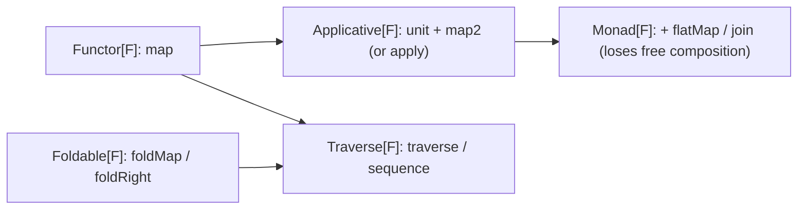

# Applicative and Traversable Functors

In [10-functors-monads-and-kleisli-composition.md](10-functors-monads-and-kleisli-composition.md), `Monad` unified sequential, context-dependent computations through `flatMap`. Yet many real-world problems—accumulating every field validation error in an HTTP request, executing independent RPC calls in parallel, or traversing a tree with a state counter—do **not** need dynamic control flow where the next effect depends on the previous effect's value. Giving up `flatMap` while keeping `unit` and `map2` yields **`Applicative`** (discovered by Conor McBride and Ross Paterson, _Applicative programming with effects_, JFP 2008). Weakening power from `Monad` to `Applicative` obeys a fundamental law of functional design: **less power buys strictly greater composability, static inspectability, and parallelism**. Together with **`Traverse`** (Jeremy Gibbons and Bruno Oliveira, _The Essence of the Iterator Pattern_, JFP 2009), applicative functors unify `Functor` and `Foldable`, fuse multi-pass traversals, and expose exactly why monads fail to compose in general.

---

## 1. `Applicative[F[_]]` as a Generalisation of `Monad[F[_]]`

Every `Monad[F]` already implements `unit` and `map2`, because `map2(fa, fb)(f)` can always be written as `flatMap(fa)(a => map(fb)(b => f(a, b)))`. Promoting `unit` and `map2` into their own trait defines **`Applicative[F[_]]`**, which stands strictly between `Functor` and `Monad`:



Like `Monad`, `Applicative` has two equivalent minimal primitive sets:

1. **`unit` + `map2`** (symmetric monoidal functor form).
2. **`unit` + `apply` (`ap`)**, where `apply[A, B](fab: F[A => B])(fa: F[A]): F[B]` applies an effectful function to an effectful argument.

```scala
trait Applicative[F[_]] extends Functor[F]:
  def unit[A](a: => A): F[A]
  def map2[A, B, C](fa: F[A], fb: F[B])(f: (A, B) => C): F[C]

  // Equivalent primitive `apply` derived from `map2`:
  def apply[A, B](fab: F[A => B])(fa: F[A]): F[B] =
    map2(fab, fa)((f, a) => f(a))

  // Conversely, `map2` derived from `unit` + `apply`:
  def map2ViaApply[A, B, C](fa: F[A], fb: F[B])(f: (A, B) => C): F[C] =
    apply(apply(unit(f.curried))(fa))(fb)

  override def map[A, B](fa: F[A])(f: A => B): F[B] =
    map2(fa, unit(()))((a, _) => f(a))

  def product[A, B](fa: F[A], fb: F[B]): F[(A, B)] =
    map2(fa, fb)((_, _))

  def map3[A, B, C, D](fa: F[A], fb: F[B], fc: F[C])(f: (A, B, C) => D): F[D] =
    apply(apply(apply(unit(f.curried))(fa))(fb))(fc)

  def traverse[A, B](as: List[A])(f: A => F[B]): F[List[B]] =
    as.foldRight(unit(List.empty[B]))((a, acc) => map2(f(a), acc)(_ :: _))

  def sequence[A](fas: List[F[A]]): F[List[A]] =
    traverse(fas)(identity)

  def replicateM[A](n: Int, fa: F[A]): F[List[A]] =
    sequence(List.fill(n)(fa))
```

Notice something striking: `traverse`, `sequence`, `replicateM`, and `product`—which we introduced under `Monad` in Module 10—do **not** actually need `flatMap` at all! Every single one requires only `Applicative`.

---

## 2. The Power vs. Composability Trade-off

Comparing `Applicative` (`map2`) against `Monad` (`flatMap`) exposes the central architectural trade-off in effectful programming:

| Dimension | `Applicative` (`map2` / `apply`) | `Monad` (`flatMap` / `join`) |
| --- | --- | --- |
| **Effect dependency** | Both `fa` and `fb` are **independent**; neither can inspect the other's runtime result | Dynamic: `f(a)` receives the runtime result `a` and chooses _which_ `F[B]` executes next |
| **Static inspectability** | Computation shape is known statically before execution (e.g., query planner / dependency DAG) | Computation graph is an opaque closure `A => F[B]`, uninspectable until runtime |
| **Parallelism** | Enables concurrent execution (`Par.map2`, Cats `parMapN`, GraphQL/Haxl batching) | Inherently sequential (`a` must finish before `f(a)` can even be constructed) |
| **Error handling** | Can evaluate all branches and **accumulate** every error (`Validated`) | Must **short-circuit** on the first failure (`Either`), because `f(a)` has no `A` to run on |
| **Functor composition** | **Closed under composition**: if `F` and `G` are `Applicative`, `F[G[_]]` is ALWAYS `Applicative` | **Not closed under composition**: `F[G[_]]` is NOT a `Monad` in general |

### `Parser` Applicative vs. `Parser` Monad

Consider parsing a fixed-schema CSV row or HTTP header block:

- With an **Applicative parser** (`header1 *> header2 *> body`), the sequence of sub-parsers is completely static. A parser compiler can precompute FIRST/FOLLOW lookahead tables, fuse adjacent literals, or infer the exact target schema before seeing a single byte of input.
- With a **Monadic parser** (`flatMap`), a parsed integer `n` on row 1 can alter the grammar of row 2 (`listOfN(n, rowParser)`). That extra context-sensitive power destroys static grammar analysis.

---

## 3. Applicative Functors That Are Not Monads

Every `Monad` is an `Applicative`, so `Monad` is a strictly smaller class of types. Two canonical `Applicative`s prove the inclusion is proper: **`Validation`** (error-accumulating validation) and **`ZipList`** (positional stream zipping).

### `Validation[E, A]` vs. `Either[E, A]`

Suppose a web API validates `name`, `birthdate`, and `phoneNumber` from a JSON payload. Using `Either.flatMap` in a `for`-comprehension halts immediately on `name` if `name` is blank—forcing the user to submit the form three times to discover three errors. **`Validation[E, A]`** (or Cats `Validated[NonEmptyList[E], A]`) replaces fail-fast sequencing with **error accumulation**:

```scala
enum Validation[+E, +A]:
  case Failure(head: E, tail: Vector[E] = Vector.empty) extends Validation[E, Nothing]
  case Success(get: A) extends Validation[Nothing, A]

given validationApplicative[E]: Applicative[[X] =>> Validation[E, X]] with
  def unit[A](a: => A): Validation[E, A] = Validation.Success(a)

  def map2[A, B, C](fa: Validation[E, A], fb: Validation[E, B])(f: (A, B) => C): Validation[E, C] =
    (fa, fb) match
      case (Validation.Success(a), Validation.Success(b)) =>
        Validation.Success(f(a, b))
      case (Validation.Failure(h1, t1), Validation.Failure(h2, t2)) =>
        Validation.Failure(h1, t1 ++ Vector(h2) ++ t2)
      case (e @ Validation.Failure(_, _), _) => e
      case (_, e @ Validation.Failure(_, _)) => e
```

**Why `Validation` cannot be a lawful `Monad`:** For `Monad[F]` to be consistent with `Applicative[F]`, `map2(fa, fb)(f)` derived from `flatMap(fa)(a => map(fb)(b => f(a, b)))` must agree with `Applicative.map2(fa, fb)(f)`. Yet if `fa = Failure(e1)` and `fb = Failure(e2)`, `flatMap(fa)(a => ...)` never receives an `a: A` to invoke its continuation, so it can only return `Failure(e1)`—discarding `e2`! Thus `Validation` is a lawful `Applicative` whose `map2` semantics are fundamentally incompatible with `Monad`.

### TypeScript Error-Accumulating `Validation` and Batch Traversal

```typescript
export type Validation<E, A> =
  | { readonly tag: 'Success'; readonly value: A }
  | { readonly tag: 'Failure'; readonly errors: readonly [E, ...E[]] };

export const success = <A>(value: A): Validation<never, A> => ({ tag: 'Success', value });
export const failure = <E>(head: E, ...tail: E[]): Validation<E, never> => ({
  tag: 'Failure',
  errors: [head, ...tail],
});

export const map2 = <E, A, B, C>(
  va: Validation<E, A>,
  vb: Validation<E, B>,
  f: (a: A, b: B) => C,
): Validation<E, C> => {
  if (va.tag === 'Success' && vb.tag === 'Success') return success(f(va.value, vb.value));
  if (va.tag === 'Failure' && vb.tag === 'Failure') {
    return { tag: 'Failure', errors: [...va.errors, ...vb.errors] };
  }
  return va.tag === 'Failure' ? va : vb;
};

export const traverseValidation = <E, A, B>(
  items: readonly A[],
  f: (a: A) => Validation<E, B>,
): Validation<E, readonly B[]> =>
  items.reduce<Validation<E, readonly B[]>>(
    (acc, a) => map2(acc, f(a), (bs, b) => [...bs, b]),
    success([]),
  );
```

### `ZipList` (`LazyList` Under Positional Zipping)

While `List` has a standard `Monad` instance whose `map2` computes a **Cartesian product** (`List(1, 2)` and `List(10, 20)` -> `List(11, 21, 12, 22)`), an infinite `LazyList[A]` also supports a completely different `Applicative` where `map2` zips elements **positionally** (`LazyList(1, 2)` and `LazyList(10, 20)` -> `LazyList(11, 22)`):

- What must `unit(a)` be so `map2(unit(a), xs)((_, x) => x) == xs` holds for _any_ length `xs`? It must be the **infinite constant stream** `LazyList.continually(a)`!
- Why does `ZipList` fail to form a `Monad` compatible with positional `map2`? If `f(x)` returns streams of varying lengths (e.g., `f(0) = Empty`, `f(1) = LazyList(10, 20)`), taking the diagonal `join(xss)` breaks associativity on finite jagged lists!

---

## 4. All Four Applicative Laws

Just as `Monoid` and `Monad` have formal laws, a lawful `Applicative[F]` must satisfy **four laws** (formulated cleanly in terms of `unit`, `map`, and `product` / `map2`):

1. **Left Identity:** Pairing `unit(())` on the left changes no values or effects: $$\text{map2}(\text{unit}(()), fa)((_, a) \Rightarrow a) = fa$$
2. **Right Identity:** Pairing `unit(())` on the right changes no values or effects: $$\text{map2}(fa, \text{unit}(()))((a, _) \Rightarrow a) = fa$$
3. **Associativity:** Nesting products left-to-right vs. right-to-left is isomorphic via `assoc((a, (b, c))) = ((a, b), c)`: $$\text{product}(\text{product}(fa, fb), fc) \;\cong\; \text{map}(\text{product}(fa, \text{product}(fb, fc)))(\text{assoc})$$
4. **Naturality of `product`:** Mapping functions `f` and `g` _before_ pairing via `product` equals pairing first and transforming the tuple with `(f, g)` afterward: $$\text{map2}(fa, fb)((a, b) \Rightarrow (f(a), g(b))) = \text{product}(\text{map}(fa)(f), \text{map}(fb)(g))$$

> [!NOTE]
> **Equivalent `apply` Formulation (McBride & Paterson):** In languages using `unit` (`pure`) and `apply` (`<*>`), those four laws correspond to **Identity** (`pure(id) <*> v == v`), **Homomorphism** (`pure(f) <*> pure(x) == pure(f(x))`), **Interchange** (`u <*> pure(y) == pure(_(y)) <*> u`), and **Composition** (`pure(compose) <*> u <*> v <*> w == u <*> (v <*> w)`). Naturality is critical in parallel runtimes because it guarantees reordering pure post-processing steps around `parMapN` cannot alter side effects or error ordering.

We can also derive **`sequenceMap[K, V](ofa: Map[K, F[V]]): F[Map[K, V]]`** purely from `Applicative[F]` without touching `flatMap`:

```scala
def sequenceMap[F[_], K, V](ofa: Map[K, F[V]])(using F: Applicative[F]): F[Map[K, V]] =
  ofa.foldLeft(F.unit(Map.empty[K, V])) { case (acc, (k, fv)) =>
    F.map2(acc, fv)((m, v) => m + (k -> v))
  }
```

Similarly, the `Functor` identity law `map(fa)(id) == fa` follows directly from `Applicative`'s Left Identity law because `map(fa)(f) = map2(fa, unit(()))((a, _) => f(a))` reduces to `fa` when `f = identity` by Right Identity.

---

## 5. `Traverse[F[_]]`: Unifying `Functor` and `Foldable` via `Const`

Look back at `Applicative.traverse`: it mapped over a hardcoded `List[A]`, turning `List[A]` and `A => G[B]` into `G[List[B]]`. Abstracting the container `List` into a type parameter `F[_]` gives **`Traverse[F[_]]`**—the generalised "iterator" type class:

```scala
trait Traverse[F[_]] extends Functor[F] with Foldable[F]:
  def traverse[G[_]: Applicative, A, B](fa: F[A])(f: A => G[B]): G[F[B]] =
    sequence(map(fa)(f))

  def sequence[G[_]: Applicative, A](fga: F[G[A]]): G[F[A]] =
    traverse(fga)(identity)

final case class Tree[+A](head: A, tail: List[Tree[A]])

given listTraverse: Traverse[List] with
  override def traverse[G[_], A, B](as: List[A])(f: A => G[B])(using G: Applicative[G]): G[List[B]] =
    as.foldRight(G.unit(List.empty[B]))((a, acc) => G.map2(f(a), acc)(_ :: _))

given optionTraverse: Traverse[Option] with
  override def traverse[G[_], A, B](oa: Option[A])(f: A => G[B])(using G: Applicative[G]): G[Option[B]] =
    oa match
      case Some(a) => G.map(f(a))(Some(_))
      case None    => G.unit(None)

given treeTraverse: Traverse[Tree] with
  override def traverse[G[_], A, B](ta: Tree[A])(f: A => G[B])(using G: Applicative[G]): G[Tree[B]] =
    G.map2(f(ta.head), listTraverse.traverse(ta.tail)(traverse(_)(f)))(Tree(_, _))
```

Notice the inheritance line: `Traverse[F]` extends **both** `Functor[F]` and `Foldable[F]`! That is not merely nominal inheritance; `traverse` alone is strictly sufficient to _implement_ both `map` (`Functor`) and `foldMap` (`Foldable`)!

1. **Recovering `Functor.map` via `Id`:** Plugging in the `Id` applicative (`Id[A] = A`) evaluates `traverse[Id, A, B](fa)(a => Id(f(a)))`, returning `F[B]` directly.
2. **Recovering `Foldable.foldMap` via `Const` + `Monoid`:** Define the phantom-typed **`Const[M, +A]`** type (`opaque type Const[M, +A] = M`), which holds an accumulated monoid value `M` and ignores its phantom type parameter `A`. Any `Monoid[M]` automatically induces an `Applicative[[X] =>> Const[M, X]]`:

```scala
opaque type Const[M, +A] = M
object Const:
  def apply[M, A](m: M): Const[M, A] = m
  extension [M, A](c: Const[M, A]) def getConst: M = c

given constApplicative[M](using m: Monoid[M]): Applicative[[X] =>> Const[M, X]] with
  def unit[A](a: => A): Const[M, A] = Const(m.empty)
  def map2[A, B, C](ca: Const[M, A], cb: Const[M, B])(f: (A, B) => C): Const[M, C] =
    Const(m.combine(ca.getConst, cb.getConst))
```

Now watch what happens when we pass `constApplicative[M]` into `traverse`:

```scala
override def foldMap[A, M](as: F[A])(f: A => M)(using mb: Monoid[M]): M =
  traverse[[X] =>> Const[M, X], A, Nothing](as)(a => Const(f(a))).getConst
```

Every `unit` emits `mb.empty`, every `map2` combines `M` values via `mb.combine`, and no `F[Nothing]` container is ever built because `Const[M, B]` never holds a `B`! Let us trace this explicitly on `List(1, 2, 3)` with `intAddition` and `f = _ * 10`:

$$ \begin{aligned}
\text{traverse}_{\text{List}}([1, 2, 3])(a \mapsto \text{Const}(10a)) &= \text{map2}(\text{Const}(10), \text{map2}(\text{Const}(20), \text{map2}(\text{Const}(30), \text{Const}(0)))) \\
&= \text{Const}(10 + (20 + (30 + 0))) = \text{Const}(60)
\end{aligned}$$

Notice also how `Traverse` works naturally in **TypeScript** for concrete tree structures without needing higher-kinded type classes, e.g., traversing a recursive AST `Tree<A>` into `Validation<E, Tree<B>>`:

```typescript
export type RoseTree<A> = { readonly head: A; readonly tail: readonly RoseTree<A>[] };

export const traverseTreeValidation = <E, A, B>(
  tree: RoseTree<A>,
  f: (a: A) => Validation<E, B>,
): Validation<E, RoseTree<B>> =>
  map2(
    f(tree.head),
    traverseValidation(tree.tail, (child) => traverseTreeValidation(child, f)),
    (head, tail) => ({ head, tail }),
  );
```

This proves formally that **`Traverse` is a true algebraic common parent of `Functor` and `Foldable`**.

### Stateful Traversals (`zipWithIndex`, `toList`)

Plugging `[X] =>> State[S, X]` as the applicative `G` inside `traverse` yields structure-preserving stateful transformations over *any* `Traverse[F]` (`List`, `Option`, rose `Tree`):

```scala
def traverseS[S, A, B](fa: F[A])(f: A => State[S, B]): State[S, F[B]] =
  traverse[[X] =>> State[S, X], A, B](fa)(f)

def zipWithIndex[A](fa: F[A]): F[(A, Int)] =
  traverseS(fa) { a =>
    for
      i <- State.get[Int]
      _ <- State.set(i + 1)
    yield (a, i)
  }.run(0)._1

def toList[A](fa: F[A]): List[A] =
  traverseS(fa)((a: A) => State.modify[List[A]](a :: _)).run(Nil)._2.reverse
```

`zipWithIndex` works identically on a `List`, an `Option`, or a multi-branch `Tree`—replacing every leaf with `(leaf, preOrderIndex)` while preserving the exact tree topology!

---

## 6. Traversal Fusion, Nested Traversals, and Monad Composition

Now we reap the reward promised in Section 2: **applicative composition and traversal fusion**.

### Traversal Fusion via `Applicative.product`

Suppose we need to run *two* traversals `f: A => G[B]` and `g: A => H[C]` over a large `F[A]`, such as computing both a `Validation` check (`G`) and a `State` index numbering (`H`). Normally that requires traversing `fa` twice. Because the product of any two applicatives `G` and `H` is unconditionally an `Applicative[[X] =>> (G[X], H[X])]`:

```scala
def product[G[_], H[_]](using G: Applicative[G], H: Applicative[H]): Applicative[[X] =>> (G[X], H[X])] =
  new Applicative[[X] =>> (G[X], H[X])]:
    def unit[A](a: => A): (G[A], H[A]) = (G.unit(a), H.unit(a))
    def map2[A, B, C](ga: (G[A], H[A]), gb: (G[B], H[B]))(f: (A, B) => C): (G[C], H[C]) =
      (G.map2(ga._1, gb._1)(f), H.map2(ga._2, gb._2)(f))

def fuse[G[_]: Applicative, H[_]: Applicative, A, B](fa: F[A])(
  f: A => G[B],
  g: A => H[B]
): (G[F[B]], H[F[B]]) =
  traverse[[X] =>> (G[X], H[X]), A, B](fa)(a => (f(a), g(a)))(using product[G, H])
```

`fuse` traverses `fa` **once** while accumulating both independent effects simultaneously!

### Nested `Applicative` and `Traverse` Composition

Even better, **nested applicatives compose unconditionally** (`Applicative.compose`): given `Applicative[F]` and `Applicative[G]`, `[X] =>> F[G[X]]` is always an `Applicative`, and **nested traversables compose unconditionally** (`Traverse.compose`): `List[Option[Tree[A]]]` is automatically `Traverse`:

```scala
def composeApplicative[F[_], G[_]](using F: Applicative[F], G: Applicative[G]): Applicative[[X] =>> F[G[X]]] =
  new Applicative[[X] =>> F[G[X]]]:
    def unit[A](a: => A): F[G[A]] = F.unit(G.unit(a))
    def map2[A, B, C](fga: F[G[A]], fgb: F[G[B]])(f: (A, B) => C): F[G[C]] =
      F.map2(fga, fgb)((ga, gb) => G.map2(ga, gb)(f))

def composeTraverse[F[_], G[_]](using F: Traverse[F], G: Traverse[G]): Traverse[[X] =>> F[G[X]]] =
  new Traverse[[X] =>> F[G[X]]]:
    override def traverse[H[_]: Applicative, A, B](fga: F[G[A]])(f: A => H[B]): H[F[G[B]]] =
      F.traverse(fga)(ga => G.traverse(ga)(f))
```

### Monad Transformers (`OptionT`) and `Parallel` Switching

When two monadic effects must compose (e.g., `IO` and `Option` or `IO` and `Either`), a **Monad Transformer** wraps the stacked type and implements `flatMap` using bespoke knowledge of the inner monad:

```scala
final case class OptionT[F[_], A](value: F[Option[A]]):
  def flatMap[B](f: A => OptionT[F, B])(using F: Monad[F]): OptionT[F, B] =
    OptionT(F.flatMap(value) {
      case Some(a) => f(a).value
      case None    => F.unit(None)
    })
```

And in modern Scala 3 / Cats (`cats.Parallel`), a type with a sequential `Monad` instance (`Either[NonEmptyList[E], *]` or `IO`) can temporarily switch to a parallel/accumulating `Applicative` twin (`Validated[NonEmptyList[E], *]` or `IO.Par`) via a natural transformation `M ~> F` for `parMapN` / `parTraverse`, then switch straight back to `Monad` for subsequent `flatMap` steps!

### Why Monads Do Not Compose in General (`composeM`)

Why can't we write `Monad.compose[F[_]: Monad, G[_]: Monad]: Monad[[X] =>> F[G[X]]]` the exact same way? Try writing `join: F[G[F[G[A]]]] => F[G[A]]` (or `flatMap: F[G[A]] => (A => F[G[B]]) => F[G[B]]`). We have `F.join: F[F[X]] => F[X]` and `G.join: G[G[X]] => G[X]`, **but `F` and `G` alternate (`F[G[F[G[A]]]]`)!** To bring the two `F`s and two `G`s adjacent so we can join them, we need a **distributive law** (Mark Jones & Luc Duponcheel, *Composing monads*, 1993):

$$\text{swap} : G[F[A]] \to F[G[A]]$$

If `G` happens to be **`Traverse`** (like `Option`, `Either`, or `List`), `G.sequence` *is* that distributive law `G[F[A]] => F[G[A]]`, letting us write `composeM`:

```scala
def composeM[F[_], G[_]](using F: Monad[F], G: Monad[G], T: Traverse[G]): Monad[[X] =>> F[G[X]]] =
  new Monad[[X] =>> F[G[X]]]:
    def unit[A](a: => A): F[G[A]] = F.unit(G.unit(a))
    def flatMap[A, B](fga: F[G[A]])(f: A => F[G[B]]): F[G[B]] =
      F.flatMap(fga)(ga => F.map(T.traverse(ga)(f))(G.join))
```

Notice the critical limitation: `composeM` fails whenever the inner `G` is **not** `Traverse`—most notably `State[S, *]`, `Reader[R, *]`, or `IO` (you cannot `sequence` a function `S => F[(A, S)]` into `F[S => (A, S)]` cleanly without executing it!). Furthermore, even when `G = List` and `F = Option`, `composeM` may still violate associativity unless `G`'s `sequence` satisfies all coherence axioms of a true categorical distributive law!

That fundamental barrier—monads failing to compose generically—is why practical functional architectures adopt **Monad Transformers** (`OptionT[F, A]`, `EitherT[F, E, A]`, `StateT[F, S, A]`, each hardcoding the outer/inner knowledge needed for `swap`), **Tagless Final** (`F[_]: MonadError[*, E]`), or **Algebraic Effect Systems** (`ZIO[-R, +E, +A]`, Kyo, Scala 3 Capabilities) that unify reader, typed error, and async effects in a single flattened type.

---

## 7. Failure Modes and Negative Examples

1. **Accidentally Calling `flatMap` Where `map2` / `parMapN` Was Intended:** Writing `for a <- fetchUser(id); b <- fetchOrders(id) yield (a, b)` inside an async `IO` or `Future` monad serialises two completely independent network RPCs ($T_{\text{total}} = T_1 + T_2$), doubling tail latency! Using `Applicative.map2` / `parMapN` runs them concurrently ($T_{\text{total}} = \max(T_1, T_2)$).
2. **Expecting `MonadError` / `Either` to Accumulate Validation Errors:** Using `Either` in a `for`-comprehension or `traverse` aborts on the first invalid field. Use `Validation` / `ValidatedNel` (`Applicative`) at input boundaries, and convert `.toEither` only when transitioning to sequential business logic (`flatMap`).
3. **Unlawful `Validation` `Monad` Adapter (`Validated.andThen`):** Converting `Validated` to `Either` inside a helper called `flatMap` breaks the consistency law between `Applicative.map2` and `Monad.flatMap`—so `for`-comprehensions silently drop accumulated errors compared to `mapN`.
4. **Non-Stack-Safe `Traverse` on `List`:** Implementing `List`'s `traverse` via `foldRight` with `map2` overflows the stack on a 20,000-element list when `G` is a strict applicative (`Option`, `Validation`). Production `Traverse[List]` uses iterative accumulation (`foldLeft` + `reverse` or divide-and-conquer balanced splitting for associative effects).

---

## Interview Drill

1. **Why is every `Monad` an `Applicative`, yet not every `Applicative` is a `Monad`?**
<details><summary>Answer</summary>

Every `Monad` can implement `map2(fa, fb)(f)` as `flatMap(fa)(a => map(fb)(b => f(a, b)))`, making `Monad` a strict refinement of `Applicative`. Conversely, an `Applicative` like `Validation` (error accumulation) or `ZipList` (positional zipping) has `map2` semantics that inspect both `fa` and `fb` independently without needing a value `a` first; no `flatMap` can be defined on `Validation` that agrees with its error-accumulating `map2`.

</details>

2. **How do you unify `Functor` and `Foldable` under `Traverse[F[_]]` using `Id` and `Const`?**
<details><summary>Answer</summary>

`Traverse` requires only `traverse[G[_]: Applicative, A, B](fa: F[A])(f: A => G[B]): G[F[B]]`. Instantiating `G = Id` recovers `Functor.map` (`traverse[Id, A, B](fa)(Id.compose(f)).value`). Instantiating `G = [X] =>> Const[M, X]` backed by `Monoid[M]` (where `unit` returns `m.empty` and `map2` returns `m.combine`) recovers `Foldable.foldMap`—accumulating `M` across `fa` without ever allocating a target `F[B]`.

</details>

3. **Why does `Applicative` compose unconditionally (`F[G[_]]` is `Applicative`), whereas `Monad` does not?**
<details><summary>Answer</summary>

`Applicative` only needs `unit` (`F.unit(G.unit(a))`) and `map2` (`F.map2(fga, fgb)((ga, gb) => G.map2(ga, gb)(f))`), which push `F` and `G` operations strictly layer-by-layer without interleaving. `Monad.join` must collapse `F[G[F[G[A]]]]` into `F[G[A]]`, which is impossible unless you can commute `G[F[X]] => F[G[X]]` (a distributive law). Types like `State[S, *]` or `IO` lack a generic `G[F[X]] => F[G[X]]` swap, blocking generic monad composition and motivating Monad Transformers (`OptionT`, `StateT`).

</details>

4. **State all four Applicative laws in `unit`/`map2`/`product` form and explain why Naturality of `product` matters for parallel compilers.**
<details><summary>Answer</summary>

The four laws are: (1) Left identity: `map2(unit(()), fa)((_, a) => a) == fa`; (2) Right identity: `map2(fa, unit(()))((a, _) => a) == fa`; (3) Associativity: `product(product(fa, fb), fc) ≅ product(fa, product(fb, fc))` via `assoc`; and (4) Naturality of `product`: `map2(fa, fb)((a, b) => (f(a), g(b))) == product(map(fa)(f), map(fb)(g))`. Naturality guarantees that pure transformations can be fused or hoisted freely before or after parallel composition without altering effect semantics or execution structure.

</details>

5. **How does `Traverse` fuse two independent passes over a data structure into a single traversal?**
<details><summary>Answer</summary>

For any two applicatives `G` and `H`, the product `[X] =>> (G[X], H[X])` is automatically an `Applicative` executing component-wise. Calling `traverse` once with `a => (f(a), g(a))` under `product[G, H]` computes `(G[F[B]], H[F[B]])` in a single structural walk over `F[A]`, eliminating a second pass and preserving cache locality.

</details>

6. **What subtle latency bug occurs if you use a `for`-comprehension (`flatMap`) instead of `map2` (`parMapN`) on independent `IO` or `Future` calls?**
<details><summary>Answer</summary>

A `for`-comprehension desugars to `flatMap`, which introduces an artificial sequential data dependency: the second `IO` / `Future` is not even constructed or submitted until the first completes, turning concurrent latency $\max(T_1, T_2)$ into sequential latency $T_1 + T_2$. Using `Applicative.map2` (or Cats `parMapN`) expresses independence so the runtime can execute both effects in parallel.

</details>

7. **Why does `composeM[F, G]` require `G` to be `Traverse`, and when does `composeM` still fail even if `G` is `Traverse`?**
<details><summary>Answer</summary>

Given `fga: F[G[A]]` and `f: A => F[G[B]]`, `T.traverse(ga)(f)` produces `F[G[G[B]]]`, swapping the inner `G` and the inner `F` so `F.flatMap` and `G.join` can flatten both layers into `F[G[B]]`. Consequently, `composeM` fails whenever the inner `G` has no `Traverse` instance (such as `State` or `Reader`). Even when `G` is `Traverse`, `composeM` violates Monad associativity unless `G.sequence` satisfies the full categorical distributive-law coherence axioms with `F` (for example, composing `List` inside `Option` or `List` inside `State` can violate associativity unless using dedicated Monad Transformers like `OptionT` or `EitherT`).

</details>

8. **How does `cats.Parallel` reconcile the error-accumulation benefits of `Validated` (`Applicative`) with the sequential `flatMap` workflow of `Either` (`Monad`)?**
<details><summary>Answer</summary>

Because `Validated` cannot lawfully implement `Monad` and `Either`'s `Monad` cannot accumulate errors inside `map2`, `Parallel[M, F]` links a `Monad[M]` (`Either[NonEmptyList[E], *]`) with an independent `Applicative[F]` (`Validated[NonEmptyList[E], *]`) via natural transformations `M ~> F` and `F ~> M`. Operations like `parMapN` and `parTraverse` convert each `M` branch into `F`, run `F`'s accumulating or parallel `map2`, and convert the final result back into `M` so the rest of a `for`-comprehension continues smoothly.

</details>
$$
