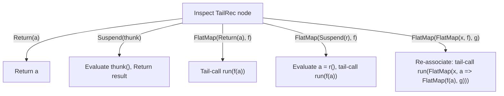
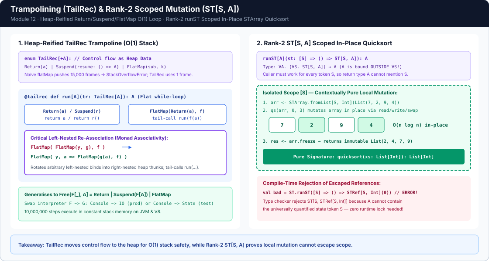
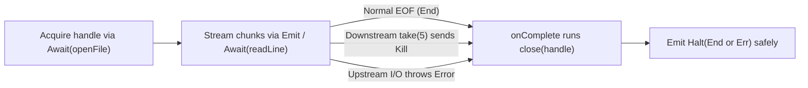

# External Effects (`IO`), Trampolining, Scoped Mutation (`ST`), and Pull-Based Streaming

Every concept in Modules 01–11 operated inside a closed, pure world. Real production systems, however, exist to perform **effects**: reading sockets, writing disks, mutating pre-allocated buffers for $O(1)$ cache-friendly throughput, and streaming multi-gigabyte payloads incrementally. The central thesis of pure functional architecture is not avoiding side effects—an impossible goal—but **separating the description of effects from their interpretation** so programs remain referentially transparent values up to the very boundary of execution, while enforcing stack safety, scope containment, and deterministic resource cleanup in the type system.

---

## 1. External Effects and the Naive `IO` Failure Mode

Factoring a system into a **pure functional core** and a thin **imperative shell** keeps domain logic easy to test, refactor, and reason about via equational substitution. To make the boundary itself composable, we reify side-effecting computations as values of a type `IO[A]`:

```scala
trait NaiveIO[A]:
  self =>
  def unsafeRun: A
  def map[B](f: A => B): NaiveIO[B] = new NaiveIO[B]:
    def unsafeRun: B = f(self.unsafeRun)
  def flatMap[B](f: A => NaiveIO[B]): NaiveIO[B] = new NaiveIO[B]:
    def unsafeRun: B = f(self.unsafeRun).unsafeRun
```

Notice what `NaiveIO` achieves: constructing `val p = readLine.flatMap(s => printLine(s.toUpperCase))` performs **no I/O**; it builds a pure description `p: NaiveIO[Unit]` that satisfies the Monad laws up to equivalence of `unsafeRun`.

### Fatal Production Failure Mode: `StackOverflowError` in Naive `flatMap`

Run a long-lived loop over `NaiveIO` such as `forever(printLine("tick"))` (or simply chain $15{,}000$ sequential `flatMap` steps):

```scala
def forever[A, B](a: NaiveIO[A]): NaiveIO[B] =
  a.flatMap(_ => forever(a)) // 💥 Crashes with StackOverflowError!
```

Why does it crash? Because `flatMap`'s `unsafeRun` calls `f(self.unsafeRun).unsafeRun` in **non-tail position**! Each `flatMap` allocates a new JVM call-stack frame waiting for `self.unsafeRun` (or waiting for the recursive call `f(a).unsafeRun` if left-nested). After roughly $8{,}000\text{–}15{,}000$ bindings, the thread stack overflows.

---

## 2. Trampolining (`TailRec`) and Heap-Reified Control Flow

To eliminate call-stack growth across arbitrary `flatMap` depths, we apply **trampolining** (Rúnar Bjarnason, _Stackless Scala With Free Monads_, 2012): instead of executing `flatMap` via nested JVM function calls, we **reify control flow as algebraic data constructors on the heap** and interpret them with a single `@tailrec` loop:

```scala
enum TailRec[+A]:
  case Return(a: A)
  case Suspend(resume: () => A)
  case FlatMap[A, +B](sub: TailRec[A], k: A => TailRec[B]) extends TailRec[B]

  def flatMap[B](f: A => TailRec[B]): TailRec[B] = TailRec.FlatMap(this, f)
  def map[B](f: A => B): TailRec[B] = flatMap(a => TailRec.Return(f(a)))
```

Crucially, simply encoding `FlatMap` as data is **not yet stack-safe** if you evaluate `FlatMap(FlatMap(x, f), g)` naively by recursing into `run(x)` before calling `g`. A left-associated chain `((a.flatMap(f)).flatMap(g)).flatMap(h)` would still overflow the stack on the leftmost branch!

The breakthrough insight uses **Monad Associativity** dynamically at runtime inside `@tailrec run`:

$$\text{FlatMap}(\text{FlatMap}(x, f), g) \;\equiv\; \text{FlatMap}(x, a \Rightarrow \text{FlatMap}(f(a), g))$$

Rotating left-nested `FlatMap` constructors into right-nested ones guarantees `step` always reaches `Return` or `Suspend` in **strictly tail-recursive $O(1)$ stack space**:



```scala
import scala.annotation.tailrec

object TailRec:
  @tailrec
  def run[A](tr: TailRec[A]): A = tr match
    case Return(a)  => a
    case Suspend(r) => r()
    case FlatMap(x, f) =>
      x match
        case Return(a)     => run(f(a))
        case Suspend(r)    => run(f(r()))
        case FlatMap(y, g) => run(y.flatMap(a => g(a).flatMap(f)))
```

Every `run` transition is a direct tail call (`@tailrec` verified by `scalac`). Deeply nested recursion—even $10{,}000{,}000$ mutual `even`/`odd` bounces or `forever` event loops—executes in **constant stack memory**, moving continuation frames from the finite thread stack to garbage-collected heap objects.

### TypeScript Iterative Trampoline Proof

Because JavaScript/TypeScript engines (V8) do not guarantee tail-call optimisation across general calls, an explicit `while (true)` trampoline loop achieves the exact same $O(1)$ stack safety for millions of chained `flatMap` steps:

```typescript
export type TailRec<A> =
  | { readonly tag: 'Return'; readonly value: A }
  | { readonly tag: 'Suspend'; readonly resume: () => TailRec<A> }
  | {
      readonly tag: 'FlatMap';
      readonly sub: TailRec<unknown>;
      readonly k: (a: unknown) => TailRec<A>;
    };

export const done = <A>(value: A): TailRec<A> => ({ tag: 'Return', value });
export const suspend = <A>(resume: () => TailRec<A>): TailRec<A> => ({ tag: 'Suspend', resume });
export const flatMap = <A, B>(sub: TailRec<A>, k: (a: A) => TailRec<B>): TailRec<B> => ({
  tag: 'FlatMap',
  sub,
  k: k as (a: unknown) => TailRec<B>,
});

export const runTrampoline = <A>(initial: TailRec<A>): A => {
  let curr: TailRec<unknown> = initial;
  while (true) {
    if (curr.tag === 'Return') return curr.value as A;
    if (curr.tag === 'Suspend') {
      curr = curr.resume();
    } else if (curr.sub.tag === 'Return') {
      curr = curr.k(curr.sub.value);
    } else if (curr.sub.tag === 'Suspend') {
      curr = flatMap(curr.sub.resume(), curr.k);
    } else {
      const inner = curr.sub;
      const outerK = curr.k;
      curr = flatMap(inner.sub, (a) => flatMap(inner.k(a), outerK));
    }
  }
};
```

---

## 3. `Free[F[_], A]`, Pure Interpreters, and Non-Blocking `Async`

Notice that `TailRec[A]` hardcodes `Suspend(() => A)`—i.e., `Function0[A]`. Generalising `Function0` to an **arbitrary type constructor `F[_]`** yields the **Free Monad `Free[F[_], A]`** (_Data types à la carte_, Wouter Swierstra, JFP 2008; _FP in Scala_ Ch 13):

```scala
enum Free[F[_], +A]:
  case Return(a: A) extends Free[F, A]
  case Suspend(s: F[A]) extends Free[F, A]
  case FlatMap[F[_], A, +B](s: Free[F, A], f: A => Free[F, B]) extends Free[F, B]

  def flatMap[B](f: A => Free[F, B]): Free[F, B] = Free.FlatMap(this, f)
  def map[B](f: A => B): Free[F, B] = flatMap(a => Free.Return(f(a)))
```

`Free[F, A]` automatically gives _any_ type constructor `F[_]` a lawful, stack-safe `Monad` without implementing `flatMap` for `F` itself! Execution is deferred to an interpreter **natural transformation `F ~> G`** (`trait Translate[F[_], G[_]] { def apply[A](fa: F[A]): G[A] }`):

```scala
@tailrec
def step[F[_], A](free: Free[F, A]): Free[F, A] = free match
  case Free.FlatMap(Free.FlatMap(x, f), g) => step(x.flatMap(a => f(a).flatMap(g)))
  case Free.FlatMap(Free.Return(x), f)     => step(f(x))
  case _                                   => free

def runFree[F[_], G[_], A](free: Free[F, A])(t: F ~> G)(using G: Monad[G]): G[A] =
  step(free) match
    case Free.Return(a)              => G.unit(a)
    case Free.Suspend(r)             => t(r)
    case Free.FlatMap(Free.Suspend(r), f) => G.flatMap(t(r))(a => runFree(f(a))(t))
    case _ => sys.error("Unreachable: step removes Return and nested FlatMap on left")
```

### Pure, Testable `Console` Interpreters and Asynchronous `Par`

Because `Free[Console, A]` is a pure AST of domain operations (`ReadLine`, `PrintLine`), the **exact same program** can be interpreted in production into `IO` / `Function0` (performing real terminal I/O), or in deterministic unit tests into `State[Buffers, A]` (reading mock input lines and recording printed lines in memory without touching `stdin`/`stdout`)!

```scala
enum Console[A]:
  case ReadLine extends Console[Option[String]]
  case PrintLine(line: String) extends Console[Unit]

type ConsoleIO[A] = Free[Console, A]

final case class Buffers(in: List[String], out: Vector[String])
type ConsoleState[A] = State[Buffers, A]

val consoleToState: Console ~> ConsoleState = new (Console ~> ConsoleState):
  def apply[A](c: Console[A]): ConsoleState[A] = c match
    case Console.ReadLine =>
      State(b => b.in match
        case h :: t => (Some(h), b.copy(in = t))
        case Nil    => (None, b)
      )
    case Console.PrintLine(line) =>
      State(b => ((), b.copy(out = b.out :+ line)))
```

Running `Free.runFree(program)(consoleToState).run(Buffers(List("Alice"), Vector.empty))` tests interactive CLI workflows deterministically at $100{,}000\text{ ops/sec}$ in memory without touching OS streams!

To support **non-blocking asynchronous I/O** (`Async[A] = Free[Par, A]`), we interpret `Console` (or socket callbacks via `Par.async`) into `Par[A]` and let `runFree[Par, Par, A]` execute asynchronously via non-blocking callbacks on a thread pool without blocking worker threads on `.get()`. Note one subtle requirement: for `runFree` itself to stay stack-safe across long chains of `FlatMap`, the target monad `G` must itself have a stack-safe `flatMap` (such as `TailRec`, `Par`'s actor trampoline, or Cats Effect `IO`).

---

## 4. Local Effects, `ST[S, A]`, and Rank-2 Polymorphism

External I/O interacts with the outside world. What about **local, scoped mutation**—such as in-place Quicksort, Fisher-Yates shuffling, or mutable hash-map construction inside a function whose external signature is completely pure?

### Contextual Purity: What Counts as a Side Effect?

Revisit referential transparency from Module 01: an expression $e$ is pure if replacing $e$ with its result preserves program meaning in **every enclosing context**. Consider sorting a `List[Int]` by allocating a fresh local `Array[Int]`, performing an in-place $O(n \log n)$ Quicksort on that array, and converting it back to an immutable `List[Int]`. Because **no external caller can ever observe the intermediate mutated array**, the mutation is _contextually pure_!

Conversely, if an unguarded `STRef` or `Array` leaks out of the local scope, two callers holding references to the same mutable cell observe temporal side effects, breaking referential transparency.

### The `ST[S, A]` Monad and Rank-2 Type Safety (Launchbury & Peyton Jones 1994)

In _Lazy Functional State Threads_ (PLDI 1994), John Launchbury and Simon Peyton Jones showed how **rank-2 polymorphism** proves statically at compile time that a mutable reference can **never** escape its enclosing `runST` block:

```scala
sealed trait ST[S, A]:
  self =>
  protected def run(s: S): (A, S)
  def map[B](f: A => B): ST[S, B] = new ST[S, B]:
    def run(s: S) = { val (a, s1) = self.run(s); (f(a), s1) }
  def flatMap[B](f: A => ST[S, B]): ST[S, B] = new ST[S, B]:
    def run(s: S) = { val (a, s1) = self.run(s); f(a).run(s1) }

object ST:
  // Do NOT memoize `a` in a lazy val: reusing `val r = ref.read` before and after
  // `ref.write(99)` must evaluate `a` freshly on each `run(s)` to observe the write!
  def apply[S, A](a: => A): ST[S, A] = new ST[S, A]:
    def run(s: S) = (a, s)

  // Scala 3 Polymorphic Function Type (Rank-2!):
  // The caller MUST produce an ST[S, A] valid for *every* possible token type S,
  // while the return type A CANNOT mention S!
  def runST[A](st: [S] => () => ST[S, A]): A =
    st[Unit]().run(())._1

final class STRef[S, A] private (private var cell: A):
  def read: ST[S, A] = ST(cell)
  def write(a: => A): ST[S, Unit] = new ST[S, Unit]:
    def run(s: S) = { cell = a; ((), s) }

object STRef:
  def apply[S, A](a: A): ST[S, STRef[S, A]] = ST(new STRef[S, A](a))
```

Look closely at the rank-2 signature of `ST.runST` (using Scala 3's native polymorphic function type `[S] => () => ST[S, A]`, replacing Scala 2's boilerplate `trait RunnableST[A] { def apply[S]: ST[S, A] }`):

$$runST : \forall A.\; (\forall S.\; \text{ST}[S, A]) \to A$$

Notice the quantifier scope! `A` is bound _outside_ the inner $\forall S$:

1. **Valid usage:** `[S] => () => for r <- STRef[S, Int](1); _ <- r.write(2); v <- r.read yield v` has return type `A = Int`, which does **not** contain `S`. It compiles cleanly and returns `2` purely.
2. **Negative compile-error test (escaped reference rejected at compile time):** Suppose someone tries to return the mutable cell itself:

```scala
// Does NOT compile!
// Found: ST[S, STRef[S, Int]], Required: ST[S, A] where A cannot depend on S
val leaked = ST.runST([S] => () => STRef[S, Int](0))
```

Because `S` is quantified universally inside the argument `st`, `A` cannot capture `S`—so `STRef[S, Int]` or `STArray[S, Int]` is **statically forbidden** from appearing in `runST`'s return type!

### Purely Functional In-Place Quicksort via `STArray`

Using `STArray[S, A]` (`read`, `write`, `swap`, `freeze: ST[S, List[A]]`), we write a true in-place Quicksort that runs with $O(n \log n)$ average time and $O(1)$ auxiliary array allocation while exposing a pure `List[Int] => List[Int]` signature:

```scala
final class STArray[S, A] private (private val value: Array[A]):
  def size: ST[S, Int] = ST(value.length)
  def read(i: Int): ST[S, A] = ST(value(i))
  def write(i: Int, a: A): ST[S, Unit] = new ST[S, Unit]:
    def run(s: S) = { value(i) = a; ((), s) }
  def swap(i: Int, j: Int): ST[S, Unit] =
    for x <- read(i); y <- read(j); _ <- write(i, y); _ <- write(j, x) yield ()
  def freeze: ST[S, List[A]] = ST(value.toList)

def partition[S](arr: STArray[S, Int], l: Int, r: Int, pivot: Int): ST[S, Int] =
  for
    pivotVal <- arr.read(pivot)
    _        <- arr.swap(pivot, r)
    jRef     <- STRef[S, Int](l)
    _        <- (l until r).foldLeft(ST[S, Unit](())) { (acc, i) =>
      for
        _  <- acc
        vi <- arr.read(i)
        _  <- if vi < pivotVal then jRef.read.flatMap(j => arr.swap(i, j).flatMap(_ => jRef.write(j + 1))) else ST(())
      yield ()
    }
    j        <- jRef.read
    _        <- arr.swap(j, r)
  yield j

def qs[S](arr: STArray[S, Int], l: Int, r: Int): ST[S, Unit] =
  if l < r then
    for
      pi <- partition(arr, l, r, l + (r - l) / 2)
      _  <- qs(arr, l, pi - 1)
      _  <- qs(arr, pi + 1, r)
    yield ()
  else ST(())

def quicksort(xs: List[Int]): List[Int] =
  if xs.isEmpty then xs
  else
    ST.runST([S] => () =>
      for
        arr <- STArray.fromList[S, Int](xs)
        sz  <- arr.size
        _   <- qs(arr, 0, sz - 1)
        res <- arr.freeze
      yield res
    )
```



_Step-by-step mechanics:_ (1) `TailRec` moves control flow to heap nodes (`Return`, `Suspend`, `FlatMap`) and rotates left-nested `FlatMap(FlatMap(y, g), f)` rightwards inside a single `@tailrec` loop for $O(1)$ stack space. (2) `ST.runST` uses rank-2 quantification $\forall A.\,(\forall S.\,\text{ST}[S, A]) \to A$ so `STArray` executes in-place Quicksort safely while any attempt to leak `STRef`/`STArray` fails at compile time.

---

## 5. Stream Processing and Incremental I/O (`Process`)

Why is `Free[Console, A]` or `IO[List[String]]` still insufficient for production I/O? Imagine counting lines or transforming records in a $50\text{ GB}$ log file:

- **Monolithic `IO`:** Reading all lines into `IO[List[String]]` exhausts heap memory ($O(n)$ space).
- **Imperative `while (reader.readLine() != null)` loop:** Fuses input reading, business logic, early termination (`take(10)`), and `reader.close()` cleanup into one tangled loop—destroying modularity and frequently leaking file descriptors when exceptions or early exits happen across composed stages.

### Pull-Based Stream Transducers: `Process[I, O]`

To recover composability _and_ $O(1)$ bounded memory, we model a stream processor as a pure pull-based state machine **`Process[I, O]`** (_FP in Scala_ Ch 15) with three states:

- `Emit(head: O, tail: Process[I, O])`: yields an output value `head` downstream and continues as `tail`.
- `Await(recv: Option[I] => Process[I, O])`: requests one input element from upstream (`Some(i)` if available, `None` on EOF).
- `Halt`: terminates the stream.

```scala
enum Process[I, O]:
  case Halt()
  case Emit(head: O, tail: Process[I, O] = Process.Halt())
  case Await(recv: Option[I] => Process[I, O])

  // Stream transducer fusion (p1 |> p2): pull-based demand!
  def |>[O2](p2: Process[O, O2]): Process[I, O2] = p2 match
    case Process.Halt()     => Process.Halt()
    case Process.Emit(h, t) => Process.Emit(h, this |> t)
    case Process.Await(f) => this match
      case Process.Emit(h, t) => t |> f(Some(h))
      case Process.Await(g)   => Process.Await(i => g(i) |> p2)
      case Process.Halt()     => Process.Halt() |> f(None)
```

Look closely at the evaluation order of **`|>` (pipe)**: `p1 |> p2` is **demand-driven (pull-based)**. It inspects `p2` (downstream) first! Only when `p2` enters `Await` does it pull a single `Emit` from `p1`. If `p2` is `take(5)` and hits `Halt()` after 5 elements, **`p1` immediately stops pulling**, never reading the remaining $49.999\text{ GB}$ of the file! Furthermore, stateful transducers such as `sum`, `count`, or `zipWithIndex` are expressed purely via recursive `loop(state)` transitions without external mutable variables:

```scala
def loop[S, I, O](z: S)(f: (I, S) => (O, S)): Process[I, O] =
  Process.Await {
    case Some(i) =>
      val (o, s2) = f(i, z)
      Process.Emit(o, loop(s2)(f))
    case None => Process.Halt()
  }

val runningSum: Process[Double, Double] =
  loop(0.0)((x, acc) => (x + acc, x + acc))
```

In **TypeScript**, the same pull-based transducer pipeline maps cleanly onto lazy `Iterable` / generator transducers (`Pipe<I, O>`) where downstream `take(5)` halts pulling immediately and runs `finally` cleanup blocks inside the upstream generator:

```typescript
export function* take<A>(n: number, src: Iterable<A>): Iterable<A> {
  if (n <= 0) return;
  let remaining = n;
  for (const item of src) {
    yield item;
    if (--remaining === 0) return; // triggers upstream generator's finally cleanup!
  }
}
```

### Extensible Effectful Streams (`Process[F[_], O]`), Bracketed Resource Safety, and `Tee` / `Wye`

To execute real I/O (`F`) and guarantee deterministic resource cleanup (`close()` on file handles or DB cursors), `Process` generalises to **`Process[F[_], O]`**:

```scala
enum ProcessF[F[_], O]:
  case Halt(err: Throwable) // End (normal completion) vs Kill (downstream termination)
  case Emit(head: Seq[O], tail: ProcessF[F, O])
  case Await[F[_], A, O](
    req: F[A],
    recv: Either[Throwable, A] => ProcessF[F, O]
  ) extends ProcessF[F, O]
```



Three architectural mechanisms turn `ProcessF` into a complete streaming engine:

1. **Bracketed Resource Safety (`resource` / `onComplete`):** `Await` captures exceptions in `Either[Throwable, A]` rather than crashing; `onComplete(finalizer)` intercepts _both_ normal `End` and forced `Kill` (when downstream `take(5)` stops early!) and executes cleanup finalizers before propagating termination. Thus, `resource(acquire)(use)(release)` guarantees `release(handle)` runs deterministically even on early termination or upstream failure.
2. **Multi-Input Streams (`Tee` and `Wye`):** Generalising `Await` to two upstream sources yields **`Tee`** (deterministic pull from left `L` or right `R`, enabling `zip` and `zipWith`) and **`Wye`** (non-deterministic concurrent merge `merge` / `either`, pulling whichever upstream emits first).
3. **Sinks and Channels:** A **Sink** is simply `ProcessF[F, O => ProcessF[F, Unit]]` (a stream emitting effectful consumer actions like `fileWriter`), while a **Channel** is `ProcessF[F, I => ProcessF[F, O]]` (e.g., querying a database per streamed ID while scoping the DB connection across the whole stream!).

---

## 6. Then vs. Now: From 2015 `Process` to 2026 Effect & Streaming Ecosystems

The foundational patterns of _Functional Programming in Scala_ (2015)—heap-reified `TailRec`/`Free`, rank-2 scoped mutation, and pull-based `Process[F, O]`—directly birthed today's production Scala 3 and TypeScript effect runtimes, while resolving major ergonomic and performance bottlenecks of the 2015 designs:

| Dimension | Then (2015 `FP in Scala` Ch 13–15) | Now (2026 Production Runtimes) | Architectural Improvement |
| --- | --- | --- | --- |
| **Effect Monad** | Hand-rolled `Free[Par, A]` / `Task` | **Cats Effect `3.7.1`** `IO` / **ZIO `2.1.26`** | Fiber work-stealing scheduler, structured cancelation, built-in `Deferred`/`Ref`, interrupt-safe `Resource` |
| **Streaming** | Element-at-a-time `Process[F, O]` with manual `Kill` | **FS2 `3.16.0`** `Stream[F, O]` / **ZIO Streams** | **Chunked** (`Chunk[O]`) pull batches eliminate per-element state-machine allocation; lexically scoped `Scope` |
| **Scoped Mutation** | `RunnableST[A]` boilerplate (`[S]`) | Scala 3 `[S] => ST[S, A]` & **Capture Checking** (`{cap}`) | Native polymorphic function types; experimental Capture Checking tracks capabilities directly in types |
| **Structured Concurrency** | Manual `Par` actors + callbacks | **Ox `1.0.9`** on JDK 25 virtual threads (`supervised`) | Direct-style structured scopes on JVM virtual threads where applicable, without losing leak-proof cancelation |

For full production coverage of Cats Effect `IO` fibers, `Resource`, and ZIO layers, see [08-typelevel-ecosystem-cats-and-cats-effect.md](../../../languages/scala/modules/08-typelevel-ecosystem-cats-and-cats-effect.md); for chunked FS2 `Stream`, backpressure, and ZStream pipelines, see [09-functional-streaming-fs2-and-zio-ecosystem.md](../../../languages/scala/modules/09-functional-streaming-fs2-and-zio-ecosystem.md).

---

## 7. Failure Modes and Negative Examples

1. **Unbounded Synchronous Loop on `NaiveIO`:** Any loop over `flatMap` without a trampoline (`TailRec` / `while`-loop interpreter) crashes with `StackOverflowError` around depth $10^4$.
2. **Left-Nested `Free` Without Right-Association:** Implementing `Free.run` without rotating `FlatMap(FlatMap(x, f), g)` into `FlatMap(x, a => FlatMap(f(a), g))` still overflows the stack on left-associated binds (such as `xs.foldLeft(Free.pure(0))((acc, x) => acc.flatMap(_ => Free.pure(x)))`).
3. **Forgotten `Kill` Propagation in Naive Streams:** Writing a custom stream `pipe` that simply drops the upstream `Process` when downstream `Halt`s leaks open file handles and sockets! Downstream termination must send `Kill` upstream so `onComplete` / `Resource` finalizers execute.
4. **Impure `try/finally` Across Async Boundaries:** Using JVM `try { use(res) } finally { res.close() }` around an asynchronous `IO` or `Promise` value closes the resource **immediately when the `IO` / `Promise` value is constructed**, long before the asynchronous callback runs (`UseAfterCloseException`). Only monadic `bracket` / `Resource` / stream `Scope` binds cleanup to actual asynchronous completion or cancelation.
5. **Leaking `STRef` Out of Scope:** Attempting to stash an `STRef` in an `Option` or return it from `ST.runST` is caught at compile time by the rank-2 quantifier `[S] => ...`; weakening `ST.runST` to a rank-1 signature `def unsafeRunST[S, A](st: ST[S, A]): A` immediately breaks referential transparency by letting callers share and mutate escaped `STRef`s across independent expressions!

---

## Interview Drill

1. **Why does a naive `IO` monad (`def flatMap(f) = IO(() => f(this.unsafeRun()).unsafeRun())`) fail on loops, and how does trampolining fix it?**

<details><summary>Answer</summary>

Naive `IO` executes `flatMap` using nested JVM call frames: each `flatMap` stays on the call stack until `f(a).unsafeRun()` returns, overflowing the stack at $\sim 10^4$ iterations. Trampolining (`TailRec`) reifies `Return`, `Suspend`, and `FlatMap` as heap data constructors and evaluates them with an iterative `@tailrec` loop (`while (true)` in TS), replacing $O(n)$ stack frames with $O(1)$ stack space.

</details>

2. **Why is reifying `FlatMap` as a case class insufficient for stack safety unless `run` also re-associates nested `FlatMap`s?**

<details><summary>Answer</summary>

If `run` encounters `FlatMap(FlatMap(x, f), g)` and recursively calls `run(x)` on the inner `FlatMap` before applying `g`, a deeply left-nested chain `(((a.flatMap(f1)).flatMap(f2))...)` still builds $O(n)$ non-tail recursive calls to `run`. Rotating `FlatMap(FlatMap(x, f), g)` into `FlatMap(x, a => FlatMap(f(a), g))` via Monad associativity converts every step into a direct tail call.

</details>

3. **What problem does `Free[F[_], A]` solve in system architecture, and what is the cost of using `Free` everywhere?**

<details><summary>Answer</summary>

`Free[F, A]` separates a domain DSL algebra (`F[_]`, e.g., `Console`, `KeyValueStore`) from its execution interpreter (`F ~> G`), giving any functor/type constructor a stack-safe `Monad` and enabling pure in-memory test interpreters alongside production async interpreters. The cost is per-bind heap allocation of `FlatMap` and `Suspend` AST nodes plus indirect interpreter dispatch, which high-throughput hot loops mitigate via chunking (FS2) or direct fiber runtimes (Cats Effect `IO` / ZIO).

</details>

4. **Explain how rank-2 polymorphism in `ST.runST` prevents mutable references from escaping their local scope at compile time.**

<details><summary>Answer</summary>

`ST.runST` takes a polymorphic argument `[S] => () => ST[S, A]` where `A` is bound _outside_ the inner type parameter `S` ($\forall A.\, (\forall S.\, \text{ST}[S, A]) \to A$). Because `st` must be valid for _every_ possible `S`, the returned result `A` cannot depend on `S`. Any attempt to return `STRef[S, T]` or `STArray[S, T]` fails type checking because `S` would escape its universal quantifier scope.

</details>

5. **Under what condition is in-place mutation inside a function (`quicksort`) still referentially transparent?**

<details><summary>Answer</summary>

Mutation is contextually pure (preserving referential transparency) whenever the mutable state is allocated freshly inside the function, never aliased or observed outside that closed scope, and discarded before returning an immutable value. Every call with equal inputs yields the exact same output without observable side effects in any enclosing context.

</details>

6. **How does pull-based `Process` piping (`p1 |> p2`) achieve bounded $O(1)$ memory and short-circuiting on `take(5)`?**

<details><summary>Answer</summary>

In `p1 |> p2`, evaluation is driven by downstream demand: `p2` is inspected first, and `p1` is stepped _only_ when `p2` enters `Await` requesting the next item. As soon as `p2` (e.g., `take(5)`) transitions to `Halt`, `|>` terminates immediately (propagating `Kill` upstream in `ProcessF` so resources close) without ever pulling or buffering the remainder of `p1`.

</details>

7. **Why does JVM `try { ... } finally { close() }` break when used around an asynchronous `IO` or `Promise` construction?**

<details><summary>Answer</summary>

Constructing an `IO` or `Promise` value returns immediately on the calling thread before the asynchronous work executes on a thread pool or event loop. A synchronous `try/finally` block runs `close()` at value-construction time, closing the file or connection before the async computation even reads from it. Resource-safe FP uses `bracket` / `Resource` / `ProcessF.onComplete`, which registers cleanup inside the monadic/stream continuation so it executes only after the async action finishes, fails, or is canceled.

</details>

8. **What are the two biggest architectural advances from 2015 `Process[F, O]` to modern FS2 `Stream[F, O]`?**

<details><summary>Answer</summary>

First, FS2 pulls **contiguous `Chunk[O]` batches** (`Array`-backed slices) instead of single elements, amortising `Pull`/`FlatMap` state-machine allocations across thousands of items for orders-of-magnitude higher throughput. Second, FS2 integrates directly with Cats Effect's fiber cancelation and lexical `Scope`s (`Resource`), guaranteeing leak-free finalization even under concurrent `parJoin`, `merge`, and fiber interruption.

</details>
