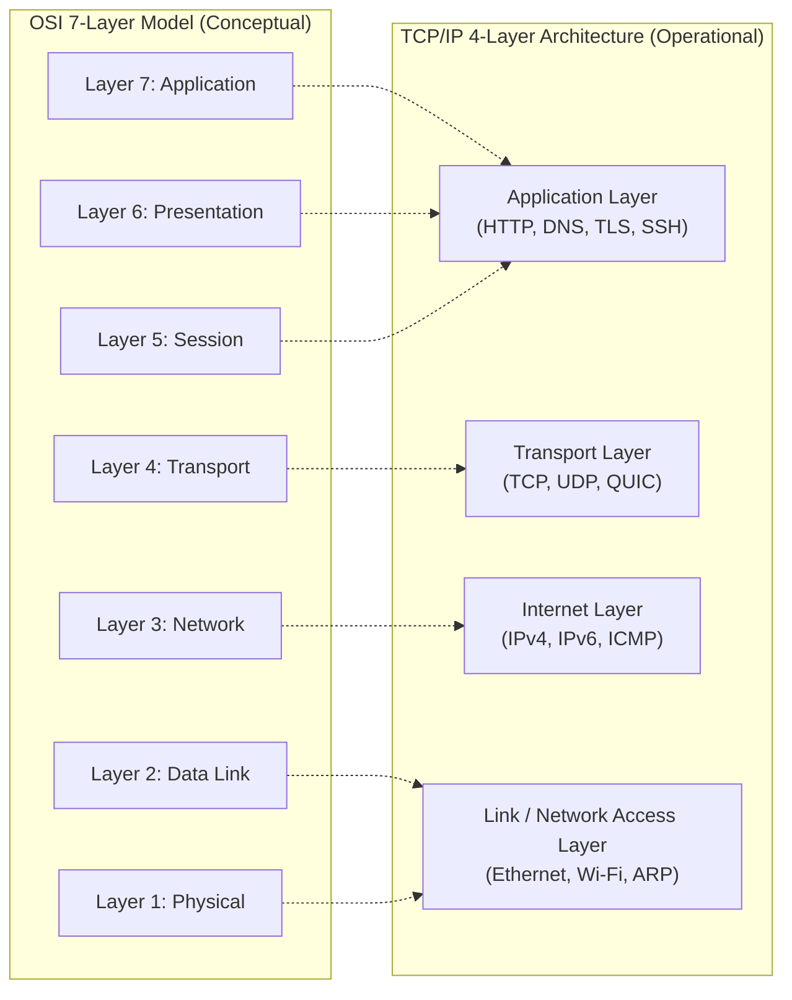
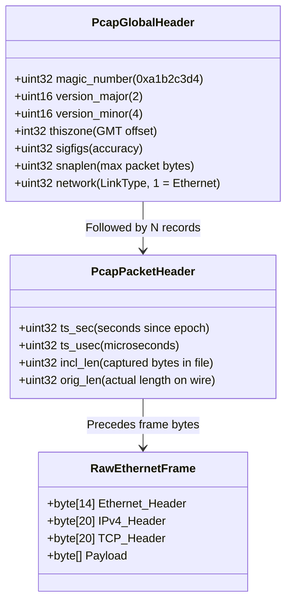

# Module 01: Network Layering, Packet Encapsulation & Latency Economics

Computer networking is the disciplined study of transmitting structured digital information across heterogeneous, unreliable physical media. Every communication system on the modern Internet balances mathematical physical limits—propagation delay, transmission serialization, queueing dynamics, and processing overhead—against architectural modularity. This module establishes the structural foundations of packet-switched communication, dissects binary encapsulation from the physical wire to application streams, formally analyzes the latency budget and Bandwidth-Delay Product (BDP), and dissects the binary architecture of the standard libpcap packet capture format.

---

## 1. Architectural Models: OSI Reference vs. TCP/IP Implementation

Modern network engineering often conflates the theoretical seven-layer Open Systems Interconnection (OSI) Reference Model (ISO/IEC 7498-1) with the four-layer Internet Protocol Suite (RFC 1122). In production software systems, the OSI model is a descriptive vocabulary for separation of concerns, whereas the TCP/IP stack represents the actual operational architecture implemented in operating system kernels and network interface controllers (NICs).



The OSI Presentation layer (syntax translation, encryption, compression) and Session layer (session checkpointing, token management, multiplexing) were never realized as independent kernel abstractions in UNIX or POSIX systems. Instead, application developers manage session state and presentation encodings directly in user space through libraries such as OpenSSL, BoringSSL, protobuf, and JSON parsers.

### Protocol Data Units (PDUs) and Encapsulation

As application data traverses down the protocol stack toward the physical medium, each layer prepends a protocol-specific header (and occasionally appends a checksum trailer). This process is known as **encapsulation**. The inverse process on the receiving host is **decapsulation**.

| Architectural Layer | Unit of Data (PDU) | Common Protocols | Primary Identifier / Addressing |
| :--- | :--- | :--- | :--- |
| **Application** | Message / Stream | HTTP/2, DNS, gRPC, TLS | URI, Hostname, Session ID |
| **Transport** | Segment (TCP) / Datagram (UDP) | TCP, UDP, QUIC, SCTP | Port Number (16-bit) |
| **Internet / Network** | Packet / Datagram | IPv4, IPv6, ICMP, IPsec | IP Address (32-bit / 128-bit) |
| **Data Link** | Frame | Ethernet II, 802.11, PPP | MAC Address (48-bit EUI-48) |
| **Physical** | Bit / Symbol | 1000BASE-T, Optical NRZ/PAM4 | Electrical voltage, Optical pulse |

```
+-------------------------------------------------------------------------------------------------+
| Ethernet Frame (L2): Preamble | Dest MAC | Src MAC | EtherType (0x0800)                         |
| +---------------------------------------------------------------------------------------------+ |
| | IPv4 Packet (L3): Version, IHL, Total Length, TTL, Protocol (0x06), Src IP, Dest IP         | |
| | +-----------------------------------------------------------------------------------------+ | |
| | | TCP Segment (L4): Src Port, Dest Port, Seq Number, Ack Number, Flags, Window Size      | | |
| | | +-------------------------------------------------------------------------------------+ | | |
| | | | Application Payload (L7): HTTP/1.1 GET /index.html CRLF CRLF                        | | | |
| | | +-------------------------------------------------------------------------------------+ | | |
| | +-----------------------------------------------------------------------------------------+ | |
| +---------------------------------------------------------------------------------------------+ |
| Ethernet Trailer: Frame Check Sequence (FCS / CRC32)                                            |
+-------------------------------------------------------------------------------------------------+
```

---

## 2. Binary Framing, Byte Order & Endianness

Network communication links connect disparate computer architectures. Systems such as x86-64 and modern ARM processors predominantly use **Little-Endian** byte ordering (least significant byte at the lowest memory address), whereas network protocol standards mandate **Big-Endian** byte ordering (most significant byte at the lowest memory address), designated universally as **Network Byte Order**.

When serializing multi-byte integers (such as 16-bit port numbers, 32-bit IPv4 addresses, or 32-bit sequence numbers) into network buffers, software must convert between Host Byte Order and Network Byte Order using standard primitives:
- `htons()` / `ntohs()`: Host to Network (and inverse) Short (16-bit).
- `htonl()` / `ntohl()`: Host to Network (and inverse) Long (32-bit).

```
32-bit Integer: 0x12345678 (Decimal: 305419896)

Little-Endian (Host Memory on x86/ARM):
Address:    [ 0x00 ] [ 0x01 ] [ 0x02 ] [ 0x03 ]
Value:      | 0x78   | 0x56   | 0x34   | 0x12   |

Big-Endian / Network Byte Order (Wire Transmit Order):
Byte Index: [ Byte 0 ] [ Byte 1 ] [ Byte 2 ] [ Byte 3 ]
Value:      | 0x12     | 0x34     | 0x56     | 0x78     |
```

In modern high-performance runtimes such as Node.js, `Buffer.prototype.readUInt16BE()` and `Buffer.prototype.writeUInt32BE()` handle these conversions explicitly, bypassing the underlying processor's native memory ordering.

---

## 3. Dissecting the Wire: The Libpcap Binary Architecture

The de facto standard for capturing and persisting raw network traffic is the **libpcap** file format (used by Wireshark, `tcpdump`, and Linux kernel packet taps). A pcap capture file consists of a 24-byte Global File Header, followed by a contiguous sequence of packet records. Each packet record contains a 16-byte Packet Record Header followed immediately by the raw, unpadded link-layer frame bytes.



### 1. Libpcap Global Header (24 Bytes)
| Byte Offset | Field Name | Data Type | Purpose & Canonical Value |
| :--- | :--- | :--- | :--- |
| `0x00 - 0x03` | `magic_number` | `uint32` | Identifies file format and endianness: `0xa1b2c3d4` indicates identical host endianness; `0xd4c3b2a1` indicates swapped endianness. |
| `0x04 - 0x05` | `version_major`| `uint16` | Major format version number (Standard: `2`). |
| `0x06 - 0x07` | `version_minor`| `uint16` | Minor format version number (Standard: `4`). |
| `0x08 - 0x0B` | `thiszone` | `int32` | GMT to local correction in seconds (typically `0`). |
| `0x0C - 0x0F` | `sigfigs` | `uint32` | Accuracy of timestamps in the capture (typically `0`). |
| `0x10 - 0x13` | `snaplen` | `uint32` | Snapshot length: maximum number of bytes captured per packet (e.g., `65535` or `262144`). |
| `0x14 - 0x17` | `network` | `uint32` | Data Link Type (DLT). `1` = `LINKTYPE_ETHERNET` (10/100/1000Mbps Ethernet frames). |

### 2. Libpcap Packet Record Header (16 Bytes)
| Byte Offset | Field Name | Data Type | Purpose & Canonical Value |
| :--- | :--- | :--- | :--- |
| `0x00 - 0x03` | `ts_sec` | `uint32` | UNIX timestamp seconds when packet arrived at network interface. |
| `0x04 - 0x07` | `ts_usec` | `uint32` | Microsecond fraction of arrival timestamp (or nanoseconds in nanosecond pcap). |
| `0x08 - 0x0B` | `incl_len` | `uint32` | Number of packet bytes actually captured and saved in this record ($\le \text{snaplen}$). |
| `0x0C - 0x0F` | `orig_len` | `uint32` | Actual length of packet as transmitted over the physical wire. |

If `incl_len < orig_len`, the packet was truncated during capture due to the configured `snaplen` parameter.

---

## 4. Latency Economics & The Four Delay Components

Network throughput measures the quantity of data transferred per unit time, but user-perceived performance is overwhelmingly governed by **round-trip latency**. The total nodal delay ($d_{\text{nodal}}$) experienced by a packet traversing a link from node $A$ to node $B$ is the sum of four discrete physical and computational components:

$$d_{\text{nodal}} = d_{\text{proc}} + d_{\text{queue}} + d_{\text{trans}} + d_{\text{prop}}$$

### 1. Processing Delay ($d_{\text{proc}}$)
The time required by a router, switch, or host CPU to inspect packet headers, verify checksums, parse routing tables (Longest Prefix Match), and execute firewall rules or NAT translations. On modern hardware equipped with hardware ternary content-addressable memory (TCAM) or eBPF/XDP offload, $d_{\text{proc}}$ is typically in the range of microseconds ($\mu\text{s}$) or sub-microseconds.

### 2. Queueing Delay ($d_{\text{queue}}$)
The time a packet sits in switch or router memory buffers awaiting transmission onto the outbound transmission link. Queueing delay is non-deterministic and dynamic. If $L$ is the packet size in bits, $R$ is transmission rate in bits/second, and $a$ is the average packet arrival rate (packets/second), the **traffic intensity** $I$ is:

$$I = \frac{L \cdot a}{R}$$

- If $I \approx 0$: Queueing delay approaches zero.
- As $I \to 1$: Queueing delay increases asymptotically toward infinity as queues fill.
- If $I > 1$: Inflow exceeds link capacity; buffer queues overflow and packets are dropped.

### 3. Transmission Delay / Serialization Delay ($d_{\text{trans}}$)
The physical time required to push all bits of a packet into the physical transmission medium. It is strictly a function of packet length and link bit-rate, completely independent of geographic distance:

$$d_{\text{trans}} = \frac{L}{R}$$

Where $L$ is packet length in bits and $R$ is link transmission speed in bits/second ($\text{bps}$).
- *Example*: Pushing a 1500-byte (12,000 bits) packet onto a 1 Gbps link requires:
  $$d_{\text{trans}} = \frac{12,000\text{ bits}}{10^9\text{ bps}} = 12\,\mu\text{s}$$
- Pushing the same packet onto a 10 Mbps legacy link requires:
  $$d_{\text{trans}} = \frac{12,000\text{ bits}}{10^7\text{ bps}} = 1.2\text{ ms}$$

### 4. Propagation Delay ($d_{\text{prop}}$)
The time required for an electromagnetic or optical bit to physically travel through the transmission medium from source to destination. It is strictly a function of physical distance and the speed of light in the physical medium, completely independent of packet size or link bandwidth:

$$d_{\text{prop}} = \frac{d}{s}$$

Where $d$ is the physical path distance (in meters) and $s$ is the propagation speed of the signal in the medium. In fiber optic glass ($c_{\text{glass}} \approx \frac{2}{3} c \approx 200,000\text{ km/s}$), light travels roughly 1 millisecond per 200 km (or $5\,\mu\text{s}$ per kilometer).
- *Transatlantic fiber (London to New York, $\approx 5,500\text{ km}$)*:
  $$d_{\text{prop}} = \frac{5,500\text{ km}}{200,000\text{ km/s}} \approx 27.5\text{ ms} \quad (\text{One-way propagation})$$
  $$\text{Minimum theoretical physical RTT} \approx 55\text{ ms}$$

No software optimization, compression algorithm, or high-bandwidth link can ever reduce this physical propagation floor.

---

## 5. The Bandwidth-Delay Product (BDP)

The **Bandwidth-Delay Product (BDP)** defines the volume of data that can be "in flight" across a communication network at any given instant. It represents the capacity of the network pipe between sender and receiver:

$$\text{BDP} = R \times \text{RTT}$$

Where $R$ is the bottleneck transmission capacity (bits/second) and $\text{RTT}$ is the round-trip time (seconds).

```
Sender ═════════════════════════════════════════════════════════════════> Receiver
        [ Packet 3 ]   [ Packet 2 ]   [ Packet 1 ] (In flight on wire)
<═════════════════════════════════════════════════════════════════
        [ ACK 0 ]                                  (In flight return)

Total Pipe Capacity = Bandwidth × Round-Trip Time
```

### Engineering Implications of High BDP Networks
Consider a transatlantic 10 Gbps cloud interconnect with an RTT of 80 ms:
$$\text{BDP} = 10 \times 10^9\text{ bps} \times 0.080\text{ s} = 800,000,000\text{ bits} = 100\text{ Megabytes}$$

If a TCP sender has a maximum socket receive window (`SO_RCVBUF`) capped at 64 KB (the historical 16-bit TCP window size without RFC 7323 Window Scaling), the sender can transmit at most 64 KB before stopping to wait for an acknowledgment. The maximum achievable throughput is bounded by:

$$\text{Throughput}_{\text{max}} \le \frac{\text{Window Size}}{\text{RTT}} = \frac{65,535 \times 8\text{ bits}}{0.080\text{ s}} = 6.55\text{ Mbps}$$

Despite paying for a 10 Gbps pipe, a single TCP stream achieves less than 0.07% link utilization unless TCP Window Scaling is enabled and kernel socket buffers are tuned to match the BDP.

---

## 6. Then vs. Now: Architectural Evolution

| Dimension | Legacy Practice (Then) | Modern Architecture (Now) | Rationale for Transition |
| :--- | :--- | :--- | :--- |
| **Layer Isolation** | Strict OSI boundary separation; kernel space handles L2-L4, user space handles L7 via standard POSIX sockets. | Cross-layer optimization; eBPF/XDP processes packets at driver layer; user-space network stacks (DPDK, QUIC). | Kernel context-switch overhead and socket lock contention degrade 100 Gbps line-rate processing. |
| **TCP Window Limit** | Fixed 16-bit window field in TCP header limiting in-flight data to 64 KB ($65,535\text{ bytes}$). | RFC 7323 Window Scaling option up to factor $2^{14}$, enabling 1 GB receive windows. | BDP of high-speed gigabit and transatlantic links drastically exceeded historical memory limits. |
| **Latency Mitigation** | Adding raw bandwidth (upgrading T1 $\to$ 100Mbps $\to$ 1Gbps). | Edge termination, Anycast CDNs, 0-RTT handshakes, protocol coalescing (QUIC). | Latency is bounded by the speed of light; adding bandwidth does not reduce physical propagation delay. |
| **Packet Inspection** | Slow user-space `libpcap` copies every packet across kernel-user boundary using `recvfrom()`. | Zero-copy `AF_XDP` sockets and memory-mapped ring buffers (`PACKET_MMAP`). | Eliminates packet memory copies and TLB cache invalidation under multi-million packet-per-second loads. |

---

## 7. Interview Drill: Questions & Model Answers

### Q1: Why is the OSI model described as an architectural taxonomy rather than an implementation standard?
<details><summary>Answer</summary>

**Operational vs Conceptual Design.** The OSI model defines a clean 7-layer theoretical separation of concerns, but no major commercial operating system ever implemented it directly. The Internet evolved on the 4-layer TCP/IP suite (RFC 1122), where Layers 5 (Session) and 6 (Presentation) were absorbed entirely into user-space application runtimes. Furthermore, high-performance modern architectures deliberately break layer boundaries: NIC hardware performs L4 TCP segmentation offload (TSO) and L3 checksum verification, while eBPF filters packets at Layer 2/3 before the kernel network stack even allocates an `sk_buff`.
- Ref: Kurose & Ross 9th ed., Section 1.5; Stevens TCP/IP Illustrated Vol. 1.
</details>

### Q2: A 1 Gbps link connects two datacenters separated by 2,000 km of optical fiber. What is the one-way transmission delay and propagation delay for a standard 1,500-byte frame?
<details><summary>Answer</summary>

**Calculations:**
1. **Transmission Delay ($d_{\text{trans}} = \frac{L}{R}$)**:
   $$L = 1,500\text{ bytes} \times 8 = 12,000\text{ bits}$$
   $$R = 10^9\text{ bps}$$
   $$d_{\text{trans}} = \frac{12,000}{10^9} = 1.2 \times 10^{-5}\text{ s} = 12\,\mu\text{s}$$
2. **Propagation Delay ($d_{\text{prop}} = \frac{d}{s}$)**:
   $$s \approx 200,000\text{ km/s} \quad (\text{speed of light in optical silica fiber})$$
   $$d = 2,000\text{ km}$$
   $$d_{\text{prop}} = \frac{2,000}{200,000} = 0.01\text{ s} = 10\text{ ms}$$
Notice that $d_{\text{prop}}$ ($10,000\,\mu\text{s}$) is nearly 833 times larger than $d_{\text{trans}}$ ($12\,\mu\text{s}$). Upgrading the link to 10 Gbps reduces transmission delay to $1.2\,\mu\text{s}$, but propagation delay remains completely fixed at 10 ms.
- Ref: RFC 1122; Kurose & Ross 9th ed., Section 1.4.
</details>

### Q3: What is the magic number in a standard libpcap header, and how does a parser use it to determine file endianness?
<details><summary>Answer</summary>

**Endianness Detection.** The first 4 bytes of a standard libpcap global header contain the magic number `0xa1b2c3d4`. When a parser reads these 4 bytes into a 32-bit unsigned integer:
- If the integer evaluates to `0xa1b2c3d4`, the capture file was written using the same endianness as the host machine running the parser.
- If the integer evaluates to `0xd4c3b2a1` (the reversed byte sequence), the capture file was generated on an architecture with the opposite byte ordering. The parser must swap all subsequent multi-byte header fields (`snaplen`, `network`, `ts_sec`, `incl_len`) when reading.
- A value of `0xa1b23c4d` indicates a nanosecond-resolution pcap variant.
- Ref: libpcap file format specification; tcpdump man page.
</details>

### Q4: If a transatlantic connection has an RTT of 70 ms and a bottleneck link speed of 40 Gbps, calculate the required TCP window size to achieve 100% link utilization.
<details><summary>Answer</summary>

**Bandwidth-Delay Product:**
$$\text{BDP} = R \times \text{RTT}$$
$$\text{BDP} = 40 \times 10^9\text{ bps} \times 0.070\text{ s} = 2.8 \times 10^9\text{ bits} = 350,000,000\text{ bytes} \approx 333.78\text{ MiB}$$
To fully saturate this link without stalling for ACKs, the sender and receiver must negotiate TCP Window Scaling (RFC 7323) and allocate at least $350\text{ MB}$ of socket buffer space (`net.ipv4.tcp_wmem` and `net.ipv4.tcp_rmem`). With historical unscaled 16-bit windows (max 64 KB), the maximum achievable throughput is only $7.49\text{ Mbps}$, utilizing less than 0.02% of available bandwidth.
- Ref: RFC 7323; Jacobson et al., "TCP Extensions for High Performance".
</details>

### Q5: In packet capture analysis, what is the difference between `incl_len` and `orig_len` in the packet record header? Under what condition are they unequal?
<details><summary>Answer</summary>

**Snapshot Truncation.**
- `orig_len` (Original Length) is the exact number of bytes the packet had as it traversed the physical wire.
- `incl_len` (Included Length) is the number of bytes actually saved into the pcap file.
They are unequal whenever the packet capture was initiated with a **snaplen** (snapshot length) parameter smaller than the packet size. For example, running `tcpdump -s 96` records only the first 96 bytes (capturing L2, L3, and L4 headers for protocol inspection while discarding payload data for performance and privacy). In this scenario, for a 1500-byte packet, `orig_len` is 1500 while `incl_len` is 96.
- Ref: libpcap file format standard; tcpdump documentation.
</details>
