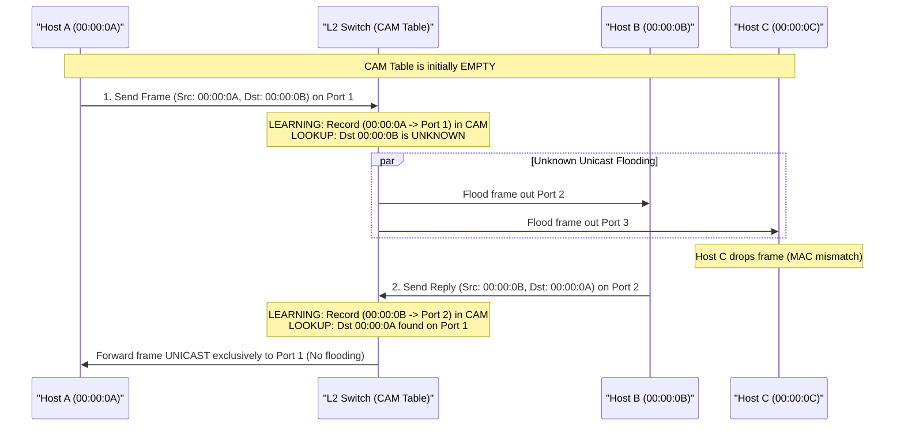
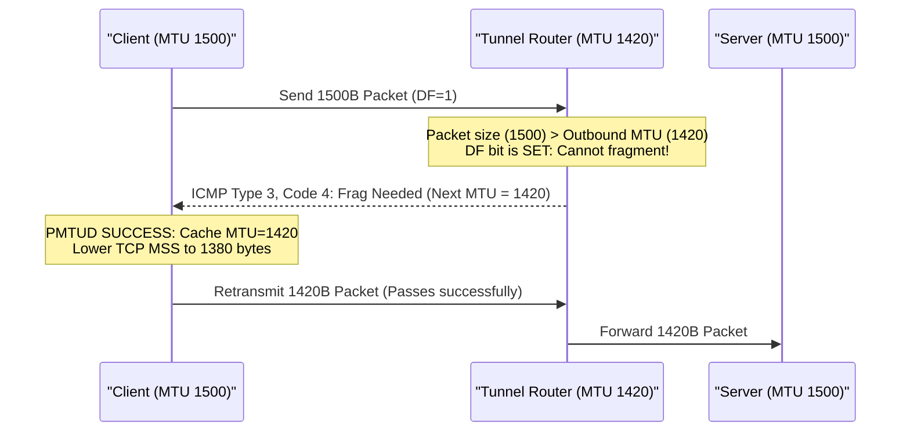

# Module 02: Link Layer Mechanics, Switching & Physical MTU Dynamics

The Data Link Layer (Layer 2) governs the transfer of datagrams between adjacent nodes connected across a shared broadcast domain or point-to-point physical circuit. Where Layer 3 provides end-to-end logical routing across disparate networks, Layer 2 is responsible for framing, physical hardware addressing, local media access arbitrations, and boundary fragmentation constraints. This module dissects the binary architecture of Ethernet II frames, the operational mechanics of transparent bridging and CAM tables, 802.1Q VLAN encapsulation, IPv4 ARP versus IPv6 Neighbor Discovery (NDP), and the engineering dynamics of Path MTU Discovery (PMTUD) and black-hole failures.

---

## 1. The Ethernet II (DIX) Frame Architecture

The dominant link-layer framing protocol across modern terrestrial local-area networks and datacenters is **Ethernet II** (also designated DIX Ethernet, formalized in IEEE 802.3). Every frame transmitted over physical copper or fiber media is wrapped in standard framing delimiters, physical hardware addresses, a protocol discriminator, and an error-detecting cyclic redundancy code (CRC).

```
+---------------------------------------------------------------------------------------------------+
| Preamble | SFD   | Destination MAC | Source MAC  | EtherType | Payload Data         | FCS (CRC-32) |
| (7 bytes)|(1 byte)|   (6 bytes)     |  (6 bytes)  | (2 bytes) | (46 - 1500 bytes)    | (4 bytes)    |
+---------------------------------------------------------------------------------------------------+
 0x55...    0xD5    e.g. 00:1A:2B...  e.g. 3C:4D:5E   0x0800    IPv4 / ARP / IPv6...    Polynomial
```

### Frame Field Specifications
1. **Preamble (7 Bytes)**: An alternating bit pattern (`10101010` repeated 7 times, byte value `0x55`) allowing receiver clock circuitry to achieve physical bit synchronization.
2. **Start Frame Delimiter / SFD (1 Byte)**: The byte `10101011` (`0xD5`), signalling that the immediately following bit represents the start of the destination address.
   *(Note: Preamble and SFD are stripped by the physical layer transceiver and are never visible in OS packet captures).*
3. **Destination MAC (6 Bytes)**: The 48-bit physical address of the receiving interface or multicast group.
4. **Source MAC (6 Bytes)**: The 48-bit physical address of the transmitting interface.
5. **EtherType (2 Bytes)**: A 16-bit multiplexing field identifying the encapsulated Layer 3 protocol payload:
   - `0x0800`: Internet Protocol Version 4 (IPv4)
   - `0x86DD`: Internet Protocol Version 6 (IPv6)
   - `0x0806`: Address Resolution Protocol (ARP)
   - `0x8100`: IEEE 802.1Q VLAN-tagged frame
   - `0x88A8`: IEEE 802.1ad Provider Bridging (QinQ double-tagging)
6. **Payload Data (46 to 1,500 Bytes)**: The encapsulated higher-layer packet. Because the IEEE 802.3 specification mandates a minimum frame size of 64 bytes (excluding preamble/SFD) to ensure reliable collision detection on legacy half-duplex CSMA/CD links, any payload smaller than 46 bytes must be padded with trailing zero bytes.
7. **Frame Check Sequence / FCS (4 Bytes)**: A 32-bit Cyclic Redundancy Check (CRC-32) computed across the Destination MAC, Source MAC, EtherType, and Payload fields using the standard generator polynomial:
   $$G(x) = x^{32} + x^{26} + x^{23} + x^{22} + x^{16} + x^{12} + x^{11} + x^{10} + x^8 + x^7 + x^5 + x^4 + x^2 + x + 1$$
   Frames arriving with a mismatched FCS are silently dropped by the NIC hardware before reaching kernel memory.

---

## 2. MAC Addressing: Unicast, Multicast & Broadcast

A Media Access Control (MAC) address is a 48-bit (6-octet) identifier formatted as `XX:XX:XX:XX:XX:XX` according to the IEEE EUI-48 standard. The address space is structurally divided into two halves:
- **Organizationally Unique Identifier (OUI, Bits 0–23)**: Assigned by the IEEE Registration Authority to hardware vendors (e.g., Apple, Intel, Cisco).
- **Network Interface Controller Specific (Bits 24–47)**: Assigned by the vendor uniquely per manufactured device.

```
Octet 0          Octet 1   Octet 2   Octet 3   Octet 4   Octet 5
+---------------+---------+---------+---------+---------+---------+
| b7 b6 ... b1 b0 |         |         |         |         |         |
+---------------+---------+---------+---------+---------+---------+
  │  │         ▲
  │  │         └── Least Significant Bit (LSB) of First Octet
  │  └── Universally Administered (0) vs. Locally Administered (1) [U/L bit]
  └───── Unicast (0) vs. Multicast/Broadcast (1) [I/G bit]
```

### The I/G (Individual / Group) Bit
The least significant bit ($b_0$) of the first transmitted octet governs frame distribution:
- **Unicast ($b_0 = 0$)**: Target is a single physical network interface.
- **Multicast ($b_0 = 1$)**: Target is a designated group of subscribed interfaces.
  - *IPv4 Multicast*: Mapped into the MAC range `01:00:5E:00:00:00` to `01:00:5E:7F:FF:FF`. (Note: The low 23 bits of the IPv4 multicast address are mapped into the MAC, leaving 5 bits of address overlap where 32 distinct IP multicast addresses map to the exact same MAC).
  - *IPv6 Multicast*: Mapped into the MAC range `33:33:XX:XX:XX:XX` using the lowest 32 bits of the IPv6 multicast address.
- **Broadcast**: All 48 bits set to 1 (`FF:FF:FF:FF:FF:FF`). Every host in the Layer 2 broadcast domain must accept and process the frame.

---

## 3. Layer 2 Transparent Bridging & CAM Table Operations

Modern Ethernet switches operate as **transparent multi-port bridges**. Unlike hubs that physically replicate incoming electrical signals out of all other ports, a switch maintains an internal **Content-Addressable Memory (CAM) Table** mapping learned source MAC addresses to specific physical ingress switch ports and VLANs.



### The 3 Core Operations of Transparent Switching
1. **Learning**: Inspect the *Source MAC* of every incoming frame. If the MAC is absent from the CAM table, add an entry `(MAC, Ingress Port, VLAN, Timestamp)`. If present, refresh the aging timer (typically 300 seconds).
2. **Filtering & Forwarding**: Inspect the *Destination MAC*:
   - If Destination is known and resides on the *same port* as the ingress frame, drop (filter) it.
   - If Destination is known and resides on a *different port*, forward it exclusively out that egress port.
   - If Destination is Broadcast or Multicast, replicate and forward out all ports belonging to that VLAN except the ingress port.
3. **Flooding (Unknown Unicast)**: If Destination is a unicast address absent from the CAM table, replicate and flood the frame out all ports in the VLAN except the ingress port.

### Security Vulnerability: CAM Table Flooding (MAC Flooding)
A malicious host connected to a switch port can rapidly generate tens of thousands of fake Ethernet frames per second, each with a randomized fake Source MAC address. Once the switch's hardware CAM table reaches memory capacity (exhaustion), the switch fails open: it cannot learn new addresses and falls back to **continuous unknown unicast flooding** for all traffic, turning the switched fabric into an unencrypted hub and allowing the attacker to sniff all intra-VLAN packets. Mitigation: **Port Security**, limiting a physical port to a maximum number of learned MAC addresses.

---

## 4. Virtual LANs (IEEE 802.1Q) & Trunking

A physical switch can be logically partitioned into multiple independent broadcast domains using **IEEE 802.1Q VLAN encapsulation**. To transport frames belonging to multiple VLANs across a single inter-switch uplink (a **Trunk Link**), the transmitting switch inserts a 4-byte 802.1Q Tag header immediately following the Source MAC address.

```
Standard Ethernet Frame:
+-------------------+------------------+-----------+----------------------+
| Destination MAC   | Source MAC       | EtherType | Payload Data...      |
| (6 bytes)         | (6 bytes)        | (2 bytes) |                      |
+-------------------+------------------+-----------+----------------------+

802.1Q Tagged Ethernet Frame (Trunk Links):
+-------------------+------------------+-----------+--------------------+-----------+----------------------+
| Destination MAC   | Source MAC       | TPID      | TCI (PCP, DEI, VID)| EtherType | Payload Data...      |
| (6 bytes)         | (6 bytes)        | (0x8100)  | (16 bits)          | (2 bytes) |                      |
+-------------------+------------------+-----------+--------------------+-----------+----------------------+
                                       ^────────────── 4 Bytes ─────────^
```

### Breakdown of the 4-byte 802.1Q Tag
1. **Tag Protocol Identifier (TPID, 16 bits)**: Set to `0x8100` to indicate an 802.1Q-tagged frame.
2. **Tag Control Information (TCI, 16 bits)**:
   - **Priority Code Point (PCP, 3 bits)**: Specifies Class of Service (CoS) priority (0 to 7) defined by IEEE 802.1p for Quality of Service (QoS).
   - **Drop Eligible Indicator (DEI, 1 bit)**: When set to 1, indicates the frame may be dropped during network congestion.
   - **VLAN Identifier (VID, 12 bits)**: Specifies the VLAN to which the frame belongs ($2^{12} = 4,096$ possible values). `0` (priority-only) and `4095` (reserved) are reserved; usable VLANs range from **1 to 4094**.

- **Access Port**: An untagged switch port connected to an end-host. The switch attaches the VLAN tag on ingress and strips it on egress.
- **Trunk Port**: Carries tagged frames preserving the 802.1Q header across inter-switch links and router interfaces.

---

## 5. IPv4 ARP vs. IPv6 Neighbor Discovery Protocol (NDP)

Before a host can transmit an IP packet to a target on the same local subnet, it must resolve the target's Layer 3 IP address to a Layer 2 physical MAC address. IPv4 and IPv6 use fundamentally different architectural mechanisms to solve this address resolution problem.

```mermaid
graph TD
    subgraph "IPv4 Address Resolution (ARP)"
        A1["Host A needs MAC for 192.168.1.50"] --> A2["Broadcast ARP Request to FF:FF:FF:FF:FF:FF"]
        A2 --> A3["Every host in VLAN receives and interrupts CPU"]
        A3 --> A4["Target 192.168.1.50 sends Unicast ARP Reply"]
    end

    subgraph "IPv6 Address Resolution (NDP)"
        N1["Host A needs MAC for 2001:db8::50"] --> N2["Compute Solicited-Node Multicast: ff02::1:ff00:50"]
        N2 --> N3["Send ICMPv6 Neighbor Solicitation (NS)"]
        N3 --> N4["Only subscribed NICs process packet; others filter at hardware"]
        N4 --> N5["Target sends ICMPv6 Neighbor Advertisement (NA)"]
    end
```



### 1. IPv4 Address Resolution Protocol (ARP / RFC 826)
ARP operates directly over Layer 2 (`EtherType = 0x0806`), bypassing IP:
- **ARP Request**: Broadcast (`FF:FF:FF:FF:FF:FF`). "Who has IP `192.168.1.50`? Tell `192.168.1.10`."
- **ARP Reply**: Unicast to requester. "I am `192.168.1.50`, my MAC is `00:1A:2B:3C:4D:5E`."
- **Gratuitous ARP (GARP)**: An ARP request or reply where the sender IP and target IP are identical. Used for:
  1. *IP Conflict Detection*: Checking if another host answers for the newly configured IP.
  2. *High Availability Failover*: When a secondary firewall or load balancer assumes a Virtual IP (VIP), it broadcasts a GARP so all switches immediately update their CAM tables to the new physical port.
- **Vulnerability**: ARP is stateless and unauthenticated. Any host can send unsolicited ARP replies (**ARP Spoofing / Poisoning**), routing victim traffic through an attacker (Man-in-the-Middle). Mitigated via switch **Dynamic ARP Inspection (DAI)**.

### 2. IPv6 Neighbor Discovery Protocol (NDP / RFC 4861)
IPv6 completely eliminates broadcast frames and ARP. Instead, NDP uses standard **ICMPv6** messages running over IPv6 (`NextHeader = 58`):
- **Neighbor Solicitation (NS, Type 135)**: Sent to the target's **Solicited-Node Multicast Address** (`ff02::1:ffXX:XXXX`, formed by appending the low 24 bits of the target IPv6 address to `ff02::1:ff00:0/104`).
- **Hardware Multicast Filtering**: The NIC hardware joins the multicast group and programs its hardware receive filter. Hosts with non-matching addresses discard the frame at the MAC layer without waking the host CPU.
- **Neighbor Advertisement (NA, Type 136)**: Unicast reply confirming IP-to-MAC association.
- **Router Solicitation (RS, Type 133) & Router Advertisement (RA, Type 134)**: Enables **SLAAC (Stateless Address Autoconfiguration / RFC 4862)**, allowing IPv6 hosts to auto-configure their IP addresses, subnet prefix, and default gateway without DHCP.

---

## 6. MTU, MSS & Path MTU Discovery (PMTUD)

Every link-layer technology enforces a maximum frame size boundary known as the **Maximum Transmission Unit (MTU)**. For standard Ethernet II, the MTU is **1,500 bytes** (the maximum Layer 3 packet size excluding the 14-byte Ethernet header and 4-byte FCS).

```
Standard Ethernet MTU (1500 Bytes):
+-------------------------------------------------------------------------------------------------+
| Ethernet Header | IPv4 Header (20B) | TCP Header (20B) | TCP Maximum Segment Size (MSS = 1460B)  | FCS |
| (14 Bytes)      | <────────────────────────── MTU = 1500 Bytes ───────────────────────────────> | (4B)|
+-------------------------------------------------------------------------------------------------+
```

### The Relationship Between MTU and TCP MSS
The TCP **Maximum Segment Size (MSS)** is the maximum payload data that a host can send in a single TCP segment. During the TCP 3-way handshake, each peer announces its MSS option:

$$\text{MSS} = \text{MTU} - (\text{IP Header Size} + \text{TCP Header Size})$$
- On IPv4: $\text{MSS} = 1500 - (20 + 20) = \mathbf{1,460\text{ bytes}}$.
- On IPv6: $\text{MSS} = 1500 - (40 + 20) = \mathbf{1,440\text{ bytes}}$.
- **Jumbo Frames**: In storage area networks (iSCSI, NFS) and high-performance datacenters, MTU is increased to **9,000 bytes** ($\text{MSS} \approx 8,960\text{ bytes}$), reducing per-packet CPU interrupt overhead by 83% for bulk transfers.

### Path MTU Discovery (PMTUD / RFC 1191 & RFC 8201)
Different links along an Internet routing path may have different MTUs (e.g., PPPoE links with 1,492-byte MTU, or GRE/IPsec/WireGuard tunnels introducing 20 to 80 bytes of encapsulation overhead).
1. The sender sets the **DF (Don't Fragment)** bit in the IPv4 header (in IPv6, routers never fragment; all packets are implicitly DF).
2. If a packet arrives at an intermediate router where packet size exceeds the outbound link's MTU, the router cannot fragment it.
3. The router drops the packet and transmits an ICMP message back to the source: **ICMP Destination Unreachable, Fragmentation Needed (Type 3, Code 4)**, including the next-hop link's MTU in the ICMP header.
4. The sending host receives the ICMP message and lowers its TCP path MTU and MSS accordingly.



### The Production Failure Mode: PMTUD Black Hole
Many misconfigured corporate firewalls and cloud security groups blanket-block all incoming ICMP traffic, including ICMP Type 3 Code 4.
- **Failure Cascade**:
  1. Small TCP packets (SYN, SYN-ACK, HTTP GET requests) are under 500 bytes and traverse the path cleanly.
  2. The server responds with a large HTTP/TLS response, sending full 1,500-byte packets with `DF=1`.
  3. The bottleneck router drops the packets and emits ICMP Type 3 Code 4 messages.
  4. The firewall silently discards the ICMP messages.
  5. The server never receives notification, believes the packets were lost to congestion, and retransmits the same 1,500-byte packets repeatedly until the connection times out.
- **Diagnostic Signature**: TCP connection establishes instantaneously, but hangs indefinitely during the TLS handshake (when the server sends its large certificate chain) or during the first large data transfer.
- **Engineering Fixes**:
  1. **MSS Clamping**: Routers and firewalls at tunnel boundaries inspect passing TCP SYN packets and rewrite the MSS option to a safe maximum (e.g., `iptables -t mangle -A FORWARD -p tcp --tcp-flags SYN,RST SYN -j TCPMSS --clamp-mss-to-pmtu`).
  2. **PLPMTUD (RFC 8899)**: Packetization Layer Path MTU Discovery, where the transport layer (TCP or QUIC) probes path MTU dynamically by transmitting isolated oversized segments without relying on ICMP feedback.

---

## 7. Then vs. Now: Link-Layer Evolution

| Dimension | Legacy Practice (Then) | Modern Architecture (Now) | Rationale for Transition |
| :--- | :--- | :--- | :--- |
| **Media Access Control** | Shared half-duplex coax/hubs using CSMA/CD with collision domains and exponential backoff. | Point-to-point full-duplex switched Ethernet with dedicated transmit and receive channels. | Full-duplex switching eliminates physical packet collisions entirely; CSMA/CD is obsolete. |
| **Address Resolution** | IPv4 ARP relying on unauthenticated broadcast flooding across the entire VLAN. | IPv6 NDP using ICMPv6 and hardware-filtered Solicited-Node Multicast addresses. | Eliminates broadcast CPU interrupts on uninterested nodes and scales to massive virtualized subnets. |
| **MTU Standards** | Universal 1500-byte Ethernet MTU designed for 10 Mbps physical links in 1980. | 9000-byte Jumbo frames in datacenters; dynamic MTU probing via PLPMTUD (RFC 8899). | Processing 1500-byte packets at 100 Gbps requires 8.2 million packets/sec, overwhelming CPU caches. |
| **VLAN Scaling** | IEEE 802.1Q limited to 12-bit VID (maximum 4,094 distinct virtual network segments). | VXLAN (RFC 7348) using 24-bit VNI (16.7 million virtual networks) encapsulated in UDP 4789. | Multi-tenant cloud hypervisors and Kubernetes clusters require orders of magnitude more isolated tenant segments. |

---

## 8. Interview Drill: Questions & Model Answers

### Q1: Explain why modern switched full-duplex Ethernet does not use the CSMA/CD collision detection algorithm.
<details><summary>Answer</summary>

**Dedicated Physical Channels.** CSMA/CD (Carrier Sense Multiple Access with Collision Detection) was engineered for half-duplex shared coaxial cable (10BASE2/10BASE5) or repeater hubs where all connected devices shared the same physical medium and could physically jam one another's electrical signals. Modern Ethernet switches establish point-to-point connections over twisted pair or fiber optic cabling, providing completely separate, isolated transmit ($TX$) and receive ($RX$) pairs. Because a host can transmit and receive simultaneously without signal interference, physical collisions are physically impossible.
- Ref: IEEE 802.3-2022; Kurose & Ross 9th ed., Section 6.4.
</details>

### Q2: What is the purpose of Gratuitous ARP (GARP), and how is it leveraged during a Virtual IP (VIP) failover in high-availability clusters?
<details><summary>Answer</summary>

**CAM Table State Synchronization.** A Gratuitous ARP is an ARP broadcast where the sender IP and target IP are identical, meaning a host is announcing its own IP-to-MAC mapping without being queried. During a VIP failover (such as Keepalived, VRRP, or AWS secondary ENI reassignment), when node $B$ takes over the VIP previously held by node $A$, node $B$ immediately broadcasts a Gratuitous ARP. When upstream switches receive this broadcast, they inspect the Source MAC and update their internal CAM tables, associating the VIP with node $B$'s physical switch port. Furthermore, all hosts on the local subnet update their ARP caches, preventing in-flight packets from being forwarded to the dead node $A$.
- Ref: RFC 826; Stevens TCP/IP Illustrated Vol. 1.
</details>

### Q3: An engineer reports that a client can connect via SSH and perform small HTTP GET requests across a VPN, but HTTPS connections to the same host hang during the TLS handshake. What is the root cause and diagnostic explanation?
<details><summary>Answer</summary>

**PMTUD Black Hole.** VPN tunnels (IPsec, WireGuard, GRE) add outer IP and encryption headers, reducing the tunnel's effective MTU from 1,500 bytes to approximately 1,420 bytes. Small packets (SSH keystrokes, TCP handshakes, small HTTP GETs) are well under 1,420 bytes and traverse the tunnel unhindered. However, when the server transmits its TLS certificate chain (often 3 to 6 KB), it sends full 1,500-byte segments with the `DF=1` (Don't Fragment) bit set. The VPN gateway cannot fit 1,500 bytes into its 1,420-byte tunnel without fragmenting, so it drops the packets and returns an ICMP Type 3 Code 4 ("Fragmentation Needed") packet. If a firewall along the path drops this ICMP packet, the sender never learns to reduce its packet size and retransmits 1,500-byte packets endlessly until the connection times out. The fix is enabling **TCP MSS Clamping** on the VPN gateway.
- Ref: RFC 1191; RFC 8899; Luckie et al., "Measuring Path MTU Discovery Behaviour".
</details>

### Q4: How does IPv6 Neighbor Discovery Protocol (NDP) avoid the CPU interrupt overhead that IPv4 ARP broadcasts impose on all hosts in a subnet?
<details><summary>Answer</summary>

**Solicited-Node Multicast Filtering.** In IPv4 ARP, requests are sent to the Ethernet broadcast address `FF:FF:FF:FF:FF:FF`. Every NIC in the broadcast domain must capture the frame, copy it to kernel memory, and interrupt the operating system CPU to inspect whether the target IP matches. In IPv6, Neighbor Solicitation messages are sent to the target's **Solicited-Node Multicast Address** (`ff02::1:ffXX:XXXX`). The target's NIC joins this specific multicast MAC address (`33:33:FF:XX:XX:XX`) at the hardware level. All other hosts whose addresses do not share the same lower 24 bits filter out the frame directly in the NIC hardware chip without triggering a CPU interrupt.
- Ref: RFC 4861; RFC 4291 Section 2.7.1.
</details>

### Q5: What is the minimum payload size of an Ethernet II frame, and why does this limitation exist?
<details><summary>Answer</summary>

**Minimum Slot Time and Collision Detection.** The minimum payload size is **46 bytes**, which produces a minimum frame size of **64 bytes** (14-byte Ethernet header + 46-byte payload + 4-byte FCS, excluding 8-byte preamble/SFD). In the original half-duplex CSMA/CD Ethernet specification, a transmitting station had to continue transmitting long enough for the signal to travel to the furthest end of the maximum cable span ($2.5\text{ km}$) and return if a collision occurred (the **slot time**, $51.2\,\mu\text{s}$ at 10 Mbps, corresponding to 512 bits or 64 bytes). If frames were smaller than 64 bytes, a host could finish transmitting before a collision signal returned, falsely assuming successful delivery. Although full-duplex links no longer have collisions, the 64-byte minimum frame size is retained in all modern Ethernet standards for backward compatibility.
- Ref: IEEE 802.3 Section 4.2.3.1.5; Kurose & Ross 9th ed.
</details>
