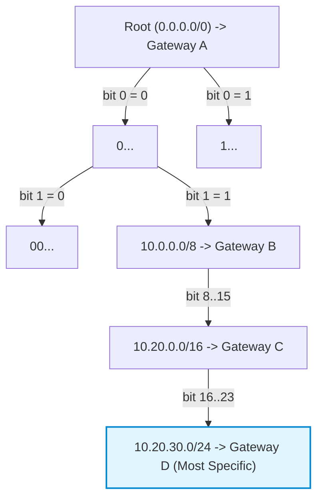
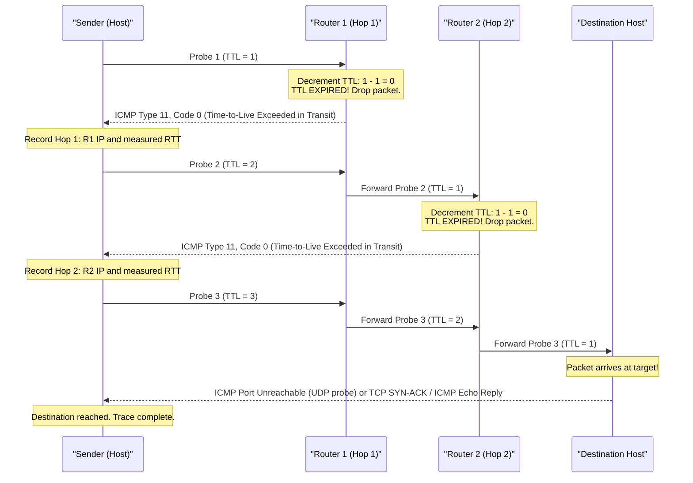
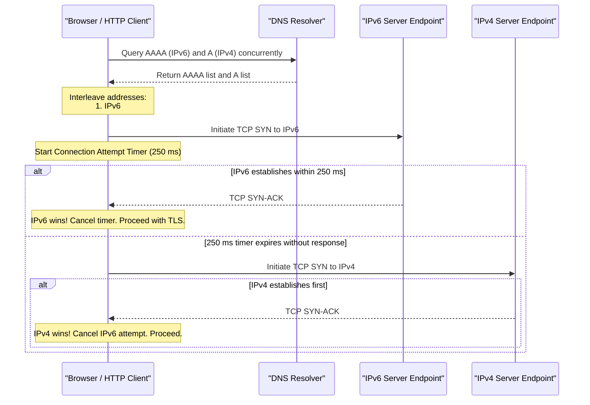

# Module 03: IP Addressing, Longest Prefix Match & Internet Routing

The Network Layer (Layer 3) provides end-to-end logical packet routing across autonomous, heterogeneous networks. Unlike the Data Link Layer, which moves frames across a single local link using physical MAC addresses, the Internet Protocol (IP) defines a global, hierarchical addressing structure. This module dissects the binary header structures of IPv4 and IPv6, the mathematics of Classless Inter-Domain Routing (CIDR), the algorithmic mechanics of Longest Prefix Match (LPM) via Radix tries, special and reserved address spaces, packet fragmentation failure modes, Linux policy routing with Equal-Cost Multi-Path (ECMP), and the dual-stack Happy Eyeballs v2 algorithm (RFC 8305).

---

## 1. The IPv4 vs. IPv6 Wire Format Dissection

The Internet Protocol exists in two concurrent production standards: IPv4 (RFC 791) and IPv6 (RFC 8200). IPv6 was engineered not merely to expand the address space from 32 to 128 bits, but to streamline router processing overhead by eliminating variable-length fields, checksums, and hop-by-hop router fragmentation.

```
IPv4 Datagram Header (20 - 60 Bytes):
 0                   1                   2                   3
 0 1 2 3 4 5 6 7 8 9 0 1 2 3 4 5 6 7 8 9 0 1 2 3 4 5 6 7 8 9 0 1
+-+-+-+-+-+-+-+-+-+-+-+-+-+-+-+-+-+-+-+-+-+-+-+-+-+-+-+-+-+-+-+-+
|Version|  IHL  |  DSCP   | ECN |         Total Length          |
+-+-+-+-+-+-+-+-+-+-+-+-+-+-+-+-+-+-+-+-+-+-+-+-+-+-+-+-+-+-+-+-+
|        Identification         |Flags|      Fragment Offset    |
+-+-+-+-+-+-+-+-+-+-+-+-+-+-+-+-+-+-+-+-+-+-+-+-+-+-+-+-+-+-+-+-+
|  Time to Live |   Protocol    |        Header Checksum        |
+-+-+-+-+-+-+-+-+-+-+-+-+-+-+-+-+-+-+-+-+-+-+-+-+-+-+-+-+-+-+-+-+
|                       Source IPv4 Address                     |
+-+-+-+-+-+-+-+-+-+-+-+-+-+-+-+-+-+-+-+-+-+-+-+-+-+-+-+-+-+-+-+-+
|                    Destination IPv4 Address                   |
+-+-+-+-+-+-+-+-+-+-+-+-+-+-+-+-+-+-+-+-+-+-+-+-+-+-+-+-+-+-+-+-+
|                    Options (if IHL > 5) ...                   |
+-+-+-+-+-+-+-+-+-+-+-+-+-+-+-+-+-+-+-+-+-+-+-+-+-+-+-+-+-+-+-+-+

IPv6 Fixed Header (Exactly 40 Bytes):
 0                   1                   2                   3
 0 1 2 3 4 5 6 7 8 9 0 1 2 3 4 5 6 7 8 9 0 1 2 3 4 5 6 7 8 9 0 1
+-+-+-+-+-+-+-+-+-+-+-+-+-+-+-+-+-+-+-+-+-+-+-+-+-+-+-+-+-+-+-+-+
|Version| Traffic Class |           Flow Label (20 bits)        |
+-+-+-+-+-+-+-+-+-+-+-+-+-+-+-+-+-+-+-+-+-+-+-+-+-+-+-+-+-+-+-+-+
|         Payload Length        |  Next Header  |   Hop Limit   |
+-+-+-+-+-+-+-+-+-+-+-+-+-+-+-+-+-+-+-+-+-+-+-+-+-+-+-+-+-+-+-+-+
|                                                               |
+                                                               +
|                                                               |
+                         Source Address                        +
|                           (128 bits)                          |
+                                                               +
|                                                               |
+-+-+-+-+-+-+-+-+-+-+-+-+-+-+-+-+-+-+-+-+-+-+-+-+-+-+-+-+-+-+-+-+
|                                                               |
+                                                               +
|                                                               |
+                      Destination Address                      +
|                           (128 bits)                          |
+                                                               +
|                                                               |
+-+-+-+-+-+-+-+-+-+-+-+-+-+-+-+-+-+-+-+-+-+-+-+-+-+-+-+-+-+-+-+-+
```

### Detailed Field Comparison & Mechanical Significance

| Field / Feature | IPv4 Implementation | IPv6 Implementation | Architectural Rationale |
| :--- | :--- | :--- | :--- |
| **Address Length** | 32 bits (4 bytes): $\sim 4.29 \times 10^9$ addresses. | 128 bits (16 bytes): $\sim 3.4 \times 10^{38}$ addresses. | Completely eliminates NAT requirements for unique global end-to-end addressing. |
| **Header Length** | Variable: 20 to 60 bytes, defined by 4-bit `IHL` (Internet Header Length in 32-bit words). | Fixed: Exactly 40 bytes. No `IHL` field. | Fixed size enables hardware pipelines and ASIC switches to parse headers at line rate without variable offsets. |
| **Quality of Service** | 6-bit DSCP (DiffServ) + 2-bit ECN (Explicit Congestion Notification). | 8-bit Traffic Class (identical mapping: 6-bit DSCP + 2-bit ECN). | Standardizes packet prioritization and congestion signalling. |
| **ECMP Flow Pinning**| Hash computed over 5-tuple: (Src IP, Dst IP, Src Port, Dst Port, Protocol). | **Flow Label (20 bits)** set by sender; routers hash directly on Flow Label. | Routers can perform ECMP hashing without parsing encrypted transport headers (e.g., ESP, QUIC). |
| **Hop Counter** | `TTL` (Time To Live), decremented by 1 at each router hop. | `Hop Limit`, decremented by 1 at each router hop. | Renamed to reflect actual implementation (hop counter rather than elapsed seconds). |
| **Transport Multiplex**| 8-bit `Protocol` field (6=TCP, 17=UDP, 1=ICMP). | 8-bit `Next Header` field (6=TCP, 17=UDP, 58=ICMPv6, or Extension Header). | Extension headers form a linked list between the IPv6 header and payload. |
| **Integrity Check** | 16-bit `Header Checksum` recomputed at every hop as TTL changes. | **None**. Integrity verification deferred to L2 (CRC-32) and L4 (TCP/UDP checksum). | Recomputing checksums at every hop was a major CPU bottleneck in high-speed core routers. |
| **Fragmentation** | Handled by sending hosts AND intermediate routers using `ID`, `Flags`, `Offset`. | **Sender only**. Routers never fragment. Fragmentation handled via Extension Header. | In-network router fragmentation causes buffer exhaustion and drops line-rate throughput. |

---

## 2. CIDR Mathematics & Subnetting Mechanics

Classless Inter-Domain Routing (CIDR, RFC 4632) replaced the obsolete classful network architecture (Class A, B, C) in 1993. A CIDR address block is denoted by the prefix notation:

$$\text{IPv4-Address} / m \quad \text{where } m \in [0, 32]$$

Where $m$ is the prefix length (the number of leading bits identifying the network). The remaining $32 - m$ bits identify the individual host interfaces within that network.

### Mathematical Subnet Equations
For any IPv4 network with prefix length $m$:
1. **Subnet Mask**: An unsigned 32-bit integer with $m$ leading `1` bits and $32 - m$ trailing `0` bits:
   $$\text{Mask} = \begin{cases} 
   0 & \text{if } m = 0 \\
   \sim ((1 \ll (32 - m)) - 1) & \text{if } 1 \le m \le 32 
   \end{cases}$$
2. **Network Address**: The lowest address in the range, representing the subnet identity:
   $$\text{Network} = \text{IP} \;\&\; \text{Mask}$$
3. **Broadcast Address**: The highest address in the range, used to broadcast to all hosts in the subnet:
   $$\text{Broadcast} = \text{Network} \;|\; (\sim \text{Mask})$$
4. **Total IP Addresses**: $2^{32 - m}$.
5. **Usable Host Addresses**: In standard subnets ($m \le 30$), the Network Address and Broadcast Address are reserved and cannot be assigned to hosts:
   $$\text{Usable Hosts} = 2^{32 - m} - 2$$
   *(Note: Under RFC 3021, `/31` subnets used for point-to-point links provide exactly 2 usable host addresses with no dedicated network or broadcast address).*

### Binary Subnetting Example: `192.168.10.130/26`
- **Prefix length ($m$)**: 26 bits. Host bits: $32 - 26 = 6$ bits.
- **Subnet Mask**: `255.255.255.192` (`11111111.11111111.11111111.11000000`).
- **IP Address**: `192.168.10.130` (`11000000.10101000.00001010.10000010`).
- **Bitwise AND ($\&$) $\implies$ Network Address**:
  `11000000.10101000.00001010.10000000` $\implies$ **`192.168.10.128`**.
- **Bitwise OR ($|$) with inverted mask $\implies$ Broadcast Address**:
  `11000000.10101000.00001010.10111111` $\implies$ **`192.168.10.191`**.
- **Usable Host Range**: `192.168.10.129` to `192.168.10.190` ($2^6 - 2 = 62$ usable hosts).

---

## 3. Longest Prefix Match (LPM) via Radix / Patricia Tries

When a router forwards an incoming packet, its forwarding table contains multiple overlapping routing entries (e.g., a default route `0.0.0.0/0`, an enterprise prefix `10.0.0.0/8`, a regional branch `10.20.0.0/16`, and a server subnet `10.20.30.0/24`). The fundamental forwarding invariant of the Internet is **Longest Prefix Match (LPM)**:

$$\text{Selected Route} = \operatorname*{argmax}_{R \in \text{Routes}, \, \text{DstIP} \in R} (\text{PrefixLength}(R))$$

The router MUST forward the packet along the route with the most specific (longest bitmask) prefix matching the destination IP.



### The Binary Radix Trie Algorithm
Linear search through a routing table with 1,000,000 global BGP routes is computationally prohibitive ($O(N)$). High-performance software routers implement LPM using a **Binary Radix Trie** (or Patricia trie):
- Each internal node represents a bit position in the IP address.
- Left edge represents bit `0`; right edge represents bit `1`.
- Routes are stored at the node corresponding to their prefix length.
- **Lookup Execution**: The router begins at the root, inspecting the destination address bit-by-bit from MSB (bit 0) to LSB (bit 31), traversing left or right. As it traverses down, it tracks the most recent valid route encountered. When the trie traversal terminates (a dead end or null pointer), the most recently encountered route is the Longest Prefix Match.
- **Complexity**: $O(W)$, where $W$ is the address bit-width (32 for IPv4, 128 for IPv6), completely independent of the total number of routes $N$ in the forwarding table.

---

## 4. Special & Reserved IP Address Spaces

Operating systems and network engineers must handle designated address ranges that carry unique routing semantics:

| Address Range | CIDR Block | RFC Standard | Intended Operational Purpose |
| :--- | :--- | :--- | :--- |
| **Private IPv4** | `10.0.0.0/8`<br/>`172.16.0.0/12`<br/>`192.168.0.0/16` | RFC 1918 | Private intranet addressing. Non-routable on the public global Internet; dropped by ISPs. |
| **Carrier-Grade NAT (CGNAT)** | `100.64.0.0/10` | RFC 6598 | Shared address space for ISP-level NAT between subscriber home routers and ISP core. |
| **Loopback** | `127.0.0.0/8` (IPv4)<br/>`::1/128` (IPv6) | RFC 1122<br/>RFC 4291 | Host-internal communication. Packets never appear on physical network interfaces. |
| **Link-Local (APIPA)** | `169.254.0.0/16` (IPv4)<br/>`fe80::/10` (IPv6) | RFC 3927<br/>RFC 4291 | Auto-assigned when DHCP fails. Non-routable across routers; constrained to local L2 link. |
| **Documentation / Test** | `192.0.2.0/24` (TEST-NET-1)<br/>`198.51.100.0/24` (TEST-NET-2)<br/>`203.0.113.0/24` (TEST-NET-3) | RFC 5737 | Reserved exclusively for documentation, books, and testing. Never routable publicly. |
| **IPv6 Unique Local (ULA)** | `fc00::/7` (`fd00::/8` assigned) | RFC 4193 | IPv6 equivalent of RFC 1918 private space. Globally unique pseudo-random 40-bit prefix. |

---

## 5. Packet Fragmentation & The IPv4 ID Exhaustion Dilemma

When an IPv4 datagram exceeds the MTU of an intermediate network link and the `DF` (Don't Fragment) bit is NOT set (`DF=0`), the intermediate router must fragment the packet into two or more smaller fragments.

```
Original IPv4 Packet (Total Length = 3000 Bytes, Identification = 0x4A12):
+--------------------+---------------------------------------------------------------+
| IPv4 Header (20B)  | Payload Data (2980 Bytes)                                     |
+--------------------+---------------------------------------------------------------+

Fragment 1 (Sent on 1500B MTU Link):
+--------------------+---------------------------------------------------------------+
| IPv4 Header (20B)  | Fragment Payload (1480 Bytes, Offset = 0, Flags: MF=1, ID=0x4A12)|
+--------------------+---------------------------------------------------------------+

Fragment 2 (Sent on 1500B MTU Link):
+--------------------+---------------------------------------------------------------+
| IPv4 Header (20B)  | Fragment Payload (1480 Bytes, Offset = 185, Flags: MF=1, ID=0x4A12)|
+--------------------+---------------------------------------------------------------+

Fragment 3 (Sent on 1500B MTU Link):
+--------------------+---------------------------------------------------------------+
| IPv4 Header (20B)  | Fragment Payload (20 Bytes, Offset = 370, Flags: MF=0, ID=0x4A12) |
+--------------------+---------------------------------------------------------------+
```

### The Fragmentation Wire Mechanics
1. **Identification (16 bits)**: Copied identically into every fragment to allow the receiving endpoint to group fragments belonging to the same original datagram.
2. **Flags (3 bits)**:
   - Bit 0: Reserved (must be 0).
   - Bit 1: **DF (Don't Fragment)**. If set to 1, routers must drop the packet if it exceeds MTU.
   - Bit 2: **MF (More Fragments)**. Set to 1 for all fragments except the final fragment (`MF=0`).
3. **Fragment Offset (13 bits)**: Measures the starting position of the fragment's payload data relative to the original unfragmented payload, expressed in **units of 8-byte blocks** ($64\text{ bits}$).
   - Fragment 1 offset: $0 / 8 = 0$.
   - Fragment 2 offset: $1480 / 8 = 185$.
   - Fragment 3 offset: $(1480 + 1480) / 8 = 370$.

### Why Fragmentation is Harmful in Modern Networks (RFC 8900)
1. **Compounded Packet Loss**: If any single fragment is lost in transit, the entire original datagram cannot be reassembled. The receiving host reassembly timer expires and discards all received fragments.
2. **Firewall & NAT Breakage**: Only the first fragment (Offset 0) contains the Layer 4 transport header (TCP/UDP ports). Subsequent fragments have no port information, causing stateless firewalls to drop them or stateful NAT gateways to fail lookup.
3. **IPv4 ID Exhaustion at High Speed**: The `Identification` field is only 16 bits ($65,536$ unique values). On a 10 Gbps link transmitting 1500-byte packets, the 16-bit ID wraps around in less than 78 milliseconds. If fragments from different packets wrap around within the maximum packet lifetime ($2\text{ minutes}$ MSL), the receiver corrupts memory by reassembling mismatched fragments.
4. **Architectural Fix in IPv6**: Intermediate routers **never fragment**. If a packet exceeds link MTU, the router drops it and returns an ICMPv6 Packet Too Big message. Fragmentation is performed strictly by the sending host using the IPv6 Fragment Extension Header.

---

## 6. ICMP Mechanics & Traceroute Operation

The **Internet Control Message Protocol (ICMP / RFC 792)** provides diagnostic, operational, and error reporting for the Internet Protocol. ICMP messages are encapsulated directly inside IP datagrams (`Protocol = 1` for IPv4, `NextHeader = 58` for ICMPv6).

### Traceroute: TTL Expiry Mechanics
Traceroute discovers the hop-by-hop layer 3 path between a source and destination by deliberately exploiting the router `TTL` decrement operation.



1. **Probe Transmission**: The sender transmits a probe packet (historically UDP to high ports $>33434$ on UNIX, ICMP Echo Request on Windows, or TCP SYN to port 80/443 in modern `tcptraceroute`) with `TTL = 1`.
2. **Intermediate Hop Drop**: The first hop router receives the packet, decrements TTL to 0, drops the packet, and transmits an **ICMP Time Exceeded (Type 11, Code 0)** message back to the sender. The sender records the router's IP and RTT.
3. **Iterative Increment**: The sender increments TTL to 2, discovering Hop 2, and continues until reaching the destination.
4. **Destination Termination**: When the packet reaches the destination, the target does not expire the TTL. If using UDP to an unassigned port, the target returns **ICMP Destination Unreachable, Port Unreachable (Type 3, Code 3)**, signalling path completion.

---

## 7. Linux Policy Routing & Equal-Cost Multi-Path (ECMP)

Traditional IP routing forwards packets based solely on the destination IP address. In modern cloud infrastructures, Kubernetes nodes, and multi-homed servers, operators employ **Policy-Based Routing (PBR)** to route traffic based on source address, firewall mark, ingress interface, or protocol.

```
Routing Policy Database (RPDB) Rule Lookup Order:
  Priority 0:      from all lookup local (reserved kernel interfaces)
  Priority 100:    from 192.168.10.0/24 lookup table 100 (Management egress)
  Priority 200:    from 10.244.0.0/16 lookup table 200 (Kubernetes Pod egress)
  Priority 32766:  from all lookup main (Standard system routing table)
  Priority 32767:  from all lookup default
```

### Equal-Cost Multi-Path (ECMP) Hashing
When a router or Linux host has multiple routes to the same destination prefix with identical metric/cost, it distributes traffic across all available paths using ECMP:

```bash
# Linux ECMP multipath default route over two distinct upstream gateways
ip route add default scope global \
    nexthop via 192.168.1.1 dev eth0 weight 1 \
    nexthop via 10.0.0.1 dev eth1 weight 1
```

To prevent packet reordering within an active TCP stream (which triggers false fast retransmits and destroys congestion window throughput), the kernel hashes the packet's **5-tuple**:
$$\text{Path Hash} = \operatorname{Hash}(\text{Src IP}, \text{Dst IP}, \text{Protocol}, \text{Src Port}, \text{Dst Port}) \pmod{\text{Total Paths}}$$
All packets belonging to the same TCP flow produce the identical hash value and traverse the identical path deterministically.

---

## 8. Dual-Stack & Happy Eyeballs v2 (RFC 8305)

During the multi-decade transition from IPv4 to IPv6, client machines operate in a **Dual-Stack** environment where both protocol stacks are active simultaneously. If an IPv6 path has broken routing, DNS misconfiguration, or black-holed traffic, a naive client that attempts IPv6 first with a standard 30-second connection timeout would cause severe, unusable latency for end users.

**Happy Eyeballs v2 (RFC 8305)** specifies an asynchronous algorithm designed to make dual-stack connections responsive and seamless:



### Happy Eyeballs v2 Algorithmic Rules
1. **Asynchronous Resolution**: Issue DNS queries for `AAAA` (IPv6) and `A` (IPv4) records concurrently.
2. **Address Interleaving**: Interleave resolved addresses, prioritizing IPv6 at the head of the list (e.g., `[IPv6_1, IPv4_1, IPv6_2, IPv4_2]`).
3. **Connection Attempt Delay**: Initiate a connection attempt to the first address (IPv6). Start a **Connection Attempt Timer** (recommended default: **250 ms**).
4. **Staggered Fallback**: If the first connection does not establish within 250 ms, immediately initiate a concurrent connection attempt to the next address in the list (IPv4) without aborting the first attempt.
5. **First-to-Establish Wins**: Whichever TCP connection completes the 3-way handshake first (`SYN-ACK` received) is selected for the application stream. The slower, in-flight connection attempt is immediately aborted (`RST` or `FIN`).
6. **State Caching**: The client temporarily caches the winning address family (for approximately 10 minutes) to avoid repeated delay on subsequent connections.

---

## 9. Then vs. Now: Internet Protocol Evolution

| Dimension | Legacy Practice (Then) | Modern Architecture (Now) | Rationale for Transition |
| :--- | :--- | :--- | :--- |
| **Address Architecture** | Classful networking (Class A `/8`, Class B `/16`, Class C `/24`). | Classless Inter-Domain Routing (CIDR, RFC 4632) and native IPv6 (`/64` subnets). | Classful allocation caused catastrophic IPv4 address space exhaustion and unscalable routing tables. |
| **Router Fragmentation** | Intermediate routers fragment packets in-network when exceeding outbound MTU. | Path MTU Discovery (PMTUD) and PLPMTUD (RFC 8899); routers drop and emit ICMP. | In-network fragmentation exhausts router buffers and corrupts high-speed line-rate forwarding. |
| **Routing Tables** | Single monolithic system routing table for all interface traffic. | Policy Routing Database (RPDB / `ip rule`) with multiple independent routing tables. | Container virtualization, overlay networks, and multi-cloud egress require traffic segregation. |
| **Dual-Stack Adoption** | Sequential connection attempts: try IPv6 until 30s timeout, then fall back to IPv4. | Happy Eyeballs v2 (RFC 8305): 250 ms staggered parallel connection attempts. | Sequential timeouts caused users to perceive IPv6 as broken, leading administrators to disable it. |

---

## 10. Interview Drill: Questions & Model Answers

### Q1: Given the CIDR block `172.24.16.0/20`, determine the network mask, broadcast address, and total usable host addresses.
<details><summary>Answer</summary>

**Calculations:**
1. **Prefix Length ($m = 20$)**: Host bits = $32 - 20 = 12$ bits.
2. **Subnet Mask**:
   The first 2 octets are full (`255.255`). The third octet has 4 network bits (`11110000_2 = 240`). Fourth octet is 0.
   $$\text{Mask} = \mathbf{255.255.240.0}$$
3. **Block Size in 3rd Octet**: $2^{8 - 4} = 16$.
   Network range spans 3rd octet from 16 to $16 + 16 - 1 = 31$.
4. **Broadcast Address**: $\mathbf{172.24.31.255}$.
5. **Usable Hosts**:
   $$\text{Usable Hosts} = 2^{12} - 2 = 4,096 - 2 = \mathbf{4,094\text{ host addresses}}$$
   Range: `172.24.16.1` through `172.24.31.254`.
- Ref: RFC 4632; Kurose & Ross 9th ed.
</details>

### Q2: How does a router determine which route to select when a packet's destination matches both `10.0.0.0/8` and `10.20.0.0/16`?
<details><summary>Answer</summary>

**Longest Prefix Match (LPM).** The router selects the route with the most specific prefix (the longest matching bitmask length). Between `10.0.0.0/8` (8 matching leading bits) and `10.20.0.0/16` (16 matching leading bits), the prefix length of 16 is longer and more specific. Therefore, the router forwards the packet according to the `10.20.0.0/16` route entry. If a metric or administrative distance differs, LPM still takes absolute precedence: a router only evaluates metrics between routes of *identical* prefix length.
- Ref: RFC 1812 Section 5.2.4.3; Stevens TCP/IP Illustrated Vol. 1.
</details>

### Q3: Why did IPv6 eliminate the Header Checksum field, and what component assumes responsibility for packet integrity?
<details><summary>Answer</summary>

**Processing Efficiency and Layer Redundancy.** In IPv4, every router along a path had to decrement the TTL field, forcing the router CPU or hardware to recompute the IPv4 header checksum at every single hop. This became a major performance bottleneck in high-throughput gigabit and terabit core switches. Because Layer 2 protocols (Ethernet, Wi-Fi) enforce strict error checking via 32-bit CRC Frame Check Sequences (FCS), and Layer 4 protocols (TCP, UDP) compute end-to-end checksums over both the payload and an IP pseudo-header, the Layer 3 header checksum was redundant. IPv6 eliminated the field entirely, allowing routers to decrement `Hop Limit` without recomputing a checksum.
- Ref: RFC 8200 Section 3; Deering & Hinden, "Internet Protocol, Version 6 Specification".
</details>

### Q4: Explain the mechanics of a traceroute run using UDP probes versus modern TCP SYN traceroute. Why is TCP SYN traceroute often superior in production?
<details><summary>Answer</summary>

**Probe Probing and Firewall Filtering.**
- **Classic UDP Traceroute**: Transmits UDP packets with incrementing TTL values directed at unassigned high UDP ports ($>33434$). Intermediate routers drop packets on TTL=0 and return ICMP Type 11 (Time Exceeded). The destination host returns ICMP Type 3 Code 3 (Port Unreachable).
- **TCP SYN Traceroute**: Transmits TCP SYN packets targeting standard service ports (e.g., port 80 or 443) with incrementing TTL values. When reaching the target, the destination responds with a standard TCP SYN-ACK (or RST if closed), proving connectivity.
- **Superiority of TCP SYN Traceroute**: Modern enterprise firewalls, NAT gateways, and cloud security groups frequently block arbitrary high-port UDP datagrams and ICMP echo requests entirely. Because TCP port 80/443 traffic is explicitly permitted by security policies, TCP SYN traceroute successfully maps real application network paths where classic UDP and ICMP traceroute fail with timeouts (`* * *`).
- **Ref**: Stevens UNIX Network Programming Vol. 1; Bellovin, "A Technique for Counting NATted Hosts".
</details>

### Q5: Describe the Happy Eyeballs v2 (RFC 8305) connection establishment process. What problem does it solve for users on dual-stack networks?
<details><summary>Answer</summary>

**Mitigating IPv6 Black Holes.** When a host has both IPv4 and IPv6 Internet connectivity, bad routing or broken tunnels on IPv6 would historically cause client applications (browsers, curl) to hang for 30 seconds waiting for an IPv6 TCP handshake to timeout before falling back to IPv4. Happy Eyeballs v2 resolves this by:
1. Querying both `A` and `AAAA` records in parallel.
2. Initiating a TCP connection to the first resolved IPv6 address.
3. Starting a 250 ms timer.
4. If the IPv6 handshake does not complete before 250 ms, launching a concurrent TCP handshake to the IPv4 address while leaving the IPv6 attempt running.
5. Whichever connection completes its 3-way handshake (`SYN-ACK`) first is accepted, and the slower attempt is terminated immediately.
This ensures users experience near-zero latency penalty (at most 250 ms) even if IPv6 connectivity is completely black-holed.
- Ref: RFC 8305; Schinazi & Wing, "Happy Eyeballs Version 2: Better Connectivity Using Concurrency".
</details>
