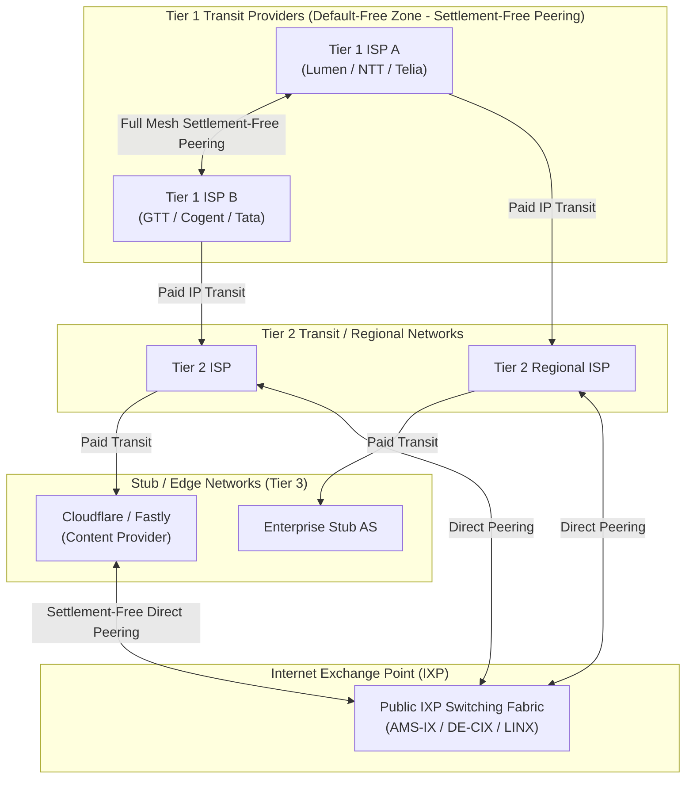
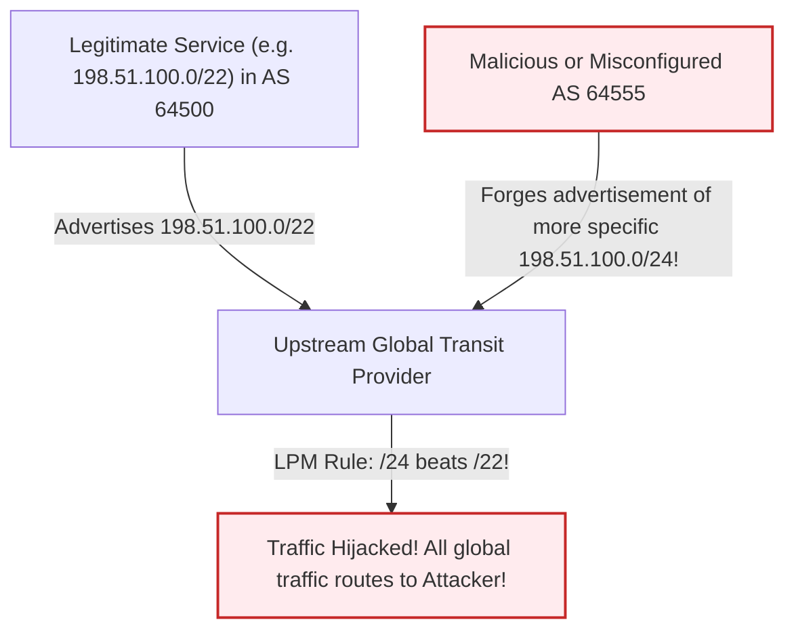
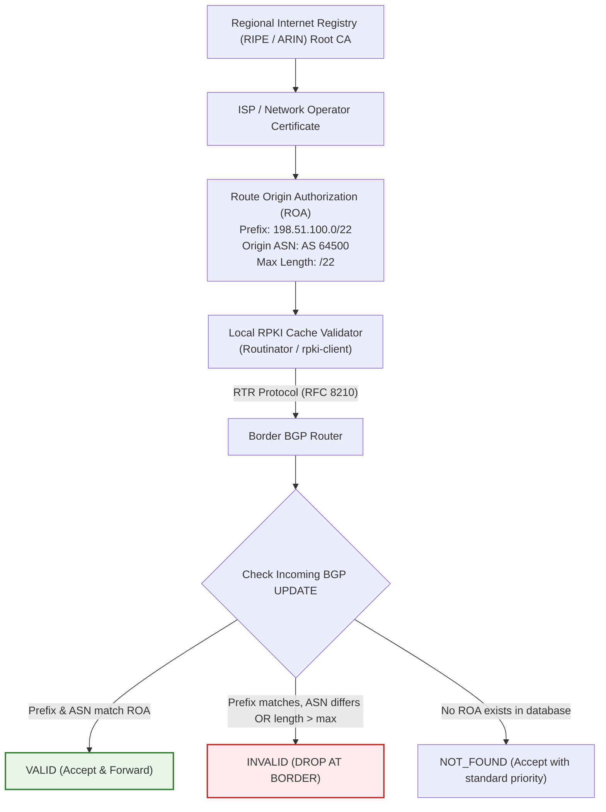
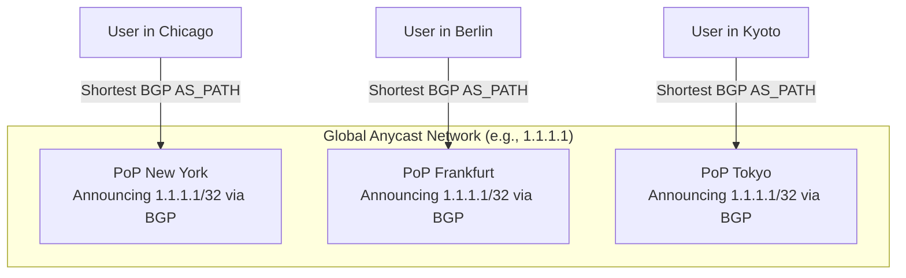

# Module 04: Internet Routing, BGP Path Selection & Anycast Mechanics

The global Internet is not a centrally managed monolithic network; it is a federation of tens of thousands of independent networks known as **Autonomous Systems (AS)** bound together by commercial transit agreements, peering relationships, and the **Border Gateway Protocol (BGP-4 / RFC 4271)**. Unlike Interior Gateway Protocols (such as OSPF or IS-IS) that compute shortest paths based on physical link metrics, BGP is a path-vector policy routing engine designed to enforce business relationships, economic boundaries, and sovereignty. This module examines the architectural hierarchy of the Default-Free Zone (DFZ), the BGP state machine, the deterministic BGP path selection algorithm, RPKI Route Origin Validation, and the operational mechanics of Anycast edge routing.

---

## 1. Autonomous Systems, Peering & The Default-Free Zone

An **Autonomous System (AS)** is a collection of connected IP routing prefixes under the control of one or more network operators on behalf of a single administrative entity that presents a common, clearly defined routing policy to the Internet (RFC 1930). Each AS is assigned a globally unique **Autonomous System Number (ASN)** by the Internet Assigned Numbers Authority (IANA) and regional registries (RIRs such as ARIN, RIPE NCC, APNIC):
- **16-bit ASNs**: Range 1 to 65,535 (RFC 4893 legacy format).
- **32-bit ASNs**: Range 65,536 to 4,294,967,295, introduced to eliminate ASN exhaustion.
- **Private ASNs**: Reserved for private enterprise interconnects (64,512–65,534 and 4,200,000,000–4,294,967,294).



### The Internet Hierarchy and Peering Economics
1. **Tier 1 Providers**: The elite backbone operators (e.g., Lumen, NTT, Telia, Cogent, GTT). They peer with all other Tier 1 networks on a settlement-free basis and purchase transit from no one. They comprise the **Default-Free Zone (DFZ)**: routers in the DFZ carry the entire global Internet routing table (exceeding 950,000 IPv4 prefixes) and operate without a default route (`0.0.0.0/0`).
2. **Transit vs. Peering**:
   - **IP Transit (Paid)**: A downstream customer pays an upstream provider to carry traffic to and from the entire global Internet.
   - **Peering (Settlement-Free)**: Two networks (e.g., an ISP and a CDN) connect directly at an **Internet Exchange Point (IXP)** to exchange traffic destined exclusively for each other's customers without financial compensation, dramatically reducing transit costs and latency.
3. **The Valley-Free Routing Principle**: A network does not forward traffic between two of its settlement-free peers or upstream transit providers. An AS only advertises its own customer prefixes to its peers and upstreams. Violating this rule creates an accidental **Route Leak** (RFC 7908).

---

## 2. BGP-4 Protocol Architecture & State Machine

BGP-4 is an application-layer protocol running over reliable **TCP port 179**. Unlike link-state protocols that flood topological databases, BGP routers establish pairwise point-to-point TCP peering sessions.

### The 6 BGP Finite State Machine (FSM) States
```
 +---------+
 |  Idle   | <───────────────────────────┐
 +---------+                             │
      │ Start Event                      │
      ▼                                  │
 +---------+                             │
 | Connect | ─── Connect Retry / Error ──┤
 +---------+                             │
      │ TCP Established                  │
      ▼                                  │
 +---------+                             │
 | Active  | ─── Connect Retry / Error ──┤
 +---------+                             │
      │ TCP Synced                       │
      ▼                                  │
 +---------+                             │
 |OpenSent | ─── Mismatched ASN / Error ─┤
 +---------+                             │
      │ Receive Valid OPEN               │
      ▼                                  │
 +-----------+                           │
 |OpenConfirm| ─── HoldTimer Expired ────┤
 +-----------+                           │
      │ Receive KEEPALIVE                │
      ▼                                  │
 +-----------+                           │
 |Established| ─── NOTIFICATION Sent ────┘
 +-----------+
```

1. **Idle**: The BGP engine initializes resources and listens for start events.
2. **Connect**: BGP initiates a TCP connection to the peer on port 179. If the TCP handshake succeeds, it sends an `OPEN` message and transitions to `OpenSent`. If TCP fails, it transitions to `Active`.
3. **Active**: BGP attempts to restart the TCP connection. If the `ConnectRetryTimer` expires, it resets to `Connect`.
4. **OpenSent**: BGP waits for the peer's `OPEN` message. It validates BGP version (must be 4), peer ASN, BGP Identifier, and Hold Time.
5. **OpenConfirm**: The router has exchanged `OPEN` messages and sent a `KEEPALIVE`. It awaits the peer's `KEEPALIVE`.
6. **Established**: The BGP session is fully operational. The peers exchange `UPDATE` messages advertising newly reachable network prefixes or withdrawing unreachable prefixes.

### BGP Message Types
- **OPEN**: Establishes session parameters, negotiated Hold Time (default 90–180s), BGP Router ID (32-bit), and capability negotiation (e.g., 32-bit ASN support, IPv6 Multiprotocol BGP).
- **UPDATE**: Advertises new reachable routes (Network Layer Reachability Information - NLRI) along with their path attributes, or withdraws previously advertised routes.
- **KEEPALIVE**: Transmitted periodically (typically every 30s, one-third of the Hold Time) to keep the TCP connection alive when no UPDATEs are pending.
- **NOTIFICATION**: Sent immediately prior to closing the connection when an unrecoverable error occurs (e.g., Hold Timer expired, malformed AS_PATH, authentication failure).

---

## 3. Path-Vector Mechanics & The BGP Decision Algorithm

BGP is a **Path-Vector** protocol. When an AS advertises a prefix to an external peer, it prepends its own ASN to the **AS_PATH** attribute.

```
Destination: 203.0.113.0/24 (Originated by AS 64500)
AS 64500 ──(AS_PATH: 64500)──> AS 64501 ──(AS_PATH: 64501 64500)──> AS 64502
```

### Loop Detection and AS_PATH Prepending
- **Loop Prevention**: When a router receives a BGP `UPDATE`, it scans the `AS_PATH` attribute. If its own local ASN appears anywhere in the list, the router silently drops the route. This prevents routing loops across complex multi-homed meshes.
- **Inbound Traffic Engineering (AS_PATH Prepending)**: Because BGP prefers shorter AS_PATHs, a multi-homed network can deliberately prepend its own ASN multiple times (e.g., `AS_PATH: 64500 64500 64500`) to a secondary upstream ISP. Upstream networks perceive this path as longer and steer inbound traffic toward the primary link.

### The BGP Path Selection Algorithm
When a BGP router receives multiple paths to the exact same prefix, it evaluates them through a strict, deterministic tie-breaking hierarchy:

| Step | Attribute / Evaluation Rule | Scope | Preference Direction | Engineering Usage |
| :---: | :--- | :--- | :--- | :--- |
| **1** | **Weight** (Vendor-proprietary, e.g. Cisco) | Local to single router | **Highest** (0 to 65535) | Local router override. Never advertised to BGP peers. |
| **2** | **LOCAL_PREF** (Local Preference) | Entire Autonomous System | **Highest** (Default: 100) | Primary outbound traffic engineering. Set higher for peering links than transit. |
| **3** | **Locally Originated** | Local router | **Locally originated** over learned | Prefers routes originated via local `network` or `aggregate-address`. |
| **4** | **AS_PATH Length** | Global | **Shortest** AS_PATH | Minimizes AS hops across the Internet. |
| **5** | **Origin Code** | Global | **IGP (0) < EGP (1) < Incomplete (?)** | Prefers clean IGP injection over redistributed (`?`) routes. |
| **6** | **MED** (Multi-Exit Discriminator) | Between adjacent ASNs | **Lowest** MED | Inbound traffic engineering. Informs neighbor which ingress link to prefer. |
| **7** | **eBGP over iBGP** | Router / AS boundary | **eBGP** over iBGP | Prefers paths learned directly from an external peer over internal relay. |
| **8** | **IGP Metric to NEXT_HOP** | Internal AS | **Lowest** IGP metric (OSPF/IS-IS) | Hot-potato routing: eject traffic from local AS as quickly as possible. |
| **9** | **BGP Router ID** | Global tie-breaker | **Lowest** BGP Router ID | Final deterministic tie-breaker (lowest numerical 32-bit IP). |

---

## 4. Internet Pathologies: Route Leaks & BGP Hijacking

Because standard BGP-4 lacks cryptographic verification of route legitimacy, the Internet has historically been vulnerable to devastating routing failures:



### The Sub-Prefix BGP Hijack
BGP routers always enforce the **Longest Prefix Match (LPM)** forwarding rule.
- If legitimate owner AS 64500 announces `198.51.100.0/22`.
- An attacker announces `198.51.100.0/24` (a more specific sub-prefix).
- Because a `/24` prefix is longer and more specific than a `/22`, every router on the global Internet will forward traffic for the sub-range to the attacker, completely bypassing the legitimate origin AS, regardless of AS_PATH length!

### Historic Incidents
1. **Pakistan Telecom YouTube Hijack (2008)**: To block YouTube domestically, Pakistan Telecom announced `208.65.153.0/24` (more specific than YouTube's `/22`). The route leaked to upstream transit provider PCCW, which propagated it globally, taking YouTube offline worldwide for two hours.
2. **Facebook Global Outage (2021)**: During routine maintenance, Facebook's backbone automation triggered a withdrawal of all Facebook BGP routes from the global DFZ. Because authoritative DNS servers were hosted on those withdrawn prefixes, the entire domain `facebook.com` vanished from global recursive resolvers, and engineers could not access datacenters remotely because physical door badges used the same offline network.

---

## 5. RPKI & Route Origin Validation (ROV)

To eliminate unauthenticated BGP hijacks, the Internet engineering community standardized **Resource Public Key Infrastructure (RPKI / RFC 6480)**. RPKI anchors IP address allocation in a cryptographically verifiable X.509 PKI hierarchy rooted at the five Regional Internet Registries (RIRs).



### Route Origin Authorizations (ROAs)
A network owner creates a cryptographically signed **Route Origin Authorization (ROA)** stating:
- **Prefix**: The authorized IP block (e.g., `198.51.100.0/22`).
- **Origin ASN**: The single AS authorized to originate BGP announcements for this prefix (e.g., `AS 64500`).
- **Max Length**: The most specific prefix length the origin AS is permitted to advertise (e.g., `maxLength = 22` prevents sub-prefix hijacking).

### Route Origin Validation (ROV / RFC 6811)
BGP border routers receive validated ROA tables from local RPKI validators via the RPKI-to-Router (RTR) protocol (RFC 8210) and evaluate incoming BGP announcements against three states:
1. **Valid**: The prefix and origin ASN match an existing ROA, and the prefix length is $\le \text{maxLength}$.
2. **Invalid**: A ROA covers the prefix, but either the originating ASN does not match, or the advertised prefix is more specific than the permitted `maxLength`. **Modern production networks (Cloudflare, Telia, AT&T) discard Invalid routes immediately.**
3. **NotFound (Unknown)**: No ROA exists covering the prefix. The route is accepted under standard BGP rules.

---

## 6. Anycast Routing Architecture & TCP Dynamics

In traditional **Unicast** routing, every IP address maps to exactly one physical network interface globally. In **Anycast** routing (RFC 4786), the **exact same IP address (or prefix)** is assigned to multiple servers distributed across dozens or hundreds of geographically separated Points of Presence (PoPs), and announced concurrently via BGP from all locations.



### The Mechanics of Anycast
1. **Topological Steering**: The global BGP routing fabric naturally steers each user's packets to the topologically closest PoP (based on AS_PATH length and local preference).
2. **DDoS Mitigation**: High-volume Distributed Denial-of-Service attacks are localized: botnet traffic from Europe is absorbed exclusively by European PoPs, preventing saturation of American or Asian infrastructure.
3. **High Availability**: If the Frankfurt PoP crashes, its local routers withdraw the BGP announcement. Upstream transit routers reconverge in seconds, automatically rerouting European traffic to London or Amsterdam without DNS changes.

### The Anycast + TCP Dilemma: BGP Convergence Flaps
Anycast is natively suited for stateless UDP protocols (DNS, NTP) because each independent datagram can land on any PoP without consequence. However, **TCP is stateful**: the TCP handshake (SYN, SYN-ACK, ACK) and subsequent payload segments depend on connection state stored in the kernel memory of a specific physical server.

```
Time t0: User in Munich establishes TCP connection with Frankfurt PoP (State: ESTABLISHED).
Time t1: A fiber cut between Munich and Frankfurt causes BGP to reconverge.
Time t2: User sends HTTP GET payload segment.
Time t3: BGP routes the packet to Amsterdam PoP!
Time t4: Amsterdam server receives packet for unknown TCP 4-tuple.
Time t5: Amsterdam server sends TCP RST (Connection Aborted)!
```

### Engineering Solutions for Stateful Anycast TCP
1. **BGP Route Flap Damping**: Border routers enforce conservative BGP convergence timers to minimize path oscillations.
2. **Consistent Hash Flow Distribution & Session Synchronization**: Within a PoP or regional cluster, software routers use Maglev consistent hashing and distribute connection state (via Linux BPF or multicast state tables) so that neighboring edge servers can honor active flows.
3. **Hybrid Architecture**: Use Anycast exclusively for initial DNS resolution and TLS edge termination, while offloading long-lived persistent connections (e.g., WebSockets, video streams) to regional Unicast IP addresses.

---

## 7. Then vs. Now: Internet Routing Evolution

| Dimension | Legacy Practice (Then) | Modern Architecture (Now) | Rationale for Transition |
| :--- | :--- | :--- | :--- |
| **BGP Security** | Trust-based peering; any AS could announce any IP prefix without validation. | Cryptographic RPKI Route Origin Validation (ROV) and ASPA (Autonomous System Provider Authorization). | Accidental fat-finger typos and malicious state-sponsored hijacks caused global outages. |
| **Address Scale** | 16-bit ASNs ($65,536$ maximum ASNs globally). | 32-bit ASNs ($4.29 \times 10^9$ ASNs) standard in BGP-4 (RFC 6793). | Global explosion of cloud providers, CDNs, and multi-homed enterprises exhausted 16-bit numbers. |
| **Service Locality** | Unicast DNS servers and web services pinned to central monolithic datacenters. | Global BGP Anycast distributing services across hundreds of edge PoPs. | Minimizes propagation RTT and localizes multi-terabit volumetric DDoS attacks. |
| **Interconnects** | Expensive Tier 1 transit provider monopolies. | Dense settlement-free peering at massive IXPs (DE-CIX, AMS-IX) handling $>10\text{ Tbps}$. | Eliminates transit costs and reduces inter-domain latency to direct optical cross-connects. |

---

## 8. Interview Drill: Questions & Model Answers

### Q1: In the BGP path selection algorithm, explain why `LOCAL_PREF` is evaluated before `AS_PATH` length, and describe how network operators use it.
<details><summary>Answer</summary>

**Economic Policy Over Distance.** BGP is an economic policy routing protocol rather than a shortest-path algorithm. `LOCAL_PREF` is evaluated at Step 2 (highest preferred), whereas `AS_PATH` length is evaluated at Step 4. This ordering allows network operators to enforce economic preferences:
- A network typically assigns `LOCAL_PREF = 200` to settlement-free peering links (which cost $0).
- It assigns `LOCAL_PREF = 100` to paid upstream transit links (which incur per-gigabyte costs).
Even if a paid transit link offers a shorter AS_PATH (e.g., 2 hops vs 3 hops via peering), the router strictly chooses the peering link because its `LOCAL_PREF` is higher. `LOCAL_PREF` is advertised across all internal iBGP routers within the same AS, ensuring consistent outbound traffic engineering across the entire enterprise.
- Ref: RFC 4271 Section 9.1.2; Kurose & Ross 9th ed.
</details>

### Q2: What is an RPKI ROA, and how does Route Origin Validation (ROV) prevent a malicious sub-prefix BGP hijack?
<details><summary>Answer</summary>

**Cryptographic Prefix Authority.** A Route Origin Authorization (ROA) is an X.509 digitally signed object created by the legitimate IP prefix holder in an RIR database. It explicitly binds an IP prefix (e.g., `198.51.100.0/22`) to an authorized originating ASN (e.g., `AS 64500`) and defines a `maxLength` (e.g., `/22`).
- When an attacker in AS 64555 attempts a sub-prefix hijack by announcing `198.51.100.0/24`, border routers performing ROV check the announcement against the validated ROA database.
- The router determines that although the prefix falls within the covered `/22` range, the announcing ASN is invalid (`AS 64555 != AS 64500`) AND the prefix length exceeds `maxLength` (`/24 > /22`).
- The router marks the BGP route state as **Invalid** and discards the route. The legitimate `/22` announcement remains the only valid route in the forwarding table, neutralizing the hijack attempt.
- Ref: RFC 6480; RFC 6811; NIST RPKI Deployment Guidelines.
</details>

### Q3: Explain the fundamental difference between eBGP and iBGP peering with respect to default TTL and route propagation rules.
<details><summary>Answer</summary>

**Scope and Split-Horizon Constraints.**
1. **External BGP (eBGP)**: Peering between routers in different Autonomous Systems.
   - **Default TTL**: Set to **1** by default, requiring peers to be directly connected over a physical link (unless `ebgp-multihop` is explicitly configured).
   - **AS_PATH Modification**: The advertising router prepends its own ASN to the AS_PATH.
2. **Internal BGP (iBGP)**: Peering between routers within the same Autonomous System.
   - **Default TTL**: Set to **64** (or 255), allowing peering between loopback interfaces across complex multi-hop internal IGP topologies.
   - **AS_PATH Modification**: Does NOT prepend local ASN.
   - **Split-Horizon Rule**: A router running iBGP will **never forward a route learned from an iBGP peer to another iBGP peer**. This rule prevents internal routing loops (since AS_PATH is unmodified), requiring a full iBGP mesh between all internal routers or the deployment of **BGP Route Reflectors (RFC 4456)**.
- Ref: RFC 4271; Stevens TCP/IP Illustrated Vol. 1.
</details>

### Q4: Why is BGP Anycast ideal for DNS and NTP, but challenging for long-lived stateful TCP connections?
<details><summary>Answer</summary>

**Stateful Connection Disruption on Routing Shift.**
- **Stateless Suitability (DNS/NTP)**: DNS queries and NTP synchronization are isolated, single-packet UDP transactions. Each request/response cycle takes a few milliseconds. If consecutive queries land on different geographic Anycast PoPs, the client experiences zero disruption because the servers hold no session state.
- **Stateful Challenge (TCP)**: A TCP connection maintains continuous state in kernel memory (sequence/acknowledgment numbers, congestion windows, TLS session keys). If an intermediate fiber cut, router reboot, or BGP route flap occurs during an active TCP stream, global BGP path selection reconverges, redirecting the user's next packet to a different physical PoP. The new PoP's servers have no record of that TCP 4-tuple in their connection tracking tables and respond with a **TCP RST**, immediately tearing down the connection.
- Ref: RFC 4786; Cloudflare Engineering, "Cloudflare's Architecture: Going Anycast".
</details>

### Q5: What is the Multi-Exit Discriminator (MED) in BGP, and how does its propagation scope differ from LOCAL_PREF?
<details><summary>Answer</summary>

**Inbound Guidance Across an Interconnect.**
- **MED (Attribute 4)**: A non-transitive metric used by an AS to inform an *adjacent* external neighbor which specific ingress link it prefers the neighbor to use when sending traffic into its network (lower value is preferred).
  - **Propagation Scope**: Transmitted across eBGP to the adjacent AS. The adjacent AS uses it internally, but **does not propagate it onward to any third AS**.
- **LOCAL_PREF**: Used strictly for *outbound* traffic engineering across the entire local AS (higher value is preferred).
  - **Propagation Scope**: Transmitted across all internal iBGP peers throughout the local AS, but **never advertised across eBGP links to external neighbors**.
- Ref: RFC 4271 Section 5.1.4; Stewart, "BGP4: Inter-Domain Routing in the Internet".
</details>
