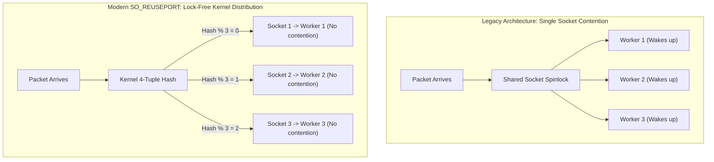
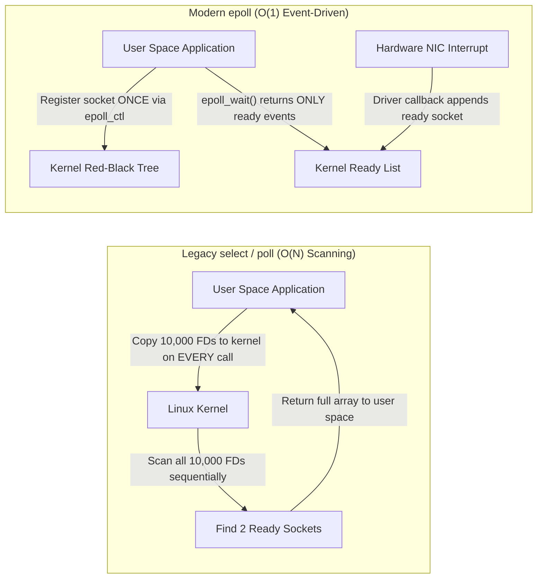

# Module 05: UDP Semantics, Sockets API & Kernel Event Multiplexing

Where the Internet Layer routes individual datagrams across host IP addresses, the Transport Layer (Layer 4) introduces process-to-process multiplexing through 16-bit **Port Numbers**. This module examines the foundational primitives of transport communication: the operational mechanics and pseudo-header checksum of the User Datagram Protocol (UDP / RFC 768), the POSIX Sockets API lifecycle, the architectural advantages of "connected" UDP sockets, kernel load balancing via `SO_REUSEPORT`, socket backlog queues, and the evolution of non-blocking I/O multiplexing from `select` and `poll` to high-performance Linux `epoll` and `io_uring`.

---

## 1. The User Datagram Protocol (UDP) Architecture

UDP (RFC 768) is a minimal, connectionless transport protocol providing only two capabilities beyond raw IP: process multiplexing via port numbers and optional/mandatory data integrity verification via a 16-bit checksum. UDP provides no reliability, no ordered delivery, no flow control, no congestion control, and no connection establishment overhead.

```
UDP Datagram Header (Exactly 8 Bytes):
 0                   1                   2                   3
 0 1 2 3 4 5 6 7 8 9 0 1 2 3 4 5 6 7 8 9 0 1 2 3 4 5 6 7 8 9 0 1
+-+-+-+-+-+-+-+-+-+-+-+-+-+-+-+-+-+-+-+-+-+-+-+-+-+-+-+-+-+-+-+-+
|          Source Port          |       Destination Port        |
+-+-+-+-+-+-+-+-+-+-+-+-+-+-+-+-+-+-+-+-+-+-+-+-+-+-+-+-+-+-+-+-+
|            Length             |           Checksum            |
+-+-+-+-+-+-+-+-+-+-+-+-+-+-+-+-+-+-+-+-+-+-+-+-+-+-+-+-+-+-+-+-+
|                            Payload Data                       |
|                             ...                               |
+-+-+-+-+-+-+-+-+-+-+-+-+-+-+-+-+-+-+-+-+-+-+-+-+-+-+-+-+-+-+-+-+
```

### The 4 Header Fields (8 Bytes Total)
1. **Source Port (16 bits)**: The port number on the transmitting host. Optional in client requests (set to 0 if no reply is expected).
2. **Destination Port (16 bits)**: The port number of the target service on the receiving host.
3. **Length (16 bits)**: The total length in bytes of the UDP header plus payload data. Minimum value is 8 (header with zero payload); maximum theoretical value is 65,535 bytes (bounded by IPv4 Total Length or link MTU).
4. **Checksum (16 bits)**: A 16-bit one's complement sum computed over an IP pseudo-header, the UDP header, and the payload.

### The IPv4 vs. IPv6 Checksum Rule
- **In IPv4**: The UDP checksum is **optional**. If a sender chooses not to compute it, the field is transmitted as all zeros (`0x0000`). If computed and the result evaluates to all zeros, it is transmitted as `0xFFFF` (one's complement negative zero).
- **In IPv6**: The UDP checksum is **strictly mandatory** (RFC 8200). Because IPv6 eliminated the Layer 3 header checksum, transport protocols MUST compute the checksum to prevent delivery of corrupted packets to incorrect port listeners. If an IPv6 node receives a UDP packet with a checksum of 0, it MUST silently discard the datagram.

### The UDP Pseudo-Header
To detect packets mistakenly misrouted to the wrong IP destination, the checksum calculation prepends a synthetic **Pseudo-Header** containing routing context from the IP layer:

```
IPv4 Pseudo-Header for UDP Checksum (12 Bytes):
+-+-+-+-+-+-+-+-+-+-+-+-+-+-+-+-+-+-+-+-+-+-+-+-+-+-+-+-+-+-+-+-+
|                       Source IPv4 Address                     |
+-+-+-+-+-+-+-+-+-+-+-+-+-+-+-+-+-+-+-+-+-+-+-+-+-+-+-+-+-+-+-+-+
|                    Destination IPv4 Address                   |
+-+-+-+-+-+-+-+-+-+-+-+-+-+-+-+-+-+-+-+-+-+-+-+-+-+-+-+-+-+-+-+-+
|     Zero      | Protocol (17) |          UDP Length           |
+-+-+-+-+-+-+-+-+-+-+-+-+-+-+-+-+-+-+-+-+-+-+-+-+-+-+-+-+-+-+-+-+
```

The sender sums all 16-bit words across the pseudo-header, UDP header, and data (padded with a trailing zero byte if length is odd), inverts the bits (one's complement), and stores the result in the Checksum field.

---

## 2. The POSIX Sockets API Lifecycle

The standard interface between application runtimes and the operating system network stack is the **Berkeley / POSIX Sockets API**.

```mermaid
graph TD
    subgraph "Connection-Oriented TCP Lifecycle"
        S_TCP["socket(AF_INET, SOCK_STREAM)"] --> B_TCP["bind(port)"]
        B_TCP --> L_TCP["listen(backlog)"]
        L_TCP --> A_TCP["accept() -> Blocks until 3-way handshake completes"]
        A_TCP --> R_TCP["read() / write() on new client socket fd"]
    end

    subgraph "Connectionless UDP Lifecycle"
        S_UDP["socket(AF_INET, SOCK_DGRAM)"] --> B_UDP["bind(port)"]
        B_UDP --> RF_UDP["recvfrom() / sendto()"]
    end

    subgraph "Connected UDP Lifecycle"
        S_CUDP["socket(AF_INET, SOCK_DGRAM)"] --> C_CUDP["connect(remote_ip, remote_port)"]
        C_CUDP --> W_CUDP["send() / recv() / Asynchronous ICMP delivery"]
    end
```



### Unconnected vs. Connected UDP Sockets
Most software engineers use UDP in its default "unconnected" mode via `sendto()` and `recvfrom()`. However, calling `connect()` on a `SOCK_DGRAM` socket fundamentally alters kernel behavior **without transmitting any packets over the wire**:

| Behavior Dimension | Unconnected UDP Socket (`sendto`) | Connected UDP Socket (`connect` + `send`) |
| :--- | :--- | :--- |
| **Address Binding** | Destination IP and Port must be supplied with every single write syscall. | Destination tuple is permanently bound to socket file descriptor. |
| **Kernel Routing Overhead** | Kernel performs routing table lookup (LPM) and ARP/NDP resolution on **every packet**. | Kernel caches the routing decision and ARP entry on the socket (`sk->sk_dst_cache`), yielding up to **30% throughput gain**. |
| **Filtering Incoming Packets**| Socket receives datagrams from ANY sender that transmits to the bound port. | Kernel automatically discards any incoming datagram whose source does not match the connected tuple. |
| **ICMP Error Reporting** | **Asynchronous ICMP errors are silently lost**. If target is dead, `sendto()` succeeds and ICMP unreachable is dropped. | **ICMP Unreachable is routed to the socket**, causing the next `read()` or `write()` syscall to fail immediately with `ECONNREFUSED`. |

---

## 3. Ephemeral Ports & The `SO_REUSEPORT` Revolution

### Port Number Taxonomy
The 16-bit port number space ($0 \text{ to } 65,535$) is partitioned into three standardized ranges (RFC 6335):
1. **Well-Known / System Ports ($0 - 1023$)**: Assigned by IANA to privileged infrastructure services (HTTP 80, HTTPS 443, DNS 53, SSH 22). Binding requires root privileges or the `CAP_NET_BIND_SERVICE` Linux capability.
2. **Registered Ports ($1024 - 49151$)**: Listed by IANA for specific vendor applications (e.g., PostgreSQL 5432, Redis 6379).
3. **Dynamic / Private / Ephemeral Ports ($49152 - 65535$)**: Assigned dynamically by the OS kernel for outbound client sockets. On Linux systems, the default ephemeral range is broadened via sysctl:
   ```bash
   sysctl net.ipv4.ip_local_port_range
   # Output: 32768 60999 (28,232 total available ephemeral ports)
   ```

### Kernel Socket Load Balancing: `SO_REUSEPORT`
Historically, only one process could bind to a specific `(IP, Port)` tuple. Multi-threaded or multi-process web servers (such as Nginx or Node.js cluster) relied on two flawed architectural patterns:
1. *Worker Process Thundering Herd*: Multiple worker processes shared a single listening socket file descriptor; when a connection arrived, all workers woke up to call `accept()`, causing massive CPU lock contention.
2. *Single Process Proxy*: A single master process accepted all connections and passed file descriptors via UNIX domain sockets, creating a severe single-threaded bottleneck.



Introduced in Linux 3.9, the **`SO_REUSEPORT`** socket option allows multiple independent sockets on the same machine to bind to the exact same IP and Port:
- The Linux kernel maintains an array of listening sockets for that port.
- When an incoming packet arrives, the kernel computes a deterministic hash of the 4-tuple:
  $$\text{Target Socket} = \operatorname{Hash}(\text{Src IP}, \text{Src Port}, \text{Dst IP}, \text{Dst Port}) \pmod{\text{Num Sockets}}$$
- Incoming TCP handshakes or UDP datagrams are dispatched directly to the target worker without lock contention or context switching.

---

## 4. Kernel Socket Queues & The Backlog Overflow Trap

When a server socket runs `listen(fd, backlog)`, the Linux kernel establishes two distinct internal queues:

```
Incoming SYN ──> [ SYN Queue (Half-Open) ] ──> Sends SYN-ACK, receives ACK
                                                       │
                                                       ▼
App calls accept() <── [ Accept Queue (Fully Established) ]
```

1. **The SYN Queue (Half-Open Connections)**: Holds embryonic connections that have sent a `SYN`, received a `SYN-ACK`, and are awaiting the client's final `ACK`. Capped by `net.ipv4.tcp_max_syn_backlog`.
2. **The Accept Queue (Completed Connections)**: Holds fully established 3-way handshakes that are ready for the application to pull via `accept()`. Capped by the minimum of the application's `backlog` argument and `net.core.somaxconn`:
   $$\text{Accept Queue Size} = \min(\text{backlog}, \text{sysctl } \texttt{net.core.somaxconn})$$

### The Silent Backlog Overflow Failure Mode
If an application thread blocks (e.g., saturated Node.js event loop or exhausted threadpool) and stops calling `accept()`, the Accept Queue fills to capacity.
- When a new client finishes the 3-way handshake and the Accept Queue is full, the Linux kernel **silently drops the client's ACK packet by default** (governed by `net.ipv4.tcp_abort_on_overflow = 0`).
- The client believes the connection is `ESTABLISHED`, but the server has no record of it.
- When the client transmits its first application request (e.g., HTTP GET), the server ignores it, forcing client-side timeouts.
- **Diagnostic Inspection**:
  ```bash
  # Check listen queue length: Send-Q is the backlog limit, Recv-Q is pending accepts!
  ss -lnt '( sport = :80 )'
  # State   Recv-Q  Send-Q  Local Address:Port
  # LISTEN  129     128     0.0.0.0:80  <-- Recv-Q > Send-Q indicates OVERFLOW!

  # Track overflow drops via kernel stats
  nstat -az TcpExtListenOverflows TcpExtListenDrops
  ```

---

## 5. Non-Blocking I/O & Multiplexing: `select`, `poll`, `epoll` & `io_uring`

In early UNIX network architectures, each socket read was blocking (`read()` halted process execution until bytes arrived). Serving 10,000 concurrent connections required 10,000 OS threads, quickly exhausting physical RAM through stack allocation ($2\text{ MB to } 8\text{ MB}$ per thread) and overwhelming the kernel scheduler with context-switching overhead.

The solution is **Non-Blocking I/O (`O_NONBLOCK`)** coordinated by kernel **I/O Multiplexing**.

| Mechanism | Introduced | Algorithmic Complexity | Scalability Limit | Kernel Architecture Mechanics |
| :--- | :--- | :---: | :---: | :--- |
| **`select()`** | 4.2BSD (1983) | $O(N)$ | Hard limit: 1024 FDs (`FD_SETSIZE`) | User space copies 3 fixed-size bitmasks (`fd_set`) into kernel space; kernel scans all bits sequentially to check readiness. |
| **`poll()`** | System V (1986) | $O(N)$ | Unbounded (memory limited) | Replaces bitmask with an array of `struct pollfd`. Still requires passing the entire array to the kernel and scanning every entry on every call. |
| **`epoll`** | Linux 2.6 (2002) | **$O(1)$** per event | Millions of FDs | Sockets are registered once into a kernel **Red-Black Tree** via `epoll_ctl()`. When hardware NIC interrupts arrive, the kernel adds ready sockets to a **Ready List (doubly linked list)**. `epoll_wait()` returns ONLY active events. |
| **`kqueue`** | FreeBSD / macOS (2000) | **$O(1)$** per event | Millions of FDs | Unified event notification filter mechanism across sockets, files, signals, and timers. |
| **`io_uring`** | Linux 5.1 (2019) | **$O(1)$** zero-syscall | Millions of operations | True asynchronous I/O using two lock-free ring buffers (Submission Queue and Completion Queue) shared between kernel and user-space memory without syscalls. |



### Level-Triggered (LT) vs. Edge-Triggered (ET) Modes in `epoll`
- **Level-Triggered (Default)**: `epoll_wait()` continues to notify the application on every cycle as long as there is unread data remaining in the socket buffer. Safer and easier to program.
- **Edge-Triggered (`EPOLLET`)**: `epoll_wait()` notifies the application **only once** when new data transitions from absent to present. The application MUST run a non-blocking loop reading until `read()` returns `EAGAIN` or `EWOULDBLOCK`; if it fails to drain the buffer completely, the application hangs indefinitely waiting for an event that will never fire.

---

## 6. High-Throughput Socket Optimizations: GSO, GRO & `recvmmsg`

On 40 Gbps and 100 Gbps networks, operating systems cannot afford to execute an independent system call and allocate an independent kernel packet structure (`sk_buff`) for every 1500-byte datagram:

1. **Generic Segmentation Offload (GSO)**: User space passes a massive 64 KB buffer to the kernel in a single write. The kernel delays segmenting the buffer into 1500-byte packets until the data reaches the physical NIC driver, reducing CPU overhead by up to 80%.
2. **Generic Receive Offload (GRO)**: The receiving NIC driver coalesces consecutive incoming 1500-byte packets from the same flow into a single mega-packet before passing it up the kernel network stack, dramatically reducing CPU interrupt frequency.
3. **Multi-Message Batching (`recvmmsg` & `sendmmsg`)**: Allows an application to send or receive up to hundreds of independent UDP datagrams in a **single system call**, eliminating kernel-user space context-switching overhead:
   ```c
   // Receive up to 64 UDP datagrams in a single system call
   struct mmsghdr msgs[64];
   int n = recvmmsg(sockfd, msgs, 64, MSG_WAITFORONE, NULL);
   ```

---

## 7. Then vs. Now: Transport Multiplexing Evolution

| Dimension | Legacy Practice (Then) | Modern Architecture (Now) | Rationale for Transition |
| :--- | :--- | :--- | :--- |
| **I/O Model** | One thread per connection using blocking `read()`/`write()`. | Non-blocking event loops using `epoll` (Linux) / `kqueue` (macOS) / `io_uring`. | Thread memory footprint ($8\text{ MB}$ stack) and OS scheduler thrashing capped capacity at $1,000$ connections. |
| **Server Socket Sharing** | Multiple workers sharing one FD with thundering herd lock contention. | `SO_REUSEPORT` kernel-level 4-tuple hashing to dedicated per-worker sockets. | Eliminates lock contention across 64+ CPU core architectures. |
| **UDP Syscalls** | Individual `sendto()`/`recvfrom()` syscall per 1500-byte datagram. | Connected UDP sockets with `sendmmsg()`/`recvmmsg()` multi-packet batching. | System call context switches and Spectre/Meltdown mitigation overhead cripple 10 Gbps+ line rates. |
| **UDP Checksums** | Checksum omitted (`0x0000`) in IPv4 to save sender CPU cycles. | Checksums mandatory in IPv6; hardware offload engines calculate checksum on NIC ASIC. | Elimination of L3 checksum in IPv6 makes transport integrity checks essential to prevent memory corruption. |

---

## 8. Interview Drill: Questions & Model Answers

### Q1: What happens under the hood when an application invokes `connect()` on a UDP socket? Does any network traffic traverse the wire?
<details><summary>Answer</summary>

**Local Kernel State Binding Only.** Calling `connect()` on a UDP socket (`SOCK_DGRAM`) transmits **zero packets across the physical wire**. Unlike TCP, there is no 3-way handshake. The operating system kernel performs three local state operations:
1. Validates the destination IP format and resolves the route to verify an egress interface exists.
2. Permanently records the destination IP and port tuple in the socket's internal kernel structure (`struct sock`).
3. Caches the route and ARP resolution (`sk->sk_dst_cache`), bypassing routing table lookups on subsequent writes.
Furthermore, the socket now receives asynchronous ICMP Port Unreachable error notifications (which are silently discarded on unconnected UDP sockets) and permits using standard `read()` and `write()` syscalls.
- Ref: Stevens UNIX Network Programming Vol. 1, Chapter 8.11; RFC 768.
</details>

### Q2: Why is the UDP checksum optional in IPv4 but strictly mandatory in IPv6?
<details><summary>Answer</summary>

**Elimination of the Layer 3 Header Checksum.** In IPv4, every router verified and updated the 16-bit IPv4 Header Checksum at every hop. Therefore, the destination IP address and protocol fields were guaranteed uncorrupted by Layer 3, making the transport-layer UDP checksum optional. In IPv6, the designers completely eliminated the Layer 3 Header Checksum to maximize router forwarding speed. If UDP checksums remained optional in IPv6, a single-bit memory corruption in the IP address or UDP destination port could cause a packet to be delivered silently to an incorrect application process, corrupting memory or causing security boundary violations. RFC 8200 therefore mandates that IPv6 UDP packets must compute the checksum.
- Ref: RFC 8200 Section 8.1; RFC 2460.
</details>

### Q3: Explain why `epoll` scales to tens of thousands of concurrent connections with $O(1)$ complexity while `select` degrades with $O(N)$ complexity.
<details><summary>Answer</summary>

**State Preservation vs Per-Call Buffer Passing.**
- **`select()`**: The application passes a set of file descriptors to the kernel on *every single invocation*. The kernel must copy the data structure across the user-kernel boundary, linearly iterate through all $N$ file descriptors to check readiness, and return the modified set. The application must then linearly scan the set to determine which sockets fired. Complexity is $O(N)$ on both kernel and user sides.
- **`epoll`**: The application registers sockets with the kernel **once** via `epoll_ctl()`, which stores them in an efficient Red-Black Tree in kernel memory. When a network packet arrives, the NIC driver interrupt triggers a kernel callback that appends only the ready socket to a Ready List (a doubly linked list). When the application calls `epoll_wait()`, the kernel simply checks if the Ready List is non-empty and copies only the ready events to user space. Complexity is $O(1)$ relative to the total number of monitored connections.
- Ref: Linux kernel `fs/eventpoll.c`; Kerrisk, "The Linux Programming Interface", Chapter 63.
</details>

### Q4: An administrator observes that a high-traffic web server has zero CPU saturation and ample free RAM, yet clients intermittently experience 1-second to 3-second connection latency spikes. What kernel socket metric should be investigated, and what is the failure mechanism?
<details><summary>Answer</summary>

**Listen Queue (Accept Queue) Overflow.**
- The server's TCP Accept Queue is overflowing (`net.core.somaxconn` or the application's `listen(backlog)` parameter is too small, or an event loop thread blocked momentarily).
- When a client completes the 3-way handshake (`SYN` $\to$ `SYN-ACK` $\to$ `ACK`), the kernel attempts to place the connection into the Accept Queue. If the queue is full, the kernel silently drops the client's final `ACK` by default.
- The server retransmits its `SYN-ACK` after an exponential backoff timer (typically 1 second, then 3 seconds). The client re-sends its `ACK`, resulting in multi-second connection latency.
- **Investigation**: Run `ss -lnt` to verify if `Recv-Q > Send-Q` on the listening port, and check `nstat -az TcpExtListenOverflows TcpExtListenDrops`.
- Ref: RFC 9293; Gregg, "Systems Performance" 2nd ed.
</details>

### Q5: What is the difference between Level-Triggered (LT) and Edge-Triggered (ET) event notification in `epoll`, and what programming trap occurs if Edge-Triggered mode is used improperly?
<details><summary>Answer</summary>

**State Readiness vs State Transition.**
- **Level-Triggered (LT)**: `epoll_wait()` returns an event as long as data remains in the receive buffer. If an application reads only 100 bytes of a 500-byte message, the next `epoll_wait()` will fire immediately because the buffer is still non-empty.
- **Edge-Triggered (ET)**: `epoll_wait()` notifies the application **only when a state transition occurs** (when new data arrives on an idle socket).
- **The Starvation / Hang Trap**: If an application using ET reads only 100 bytes of a 500-byte message and returns to `epoll_wait()`, `epoll_wait()` will block indefinitely. Because no *new* data has arrived to trigger a state edge, the remaining 400 bytes will sit in the kernel buffer unread, and the application will hang waiting for client input. To prevent this, ET applications MUST loop calling `read()` on a non-blocking socket until it explicitly returns `EAGAIN` or `EWOULDBLOCK`.
- Ref: Kerrisk, "The Linux Programming Interface", Chapter 63.2.
</details>
