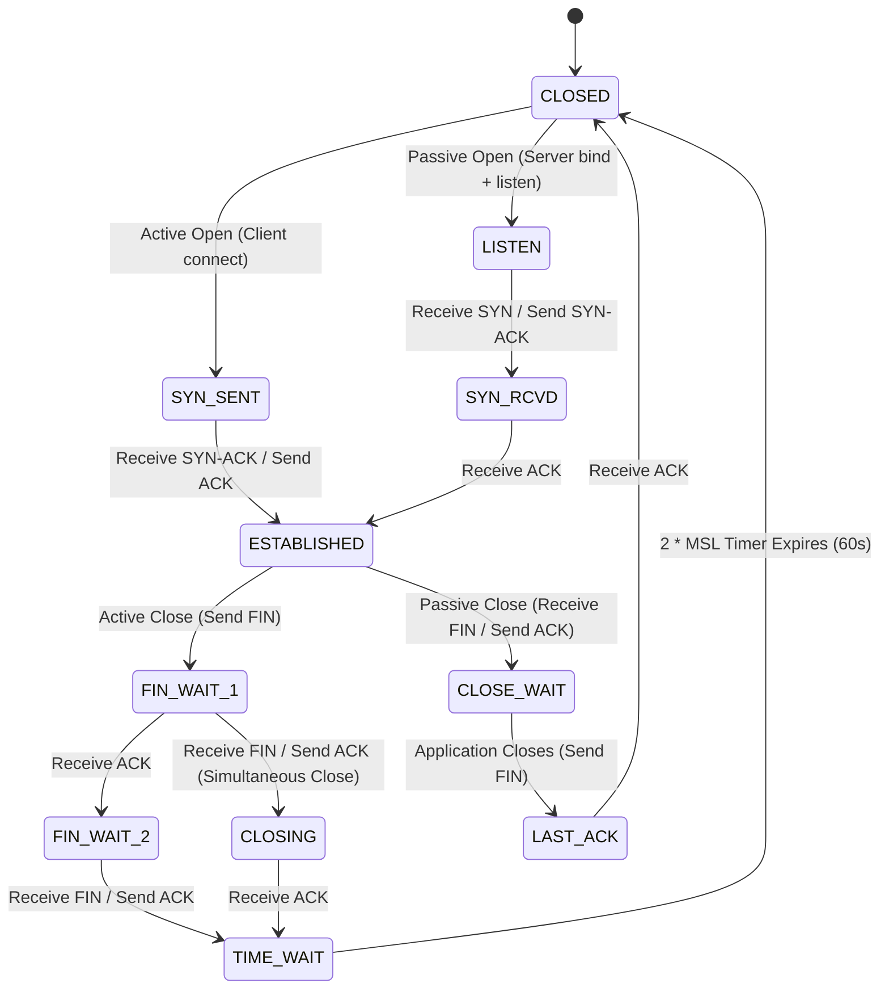
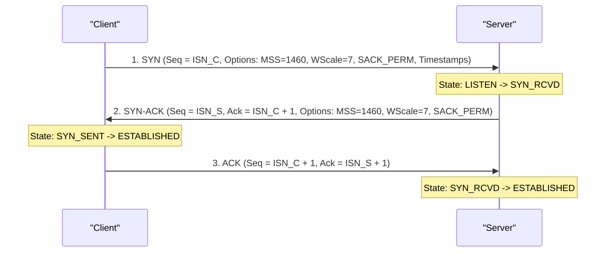
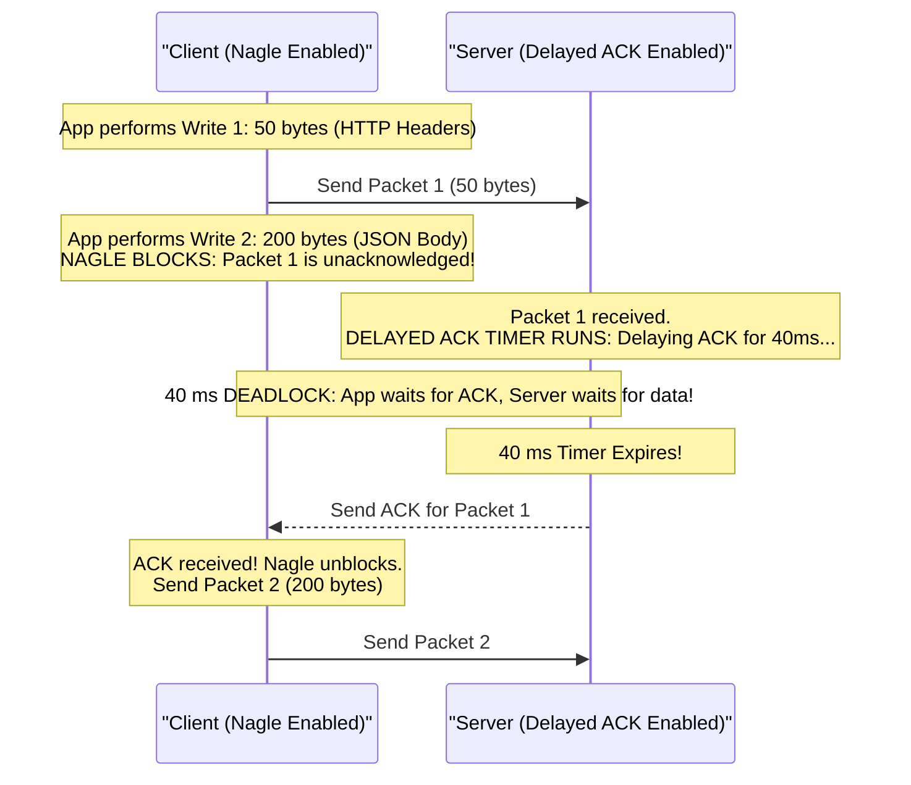
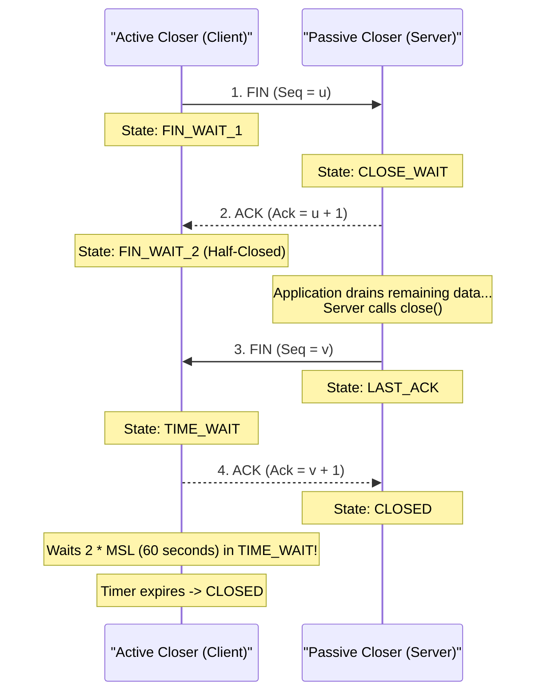

# Module 06: TCP Internals, State Machine & Connection Dynamics

The Transmission Control Protocol (TCP) is the foundational connection-oriented transport protocol of the Internet. Formally consolidated under **RFC 9293** (which unified four decades of standards across RFC 793, 1122, 1323, 6298, 7323, and 7414), TCP converts an unreliable, best-effort packet-switched network into a reliable, ordered, error-checked, flow-controlled byte stream. This module examines the complete 11-state TCP finite state machine, the mathematics of Initial Sequence Number (ISN) generation, sliding window flow control with RFC 7323 scaling, the SACK and RACK-TLP loss recovery engines, the Nagle versus Delayed ACK latency deadlock, and the operational lifecycle of the `TIME_WAIT` state.

---

## 1. The Consolidated RFC 9293 TCP Specification

Published in August 2022, RFC 9293 obsoleted RFC 793 and consolidated modern operational requirements for TCP implementations into a single authoritative standard.

```
TCP Segment Header (20 - 60 Bytes):
 0                   1                   2                   3
 0 1 2 3 4 5 6 7 8 9 0 1 2 3 4 5 6 7 8 9 0 1 2 3 4 5 6 7 8 9 0 1
+-+-+-+-+-+-+-+-+-+-+-+-+-+-+-+-+-+-+-+-+-+-+-+-+-+-+-+-+-+-+-+-+
|          Source Port          |       Destination Port        |
+-+-+-+-+-+-+-+-+-+-+-+-+-+-+-+-+-+-+-+-+-+-+-+-+-+-+-+-+-+-+-+-+
|                        Sequence Number                        |
+-+-+-+-+-+-+-+-+-+-+-+-+-+-+-+-+-+-+-+-+-+-+-+-+-+-+-+-+-+-+-+-+
|                    Acknowledgment Number                      |
+-+-+-+-+-+-+-+-+-+-+-+-+-+-+-+-+-+-+-+-+-+-+-+-+-+-+-+-+-+-+-+-+
|  Data |       |C|E|U|A|P|R|S|F|                               |
| Offset| Resv  |W|C|R|C|S|S|Y|I|            Window             |
|       |       |R|E|G|K|H|T|N|N|                               |
+-+-+-+-+-+-+-+-+-+-+-+-+-+-+-+-+-+-+-+-+-+-+-+-+-+-+-+-+-+-+-+-+
|           Checksum            |        Urgent Pointer         |
+-+-+-+-+-+-+-+-+-+-+-+-+-+-+-+-+-+-+-+-+-+-+-+-+-+-+-+-+-+-+-+-+
|                    Options (if Data Offset > 5) ...           |
+-+-+-+-+-+-+-+-+-+-+-+-+-+-+-+-+-+-+-+-+-+-+-+-+-+-+-+-+-+-+-+-+
```

### Essential Header Fields & Flags
- **Sequence Number (32 bits)**: The byte-stream position of the first data byte in this segment. If `SYN` is set, this is the Initial Sequence Number (ISN), and the first payload byte begins at $\text{ISN} + 1$.
- **Acknowledgment Number (32 bits)**: Cumulative acknowledgment. If `ACK` is set, this contains the next sequence number the receiver expects to receive. Acknowledges all bytes up to $\text{AckNumber} - 1$.
- **Data Offset (4 bits)**: The size of the TCP header in 32-bit words (minimum 5 words = 20 bytes; maximum 15 words = 60 bytes).
- **Control Flags (9 bits)**:
  - `SYN` (Synchronize): Synchronizes sequence numbers during connection establishment.
  - `ACK` (Acknowledgment): Indicates the Acknowledgment field is valid. Present on almost all packets after initial SYN.
  - `FIN` (Finish): Sender has finished sending data; initiates graceful connection termination.
  - `RST` (Reset): Abruptly aborts the connection due to errors, invalid segments, or half-open state.
  - `PSH` (Push): Instructs receiver to push buffered data immediately to the application layer.
  - `URG` (Urgent): Marks data as urgent via the Urgent Pointer (rarely used in modern systems).
  - `ECE` (ECN-Echo) / `CWR` (Congestion Window Reduced): Explicit Congestion Notification signalling (RFC 3168).
- **Window (16 bits)**: Flow control. The number of bytes the receiver is currently willing to accept beyond the acknowledged sequence number.

---

## 2. The 11-State TCP Finite State Machine (FSM)

Every TCP endpoint transitions through an explicit 11-state lifecycle model governing connection establishment, data transfer, and graceful or abrupt teardown:



### The 11 States Defined
1. **`CLOSED`**: Fictional starting point; no connection exists.
2. **`LISTEN`**: Server is awaiting connection requests from remote clients.
3. **`SYN_SENT`**: Client has sent a SYN segment and is awaiting matching SYN-ACK.
4. **`SYN_RCVD`**: Server has received a SYN, sent SYN-ACK, and is awaiting client's ACK.
5. **`ESTABLISHED`**: The 3-way handshake is complete; bidirectional data transfer is active.
6. **`FIN_WAIT_1`**: Active closer has sent a FIN and awaits either an ACK or a FIN from the peer.
7. **`FIN_WAIT_2`**: Active closer has received an ACK for its FIN, awaiting peer's FIN. (Half-closed).
8. **`CLOSE_WAIT`**: Passive closer has received a FIN, sent ACK, and awaits local application closure.
9. **`CLOSING`**: Simultaneous close: both endpoints sent FINs at the same time and await ACKs.
10. **`LAST_ACK`**: Passive closer has sent its own FIN and awaits the final ACK from active closer.
11. **`TIME_WAIT`**: Active closer has sent final ACK, waiting $2 \times \text{MSL}$ before releasing the 4-tuple.

---

## 3. Handshake Mechanics & Cryptographic ISN Generation

The TCP 3-way handshake establishes bidirectional sequence number synchronization:



### Cryptographic Initial Sequence Number (ISN) Generation (RFC 6528)
Historically, operating systems incremented a global ISN counter every 4 microseconds. In 1995, Robert Morris and Kevin Mitnick demonstrated the **TCP Sequence Prediction Attack**: an off-path attacker spoofing a trusted IP could predict the predictable ISN counter, complete a "blind" 3-way handshake, and inject unauthorized commands into services like `rsh`.

Modern operating systems generate ISNs using a cryptographic pseudorandom function (PRF) per RFC 6528:

$$\text{ISN} = M + F(\text{LocalIP}, \text{RemoteIP}, \text{LocalPort}, \text{RemotePort}, \text{SecretKey})$$

Where:
- $M$ is a monotonic clock incrementing every microsecond.
- $F$ is a cryptographic hash (e.g., SipHash-2-4 or SHA-256).
- $\text{SecretKey}$ is a randomized 128-bit key generated at kernel boot time.
Because an attacker cannot observe or invert $\text{SecretKey}$, predicting the sequence number of an unobserved connection is computationally impossible.

---

## 4. Flow Control: Sliding Windows & Window Scaling (RFC 7323)

TCP enforces **end-to-end flow control** to prevent a fast sender from overwhelming a slow receiver's buffer space. The receiver advertises its available buffer capacity in the 16-bit **Window** field (`rwnd`).

```
                Unacknowledged In-Flight Data
                <────────────────────────────>
... | Byte 99 | Byte 100 | Byte 101 | Byte 102 | Byte 103 | Byte 104 | Byte 105 | ...
               ▲                                                       ▲
               AckNumber = 100                                         Usable Window Edge (100 + rwnd)
               (Left Edge of Window)                                   (Right Edge of Window)
```

### The 64 KB Limit & RFC 7323 Window Scaling
The TCP header Window field is 16 bits wide, capping the maximum advertised window at:
$$2^{16} - 1 = 65,535\text{ bytes } (\approx 64\text{ KB})$$

As established in Module 01, high-speed and transatlantic links have Bandwidth-Delay Products (BDP) in the tens or hundreds of megabytes. A 64 KB window limits throughput on an 80 ms RTT link to $6.55\text{ Mbps}$.

RFC 7323 introduced the **Window Scale (WScale) Option**:
- Negotiated exclusively during the initial `SYN` and `SYN-ACK` packets.
- Specifies a shift count $S \in [0, 14]$.
- The actual effective receive window is calculated by left-shifting the 16-bit header value:
  $$\text{Effective Window} = \text{Window Field} \times 2^S = \text{Window Field} \ll S$$
- Maximum shift $S = 14$ allows a maximum receive window of:
  $$65,535 \times 2^{14} = 65,535 \times 16,384 = \mathbf{1,073,725,440\text{ bytes } (\approx 1\text{ GiB})}$$

---

## 5. Loss Recovery: SACK, PAWS & RACK-TLP

When segments are lost in transit, TCP must detect and retransmit missing bytes without stalling throughput:

### 1. Selective Acknowledgement (SACK / RFC 2018)
In standard TCP (Cumulative ACK), if the sender transmits segments 1, 2, 3, 4, 5 and segment 2 is dropped, the receiver repeatedly ACKs segment 2. The sender has no way of knowing whether segments 3, 4, and 5 arrived safely, forcing a wasteful Go-Back-N retransmission of all segments.

With SACK enabled via TCP options, the receiver acknowledges contiguous blocks of non-sequential data:
```
TCP Header: AckNumber = 2000 (Expecting byte 2000)
TCP Options: SACK Block 1: [3000, 4500] (Bytes 3000-4499 received)
             SACK Block 2: [5500, 7000] (Bytes 5500-6999 received)
```
The sender retransmits **only** the missing gaps (`[2000, 2999]` and `[4500, 5499]`), preserving network capacity.

### 2. Protection Against Wrapped Sequences (PAWS / RFC 7323)
On a 10 Gbps link, the 32-bit sequence number space ($4.29 \times 10^9$ bytes) wraps around in less than 3.4 seconds. If an old, delayed packet wanders through the Internet and arrives after the sequence counter has wrapped, the receiver might accept obsolete data as current. PAWS leverages the 32-bit **TCP Timestamps Option (TSopt)**: if an arriving segment has a timestamp earlier than the most recent timestamp received on that connection, it is rejected as an obsolete duplicate.

### 3. RACK-TLP: Recent ACK & Tail Loss Probe (RFC 8985)
Traditional TCP relies on counting **3 duplicate ACKs** to trigger Fast Retransmit. This heuristic fails in two common production scenarios:
1. *Small Connection Windows*: If a sender's window is only 2 segments, it cannot receive 3 duplicate ACKs if one is dropped.
2. *Tail Drops*: If the *final* segment of a request or burst is dropped, no subsequent packets exist to generate duplicate ACKs.

**RACK (Recent ACK)** replaces packet counting with time-based loss detection:
- It tracks the transmission timestamp of every outbound segment.
- If packet $X$ is acknowledged, any unacknowledged packet $Y$ transmitted prior to $X$ (by at least a reordering window $\approx \frac{1}{4} \text{RTT}$) is declared lost and retransmitted immediately.
- **Tail Loss Probe (TLP)**: If the connection falls idle after transmitting data without receiving an ACK, TLP fires a probe retransmission after approximately $2 \times \text{RTT}$, converting expensive RTO timeouts (which reset the congestion window) into rapid Fast Retransmits.

---

## 6. Nagle’s Algorithm vs. Delayed ACKs: The 40 ms Deadlock

One of the most notorious performance traps in networked software engineering is the interaction between **Nagle's Algorithm** and **Delayed Acknowledgments**.



### The Two Colliding Mechanisms
1. **Nagle's Algorithm (RFC 896)**: Engineered in 1984 to eliminate "tinygrams" (sending 1 byte of Telnet data wrapped in 40 bytes of headers). Rule: *If an application writes data smaller than the MSS, buffer the data until all previously transmitted data has been acknowledged by the receiver.*
2. **Delayed Acknowledgment (RFC 1122)**: Receivers delay sending ACKs for up to **40 ms** (Linux) or **200 ms** (Windows/BSD), hoping the local application will send response data so the ACK can be piggybacked onto the response packet for free.

### The Failure Cascade
When an application performs two consecutive small writes (e.g., an HTTP/REST client writing headers, then body):
- Write 1 (headers) is transmitted immediately.
- Write 2 (body) is smaller than MSS and there is unacknowledged in-flight data (Write 1), so **Nagle holds Write 2 in memory**.
- The server receives Write 1, but has no response data yet (it needs the body to parse the request), so **Delayed ACK waits 40 ms**.
- The entire transaction freezes for exactly 40 ms until the server's delayed ACK timer expires.

### The Solution: `TCP_NODELAY`
Modern application runtimes (including Node.js `node:net` and HTTP clients) disable Nagle's algorithm by setting the `TCP_NODELAY` socket option:

```typescript
// Disable Nagle's algorithm in Node.js
socket.setNoDelay(true);
```
With `TCP_NODELAY`, the kernel transmits small writes immediately without awaiting ACKs.

---

## 7. Connection Teardown & The `TIME_WAIT` Lifecycle

Closing a TCP connection requires a 4-way handshake because TCP is **full-duplex**; closing the local transmit channel does not close the incoming receive channel.



### Why Does the `TIME_WAIT` State Exist?
The endpoint that initiates the active close (typically the client, or an HTTP server running without keep-alive) MUST remain in `TIME_WAIT` for **$2 \times \text{MSL}$ (Maximum Segment Lifetime)**. Under the Linux kernel, MSL is fixed at 30 seconds ($2 \times \text{MSL} = \mathbf{60\text{ seconds}}$).

`TIME_WAIT` serves two critical reliability guarantees:
1. **Preventing Delayed Duplicate Data Corruption**: Packets can wander through the Internet due to routing loops. If a connection is closed and immediately reopened using the identical 4-tuple `(Src IP, Src Port, Dst IP, Dst Port)`, an old wandering duplicate packet from the previous incarnation could arrive and be accepted as current data. Waiting $2 \times \text{MSL}$ ensures all wandering duplicates die in transit.
2. **Reliable Graceful Teardown**: If the active closer's final ACK (packet 4) is dropped by the network, the passive closer retransmits its FIN (packet 3). If the active closer had transitioned directly to `CLOSED`, it would respond to the retransmitted FIN with a `RST`, causing the passive closer to log an unclean "Connection reset by peer" error instead of a graceful close.

### Ephemeral Port Exhaustion via `TIME_WAIT`
On a busy client machine or reverse proxy (e.g., an API gateway making 1,000 outbound HTTP requests per second to a single backend database without connection pooling):
- Each outbound connection uses an ephemeral port.
- Each closed connection stays in `TIME_WAIT` for 60 seconds.
- At 1,000 requests/sec, after 60 seconds, $60,000$ ephemeral ports are locked in `TIME_WAIT`.
- The client exhausts the local ephemeral port pool (`net.ipv4.ip_local_port_range`), and subsequent `connect()` syscalls fail with `EADDRNOTAVAIL`.
- **Engineering Fixes**:
  1. **HTTP Keep-Alive Connection Pooling**: Reuse persistent connections across requests (the only true production architectural fix).
  2. **`sysctl net.ipv4.tcp_tw_reuse = 1`**: Allows the kernel to safely reuse a `TIME_WAIT` socket for a new outbound connection IF the RFC 7323 timestamp of the new SYN is strictly greater than the last timestamp recorded on the previous connection.
  3. *(Caution)*: The historical `net.ipv4.tcp_tw_recycle` option was fundamentally broken for NAT clients (it rejected connections from distinct client machines behind the same NAT whose timestamps were not synchronized) and was **completely removed from the Linux kernel in version 4.12**.

---

## 8. Abrupt Teardown: The TCP Reset (`RST`)

When an endpoint needs to abort a connection immediately without the 4-way FIN handshake, it transmits a segment with the `RST` flag set:
- **Port Closed**: Transmitted by a host when a SYN packet arrives for a port with no listening process.
- **Connection Abort**: Transmitted when an application calls `close()` on a socket that still has unread data waiting in its receive buffer (preventing silent data loss).
- **Hard Teardown (`SO_LINGER`)**: An application can configure the `SO_LINGER` socket option with a timeout of 0, forcing `close()` to discard pending data and send an immediate RST, bypassing `TIME_WAIT`. In Node.js, `socket.resetAndDestroy()` performs this abrupt abort.

---

## 9. SYN Floods, SYN Cookies & TCP Fast Open (TFO)

### The SYN Flood DoS Attack
An attacker transmits thousands of spoofed `SYN` packets per second without ever sending the completing `ACK`. The server allocates a state structure in its SYN Queue for each half-open connection. Within seconds, the SYN Queue overflows, and legitimate users are locked out.

### SYN Cookies: Stateless Handshake Verification
When the SYN Queue overflows, modern Linux kernels activate **SYN Cookies** (`net.ipv4.tcp_syncookies = 1`):
- The server **does not allocate any memory** for the half-open connection.
- Instead, it encodes the connection state (MSS, timestamp, cryptographic hash) directly into the 32-bit `ISN` of its `SYN-ACK` reply:
  $$\text{ISN}_{\text{cookie}} = \operatorname{HMAC}(\text{SrcIP}, \text{DstIP}, \text{SrcPort}, \text{DstPort}, t, \text{Secret}) + \text{MSS Index}$$
- When a legitimate client sends its final `ACK` (`AckNumber = \text{ISN}_{\text{cookie}} + 1`), the server subtracts 1, recomputes the HMAC, verifies mathematical validity, and allocates the socket connection on the fly.

### TCP Fast Open (TFO / RFC 7413)
The standard 3-way handshake introduces a 1-RTT latency tax before application data can be transmitted. **TCP Fast Open** eliminates this delay:
1. In an initial connection, the client requests a cryptographic **TFO Cookie** from the server.
2. In subsequent connections, the client includes the TFO Cookie AND encrypted application payload (e.g., HTTP GET) **directly inside the initial SYN packet**.
3. The server validates the cookie and passes the payload data to the application layer immediately, responding with `SYN-ACK` + data, achieving **0-RTT data transfer**.

---

## 10. Then vs. Now: TCP Architecture Evolution

| Dimension | Legacy Practice (Then) | Modern Architecture (Now) | Rationale for Transition |
| :--- | :--- | :--- | :--- |
| **Specification** | Fragmented across RFC 793, 1122, 1323, 6298, and dozens of disparate errata. | Consolidated unified specification under **RFC 9293 (2022)**. | Eliminates ambiguities and contradictory implementation edge cases across OS kernels. |
| **Window Limits** | Unscaled 16-bit window capped at 64 KB ($65,535\text{ bytes}$). | RFC 7323 Window Scaling up to $2^{14}$ multiplier ($1\text{ GiB}$ window). | Saturating modern gigabit and high-RTT interconnects requires tens of megabytes in flight. |
| **Loss Recovery** | Go-Back-N retransmission and waiting for 3 duplicate ACKs. | SACK (RFC 2018) + RACK-TLP (RFC 8985) time-based loss recovery. | Eliminates packet loss retransmission storms and tail loss stalls on small windows. |
| **Nagle Tuning** | Default Nagle enabled; batching writes manually. | `TCP_NODELAY` enabled by default across modern HTTP runtimes. | Prevents 40 ms latency deadlock when interacting with receiver Delayed ACKs. |
| **TIME_WAIT Reuse** | Risky `tcp_tw_recycle` enabled on servers. | `tcp_tw_reuse = 1` using RFC 7323 timestamps; `tcp_tw_recycle` removed. | `tcp_tw_recycle` broke NAT clients whose non-synchronized timestamps caused dropped handshakes. |

---

## 11. Interview Drill: Questions & Model Answers

### Q1: Explain why the interaction between Nagle's algorithm and Delayed ACKs causes a 40 ms latency stall on write-write-read application patterns.
<details><summary>Answer</summary>

**Deadlock Between Buffering and Delayed ACK.**
- **Nagle's Rule**: If an application writes data smaller than MSS, the kernel buffers the data until all previously transmitted data has been acknowledged.
- **Delayed ACK Rule**: The receiver delays sending an ACK for up to 40 ms (Linux) or 200 ms (Windows) in anticipation of piggybacking the ACK onto outbound response data.
- **The Deadlock**: When an application performs two consecutive writes (e.g., HTTP headers, then HTTP body):
  1. Write 1 is sent immediately.
  2. Write 2 is smaller than MSS, and Write 1 is unacknowledged, so Nagle holds Write 2 in the local socket buffer.
  3. The receiver has received Write 1, but cannot produce a response without Write 2. It has no data to send, so Delayed ACK waits 40 ms.
  4. Neither endpoint acts: the client waits for an ACK, and the server waits for data.
  5. The deadlock breaks only when the server's 40 ms timer expires, forcing a standalone ACK, which finally unblocks Nagle to transmit Write 2.
- **Fix**: Call `socket.setNoDelay(true)` (`TCP_NODELAY`) to disable Nagle.
- Ref: RFC 896; RFC 1122; Stevens TCP/IP Illustrated Vol. 1.
</details>

### Q2: Why must the active closer of a TCP connection transition into the `TIME_WAIT` state, and why is the timer duration set to $2 \times \text{MSL}$?
<details><summary>Answer</summary>

**Wandering Packets and Final ACK Delivery.**
The `TIME_WAIT` state lasts for $2 \times \text{MSL}$ ($2 \times 30\text{s} = 60\text{s}$ on Linux) for two mandatory reasons:
1. **Draining Delayed Duplicate Segments**: A packet can wander through intermediate router loops for up to the Maximum Segment Lifetime (MSL $\approx 30\text{s}$). If the socket were closed immediately and a new connection opened on the identical 4-tuple, an old delayed duplicate data packet could arrive and be accepted into the new stream, corrupting application memory. $2 \times \text{MSL}$ guarantees that any packet from the old connection (and any retransmitted response) has expired from the network.
2. **Ensuring Clean Teardown**: The active closer's final ACK (packet 4) is unacknowledged. If it is lost, the peer retransmits its FIN. If the active closer remained in `TIME_WAIT`, it can retransmit the final ACK. If it had transitioned directly to `CLOSED`, it would return a `RST`, causing the peer's application to report an unclean connection failure.
- Ref: RFC 9293 Section 3.6; Faber et al., "The TIME-WAIT State in TCP and Its Effect on Network Throughput".
</details>

### Q3: How do SYN Cookies protect a server against a SYN Flood DoS attack without allocating memory in the SYN Queue?
<details><summary>Answer</summary>

**Stateless Sequence Number Encoding.** Under a SYN Flood, the server's SYN Queue is completely filled with half-open connections from spoofed IPs. When SYN Cookies are active (`net.ipv4.tcp_syncookies = 1`):
- The server does not allocate an `sk_buff` or connection tracking block.
- Instead, it generates a synthetic Initial Sequence Number ($\text{ISN}$) for its `SYN-ACK` reply:
  $$\text{ISN} = \operatorname{Hash}(\text{SrcIP}, \text{DstIP}, \text{SrcPort}, \text{DstPort}, t, \text{Secret}) + \text{MSS Table Index}$$
- The server sends the `SYN-ACK` and discards all local state immediately.
- If the client is legitimate, it returns a final `ACK` containing $\text{AckNumber} = \text{ISN} + 1$.
- The server extracts the sequence number, subtracts 1, recomputes the cryptographic hash, and verifies authenticity. If valid, it reconstructs the connection and allocates the socket directly in the Accept Queue.
- Ref: Bernstein, "SYN Cookies Definition"; RFC 4987.
</details>

### Q4: What was `tcp_tw_recycle`, and why was it permanently removed from the Linux kernel in version 4.12?
<details><summary>Answer</summary>

**NAT Client Connection Drops.**
- `tcp_tw_recycle` attempted to aggressively reclaim `TIME_WAIT` sockets in sub-second intervals by caching the last-seen TCP timestamp (`TSopt`) per remote IP address. If a new connection arrived from that IP with a timestamp older than the recorded timestamp, the SYN was silently dropped.
- **The NAT Failure**: Multiple distinct client machines behind a corporate NAT or mobile carrier gateway share the same public IP address. Their internal system clocks and TCP timestamps are not synchronized.
- When Client $A$ connected, the server recorded Client $A$'s timestamp. If Client $B$ (whose clock happened to be slightly behind Client $A$) attempted to connect through the same NAT seconds later, the server saw Client $B$'s smaller timestamp and dropped the SYN packet.
- This resulted in random, intermittent connection drops for users behind NAT gateways. The option was deprecated and completely excised from the kernel in Linux 4.12. Operators should use `tcp_tw_reuse = 1` instead.
- Ref: Linux kernel commit `4396e46187ca`; RFC 7323.
</details>

### Q5: How does RACK-TLP (RFC 8985) improve loss recovery compared to classic Fast Retransmit?
<details><summary>Answer</summary>

**Time-Based Loss Detection Over Duplicate ACK Counting.**
- **Classic Fast Retransmit**: Requires receiving **3 duplicate ACKs** to declare a packet lost. It completely fails if the congestion window is small ($<4$ segments) or if packet loss occurs at the **tail of a burst** (the last packet dropped has no subsequent packets to trigger duplicate ACKs), forcing an expensive Retransmission Timeout (RTO) that resets `cwnd` to 1.
- **RACK (Recent ACK)**: Uses per-segment transmit timestamps. If an ACK arrives confirming packet $K$, any previously transmitted packet $J$ (sent prior to $K$ by at least a small reordering window) is marked lost and retransmitted immediately, regardless of duplicate ACK counts.
- **TLP (Tail Loss Probe)**: If data is sent and the connection goes quiet, TLP transmits a probe segment after approximately $2 \times \text{RTT}$, eliciting an immediate ACK from the receiver. This converts a catastrophic RTO stall into an instantaneous RACK Fast Retransmit.
- Ref: RFC 8985; Cheng et al., "RACK: A Time-Based Fast Loss Detection Algorithm for TCP".
</details>
