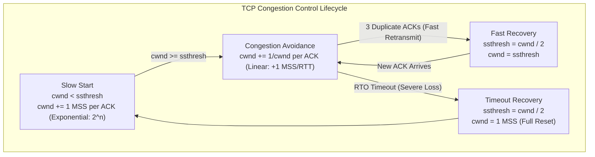
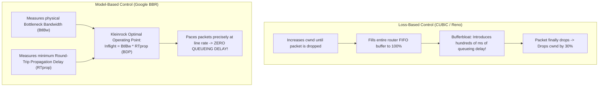

# Module 07: Congestion Control, Loss Recovery & Modern Pacing Engines

While flow control protects the receiving host's memory buffers from being overwhelmed by a fast sender, **congestion control** protects the shared intermediate network fabric—routers, switches, and transmission links—from catastrophic collapse. Following the historic 1986 Internet congestion collapse, Van Jacobson engineered algorithmic pacing that transformed TCP from an uncontrolled packet burst mechanism into a self-stabilizing distributed feedback system. This module examines the mathematical foundations of Additive Increase / Multiplicative Decrease (AIMD), the cubic curve mechanics of RFC 9438 (CUBIC), Google's model-based Bottleneck Bandwidth and RTT (BBR) paradigm, Active Queue Management (AQM), Explicit Congestion Notification (ECN), and Low Latency, Low Loss, Scalable Throughput (L4S).

---

## 1. Flow Control vs. Congestion Control & The 1986 Collapse

In October 1986, the data throughput along the 400-mile 32 kbps LBL-to-UC Berkeley link collapsed from 32,000 bps to 40 bps—a **factor of 1,000 throughput destruction**. The collapse was not caused by broken hardware or truncated packets, but by an unmanaged feedback loop: when packet arrival exceeded link capacity, router FIFO buffers overflowed, dropping packets. Sending endpoints timed out and retransmitted identical packets into an already saturated buffer, compounding queueing delay and causing every packet to time out before reaching the receiver.

```
                              THE CONGESTION FEEDBACK LOOP
+───────────────────────────────────────────────────────────────────────────────────────────+
| Overloaded Router Buffer ──> Packet Dropped ──> Sender Retransmission Timeout (RTO)        |
|          ▲                                                          │                     |
|          └──────────── Inject Duplicate Packets Into Network <──────┘                     |
+───────────────────────────────────────────────────────────────────────────────────────────+
```

### The Effective Transmission Window
A TCP sender calculates its usable transmission window ($W_{\text{effective}}$) as the minimum of the receiver's advertised flow control window (`rwnd`) and the sender's calculated congestion window (`cwnd`):

$$W_{\text{effective}} = \min(\text{cwnd}, \text{rwnd})$$

- **`rwnd` (Receive Window)**: Enforces end-to-end host capacity (advertised in segment headers).
- **`cwnd` (Congestion Window)**: Enforces network pipe capacity (tracked purely in sender kernel memory; never transmitted over the wire).

---

## 2. Mathematical Stability: Chiu & Jain's AIMD Axiom

In 1989, Dah-Ming Chiu and Raj Jain published the foundational mathematical proof governing resource allocation in distributed networks (*Analysis of the Increase and Decrease Strategies for Congestion Avoidance in Computer Networks*). They proved that among all linear control algorithms, **Additive Increase / Multiplicative Decrease (AIMD)** is the only mechanism that converges to both **efficiency** (full link utilization) and **fairness** (equal bandwidth sharing among competing flows).

```
                               EFFICIENCY LINE (x1 + x2 = Capacity)
        x2 (Flow 2)              ▲
            │                   /
            │                  /
            │                 /  <-- AIMD Vector drifts toward fairness
            │                /
            │    Fairness   /
            │    Vector    /
            │    (x1=x2)  /
            │       ▲    /
            │       │   /
            │       │  /
            │       │ /
            └───────┴────────────────────────> x1 (Flow 1)
```

### The AIMD Rules
1. **Additive Increase (Congestion Avoidance)**: In the absence of loss, probing the network by incrementing `cwnd` linearly:
   $$\text{cwnd}_{t + 1} = \text{cwnd}_t + \alpha \quad (\alpha = 1\text{ MSS per RTT})$$
2. **Multiplicative Decrease (Loss Event)**: Upon detecting packet loss, halving the window multiplicatively:
   $$\text{cwnd}_{t + 1} = \text{cwnd}_t \times \beta \quad (\beta = 0.5 \text{ in classic Reno, } 0.7 \text{ in CUBIC})$$

If an algorithm used Multiplicative Increase (MIMD) or Additive Decrease (AIAD), competing flows would either diverge into extreme unfairness (one flow starving all others) or oscillate violently without stabilizing.

---

## 3. The Classic Loss-Based Pipeline: Tahoe, Reno & NewReno

Classic TCP algorithms infer network congestion exclusively from **packet drops** (either 3 duplicate ACKs or an RTO timeout).



### The 3 Classical Phases
1. **Slow Start**: When a connection begins, `cwnd` is initialized to an Initial Window (IW $\approx 10\text{ MSS}$ per RFC 6928). To rapidly probe available capacity, for every ACK received, `cwnd` is incremented by 1 MSS:
   $$\text{cwnd} \leftarrow \text{cwnd} + 1\text{ MSS}$$
   Because an entire window of packets produces an entire window of ACKs, `cwnd` **doubles every RTT** ($2, 4, 8, 16 \dots$). Slow Start terminates when `cwnd` reaches the Slow Start Threshold (`ssthresh`).
2. **Congestion Avoidance**: Once $\text{cwnd} \ge \text{ssthresh}$, growth switches to linear additive increase to cautiously probe line capacity without causing buffer overflow:
   $$\text{cwnd} \leftarrow \text{cwnd} + \frac{1}{\text{cwnd}}\text{ MSS per ACK} \implies \text{Increases by } 1\text{ MSS per full RTT}$$
3. **Fast Retransmit & Fast Recovery (RFC 5681)**:
   - When 3 duplicate ACKs arrive, TCP avoids dropping `cwnd` to 1 MSS (which destroys throughput).
   - `ssthresh` is set to $\frac{\text{cwnd}}{2}$.
   - The missing segment is retransmitted immediately (Fast Retransmit).
   - In **Reno**, `cwnd` is set to $\text{ssthresh} + 3\text{ MSS}$ and continues in Congestion Avoidance (Fast Recovery).
   - Only a hard **Retransmission Timeout (RTO)** forces `cwnd` back to 1 MSS.

---

## 4. The Modern Linux Standard: CUBIC (RFC 9438)

Standard Reno scaling broke down with the emergence of high-speed optical links. On a 10 Gbps transatlantic link with an 80 ms RTT, after a packet drop, standard Reno requires over **one hour** of linear additive increase (+1 packet per RTT) to climb back to 10 Gbps line saturation!

Formalized in **RFC 9438** (and the default Linux congestion control algorithm since kernel 2.6.19), **CUBIC** replaces linear increase with a mathematical cubic growth function centered around the previous maximum window size before loss:

$$W_{\text{cubic}}(t) = C(t - K)^3 + W_{\text{max}}$$

Where:
- $W_{\text{max}}$: The window size in packets immediately prior to the most recent loss event.
- $C$: A scaling factor fixed at $0.4$.
- $t$: Elapsed time in seconds since the most recent window reduction.
- $K$: The time period required for the cubic function to climb from the reduced window back to $W_{\text{max}}$:
  $$K = \sqrt[3]{\frac{W_{\text{max}} \cdot \beta}{C}} \quad (\text{where multiplicative decrease } \beta = 0.7)$$

```
Window Size (cwnd)
      ▲
W_max │             . . - - - . .              <-- Concave plateau near W_max
      │          .                 .                (Stability & High Utilization)
      │        .                     .
      │       .                        .       <-- Convex probing for new capacity
      │      /                           .
      │     /                              .
      │    /
W_min ├───┘
      └────────────────────────────────────────> Time (t)
      0                 t = K
```

### The Architectural Beauty of CUBIC
1. **RTT Independence**: Notice that $t$ is real elapsed time (in seconds), NOT counted in RTTs. Unlike Reno (where short-RTT flows grow drastically faster and starve long-RTT flows), two competing CUBIC flows scale at the exact same rate regardless of geographic distance.
2. **Concave Region ($t < K$)**: As `cwnd` approaches the previous saturation point $W_{\text{max}}$, growth flattens and slows down, stabilizing near line capacity with minimal packet loss.
3. **Convex Region ($t > K$)**: Once the connection has safely operated at $W_{\text{max}}$ for a period without loss, CUBIC accelerates exponentially upward to probe for newly available bandwidth (e.g., if a competing flow disconnected).

---

## 5. Model-Based Congestion Control: BBR (Bottleneck Bandwidth and RTT)

Despite CUBIC's success, all loss-based algorithms suffer from a catastrophic structural defect: **Bufferbloat**.



### Kleinrock’s Optimal Operating Point
In 1979, Leonard Kleinrock proved that optimal network throughput occurs at the exact boundary where:
1. In-flight data matches the true **Bandwidth-Delay Product (BDP)**:
   $$\text{BDP} = \text{BtlBw} \times \text{RTprop}$$
2. Throughput reaches the maximum physical bottleneck rate ($\text{BtlBw}$).
3. Round-trip time is equal to the minimum physical propagation delay ($\text{RTprop}$).

Any data injected beyond the BDP does not increase throughput; it merely accumulates in router memory buffers, inflating queueing delay (**Bufferbloat**).

### The BBR State Machine
Engineered by Van Jacobson, Neal Cardwell, and Yuchung Cheng at Google, **BBR (draft-ietf-ccwg-bbr)** abandons loss as a congestion indicator. Instead, BBR continuously models the physical path:

```
        +─────────────+
        |   STARTUP   | ─── BtlBw plateau reached ───┐
        +─────────────+                              │
               ▲                                     ▼
               │                              +─────────────+
        ProbeRTT (every 10s)                  |    DRAIN    |
               │                              +─────────────+
               │                                     │ Drain buffer to BDP
               │                                     ▼
        +─────────────+                       +─────────────+
        |  PROBE_RTT  | <── 10s without min ── |  PROBE_BW   |
        +─────────────+                        +─────────────+
```

1. **STARTUP**: Exponential search (growth gain $2/\ln 2 \approx 2.89$) until bottleneck bandwidth stops increasing.
2. **DRAIN**: Paces at $\frac{1}{2.89}$ to drain excess queueing buffers accumulated during STARTUP back down to exactly 1 BDP.
3. **PROBE_BW**: The steady state. Cycles through an 8-phase pacing cycle: briefly probes upward ($1.25 \times \text{BtlBw}$), drains excess ($0.75 \times \text{BtlBw}$), and cruises at line rate ($1.0 \times \text{BtlBw}$).
4. **PROBE_RTT**: Every 10 seconds, BBR drops `cwnd` to 4 packets for 200 ms to drain all queues, allowing it to accurately measure true physical propagation delay ($\text{RTprop}$).

### Packet Pacing
Traditional TCP bursts an entire window of packets into the NIC back-to-back, overwhelming shallow router buffers. BBR uses kernel pacing timers (`SO_MAX_PACING_RATE`) via the Fair Queueing (FQ) scheduler, spacing packet transmissions evenly across the entire RTT:

$$\text{pacing\_rate} = \text{pacing\_gain} \times \text{BtlBw}$$

---

## 6. Active Queue Management (AQM), ECN & L4S

To prevent Dumb FIFO router buffers from filling to capacity, modern network switches and routers implement **Active Queue Management (AQM)**.

### CoDel (Controlled Delay / RFC 8289) & FQ-CoDel
Instead of measuring queue length in bytes or packets, **CoDel** measures the **sojourn time** (the actual dwell time a packet spends sitting in the queue):
- If the minimum sojourn time over a 100 ms sliding window exceeds **5 ms**, CoDel declares persistent bufferbloat.
- It begins dropping packets (or marking ECN) at an increasing rate to force senders to back off.
- **FQ-CoDel (RFC 8290)**: Hashes packets into independent flow queues (Fair Queueing) and runs CoDel independently per flow, preventing a single heavy bittorrent stream from degrading latency for interactive DNS or SSH packets.

### Explicit Congestion Notification (ECN / RFC 3168)
ECN allows intermediate routers to signal impending congestion **without dropping packets**:

```
 0   1   2   3   4   5   6   7
+---+---+---+---+---+---+---+---+
|       DSCP (6 bits)   | ECN   |  <-- In IPv4 TOS / IPv6 Traffic Class Octet
+---+---+---+---+---+---+---+---+
                         │   │
                         └───┴── 00: Non ECN-Capable Transport (Not-ECT)
                                 01: ECN Capable Transport (ECT(1))
                                 10: ECN Capable Transport (ECT(0))
                                 11: Congestion Experienced (CE)
```

1. **Signalling**: The sender marks packets with `ECT(0)` or `ECT(1)`.
2. **Marking**: An AQM router experiencing buffer growth rewrites the bits to `11` (**Congestion Experienced - CE**) instead of discarding the packet.
3. **Reflection**: The receiver sees `CE=11`, and sets the **`ECE` (ECN-Echo)** flag in its TCP header ACK segment back to the sender.
4. **Reduction**: The sender receives `ECE`, reduces its congestion window as if a drop had occurred, and sets **`CWR` (Congestion Window Reduced)** in its next data packet to acknowledge receipt of the congestion signal.

### Low Latency, Low Loss, Scalable Throughput (L4S / RFC 9330–9332)
Standard ECN still drops the congestion window by 30% to 50% upon receiving an ECE signal, causing window oscillation. Formalized in 2023, **L4S** introduces **Prague Congestion Control** and **DualPI2 AQM**:
- Uses `ECT(1)` to identify L4S flows.
- Routers emit microscopic, step-wise CE marks proportionally.
- Senders adjust `cwnd` continuously and smoothly by fractions of a percent, eliminating packet drops entirely and achieving **sub-millisecond queueing delay** over public Internet links.

---

## 7. Linux Socket Inspection: Deciphering `ss -ti`

Network systems engineers inspect active TCP congestion states using `ss -ti`:

```bash
ss -ti '( dport = :443 )'
```
```text
ESTAB  0  0  192.168.1.100:54210  203.0.113.50:443
   cubic wscale:7,7 rto:240 rtt:38.2/1.4 ato:40 mss:1440 rcvspace:131072
   ssthresh:28 cwnd:42 pacing_rate 25.4Mbps delivery_rate 24.1Mbps
   bytes_acked:184520 bytes_received:4210 segs_out:132 segs_in:88
   data_segs_out:128 send 12.6Mbps lastsnd:12 lastrcv:14 lastack:12
   pacing_rate 25.4Mbps delivery_rate 24.1Mbps retrans:0/1
```

### Key Diagnostic Fields
- **`cubic` / `bbr`**: The active congestion control module.
- **`wscale:7,7`**: Window scaling factors for send and receive ($2^7 = 128$).
- **`rtt:38.2/1.4`**: Smoothed RTT ($38.2\text{ ms}$) and RTT variation / jitter ($1.4\text{ ms}$).
- **`rto:240`**: Retransmission Timeout ($240\text{ ms}$). If no ACK arrives within this window, packet is declared lost.
- **`cwnd:42`**: Current congestion window in packets ($42 \times 1440\text{ bytes} \approx 60.4\text{ KB}$ in flight).
- **`ssthresh:28`**: Slow start threshold. Once `cwnd` reaches 28, additive linear increase begins.
- **`pacing_rate`**: Kernel transmit pacing speed enforced by the queueing discipline.
- **`retrans:0/1`**: Currently retransmitting 0 segments; total 1 segment retransmitted over connection lifetime.

---

## 8. Then vs. Now: Congestion Control Evolution

| Dimension | Legacy Practice (Then) | Modern Architecture (Now) | Rationale for Transition |
| :--- | :--- | :--- | :--- |
| **Loss Detection** | Packet loss inferred only from drop timeouts (RTO) or 3 duplicate ACKs. | Time-based RACK-TLP (RFC 8985) and proactive ECN congestion marking. | Eliminates long timeout stalls on tail drops and high-bandwidth small flows. |
| **Congestion Signal**| Buffer overflow packet drops (Loss-based). | Bottleneck bandwidth & minimum RTT tracking (Model-based BBRv3 / L4S). | Prevents Bufferbloat from inflating interactive round-trip latency by hundreds of milliseconds. |
| **Transmit Cadence** | Bursty window dumping: blasting entire `cwnd` back-to-back upon receiving an ACK. | Fair Queueing (FQ) kernel hardware-paced packet scheduling. | Spreads packet transmissions evenly over time, preventing micro-burst switch buffer drops. |
| **Initial Window** | Initial Window = 1 or 2 MSS ($1.5\text{ KB}$ to $3\text{ KB}$). | Initial Window = 10 MSS (RFC 6928, $\sim 14.6\text{ KB}$) standard. | Allows small web requests (HTML, TLS certificates) to complete within the initial RTT without stalling. |

---

## 9. Interview Drill: Questions & Model Answers

### Q1: Why does Additive Increase / Multiplicative Decrease (AIMD) guarantee convergence to both efficiency and fairness, whereas Multiplicative Increase / Multiplicative Decrease (MIMD) does not?
<details><summary>Answer</summary>

**Geometric Vector Convergence.**
In Chiu and Jain's phase plot (where axes represent the allocation of two competing flows $x_1$ and $x_2$):
- **Efficiency** is the line $x_1 + x_2 = C$ (full link capacity).
- **Fairness** is the line $x_1 = x_2$ (equal bandwidth sharing).
- **Additive Increase** adds a fixed constant $\alpha$ to both flows: $(x_1 + \alpha, x_2 + \alpha)$. Geometrically, this moves the operating point along a $45^\circ$ vector parallel to the fairness line, increasing fairness relative to the origin.
- **Multiplicative Decrease** multiplies both flows by a factor $\beta < 1$: $(\beta x_1, \beta x_2)$. Geometrically, this scales the operating point along a vector pointing directly toward the origin.
- The combination of a $45^\circ$ increase followed by a radial decrease causes the trajectory to oscillate along a stable limit cycle that steadily converges directly toward the intersection of efficiency and fairness.
- Under **MIMD**, both increase and decrease vectors point along radial lines toward and away from the origin; competing flows maintain their initial ratio and never converge toward fairness.
- Ref: Chiu & Jain, ACM Computer Communication Review (1989); Kurose & Ross 9th ed.
</details>

### Q2: Explain the Bufferbloat phenomenon. Why do loss-based congestion control algorithms like Reno and CUBIC cause it?
<details><summary>Answer</summary>

**Queue Saturation to Packet Drop.**
- Loss-based algorithms increase `cwnd` continuously until an intermediate router buffer overflows and **drops a packet**.
- If intermediate routers and home broadband modems have large memory buffers (engineered to "prevent packet loss"), TCP fills the entire buffer.
- Because throughput is bounded by the bottleneck link speed, adding packets to a full buffer does not increase data delivery rate; it merely forces packets to wait behind hundreds of megabytes of queued data.
- This inflates the connection's Round-Trip Time from $20\text{ ms}$ to $500\text{ ms}$ or higher (**Bufferbloat**), destroying interactive performance (voice calls, gaming, DNS queries) while transferring large files.
- Ref: Gettys & Nichols, "Bufferbloat: Dark Buffers in the Internet", CACM; RFC 8289.
</details>

### Q3: How does BBR estimate the Bottleneck Bandwidth (`BtlBw`) and Round-Trip Propagation Time (`RTprop`), and why can it not measure both simultaneously?
<details><summary>Answer</summary>

**The Heisenberg-like Uncertainty of Network Measurement.**
- **Bottleneck Bandwidth ($\text{BtlBw}$)**: To measure maximum bandwidth, the network pipe must be fully filled with in-flight data, which intentionally creates a small queue at the bottleneck link.
- **Propagation Delay ($\text{RTprop}$)**: To measure minimum physical propagation delay, the network queues must be completely empty so that queueing delay is strictly zero ($d_{\text{queue}} = 0$).
- **The Paradox**: You cannot measure maximum bandwidth without creating a queue, and you cannot measure minimum latency without draining the queue.
- **BBR's Solution**: BBR alternates states over time:
  1. It tracks the max delivery rate observed over a sliding window (estimating $\text{BtlBw}$).
  2. Every 10 seconds, it enters `PROBE_RTT`, throttling `cwnd` down to 4 packets for 200 ms to drain all queues, recording the lowest observed RTT as $\text{RTprop}$.
- Ref: Cardwell et al., "BBR: Congestion-Based Congestion Control", ACM Queue 2016.
</details>

### Q4: In CUBIC (RFC 9438), what is the purpose of the parameter $W_{\text{max}}$, and how does the cubic curve behave when $t < K$ versus $t > K$?
<details><summary>Answer</summary>

**Target Memory and Stability Concavity.**
- $W_{\text{max}}$ is the saturation window size in packets immediately before the most recent packet drop occurred.
- $K = \sqrt[3]{\frac{W_{\text{max}} \beta}{C}}$ is the mathematical time required to scale back up to $W_{\text{max}}$.
- **When $t < K$ (Concave Region)**: The window grows toward $W_{\text{max}}$, but the rate of growth decelerates as it approaches $W_{\text{max}}$, forming a flat plateau. This provides high stability and maximizes link utilization without triggering another drop.
- **When $t > K$ (Convex Region)**: The window has operated safely at $W_{\text{max}}$ without loss. CUBIC assumes background conditions have improved or cross-traffic has departed, and accelerates its growth rate exponentially upward to probe for new capacity.
- Ref: RFC 9438 Section 3.1; Ha et al., "CUBIC: A New TCP-Friendly High-Speed TCP Variant".
</details>

### Q5: How does Explicit Congestion Notification (ECN) allow an AQM router to signal congestion without dropping packets? What headers and flags are modified?
<details><summary>Answer</summary>

**In-Band Congestion Feedback via IP and TCP Flags.**
1. **Sender Marking**: The sender marks the 2-bit ECN field in the IPv4 TOS or IPv6 Traffic Class byte as `ECT(0)` (`10`) or `ECT(1)` (`01`), indicating ECN support.
2. **Router Marking**: When an intermediate AQM router observes queue dwell time crossing threshold, instead of dropping the packet, it rewrites the 2-bit IP field to `CE` (`11` - Congestion Experienced).
3. **Receiver Reflection**: The receiver inspects the IP header. If `CE` is set, it sets the **`ECE` (ECN-Echo)** flag in the TCP header of its next outgoing cumulative ACK.
4. **Sender Backoff**: When the sender receives an ACK with `ECE=1`, it reduces its congestion window (`cwnd`) as if a packet loss had occurred. It then sets the **`CWR` (Congestion Window Reduced)** flag in its next data packet to acknowledge the signal, allowing the receiver to stop asserting `ECE`.
Zero packets are dropped, avoiding retransmission overhead while preventing queue overflow.
- Ref: RFC 3168; Floyd, "TCP and Explicit Congestion Notification".
</details>
