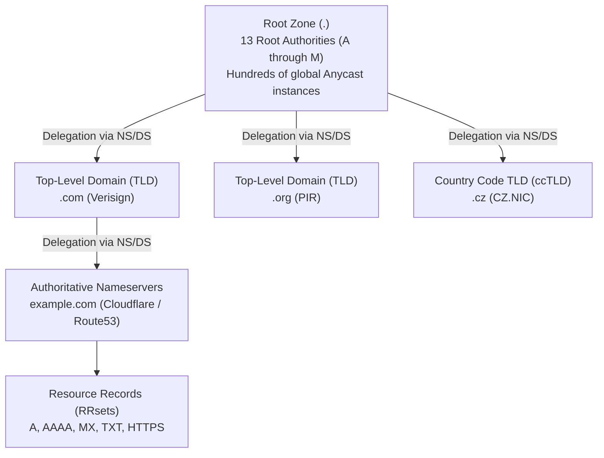
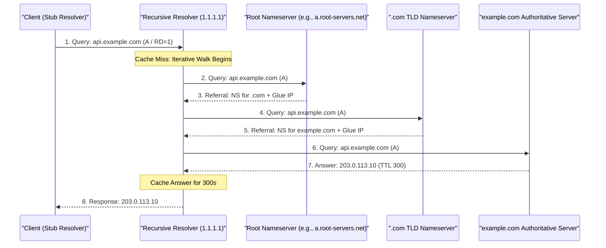
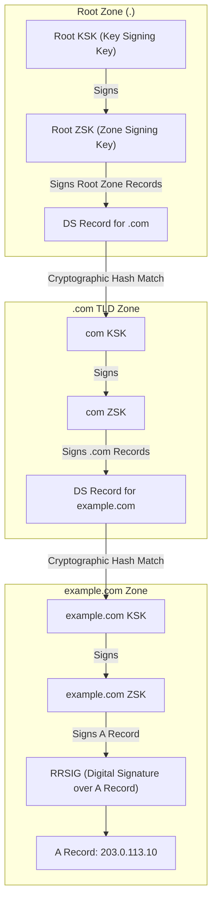
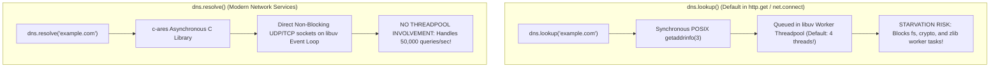

# Module 08: The Domain Name System (DNS), Wire Architecture & Modern Transports

The Domain Name System (DNS) is the globally distributed, hierarchical database that translates human-readable hostnames into topological IP addresses. Engineered by Paul Mockapetris in 1983 (RFC 1034 / 1035) and continuously modernized (RFC 6891, 8484, 9460, 9499), DNS is the critical precursor to virtually every Internet connection. This module dissects the recursive resolution tree, binary wire framing, domain name pointer compression, EDNS(0) extensions, zone apex aliasing with modern HTTPS resource records (RFC 9460), caching dynamics, the DNSSEC cryptographic chain of trust, and the Node.js `dns.lookup` threadpool starvation dilemma.

---

## 1. The Global DNS Resolution Hierarchy

DNS is an inverted tree rooted at the **Root Domain** (`.`). No single entity stores all Internet records; instead, authority is delegated down hierarchical zones:



### The 4 Actors in DNS Resolution
1. **Stub Resolver**: The client operating system library (e.g., `getaddrinfo(3)` in `glibc`). It performs no iterative root walking; it simply forwards requests to a configured recursive resolver.
2. **Recursive Resolver (Recursive Cache)**: Operated by an ISP, enterprise, or public provider (e.g., Cloudflare `1.1.1.1`, Google `8.8.8.8`). It iterates down the DNS hierarchy on behalf of the client, caching intermediate answers according to their TTL.
3. **TLD Nameserver**: Authoritative for top-level domains (`.com`, `.net`, `.io`, `.cz`). Returns referrals pointing to the domain's authoritative nameservers.
4. **Authoritative Nameserver**: Holds the definitive zone file containing the actual resource records authored by the domain owner.

---

## 2. The Iterative Resolution Walk: Step-by-Step

When a recursive resolver has an empty cache and resolves `api.example.com`:



- **Glue Records**: If the authoritative nameserver for `example.com` is `ns1.example.com`, a circular dependency exists: resolving `example.com` requires knowing the IP of `ns1.example.com`. The parent TLD zone solves this by providing **Glue Records**—an unauthenticated `A`/`AAAA` record bundled in the `Additional` section of the referral containing the raw IP of the nameserver.

---

## 3. The DNS Wire Format & Message Compression

DNS packets are binary-encoded datagrams (historically limited to 512 bytes over UDP port 53).

```
DNS Packet Wire Structure:
+-------------------------------------------------------------------+
| Header (Fixed 12 Bytes)                                           |
+-------------------------------------------------------------------+
| Question Section (Queries to resolve)                             |
+-------------------------------------------------------------------+
| Answer Section (Resource Records satisfying query)                |
+-------------------------------------------------------------------+
| Authority Section (NS records pointing to authoritative servers)  |
+-------------------------------------------------------------------+
| Additional Section (Glue records, OPT records, EDNS, TSIG)        |
+-------------------------------------------------------------------+
```

### The 12-Byte DNS Header Layout
```
 0                   1                   2                   3
 0 1 2 3 4 5 6 7 8 9 0 1 2 3 4 5 6 7 8 9 0 1 2 3 4 5 6 7 8 9 0 1
+-+-+-+-+-+-+-+-+-+-+-+-+-+-+-+-+-+-+-+-+-+-+-+-+-+-+-+-+-+-+-+-+
|        Transaction ID         |QR|  Opcode |AA|TC|RD|RA| Z|RCODE|
+-+-+-+-+-+-+-+-+-+-+-+-+-+-+-+-+-+-+-+-+-+-+-+-+-+-+-+-+-+-+-+-+
|          QDCOUNT              |          ANCOUNT              |
+-+-+-+-+-+-+-+-+-+-+-+-+-+-+-+-+-+-+-+-+-+-+-+-+-+-+-+-+-+-+-+-+
|          NSCOUNT              |          ARCOUNT              |
+-+-+-+-+-+-+-+-+-+-+-+-+-+-+-+-+-+-+-+-+-+-+-+-+-+-+-+-+-+-+-+-+
```

### Header Bitflags
- **Transaction ID (16 bits)**: Matched by the client to correlate asynchronous responses with outbound queries.
- **`QR` (1 bit)**: `0` = Query; `1` = Response.
- **`Opcode` (4 bits)**: Standard query (`0`), Inverse query (`1`), Server status (`2`).
- **`AA` (Authoritative Answer, 1 bit)**: Set if the responding server is authoritative for the zone.
- **`TC` (Truncation, 1 bit)**: Set if the response exceeded the maximum transmission size and was truncated. Signals the client to retry immediately over **TCP port 53**.
- **`RD` (Recursion Desired, 1 bit)**: Set by client to request recursive resolution.
- **`RA` (Recursion Available, 1 bit)**: Set by server indicating it supports recursion.
- **`RCODE` (Response Code, 4 bits)**:
  - `0`: **`NOERROR`** (Query succeeded).
  - `1`: **`FORMERR`** (Format error; server cannot parse query).
  - `2`: **`SERVFAIL`** (Server failed to resolve; authoritative servers unreachable or DNSSEC validation failed).
  - `3`: **`NXDOMAIN`** (Non-Existent Domain; authoritative confirmation that domain does not exist).
  - `5`: **`REFUSED`** (Server refused to answer, e.g., open recursion denied).

### QNAME Encoding & Pointer Compression (`0xC000`)
Hostnames are encoded as a series of **length-prefixed labels** ending in a null byte (`0x00`). For example, `api.example.com`:
```
[ 0x03 ] 'a' 'p' 'i' [ 0x07 ] 'e' 'x' 'a' 'm' 'p' 'l' 'e' [ 0x03 ] 'c' 'o' 'm' [ 0x00 ]
```

To avoid repeating long domain names across multiple records in the same packet, RFC 1035 specifies **DNS Name Compression**:
- If the two most significant bits of a label length octet are `11` (hex `0xC0`), the remaining 14 bits represent an **offset pointer** from the start of the DNS header to a previously encoded name:

```
Offset 0x0C: [ 0x07 ] "example" [ 0x03 ] "com" [ 0x00 ]
Offset 0x30: [ 0x03 ] "api" [ 0xC0 ] [ 0x0C ]  <-- Points to "example.com" at offset 12!
```

---

## 4. EDNS(0): Extension Mechanisms for DNS (RFC 6891)

The original 1983 DNS specification strictly capped UDP packets at **512 bytes** (the minimum IPv4 reassembly buffer size). If a DNS response containing multiple IPv6 `AAAA` records or DNSSEC signatures exceeded 512 bytes, the server had to truncate the packet (`TC=1`), forcing the client to re-establish a high-latency TCP connection.

**EDNS(0) (RFC 6891)** retrofits modern capabilities without breaking legacy servers by introducing a pseudo-Resource Record named **`OPT`** into the Additional section:
- **UDP Payload Size**: Advertises the client's buffer capacity (typically **1,232 bytes** or **4,096 bytes**), eliminating truncation for most responses. (Note: 1,232 bytes is the modern recommended standard to avoid IPv6 link MTU 1,280-byte fragmentation).
- **Extended RCODE (8 bits)**: Expands the 4-bit RCODE to 12 bits, enabling new error conditions.
- **`DO` Bit (DNSSEC OK, 1 bit)**: Instructs the resolver to return DNSSEC cryptographic records (`RRSIG`, `DNSKEY`, `DS`) along with standard answers.
- **Client Subnet (ECS / RFC 7871)**: Transmits a truncated portion of the client's IP subnet (e.g., `/24`) to authoritative servers so CDNs can return geographically optimized Anycast PoP IPs.

---

## 5. Modern Resource Records: The Zone Apex & RFC 9460 (HTTPS RR)

| Record Type | Type Code | Payload Structure | Architectural Function & Constraints |
| :--- | :---: | :--- | :--- |
| **`A`** | `1` | 32-bit IPv4 address | Maps hostname to IPv4 address. |
| **`AAAA`** | `28` | 128-bit IPv6 address | Maps hostname to IPv6 address. |
| **`CNAME`** | `5` | Canonical target hostname | Alias. **Cannot coexist with any other record at the same name (Zone Apex Trap).** |
| **`MX`** | `15` | Preference (16-bit) + Mail Host | Designates mail exchange servers in priority order. |
| **`TXT`** | `16` | Text strings (length-prefixed) | Arbitrary machine-readable data (SPF, DKIM, site verification tokens). |
| **`PTR`** | `12` | Canonical hostname | Reverse DNS lookup in `.in-addr.arpa` or `.ip6.arpa`. |
| **`CAA`** | `257` | Flags, Tag, Value | Authorizes specific CAs (e.g., Let's Encrypt) to issue certificates. |
| **`HTTPS` / `SVCB`** | `65` | Priority, Target, SvcParams | **Modern standard (RFC 9460)**: Apex aliasing, protocol hints (HTTP/3), and ECH configs in a single round trip! |

### The CNAME at the Apex Dilemma & Solution
RFC 1034 §3.6.2 states: *If a CNAME record is present at a node, no other data may be present.*
- An Internet domain root (`example.com`, the **Zone Apex**) MUST contain an `SOA` (Start of Authority) and `NS` (Nameserver) record.
- Therefore, putting a `CNAME` at the apex `example.com` to point to a CDN (`example.com CNAME cdn.cloudflare.net`) is **strictly illegal under the DNS standard**.
- Historical proprietary workarounds: Authoritative DNS vendors developed "CNAME Flattening" or "ALIAS" records, dynamically resolving the CDN CNAME in the background and returning synthetic `A`/`AAAA` records.
- **The Modern Standard: The `HTTPS` Resource Record (RFC 9460)**:
  Standardized in 2023, the `HTTPS` record natively solves apex aliasing in AliasMode:
  ```text
  example.com.  300  IN  HTTPS  0  cdn.cloudflare.net.
  ```
  In ServiceMode (`Priority > 0`), it advertises ALPN protocol capabilities and Encrypted Client Hello (ECH) keys:
  ```text
  api.example.com. 300 IN HTTPS 1 . (
      alpn="h3,h2"
      ipv4hint=203.0.113.10
      ipv6hint=2001:db8::10
      ech="AEx+DQB4AgAgAC..."
  )
  ```
  A browser resolves the IP, learns the server supports HTTP/3, and acquires the public key to encrypt its TLS 1.3 ClientHello, all within the **initial single DNS lookup**!

---

## 6. Caching Dynamics: Negative Caching & Serve-Stale

### Negative Caching (RFC 2308)
When a recursive resolver queries a non-existent domain and receives `NXDOMAIN` (or `NOERROR` with 0 answers, known as `NODATA`), it caches the **negative result**.
- The negative cache duration is governed by the `SOA` record returned in the Authority section:
  $$\text{Negative TTL} = \min(\text{SOA.TTL}, \text{SOA.Minimum})$$
- **The Deployment Trap**: If an engineer removes a DNS record during a zero-downtime release or updates a subdomain before records propagate, early client queries trigger `NXDOMAIN`. Resolvers cache this failure for the full negative TTL (often 1 to 4 hours), locking users out even after the correct records are published.

### Serve-Stale (RFC 8767)
If an authoritative nameserver suffers an outage or DDoS attack, recursive resolvers would normally return `SERVFAIL` once cached TTLs hit 0. RFC 8767 permits resolvers to **serve stale cached records** (e.g., for up to 3 days past expiration) while continuing to attempt background refreshes, preventing global web outages during DNS infrastructure incidents.

---

## 7. DNSSEC: The Cryptographic Chain of Trust

Standard DNS provides zero integrity authentication; an attacker on an open Wi-Fi network or compromised ISP router can forge UDP DNS replies (**DNS Spoofing / Cache Poisoning**). **DNSSEC (RFC 4033–4035)** adds cryptographic digital signatures:



### The 4 DNSSEC Record Types
1. **`DNSKEY`**: Contains the public signing keys of the zone.
   - **Zone Signing Key (ZSK)**: Short-term key used to sign the domain's individual resource record sets (RRsets).
   - **Key Signing Key (KSK)**: Long-term key used exclusively to sign the ZSK.
2. **`RRSIG`**: The cryptographic digital signature (e.g., ECDSA P-256 or Ed25519) accompanying an RRset. Resolvers verify this signature against the zone's public `DNSKEY`.
3. **`DS` (Delegation Signer)**: A cryptographic SHA-256 hash of the child zone's KSK placed in the **parent zone**. This forms the unbroken trust chain from child $\to$ TLD $\to$ Root.
4. **`NSEC` / `NSEC3` (RFC 5155)**: Authenticated Denial of Existence. Proves mathematically that a queried name does not exist without requiring real-time on-the-fly signing of `NXDOMAIN` responses, using salt and repeated hashing to prevent attackers from enumerating all records in a zone ("zone walking").

If a validating resolver detects an expired `RRSIG` or mismatched `DS` hash, it treats the record as poisoned and returns **`SERVFAIL`** to the client.

---

## 8. Encrypted Transports: DoT, DoH & DoQ

Standard DNS queries travel over plaintext UDP port 53, allowing network eavesdroppers, ISPs, and nation-state firewalls to inspect, log, and censor every domain a user accesses:

| Protocol | Transport | Port | RFC Standard | Operational Trade-offs |
| :--- | :--- | :---: | :---: | :--- |
| **Classic DNS** | UDP / TCP | 53 | RFC 1035 | Plaintext, vulnerable to spoofing, eavesdropping, and DPI tampering. |
| **DNS over TLS (DoT)** | TCP + TLS | 853 | RFC 7858 | Dedicated port. Strictly encrypted. Easily blocked by restrictive firewalls blocking port 853. |
| **DNS over HTTPS (DoH)** | HTTP/2 or HTTP/3 | 443 | RFC 8484 | Encapsulated in standard HTTPS web traffic. Virtually impossible to block without blocking the entire web. |
| **DNS over QUIC (DoQ)** | UDP + QUIC | 853 | RFC 9250 | Zero connection establishment latency (0-RTT), eliminates TCP head-of-line blocking, supports connection migration. |

---

## 9. The Node.js DNS Architecture: `lookup` vs. `resolve`

In Node.js, network engineers frequently trigger severe production performance bottlenecks by conflating the two different DNS modules:



### The Pitfalls of `dns.lookup()`
1. **Threadpool Starvation**: `dns.lookup()` invokes the synchronous C-library function `getaddrinfo(3)` to honor local system configuration (`/etc/hosts`, nsswitch). Because it is blocking, libuv executes it inside the **libuv worker threadpool** (default size: **4 threads**, configured via `UV_THREADPOOL_SIZE`).
2. If an application makes multiple outbound HTTP requests and DNS responses are slow (e.g., 500 ms latency), all 4 worker threads become blocked. As a result, unrelated operations that depend on the threadpool—such as file system operations (`fs.readFile`), cryptographic hashing (`crypto.pbkdf2`), or compression (`zlib`)—freeze completely!
3. **No Caching**: Node.js does **not cache DNS lookups by default**. Every outbound request issues a new DNS query unless an application-level agent (such as Undici or an agent cache) is configured.
4. **Architectural Fix**: For high-throughput microservices, configure `dns.resolve()` or deploy a local caching resolver (such as `unbound` or `dnsmasq`) on `127.0.0.1`.

---

## 10. Then vs. Now: Domain Name System Evolution

| Dimension | Legacy Practice (Then) | Modern Architecture (Now) | Rationale for Transition |
| :--- | :--- | :--- | :--- |
| **Packet Size** | Hard 512-byte UDP limit with TCP fallback. | EDNS(0) (RFC 6891) with 1,232-byte UDP buffer. | Accommodates IPv6 addresses and cryptographic DNSSEC signatures without TCP latency. |
| **Apex Aliasing** | Proprietary CNAME flattening hacks or forwarding servers. | HTTPS Resource Record (RFC 9460) AliasMode. | Standardized, cross-vendor apex aliasing without violating RFC 1034 CNAME coexistence rules. |
| **Privacy** | Plaintext UDP port 53 observable by any intermediate router. | DNS over HTTPS (DoH / RFC 8484) and DNS over QUIC (DoQ). | Encrypts query metadata, preventing ISP surveillance and DNS hijacking. |
| **Resilience** | Strict TTL expiration dropping into SERVFAIL on server down. | Serve-Stale (RFC 8767) serving expired cache during outages. | Prevents cascading global outages during transient authoritative nameserver failures. |

---

## 11. Interview Drill: Questions & Model Answers

### Q1: Why is a CNAME record strictly prohibited at the zone apex (`example.com`), and how does the modern HTTPS Resource Record (RFC 9460) solve this problem?
<details><summary>Answer</summary>

**The CNAME Exclusivity Rule (RFC 1034 §3.6.2).**
- RFC 1034 dictates that if a CNAME record exists at a domain node, no other resource record of any type may coexist at that same node.
- A zone apex (`example.com`) MUST contain an `SOA` (Start of Authority) and `NS` (Nameserver) record to function as a valid DNS zone. Placing a CNAME at `example.com` would violate the standard because the CNAME would collide with the mandatory SOA and NS records.
- **The RFC 9460 Solution**: The modern `HTTPS` record operates in two modes: ServiceMode and AliasMode. In AliasMode (`Priority = 0`), the record acts as an alias redirecting the query to another domain name (e.g., `example.com. HTTPS 0 cdn.provider.net.`). Unlike CNAME, the HTTPS record is a distinct record type and is explicitly permitted to coexist with SOA, NS, and MX records at the zone apex, providing standardized, native apex redirection across all compliant resolvers.
- Ref: RFC 1034 Section 3.6.2; RFC 9460 Section 2.4.2.
</details>

### Q2: What is the purpose of the 2 most significant bits in a DNS label length byte evaluating to `11` (`0xC0`), and how does domain name pointer compression work?
<details><summary>Answer</summary>

**Message Compression via Wire Pointers (RFC 1035).**
- Standard DNS labels are length-prefixed strings where the first byte specifies the string length (e.g., `[0x03] 'a' 'p' 'i'`). The maximum length of a label is 63 bytes, meaning the two highest bits of a legitimate length octet are always `00`.
- If the two highest bits are set to `11` (`0xC0` in hex), the parser recognizes it as an **offset pointer** rather than a literal string length.
- The parser masks out the top two bits and combines the remaining 14 bits into a 16-bit integer representing a byte offset from the beginning of the DNS header to a prior location in the packet where the suffix was already encoded.
- This eliminates redundant string transmissions (such as repeated nameservers and domain suffixes in Answer and Authority sections), compressing large multi-record DNS responses into minimal UDP byte sizes.
- Ref: RFC 1035 Section 4.1.4; Stevens TCP/IP Illustrated Vol. 1.
</details>

### Q3: Explain why a production Node.js application making heavy outbound HTTP requests might experience extreme event loop lag and stalled file system operations when using default network settings.
<details><summary>Answer</summary>

**Libuv Threadpool Starvation via `dns.lookup()`.**
- By default, Node.js HTTP clients (`fetch`, `http.get`, `net.connect`) use `dns.lookup()` to resolve hostnames.
- `dns.lookup()` calls the operating system's synchronous POSIX `getaddrinfo(3)` function to respect `/etc/hosts` and local NSS configuration.
- Because `getaddrinfo(3)` blocks the calling thread, Node.js offloads the call to the **libuv worker threadpool** (default size: **4 threads**).
- Node.js does not cache DNS lookups by default. Under high concurrency or during slow DNS server response times, all 4 worker threads become completely occupied waiting for DNS network replies.
- Because asynchronous file system operations (`fs.*`), cryptographic operations (`crypto.*`), and zlib compression share the exact same libuv threadpool, those operations are starved of execution threads and freeze, causing severe application-wide latency spikes.
- **Fix**: Use custom HTTP agents with persistent connection pools, deploy local caching resolvers, or increase `UV_THREADPOOL_SIZE`.
- Ref: Node.js Documentation (`node:dns`); StrongLoop, "Node.js Event Loop and Threadpool Architecture".
</details>

### Q4: In DNSSEC, what is the role of the DS (Delegation Signer) record, and how does it establish the trust relationship between a parent and child zone?
<details><summary>Answer</summary>

**The Cryptographic Anchor Between Parent and Child.**
- In DNSSEC, a child zone (e.g., `example.com`) signs its own records using a Zone Signing Key (ZSK), which is authenticated by a Key Signing Key (KSK). Both keys reside as `DNSKEY` records in the child zone.
- To prove that the child's KSK is authentic and has not been forged by an attacker, the parent zone (e.g., `.com`) publishes a **DS (Delegation Signer) record**.
- The DS record contains a cryptographic SHA-256 hash of the child zone's public KSK.
- The parent zone cryptographically signs this DS record using its own ZSK.
- A validating resolver verifies the parent's signature over the DS record, hashes the child's KSK, and confirms that the computed hash strictly matches the DS record in the parent. This anchors the child zone's public key into the global trust tree extending up to the Root Zone KSK.
- Ref: RFC 4034 Section 5; RFC 4035 Section 5.
</details>

### Q5: What is Negative Caching in DNS (RFC 2308), how is its expiration timer determined, and what operational issue does it frequently cause during software deployments?
<details><summary>Answer</summary>

**Caching Non-Existence via SOA Minimum.**
- When a resolver queries a domain that does not exist, the authoritative nameserver returns `RCODE = 3` (`NXDOMAIN`). Under RFC 2308, the resolver caches this failure (**Negative Caching**) so it does not repeatedly query upstream servers for invalid domains.
- **TTL Calculation**: The duration of the negative cache is determined by:
  $$\text{Negative TTL} = \min(\text{SOA.TTL}, \text{SOA.Minimum})$$
  Extracted from the `SOA` record returned in the Authority section of the NXDOMAIN response.
- **The Deployment Trap**: If an infrastructure team spins up a new canary service or newly created DNS record (e.g., `canary.api.example.com`), and an automated health check or user browser queries the hostname *seconds before* authoritative DNS propagation finishes, the recursive resolver queries authoritative servers, receives `NXDOMAIN`, and caches that non-existence. Even after the DNS record becomes live globally, that specific resolver continues returning `NXDOMAIN` for the entire duration of the negative TTL (often 1800 to 7200 seconds), causing localized deployment failure.
- Ref: RFC 2308 Section 3; RFC 1035.
</details>
