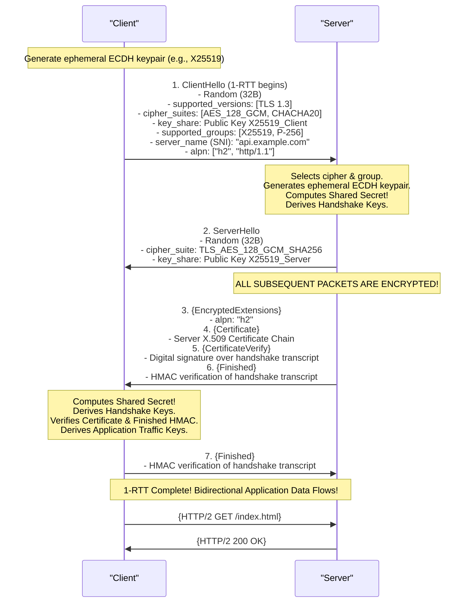
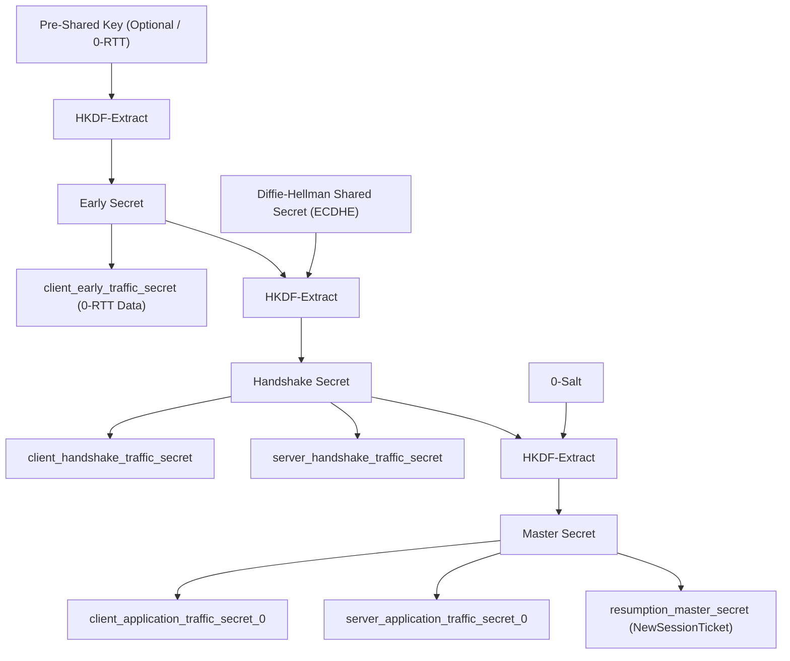
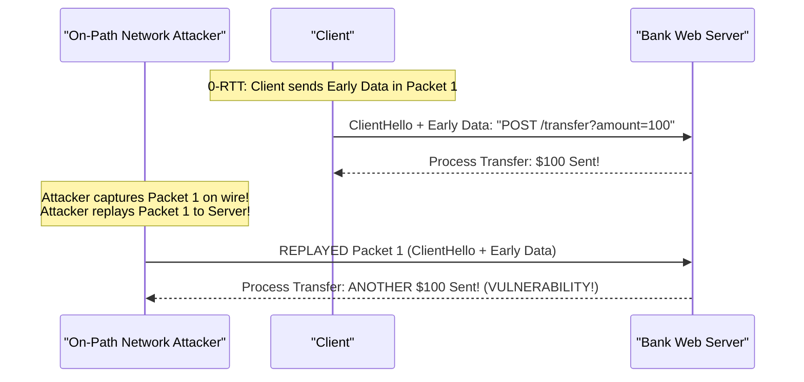
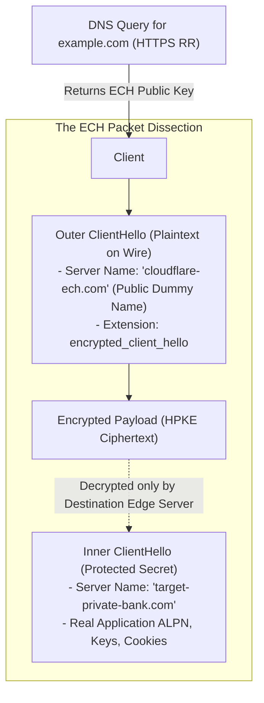

# Module 09: TLS 1.3 Wire Architecture, Handshake Mechanics & Post-Quantum Cryptography

Transport Layer Security (TLS) is the ubiquitous cryptographic protocol securing communications across the modern Internet. While foundational cryptographic theory (X.509 validation, certificate lifecycle, PKI trust stores, and mutual TLS identity) is owned by [`architecture/security-identity`](../security-identity/), this module dissects the **wire protocol mechanics**: the elimination of legacy cipher suites, the 1-RTT handshake state machine, the HKDF key derivation schedule, 0-RTT Early Data and its replay vulnerabilities (RFC 8470), Encrypted Client Hello (ECH / RFC 9849), and the operational impact of Post-Quantum Hybrid Key Exchange (RFC 10024) on MTU fragmentation and middlebox traversal.

---

## 1. The TLS 1.3 Paradigm Shift (RFC 8446 / RFC 9846)

Published in August 2018 (RFC 8446) and formally consolidated in modern standards (RFC 9846), TLS 1.3 was not an iterative upgrade to TLS 1.2; it was a radical architectural rewrite that excised two decades of accumulated cryptographic vulnerabilities.

```
+---------------------------------------------------------------------------------------------------+
| Historical TLS 1.2 Baggage EXCISED in TLS 1.3:                                                    |
| - Static RSA Key Exchange (Vulnerable to Bleichenbacher's attack; NO Perfect Forward Secrecy)    |
| - CBC Mode Ciphers (Vulnerable to Padding Oracle attacks: POODLE, Lucky13)                        |
| - RC4 Stream Cipher (Vulnerable to statistical bias attacks)                                      |
| - SHA-1 & MD5 Hashing                                                                             |
| - Non-ephemeral Static Diffie-Hellman                                                             |
| - Custom Renegotiation Handshakes                                                                 |
| - Plaintext Server Certificate & Extensions                                                       |
+---------------------------------------------------------------------------------------------------+
```

### The 5 Standard TLS 1.3 AEAD Cipher Suites
TLS 1.3 mandates **Authenticated Encryption with Associated Data (AEAD)**, which integrates confidentiality and message authentication into a single cryptographic primitive:
1. `TLS_AES_128_GCM_SHA256`
2. `TLS_AES_256_GCM_SHA384`
3. `TLS_CHACHA20_POLY1305_SHA256`
4. `TLS_AES_128_CCM_SHA256`
5. `TLS_AES_128_CCM_8_SHA256`

Key exchange is strictly decoupled from the cipher suite and MUST use **Ephemeral Diffie-Hellman** (ECDHE over Curve25519/P-256 or DHE), guaranteeing **Perfect Forward Secrecy (PFS)**: even if a server's private key is compromised in the future, past recorded traffic sessions cannot be decrypted.

---

## 2. Handshake Wire Dissection: The 1-RTT State Machine

In TLS 1.2, establishing an encrypted session required a 2-RTT handshake before application data could be transmitted. TLS 1.3 cuts connection latency in half by enabling **1-RTT Handshakes** out of the box.



### The HelloRetryRequest (HRR) Edge Case
The client speculatively transmits its public `key_share` for its most preferred cryptographic group (typically Curve25519 / `X25519`).
- If the server does not support the client's chosen group (e.g., server policy mandates NIST `secp256r1`), the server does not fail.
- Instead, it responds with a **`HelloRetryRequest` (HRR)**, instructing the client to provide a `key_share` for the server's preferred group.
- The client re-sends `ClientHello` with the requested group. The handshake succeeds, but incurs an extra round trip (**2-RTT total**).

---

## 3. The TLS 1.3 Key Schedule (HKDF)

TLS 1.3 structures its cryptographic key derivation around the **HMAC-based Extract-and-Expand Key Derivation Function (HKDF / RFC 5869)**. Instead of deriving a single master secret, the key schedule progresses through three discrete phases as secrets become available:



### The 3 Secrets Explained
1. **Early Secret**: Derived from a Pre-Shared Key (PSK) or all-zeros if no PSK is present. Used to protect 0-RTT application data.
2. **Handshake Secret**: Derived by mixing the Early Secret with the ephemeral Diffie-Hellman shared secret (`ECDH`). Used to encrypt the server's Certificate, CertificateVerify, and Finished messages. Eavesdroppers on the physical link cannot inspect the certificate chain!
3. **Master Secret**: Derived by mixing the Handshake Secret with zero-salt. Produces the independent bidirectional keys (`client_application_traffic_secret_0` and `server_application_traffic_secret_0`) used to encrypt post-handshake application payloads.

---

## 4. Session Resumption & The 0-RTT Replay Vulnerability (RFC 8470)

When a client reconnects to a previously visited server, it can resume the session using a **Pre-Shared Key (PSK) Ticket** delivered in a post-handshake `NewSessionTicket` message.

### 0-RTT Early Data
TLS 1.3 allows the client to transmit encrypted application payload (e.g., an HTTP GET request) **in its very first flight of packets alongside the `ClientHello`**, achieving **0-RTT connection establishment**:



### The Replay Vulnerability & Mitigation Rules (RFC 8470)
Because 0-RTT data is encrypted under the static PSK established in the prior session, **it lacks ephemeral forward secrecy**. An on-path network eavesdropper who records the initial 0-RTT packet can replay the exact same byte sequence to the server minutes later.
- If the application request modifies database state (e.g., a credit card charge or account transfer), the server executes the mutation multiple times (**Double-Spend Vulnerability**).
- **RFC 8470 Engineering Constraints**:
  1. **Idempotency Restriction**: 0-RTT early data MUST ONLY be used for safe, idempotent HTTP methods (`GET`, `HEAD`, `OPTIONS`). Applications MUST reject `POST`, `PUT`, `DELETE` in 0-RTT.
  2. **HTTP 425 Too Early**: If a server receives an early-data request targeting a non-idempotent endpoint or during a risk window, the server MUST respond with **`HTTP 425 Too Early`**, instructing the client to retransmit the request after the 1-RTT handshake completes.
  3. **Anti-Replay Caches**: Servers deploy distributed Redis or memory-mapped bloom filters checking client ticket timestamps and nonces, rejecting observed tickets within a 10-second skew window.

---

## 5. Encrypted Client Hello (ECH / RFC 9849)

In standard TLS 1.2 and basic TLS 1.3, although the server's certificate is encrypted, the domain name the user is connecting to is broadcast in cleartext across the network inside the **Server Name Indication (SNI)** extension of the `ClientHello`. Any intermediate ISP, router, or nation-state surveillance engine can monitor and block user domain access.

**Encrypted Client Hello (ECH / RFC 9849)** resolves this privacy leak by encapsulating the real `ClientHello` inside a dummy outer wrapper using **Hybrid Public Key Encryption (HPKE / RFC 9180)**:



### The Operational Flow of ECH
1. **Discovery**: The client issues a DNS lookup for the domain's **`HTTPS` Resource Record (RFC 9460)** (as explored in Module 08), which returns the server's ECH public key configuration (`ech="AEx+..."`).
2. **Construction**:
   - **Inner ClientHello**: Contains the real sensitive SNI (`target-private-bank.com`), real ALPN, and extension parameters. The client encrypts this entire structure using HPKE and the server's ECH public key.
   - **Outer ClientHello**: A completely standard, unencrypted `ClientHello` containing an innocuous public "Outer SNI" (e.g., `cloudflare-ech.com`) and the encrypted inner payload embedded in the `encrypted_client_hello` extension.
3. **Transit**: Network eavesdroppers and intermediate ISPs inspect the packet and observe only a connection to `cloudflare-ech.com`.
4. **Edge Termination**: The destination CDN or edge load balancer possesses the private HPKE key, decrypts the Inner ClientHello, and routes the connection to `target-private-bank.com` seamlessly.

---

## 6. Post-Quantum Hybrid Cryptography (RFC 10024)

Modern public-key cryptography (RSA and Elliptic Curve Diffie-Hellman / ECDH) relies on mathematical problems (integer factorization and discrete logarithms) that can be solved in polynomial time by a sufficiently powerful quantum computer running **Shor's Algorithm**.

Under the **"Harvest Now, Decrypt Later"** threat model, adversarial state actors are recording vast volumes of encrypted Internet traffic today, anticipating the arrival of quantum machines capable of decrypting recorded ECDH exchanges retrospectively.

```
+───────────────────────────────────────────────────────────────────────────────────────────────────+
| Modern Post-Quantum Hybrid Group: X25519MLKEM768                                                  |
| 1. Classical Elliptic Curve: X25519 (Curve25519 ECDH)                                             |
| 2. Post-Quantum Lattice Kem: ML-KEM-768 (FIPS 203 / Kyber-768)                                    |
| Combined Secret = HKDF-Extract(X25519_Secret || MLKEM768_Secret)                                 |
+───────────────────────────────────────────────────────────────────────────────────────────────────+
```

### The Wire Impact: MTU Fragmentation & Middlebox Trapping
While classical X25519 keys are compact (32 bytes), post-quantum lattice public keys and ciphertexts are massive:
- **ML-KEM-768 Public Key**: **1,184 bytes**.
- **Combined Hybrid `key_share`**: **1,216 bytes**.

```
Standard TLS 1.3 ClientHello (X25519):     ~350 - 500 Bytes  (Fits cleanly in single 1500B MTU)
Hybrid PQ ClientHello (X25519MLKEM768):    ~1,600 - 2,000 Bytes (EXCEEDS STANDARD 1500B MTU!)
```

### The Middlebox Failure Mode
Because the post-quantum `ClientHello` exceeds the standard 1,500-byte Ethernet MTU:
1. The TCP transport layer segments the `ClientHello` across **two discrete IP packets**.
2. Legacy enterprise firewalls, deep packet inspection (DPI) boxes, and buggy load balancers historically assumed that the entire TLS `ClientHello` must fit inside a single packet.
3. Upon receiving the split segment, these buggy middleboxes fail to reassemble the TCP stream, drop the second segment, or return a TCP RST, causing the post-quantum connection to hang and time out.
4. Major browser engines (Chrome, Firefox, Safari) deployed fallback algorithms during the initial rollout of RFC 10024, retrying connections with classical X25519 if the hybrid handshake failed.

---

## 7. Decrypting Network Captures: `SSLKEYLOGFILE`

Because TLS 1.3 enforces ephemeral Diffie-Hellman key exchange for every connection, a network engineer capturing traffic with `tcpdump` or Wireshark **cannot decrypt the packet capture using the server's private certificate key**.

Modern browsers (Chrome, Firefox) and runtimes (Node.js, curl) support exporting ephemeral session secrets via the **`SSLKEYLOGFILE`** environment variable:

```bash
# Export TLS secrets to a local log file
export SSLKEYLOGFILE=/tmp/tls_secrets.log

# Run Node.js or curl against a secure service
node --experimental-fetch my-app.js
```
```text
# Sample /tmp/tls_secrets.log entries:
SERVER_HANDSHAKE_TRAFFIC_SECRET <ClientRandom> <SecretHex...>
CLIENT_HANDSHAKE_TRAFFIC_SECRET <ClientRandom> <SecretHex...>
SERVER_TRAFFIC_SECRET_0 <ClientRandom> <SecretHex...>
CLIENT_TRAFFIC_SECRET_0 <ClientRandom> <SecretHex...>
```
In Wireshark: Navigate to **Preferences $\to$ Protocols $\to$ TLS $\to$ (Pre)-Master-Secret log filename**, load `/tmp/tls_secrets.log`, and Wireshark decrypts all application payloads on the fly.

---

## 8. Then vs. Now: Transport Encryption Evolution

| Dimension | Legacy Practice (Then) | Modern Architecture (Now) | Rationale for Transition |
| :--- | :--- | :--- | :--- |
| **Handshake Latency**| 2-RTT handshake required before application data transmission. | 1-RTT standard; 0-RTT Early Data for idempotent requests. | Halves connection establishment latency across mobile and high-RTT connections. |
| **Forward Secrecy** | Optional; static RSA key exchange allowed decrypting past captures. | Mandatory; ephemeral Diffie-Hellman (ECDHE / ML-KEM) only. | Protects historic user data against retrospective private key compromise. |
| **Server Privacy** | Server certificate sent in plaintext, revealing host identity. | Certificate and extensions encrypted under Handshake Secret. | Prevents on-path network snoopers from identifying internal backend services. |
| **Domain Privacy** | Plaintext SNI broadcast over the wire in ClientHello. | Encrypted Client Hello (ECH / RFC 9849) with HPKE outer wrapping. | Eliminates ISP and middlebox domain surveillance and censorship. |
| **Quantum Resistance**| 128-bit/256-bit classical ECC susceptible to Shor's algorithm. | Post-Quantum Hybrid Key Exchange (X25519MLKEM768 / RFC 10024). | Neutralizes "Harvest Now, Decrypt Later" quantum decryption attacks. |

---

## 9. Interview Drill: Questions & Model Answers

### Q1: Why is static RSA key exchange completely prohibited in TLS 1.3, and how does ephemeral Diffie-Hellman provide Perfect Forward Secrecy?
<details><summary>Answer</summary>

**Eliminating Retrospective Decryption Risk.**
- In static RSA key exchange (standard in TLS 1.2), the client generates a Pre-Master Secret, encrypts it using the server's public RSA certificate key, and sends it over the wire. The server decrypts it using its long-term private key.
- If an adversary records encrypted network traffic for months or years, and the server's private key is subsequently compromised (e.g., via subpoena, memory leak like Heartbleed, or decommissioned hard drives), the adversary can decrypt the Pre-Master Secret of every historical session and decrypt all recorded past communications.
- In **Ephemeral Diffie-Hellman (ECDHE)**, both client and server generate fresh, temporary mathematical keypairs for that specific connection and discard the private parts immediately after deriving the shared secret. Even if the server's long-term certificate private key is compromised later, the ephemeral keys no longer exist in memory anywhere on Earth, mathematically preventing retrospective decryption (**Perfect Forward Secrecy**).
- Ref: RFC 8446 Section 1.2; Rescorla, "The Transport Layer Security (TLS) Protocol Version 1.3".
</details>

### Q2: What is the 0-RTT Early Data replay attack in TLS 1.3, and what HTTP constraints are mandated by RFC 8470 to mitigate it?
<details><summary>Answer</summary>

**The Non-Idempotent Mutation Replay Attack.**
- 0-RTT allows a client reconnecting with a pre-shared ticket to transmit encrypted application payload in its very first packet (`ClientHello + EarlyData`) without waiting for a server handshake response.
- Because this early data is encrypted using keys derived from a previous session ticket, it contains no fresh ephemeral Diffie-Hellman entropy. An on-path network eavesdropper who intercepts the packet can copy and replay the exact same byte string to the server seconds or minutes later.
- If the replayed packet contains a state-modifying action (e.g., `POST /api/pay?cents=5000`), the server would process the charge twice.
- **RFC 8470 Mitigations**:
  1. Clients and servers MUST restrict 0-RTT early data strictly to safe, idempotent HTTP methods (`GET`, `HEAD`, `OPTIONS`).
  2. If a server receives a non-idempotent request in 0-RTT, it MUST NOT execute it, and MUST return **`HTTP 425 Too Early`**, prompting the client to retransmit the request safely over the established 1-RTT connection.
- Ref: RFC 8446 Section 2.3; RFC 8470 Section 3.
</details>

### Q3: Explain how Encrypted Client Hello (ECH / RFC 9849) conceals the Server Name Indication (SNI) from network eavesdroppers.
<details><summary>Answer</summary>

**HPKE Dual-Hello Architecture.**
1. The client queries the domain's DNS `HTTPS` Resource Record (RFC 9460) and retrieves the server's public ECH configuration (`ech="..."`).
2. The client splits the handshake into two structures:
   - **Inner ClientHello**: Contains the real, sensitive destination domain name (e.g., `SNI: private-health.com`), real ALPN, and extension parameters. The client encrypts this entire structure using Hybrid Public Key Encryption (HPKE / RFC 9180) and the server's ECH public key.
   - **Outer ClientHello**: A standard, unencrypted `ClientHello` containing an innocuous public dummy name (e.g., `SNI: cloudflare-ech.com`) and embeds the encrypted Inner ClientHello payload within the `encrypted_client_hello` extension.
3. Intermediate routers, ISPs, and network taps inspect the outer packet and observe only traffic bound for `cloudflare-ech.com`.
4. When the packet arrives at the destination edge infrastructure, the CDN server uses its private key to decrypt the inner payload and routes the request to `private-health.com`.
- Ref: RFC 9849; Cloudflare, "Goodbye SNI, Hello ECH".
</details>

### Q4: Why does the adoption of Post-Quantum Hybrid Cryptography (X25519MLKEM768) cause connection failures with legacy network middleboxes?
<details><summary>Answer</summary>

**Packet MTU Fragmentation Traps.**
- Classical elliptic curve public keys (X25519) require only 32 bytes, allowing the entire TLS `ClientHello` (along with certificates and extensions) to fit easily within a single 1,500-byte Ethernet MTU packet (typically 350 to 500 bytes).
- Post-quantum lattice-based key encapsulation (ML-KEM-768 / Kyber) requires an extra **1,184 bytes** of key data. When bundled into the hybrid `key_share` extension, the total `ClientHello` size expands to **1,800 to 2,200 bytes**, exceeding the standard 1,500-byte MTU.
- The transport layer is forced to fragment the `ClientHello` across two TCP segments.
- Many legacy enterprise middleboxes, transparent proxies, and deep packet inspection firewalls were hard-coded with the buggy assumption that a `ClientHello` must never exceed one packet. When presented with a multi-segment `ClientHello`, they fail to reassemble the TCP stream, drop the subsequent packet, or reset the connection.
- Ref: RFC 10024; Google Chromium Post-Quantum Rollout Post-Mortem (2024).
</details>

### Q5: Can an engineer decrypt a modern TLS 1.3 packet capture if they possess the server's private RSA/ECDSA certificate key? Explain why or why not.
<details><summary>Answer</summary>

**No. Ephemeral Key Isolation.**
- In TLS 1.3, the server's private certificate key is used **strictly for authentication (signing)** via the `CertificateVerify` message; it is **never used for key exchange or encryption**.
- The actual symmetric encryption keys protecting the session are derived via HKDF from an ephemeral Diffie-Hellman exchange (`ECDHE` or `ML-KEM`) generated uniquely for that specific connection. The server's certificate key cannot decrypt the ephemeral DH exchange.
- To decrypt TLS 1.3 traffic in tools like Wireshark, the engineer must export the per-session ephemeral symmetric secrets generated in runtime memory using the **`SSLKEYLOGFILE`** environment variable.
- Ref: RFC 8446 Section 4.1.2; Wireshark User Guide ("TLS Decryption").
</details>
