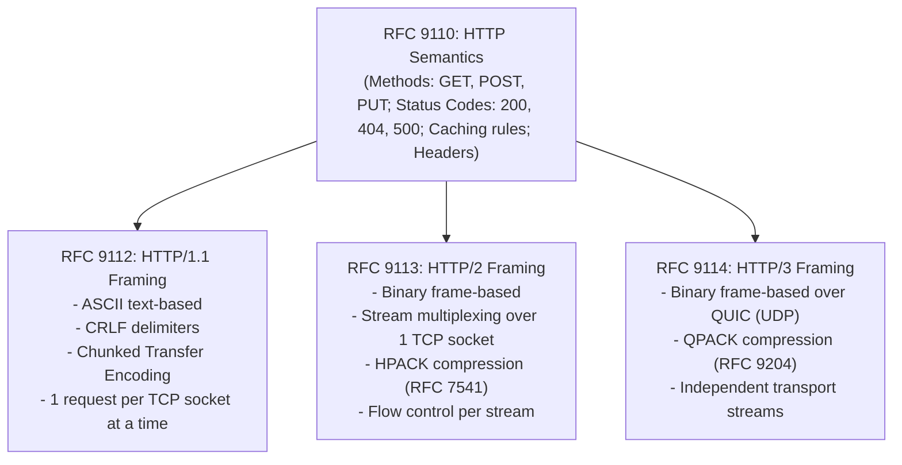
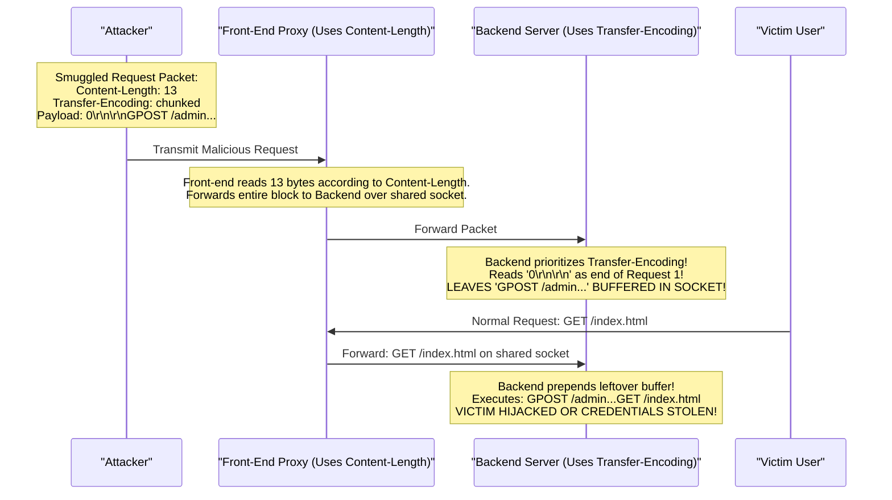
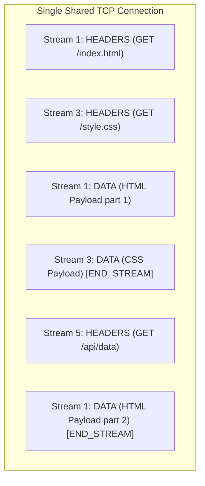
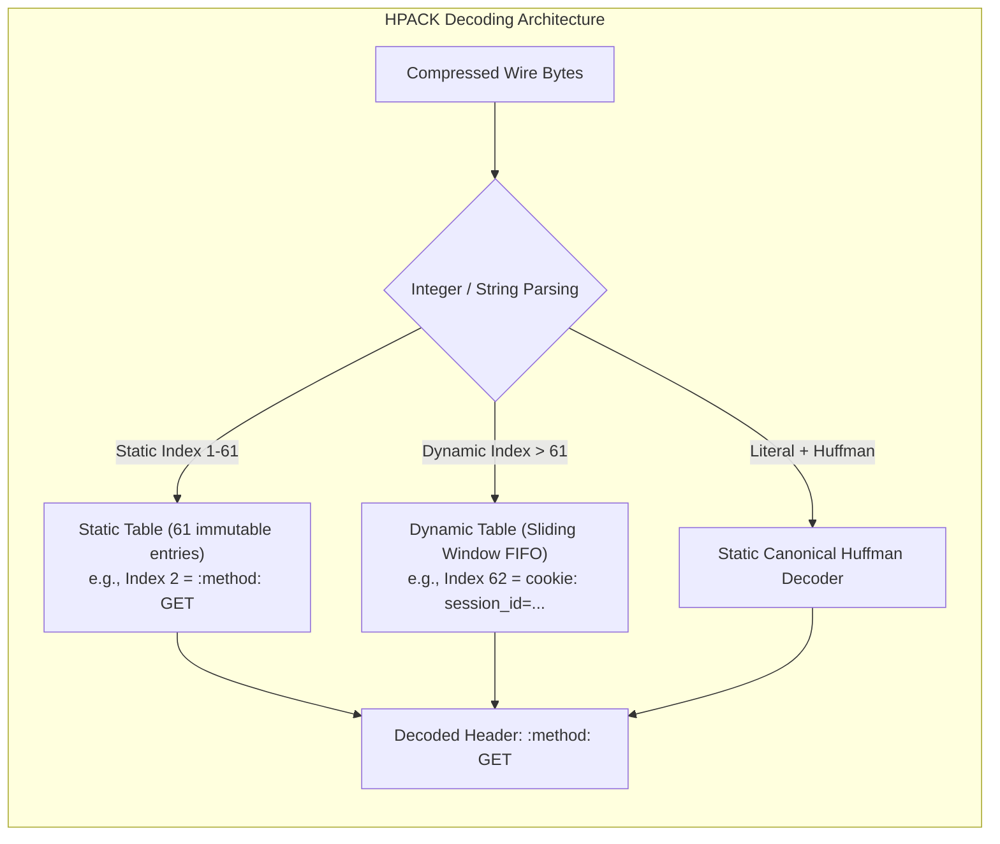
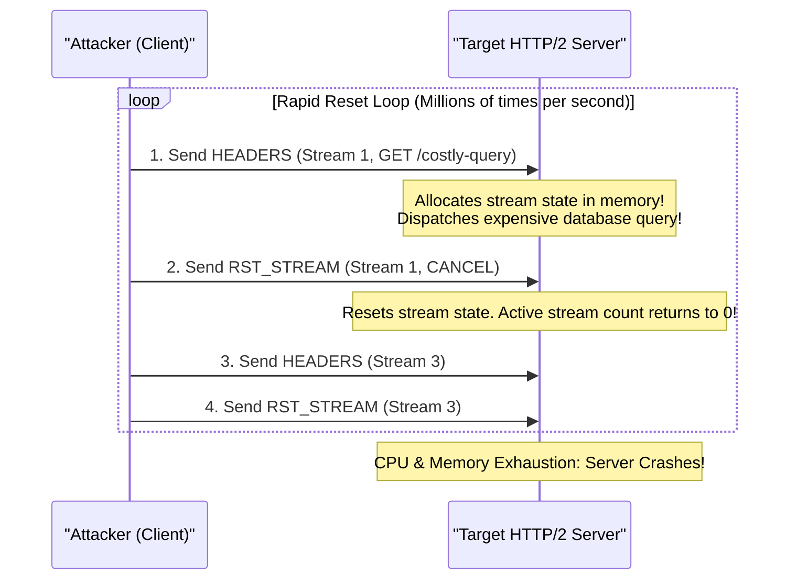

# Module 10: HTTP Evolution: Semantic Standards, HTTP/1.1 Smuggling & HTTP/2 Binary Multiplexing

The Hypertext Transfer Protocol (HTTP) is the universal application layer of the World Wide Web, microservice architectures, and modern cloud APIs. In 2022, the IETF formalized a fundamental architectural demarcation by splitting the HTTP standard: **RFC 9110** defines core semantic invariants (methods, status codes, header processing, and content negotiation), decoupled from transport-specific wire framing specifications—**RFC 9112** for HTTP/1.1, **RFC 9113** for HTTP/2, and **RFC 9114** for HTTP/3. This module examines the text framing of HTTP/1.1, HTTP Request Smuggling vulnerabilities (CL.TE and TE.CL), the binary frame architecture of HTTP/2, HPACK header compression, stream prioritization, the Rapid Reset attack (CVE-2023-44487), and the structural TCP Head-of-Line blocking bottleneck.

---

## 1. Specification Architecture: Semantics vs. Wire Framing

Prior to 2022, HTTP specifications intertwined application semantics (e.g., what a `POST` method means) with ASCII wire serialization (e.g., carriage-return line-feeds). The modern IETF standard cleanly segregates these concerns:



Regardless of whether an endpoint communicates over plaintext HTTP/1.1, binary HTTP/2, or UDP-encapsulated HTTP/3, the higher-level application contract—headers, cookies, status codes, and idempotency guarantees—remains semantically identical.

---

## 2. HTTP/1.1 Wire Mechanics: Chunked Transfer & Pipelining

HTTP/1.1 (RFC 9112) is an ASCII-delimited, human-readable text protocol. A message consists of a start line, followed by header fields separated by CRLF (`\r\n`), an empty line (`\r\n`), and an optional message body.

```http
GET /api/users?page=1 HTTP/1.1\r\n
Host: api.example.com\r\n
User-Agent: curl/8.4.0\r\n
Accept: application/json\r\n
Connection: keep-alive\r\n
\r\n
```

### Chunked Transfer Encoding
When a web server generates dynamic content on the fly (e.g., streaming a large database query or video segment), it does not know the final payload size in advance and cannot supply a `Content-Length` header. HTTP/1.1 resolves this via **Chunked Transfer Encoding (`Transfer-Encoding: chunked`)**:

```http
HTTP/1.1 200 OK\r\n
Content-Type: text/plain\r\n
Transfer-Encoding: chunked\r\n
\r\n
7\r\n
Mozilla\r\n
9\r\n
Developer\r\n
7\r\n
Network\r\n
0\r\n
\r\n
```
- Each chunk begins with the **hexadecimal size** of the chunk payload, followed by `\r\n`.
- The chunk data follows, terminated by `\r\n`.
- Transmission terminates with a **terminal chunk of size zero (`0\r\n`)**, followed by optional trailing headers and a final `\r\n`.

### The Pipelining Failure
HTTP/1.1 supports **Keep-Alive Persistent Connections**, allowing multiple consecutive requests over a single TCP socket. To improve throughput, HTTP/1.1 proposed **Pipelining**: sending requests 1, 2, and 3 back-to-back without waiting for response 1.
- **The Failure Mode**: The specification strictly mandates that responses MUST be returned in the exact chronological order of requests (**FIFO Order**). If request 1 takes 5 seconds to query a slow database, while requests 2 and 3 require 2 milliseconds, response 2 and 3 MUST be held in server memory until response 1 finishes.
- Furthermore, buggy intermediate enterprise proxies frequently corrupted pipelined socket boundaries, mixing responses between distinct users. As a result, pipelining was universally disabled across all major browsers.

---

## 3. HTTP Request Smuggling: CL.TE & TE.CL Attacks

In modern cloud architectures, a client connects to a **Front-End Reverse Proxy** (e.g., Cloudflare, AWS ALB, Nginx), which proxies requests over shared, persistent backend TCP connections to an **Application Server** (e.g., Node.js, Python Gunicorn, Java Netty).

**HTTP Request Smuggling** occurs when the front-end proxy and backend server interpret ambiguous request framing boundaries differently.



### The Two Classic Desynchronization Vectors
1. **CL.TE (Front-end uses `Content-Length`, Backend uses `Transfer-Encoding`)**:
   The attacker provides both headers. The front-end proxy routes the request based on the long `Content-Length`. The backend prioritizes `Transfer-Encoding: chunked`, encounters the terminal chunk `0\r\n\r\n` early, and treats the remaining payload bytes as the start of the *next* pipelined request on the shared socket.
2. **TE.CL (Front-end uses `Transfer-Encoding`, Backend uses `Content-Length`)**:
   The attacker obfuscates the `Transfer-Encoding` header (e.g., `Transfer-Encoding: xchunked` or `Transfer-Encoding: [tab]chunked`). The front-end accepts the chunked encoding, while the backend fails to parse it, falls back to `Content-Length`, and leaves the trailing chunk body buffered in the socket queue.

### Impact & Hardening
- **Impact**: Attackers can hijack subsequent users' requests, capture session authentication cookies, bypass IP allowlists, or poison web cache proxies globally.
- **Defensive Hardening**:
  - RFC 9112 Section 6.1 explicitly mandates: *If a message arrives with both `Content-Length` and `Transfer-Encoding`, the server MUST reject it with `400 Bad Request` or strip the `Content-Length`.*
  - Modern runtimes (including Node.js `llhttp`) enforce strict parsing rules. The dangerous flag `--insecure-http-parser` disables this protection and MUST never be enabled in production.
  - End-to-end HTTP/2 eliminates smuggling because binary frames have unambiguous lengths.

---

## 4. HTTP/2 Binary Framing & Multiplexing (RFC 9113)

HTTP/2 replaces textual parsing with a strict **Binary Framing Layer**. Every transmission over an HTTP/2 connection is divided into discrete, binary-encoded frames.

```
HTTP/2 Frame Layout (Fixed 9-Byte Header + Variable Payload):
 0                   1                   2                   3
 0 1 2 3 4 5 6 7 8 9 0 1 2 3 4 5 6 7 8 9 0 1 2 3 4 5 6 7 8 9 0 1
+-+-+-+-+-+-+-+-+-+-+-+-+-+-+-+-+-+-+-+-+-+-+-+-+-+-+-+-+-+-+-+-+
|                 Length (24 bits)              |
+-+-+-+-+-+-+-+-+-+-+-+-+-+-+-+-+-+-+-+-+-+-+-+-+-+-+-+-+-+-+-+-+
|   Type (8)    |   Flags (8)   |R|      Stream Identifier (31) |
+-+-+-+-+-+-+-+-+-+-+-+-+-+-+-+-+-+-+-+-+-+-+-+-+-+-+-+-+-+-+-+-+
|                     Frame Payload (0...Length)                |
+-+-+-+-+-+-+-+-+-+-+-+-+-+-+-+-+-+-+-+-+-+-+-+-+-+-+-+-+-+-+-+-+
```

### The 9-Byte Frame Header Breakdown
1. **Length (24 bits)**: The length of the frame payload (excluding the 9-byte header). Maximum default payload is $2^{14} = 16,384\text{ bytes}$ (expandable to $16\text{ MB}$ via `SETTINGS_MAX_FRAME_SIZE`).
2. **Type (8 bits)**: The functional discriminator of the frame:
   - `0x00` (`DATA`): Carries application body payloads.
   - `0x01` (`HEADERS`): Carries compressed request/response metadata.
   - `0x02` (`PRIORITY`): Stream dependency guidance (deprecated in favor of RFC 9218).
   - `0x03` (`RST_STREAM`): Abruptly cancels an individual stream.
   - `0x04` (`SETTINGS`): Negotiates connection configuration parameters.
   - `0x05` (`PUSH_PROMISE`): Server push notification (widely disabled).
   - `0x06` (`PING`): Round-trip heartbeat and latency measurement.
   - `0x07` (`GOAWAY`): Initiates graceful connection teardown.
   - `0x08` (`WINDOW_UPDATE`): Credit-based flow control adjustment.
   - `0x09` (`CONTINUATION`): Extends oversized header blocks.
3. **Flags (8 bits)**: Context-dependent flags:
   - `END_STREAM` (`0x01`): Signals that this frame is the final transmission for the stream.
   - `END_HEADERS` (`0x04`): Signals the end of a header block.
   - `ACK` (`0x01` on SETTINGS/PING): Confirms receipt of settings or ping.
4. **Stream Identifier (31 bits)**:
   - `0x00`: Reserved strictly for connection-level control frames (SETTINGS, PING, GOAWAY).
   - **Odd Numbers (1, 3, 5...)**: Client-initiated streams.
   - **Even Numbers (2, 4, 6...)**: Server-initiated streams (Server Push).

---

## 5. Full-Duplex Multiplexing & Stream States

In HTTP/2, a single TCP connection hosts dozens or hundreds of concurrent, bidirectional **Streams**. A stream is an independent, bidirectional sequence of frames exchanged between client and server.



Frames from distinct streams are interleaved over the wire without blocking one another, completely eliminating application-level Head-of-Line blocking.

### The Stream State Lifecycle
```
                           +--------+
                   send PP |        | recv PP
                  ==> o <==|  idle  |==> o <==
                 /         |        |         \
                /          +--------+          \
               /                                \
              v                                  v
        +----------+                        +----------+
        |          |                        |          |
        | reserved |                        | reserved |
        | (local)  |                        | (remote) |
        |          |                        |          |
        +----------+                        +----------+
               \                                /
                \          +--------+          /
                 \         |        |         /
                  v        |  open  |        v
               send H ==> o|        |o <== recv H
                           +--------+
```
- A stream transitions from `idle` to `open` upon transmitting or receiving a `HEADERS` frame.
- It enters `half-closed` when one side sets the `END_STREAM` flag.
- It enters `closed` when both sides have asserted `END_STREAM` or an endpoint sends `RST_STREAM`.

---

## 6. HPACK: Header Compression (RFC 7541)

In HTTP/1.1, clients repeatedly transmit identical strings of headers (`User-Agent`, `Cookie`, `Authorization`, `Accept`) on every request, wasting kilobytes of bandwidth. Applying standard gzip/deflate compression directly to encrypted HTTP headers leads to the **CRIME (Compression Ratio Info-leak Made Easy)** attack: an attacker observing compressed TLS length changes can deduce the exact bytes of secret session cookies.

**HPACK (RFC 7541)** was engineered to provide high-ratio compression without side-channel leaks:



### The 3 HPACK Pillars
1. **Static Table (61 Immutable Entries)**: Hard-coded in RFC 7541 for the most common HTTP headers (e.g., Index 2 is `:method: GET`, Index 8 is `:status: 200`, Index 14 is `:status: 500`). Transmitting `:method: GET` over the wire takes exactly **1 byte** (`0x82`).
2. **Dynamic Table (Sliding-Window FIFO Cache)**: As new headers are exchanged (e.g., `authorization: Bearer xyz`), they are added to an in-memory dynamic table shared across the connection. Subsequent requests reference that header by integer index, shrinking 1,000-byte authorization headers into a single 2-byte integer.
3. **Static Canonical Huffman Coding**: Strings that are not indexed are encoded using a precomputed, static Huffman code tree based on global character frequencies across the web, reducing text size by approximately 30%.

---

## 7. The Rapid Reset Attack (CVE-2023-44487)

In October 2023, cloud providers (Google, Cloudflare, AWS) disclosed the largest Distributed Denial of Service (DDoS) attack in Internet history, peaking at **398 million requests per second**. The attack exploited an architectural blind spot in the HTTP/2 protocol specification known as **Rapid Reset (CVE-2023-44487)**.



### The Mechanism of the Exploit
- HTTP/2 servers enforce `SETTINGS_MAX_CONCURRENT_STREAMS` (typically 100) to prevent memory exhaustion.
- The attacker transmits a `HEADERS` frame initiating a stream, which forces the server to allocate internal data structures, parse HPACK headers, and dispatch backend application tasks.
- **Immediately afterward (in the exact same TCP packet)**, the attacker sends a `RST_STREAM` frame with error code `CANCEL`.
- Because `RST_STREAM` closes the stream instantly, the server decrements its active stream counter back to zero.
- **The Vulnerability**: The server spent expensive CPU and memory allocating and processing the request, but the active stream count never crossed the 100-stream limit. The attacker blasted millions of requests without hitting any connection concurrency throttle.
- **Mitigation**: Modern HTTP/2 servers (including Node.js, Envoy, and Nginx) enforce **RST_STREAM rate limits**: if a client resets more than a specific ratio of streams per second, the server terminates the TCP connection with a `GOAWAY` frame.

---

## 8. The Architectural Limitation: TCP Head-of-Line Blocking

While HTTP/2 successfully solved *application-layer* Head-of-Line blocking by multiplexing multiple streams over a single connection, it created an unavoidable **transport-layer Head-of-Line blocking vulnerability**:

```
TCP Byte Stream (Carrying 50 HTTP/2 Streams Multiplexed):
[ Frame S1 ] [ Frame S2 ] [ Frame S3 (DROPPED!) ] [ Frame S4 ] [ Frame S5 ]
                                  │
                                  ▼
TCP Receiver Buffer: BLOCKS ALL STREAMS! (Streams 4 and 5 must wait for retransmit of S3)
```

- TCP guarantees an **in-order, contiguous byte stream**.
- If a single packet carrying a frame for Stream 3 is dropped due to Wi-Fi jitter or congestion, the receiver's operating system kernel **buffers all subsequent packets (Streams 4, 5, 6...) in the TCP receive queue**.
- The kernel will NOT deliver any bytes to the user-space HTTP/2 parser until the missing packet for Stream 3 is retransmitted and acknowledged.
- **The Paradox**: On lossy networks (e.g., mobile 4G/5G with 2% packet loss), HTTP/2 frequently exhibits **worse latency than HTTP/1.1** (where 6 independent TCP connections isolate packet drops to a single request).
- Resolving this physical limitation required abandoning TCP entirely and engineering a new transport protocol over UDP: **QUIC and HTTP/3**.

---

## 9. Then vs. Now: Web Transport Protocol Evolution

| Dimension | Legacy Practice (Then) | Modern Architecture (Now) | Rationale for Transition |
| :--- | :--- | :--- | :--- |
| **Framing** | Human-readable ASCII text lines delimited by `\r\n`. | Strict 9-byte binary frame header with typed payloads. | Binary parsing is vastly faster and eliminates text-delimited smuggling ambiguities. |
| **Multiplexing** | One request at a time per TCP socket; failed pipelining. | True full-duplex stream multiplexing over a single connection. | Eliminates TCP connection setup latency and reduces server socket memory footprints. |
| **Header Overhead**| Redundant text headers repeated across every HTTP request. | HPACK (RFC 7541) static table + dynamic sliding-window compression. | Reduces header bandwidth overhead by 85% to 90% without CRIME side-channel vulnerabilities. |
| **Stream Control** | None; closing a request requires closing the physical TCP socket. | In-flight stream cancellation via `RST_STREAM` frames. | Allows clients to cancel image or video downloads immediately when users scroll past. |
| **Transport Dependency**| Strictly tied to TCP transport in-order byte stream. | Migrating to QUIC/UDP (HTTP/3) to eliminate transport HOL blocking. | Resolves multi-stream stalling caused by single-packet drops on modern mobile links. |

---

## 10. Interview Drill: Questions & Model Answers

### Q1: Explain how an HTTP Request Smuggling (CL.TE) vulnerability occurs between a front-end reverse proxy and a backend server.
<details><summary>Answer</summary>

**Desynchronization of Message Delimiters.**
- In a CL.TE attack, the attacker crafts an HTTP/1.1 request containing BOTH a `Content-Length` header and a `Transfer-Encoding: chunked` header.
- The **Front-End Proxy** prioritizes `Content-Length`. It measures the full payload length declared in the header and forwards the entire packet across a persistent, reused TCP connection to the backend server.
- The **Backend Server** prioritizes `Transfer-Encoding: chunked`. It begins reading chunked frames, encounters the terminal zero-length chunk (`0\r\n\r\n`) early in the payload, and concludes that Request 1 is finished.
- The remaining bytes sent by the attacker (which the front-end thought belonged to Request 1) remain sitting in the backend socket's receive buffer.
- When an innocent next user sends a request across that same reused TCP connection, the backend server reads the leftover smuggled bytes as the start of the next request, executing the attacker's arbitrary command or stealing the victim's session tokens.
- Ref: RFC 9112 Section 6.1; PortSwigger Research, "HTTP Desync Attacks".
</details>

### Q2: How does HPACK (RFC 7541) compress HTTP headers without introducing the CRIME side-channel security vulnerability?
<details><summary>Answer</summary>

**Deterministic Two-Table Lookups Over Entropy Compression.**
- The **CRIME attack** targeted general-purpose LZ77/Deflate compression algorithms. When an attacker-controlled query parameter is compressed in the same stream as a secret authentication cookie, identical byte sequences produce shorter compressed output, allowing an observer to brute-force cookies character-by-character based on packet length.
- **HPACK's Solution**: HPACK completely avoids sliding-window byte matching across arbitrary user strings. Instead, it relies on two deterministic tables:
  1. An immutable **Static Table** of 61 predefined header fields.
  2. A connection-specific **Dynamic Table** that caches exact `(name, value)` pairs previously observed.
  3. Literal strings not in the tables are encoded using a precomputed, static canonical **Huffman Table** that does not adapt dynamically to the payload contents.
Because string representations are static and independent of adjacent secret values, length variations do not leak secret cookie content.
- Ref: RFC 7541 Section 1.1; Prado et al., "Cryptography: The CRIME Attack".
</details>

### Q3: Describe the mechanics of the HTTP/2 Rapid Reset attack (CVE-2023-44487). Why did standard stream concurrency limits fail to protect servers?
<details><summary>Answer</summary>

**Zero-Duration Stream State Reset.**
- HTTP/2 implementations enforce `SETTINGS_MAX_CONCURRENT_STREAMS` (typically 100) to cap concurrent in-flight requests and prevent server memory saturation.
- Under Rapid Reset, the attacker transmits a `HEADERS` frame to open Stream $N$, forcing the server to parse headers, allocate stream context, and dispatch backend application tasks.
- In the exact same TCP packet, the attacker immediately follows with a `RST_STREAM` frame for Stream $N$ with error code `CANCEL`.
- Because `RST_STREAM` instantly transitions the stream state from `open` to `closed`, the server decrements its active stream counter back to zero.
- The attacker repeats this sequence continuously across millions of stream IDs. The server consumes enormous CPU and memory cycles constantly creating and tearing down requests, but because the active stream count never exceeds 1, the concurrency limit of 100 is never breached, causing the server to collapse.
- Ref: CVE-2023-44487; Cloudflare, Google, AWS Joint Security Advisory (Oct 2023).
</details>

### Q4: What is the purpose of the 9-byte HTTP/2 frame header, and what is the significance of Stream Identifier `0x00`?
<details><summary>Answer</summary>

**Universal Frame Demuxing and Connection-Level Control.**
- Every HTTP/2 frame begins with a fixed 9-byte header:
  - 3 bytes (24 bits) for **Payload Length**.
  - 1 byte (8 bits) for **Frame Type** (DATA, HEADERS, SETTINGS, etc.).
  - 1 byte (8 bits) for **Flags** (`END_STREAM`, `END_HEADERS`, `ACK`).
  - 4 bytes (31 bits + 1 reserved bit) for the **Stream Identifier**.
- **Stream Identifier `0x00`**: Designates **Connection-Level Control**. Any frame with Stream ID 0 applies to the entire physical TCP connection as a whole rather than an individual application request. Frames that MUST use Stream ID 0 include `SETTINGS` (negotiating connection limits), `PING` (connection keepalive and RTT measurement), and `GOAWAY` (initiating graceful connection teardown).
- Ref: RFC 9113 Section 4.1; Belshe et al., "Hypertext Transfer Protocol Version 2 (HTTP/2)".
</details>

### Q5: Why can HTTP/2 perform worse than HTTP/1.1 on high-loss mobile networks? What physical transport bottleneck is responsible?
<details><summary>Answer</summary>

**Transport-Layer Head-of-Line Blocking.**
- In HTTP/1.1, browsers open up to 6 separate TCP connections per domain. If a packet on Connection 1 is lost, Connections 2 through 6 continue streaming data unaffected.
- In HTTP/2, all requests (HTML, CSS, JavaScript, images) are multiplexed over a **single shared TCP connection**.
- TCP guarantees strictly sequential, in-order byte delivery. If a single IP packet carrying a frame for one stream is dropped by a lossy mobile link (e.g., 2% packet loss), the receiver's operating system kernel halts delivery of all subsequent packets in its receive buffer.
- The kernel will not release *any* data to user space until the lost segment is retransmitted and acknowledged, stalling all multiplexed HTTP/2 streams simultaneously.
- On lossy networks, this transport-level stall degrades total page load time significantly below that of 6 independent HTTP/1.1 connections, motivating the design of HTTP/3 over QUIC.
- Ref: RFC 9000 Section 1; Grigorik, "High Performance Browser Networking", Chapter 12.
</details>
