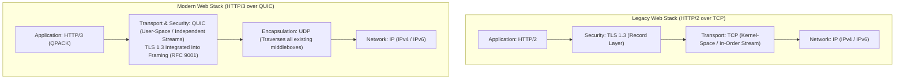
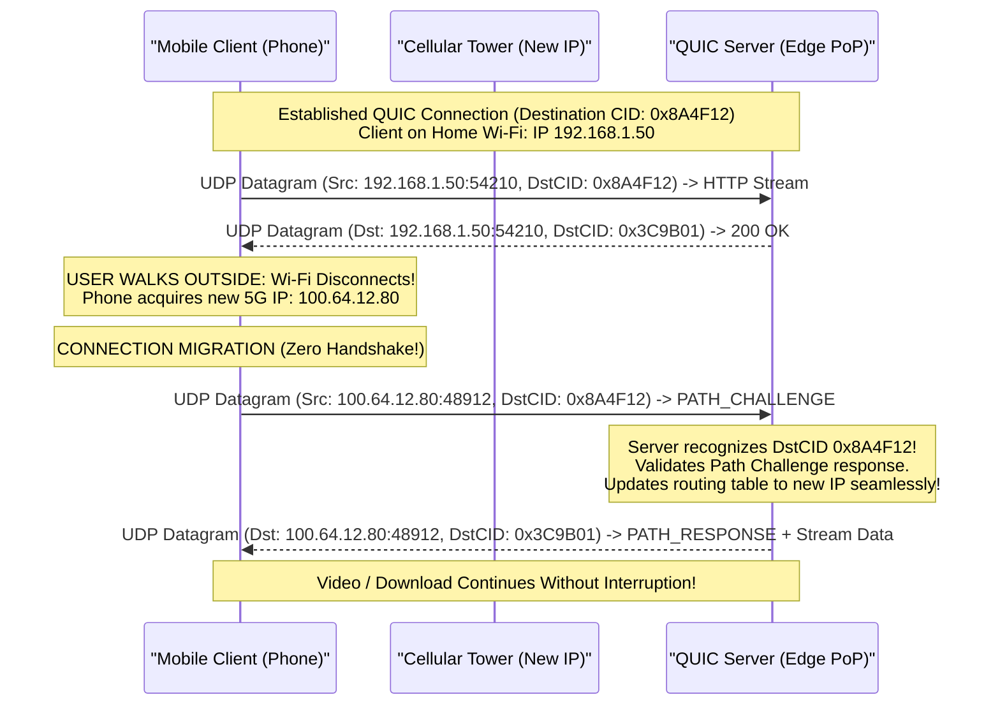
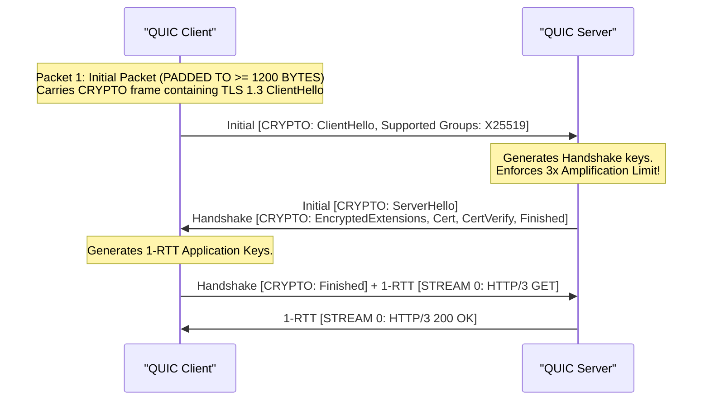
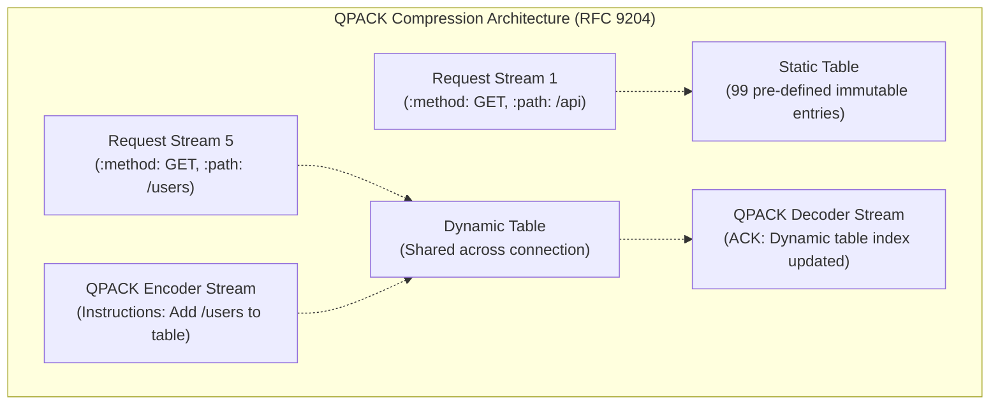
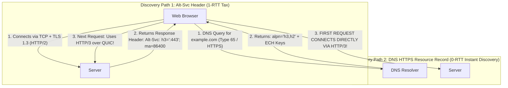

# Module 11: QUIC Transport, HTTP/3 Architecture & Non-Blocking Streams

For over thirty-five years, the transport architecture of the web was inextricably bound to TCP. However, the emergence of mobile devices frequently roaming between networks, coupled with the insurmountable transport-layer Head-of-Line blocking inherent to TCP's in-order byte stream, exposed the limits of OS kernel network stacks. Standardized in 2021 by the IETF across **RFC 9000** (QUIC Transport), **RFC 9001** (QUIC Security), **RFC 9002** (Loss Detection), and **RFC 9114** (HTTP/3), QUIC completely replaces TCP. This module dissects the UDP encapsulation model of QUIC, Connection Identifiers and zero-downtime Connection Migration, cryptographic transport integration, UDP amplification protection, QPACK non-blocking header compression, and enterprise middlebox traversal failures.

---

## 1. Architectural Motivation: Why Build on UDP?

Engineering an entirely new transport protocol to replace TCP faced a massive real-world deployment barrier: **Internet Middlebox Ossification**. Over decades, commercial NAT gateways, stateful firewalls, load balancers, and deep packet inspection (DPI) appliances were hard-coded to recognize only two Layer 4 transport protocol numbers in IP headers: `6` (TCP) and `17` (UDP). Any packet with a new protocol number (such as SCTP, protocol `132`) is dropped by intermediate middleboxes across the public Internet.

Furthermore, updating the TCP implementation requires upgrading the operating system kernel on billions of client devices—a multi-year rollout cycle.



### The QUIC Architectural Solution
1. **UDP Encapsulation**: QUIC runs as payload data inside standard UDP datagrams (`Protocol = 17`), allowing it to traverse all existing Internet routers, firewalls, and NAT gateways without middlebox modifications.
2. **User-Space Implementation**: QUIC lives inside user-space application runtimes (e.g., Chromium, curl, Node.js, Envoy). Protocols can be updated, patched, and optimized without waiting for operating system kernel updates.
3. **Encrypted Transport Metadata**: Unlike TCP (where sequence numbers, flags, and options are visible in cleartext), QUIC encrypts both the application payload AND almost all transport-layer headers, preventing intermediate middleboxes from tampering with or ossifying transport behavior.

---

## 2. Connection IDs & Zero-Downtime Connection Migration

In TCP, a connection is strictly identified by the **4-tuple**:
$$(\text{Source IP}, \text{Source Port}, \text{Destination IP}, \text{Destination Port})$$
If a user on a smartphone steps out of their home, transitioning from Wi-Fi to a 5G cellular network, their device's IP address changes immediately. Because the 4-tuple is broken, the active TCP connection dies immediately with a `TCP RST`. The smartphone must re-execute the TCP 3-way handshake, re-negotiate TLS, and restart interrupted downloads.

QUIC solves this by introducing **Connection Identifiers (Connection IDs / CIDs)**:



### Mechanics of Connection Migration
- A QUIC connection is bound to a pair of opaque **Connection IDs**: Source CID (SCID) and Destination CID (DCID), ranging from 0 to 20 bytes in length.
- When the client's network interface switches (changing IP and ephemeral port), the client transmits its next QUIC datagram using the existing Destination CID.
- The server matches the packet to the active session based on CID, completely ignoring the IP/port shift.
- **Path Validation**: To prevent an attacker from redirecting server traffic to a victim IP (DDoS reflection), the server immediately executes a cryptographic probe by transmitting a `PATH_CHALLENGE` frame containing 8 bytes of unpredictable entropy. The client echoes the payload inside a `PATH_RESPONSE` frame, proving ownership of the new IP address.

---

## 3. Monotonic Packet Numbers & Eliminating TCP Retransmission Ambiguity

In TCP, if segment 1000 is sent, times out, and is retransmitted with sequence number 1000, when an ACK arrives acknowledging sequence number 1000, the sender cannot tell whether the ACK was triggered by the original transmission or the retransmission (**The TCP Retransmission Ambiguity Problem**). This leads to corrupted RTT calculations.

```
QUIC Packet Number Evolution:
Transmission 1: Packet Number 42  (Carrying STREAM Frame: Offset 0, Length 1000) -> LOST IN TRANSIT
Transmission 2: Packet Number 43  (Retransmission! Carries identical STREAM Frame: Offset 0, Length 1000)
```

In QUIC (RFC 9002):
1. **Packet Numbers are Strictly Monotonic**: Every transmitted packet (even one carrying retransmitted stream data) is assigned a strictly incremented, unique Packet Number.
2. **Decoupling Stream Offset from Packet Number**:
   - The **Packet Number** governs transport-layer loss detection and ordering.
   - The **Stream Offset** (inside the `STREAM` frame payload) governs application-layer byte-stream reassembly.
3. When an ACK frame confirms Packet Number 43, the sender knows with absolute mathematical certainty that the ACK was generated by the retransmission, producing precise, uncorrupted RTT measurements.

---

## 4. Cryptographic Security & The 3x Amplification Limit

QUIC integrates TLS 1.3 directly into its transport framing layer (RFC 9001). There is no separate "cleartext TCP handshake followed by a TLS handshake":



### The UDP Amplification Attack Prevention Rule
Because UDP allows an attacker to forge the Source IP address with zero handshake validation, public UDP services are prime targets for **Distributed Denial-of-Service (DDoS) Amplification Attacks** (e.g., sending a 50-byte request with a spoofed victim IP and having the server blast a 5,000-byte response to the victim).

QUIC mandates two strict anti-amplification mechanisms (RFC 9000 Section 8):
1. **The Client Initial Padding Rule**: Every `Initial` packet transmitted by a client MUST be padded with `PADDING` frames to a **minimum size of 1,200 bytes**.
2. **The 3x Amplification Limit**: Until the server has validated the client's IP address (by receiving an authenticated handshake packet or Retry token), the server **MUST NOT transmit more than 3 times the number of bytes received from that IP address**:
   $$\text{Max Transmit Bytes} \le 3 \times \text{Bytes Received}$$
3. **Stateless Retry Packets**: If the server's handshake response (e.g., large certificate chains) exceeds the 3x limit, the server responds with a compact **Retry Packet** containing a cryptographically signed, stateless **Retry Token**. The client must echo this token in its next Initial packet, proving it owns the IP address and has completed a return round trip before the server releases full certificates.

---

## 5. Independent Streams: Complete Elimination of Transport Head-of-Line Blocking

In HTTP/2, multiplexing multiple streams over one TCP connection meant that dropping a single packet halted delivery for all streams simultaneously.

In QUIC, streams are **first-class transport primitives**:

```
QUIC UDP Datagram:
+---------------------------------------------------------------------------------------------------+
| QUIC Header: DCID 0x4A12, Packet Number 105                                                      |
| +-----------------------------------------------------------------------------------------------+ |
| | Frame 1: STREAM (Stream ID 4, Offset 0, Length 500, Data: Image bytes...)                    | |
| +-----------------------------------------------------------------------------------------------+ |
| | Frame 2: STREAM (Stream ID 8, Offset 1200, Length 300, Data: CSS bytes...)                   | |
| +-----------------------------------------------------------------------------------------------+ |
+---------------------------------------------------------------------------------------------------+
```

- Each stream has its own independent stream buffer and flow control window.
- If a UDP datagram carrying data for Stream 4 is dropped by the network:
  - Stream 4 halts waiting for retransmission.
  - **Stream 8 continues to be delivered to the application layer immediately without a microsecond of delay!**
- Single-packet drops on high-loss mobile links (cellular 5G, congested Wi-Fi) impact only the specific stream carrying those bytes.

---

## 6. HTTP/3 & QPACK Header Compression (RFC 9204)

HTTP/3 maps HTTP semantics directly onto QUIC transport streams:
- Request and response messages travel over **Bidirectional Streams**.
- HTTP/3 establishes three permanent **Unidirectional Control Streams**:
  1. **Control Stream**: Negotiates HTTP/3 settings (`SETTINGS_MAX_FIELD_SECTION_SIZE`) and graceful teardown (`GOAWAY`).
  2. **QPACK Encoder Stream**: Carries instructions updating the dynamic header table.
  3. **QPACK Decoder Stream**: Transmits acknowledgments confirming table state.



### Why HPACK Failed on QUIC & How QPACK Resolves It
HTTP/2's header compression algorithm (HPACK) maintained a strictly synchronized dynamic table. If HPACK were used over QUIC:
- If Stream 1 added a header to the table and Stream 5 referenced it, dropping Stream 1's packet would freeze Stream 5, re-introducing Head-of-Line blocking!
- **QPACK (RFC 9204)** solves this:
  - Expands the **Static Table to 99 entries**.
  - Dynamic table updates are transmitted over a dedicated, independent unidirectional **QPACK Encoder Stream**.
  - Senders can choose whether to reference the dynamic table or emit literal headers to trade compression ratio for zero stream dependencies.

---

## 7. Protocol Discovery: Alt-Svc vs. DNS HTTPS (RFC 9460)

Because a browser typing `https://example.com` has no prior knowledge of whether the server supports QUIC over UDP port 443, it begins with standard TCP + TLS:



1. **`Alt-Svc` (Alternative Services / RFC 7838)**: The server responds to an initial HTTP/2 request with the header:
   ```http
   Alt-Svc: h3=":443"; ma=86400; persist=1
   ```
   The browser caches this directive and initiates subsequent requests over QUIC.
2. **DNS `HTTPS` Resource Record (RFC 9460)**: As examined in Module 08, modern browsers query the `HTTPS` DNS record during initial name resolution. If the record advertises `alpn="h3"`, the browser launches its **very first connection directly over HTTP/3**, completely eliminating the 1-RTT discovery tax!

---

## 8. Operational Reality: Firewall Blocks & Buffer Sizing

Deploying QUIC and HTTP/3 in production infrastructure requires addressing real-world operational challenges:

### 1. Enterprise UDP 443 Filtering
Many corporate firewalls, banking proxies, and hotel networks block all outbound UDP traffic except DNS port 53, or aggressively rate-limit UDP packets.
- **Production Requirement**: All HTTP/3 web clients and browsers MUST implement an automatic **fallback pipeline**: if a QUIC handshake times out or fails, the client immediately falls back to TCP + TLS 1.3 (HTTP/2).

### 2. Linux Kernel UDP Buffer Exhaustion
In standard Linux distributions, default UDP socket receive buffers (`net.core.rmem_default` and `net.core.rmem_max`) are sized for tiny DNS lookups (e.g., 212 KB).
- A 10 Gbps HTTP/3 edge proxy receiving thousands of multiplexed streams will instantly overflow a 212 KB buffer, dropping thousands of packets per second.
- **Production Tuning**: Edge servers terminating QUIC must expand socket buffers to tens of megabytes:
  ```bash
  sysctl -w net.core.rmem_max=16777216
  sysctl -w net.core.wmem_max=16777216
  ```

---

## 9. Then vs. Now: Web Transport Protocol Matrix

| Dimension | HTTP/1.1 (RFC 9112) | HTTP/2 (RFC 9113) | HTTP/3 over QUIC (RFC 9114) |
| :--- | :--- | :--- | :--- |
| **Transport Protocol** | TCP (Layer 4) | TCP (Layer 4) | **UDP (Encapsulated Layer 4)** |
| **Framing** | ASCII text, CRLF delimited | 9-byte binary frames | **Binary frames inside QUIC packets** |
| **Multiplexing** | None (FIFO pipelining failed) | Full duplex over single TCP stream | **Independent non-blocking streams** |
| **Transport Head-of-Line**| N/A | **Severe**: 1 packet drop halts all streams | **Eliminated**: Drops isolate to 1 stream |
| **Connection ID** | Bound to IP 4-tuple | Bound to IP 4-tuple | **Independent 64-bit/160-bit CIDs** |
| **Connection Migration** | Impossible (RST on IP shift) | Impossible (RST on IP shift) | **Zero-downtime client migration** |
| **Handshake Latency** | 2-3 RTT (TCP + TLS) | 2-3 RTT (TCP + TLS) | **1-RTT (Integrated) / 0-RTT Resumption** |
| **Header Compression** | None | HPACK (Static + Dynamic Table) | **QPACK (Stream-independent dynamic)** |
| **Header Encryption** | None (Cleartext headers) | None (Cleartext headers on wire) | **Encrypted transport & application** |

---

## 10. Interview Drill: Questions & Model Answers

### Q1: Why did the creators of QUIC build the protocol on top of UDP instead of defining a new Layer 4 transport protocol number in the IP header?
<details><summary>Answer</summary>

**Overcoming Internet Middlebox Ossification.**
- If QUIC were assigned a new IP protocol number (e.g., protocol 145), the vast majority of commercial enterprise firewalls, NAT gateways, and residential routers would drop the packets, because their firmware is hard-coded to accept only TCP (protocol 6), UDP (protocol 17), and ICMP (protocol 1).
- Furthermore, operating systems implement Layer 4 transport protocols inside kernel space. Rolling out a new kernel protocol requires upgrading operating system kernels on billions of smartphones, PCs, and servers worldwide.
- By encapsulating QUIC inside standard UDP datagrams:
  1. QUIC packets traverse all existing switches, NAT gateways, and firewalls without modification.
  2. QUIC is implemented entirely in user space (inside browsers, Node.js runtimes, and reverse proxies), allowing developers to ship optimizations and protocol upgrades on continuous deployment schedules.
- Ref: RFC 9000 Section 1.2; Langley et al., "The QUIC Transport Protocol: Design and Internet-Scale Deployment", ACM SIGCOMM.
</details>

### Q2: How does QUIC's Connection Migration preserve active downloads when a smartphone switches from Wi-Fi to a cellular network?
<details><summary>Answer</summary>

**Decoupling Connection Identity from the IP 4-Tuple.**
- In TCP, a connection is identified strictly by the 4-tuple `(Src IP, Src Port, Dst IP, Dst Port)`. When a mobile phone switches networks, its local IP and port change, breaking the 4-tuple and killing the TCP socket.
- In QUIC, connections are identified by cryptographic **Connection Identifiers (Connection IDs / CIDs)** embedded in the QUIC header, independent of network routing.
- When the smartphone transitions to 5G, it transmits its next UDP packet from its new cellular IP, preserving the identical Destination Connection ID.
- The server matches the packet to the existing user session via the Connection ID, validates ownership of the new IP address via a cryptographic `PATH_CHALLENGE` / `PATH_RESPONSE` exchange, and resumes streaming data to the new cellular IP without dropping the connection or restarting TLS.
- Ref: RFC 9000 Section 9; Iyengar & Thomson, "QUIC: A UDP-Based Multiplexed and Secure Transport".
</details>

### Q3: What is the UDP amplification attack, and how does QUIC mathematically mitigate it during the initial handshake?
<details><summary>Answer</summary>

**The 3x Transmission Ratio Cap and Initial Packet Padding.**
- In UDP, an attacker can spoof the source IP address of a victim. If a server returned large certificate chains in response to a small query, the server would blast massive volumetric traffic at the victim (an amplification attack).
- QUIC enforces two mathematical mitigations (RFC 9000 Section 8):
  1. **Initial Padding**: The client MUST pad its `Initial` packet to at least **1,200 bytes** using PADDING frames.
  2. **The 3x Amplification Limit**: Until the server has verified that the client can actually receive packets at its declared IP address, the server is forbidden from transmitting more than **3 times the volume of bytes received from the client**:
     $$\text{Max Transmit Bytes} \le 3 \times \text{Bytes Received}$$
  If the server's response exceeds this limit, it issues a compact **Retry Packet** requiring the client to echo a stateless token, validating client IP return routability before releasing the rest of the handshake.
- Ref: RFC 9000 Section 8.1; RFC 9001.
</details>

### Q4: Explain why HTTP/2's HPACK compression algorithm could not be used in HTTP/3, and describe how QPACK resolves the problem.
<details><summary>Answer</summary>

**Dynamic Table Synchronization and Inter-Stream Head-of-Line Blocking.**
- HPACK relies on a synchronized, in-order dynamic table where headers added by stream $A$ can be referenced by stream $B$. Because HTTP/2 runs over TCP (which guarantees total in-order delivery), both endpoints are guaranteed to share the exact same table state at all times.
- In HTTP/3, QUIC streams are completely independent and out of order. If stream $A$'s packet were dropped while stream $B$ referenced a table entry created by stream $A$, stream $B$ would have to block waiting for stream $A$'s retransmission, **re-introducing Head-of-Line blocking across streams!**
- **QPACK's Solution (RFC 9204)**:
  1. Expands the immutable **Static Table to 99 entries**.
  2. Separates dynamic table modifications onto dedicated, unidirectional **QPACK Encoder and Decoder Streams**.
  3. Gives the encoder the freedom to emit literal headers rather than referencing the dynamic table when stream independence is critical.
- Ref: RFC 9204; Bishop, "QPACK: Field Compression for HTTP/3".
</details>

### Q5: If an edge server deployed with default Linux kernel network settings terminates HTTP/3 traffic at 10 Gbps, why does it experience severe packet loss? What sysctl parameter must be tuned?
<details><summary>Answer</summary>

**UDP Socket Receive Buffer Sizing.**
- The Linux kernel's default UDP receive buffer parameters (`net.core.rmem_default` and `net.core.rmem_max`) are sized for lightweight UDP protocols like DNS or NTP, often defaulting to only **212 KB**.
- At 10 Gbps, a network interface receives over $800,000\text{ packets per second}$. A 212 KB buffer can hold fewer than 150 standard packets; under the slightest CPU scheduling jitter or garbage collection pause, the UDP socket buffer fills to capacity in less than **200 microseconds**, causing the kernel to silently drop thousands of incoming UDP datagrams.
- **Tuning**: Production QUIC proxies must configure socket receive buffers to at least $16\text{ MB}$ to $32\text{ MB}$:
  ```bash
  sysctl -w net.core.rmem_max=33554432
  ```
  And explicitly pass `SO_RCVBUF` to the listening UDP socket.
- Ref: Cloudflare Engineering, "Optimizing Architecture and Kernel Settings for QUIC"; RFC 9000.
</details>
