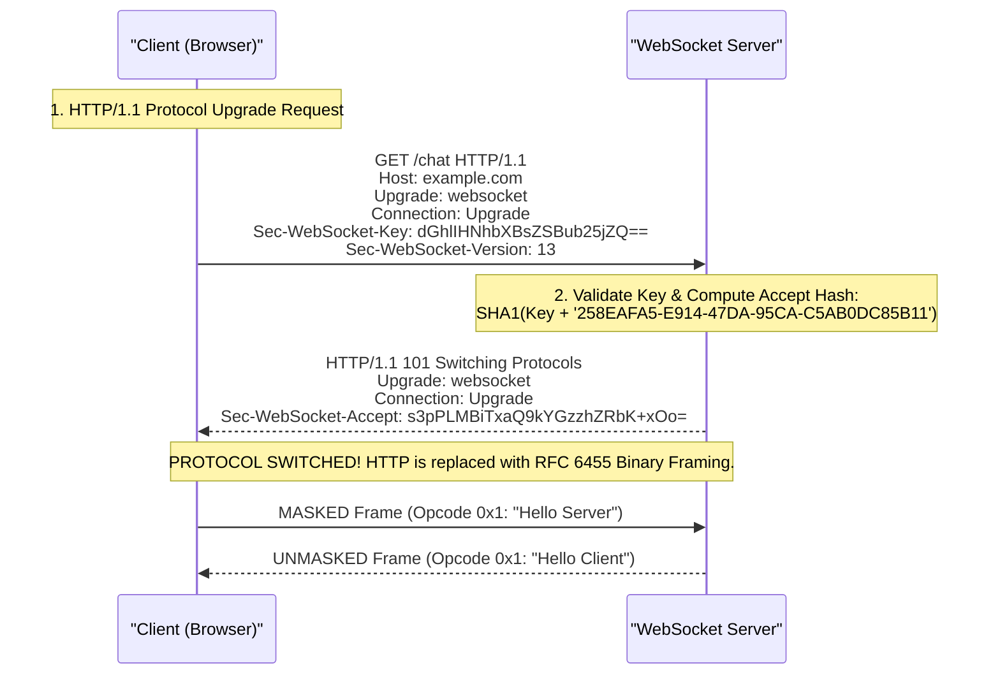
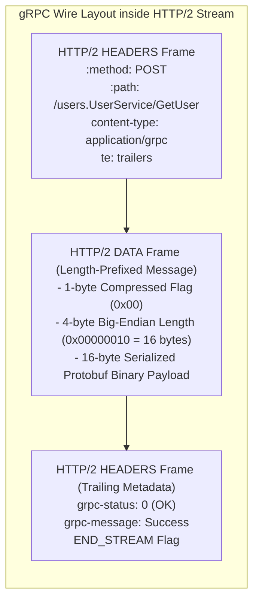
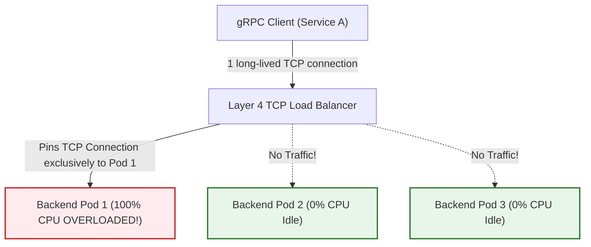

# Module 12: Real-Time Protocols: WebSockets, Server-Sent Events & gRPC

Traditional HTTP is built upon a client-initiated, request-response exchange model. However, modern interactive applications—collaborative editing, financial ticker feeds, push notifications, and high-frequency microservice communication—require bidirectional, low-latency streaming. This module examines the wire framing and cryptographic masking of the WebSocket protocol (RFC 6455), WebSockets over HTTP/2 (RFC 8441), Server-Sent Events (SSE), and the length-prefixed framing, trailing status codes, and Layer 4 load balancing pitfalls of **gRPC over HTTP/2**.

---

## 1. Real-Time Protocol Taxonomy

When architecting real-time streaming interfaces, engineers evaluate four primary communication models:

| Dimension | Long Polling | Server-Sent Events (SSE) | WebSockets (RFC 6455) | WebTransport (W3C/IETF) |
| :--- | :--- | :--- | :--- | :--- |
| **Transport** | TCP (HTTP/1.1) | TCP (HTTP/1.1 or HTTP/2) | TCP (RFC 6455 / RFC 8441) | **UDP (QUIC / HTTP/3)** |
| **Directionality** | Unidirectional poll/wait | **Server-to-Client only** | **Full Duplex (Bidirectional)** | **Full Duplex (Bidirectional)** |
| **Multiplexing** | No | Yes (over HTTP/2) | Yes (via RFC 8441) | **Yes (Native QUIC streams)** |
| **Reliability** | Reliable | Reliable | Reliable | **Reliable streams & Unreliable datagrams** |
| **Reconnection** | Manual app loop | **Automatic (`Last-Event-ID`)** | Manual app logic | Manual app logic |
| **Binary Support** | Base64 strings | Base64 strings | **Native typed arrays** | **Native typed arrays** |
| **Primary Use Case**| Legacy fallback | LLM token streaming, feeds | Chat, gaming, collaborative editing | High-speed gaming, live video |

---

## 2. WebSockets on the Wire: The RFC 6455 Upgrade & Framing

The WebSocket protocol (RFC 6455) provides full-duplex, bidirectional communication over a single long-lived TCP connection. It initiates as a standard HTTP/1.1 transaction and switches protocols dynamically.



### The Cryptographic Upgrade Handshake
To prevent accidental protocol upgrades caused by caching proxies, the handshake requires cryptographic proof of intent:
1. The client sends a randomized 16-byte base64-encoded string in `Sec-WebSocket-Key`.
2. The server concatenates this key with a globally fixed magic GUID string:
   $$\text{Magic GUID} = \texttt{"258EAFA5-E914-47DA-95CA-C5AB0DC85B11"}$$
3. The server computes the SHA-1 cryptographic hash of the concatenated string and returns it base64-encoded in `Sec-WebSocket-Accept`:
   $$\text{Accept Header} = \operatorname{Base64}(\operatorname{SHA-1}(\text{Sec-WebSocket-Key} + \text{Magic GUID}))$$
4. The client verifies the hash. If the hash matches, the connection transitions to raw binary framing.

---

## 3. WebSocket Binary Framing & Client Masking

Once established, data travels in binary-encoded WebSocket frames:

```
 0                   1                   2                   3
 0 1 2 3 4 5 6 7 8 9 0 1 2 3 4 5 6 7 8 9 0 1 2 3 4 5 6 7 8 9 0 1
+-+-+-+-+-------+-+-------------+-------------------------------+
|F|R|R|R| opcode|M| Payload len |    Extended payload length    |
|I|S|S|S|  (4)  |A|     (7)     |             (16/64)           |
|N|V|V|V|       |S|             |   (if payload len==126 or 127)|
| |1|2|3|       |K|             |                               |
+-+-+-+-+-------+-+-------------+ - - - - - - - - - - - - - - - +
|     Extended payload length continued, if payload len == 127  |
+ - - - - - - - - - - - - - - - +-------------------------------+
|                               |Masking-key, if MASK set to 1  |
+-------------------------------+-------------------------------+
| Masking-key (continued)       |          Payload Data         |
+-------------------------------- - - - - - - - - - - - - - - - +
:                     Payload Data continued ...                :
+---------------------------------------------------------------+
```

### Frame Fields Dissected
- **FIN (1 bit)**: Indicates this is the final fragment in a message. (Allows fragmenting massive messages).
- **Opcode (4 bits)**:
  - `0x0`: Continuation Frame
  - `0x1`: Text Frame (MUST be validated as strictly valid UTF-8)
  - `0x2`: Binary Frame (Arbitrary byte array)
  - `0x8`: Connection Close Frame
  - `0x9`: Ping Frame
  - `0xA`: Pong Frame
- **MASK (1 bit)**: Specifies whether the payload is XOR-masked.
  - **MANDATORY for all frames sent from Client to Server**. If a server receives an unmasked frame from a client, RFC 6455 mandates the server MUST drop the connection with Protocol Error `1002`.
  - **FORBIDDEN for frames sent from Server to Client**.
- **Payload Length (7 bits, 7+16 bits, or 7+64 bits)**:
  - $0 - 125$: Actual payload length in bytes.
  - $126$: Following 16 bits encode unsigned integer length ($\le 65,535\text{ bytes}$).
  - $127$: Following 64 bits encode unsigned 64-bit integer length.

### Why Client Masking is Mandatory: The Proxy Poisoning Defense
Why does the specification mandate XOR masking from client to server?
- **The Attack Vector**: In 2011, researchers discovered that malicious JavaScript in a browser could open a WebSocket to an attacker's server and transmit a payload crafted to look exactly like an HTTP/1.1 GET request (`GET /sensitive.html HTTP/1.1`).
- If an intermediate transparent enterprise caching proxy intercepted the traffic, the proxy mistook the raw WebSocket stream for a standard HTTP pipelined connection. The proxy cached the attacker's response, serving malicious content to innocent corporate users (**Cache Poisoning**).
- **The Defense**: The browser client generates a fresh, randomized 4-byte **Masking Key** ($M$) for every frame and XORs the payload bytes ($P$):
  $$D[i] = P[i] \oplus M[i \pmod 4]$$
Because the bytes on the wire appear as completely randomized entropy, no intermediate proxy can ever misidentify the payload as an HTTP command. The server XORs the bytes again with the same 4-byte key to recover the plaintext data.

---

## 4. WebSockets over HTTP/2 (RFC 8441) & HTTP/3 (RFC 9220)

In standard RFC 6455, every WebSocket consumes a dedicated TCP connection. If an application opens 5 WebSockets (e.g., chat, live notifications, real-time dashboard, presence), it wastes 5 TCP 3-way handshakes and 5 TLS handshakes.

**RFC 8441** specifies **Bootstrapping WebSockets with the HTTP/2 `CONNECT` Method**:

```http
:method: CONNECT
:protocol: websocket
:scheme: https
:authority: example.com
:path: /chat
sec-websocket-version: 13
sec-websocket-key: dGhlIHNhbXBsZSBub25jZQ==
```
- A client establishes a single shared HTTP/2 TCP connection.
- When opening a WebSocket, it sends a `HEADERS` frame using the `:protocol: websocket` pseudo-header.
- The server responds with `:status: 200`.
- The single HTTP/2 **Stream** transitions into an independent WebSocket channel.
- **Benefit**: Dozens of independent WebSockets share the **exact same single TCP + TLS connection**, interleaved alongside standard HTTP requests with zero handshake overhead!

---

## 5. Server-Sent Events (SSE) & LLM Token Streaming

For applications where communication is strictly unidirectional from server to client (e.g., streaming Large Language Model token generation or real-time metrics dashboards), **Server-Sent Events (SSE)** is vastly simpler and more resilient than WebSockets.

### Wire Formatting (`text/event-stream`)
An SSE connection is a standard persistent HTTP request (`GET`) returning `Content-Type: text/event-stream`:

```http
HTTP/1.1 200 OK
Content-Type: text/event-stream
Cache-Control: no-cache
Connection: keep-alive

event: update
id: 1042
data: {"temperature": 21.5, "unit": "C"}

event: token
id: 1043
data: Hello

event: token
id: 1044
data:  world!

```

### The Architectural Beauty of SSE
1. **Plain HTTP Semantics**: Operates natively over standard HTTP/1.1 and HTTP/2. Fully compatible with standard corporate firewalls, API gateways, load balancers, and authentication headers (`Bearer` tokens).
2. **Built-in Browser Resilience (`EventSource`)**: If the connection drops due to a network glitch:
   - The browser automatically waits (default 3 seconds) and reconnects.
   - The browser automatically passes the **`Last-Event-ID: 1044`** header on reconnection.
   - The server inspects the header, replays any events missed since ID 1044 from an in-memory queue, and resumes streaming with zero data loss!

---

## 6. gRPC over HTTP/2: Architecture & Wire Framing

**gRPC** (developed by Google) is a high-performance Remote Procedure Call (RPC) framework. Unlike REST/JSON APIs, gRPC relies on **Protocol Buffers (Protobuf)** for strict contract definitions and compact binary serialization, running exclusively over **HTTP/2**.



### The 5-Byte Length-Prefixed Message Framing
Unlike REST where an HTTP body contains a single JSON string, a single gRPC HTTP/2 stream can carry multiple request and response messages (Streaming RPC). Every gRPC message inside an HTTP/2 `DATA` frame begins with a **5-byte prefix**:
1. **Compressed-Flag (1 byte)**: `0` = Uncompressed; `1` = Compressed using algorithm specified in `grpc-encoding` (e.g., gzip or snappy).
2. **Message-Length (4 bytes)**: 32-bit unsigned integer (big-endian) specifying the exact byte size of the following Protocol Buffer payload.
3. **Message Data**: The raw binary Protocol Buffer serialized bytes.

### The Trailing Status Architecture (`grpc-status`)
Standard HTTP APIs return status codes in the initial response headers (`200 OK` or `500 Internal Server Error`).
- However, in long-running streaming RPCs, a server might stream 1,000 items successfully over 10 minutes before encountering a database failure on item 1,001.
- Because headers were sent 10 minutes ago, the server cannot change the HTTP status code.
- **The gRPC Solution**: The HTTP status code in the initial headers is **always `200 OK`**. The true operational outcome is delivered at the end of the stream in the **HTTP/2 Trailing Headers**:
  - **`grpc-status`**: Integer status code (`0` = OK, `1` = CANCELLED, `3` = INVALID_ARGUMENT, `4` = DEADLINE_EXCEEDED, `14` = UNAVAILABLE).
  - **`grpc-message`**: Error explanation string.

---

## 7. The gRPC Layer 4 Load Balancing Dilemma

A common and critical production failure occurs when engineering teams deploy gRPC microservices behind standard **Layer 4 (L4) TCP Load Balancers** (e.g., AWS NLB, standard Kubernetes ClusterIP, or classic round-robin TCP proxies):



### The Failure Mechanism
- In HTTP/1.1 REST, clients frequently open and close connections or make short requests across multiple connections.
- A gRPC client establishes a **single, persistent HTTP/2 TCP connection** upon boot and multiplexes thousands of RPCs across that single socket.
- An L4 load balancer routes at the *TCP packet layer*. It picks a backend node (Pod 1) during the initial TCP 3-way handshake and forwards all subsequent packets over that connection to Pod 1.
- **The Result**: Pod 1 receives 100% of all RPC traffic and crashes under load, while Pods 2 and 3 sit completely idle! Adding new pods via horizontal autoscaling provides zero relief because existing clients never open new TCP connections.

### 3 Production Solutions
1. **Layer 7 (L7) Reverse Proxy**: Deploy an L7 load balancer (e.g., Envoy, AWS ALB in gRPC mode, or Traefik) that terminates HTTP/2, parses individual gRPC stream requests, and balances RPCs round-robin across backend pods.
2. **Client-Side Load Balancing (gRPC Name Resolver)**: The gRPC client queries DNS or Kubernetes headless service endpoints directly, learns all backend pod IPs, opens persistent connections to all pods, and balances RPCs locally across them using a round-robin subchannel picker.
3. **`MAX_CONNECTION_AGE` Enforcement**: Servers configure a maximum connection lifetime (e.g., 5 minutes). When the timer expires, the server sends an HTTP/2 `GOAWAY` frame, prompting the client to gracefully reconnect and re-balance against the L4 load balancer.

---

## 8. Then vs. Now: Real-Time Communication Evolution

| Dimension | Legacy Practice (Then) | Modern Architecture (Now) | Rationale for Transition |
| :--- | :--- | :--- | :--- |
| **Bidirectional Comms**| Polling / Long Polling (opening continuous HTTP requests). | Full-duplex WebSockets (RFC 6455) or WebTransport (UDP). | Eliminates HTTP request header overhead ($1\text{ KB}$ per poll) and cuts latency to zero. |
| **WebSocket Transport**| 1 physical TCP connection per WebSocket session. | Multiplexing WebSockets over HTTP/2 (RFC 8441) streams. | Prevents port exhaustion and amortizes TLS handshakes across multiple app channels. |
| **Unidirectional Feeds**| WebSockets forced for one-way server-to-client updates. | Server-Sent Events (SSE) with `Last-Event-ID`. | WebSockets lack native HTTP authentication, caching, and automatic browser reconnection. |
| **Microservice RPC** | REST APIs exchanging textual JSON over HTTP/1.1. | gRPC exchanging binary Protocol Buffers over HTTP/2. | Protobuf serialization is 5-10x faster than JSON and enforces strict contract typing. |
| **gRPC Load Balancing**| Standard L4 TCP load balancing causing single-pod saturation. | L7 proxying (Envoy) or client-side headless subchannel picking. | Distributes individual RPC streams rather than coarse physical TCP sockets. |

---

## 9. Interview Drill: Questions & Model Answers

### Q1: Why does the WebSocket specification (RFC 6455) strictly require client-to-server frames to be masked, while server-to-client frames remain unmasked?
<details><summary>Answer</summary>

**Preventing Proxy Cache Poisoning Attacks.**
- If client frames were unmasked, malicious JavaScript running in a browser could open a WebSocket to an attacker's domain and transmit a payload carefully crafted to mimic an HTTP/1.1 GET request (`GET /target.html HTTP/1.1`).
- If an intermediate transparent corporate proxy or caching firewall inspected the link, it could misinterpret the byte stream as a valid HTTP pipelined request. The proxy would then cache the server's reply against `/target.html`, poisoning the cache and serving attacker content to other users on the network.
- **The XOR Masking Solution**: By forcing the client browser to XOR-mask every payload byte with a randomized 4-byte key generated per frame, the bytes on the wire appear as completely randomized entropy. No intermediate proxy can recognize patterns or misinterpret the stream as HTTP commands.
- Masking from server to client is unnecessary because clients do not act as transparent proxies to other downstream users.
- Ref: RFC 6455 Section 5.3; Huang et al., "Talking to Computers in Their Own Language: Vulnerabilities in Network Intermediaries".
</details>

### Q2: What is the gRPC Layer 4 load balancing problem, and how do client-side load balancing and Envoy proxies resolve it?
<details><summary>Answer</summary>

**HTTP/2 Long-Lived Connection Pinning.**
- gRPC uses HTTP/2, multiplexing hundreds of RPC calls over a **single long-lived TCP connection**.
- Layer 4 (L4) load balancers operate at the TCP layer. When a client connects, the L4 balancer assigns the TCP connection to a single backend pod. All subsequent RPC requests transmitted by that client traverse that exact same connection and land on the same pod.
- This creates severe load imbalance: one backend pod becomes saturated and crashes while other pods remain idle.
- **Solutions**:
  1. **Layer 7 (L7) Proxy (e.g., Envoy)**: The proxy terminates the client's HTTP/2 connection, inspects individual gRPC request frames, and balances individual streams across backend pods.
  2. **Client-Side Load Balancing**: The gRPC client queries a DNS headless service or service discovery registry, discovers all backend pod IPs, opens connections to each pod, and balances calls locally using an internal round-robin picker.
- Ref: gRPC Documentation ("Load Balancing in gRPC"); Envoy Proxy Architecture.
</details>

### Q3: How does the cryptographic handshake in RFC 6455 prove that a server actually understands the WebSocket protocol?
<details><summary>Answer</summary>

**The Sec-WebSocket-Key / Accept Verification.**
- The client generates a random 16-byte base64-encoded string and passes it in the `Sec-WebSocket-Key` header.
- If a server is just a standard HTTP server or misconfigured proxy that blindly echoes headers, it cannot complete the handshake.
- The specification dictates that a compliant WebSocket server MUST:
  1. Take the client's key string.
  2. Append the globally fixed magic GUID: `258EAFA5-E914-47DA-95CA-C5AB0DC85B11`.
  3. Compute the SHA-1 cryptographic hash of the combined string.
  4. Base64-encode the resulting binary hash and return it in `Sec-WebSocket-Accept`.
- The client verifies this computation. Only a server explicitly written to implement RFC 6455 will produce the correct hash, preventing accidental protocol confusion on misconfigured endpoints.
- Ref: RFC 6455 Section 1.3.
</details>

### Q4: Why are gRPC status codes (`grpc-status`) delivered in HTTP/2 Trailing Headers rather than standard initial response headers?
<details><summary>Answer</summary>

**Deferred Status in Long-Running Streams.**
- In REST/JSON APIs, requests are short transactions where success or failure is known immediately, so the status code (`200` or `500`) is returned in the initial header block.
- gRPC supports **Streaming RPCs** (e.g., server streaming thousands of database rows or real-time event logs).
- The initial HTTP/2 `HEADERS` frame must be sent immediately to open the stream and start delivering data. The server returns HTTP status `200 OK`.
- If an error occurs 5 minutes into the transfer (e.g., database timeout on record 40,000), the initial headers have already been transmitted and cannot be modified.
- By placing `grpc-status` in the **HTTP/2 Trailing Headers** (the final `HEADERS` frame terminating the stream with `END_STREAM`), the server can deliver rich error codes (`UNAVAILABLE`, `DEADLINE_EXCEEDED`) and error messages at the conclusion of any streaming interaction.
- Ref: gRPC Over HTTP/2 Protocol Specification; RFC 9113.
</details>

### Q5: Describe the architectural advantages of Server-Sent Events (SSE) over WebSockets for Large Language Model (LLM) token streaming.
<details><summary>Answer</summary>

**Simplicity, HTTP Infrastructure Compatibility, and Native Reconnection.**
1. **Unidirectional Match**: LLM token streaming is strictly unidirectional (prompt sent by client, tokens streamed from server to client); bidirectional WebSocket framing introduces unnecessary complexity.
2. **Standard HTTP/2 Compatibility**: SSE is standard HTTP (`text/event-stream`), so it natively traverses corporate firewalls, API gateways, load balancers, and authentication proxies without requiring protocol upgrades (`101 Switching Protocols`) or special proxy timeouts.
3. **Automatic Reconnection with State Resume**: The browser's native `EventSource` API automatically reconnects if the connection drops and sends the `Last-Event-ID` header, allowing the server to resume token delivery without application-layer reconnect logic.
4. **Header Compression**: Under HTTP/2, SSE benefits from HPACK header compression and native multiplexing over existing connection pools.
- Ref: W3C Server-Sent Events Recommendation; WHATWG HTML Standard Section 9.2.
</details>
