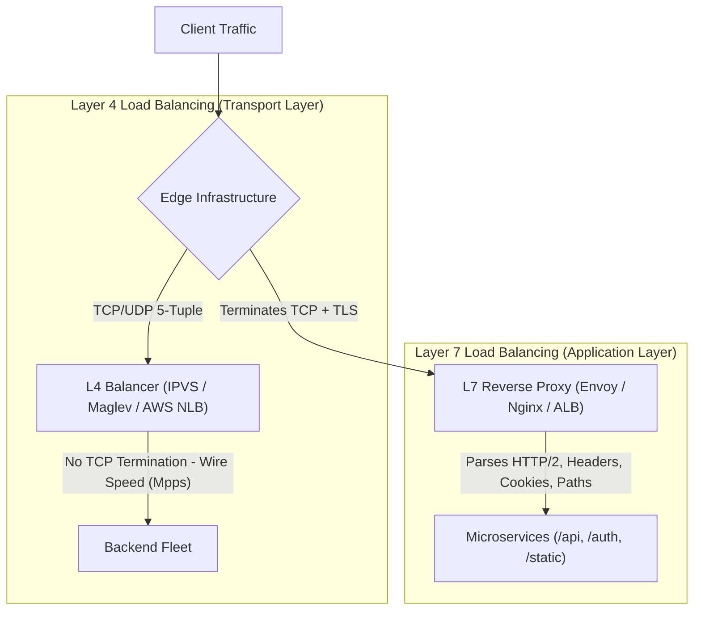
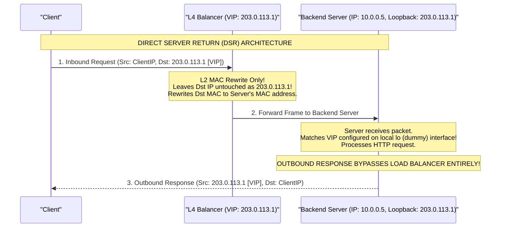
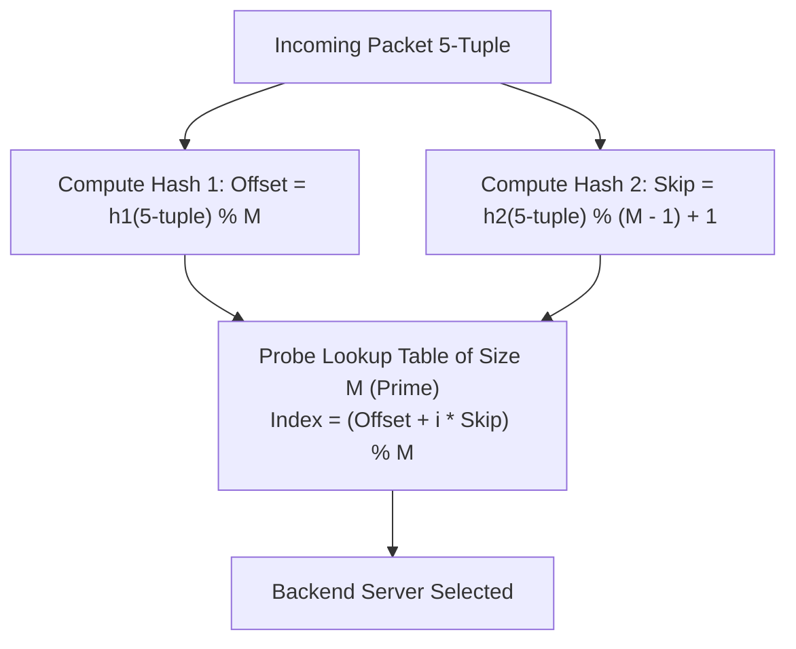
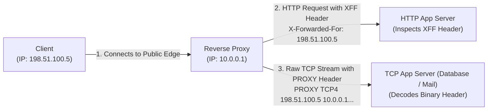
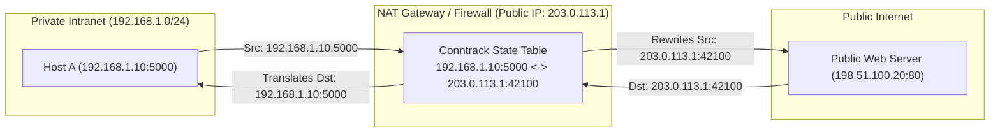

# Module 13: Edge Architecture: L4/L7 Load Balancing, CDNs & NAT Mechanics

Modern web and cloud architectures scale horizontally by distributing traffic across clusters of independent application servers. At the edge of the network, systems engineers balance traffic using two fundamentally different paradigms: **Layer 4 (Transport)** and **Layer 7 (Application)** load balancing. This module examines the mechanics of Layer 4 Direct Server Return (DSR), Google Maglev consistent hashing, Layer 7 reverse proxying and client IP preservation (PROXY protocol vs. `X-Forwarded-For` spoofing), RFC 9111 HTTP caching and CDN edge networks, and the connection tracking mechanics of Network Address Translation (NAT) traversal (STUN/TURN/ICE).

---

## 1. Layer 4 vs. Layer 7 Load Balancing Architecture

The fundamental architectural trade-off at the network edge is between **raw packet throughput** (Layer 4) and **application-aware routing intelligence** (Layer 7):



| Dimension | Layer 4 (Transport / L4) | Layer 7 (Application / L7) |
| :--- | :--- | :--- |
| **Inspection Scope** | IP 5-tuple: (Src IP, Dst IP, Src Port, Dst Port, Protocol) | Full HTTP message: URI path, Host, Headers, Cookies, Body |
| **TCP / TLS State** | **Does NOT terminate TCP or TLS**. Routes raw packets. | **Terminates TCP and TLS**. Maintains two independent sockets. |
| **Throughput & Speed** | Extremely fast: millions of packets/sec (Mpps); hardware offload. | Bound by CPU: parsing HTTP, decompressing HPACK, TLS crypto. |
| **Routing Capability** | IP and Port hashing; round-robin; least connections. | Content-based routing: `/api` $\to$ Service A, `/video` $\to$ Service B. |
| **Security & Logic** | SYN flood mitigation, L4 rate limiting. | WAF inspection, JWT authentication, rate limiting per user ID. |

---

## 2. Layer 4 Architectures: NAT vs. Direct Server Return (DSR)

When an L4 load balancer receives traffic for a public **Virtual IP (VIP)**, it forwards packets to backend real servers using one of two techniques:

### 1. Destination NAT (DNAT)
The load balancer rewrites the Destination IP from the public VIP to the backend server's private IP.
- **The Bottleneck**: When the backend server responds, its Source IP is its private IP. The response packet **MUST route back through the load balancer** so the load balancer can rewrite the Source IP back to the public VIP before sending it to the client.
- Because web traffic is heavily asymmetric (inbound requests are tiny, outbound responses are massive video, images, and JSON), the load balancer's egress bandwidth becomes the primary bottleneck of the entire datacenter.



### 2. Direct Server Return (DSR)
DSR completely eliminates the outbound bottleneck:
1. The load balancer receives the inbound packet destined for the public VIP (`203.0.113.1`).
2. The load balancer **leaves the IP header completely untouched**; it merely rewrites the **Layer 2 Destination MAC address** to point to the chosen backend server's network interface.
3. The backend server configures the public VIP on a local **loopback interface (`lo:0` or dummy interface)** and configures the kernel to **not respond to ARP requests for the VIP** (`arp_ignore = 1`, `arp_announce = 2`).
4. The backend server accepts the packet (because its loopback interface matches the Destination IP).
5. When the backend transmits the response, it sets the Source IP to the VIP and transmits the packet **directly out its local Internet gateway to the client, completely bypassing the load balancer!**
6. DSR allows a modest 10 Gbps load balancer cluster to support hundreds of gigabits per second of outbound application traffic.

---

## 3. Google Maglev Consistent Hashing

In massive cloud networks, Layer 4 load balancers run in software across commodity x86 servers. If a load balancer node crashes or a backend server is added, existing TCP connections must not be broken. Google solved this with the **Maglev Consistent Hashing Lookup Table (ACM EuroSys 2016)**.



### The Maglev Algorithm Principles
1. **Lookup Table of Size $M$**: Maglev establishes a lookup table of prime size $M$ (e.g., $M = 65,537$).
2. **Deterministic Permutation**: For each backend server $B_i$, Maglev generates a pseudo-random permutation of the integers $0 \dots M-1$ using two independent hash functions:
   $$\text{offset}_i = h_1(B_i) \pmod M$$
   $$\text{skip}_i = (h_2(B_i) \pmod{M - 1}) + 1$$
   The $j$-th entry in the permutation for server $B_i$ is:
   $$\text{perm}[i][j] = (\text{offset}_i + j \times \text{skip}_i) \pmod M$$
3. **Table Population**: Backends take turns filling empty slots in the master table according to their permutation preference.
4. **Minimal Disruption**: When a backend server is removed, only its specific slots are reassigned; all other backend mappings remain completely untouched. When an incoming packet arrives, hashing its 5-tuple points to the exact same backend across all independent Maglev load balancers without shared memory state!

---

## 4. Layer 7 Reverse Proxying & Client IP Preservation

When an L7 proxy (e.g., Envoy, Nginx, AWS ALB) terminates a client's TCP/TLS connection and establishes a new upstream connection to a backend application server, the backend observes the proxy's IP as the socket peer. Preserving the real client's IP is critical for security logging, rate limiting, and fraud prevention:



### The Two Client IP Preservation Mechanisms
1. **The `X-Forwarded-For` (XFF) Header (HTTP Only)**:
   The proxy appends the client's IP:
   ```http
   X-Forwarded-For: 198.51.100.5, 10.0.0.1
   ```
   - **The Security Vulnerability (XFF Spoofing)**: A malicious client can send a fake header: `X-Forwarded-For: 127.0.0.1`. If an application blindly reads the *first* IP in the list (`req.headers['x-forwarded-for'].split(',')[0]`), the attacker successfully bypasses IP authentication allowlists!
   - **The Rule of Trust**: An application MUST only trust the IP appended by a verified upstream proxy, parsing from right to left based on the number of configured trusted proxy hops.
2. **The PROXY Protocol (HAProxy Standard, Protocol-Agnostic)**:
   For non-HTTP protocols (PostgreSQL, Redis, SMTP) or encrypted TCP pass-through, headers cannot be modified. The **PROXY Protocol** prepends an unambiguous metadata header immediately following the TCP handshake before any application payload:
   - **Version 1 (Human-Readable ASCII)**:
     ```text
     PROXY TCP4 198.51.100.5 203.0.113.1 54210 443\r\n
     ```
   - **Version 2 (Binary 16-byte fixed header)**: Magic signature `0x0D0A0D0A000D0A515549540A`, address family, and raw 4-tuple binary addresses. The backend server parses the 16 bytes and sets the socket peer IP to the client.

---

## 5. Content Delivery Networks (CDNs) & RFC 9111 Caching

A **Content Delivery Network (CDN)** deploys hundreds of Points of Presence (PoPs) at the Internet's topological edge. By terminating user connections via BGP Anycast (Module 04) and serving cached assets directly from edge memory, CDNs eliminate long physical propagation delays.

### The RFC 9111 HTTP Caching Directives
HTTP responses declare caching constraints using the `Cache-Control` header:
- **`public`**: The response may be cached by any intermediate cache (CDNs, shared proxies, browsers).
- **`private`**: The response is personalized for a single user (e.g., account dashboard); it may be stored by the user's browser, but **MUST NOT be cached by a CDN or shared proxy**.
- **`max-age=<seconds>`**: Specifies the maximum duration (in seconds) the resource is considered fresh by client browsers.
- **`s-maxage=<seconds>`**: Overrides `max-age` exclusively for **shared caches (CDNs)**. (Allows caching for 1 day on CDN edge, but only 5 minutes in browser!).
- **`no-cache`**: The asset may be cached, but **MUST be revalidated with the origin server** (via `ETag` / `If-None-Match` returning `304 Not Modified`) before every single delivery.
- **`no-store`**: The asset must NEVER be written to storage or memory anywhere; fetch freshly from origin every time.

### Modern Caching: `stale-while-revalidate` (RFC 5861)
```http
Cache-Control: max-age=600, stale-while-revalidate=86400
```
1. For the first 600 seconds, the CDN serves the cached copy immediately.
2. Between 600 seconds and 86,400 seconds (the stale window), when a request arrives:
   - The CDN **serves the stale cached copy immediately to the user (0 ms latency!)**.
   - In the background, the CDN asynchronously dispatches a request to the origin server to refresh the cache.
   - Users never wait for slow origin database queries.

### The `Vary` Header Trap
The `Vary` header instructs caches that an asset's representation depends on specific client request headers (e.g., `Vary: Accept-Encoding` stores separate cached copies for gzip, br, and uncompressed).
- **The Fragmentation Failure**: Setting `Vary: User-Agent` tells the CDN to create an independent cache entry for every unique `User-Agent` string. Because there are millions of minor browser versions and operating system strings, the CDN cache fragments completely, dropping cache hit ratios from 98% to under 5%!

---

## 6. Network Address Translation (NAT) & Traversal (STUN / TURN / ICE)

IPv4 address exhaustion forced the global deployment of **Network Address Translation (NAT / RFC 4787 / RFC 5382)**. A residential router or enterprise firewall translates multiple private IP addresses (RFC 1918) into a single public routable IP by rewriting Layer 3 IP addresses and Layer 4 port numbers (**Network Address and Port Translation / NAPT**).



### The 4 NAT Variations
1. **Full Cone NAT (One-to-One)**: Once an internal address `(iAddr:iPort)` is mapped to an external `(eAddr:ePort)`, ANY external host can send packets to `(eAddr:ePort)` and they are forwarded inside.
2. **Restricted Cone NAT (Address-Restricted)**: External host `hAddr` can send to `(eAddr:ePort)` ONLY if the internal host previously sent a packet to `hAddr`.
3. **Port-Restricted Cone NAT**: External host `(hAddr:hPort)` can send to `(eAddr:ePort)` ONLY if the internal host previously sent a packet to that exact `(hAddr:hPort)`.
4. **Symmetric NAT**: The most restrictive. The NAT assigns a **different external mapping for every distinct destination host and port**. Direct Peer-to-Peer (P2P) hole punching is mathematically impossible.

### NAT Traversal Protocols
When two peer devices behind NATs need to establish direct peer-to-peer audio/video connections (e.g., WebRTC, VoIP):
- **STUN (Session Traversal Utilities for NAT / RFC 8489)**: The client contacts a public STUN server. The STUN server inspects the incoming UDP packet and tells the client its public reflected mapping `(eAddr:ePort)`. Works across Cone NATs (**Hole Punching**).
- **TURN (Traversal Using Relays around NAT / RFC 8656)**: When one or both clients are behind Symmetric NATs, hole punching fails. TURN provides a public relay server where both peers stream all media packets through the relay.
- **ICE (Interactive Connectivity Establishment / RFC 8445)**: The master framework. Gathers local candidates (LAN IPs), STUN candidates (public reflexive IPs), and TURN candidates (relay IPs), systematically probing candidate pairs to select the lowest-latency viable path.

---

## 7. Then vs. Now: Edge Infrastructure Evolution

| Dimension | Legacy Practice (Then) | Modern Architecture (Now) | Rationale for Transition |
| :--- | :--- | :--- | :--- |
| **L4 Architecture** | Two-way Destination NAT bottlenecks where all egress passes back through balancer. | Direct Server Return (DSR) using MAC rewrites and loopback VIPs. | Eliminates asymmetric outbound throughput bottlenecks on gigabit links. |
| **L4 Hashing** | Simple modulo hashing (`hash % N`) breaking all connections on backend changes. | Maglev Consistent Hashing lookup tables (prime $M$). | Provides connection stability and minimal flow disruption during server scaling. |
| **Client IP Tracking**| Reading untrusted `X-Forwarded-For` blindly. | Standardized PROXY Protocol v2 binary headers. | Prevents header spoofing attacks and supports non-HTTP transport protocols. |
| **Edge Caching** | Static TTL expiration forcing full synchronous origin refetches. | `stale-while-revalidate` (RFC 5861) serving edge cache with background refresh. | Cuts origin load to zero and delivers instant sub-millisecond response latency. |

---

## 8. Interview Drill: Questions & Model Answers

### Q1: Explain how Direct Server Return (DSR) operates in a Layer 4 load balancer, and why it is vastly more scalable than standard Destination NAT.
<details><summary>Answer</summary>

**Asymmetric Egress Bypass via Layer 2 MAC Rewriting.**
- In standard Destination NAT, the load balancer rewrites the packet's destination IP to the backend server. The backend server's response must pass back through the load balancer so the balancer can rewrite the source IP back to the VIP. Because outbound web traffic is orders of magnitude larger than inbound requests (e.g., a 100-byte GET producing a 10 MB video stream), the load balancer's egress bandwidth saturates quickly.
- **DSR Mechanics**:
  1. The load balancer receives the packet destined for the VIP.
  2. The load balancer leaves the IP header completely untouched (`Dst IP = VIP`). It rewrites only the **Layer 2 Destination MAC address** to match the chosen backend server.
  3. The backend server configures the public VIP on a local loopback (`lo`) or dummy interface and sets `arp_ignore=1` so it does not respond to ARP queries for the VIP.
  4. The backend accepts the frame because its local loopback interface owns the VIP.
  5. When transmitting the response, the backend routes the packet **directly to its default gateway to the client**, completely bypassing the load balancer.
- The load balancer only processes tiny inbound request packets, allowing a single load balancer to manage tens of gigabits of application traffic.
- Ref: Linux Virtual Server (IPVS) Documentation; Eisenbud et al., "Maglev: A Fast and Reliable Software Network Load Balancer".
</details>

### Q2: What is an `X-Forwarded-For` spoofing vulnerability, and how should an application server safely extract the real client IP?
<details><summary>Answer</summary>

**Blind Leftmost Header Parsing Vulnerability.**
- An HTTP reverse proxy appends the immediate client's IP to the end of the comma-separated `X-Forwarded-For` (XFF) header:
  `X-Forwarded-For: client, proxy1, proxy2`
- If an attacker sends an initial request with a forged header:
  `X-Forwarded-For: 127.0.0.1`
  The proxy appends the attacker's real IP (`198.51.100.5`), resulting in:
  `X-Forwarded-For: 127.0.0.1, 198.51.100.5`
- If the application naively reads the *first* IP in the string (`split(',')[0]`), it assumes the client is `127.0.0.1`, bypassing admin allowlists or rate limiters.
- **The Safe Extraction Rule**: The application must parse from **right to left**. If the application knows it sits behind exactly $N$ trusted proxies (e.g., $N=1$ for AWS ALB), it counts $N$ hops from the right end of the header and takes the IP immediately preceding the trusted hops. Alternatively, deployments should use the binary **PROXY Protocol v2**, which cannot be manipulated by client HTTP headers.
- Ref: RFC 7239; OWASP API Security Top 10.
</details>

### Q3: In HTTP caching (RFC 9111), what is the difference between `no-cache` and `no-store`?
<details><summary>Answer</summary>

**Revalidation Mandate vs. Absolute Non-Persistence.**
- **`no-cache`**: Does **NOT** mean "do not cache". It means the cache (browser or CDN) **MAY store the response**, but it **MUST NOT use the cached response to satisfy subsequent requests without successfully revalidating it with the origin server first** (using conditional headers like `If-None-Match: <ETag>`). If the server returns `304 Not Modified`, the cache serves the stored copy without re-transmitting the body.
- **`no-store`**: Means **do not write this response to disk or persistent storage under any circumstances**. Caches and browsers must completely discard the data immediately after streaming it to the user. Every subsequent request MUST fetch the entire asset from the origin server from scratch. Used for sensitive personal data, passwords, and banking APIs.
- Ref: RFC 9111 Section 5.2.2.4 & 5.2.2.5.
</details>

### Q4: How does the Maglev consistent hashing algorithm maintain connection affinity to backend servers without storing connection tracking state in memory?
<details><summary>Answer</summary>

**Deterministic Permutation Hashing Across Prime Tables.**
- Maglev establishes a lookup table of prime size $M$ (e.g., 65,537 slots).
- For each backend server $B_i$, it computes two independent hash values to produce a pseudo-random permutation sequence of table slots:
  $$\text{offset} = h_1(B_i) \pmod M, \quad \text{skip} = (h_2(B_i) \pmod{M - 1}) + 1$$
- The servers take turns filling empty slots in the master table according to their permutation preferences until all $M$ slots are filled.
- When a packet arrives at *any* Maglev node, the node computes the hash of the packet's 5-tuple:
  $$\text{Index} = \operatorname{Hash}(\text{5-tuple}) \pmod M$$
- The entry at that index directly specifies the backend server.
- Because all Maglev nodes compute the exact same mathematical table, every node maps the packet to the identical backend without communicating with each other. If a backend fails, its slots are evenly redistributed among remaining backends, leaving all other backend assignments intact.
- Ref: Eisenbud et al., "Maglev: A Fast and Reliable Software Network Load Balancer", Google (ACM EuroSys 2016).
</details>

### Q5: Why is WebRTC peer-to-peer media streaming impossible between two clients that are both behind Symmetric NATs using only STUN? What protocol is required as a fallback?
<details><summary>Answer</summary>

**Dynamic Mapping per Destination Tuple.**
- Under a **Symmetric NAT**, the gateway assigns a *different* public external port mapping for every distinct destination IP and port that the internal host connects to.
- When Client $A$ contacts a STUN server to discover its public mapping, the Symmetric NAT maps Client $A$'s internal socket to External Port $P_1$ (for the STUN server).
- When Client $A$ attempts to send media to Client $B$, the Symmetric NAT allocates a completely new, unpredictable external port $P_2$ for Client $B$.
- Client $B$ attempts to send packets to Port $P_1$ (which it learned via signaling), but Client $A$'s NAT drops them because Port $P_1$ was authorized exclusively for communication with the STUN server.
- Because both clients have randomized, unpredictable port mappings, UDP hole punching fails completely.
- **Required Fallback**: The connection must fall back to **TURN (Traversal Using Relays around NAT / RFC 8656)**, where both clients connect outbound to a shared public relay server that forwards media packets bidirectionally between them.
- Ref: RFC 4787; RFC 8656; RFC 8445.
</details>
