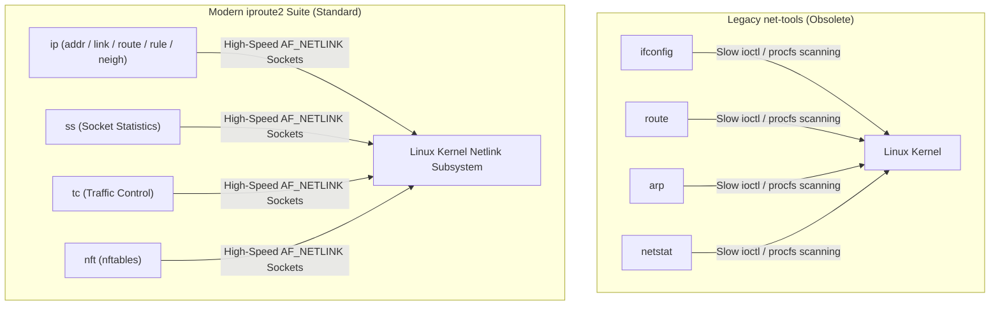
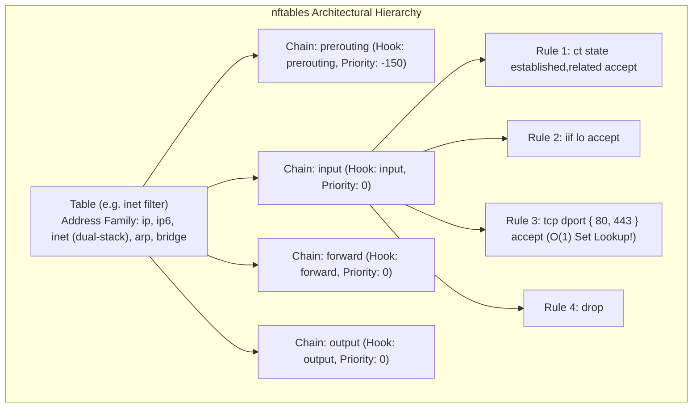
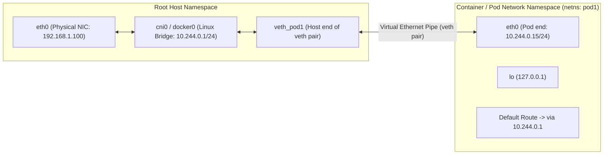
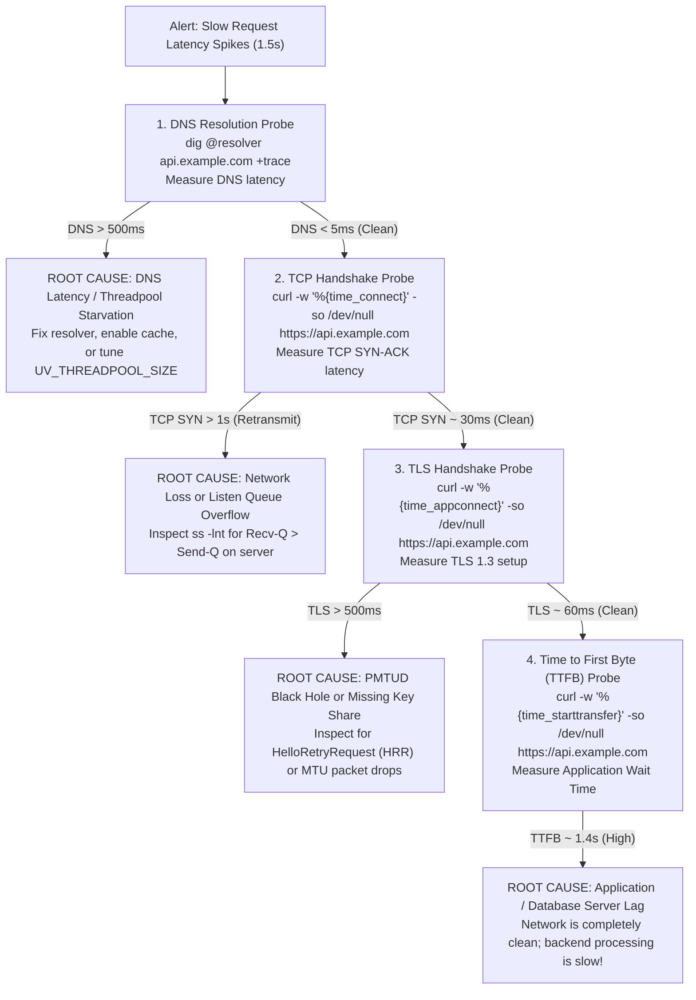

# Module 14: Linux Network Operations, Packet Diagnostics & Troubleshooting Runbooks

Operating systems software engineering requires bridging high-level network theory with the concrete diagnostic tools provided by the Linux kernel. A staff engineer diagnosing a production latency regression or packet drop must navigate kernel socket queues, interface ring buffers, Berkeley Packet Filters (BPF), network namespaces, traffic shaping, and firewall connection tracking tables. This module provides an exhaustive operational reference for the modern Linux network stack: replacing legacy `net-tools` with `iproute2`, deep socket diagnostics via `ss`, packet dissection with `tcpdump` BPF primitives, `nftables` and `conntrack` mechanics, container networking via `veth` pairs in network namespaces, and a deterministic step-by-step troubleshooting runbook decomposing latency into DNS, TCP, TLS, and application processing phases.

---

## 1. Modern Interface & Routing Management: `iproute2`

For over twenty years, system administrators relied on the `net-tools` suite (`ifconfig`, `route`, `arp`, `netstat`). These tools interact with the kernel via obsolete `ioctl()` system calls, cannot display modern routing tables, cannot manage network namespaces, and were declared obsolete in the Linux kernel in 2001.

The standard Linux network management utility suite is **`iproute2`**, communicating directly with kernel subsystems over the high-speed **Netlink IPC socket protocol (`AF_NETLINK`)**.



### The 5 Core `ip` Command Categories

| Command & Subcommand | Functional Purpose | Equivalent Legacy Command |
| :--- | :--- | :--- |
| **`ip addr show [dev]`** | Displays and configures IPv4/IPv6 addresses, flags, and broadcast scopes. | `ifconfig` |
| **`ip link set dev <name> up/down`** | Manages physical/virtual link state, MTU, and promiscuous mode. | `ifconfig <name> up/down` |
| **`ip route show [table <id>]`** | Displays and manages kernel routing tables, multipath ECMP, and metrics. | `route -n` |
| **`ip rule show`** | Inspects and manages the Routing Policy Database (RPDB) for policy routing. | *No legacy equivalent* |
| **`ip neigh show [dev]`** | Displays and manipulates ARP (IPv4) and NDP (IPv6) neighbor caches. | `arp -n` |

### Essential `iproute2` Operational Commands
```bash
# 1. Assign IP address and CIDR mask to interface
ip addr add 192.168.10.50/24 dev eth0

# 2. Modify interface MTU (e.g., enabling 9000-byte Jumbo frames)
ip link set dev eth0 mtu 9000

# 3. Add a static network route via a specific gateway
ip route add 10.20.0.0/16 via 192.168.10.1 dev eth0

# 4. Configure Equal-Cost Multi-Path (ECMP) over dual gateways
ip route add default scope global \
    nexthop via 192.168.10.1 dev eth0 weight 1 \
    nexthop via 10.0.0.1 dev eth1 weight 1

# 5. Flush a corrupted neighbor (ARP) cache entry
ip neigh flush dev eth0
```

---

## 2. Advanced Socket Diagnostics: Deciphering `ss`

The `ss` (Socket Statistics) command inspects internal kernel socket data structures directly via Netlink (`sock_diag`), executing orders of magnitude faster than `netstat` (which crawled `/proc/net/tcp` line-by-line).

```bash
ss -tanpi '( dport = :443 or sport = :443 )'
```
Flags:
- `-t`: TCP sockets (`-u` for UDP).
- `-a`: All sockets (listening and established).
- `-n`: Numeric output (do not resolve IP to hostname or port to service name).
- `-p`: Show process name and Process ID (PID) owning the socket.
- `-i`: Display internal kernel TCP metrics (`cwnd`, `rtt`, `pacing_rate`, `retrans`).

### The Critical Semantic Difference: Recv-Q & Send-Q
The interpretation of the `Recv-Q` and `Send-Q` columns in `ss` **inverts completely** depending on whether the socket is in the `LISTEN` state or the `ESTABLISHED` state!

```
LISTEN Sockets (e.g. ss -lnt):
  State   Recv-Q  Send-Q  Local Address:Port
  LISTEN  129     128     0.0.0.0:80
          ▲       ▲
          │       └── Send-Q = Maximum Backlog Limit (min(listen_backlog, somaxconn))
          └────────── Recv-Q = Current completed 3-way handshakes awaiting accept()
          * Recv-Q > Send-Q indicates ACCEPT QUEUE OVERFLOW! Clients experiencing latency!

ESTABLISHED Sockets (e.g. ss -nt):
  State   Recv-Q  Send-Q  Local Address:Port
  ESTAB   0       65420   192.168.1.10:48912   203.0.113.10:443
          ▲       ▲
          │       └── Send-Q = Bytes buffered in kernel, SENT but UNACKNOWLEDGED by remote peer
          └────────── Recv-Q = Bytes received from remote peer, BUFFERED awaiting app read()
          * High Recv-Q = Application thread is blocked or slow at reading!
          * High Send-Q = Network bottleneck or remote receiver window rwnd is full!
```

---

## 3. Packet Capturing & Berkeley Packet Filters (BPF)

When diagnosing network anomalies, raw packet captures provide ground-truth evidence. **`tcpdump`** captures packets from kernel memory using the `libpcap` library and the Linux kernel's in-socket **Berkeley Packet Filter (cBPF / eBPF)** virtual machine.

```bash
# Capture full uncompressed packets on interface eth0, skipping DNS resolution, writing to file
tcpdump -i eth0 -nn -s0 -w /tmp/incident.pcap "tcp port 443"
```
- `-i eth0`: Listen on interface `eth0` (`-i any` captures on all interfaces, but disables hardware offloading).
- `-nn`: Do not resolve hostnames (prevents `tcpdump` from generating its own DNS queries during an outage!) and do not resolve port numbers.
- `-s0`: Snapshot length 0 captures the entire unclipped packet (`snaplen = 262144`).
- `-w file.pcap`: Writes raw binary pcap to disk for offline Wireshark analysis.

### Advanced BPF Filter Primitives
Berkeley Packet Filter expressions execute inside kernel space *before* packets are copied to user space, eliminating CPU overhead for filtered traffic:

```bash
# 1. Filter SYN packets without ACK (Detecting new incoming connection attempts)
tcpdump -nn "tcp[tcpflags] & (tcp-syn) != 0 and tcp[tcpflags] & (tcp-ack) == 0"

# 2. Filter TCP RST packets (Hunting connection resets)
tcpdump -nn "tcp[tcpflags] & (tcp-rst) != 0"

# 3. Filter packets matching TTL = 1 (Traceroute probes or routing loops)
tcpdump -nn "ip[8] == 1"

# 4. Filter DNS queries directed to port 53 excluding local resolver
tcpdump -nn "udp port 53 and not host 127.0.0.1"
```

---

## 4. Modern Firewalling: `nftables` & `conntrack` Mechanics

Introduced in Linux 3.13, **`nftables`** replaced the legacy `iptables`, `ip6tables`, `arptables`, and `ebtables` tools with a unified, bytecode-driven packet classification engine.



### Why `nftables` Outperforms `iptables`
1. **Unified Dual-Stack Tables (`inet`)**: A single table handles both IPv4 and IPv6 simultaneously, eliminating duplicated rulesets across `iptables` and `ip6tables`.
2. **$O(1)$ Native Sets & Dictionaries**: In `iptables`, matching 100 ports or 500 IP addresses required 500 sequential linear rule evaluations ($O(N)$). In `nftables`, sets (`tcp dport { 80, 443, 8000-8080 }`) are evaluated in **$O(1)$ constant time** using kernel red-black trees or hash tables.
3. **Atomic Ruleset Swaps**: Updating rules in `nftables` executes as an atomic kernel transaction; packets are never evaluated against half-applied rulesets.

### The Connection Tracking Table: `conntrack`
Stateful firewall rules (`ct state established,related accept`) and NAT depend on the kernel's **`nf_conntrack`** subsystem. Every active flow occupies a memory entry in the connection tracking table:

```bash
# View active conntrack flows
conntrack -L -p tcp
# tcp 6 431999 ESTABLISHED src=192.168.1.10 dst=203.0.113.5 sport=54210 dport=443 [ASSURED] ...
```

### The Production Failure Mode: Conntrack Table Full
On NAT gateways, Kubernetes nodes, or servers subjected to high-volume UDP traffic (e.g., DNS or WebRTC):
- If the number of concurrent connections exceeds the configured maximum, the kernel logs:
  ```text
  nf_conntrack: table full, dropping packet
  ```
- **The Failure**: The kernel drops incoming packets immediately, regardless of whether CPU or memory is saturated!
- **Inspection & Tuning**:
  ```bash
  # Check current entries vs maximum limit
  sysctl net.netfilter.nf_conntrack_count
  sysctl net.netfilter.nf_conntrack_max

  # Increase conntrack table size
  sysctl -w net.netfilter.nf_conntrack_max=1048576
  ```

---

## 5. Network Isolation: Namespaces (`netns`) & Virtual Ethernet (`veth`)

Container runtimes (Docker, Podman, Kubernetes) achieve network isolation using Linux **Network Namespaces (`netns`)**. A network namespace provides an independent, isolated copy of the network stack: its own interfaces, IP addresses, routing tables, socket lists, and firewall rules.



### Building a Container Network Pair from Scratch
A **Virtual Ethernet (`veth`) pair** acts as a virtual bidirectional cable: packets injected into one end emerge immediately out of the peer interface:

```bash
# 1. Create an isolated network namespace
ip netns add worker-ns

# 2. Create a veth pair (veth-host <--> veth-container)
ip link add veth-host type veth peer name veth-worker

# 3. Move the worker interface into the isolated namespace
ip link set veth-worker netns worker-ns

# 4. Configure interfaces and IP addresses
ip addr add 10.100.1.1/24 dev veth-host
ip link set dev veth-host up

ip netns exec worker-ns ip addr add 10.100.1.2/24 dev veth-worker
ip netns exec worker-ns ip link set dev veth-worker up
ip netns exec worker-ns ip link set dev lo up

# 5. Add default gateway inside the namespace
ip netns exec worker-ns ip route add default via 10.100.1.1

# 6. Verify end-to-end ping across the namespace boundary!
ip netns exec worker-ns ping -c 2 10.100.1.1
```

---

## 6. Traffic Control (`tc`) & Network Emulation (`netem`)

To test how applications behave under degraded network conditions (e.g., testing QUIC connection migration or TCP CUBIC behavior on lossy satellite links), engineers use the Linux **Traffic Control (`tc`)** subsystem and the **`netem` (Network Emulation)** queuing discipline (`qdisc`).

```bash
# 1. Add 100 ms of deterministic latency with 10 ms jitter to eth0
tc qdisc add dev eth0 root netem delay 100ms 10ms

# 2. Add 2% random packet loss
tc qdisc change dev eth0 root netem delay 100ms 10ms loss 2%

# 3. Simulate packet reordering (25% of packets delayed by 10ms)
tc qdisc change dev eth0 root netem reorder 25% 50% delay 10ms

# 4. Rate-limit interface bandwidth to 10 Mbps using Token Bucket Filter (tbf)
tc qdisc add dev eth0 root tbf rate 10mbit burst 32kbit latency 400ms

# 5. Delete all traffic control rules (reset to default pfifo_fast / fq)
tc qdisc del dev eth0 root
```

---

## 7. The End-to-End Network Troubleshooting Runbook

When an engineer receives an alert stating *"Service API latency has spiked to 1.5 seconds"*, naive engineers jump to guessing application code. A systematic network engineer applies the **Deterministic Layered Troubleshooting Runbook**:



### The `curl -w` Precision Timing Breakdown
A single command exposes the exact millisecond timing of each protocol layer:

```bash
curl -w @- -o /dev/null -s https://api.example.com <<'EOF'
    DNS Lookup Time:        %{time_namelookup} s
    TCP Connect Time:       %{time_connect} s
    TLS AppConnect Time:    %{time_appconnect} s
    Time to First Byte:     %{time_starttransfer} s
    ---------------------------------------------
    Total Request Time:     %{time_total} s
EOF
```

```text
Output Interpretation:
    DNS Lookup Time:        0.004 s  (4 ms   - DNS cache hit)
    TCP Connect Time:       0.038 s  (34 ms  - 1-RTT physical TCP handshake)
    TLS AppConnect Time:    0.072 s  (34 ms  - 1-RTT TLS 1.3 handshake)
    Time to First Byte:     1.450 s  (1,378 ms - SERVER APPLICATION PROCESSING TIME!)
    ---------------------------------------------
    Total Request Time:     1.455 s
```
- **Conclusion**: The network transport (DNS, TCP, TLS) took a combined total of **$72\text{ ms}$**. The remaining **$1,378\text{ ms}$** was spent by the server application executing database queries. The network is completely exonerated in under 5 seconds!

---

## 8. Then vs. Now: Linux Networking Ops Evolution

| Dimension | Legacy Practice (Then) | Modern Architecture (Now) | Rationale for Transition |
| :--- | :--- | :--- | :--- |
| **Interface Config** | `ifconfig` and `route` using slow `ioctl()` system calls. | `iproute2` (`ip addr`, `ip route`) via Netlink sockets. | Supports policy routing, VRFs, namespaces, and modern tunneling. |
| **Socket Inspection**| `netstat` scanning textual `/proc/net/tcp` entries ($O(N)$). | `ss` querying kernel Netlink `sock_diag` binary subsystem. | Prevents multi-minute server hangs when scanning 100,000+ active connections. |
| **Firewall Rules** | `iptables` linear rule scanning ($O(N)$ CPU scaling). | `nftables` bytecode execution with $O(1)$ set matching. | Drastically reduces packet processing CPU overhead under complex firewall rulesets. |
| **Container Networking**| Physical VLAN tagging or heavy user-space tap interfaces. | Linux Network Namespaces (`netns`) and `veth` pairs. | Zero-overhead lightweight kernel virtualization of network stacks. |
| **Traffic Emulation**| Physical hardware network delay generators or external testboxes. | In-kernel `tc qdisc` with `netem` delay, loss, and jitter injection. | Enables fully automated, programmatic CI/CD integration testing of network resilience. |

---

## 9. Interview Drill: Questions & Model Answers

### Q1: In the output of `ss -lnt`, what do the `Recv-Q` and `Send-Q` columns indicate? How does this differ from their meaning on an established connection?
<details><summary>Answer</summary>

**Inversion Between Listening and Established Sockets.**
- **On a `LISTEN` socket (`ss -lnt`)**:
  - `Send-Q`: The configured maximum **Accept Queue (backlog) limit**, determined by $\min(\text{backlog}, \text{sysctl } \texttt{net.core.somaxconn})$.
  - `Recv-Q`: The current number of completed 3-way handshakes waiting in the Accept Queue for the application process to call `accept()`.
  - *If `Recv-Q > Send-Q`, the Accept Queue is overflowing, and the kernel is dropping incoming connections.*
- **On an `ESTABLISHED` socket (`ss -nt`)**:
  - `Send-Q`: The number of bytes queued in kernel memory that have been sent but **not yet acknowledged (ACKed)** by the remote peer.
  - `Recv-Q`: The number of bytes received from the remote peer that are queued in kernel memory **waiting for the local application to read them**.
- Ref: Linux `ss` manual; Kerrisk, "The Linux Programming Interface", Chapter 59.
</details>

### Q2: Why does `nftables` evaluate sets of hundreds of IP addresses in $O(1)$ constant time while legacy `iptables` degrades linearly ($O(N)$)?
<details><summary>Answer</summary>

**Native Kernel Set Structures vs. Linear Chain Traversal.**
- In legacy `iptables`, if an operator blocked 1,000 IP addresses, `iptables` appended 1,000 discrete rules to the `INPUT` chain. Every incoming packet was evaluated against each rule sequentially until a match was found (linear search, $O(N)$ complexity). Under heavy traffic, traversing thousands of rules per packet consumed enormous CPU time.
- In `nftables`, sets (`ip saddr { 192.0.2.1, 198.51.100.0/24, ... }`) are built directly into the kernel syntax as first-class primitives.
- The kernel stores set elements in optimized data structures—either **Red-Black balanced search trees** (for ranges/intervals) or **hash tables** (for exact IP/port matches).
- When a packet arrives, `nftables` performs a single $O(1)$ hash table lookup or $O(\log N)$ tree search, completely eliminating linear chain traversal bottlenecks.
- Ref: Netfilter Core Team, "nftables Architecture Documentation"; LWN, "The State of nftables".
</details>

### Q3: An infrastructure engineer notices that a high-traffic NAT gateway is dropping UDP packets, yet CPU utilization is at 15% and network bandwidth is at 20% of capacity. Kernel dmesg logs: `nf_conntrack: table full, dropping packet`. What is the root cause and remedy?
<details><summary>Answer</summary>

**Connection Tracking Table Saturation.**
- Every stateful network flow traversing a Linux firewall or NAT gateway creates an entry in the kernel's connection tracking hash table (`nf_conntrack`).
- Under high-volume UDP traffic (such as DNS queries or WebRTC streams), because UDP is connectionless, the kernel assigns a conservative timeout (default 30 seconds) before purging idle UDP entries.
- If the rate of new UDP flows exceeds the expiration rate, the table reaches its capacity ceiling defined by `net.netfilter.nf_conntrack_max`.
- Once full, the kernel refuses to allocate new tracking entries and **drops all subsequent packets immediately**, regardless of free CPU or bandwidth capacity.
- **Remedies**:
  1. Increase table size: `sysctl -w net.netfilter.nf_conntrack_max=1048576`.
  2. Reduce idle UDP timeouts: `sysctl -w net.netfilter.nf_conntrack_udp_timeout=10`.
  3. Bypass connection tracking for trusted stateless traffic using the `NOTRACK` target in `raw` tables: `nft add rule inet raw prerouting udp dport 53 notrack`.
- Ref: Netfilter conntrack documentation; Cloudflare, "Conntrack Tales: One Million Connections".
</details>

### Q4: How do virtual ethernet (`veth`) pairs and network namespaces (`netns`) enable network isolation in container runtimes like Docker and Kubernetes?
<details><summary>Answer</summary>

**Virtual Point-to-Point Cable Bridging Namespaces.**
- A Linux **Network Namespace (`netns`)** provides an isolated instance of the network subsystem, containing its own private loopback interface, routing table, firewall rules, and socket list.
- A **`veth` pair** is a pair of interconnected virtual Ethernet interfaces that act like a two-ended physical Ethernet cable. Packets transmitted into one interface instantly emerge as ingress packets on the peer interface.
- **Container Architecture**:
  1. The container runtime creates a new namespace for the container (`pod1-ns`).
  2. The runtime creates a `veth` pair: `veth-host` and `veth-container`.
  3. `veth-container` is moved into `pod1-ns`, renamed to `eth0`, and assigned the container's private IP (e.g., `10.244.0.15`).
  4. `veth-host` remains in the root host namespace and is plugged into a virtual Linux bridge (`cni0` or `docker0`).
  5. The container configures its default route pointing to the bridge IP, routing all container traffic across the virtual ethernet boundary cleanly and securely.
- Ref: Linux kernel documentation (`Documentation/networking/veth.rst`); Kubernetes CNI Specification.
</details>

### Q5: In the `curl -w` diagnostic breakdown, what does a large discrepancy between `time_appconnect` and `time_starttransfer` indicate?
<details><summary>Answer</summary>

**Application Server Processing Bottleneck (TTFB).**
- `time_appconnect`: The timestamp (in seconds) when the **TLS handshake completes** (the secure transport pipe is fully established and the HTTP request has been sent).
- `time_starttransfer`: The timestamp when the client receives the **very first byte of the HTTP response headers** (Time to First Byte / TTFB).
- The difference ($\text{time\_starttransfer} - \text{time\_appconnect}$) measures the exact duration the server spent processing the request: reading backend database rows, running application code, or calling external APIs.
- If `time_appconnect` is small (e.g., 50 ms) and `time_starttransfer` is large (e.g., 1.8 seconds), it proves definitively that **the network, routing, TCP, and TLS layers are completely healthy**, and the latency problem resides entirely within the backend application server or database.
- Ref: curl manual (`curl --write-out`); High Performance Browser Networking.
</details>
